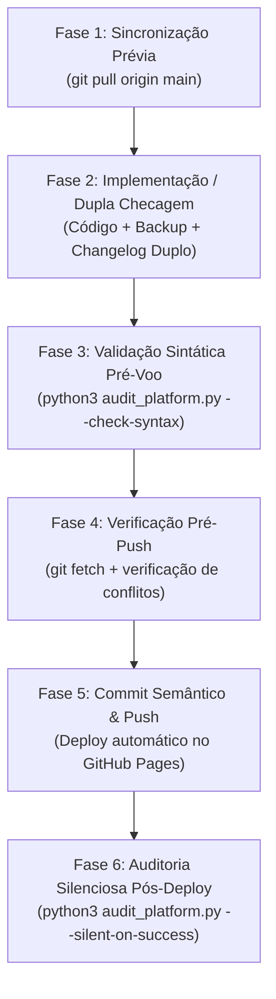

# WORKFLOW PADRÃO DE DESENVOLVIMENTO COLABORATIVO (ANTIGRAVITY + GITHUB)

Este documento define o fluxo operacional oficial de trabalho conjunto no projeto **Gestor Supervisão Patos** (`supervisao-st-crianca`), unindo o **Antigravity (Assistente de IA)** e o **GitHub** para permitir desenvolvimento simultâneo e independente sem perda de código nem conflitos.

---

## 1. Dados do Projeto e Repositório Oficial
- **Repositório GitHub:** [https://github.com/silvabrun0/supervisao-st-crianca](https://github.com/silvabrun0/supervisao-st-crianca)
- **Branch Principal de Produção:** `main`
- **Hosting URL Oficial (GitHub Pages):** [https://silvabrun0.github.io/supervisao-st-crianca/](https://silvabrun0.github.io/supervisao-st-crianca/)
- **Hosting URL Alternativo (Firebase):** [https://supervisao-st-crianca.web.app](https://supervisao-st-crianca.web.app)

---

## 2. A Regra de Ouro da Colaboração (Pré e Pós Ação)

Para que múltiplos desenvolvedores e agentes trabalhem com segurança sem sobrescrever alterações do outro:
1. **SEMPRE PUXAR ANTES DE COMEÇAR (`git pull origin main`):** Antes de planejar ou aplicar código novo, sincronize com o repositório remoto para garantir base atualizada.
2. **SEMPRE CHECAR ANTES DE ENVIAR (`git fetch` + checagem de concorrência):** Antes de enviar alterações locais, verifique se foram subidos novos commits remotamente.
3. **SEMPRE VALIDAR SINTAXE ANTES DO COMMIT (`python3 audit_platform.py --check-syntax`):** Garantir que o JavaScript inline esteja 100% livre de erros léxicos/sintáticos.
4. **SEMPRE ENVIAR AO CONCLUIR (`git commit` + `git push origin main`):** Nunca deixe código funcional acumulado apenas localmente; suba para que todos tenham acesso imediato.

---

## 3. Fluxo de Trabalho Integrado no Antigravity



### Fase 1: Sincronização Prévia (Início de Qualquer Tarefa)
Antes de analisar ou editar qualquer código:
```bash
git pull origin main
```
- Se houverem mudanças remotas, elas serão integradas imediatamente.
- Se houver conflito pendente, resolver antes de prosseguir.

### Fase 2: Implementação e Dupla Checagem
1. **Desenvolvimento:** O assistente aplica as alterações em `index.html`.
2. **Dupla Checagem:** Releitura do trecho alterado no arquivo para garantir integridade.
3. **Sincronização de Cópias Espelhadas:**
   - `gestor supervisao_patos/index.html`
   - `gestor supervisao_patos/firebase_deploy/public/index.html`
4. **Backup Intermediário:**
   - Salvar cópia em `intermediárias/aplicativo_v[N]_[descrição].html`.
5. **Gestão Dupla do Changelog (Obrigatório):**
   - Atualizar `CHANGELOG.md` com a nova versão sequencial, data e itens incluídos, modificados e excluídos.
   - Atualizar a indicação de versão no topo e no modal `#modalChangelog` do `index.html`.

### Fase 3: Validação Sintática Pré-Voo (macOS JSC)
Executar antes de commitar:
```bash
python3 audit_platform.py --check-syntax
```
Garante que o motor JavaScriptCore valide a compilação de todo o script inline sem requerer Chrome.

### Fase 4: Checagem de Concorrência Pré-Push
Antes de disparar o push:
```bash
git fetch origin main
git log HEAD..origin/main --oneline
```
- **Se a saída estiver vazia:** Nenhum commit novo no remoto. Seguro prosseguir!
- **Se aparecerem commits:** Outro desenvolvedor enviou código. Execute:
  ```bash
  git pull --rebase origin main
  ```

### Fase 5: Registro e Envio ao GitHub
```bash
git add index.html CHANGELOG.md audit_platform.py "intermediárias/..." ...
git commit -m "feat(ou fix): descrição clara do que foi feito"
git push origin main
```

### Fase 6: Auditoria Automatizada Pós-Deploy
Imediatamente após o push:
```bash
python3 audit_platform.py --silent-on-success
```
- Em caso de aprovação integral: silêncio de logs, apenas confirmação do deploy e do status verde.
- Em caso de erro: comunicar pontualmente as falhas para correção imediata.
