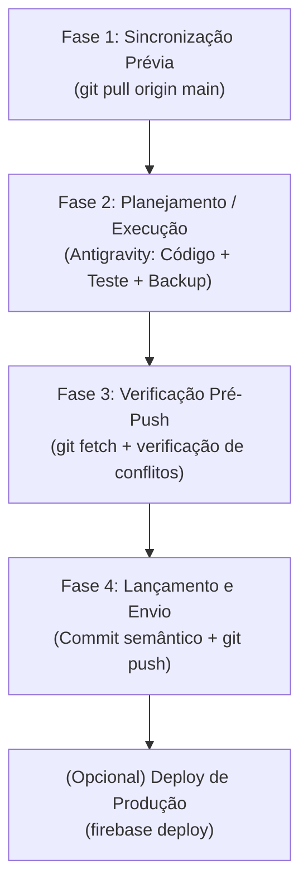

# WORKFLOW PADRÃO DE DESENVOLVIMENTO COLABORATIVO (ANTIGRAVITY + GITHUB)

Este documento define o fluxo operacional oficial de trabalho conjunto no projeto **Gestor Supervisão Patos** (`supervisao-st-crianca`), unindo o **Antigravity (Assistente de IA)** e o **GitHub** para permitir desenvolvimento simultâneo e independente sem perda de código nem conflitos.

---

## 1. Dados do Projeto e Repositório Oficial
- **Repositório GitHub:** [https://github.com/silvabrun0/supervisao-st-crianca](https://github.com/silvabrun0/supervisao-st-crianca)
- **Branch Principal de Produção:** `main`
- **Firebase Project ID:** `supervisao-st-crianca`
- **Hosting URL (Produção):** [https://supervisao-st-crianca.web.app](https://supervisao-st-crianca.web.app)

---

## 2. A Regra de Ouro da Colaboração (Pré e Pós Ação)

Para que dois desenvolvedores trabalhem ao mesmo tempo sem sobrescrever alterações do outro:
1. **SEMPRE PUXAR ANTES DE COMEÇAR (`git pull`):** Antes de planejar ou aplicar código novo, sincronize com o repositório para garantir que você está trabalhando sobre a versão mais recente enviada pelo colega.
2. **SEMPRE CHECAR ANTES DE ENVIAR (`git fetch` / `git status`):** Antes de enviar as suas alterações locais, verifique se o colega subiu algo novo enquanto você programava.
3. **SEMPRE ENVIAR AO CONCLUIR (`git commit` + `git push`):** Nunca deixe código funcional acumulado apenas localmente; suba para que o colega tenha acesso imediato.

---

## 3. Fluxo de Trabalho Integrado no Antigravity

O ciclo de desenvolvimento com o Antigravity opera em **4 Fases Racionalizadas**:



### Fase 1: Sincronização Prévia (Início de Qualquer Tarefa)
Antes de analisar ou editar qualquer código:
```bash
git pull origin main
```
- Se o colega subiu mudanças, elas serão mescladas imediatamente.
- Se houver conflito não resolvido, o assistente ajuda a resolver antes de criar código novo.

### Fase 2: Implementação e Dupla Checagem (O Trabalho com a IA)
1. **Desenvolvimento:** O assistente aplica e testa as alterações diretamente no código (`index.html`, scripts, assets, etc.).
2. **Dupla Checagem:** Releitura do arquivo para garantir integridade.
3. **Gestão de Versões e Changelog (Obrigatório):**
   - Atualizar `CHANGELOG.md` com a nova versão (`0.n`), data, itens incluídos, modificados e excluídos.
   - Atualizar a indicação de versão no topo e no modal `#modalChangelog` do `index.html`.

### Fase 3: Checagem de Concorrência Pré-Push (Verificação do Colega)
Antes de disparar o push, o assistente ou desenvolvedor roda:
```bash
git fetch origin main
git log HEAD..origin/main --oneline
```
- **Se a saída estiver vazia:** O colega não subiu nada enquanto você trabalhava. É seguro enviar diretamente!
- **Se aparecerem commits na lista:** O colega subiu alterações enquanto você programava. Execute:
  ```bash
  git pull --rebase origin main
  # ou git pull origin main
  ```
  Assim suas mudanças são organizadas em cima do que o colega acabou de subir, garantindo histórico linear e sem perdas.

### Fase 4: Registro e Envio ao GitHub
Com tudo validado e verificado:
```bash
git add .
git commit -m "feat(ou fix): [descrição clara do que foi feito]"
git push origin main
```

---

## 4. Como Pedir ao Antigravity no Chat (Exemplos Rápidos)

Você pode simplesmente usar comandos naturais no chat com o assistente:

| O que você quer fazer | O que dizer ao Antigravity | O que o assistente fará |
| :--- | :--- | :--- |
| **Começar uma tarefa** | *"Verifique se meu colega subiu algo novo e puxe as alterações."* | Executa `git pull origin main` e reporta os últimos commits. |
| **Programar normalmente** | *"Adicione o filtro de escolas na tabela de visitas."* | Desenvolve, testa localmente e valida a lógica. |
| **Concluir e subir tudo** | *"Finalize a versão, atualize o changelog, verifique se há algo novo no remoto e dê push no GitHub."* | Executa a checagem com `git fetch`, atualiza o `CHANGELOG.md`, faz o `git commit` e dá o `git push`. |

---

## 5. Diretrizes para Branches (Quando o trabalho for grande ou complexo)

Para tarefas que demorem mais de 1 dia ou sejam reformas pesadas na interface:
1. Criar branch de trabalho:
   ```bash
   git checkout -b feature/nome-da-funcionalidade
   ```
2. Programar e subir para a branch remota:
   ```bash
   git push -u origin feature/nome-da-funcionalidade
   ```
3. Abrir um **Pull Request (PR)** no GitHub para o colega revisar antes de integrar à `main`.

---

## 6. Publicação em Produção (Firebase Hosting)

Quando a versão na branch `main` estiver pronta para uso real pela equipe de supervisão:
```bash
firebase deploy
# Ou caso o binário não esteja no PATH:
npx firebase-tools deploy
```
URL oficial atualizada: [https://supervisao-st-crianca.web.app](https://supervisao-st-crianca.web.app)
