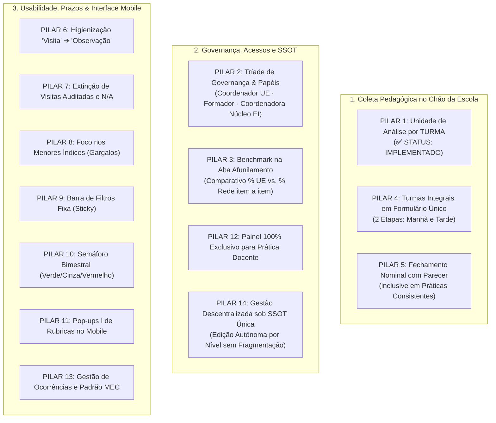

# CONSOLIDAÇÃO DE INSIGHTS E DIRETRIZES TÉCNICO-PEDAGÓGICAS
## Sistema de Supervisão Pedagógica · SerTão Criança (Patos/PB)

> **Documento Oficial de Referência de Produto, Governança e Arquitetura**  
> **Data de Atualização:** 20 de Outubro de 2026  
> **Base Documental:** Transcrição na íntegra da Reunião ST Criança de 19 de Outubro de 2026 cruzada com as novas deliberações de governança operacional descentralizada, autonomia cadastral em cascata e integridade da SSOT (Single Source of Truth).

---

## 1. Sumário Executivo e Governança de Perfis

A evolução do instrumento de supervisão pedagógica do programa **SerTão Criança** consolida uma separação nítida de papéis, permissões de visualização, autonomia cadastral em cascata e ferramentas de tomada de decisão, preservando rigidamente a integridade de uma **Single Source of Truth (SSOT)**.

### A Tríade Canônica de Governança e Escopos Operacionais:
1. **Coordenador(a) Pedagógico(a) da Unidade Escolar (UE):**
   * **Escopo de Visualização e Ação:** Circunscrito estritamente à sua própria Unidade Escolar (`user.school`).
   * **Autonomia de Gestão Cadastral:** Capacidade total de adicionar, editar e remover professoras e turmas da sua escola. Define características da unidade (quantidade de turmas, alunos matriculados, número de crianças público-alvo da educação inclusiva/diversidade), jornadas (*Tempo Parcial* vs. *Tempo Integral*), turnos (*Matutino* e *Vespertino*) e vinculação nominal de quais docentes regentes titulares atuam em cada turma e período.
   * **Ferramenta Decisória Principal:** Na sub-aba de **"Afunilamento por Dimensão"**, obtém o **comparativo `% da UE vs. Rede`**, identificando a discrepância item a item em relação à média geral municipal de Patos.
2. **Formador(a) Pedagógico(a):**
   * **Escopo de Visualização e Ação:** Restrito aos coordenadores pedagógicos e unidades escolares atribuídos à sua supervisão/polo regional.
   * **Autonomia de Gestão Cadastral:** Pode editar, vincular e gerenciar os coordenadores pedagógicos de cada unidade, **mas exclusivamente das escolas vinculadas ao seu polo atribuído**.
   * **Ferramenta Decisória:** Tem acesso às avaliações de cada coordenador atribuído, podendo comparar o desempenho do seu polo com o **`% de toda a rede municipal`**.
3. **Coordenadora do Núcleo de Educação Infantil (EI) [Renomeação da antiga "Equipe Técnica"]:**
   * **Escopo Total e Governança Central:** É a **autoridade central com acesso total e irrestrito a todo o ecossistema**. 
   * **Atribuição de Acessos:** É a responsável por cadastrar os formadores, definir a alocação de polos, delegar acessos e supervisionar a totalidade das 32 UEs, coordenadores e docentes da rede de Patos.
   * **Visão Macro:** Acesso onisciente a todos os relatórios, matrizes, afunilamentos e séries históricas municipais.
4. **Blindagem e Integridade da Base Única (SSOT):**
   * Toda e qualquer modificação cadastral ou pedagógica realizada por uma coordenadora (em sua escola) ou por um formador (em seu polo) grava e consome diretamente a **Single Source of Truth** (`appState` / base única consolidada), impedindo fragmentação de dados, bancos paralelos ou registros órfãos.

---

## 2. Tabela Oficial de Matriz de Governança e Permissões

| Papel / Perfil no Sistema | Identificador Técnico (`roleKey`) | Escopo de Visualização | Poder de Edição / Gestão Cadastral | Acesso na Aba "Afunilamento por Dimensão" | Governança da Base (SSOT) |
| :--- | :---: | :--- | :--- | :--- | :---: |
| **Coordenador(a) da UE** | `coordenador` | Apenas a sua própria Unidade Escolar (`user.school`) | **Autonomia na sua UE:** Adiciona/remove professoras e turmas, define jornada (parcial/integral), turnos e vincula docentes | Compara a **sua UE vs. Rede** em cada Dimensão, Subdimensão e Critério | Grava diretamente na SSOT no escopo da sua UE |
| **Formador(a) Pedagógico(a)** | `formador` | Coordenadores e UEs atribuídos ao seu Polo Regional | **Autonomia no seu Polo:** Edita e aloca os coordenadores das escolas do seu polo | Visualiza o afunilamento de cada coordenador do seu polo vs. Rede | Grava diretamente na SSOT no escopo do seu Polo |
| **Coordenadora do Núcleo de EI** *(Antiga Equipe Técnica)* | `tecnico` ➔ `nucleo_ei` | **Acesso Global e Total** (Todas as 32 UEs, Polos e Servidores) | **Governança Global Plena:** Cadastra formadores, atribui polos/escolas, gerencia a rede inteira | Visualiza o afunilamento de qualquer unidade, de qualquer polo ou da rede inteira | Custodiante Central da SSOT Unificada |

---

## 3. Matriz Consolidada dos 14 Pilares Técnico-Pedagógicos



---

### PILAR 1: Inversão da Unidade de Análise para a TURMA
> **STATUS DO PILAR: ✅ IMPLEMENTADO / EM PRODUÇÃO**
* **Contexto e Aplicação:**  
  A mudança estrutural que substituiu o formulário individual por professor pela observação da **TURMA** já se encontra construída e validada no código.
* **Regra Operacional Consolidada:**
  - A turma é a unidade de observação (parcial ou integral).
  - Em Patos, não existe professor auxiliar: todos os docentes são regentes titulares (duplas no parcial e quartetos no integral).
  - A rotina observada reflete o acesso da criança às experiências pedagógicas, assegurando a série histórica da turma.

---

### PILAR 2: Governança em 3 Níveis & Renomeação da "Equipe Técnica" para "Coordenadora do Núcleo de EI"
> **STATUS DO PILAR: 🏗️ PLANO EXECUTIVO DETALHADO (PRONTO PARA EXECUÇÃO - ETAPA 2)**  
> **Documento Oficial Mestre de Execução:** [`./planos_de_implementacao/plano_pilar_2_triade_governanca_e_nucleo_ei.md`](file:///Users/bruno/Desktop/gestor%20supervisao_patos/planos_de_implementacao/plano_pilar_2_triade_governanca_e_nucleo_ei.md)  
> **Versão Alvo de Entrega:** `0.91` | **Backup Intermediário:** `intermediárias/aplicativo_v91_pilar_2_triade_governanca_e_nucleo_ei.html`

* **Contexto e Fundamentação:**
  O instrumento de supervisão pedagógica do programa **SerTão Criança** consolida a separação canônica de três níveis operacionais com autonomia em cascata, preservando a **Single Source of Truth (SSOT)** e formalizando a liderança pedagógica máxima da rede sob o título oficial de **Coordenadora do Núcleo de Educação Infantil** (eliminando terminologias burocráticas legadas como *"Equipe Técnica"*).

* **As 4 Dimensões Estruturantes do Plano de Implementação do Pilar 2:**

  #### 1. Renomeação Institucional e Semântica Visual:
  - **Eliminação Definitiva de "Equipe Técnica":** Substituição do termo em 100% das telas, modais de troca de perfil, cadastros de equipe e mensagens do sistema pelo título oficial: **"Coordenadora do Núcleo de Educação Infantil"** (ou forma abreviada **"Núcleo de EI"**).
  - **Revisão do Modal `#modalRole`:** No bloco `#roleBoxTecnico`, atualizar o título para *"Coordenadora do Núcleo de Educação Infantil (Helena Martins / Rodrigo)"*, direcionando o acionamento para a titular pedagógica central (`selectUserAccount('helena')`).
  - **Atualização na Base de Usuários (`USERS_DB`):**
    - `helena`: `roleKey: 'nucleo_ei'`, `roleTitle: 'Coordenadora do Núcleo de EI'`, `avatarText: 'NE'`.
    - `rodrigo`: `roleKey: 'nucleo_ei'`, `roleTitle: 'Núcleo de EI (Governança & Dados)'`, `avatarText: 'NE'`.
    - `bruno`: `roleKey: 'nucleo_ei'`, `roleTitle: 'Administrador do Sistema (Núcleo de EI)'`, `avatarText: 'BS'`.

  #### 2. Arquitetura dos 3 Níveis Canônicos de Governança e Escopos Operacionais:
  ```mermaid
  flowchart TD
      subgraph Nivel3["NÍVEL 3 · NÚCLEO DE EDUCAÇÃO INFANTIL (CENTRAL)"]
          NEI["👑 Coordenadora do Núcleo de EI (Helena Martins)\n• Acesso Global Onisciente (Todas as 32 UEs e Polos)\n• Gestão de Polos, Formadores e Matrizes de Rubricas\n• Sem aplicação de avaliações diretas em sala"]
      end

      subgraph Nivel2["NÍVEL 2 · POLO REGIONAL (TUTORIA E FORMAÇÃO)"]
          FP["🎓 Formadora Pedagógica (Clarice Barbosa)\n• Escopo: UEs e Coordenadores do seu Polo Regional\n• Tutoria e Avaliação Formativa das Coordenadoras\n• Sem visualização ou interferência em outros polos"]
      end

      subgraph Nivel1["NÍVEL 1 · UNIDADE ESCOLAR (CHÃO DA ESCOLA)"]
          CP["🏫 Coordenadora Pedagógica da UE (Mariana Ferreira)\n• Escopo Estrito: Sua Própria Unidade Escolar (user.school)\n• Gestão e Observação das Turmas e Docentes da sua UE\n• Rascunhos de observação estritamente privados"]
      end

      NEI -->|Cadastra e atribui Polos| FP
      FP -->|Acompanha e avalia Coordenadoras| CP
  ```

  #### 3. Regras Rigorosas de Blindagem Multitenant & Retrocompatibilidade:
  - **Função Canônica Global `isNucleoEI(user)`:**
    ```javascript
    function isNucleoEI(user) {
      if (!user) return false;
      const key = typeof user === 'string' ? user : (user.roleKey || '');
      return key === 'nucleo_ei' || key === 'tecnico';
    }
    ```
    Garante **dupla compatibilidade resiliente (zero breaking changes)**: tanto registros novos com `'nucleo_ei'` quanto históricos persistidos em `localStorage` com `'tecnico'` continuam funcionando sem perda de sessão ou corrupção de estado.
  - **Escopos Restritos:**
    - `getScopedObservations()`: Retorna todas as observações municipais para `isNucleoEI(user)`, apenas as do polo para `user.roleKey === 'formador'`, e estritamente as da UE para `user.roleKey === 'coordenador'`.
    - `getScopedAvaliandos()`: Coordenadora acessa apenas docentes da sua UE; Formadora acessa coordenadoras do seu polo; Núcleo de EI acessa toda a rede.
    - `getScopedNotes()` e `getScopedSchedules()`: Isolados na mesma lógica determinística.
    - Travamento de avaliação direta: `startNewObservation()` emite toast específico: *"A Coordenadora do Núcleo de EI não aplica avaliações diretas."*

  #### 4. Cascata Cadastral sob Single Source of Truth (SSOT):
  - A Coordenadora do Núcleo de EI cadastra e aloca os Formadores por Polo Regional.
  - O Formador gerencia e aloca as Coordenadoras Pedagógicas das UEs do seu polo atribuído.
  - A Coordenadora Pedagógica gerencia as turmas e professoras da sua escola.
  - Toda mutação grava diretamente no `appState` compartilhado, garantindo reatividade instantânea sem bancos paralelos ou registros órfãos.

* **Roteiro de Implementação Passo a Passo (Etapa 2):**
  1. **Interface HTML (`index.html`):** Atualizar `#roleBoxTecnico` no `#modalRole`, seletor `#teamRoleFilter`, seletores `#newMemberRole` / `#editMemberRole` e dicas de login em `#screenLogin`.
  2. **Estrutura Canônica:** Atualizar `USERS_DB`, `INITIAL_TEAM` e criar helper `isNucleoEI(user)`.
  3. **Blindagem de Funções:** Atualizar `getScopedAvaliandos()`, `getScopedObservations()`, `getScopedNotes()`, `getScopedSchedules()`, `applyUserRoleUI()`, `navigateToTab()`, `startNewObservation()`, `normalizeRoleData()` e `renderIndicatorsScreen()`.
  4. **Gestão de Changelog Duplo:** Atualizar `CHANGELOG.md` e modal `#modalChangelog` para a Versão `0.91`.
  5. **Sincronização de Espelhos:** Replicar as alterações em `gestor supervisao_patos/index.html` e `firebase_deploy/public/index.html`.
  6. **Backup Intermediário:** Salvar cópia funcional em `intermediárias/aplicativo_v91_pilar_2_triade_governanca_e_nucleo_ei.html`.
  7. **Deploy Automático e Auditoria:** Push para `main` (deploy GitHub Pages) e execução de `python3 audit_platform.py --silent-on-success`.

* **Auditoria Automatizada Obrigatória (Cobertura de 100%):**
  - Módulo 1 (`auth_rbac`): Teste de resolução de Mariana (Coordenador), Clarice (Formador), Helena (Coordenadora do Núcleo de EI) e Rodrigo (Núcleo de EI - Dados), validando a dupla compatibilidade de `isNucleoEI()` (`nucleo_ei` & `tecnico`).
  - Módulo 7 (`formadora_coordenacao`): Validação de isolamento do Polo Regional da formadora e acesso global irrestrito do Núcleo de EI.
  - Preservação da integridade de 100% dos testes determinísticos da suíte.

---

### PILAR 3: Comparativo "% da UE vs. Rede" na Aba de "Afunilamento por Dimensão"
* **Diagnóstico e Solução:**  
  A visualização comparativa com a rede atinge sua máxima potência pedagógica dentro da sub-aba de **"Afunilamento por Dimensão"** (`currentSubTab === 'drilldown'`).
* **Comportamento na Interface:**
  - Ao abrir o Afunilamento, o Coordenador da UE visualiza para cada **Grande Dimensão**, **Subdimensão** e **Item/Critério Individual**:
    1. **O percentual da sua UE:** `% Consistência na Escola`.
    2. **O percentual de toda a rede:** `% Médio da Rede Municipal de Patos`.
    3. **O Delta Comparativo ($\Delta \pm\%$):** Indicação visual imediata se a sua escola está acima ou abaixo da média municipal naquele indicador específico.
  - O Formador acessa essa mesma tela para cada um dos coordenadores atribuídos ao seu polo, podendo cruzar o afunilamento individual daquele coordenador/unidade contra o `% de toda a rede`.

---

### PILAR 4: Turmas em Tempo Integral em Formulário Único (2 Etapas: Manhã e Tarde)
* **Fundamentação Pedagógica (Bruno Pereira da Silva, 01:21:35):**  
  A divisão em formulários isolados prejudicaria a avaliação do **planejamento conjunto** dos 4 professores regentes. A escola integral precisa manter unidade pedagógica.
* **Definição de Arquitetura:**
  - Formulário único com salvamento como rascunho após a observação do turno matutino.
  - Retomada do mesmo rascunho no turno vespertino para complementação das práticas da tarde.
  - Envio definitivo apenas após a conclusão dos dois turnos, permitindo que a coordenação pondere o balanço global da experiência da criança naquele bimestre.

---

### PILAR 5: Fechamento Nominal com Parecer Obrigatório em Práticas Consistentes
* **Fundamentação Pedagógica (Carolina Machado, 01:13:16):**  
  Para garantir que os professores recebam feedback individualizado e evitar o desincentivo de quem conduz bem a sala, o formulário da turma fecha com blocos nominais.  
  Carolina Machado enfatizou que **o nível Consistente também deve ter campo de anotação descritiva**, documentando a boa prática pedagógica para fins de replicação e fornecendo dados ao Núcleo de EI sobre o padrão avaliativo da coordenação.
* **Definição de Arquitetura:**
  - Blocos finais nominais dos professores daquela turma.
  - Pontuação simplificada nas 5 Dimensões (`Consistente`, `Parcial`, `Não Realizado`).
  - Campo de parecer descritivo aberto em todos os níveis.
  - Exportação de relatório em PDF segregado por professor.

---

### PILAR 6: Higienização Terminológica Mandatória ("Visita" ➔ "Observação")
* **Diretriz Aprovada (00:19:27):**  
  Substituição completa do vocábulo policialesco *"visita"* por **"observação"** em 100% dos textos, botões, rotas e relatórios.

---

### PILAR 7: Extinção de Métricas Burocráticas ("Visitas Auditadas" e "Itens Válidos / N.A.")
* **Diretriz Aprovada:**  
  - O card `Visitas Auditadas` é removido.
  - O card `Itens Válidos / N.A.` é removido.
  - O grid superior de 4 colunas é reorganizado com métricas 100% orientadas à ação e intervenção.

---

### PILAR 8: Diagnóstico de Prioridades: Bloco "Foco nos Menores Índices" (Gargalos)
* **Diretriz Aprovada:**  
  - Apresentação automática dos **3 menores critérios da unidade ou polo** (os pontos mais frágeis ou com maior desvio negativo em relação à rede).
  - Serve como pauta prioritária imediata para as reuniões de alinhamento e formação interna na escola.

---

### PILAR 9: Usabilidade e Ergonomia: Barra de Filtros Fixa (`position: sticky`)
* **Diretriz Aprovada:**  
  Fixação da barra de filtros e sub-abas durante a rolagem vertical (`position: sticky; top: 60px; z-index: 90`), mantendo a seleção de UE, turma e bimestre sempre acessível na navegação longa do afunilamento.

---

### PILAR 10: Quadro de Controle Bimestral (Semáforo de Prazos Verde / Cinza / Vermelho)
* **Diretriz Aprovada (00:28:59):**  
  Painel visual para o acompanhamento do ciclo das 4 observações:
  - 🟢 **Verde:** Observação realizada e concluída.
  - ⚪ **Cinza:** Bimestre em andamento (dentro do prazo regulamentar).
  - 🔴 **Vermelho:** Bimestre expirado sem envio de observação para a turma (alerta de atraso).

---

### PILAR 11: Enxugamento Visual no Mobile: Pop-ups / Tooltips de Apoio (`ℹ️`)
* **Diretriz Aprovada (00:24:26):**  
  Ocultação de textos extensos de orientações das rubricas no celular. Inserção de ícone informativo discreto (`ℹ️`) que abre modal/tooltip sob demanda.

---

### PILAR 12: Painel de Indicadores 100% Exclusivo para a Prática Docente Infantil
* **Diretriz Aprovada (01:30:42):**  
  A avaliação de coordenadores realizada pelos formadores é um processo de tutoria de gestão e segue fluxo próprio no histórico/agenda. A tela de Indicadores é 100% dedicada aos **Indicadores da Prática Docente nas Turmas**, eliminando matrizes de coordenação deste painel.

---

### PILAR 13: Gestão de Ocorrências Críticas e Padrão MEC de Nomenclatura
* **Diretriz Aprovada (00:56:18 e 02:40:57):**  
  - **Ocorrências Críticas:** Bloco com marcação de status **"Conversado"** e arquivamento com rastreabilidade da observação.
  - **Padronização MEC:** Uso rigoroso de **"Turma em Tempo Parcial"** (Matutino/Vespertino) e **"Turma em Tempo Integral"**, abolindo o termo ambíguo "regular".

---

### PILAR 14: Governança Operacional Descentralizada & Gestão Autônoma sob SSOT Única
* **Diretriz de Arquitetura e Engenharia de Dados:**
  - **Autonomia da Coordenadora Pedagógica (Escopo UE):**
    - A coordenadora pode adicionar, editar e remover turmas e professoras da sua escola.
    - Pode caracterizar a unidade: cadastrar/atualizar o número de turmas, o total de alunos e a contagem de crianças público-alvo da educação inclusiva/diversidade.
    - Pode configurar as turmas: definir a jornada (*Tempo Parcial* ou *Tempo Integral*), selecionar turnos (*Matutino* e *Vespertino*) e alocar nominalmente os docentes regentes titulares em seus respectivos turnos.
    - **Restrição Estrita:** A coordenadora atua única e exclusivamente sobre os dados da sua própria Unidade Escolar (`user.school`). Os controles de interface não exibem nem permitem manipulação de outras UEs.
  - **Autonomia do Formador(a) Pedagógico(a) (Escopo Polo):**
    - O formador tem permissão para editar os coordenadores de cada unidade, atribuir e reatribuir coordenadores a escolas, **mas somente das unidades escolares vinculadas ao seu polo regional**.
    - Não tem acesso de alteração em escolas fora do seu polo.
  - **Autoridade Central da Coordenadora do Núcleo de EI (Gestão Central):**
    - A Coordenadora do Núcleo de EI tem **acesso total**: é quem cria e cadastra formadores, define a vinculação de polos e unidades aos formadores e mantém a governança global da rede.
  - **Princípio Rígido da Single Source of Truth (SSOT):**
    - Toda e qualquer edição cadastral (seja de turmas, docentes ou coordenações) é gravada diretamente na base única compartilhada (`appState` e repositório central), sincronizando instantaneamente referências relacionais.
    - Nenhuma alteração gera bases paralelas ou desconectadas: a integridade de turmas, séries históricas e relatórios permanece unificada e reativa em tempo real.

---

## 4. O Afunilamento com Benchmark: Como Fica na Interface

Na sub-aba **"Afunilamento por Dimensão"**, cada nível hierárquico apresenta a régua dupla:

```
┌─────────────────────────────────────────────────────────────────────────────┐
│ 1. PLANEJAMENTO DIDÁTICO PEDAGÓGICO                                        │
│ Minha UE: [██████████████░░░░] 72%   |   Rede: [████████████████░░] 81%     │
│ Variação: 🔻 -9% abaixo da média municipal                                  │
├─────────────────────────────────────────────────────────────────────────────┤
│   ▼ 1.1 Organização dos Espaços e Rotina                                    │
│   Minha UE: 68%   |   Rede: 76%   |   Δ: 🔻 -8%                             │
│   ───────────────────────────────────────────────────────────────────────   │
│     • [1.1.1] Materiais ao alcance das crianças                             │
│       Minha UE: 60%   |   Rede Patos: 75%   |   Δ: 🔻 -15% [Atenção Crítica]│
│     • [1.1.2] Cantos temáticos diversificados                               │
│       Minha UE: 85%   |   Rede Patos: 78%   |   Δ: 🟢 +7% [Destaque Positivo]│
└─────────────────────────────────────────────────────────────────────────────┘
```

---

## 5. Cronograma e Estratégia de Implementação em 2 Frentes

### 🔹 FRENTE 1: Painel de Indicadores, Governança & Afunilamento Comparativo (Imediata)
* **Escopo da Entrega:**
  1. Implementação do comparativo **`% da UE vs. % da Rede`** dentro da aba de **"Afunilamento por Dimensão"**.
  2. Implementação das regras de escopo de visualização:
     - Coordenador visualiza sua UE comparada à Rede.
     - Formador visualiza os coordenadores atribuídos comparados à Rede.
     - Coordenadora do Núcleo de EI visualiza toda a rede e pode alternar qualquer UE/Polo.
  3. Renomeação do rótulo institucional de *"Equipe Técnica"* para **"Coordenadora do Núcleo de EI"** (`#roleBoxTecnico`, cadastros e cabeçalhos).
  4. Higienização terminológica completa de *"visita"* para *"observação"*.
  5. Remoção dos cards de *Visitas Auditadas* e *Itens Válidos/NA*, substituindo pelos novos KPIs decisórios.
  6. Travamento CSS `position: sticky` na barra de filtros.

### 🔹 FRENTE 2: Coleta por Turma em 2 Etapas e Gestão Descentralizada (Estrutural)
* **Escopo da Entrega:**
  1. **Gestão Descentralizada sob SSOT (Pilar 14):**
     - Interface para a Coordenadora da UE gerenciar turmas, docentes regentes, turnos, jornadas e caracterização da sua escola.
     - Interface para o Formador gerenciar os coordenadores das escolas do seu polo atribuído.
     - Interface de Gestão Central para a Coordenadora do Núcleo de EI atribuir acessos e polos aos formadores.
  2. Formulário único de Turma Integral em 2 etapas (salvamento manhã / conclusão tarde).
  3. Blocos nominais de avaliação docente ao término da turma com parecer aberto para práticas consistentes.
  4. Quadro Semáforo Bimestral (Verde/Cinza/Vermelho).
  5. Pop-ups informativos `ℹ️` nas rubricas no mobile.
  6. Adequação formal da nomenclatura MEC (Tempo Parcial vs. Tempo Integral) e coleta de diversidade.
