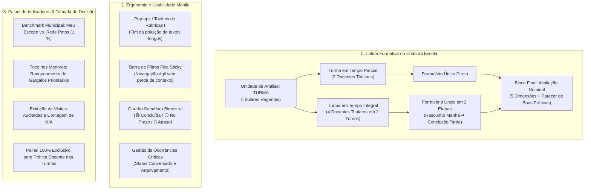

# CONSOLIDAÇÃO DE INSIGHTS E DIRETRIZES TÉCNICO-PEDAGÓGICAS
## Sistema de Supervisão Pedagógica · SerTão Criança (Patos/PB)

> **Documento Oficial de Referência de Produto e Arquitetura**  
> **Data de Atualização:** 20 de Outubro de 2026  
> **Base Documental Integral:** Transcrição na íntegra da Reunião ST Criança de 19 de Outubro de 2026 (Participantes: Diogo Dias Furtado, Bruno Pereira da Silva, Julia Elena Cordoba Vieira, Carolina Machado).

---

## 1. Sumário Executivo e Virada de Chave Metodológica

A análise da transcrição literal da reunião de 19 de outubro de 2026 consolidou uma **virada estrutural de engenharia e pedagogia** no Sistema de Supervisão Pedagógica. O instrumento afasta-se em definitivo de uma lógica burocrática e fiscalizatória de "auditoria individual" e assume a missão central de diagnosticar e qualificar as oportunidades de aprendizagem no chão da creche e da pré-escola municipal.

### As Quatro Diretrizes Nucleares Alinhadas pela Equipe:
1. **O Centro do Instrumento é a Experiência e Aprendizagem da Criança:**  
   *(Carolina Machado, 00:41:45)*: O objetivo primordial é aferir o que a criança está de fato recebendo na rotina escolar (mediação da leitura de histórias, autonomia, interações afetivas, brincadeiras estruturadas). A supervisão avalia como o ambiente educativo se organiza para garantir esses direitos.
2. **Inversão da Unidade de Análise: da "Docência Isolada" para a "TURMA":**  
   *(Carolina Machado e Julia Cordoba, 00:31:35 - 00:39:39)*: Unidades de grande porte (como a Creche Cremilde/Rossvânia, com 38 professores) inviabilizam a aplicação de formulários individuais completos por professor. Em Patos, **não existe professor auxiliar**: as turmas contam com duplas de professores regentes titulares no período parcial e quartetos no período integral. A observação passa a focar na rotina da turma, reservando o fechamento para avaliações nominais específicas.
3. **Preservação da Articulação do Planejamento Coletivo:**  
   *(Bruno Pereira da Silva, 01:21:35)*: Em turmas integrais, a divisão mecânica em dois formulários desvinculados destruiria a avaliação da condução articulada entre os 4 professores. Optou-se pelo modelo híbrido de **Formulário Único em 2 Etapas (Manhã e Tarde)**, garantindo que o planejamento coletivo com início, meio e fim seja valorizado.
4. **Padronização Terminológica e Higienização Formativa:**  
   *(Carolina Machado e Diogo Furtado, 00:19:27)*: O termo policialesco *"visita"* e o indicador *"visitas auditadas"* são **definitivamente banidos** de toda a plataforma, substituídos pelo conceito didático e formativo de **"observação pedagógica"**.

---

## 2. Matriz Consolidada dos 13 Pilares Técnico-Pedagógicos

---

### PILAR 1: Inversão da Unidade de Análise para a TURMA
* **Fundamentação na Transcrição (00:31:35 - 00:44:00):**  
  Carolina Machado demonstrou a inviabilidade operacional do modelo anterior: *"Se eu tenho Rossvânia, que tem 38 professores, vai fazer 38 observações completas? (...) Em Patos não tem professor auxiliar. Os dois professores são professores titulares da turma, independente de serem concursados ou contratados (...) Essa observação tem que ser por turma e não por professor."*
* **Definição de Arquitetura:**
  - O formulário de observação passa a ser aberto para a **TURMA**.
  - O sistema puxa o pré-cadastro da turma com a equipe de professores regentes titulares vinculados.
  - A série histórica principal é construída sobre a **TURMA**, pois ela representa a continuidade da experiência pedagógica recebida pelas crianças, mesmo em eventuais faltas ou trocas pontuais de docentes no dia da visita.

---

### PILAR 2: Turmas em Tempo Integral em Formulário Único (2 Etapas: Manhã e Tarde)
* **Fundamentação na Transcrição (00:58:33 - 01:22:46):**  
  A discussão inicial considerou dividir a turma integral em dois formulários isolados. Bruno Pereira da Silva interveio pontuando a perda metodológica dessa divisão: *"Se a gente coloca dois formulários distintos, a gente vai perder a avaliação da condução entre os professores, porque são quatro professores... o direito dos alunos passaria por ser uma aula planejada entre eles, no conjunto... perder o espírito de que os professores têm que estar sempre em contato para planejarem ter início, meio e fim."*
* **Definição de Arquitetura:**
  - **Formulário Único e Integrado:** A coordenadora realiza a observação no turno matutino (ex: acolhida, leitura, higiene), preenche as seções observadas e **salva como rascunho**.
  - No turno vespertino (mesmo que em dia subsequente acordado), ela retoma o mesmo rascunho e complementa com as práticas da equipe da tarde.
  - O sistema calcula o balanço geral da turma e exige o preenchimento do bloco final nominal antes do envio definitivo.

---

### PILAR 3: Fechamento Nominal com Parecer Qualitativo Obrigatório para Práticas Consistentes
* **Fundamentação na Transcrição (01:07:34 - 01:16:03):**  
  Para evitar o "desincentivo do bom professor que carrega a turma nas costas enquanto outro profissional não faz nada" (Julia Cordoba, 01:05:38), Diogo estruturou a avaliação docente nominal ao final.  
  Carolina Machado insistiu que **mesmo as práticas consistentes devem conter anotação descritiva**: *"O consistente também tem que ter observação, porque aí é a replicação da boa prática... isso aqui também traz um dado sobre o coordenador pra gente do Núcleo: o que para aquele coordenador está sendo a visão de uma prática consistente."* Diogo concordou (01:14:09), validando que o bloco é enxuto e rápido de preencher.
* **Definição de Arquitetura:**
  - Ao final do formulário da turma, são exibidos os **blocos nominais dos professores regentes da turma** (1 a 4 docentes).
  - Cada docente é avaliado nas **5 Dimensões da Matriz** sob três níveis objetivos: `Consistente`, `Parcial`, `Não Realizado` (sem opção de N/A).
  - **Campo de Parecer Descritivo Aberto:** Disponível e encorajado em todos os níveis, permitindo registrar orientações formativas nos casos parciais/negativos e evidências de boas práticas nos casos consistentes.
  - **Geração de PDF Segregado:** O aplicativo permite exportar o relatório consolidado da turma e **fichas individuais em PDF por professor**, preservando o sigilo formativo na devolutiva.

---

### PILAR 4: Higienização Terminológica Mandatória ("Visita" ➔ "Observação")
* **Fundamentação na Transcrição (00:19:27):**  
  Carolina Machado: *"Diogo, volta por favor no início... tem 'iniciar visita', esse nome visita nem é bom... Nova observação."* Diogo Furtado: *"OK, certo."*
* **Definição de Arquitetura:**
  - Varredura e substituição em 100% da interface:
    - `"Iniciar Visita"` ➔ `"Iniciar Observação"`
    - `"Próximas Visitas"` ➔ `"Próximas Observações"`
    - `"Visitas Concluídas / Auditadas"` ➔ `"Observações Realizadas"`
    - `"Histórico de Visitas"` ➔ `"Histórico de Observações"`

---

### PILAR 5: Benchmark Comparativo em Tempo Real: Meu Escopo vs. Toda a Rede (Lado a Lado)
* **Fundamentação na Transcrição (01:27:24):**  
  Diogo Dias Furtado: *"Agora a gente vai mudar inclusive isso, para ser comparativo do que eu tô observando com a rede... Pensem assim que nesse de consistência, esse bloco vai ter do lado esquerdo como tá a porcentagem de consistência naquela dimensão na minha unidade escolar e do lado direito o índice da rede de professoras, para ter essa comparação."*
* **Definição de Arquitetura:**
  - Substituição da métrica isolada local por uma visualização em **Benchmark**:
    - **Lado Esquerdo:** Índice de Consistência do Escopo Atual (Unidade / Polo).
    - **Lado Direito:** Média Geral Consolidada da Rede Municipal de Patos.
    - **Badge Dinâmico de Variação ($\Delta \pm\%$):** Sinaliza visualmente se a unidade está operando acima (`+X% ▲` em verde) ou abaixo da média municipal (`-X% ▼` em vermelho).

---

### PILAR 6: Diagnóstico de Prioridades: Bloco "Foco nos Menores Índices" (Gargalos)
* **Fundamentação na Transcrição (01:16:03 - 01:27:24):**  
  Julia Cordoba: *"Como a preocupação primária é a criança, se a leitura de livros de história tá consistente, por mais que um professor faça de maneira ruim, não vai ser a primeira fonte de intervenção; vai ser naquilo que as crianças não têm acesso de maneira inconsistente."*
* **Definição de Arquitetura:**
  - Criação de um card/seção de triagem imediata: **"Pontos Prioritários de Intervenção"**.
  - O algoritmo filtra e ranqueia os **3 critérios com menor pontuação** no escopo selecionado, orientando as pautas imediatas de HTPC e formação interna da coordenação.

---

### PILAR 7: Extinção de Métricas Burocráticas ("Visitas Auditadas" e "Itens Válidos / N.A.")
* **Definição de Arquitetura:**
  - O card `Visitas Auditadas` é removido (a contagem fria não gera ação).
  - O card `Itens Válidos / N.A.` é removido (metadados operacionais não agregam valor pedagógico).
  - A linha superior de KPIs é remodelada com 4 cards 100% voltados à decisão:
    1. **Consistência Local** (com barra visual de meta em 80%).
    2. **Benchmark da Rede Municipal** (Média de Patos com delta $\pm\%$).
    3. **Cobertura de Turmas** (% de turmas observadas no bimestre).
    4. **Gargalo Prioritário** (Menor dimensão/critério registrado).

---

### PILAR 8: Usabilidade e Ergonomia: Barra de Filtros Fixa (`position: sticky`)
* **Definição de Arquitetura:**
  - Fixação da barra de filtros superiores e do controle segmentado de sub-abas durante a rolagem vertical (`position: sticky; top: 60px; z-index: 90; backdrop-filter: blur(8px)`).
  - A coordenadora pode descer por dezenas de itens de critérios no afunilamento sem perder o controle dos seletores de escola, turma e bimestre.

---

### PILAR 9: Quadro de Controle Bimestral (Semáforo de Prazos Verde / Cinza / Vermelho)
* **Fundamentação na Transcrição (00:28:59 - 00:30:04):**  
  Julia Cordoba e Diogo Furtado debateram como a coordenadora saberá quem falta observar: Diogo propôs: *"Eu tenho quatro blocos aqui... um bloco do primeiro bimestre e quem tá verde, quem tá cinza e quem tá vermelho que talvez seja atrasado... e aí no segundo bimestre a mesma coisa."*
* **Definição de Arquitetura:**
  - Quadro matricial no início do painel de acompanhamento:
    - 🟢 **Verde:** Observação do bimestre finalizada.
    - ⚪ **Cinza:** Bimestre em curso (dentro do prazo regulamentar de 2 meses).
    - 🔴 **Vermelho:** Bimestre expirado sem envio de observação para a turma (alerta de atraso).

---

### PILAR 10: Enxugamento Visual no Mobile: Pop-ups / Tooltips de Apoio (`ℹ️`)
* **Fundamentação na Transcrição (00:24:26 - 00:25:19):**  
  Diogo alertou sobre o excesso de texto no celular: *"Aqui tem muito texto. Eu não gosto muito de texto."* Carolina sugeriu o formato pop-up/ícone: *"Sabe aquele que quando passa assim aparece? O texto fica escondido aí quando você clica no 'izinho' abre um pop-up."*
* **Definição de Arquitetura:**
  - No celular, títulos extensos e textos explicativos de rubricas são ocultados por padrão.
  - Ao lado de cada item, insere-se um botão discreto de informação (`ℹ️`). Ao ser tocado, exibe um modal ou tooltip explicativo com as orientações pedagógicas, despoluindo a tela de avaliação.

---

### PILAR 11: Padronização Terminológica MEC para Jornadas
* **Fundamentação na Transcrição (02:40:57 - 02:42:49):**  
  Carolina Machado corrigiu a terminologia: *"Não é jornada regular... a nomenclatura que o MEC usa é meio período/parcial e integral... regular é se ela é multisseriada ou regular."* Julia concordou: *"Vou colocar parcial... turma em tempo integral e turma em tempo parcial."*
* **Definição de Arquitetura:**
  - Substituição formal em cadastros, seletores e relatórios:
    - `"Turma em Tempo Parcial"` (com subtipos *Parcial Matutino* e *Parcial Vespertino*).
    - `"Turma em Tempo Integral"`.
  - Banimento do termo ambíguo "jornada regular".

---

### PILAR 12: Painel de Indicadores 100% Exclusivo para a Prática Docente Infantil
* **Fundamentação na Transcrição (01:29:36 - 01:30:42):**  
  Diogo Furtado pontuou que o instrumento de avaliação de coordenadoras segue fluxo próprio de tutoria, e não deve poluir a aba de índices: *"não vai ter mais esses índices desse instrumento específico... o que vai estar aqui são as professoras."*
* **Definição de Arquitetura:**
  - A tela de Indicadores (`#screenIndicators`) passa a operar incondicionalmente com `targetType = 'professora'`.
  - O dropdown de alternância para coordenadores é suprimido para Formadores e Equipe Técnica nesta aba, garantindo um painel unificado e focado na sala de aula da infância.

---

### PILAR 13: Gestão de Ocorrências Críticas e Cadastro Centralizado de Turmas
* **Fundamentação na Transcrição (00:56:18, 01:19:45 e 01:28:29):**
  - **Ocorrências de Campo (Diogo):** As ocorrências geradas em sala de aula alimentam um painel de pendências críticas. A coordenadora pode acessar a ocorrência, dar a devolutiva pedagógica ao docente, marcar como **"Conversado"** e arquivar o registro, preservando o histórico vinculado à observação.
  - **Fluxo de Cadastro (Carolina e Julia):** O cadastro de turmas, contagem de alunos e registro de crianças público-alvo da educação inclusiva/diversidade é gerido centralmente pelo **Núcleo Central (Milena/Stênio)** via planilha padronizada, sendo importado em lote para o sistema sem onerar a rotina da coordenadora.

---

## 3. Matriz Antes vs. Depois da Linha de KPIs Superiores

| Posição | Configuração Atual | Nova Configuração Estratégica | Justificativa na Reunião |
| :---: | :--- | :--- | :--- |
| **Card 1** | **Índice de Consistência** (número estático sem régua) | **Consistência Local + Barra Visual de Meta** | Visualização instantânea da proximidade do patamar de 80% (Nível 4 da EAP). |
| **Card 2** | **Visitas Auditadas** (contagem quantitativa fria) | **Benchmark da Rede Municipal** (Média de Patos com delta dinâmico $\pm\%$) | Decisão de Diogo (01:27:24) de colocar o comparativo lado a lado com a rede. |
| **Card 3** | **Avaliandos / Cobertura** (proporção individual de docentes) | **Cobertura de Turmas** (% de turmas com observação concluída no bimestre) | Adequação à nova unidade de análise (Turma). |
| **Card 4** | **Itens Válidos / N.A.** (metadado técnico de respostas) | **Ponto de Atenção Prioritária** (Menor índice registrado no escopo) | Foco na intervenção pedagógica prioritária sobre as maiores fragilidades. |

---

## 4. Cronograma e Estratégia de Implementação em 2 Frentes

```mermaid
flowchart LR
    subgraph F1["FRENTE 1: Painel & Terminologia (Imediata)"]
        direction TB
        f1["Higienização: 'Visita' ➔ 'Observação'"]
        f2["Novos KPIs: Benchmark Rede (±%) e Foco nos Menores"]
        f3["Derrubada de 'Visitas Auditadas' e 'N/A'"]
        f4["Barra de Filtros Fixa (Sticky)"]
        f5["Ocultação de Coordenadores em Indicadores"]
    end

    subgraph F2["FRENTE 2: Arquitetura de Turmas (Estrutural)"]
        direction TB
        f6["Migração do formulário para a unidade TURMA"]
        f7["Motor de 2 Etapas para Turmas Integrais"]
        f8["Blocos Nominais Finais de Avaliação Docente"]
        f9["Quadro Semáforo Bimestral (Verde/Cinza/Vermelho)"]
        f10["Pop-ups ℹ️ de Rubricas no Mobile"]
        f11["Cadastro em Lote com Diversidade e Padrão MEC"]
    end

    F1 --> F2
```

### 🔹 FRENTE 1: Painel de Indicadores, Usabilidade & Higienização (Execução Imediata)
* **Objetivo:** Entregar imediatamente os ganhos visuais e decisórios discutidos na reunião, sem alterar a estrutura do banco ou invalidar observações existentes:
  1. Atualização dos 4 Cards Superiores com o Benchmark da Rede Municipal e Foco nos Menores.
  2. Higienização terminológica completa: substituição de *"visita"* por *"observação"* em botões, títulos e modais.
  3. Travamento CSS `position: sticky` na barra de filtros.
  4. Bloqueio incondicional de indicadores para matriz docente (`targetType = 'professora'`).

### 🔹 FRENTE 2: Nova Arquitetura de Coleta por Turma (Próxima Sprint Estrutural)
* **Objetivo:** Reformular o motor de aplicação e cadastro para o ano letivo de 2027:
  1. Reestruturação do formulário de observação centrado na Turma (Tempo Parcial vs. Tempo Integral).
  2. Implementação do fluxo de salvamento matutino e conclusão vespertina para turmas integrais.
  3. Inclusão dos 4 blocos de avaliação individual docente no encerramento da observação com exportação PDF individualizada.
  4. Implementação do Quadro Semáforo Bimestral de Acompanhamento.
  5. Componentização dos pop-ups/tooltips informativos `ℹ️` para enxugamento da interface mobile.
  6. Padronização MEC das jornadas e importação em lote das turmas com contagem de diversidade pelo Núcleo Central.
