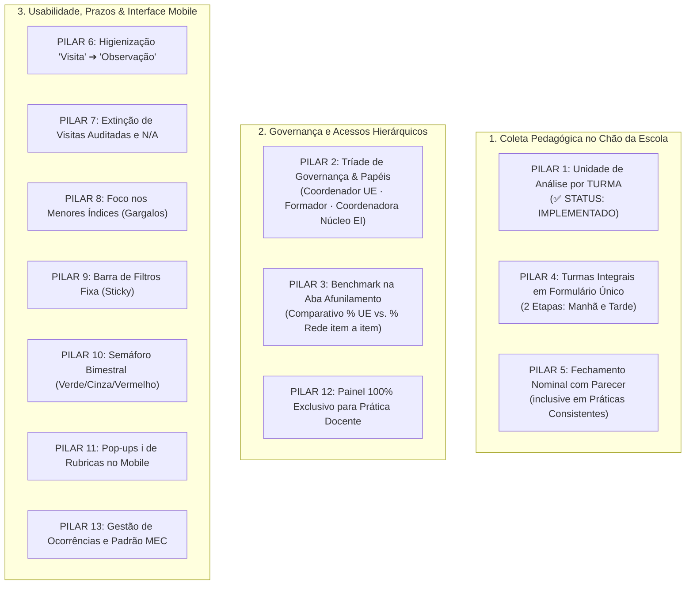

# CONSOLIDAÇÃO DE INSIGHTS E DIRETRIZES TÉCNICO-PEDAGÓGICAS
## Sistema de Supervisão Pedagógica · SerTão Criança (Patos/PB)

> **Documento Oficial de Referência de Produto, Governança e Arquitetura**  
> **Data de Atualização:** 20 de Outubro de 2026  
> **Base Documental:** Transcrição na íntegra da Reunião ST Criança de 19 de Outubro de 2026 cruzada com as novas deliberações de governança de perfis e benchmark comparativo no afunilamento.

---

## 1. Sumário Executivo e Governança de Perfis

A evolução do instrumento de supervisão pedagógica do programa **SerTão Criança** consolida uma separação nítida de papéis, permissões de visualização e ferramentas de tomada de decisão. 

### A Tríade Canônica de Governança e Escopos de Visualização:
1. **Coordenador(a) Pedagógico(a) da Unidade Escolar (UE):**
   * **Escopo:** Estrito à sua Unidade Escolar (`user.school`).
   * **Ferramenta Decisória Principal:** Na sub-aba de **"Afunilamento por Dimensão"**, obtém o **comparativo `% da UE vs. Rede`**, visualizando a discrepância item a item em relação à média geral municipal de Patos.
2. **Formador(a) Pedagógico(a):**
   * **Escopo:** Tem acesso às avaliações de **cada coordenador pedagógico atribuído à sua supervisão/polo** (não a coordenadores de outros polos).
   * **Ferramenta Decisória:** Pode comparar o desempenho agregado das escolas sob sua responsabilidade e de cada coordenador com o **`% de toda a rede`**.
3. **Coordenadora do Núcleo de Educação Infantil (EI) [Renomeação da antiga "Equipe Técnica"]:**
   * **Escopo Total:** É o **único perfil com visualização onisciente/global** de todo o ecossistema. Visualiza todas as 32 UEs, todos os polos, todos os formadores e todos os coordenadores sem restrições de filtro.

---

## 2. Tabela Oficial de Matriz de Governança e Permissões

| Papel / Perfil no Sistema | Identificador Técnico (`roleKey`) | Escopo de Unidades / Avaliados | Acesso na Aba "Afunilamento por Dimensão" | Visualização de Benchmark (% da Rede) |
| :--- | :---: | :--- | :--- | :---: |
| **Coordenador(a) da UE** | `coordenador` | Apenas a sua própria Unidade Escolar e suas turmas/docentes | Compara a **sua UE vs. Rede** em cada Dimensão, Subdimensão e Critério | ✅ Sim (UE vs. Rede) |
| **Formador(a) Pedagógico(a)** | `formador` | Coordenadores e UEs que lhe forem atribuídos (seu Polo) | Visualiza o afunilamento dos coordenadores do seu escopo vs. Rede | ✅ Sim (Polo/Escopo vs. Rede) |
| **Coordenadora do Núcleo de EI** *(Antiga Equipe Técnica)* | `tecnico` ➔ `nucleo_ei` | **Acesso Total e Global** (Todas as 32 UEs, Polos e Profissionais da Rede) | Visualiza o afunilamento de qualquer unidade, de qualquer polo ou da rede inteira | ✅ Sim (Visão Macrorregional Total) |

---

## 3. Matriz Consolidada dos 13 Pilares Técnico-Pedagógicos



---

### PILAR 1: Inversão da Unidade de Análise para a TURMA
> **STATUS DO PILAR: ✅ IMPLEMENTADO / EM PRODUÇÃO**
* **Contexto e Aplicação:**  
  A mudança estrutural que substituiu o formulário individual por professor pela observação da **TURMA** já se encontra construída e validada no código.
* **Regra Operacional Consolidada:**
  - A turma é a unidade de observação (parcial ou integral).
  - Em Patos, não existe professor auxiliar: todos os docentes são regentes titulares (duplas no parcial e quartetos no integral).
  - A rotina observada reflete o acesso da criança às experiências pedagógicas, assegurando a série histórica da turma.

---

### PILAR 2: Governança em 3 Níveis & Renomeação da "Equipe Técnica" para "Coordenadora do Núcleo de EI"
* **Diretriz de Produto e Perfis:**
  - **Renomeação Obrigatória:** O perfil até então denominado *"Equipe Técnica"* (`user.roleKey === 'tecnico'`) passa a ser oficialmente rotulado como **"Coordenadora do Núcleo de Educação Infantil"** (ou *Núcleo de EI*).
  - **Permissão de Visualização Global:** A Coordenadora do Núcleo de EI é a única autoridade com direito de visualização irrestrita de todas as unidades, relatórios e consolidados da rede.
  - **Escopo do Formador:** O formador visualiza unicamente os coordenadores pedagógicos atribuídos a ele (vinculados ao seu polo de supervisão). Não há visualização cruzada de outros polos sem autorização central.
  - **Escopo do Coordenador:** Acesso circunscrito e protegido aos docentes e turmas da sua própria Unidade Escolar.

---

### PILAR 3: Comparativo "% da UE vs. Rede" na Aba de "Afunilamento por Dimensão"
* **Diagnóstico e Solução:**  
  A visualização comparativa com a rede não deve ser restrita apenas a um card genérico no topo. Ela atinge sua máxima potência pedagógica dentro da sub-aba de **"Afunilamento por Dimensão"** (`currentSubTab === 'drilldown'`).
* **Comportamento na Interface:**
  - Ao abrir o Afunilamento, o Coordenador da UE visualiza para cada **Grande Dimensão**, **Subdimensão** e **Item/Critério Individual**:
    1. **O percentual da sua UE:** `% Consistência na Escola`.
    2. **O percentual de toda a rede:** `% Médio da Rede Municipal de Patos`.
    3. **O Delta Comparativo ($\Delta \pm\%$):** Indicação visual imediata se a sua escola está acima ou abaixo da média municipal naquele indicador específico.
  - O Formador acessa essa mesma tela para cada um dos coordenadores atribuídos ao seu polo, podendo cruzar o afunilamento individual daquele coordenador/unidade contra o `% de toda a rede`.

---

### PILAR 4: Turmas em Tempo Integral em Formulário Único (2 Etapas: Manhã e Tarde)
* **Fundamentação Pedagógica (Bruno Pereira da Silva, 01:21:35):**  
  A divisão em formulários isolados prejudicaria a avaliação do **planejamento conjunto** dos 4 professores regentes. A escola integral precisa manter unidade pedagógica.
* **Definição de Arquitetura:**
  - Formulário único com salvamento como rascunho após a observação do turno matutino.
  - Retomada do mesmo rascunho no turno vespertino para complementação das práticas da tarde.
  - Envio definitivo apenas após a conclusão dos dois turnos, permitindo que a coordenação pondere o balanço global da experiência da criança naquele bimestre.

---

### PILAR 5: Fechamento Nominal com Parecer Obrigatório em Práticas Consistentes
* **Fundamentação Pedagógica (Carolina Machado, 01:13:16):**  
  Para garantir que os professores recebam feedback individualizado e evitar o desincentivo de quem conduz bem a sala, o formulário da turma fecha com blocos nominais.  
  Carolina Machado enfatizou que **o nível Consistente também deve ter campo de anotação descritiva**, documentando a boa prática pedagógica para fins de replicação e fornecendo dados ao Núcleo de EI sobre o padrão avaliativo da coordenação.
* **Definição de Arquitetura:**
  - Blocos finais nominais dos professores daquela turma.
  - Pontuação simplificada nas 5 Dimensões (`Consistente`, `Parcial`, `Não Realizado`).
  - Campo de parecer descritivo aberto em todos os níveis.
  - Exportação de relatório em PDF segregado por professor.

---

### PILAR 6: Higienização Terminológica Mandatória ("Visita" ➔ "Observação")
* **Diretriz Aprovada (00:19:27):**  
  Substituição completa do vocábulo policialesco *"visita"* por **"observação"** em 100% dos textos, botões, rotas e relatórios.

---

### PILAR 7: Extinção de Métricas Burocráticas ("Visitas Auditadas" e "Itens Válidos / N.A.")
* **Diretriz Aprovada:**  
  - O card `Visitas Auditadas` é removido.
  - O card `Itens Válidos / N.A.` é removido.
  - O grid superior de 4 colunas é reorganizado com métricas 100% orientadas à ação e intervenção.

---

### PILAR 8: Diagnóstico de Prioridades: Bloco "Foco nos Menores Índices" (Gargalos)
* **Diretriz Aprovada:**  
  - Apresentação automática dos **3 menores critérios da unidade ou polo** (os pontos mais frágeis ou com maior desvio negativo em relação à rede).
  - Serve como pauta prioritária imediata para as reuniões de alinhamento e formação interna na escola.

---

### PILAR 9: Usabilidade e Ergonomia: Barra de Filtros Fixa (`position: sticky`)
* **Diretriz Aprovada:**  
  Fixação da barra de filtros e sub-abas durante a rolagem vertical (`position: sticky; top: 60px; z-index: 90`), mantendo a seleção de UE, turma e bimestre sempre acessível na navegação longa do afunilamento.

---

### PILAR 10: Quadro de Controle Bimestral (Semáforo de Prazos Verde / Cinza / Vermelho)
* **Diretriz Aprovada (00:28:59):**  
  Painel visual para o acompanhamento do ciclo das 4 observações:
  - 🟢 **Verde:** Observação realizada e concluída.
  - ⚪ **Cinza:** Bimestre em andamento (dentro do prazo regulamentar).
  - 🔴 **Vermelho:** Bimestre expirado sem envio de observação para a turma (alerta de atraso).

---

### PILAR 11: Enxugamento Visual no Mobile: Pop-ups / Tooltips de Apoio (`ℹ️`)
* **Diretriz Aprovada (00:24:26):**  
  Ocultação de textos extensos de orientações das rubricas no celular. Inserção de ícone informativo discreto (`ℹ️`) que abre modal/tooltip sob demanda.

---

### PILAR 12: Painel de Indicadores 100% Exclusivo para a Prática Docente Infantil
* **Diretriz Aprovada (01:30:42):**  
  A avaliação de coordenadores realizada pelos formadores é um processo de tutoria de gestão e segue fluxo próprio no histórico/agenda. A tela de Indicadores é 100% dedicada aos **Indicadores da Prática Docente nas Turmas**, eliminando matrizes de coordenação deste painel.

---

### PILAR 13: Gestão de Ocorrências Críticas e Padrão MEC de Nomenclatura
* **Diretriz Aprovada (00:56:18 e 02:40:57):**  
  - **Ocorrências Críticas:** Bloco com marcação de status **"Conversado"** e arquivamento com rastreabilidade da observação.
  - **Padronização MEC:** Uso rigoroso de **"Turma em Tempo Parcial"** (Matutino/Vespertino) e **"Turma em Tempo Integral"**, abolindo o termo ambíguo "regular".
  - **Cadastro em Lote:** O Núcleo Central de EI cadastra as turmas e a contagem de crianças público-alvo da educação inclusiva/diversidade via planilha central.

---

## 4. O Afunilamento com Benchmark: Como Fica na Interface

Na sub-aba **"Afunilamento por Dimensão"**, cada nível hierárquico apresenta a régua dupla:

```
┌─────────────────────────────────────────────────────────────────────────────┐
│ 1. PLANEJAMENTO DIDÁTICO PEDAGÓGICO                                        │
│ Minha UE: [██████████████░░░░] 72%   |   Rede: [████████████████░░] 81%     │
│ Variação: 🔻 -9% abaixo da média municipal                                  │
├─────────────────────────────────────────────────────────────────────────────┤
│   ▼ 1.1 Organização dos Espaços e Rotina                                    │
│   Minha UE: 68%   |   Rede: 76%   |   Δ: 🔻 -8%                             │
│   ───────────────────────────────────────────────────────────────────────   │
│     • [1.1.1] Materiais ao alcance das crianças                             │
│       Minha UE: 60%   |   Rede Patos: 75%   |   Δ: 🔻 -15% [Atenção Crítica]│
│     • [1.1.2] Cantos temáticos diversificados                               │
│       Minha UE: 85%   |   Rede Patos: 78%   |   Δ: 🟢 +7% [Destaque Positivo]│
└─────────────────────────────────────────────────────────────────────────────┘
```

---

## 5. Cronograma e Estratégia de Implementação em 2 Frentes

### 🔹 FRENTE 1: Painel de Indicadores, Governança & Afunilamento Comparativo (Imediata)
* **Escopo da Entrega:**
  1. Implementação do comparativo **`% da UE vs. % da Rede`** dentro da aba de **"Afunilamento por Dimensão"**.
  2. Implementação das regras de escopo:
     - Coordenador visualiza sua UE comparada à Rede.
     - Formador visualiza os coordenadores atribuídos comparados à Rede.
     - Coordenadora do Núcleo de EI visualiza toda a rede e pode alternar qualquer UE/Polo.
  3. Renomeação do rótulo institucional de *"Equipe Técnica"* para **"Coordenadora do Núcleo de EI"** (`#roleBoxTecnico`, cadastros e cabeçalhos).
  4. Higienização terminológica completa de *"visita"* para *"observação"*.
  5. Remoção dos cards de *Visitas Auditadas* e *Itens Válidos/NA*, substituindo pelos novos KPIs decisórios.
  6. Travamento CSS `position: sticky` na barra de filtros.

### 🔹 FRENTE 2: Coleta por Turma em 2 Etapas e Semáforo (Estrutural)
* **Escopo da Entrega:**
  1. Formulário único de Turma Integral em 2 etapas (salvamento manhã / conclusão tarde).
  2. Blocos nominais de avaliação docente ao término da turma com parecer aberto para práticas consistentes.
  3. Quadro Semáforo Bimestral (Verde/Cinza/Vermelho).
  4. Pop-ups informativos `ℹ️` nas rubricas no mobile.
  5. Adequação da nomenclatura MEC (Tempo Parcial vs. Tempo Integral) e coleta de diversidade.
