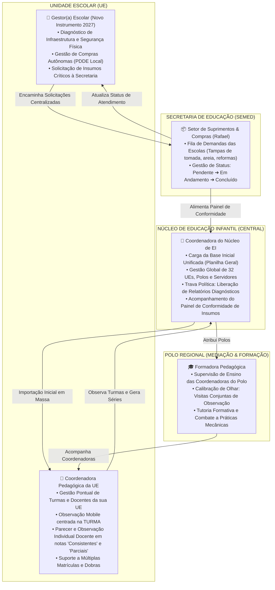
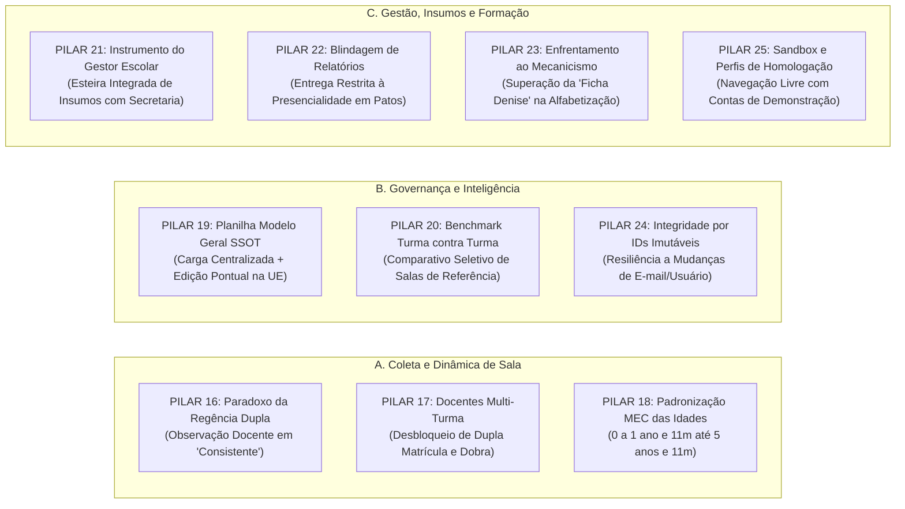

# CONSOLIDAÇÃO DE INSIGHTS E DIRETRIZES TÉCNICO-PEDAGÓGICAS
## Sistema de Supervisão Pedagógica · SerTão Criança (Patos/PB)

> **Documento Oficial de Referência de Produto, Governança e Arquitetura de Software**  
> **Data de Atualização:** 03 de Novembro de 2026  
> **Base Documental:** Transcrição na íntegra da Reunião ST Criança de 03 de Novembro de 2026 (`docs/transcricao_reuniao_st_crianca_20261103.md`), cruzada com a evolução da plataforma (versões v0.90 até v1.71) e as novas deliberações sobre regência dupla, governança cadastral centralizada, gestão de insumos escolares e enfrentamento às práticas mecânicas na Educação Infantil.  
> **Público-Alvo:** Arquiteto de Software (Etapa 1 - Planejamento Profundo) e Lideranças do Programa SerTão Criança.

---

## 1. Sumário Executivo e Balanço Evolutivo do Ecossistema

Entre 20 de outubro e 03 de novembro de 2026, a plataforma de supervisão pedagógica do programa **SerTão Criança** consolidou sua transição estrutural:
1. **Conclusão dos 15 Pilares Originais:** O sistema transferiu com sucesso o eixo dorsal de análise do professor isolado para a **TURMA**, estruturou a tríade canônica de papéis com isolamento estrito de permissões (`isNucleoEI`), implementou o comparativo `% UE vs. % Rede` no afunilamento por dimensão, criou o Quadro Semáforo bimestral e modularizou sua arquitetura em CSS e JS limpos.
2. **As Demandas Emergentes da Reunião de 03/11/2026:** A apresentação das telas operacionais (mobile e desktop) e a análise crítica dos resultados de campo da Avaliação da Educação Infantil (EAP) evidenciaram a necessidade premente de uma nova rodada de aprimoramentos técnicos e pedagógicos.

### Os 4 Desafios Estruturantes Mapeados em 03/11:
* **O Paradoxo da Regência Dupla em Práticas Consistentes:** Em turmas com dois professores simultâneos, uma prática observada pode ser excelente para a criança (graças à atuação destacada de uma professora), enquanto a segunda professora atua de forma passiva ou inadequada. O sistema não pode forçar a coordenadora a escolher entre rebaixar injustamente a turma para *Parcial* ou marcar *Consistente* sem conseguir registrar a necessidade de intervenção individual da docente.
* **A Realidade da Dupla Matrícula e Dobra de Turnos:** Professores da rede municipal de Patos frequentemente atuam nos turnos matutino e vespertino (concursados com duas matrículas, dobras regulamentadas ou contratos duplos). A plataforma precisa destravar e suportar nativamente docentes lecionando em múltiplas turmas.
* **Governança de Dados via Planilha Modelo Geral:** A estratégia de cadastro em massa deve priorizar a integridade da **Single Source of Truth (SSOT)**: o Núcleo de Educação Infantil carrega a rede toda de uma só vez via planilha modelo unificada, enquanto as unidades escolares realizam manutenções e ajustes pontuais de forma autônoma e descentralizada.
* **O Terceiro Instrumento: Gestão de Insumos e Infraestrutura:** Para além da supervisão pedagógica e da supervisão de ensino, o ecossistema deve integrar em janeiro de 2027 o instrumento do Gestor Escolar, criando uma esteira de solicitações de infraestrutura física conectada diretamente ao setor de compras da Secretaria de Educação.

---

## 2. Matriz de Governança e Fluxo de Dados Revisada

---

## 3. Especificação dos Novos Pilares Técnico-Pedagógicos (Reunião 03/11)

---

### PILAR 16: Resolução do Paradoxo da Regência Dupla — Observação Docente Individualizada em Práticas "Consistentes"
* **Fundamentação Pedagógica (Julia Elena Cordoba Vieira, 01:29:30 - 01:31:31):**  
  A unidade de análise é a **TURMA** (o que a criança vivencia no cotidiano). Em turmas atendidas por duplas de professores regentes simultâneos (cenário padrão da rede de Patos), se uma professora conduz uma contação de histórias rica e envolvente, a experiência das crianças foi de alta qualidade pedagógica — portanto, o critério da turma deve ser classificado com legitimidade como **`Consistente`**.  
  No entanto, se a segunda professora regente esteve alheia, não interagiu ou demonstrou despreparo, a coordenadora pedagógica enfrenta um impasse metodológico grave no sistema:
  - Se rebaixar a turma para *Parcial*, estará punindo a experiência da criança e o trabalho da professora excelente.
  - Se marcar *Consistente* e o sistema só abrir caixas de texto no status *Parcial*, a coordenadora perde o registro da discrepância e não dispõe de subsídio documentado para orientar individualmente a professora fragilizada.
* **Diretriz de Arquitetura e Interface:**
  1. **Abertura de Campo Descritivo Opcional em Práticas Consistentes:**  
     Ao marcar uma prática como **`Consistente`**, o sistema deve disponibilizar um gatilho discreto:  
     `[ 📝 Registrar Observação Individual por Docente (Opcional) ]`.
  2. **Seleção Nominal do Docente:**  
     Ao abrir o campo, a coordenadora pode selecionar nominalmente qual dos professores regentes da turma é o alvo do apontamento formativo (ex: *"Professora Maria conduziu com excelência; Professora Joana permaneceu em silêncio e não mediou os conflitos entre as crianças"*).
  3. **Comportamento no Parecer Geral e no Dossiê:**  
     Essa anotação alimenta o dossiê individual da docente e subsidia a reunião de feedback individual da coordenadora, sem rebaixar a nota geral da turma na dimensão.
  4. **Diferenciação por Status:**
     - **`Consistente`:** Campo de atribuição individual **opcional** para detalhar assimetrias e destacar boas práticas.
     - **`Parcial`:** Campo de atribuição individual e justificativa **mandatório** (trava do Pilar 5).
     - **`Não Realizado`:** Não abre atribuição individual, pois a prática não ocorreu para a turma como um todo.

---

### PILAR 17: Suporte a Docentes com Múltiplas Matrículas, Dobras de Turno e Contratos Duplos
* **Fundamentação Pedagógica e Legal (Carolina Machado, 00:59:59):**  
  Em Patos/PB, o quadro do magistério da Educação Infantil conta com docentes que possuem:
  - Duas matrículas públicas de concurso municipal;
  - Matrícula efetiva em um turno e regime de "dobra" remunerada no contraturno;
  - Contratos temporários com alocação em dois turnos distintos.
  A antiga trava que impedia um mesmo professor de constar em turmas da manhã e da tarde conflitava frontalmente com a realidade do município.
* **Diretriz de Arquitetura e Engenharia de Dados:**
  1. **Remoção da Trava de Turno Único:**  
     Eliminar a restrição do algoritmo que bloqueia a vinculação de um professor cadastrado a mais de uma turma regular em turnos diferentes (ex: *Turma Creche 3 Matutino* e *Turma Pré-escola 1 Vespertino*).
  2. **Validação Inteligente Anti-Colisão Real:**  
     A única validação proibitiva a ser mantida é a alocação de um docente em duas turmas no **mesmo turno e mesmo horário** em tempo parcial. Atuações em turnos distintos (manhã vs. tarde) devem ser plenamente autorizadas.
  3. **Visão Consolidada do Docente Multivinculado:**  
     Na ficha de acompanhamento do professor, o sistema agrega os relatórios e observações de todas as turmas em que o docente atua, permitindo que a coordenação e a formadora analisem o desempenho global do educador na rede.

---

### PILAR 18: Padronização Rigorosa das Faixas Etárias da Educação Infantil Regular
* **Diretriz Aprovada (Bruno Pereira da Silva e Carolina Machado, 00:59:59 - 01:01:12):**  
  As etiquetas das etapas e idades de turmas regulares devem refletir rigorosamente o vocabulário oficial da rede municipal de Patos:
  - `0 a 1 ano e 11 meses` (Berçário / Creche I)
  - `1 ano a 1 ano e 11 meses` (Creche II)
  - `2 anos a 2 anos e 11 meses` (Creche III)
  - `3 anos a 3 anos e 11 meses` (Creche IV / Pré-escola Inicial)
  - `4 anos a 4 anos e 11 meses` (Pré-escola 1)
  - `5 anos a 5 anos e 11 meses` (Pré-escola 2)
  - `Turma Multietapa (Multiada)` *(Opção com seleção aberta das faixas abrangidas)*.
* **Impacto no Sistema:**  
  Atualizar os seletores do modal de cadastro de turma (`#modalClassroom`), os cards de identificação da turma na observação mobile, a tela de indicadores e o esquema de importação/exportação da base.

---

### PILAR 19: Arquitetura de Carga em Massa via Planilha Geral SSOT & Edições Pontuais Descentralizadas
* **Alinhamento Metodológico (Diogo Dias Furtado, Carolina Machado e Bruno Pereira da Silva, 01:03:43 - 01:21:37):**  
  A pulverização do cadastro inicial (deixar cada coordenadora preencher planilhas isoladas do zero) geraria graves ruídos relacionais, duplicações de nomes de unidades e quebra de integridade. Estabeleceu-se uma divisão clara de responsabilidades:
  1. **Carga Inicial pelo Núcleo de Educação Infantil (Centralizada):**  
     O Núcleo de EI importa uma **planilha modelo geral unificada** contendo toda a malha inicial da rede: Unidades Escolares, Polos Regionais, Formadoras Vinculadas, Coordenadoras Vinculadas, Turmas, Jornadas, Turnos e Docentes Regentes Titulares.
  2. **Disponibilização do Modelo Padrão de Planilha:**  
     O sistema deve exibir botão proeminente para download do modelo padronizado (`.csv` ou `.xlsx`) estruturado com as colunas oficiais exigidas pelo parser de importação.
  3. **Edições Pontuais Autônomas na Escola (Descentralizada):**  
     Após o início do ano letivo com a base carregada, as coordenadoras nas escolas **não importam planilhas**. Elas operam diretamente nos botões simples da interface web (`+ Nova Turma`, `+ Novo Professor`, `Editar Turma`, `Substituir Docente`), garantindo manutenção ágil e intuitiva.
  4. **Agregação em Tempo Real:**  
     A caracterização da escola (total de alunos matriculados, turmas ativas e crianças público-alvo da educação inclusiva/AEE) deve ser recalculada e agregada de forma automática pelo sistema com base nas turmas cadastradas, eliminando campos de preenchimento duplicado ou incoerente.

---

### PILAR 20: Painel de Indicadores com Benchmark Seletivo "Turma contra Turma"
* **Fundamentação Pedagógica (Julia Elena Cordoba Vieira, 01:24:43):**  
  Além da régua comparativa da Unidade vs. Rede Municipal (Pilar 3), a gestão pedagógica necessita comparar turmas entre si dentro da própria escola (ex: *Infantil I Turma A vs. Infantil I Turma B* ou *Creche 3 vs. Pré 2*) para investigar se as disparidades decorrem de práticas de mediação docente específicas ou de desafios próprios da faixa etária.
* **Comportamento na Interface:**
  - Na aba de Indicadores (`#screenIndicators`), adicionar seletor de modo de análise:  
    `[ 🏫 Minha UE vs. Rede ]` | `[ 👥 Comparativo Turma contra Turma ]`.
  - No modo "Turma contra Turma", a coordenadora ou formadora seleciona a **Turma de Referência (Turma 1)** e a **Turma Comparada (Turma 2)**.
  - O sistema renderiza gráfico visual e tabela de desvios nas 5 Grandes Dimensões pedagógicas, destacando com precisão os critérios onde houve maior assimetria de desempenho.

---

### PILAR 21: Módulo do Gestor Escolar — O Terceiro Instrumento (Insumos e Infraestrutura)
* **Diretriz de Implantação (Julia Elena Cordoba Vieira e Carolina Machado, 00:34:50 - 00:38:20):**  
  Em janeiro de 2027, entrarão em vigor simultaneamente os 3 instrumentos do programa:
  1. *Supervisão Pedagógica* (Práticas docentes nas turmas);
  2. *Supervisão de Ensino* (Tutoria e acompanhamento das coordenadoras pelas formadoras);
  3. *Instrumento do Gestor Escolar* (Diagnóstico e governança de infraestrutura, segurança física e insumos escolares).
* **Mapeamento de Funcionalidades do Módulo do Gestor:**
  1. **Matriz de Conformidade de Infraestrutura:**  
     Checklist estrutural da escola (tampas de tomada protegidas, areia tratada para parque infantil, pias e vasos sanitários na altura da criança, ventilação e iluminação adequadas, brinquedos higienizados, segurança predial).
  2. **Bifurcação de Encaminhamentos:**
     - **Resolução Interna (PDDE da Escola):** O gestor assume a compra direta com a verba descentralizada da unidade (ex: compra de madeira ou areia) e marca a pendência como tratada internamente.
     - **Demanda Centralizada (Secretaria de Educação):** Itens de grande porte ou padronizados (ex: lote de 200 tampas de tomada, reformas hidráulicas) são submetidos eletronicamente para a Secretaria de Educação.
  3. **Perfil e Painel do Setor de Suprimentos (Rafael / Secretaria):**  
     Acesso direcionado para o setor responsável na SEMED visualizar as demandas consolidadas de todas as unidades, com workflow de estados: `Recebido` ➔ `Em Cotação / Compra` ➔ `Em Distribuição` ➔ `Entregue / Concluído`.
  4. **Painel de Conformidade em Tempo Real para o Núcleo:**  
     A Coordenadora do Núcleo de EI e a Secretária Adriana visualizam em tempo real o mapa de calor de conformidade estrutural de todas as 32 UEs, com rastreabilidade sobre quais escolas ainda apresentam itens pendentes.

---

### PILAR 22: Governança de Liberação de Relatórios (Presencialidade Pedagógica vs. Ansiedade)
* **Diretriz Estratégica (Julia Elena Cordoba Vieira, 00:14:13 - 00:15:19):**  
  Relatórios de avaliação e diagnósticos escolares divulgados sem mediação provocam ansiedade desmedida, acusações mútuas entre coordenação e professores, e desvios de foco pedagógico.  
  Ficou determinado que **nenhum relatório por unidade ou síntese municipal será liberado antes da reunião de devolutiva presencial em Patos**.
* **Trava Sistêmica de Governança:**  
  - No módulo de controle de ciclo e calendários gerenciado pelo Núcleo de EI, incorporar a chave de configuração:  
    `statusLiberacaoRelatorios: 'bloqueado' | 'liberado'`.
  - Enquanto estiver com status `'bloqueado'`, as telas de relatórios individuais e exportações em PDF exibem aviso institucional de embargo temporário:  
    *"Os relatórios analíticos deste ciclo avaliativo serão disponibilizados após a sessão presencial de devolutiva pedagógica pactuada pelo Núcleo de EI."*

---

### PILAR 23: Enfrentamento ao Mecanicismo Pedagógico e Fortalecimento dos Roteiros Formativos
* **Diagnóstico Pedagógico de Campo (Carolina Machado e Julia Elena Cordoba Vieira, 00:23:58 - 00:28:58):**  
  A disseminação da *"Ficha da Denise"* (instrumento informal focado em apenas 5 itens mecanicistas como escrita repetitiva do próprio nome e leitura descontextualizada de palavras isoladas como "pato") gerou um grave retrocesso metodológico na rede: professores abandonaram práticas ricas de oralidade, artes e escrita espontânea para adotar folhas de treino e cópia, contaminando desde a pré-escola até a creche.
* **Resposta Arquitetural da Plataforma:**  
  - O instrumento de supervisão pedagógica do SerTão Criança deve permanecer **intacto e integral**, sem concessões a reducionismos mecanicistas.
  - A interface deve orientar ativamente a coordenadora durante a observação:
    - Destacar que a **escrita espontânea** pressupõe reflexão conceitual da criança sobre a linguagem, e não cópia mecânica do quadro.
    - Incentivar a observação de **perguntas abertas**, organização de cantos diversificados e redução do tempo de espera.
    - Na tutoria de formadoras, incluir bloco estruturado de checagem do alinhamento da coordenadora da UE, aferindo se ela está conseguindo diagnosticar e orientar seus professores na superação do mecanicismo.

---

### PILAR 24: Blindagem de Integridade Relacional por IDs Imutáveis (Anti-Orfandade)
* **Alinhamento Técnico (Diogo Dias Furtado e Bruno Pereira da Silva, 01:24:43 - 01:25:50):**  
  Com a frequente rotatividade funcional nas secretarias municipais (mudanças de coordenadoras de unidade, transições de liderança e alterações de endereços de e-mail institucionais), a arquitetura de dados não pode atrelar vínculos relacionais a nomes próprios ou e-mails.
* **Diretriz de Dados:**  
  - Todas as entidades (`escolaId`, `poloId`, `turmaId`, `docenteId`, `observacaoId`) devem ser governadas por chaves primárias imutáveis (`UUID` / `ID canônico`).
  - Trocas de e-mail de acesso ou substituições de ocupantes de cargo associam o novo usuário ao mesmo `escolaId`, preservando 100% das séries históricas longitudinais e avaliações pregressas.

---

### PILAR 25: Subsistema de Homologação e Sandbox com Perfis Falsos de Demonstração
* **Demanda de Homologação (Julia Elena Cordoba Vieira e Bruno Pereira da Silva, 01:32:37 - 01:35:15):**  
  Para que as lideranças pedagógicas (Julia e Carolina) possam homologar a plataforma sem risco de corrupção da base real de Patos, a plataforma deve oferecer um modo de sandbox acessível via web.
* **Diretriz de Entrega:**  
  - Fornecer 3 contas pré-configuradas para testes:
    1. `coordenador.teste@patos.pb` (Visão restrita de Unidade Escolar e observação mobile);
    2. `formador.teste@patos.pb` (Visão de Polo Regional e tutoria de gestão);
    3. `nucleo.teste@patos.pb` (Visão onisciente municipal e gestão de calendários).
  - Incluir botão discreto de *"Restaurar Dados de Teste"* na tela de diagnóstico para permitir reset instantâneo após rodadas experimentais de preenchimento.

---

## 4. Roteiro de Ação para o Arquiteto de Software (Etapa 1)

O Arquiteto de Software deve considerar este documento como a diretriz conceitual máxima para a elaboração dos próximos planos de implementação específicos em `./planos_de_implementacao/`.

### Frentes Prioritárias de Planejamento:

| Prioridade | Frente de Ação | Pilar Relacionado | Módulos Impactados | Complexidade |
| :---: | :--- | :---: | :--- | :---: |
| 🔴 **Alta** | Campo de Observação Docente Individual em Práticas Consistentes | Pilar 16 | `js/modules/observation.js`, `index.html` | Média |
| 🔴 **Alta** | Desbloqueio de Múltiplas Matrículas e Dobras de Turno Docente | Pilar 17 | `js/modules/schools.js`, `js/modules/schedule.js` | Baixa |
| 🟡 **Média** | Padronização das Faixas Etárias da Educação Infantil Regular | Pilar 18 | `js/modules/schools.js`, `js/modules/indicators.js` | Baixa |
| 🟡 **Média** | Planilha Modelo Unificada e Mecanismo de Carga Centralizada | Pilar 19 | `js/modules/reports.js`, `js/modules/schools.js` | Alta |
| 🟡 **Média** | Benchmark Seletivo "Turma contra Turma" no Painel | Pilar 20 | `js/modules/indicators.js`, `css/screens.css` | Média |
| 🔵 **Evolutiva** | Especificação do Módulo do Gestor Escolar (Insumos/SEMED) | Pilar 21 | Novo módulo `js/modules/insumos.js` | Alta (Jan/2027) |
| 🔵 **Evolutiva** | Trava Política de Embargo/Liberação de Relatórios Diagnósticos | Pilar 22 | `js/modules/reports.js`, `js/modules/cycles.js` | Baixa |
| 🟢 **Suporte** | Sandbox de Homologação com Credenciais de Demonstração | Pilar 25 | `js/modules/auth.js`, `index.html` | Baixa |

---

## 5. Diretriz de Integridade Inviolável do Projeto

1. **Separação Rigorosa de Etapas:** Este documento não altera código executável nem antecipa deploys. Toda modificação em código de produção deverá ser precedida por seu plano detalhado individual em `./planos_de_implementacao/plano_[nome].md` (Etapa 1) e executada mecanicamente apenas sob autorização expressa do usuário (Etapa 2).
2. **Proibição Absoluta do Chrome Interativo:** Testes manuais no navegador da máquina do usuário são proibidos. A suíte headless é acionada unicamente via `python3 audit_platform.py --silent-on-success` após o deploy da Etapa 2.
3. **Blindagem Sintática Pré-Voo (JSC):** Todo plano de implementação deve prever a validação de sintaxe via `python3 audit_platform.py --check-syntax` antes de commits.
4. **Respeito à Autonomia Pedagógica do Território:** A plataforma não é um fim em si mesma, mas um instrumento de suporte à decisão pedagógica do programa SerTão Criança em benefício do desenvolvimento integral da infância em Patos/PB.
