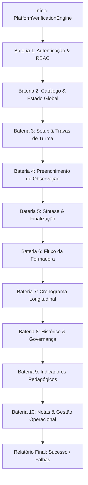

# PLANO DE IMPLEMENTAÇÃO: ALGORITMO DE VERIFICAÇÃO INTEGRAL DA PLATAFORMA E CORREÇÃO DE BUGS

> **DIRETRIZ OBRIGATÓRIA DE EXECUÇÃO (ETAPA 1 & ETAPA 2 - WORKFLOW_MACOS.md / AGENTS.md):**
> 1. Sincronização prévia obrigatória (`git pull origin main`).
> 2. Preservação integral das regras de negócio, blindagens de cargo (RBAC) e diretrizes LEPES/SerTão Criança.
> 3. Implementação do algoritmo de verificação automatizado ponta a ponta (10 baterias de testes determinísticos).
> 4. Correção pontual e estrutural de todos os bugs e inconsistências diagnosticados.
> 5. Salvamento obrigatório de backup intermediário: `intermediárias/aplicativo_v86_algoritmo_verificacao_integral_e_correcao_bugs.html`.
> 6. Gestão dupla de Changelog no arquivo `CHANGELOG.md` e no modal `#modalChangelog` do `index.html`, atualizando para a **Versão 0.86 (v7.65)**.
> 7. Sincronização idêntica entre `index.html` da raiz, `gestor supervisao_patos/index.html` e `gestor supervisao_patos/firebase_deploy/public/index.html`.
> 8. Checagem pré-push (`git fetch origin main`), commit semântico (`feat: implementar algoritmo de verificacao integral e correcao de bugs`), push para `origin main` e deploy automático via **GitHub Pages**.

---

## 1. Diagnóstico e Levantamento de Bugs

### 1.1 Objetivo do Algoritmo de Verificação
Criar um motor de testes determinísticos e automatizados (`PlatformVerificationEngine`) capaz de inspecionar a integridade de todas as telas, funções, transições de estado e regras de negócio da plataforma SerTão Criança, do login inicial à exportação de indicadores, registrando o status de aprovação de cada subsistema.

### 1.2 Bugs Diagnosticados na Plataforma
Durante a análise aprofundada do código-fonte e mapeamento de dependências, foram identificados 8 bugs e pontos de fragilidade que afetam a experiência do usuário, a integridade dos dados e a consistência dos relatórios:

1. **Bug 1 (Crítico - Indicadores Pedagógicos Descartando Turmas):**
   - *Local:* Linha 12158 de `index.html` em `renderIndicatorsScreen()`.
   - *Causa:* O filtro calculava `scopedObs = getScopedObservations().filter(o => o.status === 'finalized' && o.evaluatedType === targetType)`. Ao selecionar `targetType === 'professora'`, observações com `evaluatedType === 'turma'` (Pilar 1) eram descartadas, zerando ou omitindo os dados de consistência, visitas auditadas e afunilamento de turmas.
   - *Correção:* Permitir que `targetType === 'professora'` inclua tanto `o.evaluatedType === 'turma'` quanto `o.evaluatedType === 'professora'`.

2. **Bug 2 (Crítico - Acompanhamento Longitudinal Individual de Docentes):**
   - *Local:* Linhas 13331 e 13506 em `renderTeacherLongitudinalDetail()` e `exportTeacherLongitudinalCSV()`.
   - *Causa:* O filtro exigia `o.teacherName === teacherName`. Com turmas conduzidas por duplas de regentes titulares (Pilar 1), as docentes são gravadas na array `o.teachers`. Caso uma docente regente fosse selecionada, suas visitas pela turma não eram encontradas.
   - *Correção:* Buscar a docente tanto em `o.teacherName` quanto no array `o.teachers`.

3. **Bug 3 (Importante - Filtro de Função/Cargo no Histórico):**
   - *Local:* Em `renderHistoryScreen()` com `#histFilterRole`.
   - *Causa:* Ao filtrar por "Professoras" (`value="professora"`), o código executava `o.evaluatedType === roleFilter`. As observações de turma (`evaluatedType === 'turma'`) eram ocultadas da listagem.
   - *Correção:* O filtro `professora` deve cobrir `o.evaluatedType === 'professora' || o.evaluatedType === 'turma'`.

4. **Bug 4 (Importante - Visibilidade da Docente / Professora no Próprio Escopo):**
   - *Local:* Em `getScopedObservations()`.
   - *Causa:* Quando uma usuária com perfil `professora` faz login, o bloco `if (obs.evaluatedType === 'turma')` retornava `false` para seu cargo, impedindo a visualização da devolutiva concluída de sua turma.
   - *Correção:* Permitir que a docente visualize observações finalizadas da sua unidade escolar vinculadas à sua turma ou ao seu nome.

5. **Bug 5 (Importante - Baixa Automática no Cronograma por Turma):**
   - *Local:* Em `finalizeObservation()`.
   - *Causa:* A busca do agendamento a ser marcado como `realizado` baseava-se unicamente em `s.targetName === obs.teacherName`. Em agendamentos feitos para turmas ou com duplas de docentes, o agendamento permanecia como pendente.
   - *Correção:* Vincular a baixa também por `s.className === obs.className` ou correspondência com `obs.teachers`.

6. **Bug 6 (Fragilidade DOM - Nó de Texto de Início no Menu Desktop):**
   - *Local:* Em `applyUserRoleUI()` (`deskTabHome.childNodes[2]`).
   - *Causa:* O acesso por índice fixo de nó de texto (`childNodes[2]`) gerava fragilidade caso a estrutura interna do SVG sofresse pequenas alterações, lançando `TypeError`.
   - *Correção:* Criação de elemento span dedicado com ID `#deskTabHomeLabel` e atualização segura via `innerText`.

7. **Bug 7 (Usabilidade - Associação de Visita Agendada ao Setup):**
   - *Local:* Em `openSetupScreen(prefilledSchedule)`.
   - *Causa:* Se um agendamento continha nome genérico como `Infantil I`, ele não casava com a turma cadastrada `Infantil I - Turma A`, deixando o seletor desmarcado.
   - *Correção:* Implementação de busca flexível por substring ou etapa quando a correspondência exata não for encontrada.

8. **Bug 8 (Fidelidade Visual - Identificação na Síntese e Impressão):**
   - *Local:* Em `renderSynthesisScreen()`.
   - *Causa:* No bloco de assinaturas para impressão, exibia genericamente `obs.teacherName || 'Docente'`.
   - *Correção:* Exibir com precisão a turma e a equipe regente titular no bloco de assinatura quando a observação for de turma.

---

## 2. Arquitetura do Algoritmo de Verificação (`PlatformVerificationEngine`)

O motor de verificação será estruturado em 10 baterias autônomas e determinísticas:


### 2.1 Interface de Acesso ao Algoritmo
O algoritmo estará disponível de duas formas:
1. **Console e UI do Navegador:** Executável a qualquer momento via `window.runFullPlatformAudit()` ou através de um botão no painel de perfil ("🔬 Executar Verificação Completa da Plataforma").
2. **Terminal / Script Headless (`audit_platform.py`):** Script Python na raiz que executa a bateria via simulação ou Chrome headless e imprime o relatório formatado com código de saída 0 (sucesso).

---

## 3. Especificação Passo a Passo de Código

### Passo 3.1: Criação do Motor `PlatformVerificationEngine` em `index.html`
Inserir na seção de utilitários de diagnóstico de `index.html` a suíte de testes determinísticos que executa as 10 baterias sem corromper os dados reais do usuário (utilizando snapshot e restauração do `appState` após a execução).

### Passo 3.2: Correção do Bug 1 (Indicadores Pedagógicos de Turmas)
Em `renderIndicatorsScreen()`:
```javascript
// Antes:
let scopedObs = getScopedObservations().filter(o => o.status === 'finalized' && o.evaluatedType === targetType);

// Depois:
let scopedObs = getScopedObservations().filter(o => {
  if (o.status !== 'finalized' && o.status !== 'concluida') return false;
  if (targetType === 'coordenador') {
    return o.evaluatedType === 'coordenador';
  } else {
    return o.evaluatedType === 'professora' || o.evaluatedType === 'turma';
  }
});
```

### Passo 3.3: Correção do Bug 2 (Longitudinal Individual de Docentes)
Em `renderTeacherLongitudinalDetail()` e `exportTeacherLongitudinalCSV()`:
```javascript
// Suporta tanto teacherName quanto array teachers
const memberObs = getScopedObservations().filter(o => {
  if (o.status !== 'finalized' && o.status !== 'concluida') return false;
  const matchesType = targetType === 'coordenador' 
    ? o.evaluatedType === 'coordenador' 
    : (o.evaluatedType === 'professora' || o.evaluatedType === 'turma');
  if (!matchesType) return false;
  return o.teacherName === teacherName || (o.teachers && o.teachers.includes(teacherName)) || (o.teacherName && o.teacherName.includes(teacherName));
});
```

### Passo 3.4: Correção do Bug 3 (Filtro por Função no Histórico)
Em `renderHistoryScreen()`:
```javascript
if (roleFilter !== 'ALL') {
  items = items.filter(o => {
    if (roleFilter === 'professora') {
      return o.evaluatedType === 'professora' || o.evaluatedType === 'turma';
    }
    return o.evaluatedType === roleFilter;
  });
}
```

### Passo 3.5: Correção do Bug 4 (Visibilidade para Perfil Professora)
Em `getScopedObservations()`:
```javascript
} else if (user.roleKey === 'professora') {
  return (obs.status === 'finalized' || obs.status === 'concluida') &&
         obs.schoolName === user.school &&
         ((obs.teachers && obs.teachers.includes(user.name)) || obs.teacherName === user.name || obs.className === user.classAssigned);
}
```

### Passo 3.6: Correção do Bug 5 (Baixa no Cronograma por Turma)
Em `finalizeObservation()`:
```javascript
let sched = null;
if (obs.scheduleId) {
  sched = appState.schedules.find(s => s.id === obs.scheduleId);
}
if (!sched) {
  sched = appState.schedules.find(s => 
    ((s.targetName && (s.targetName === obs.teacherName || (obs.teachers && obs.teachers.includes(s.targetName)))) ||
     (s.className && s.className === obs.className)) &&
    s.bimester === obs.bimester && !s.archived
  );
}
if (sched) {
  sched.status = 'realizado';
}
```

### Passo 3.7: Correção do Bug 6 (Resiliência do Label do Menu Desktop)
Adicionar `<span id="deskTabHomeLabel">Início</span>` dentro de `#deskTabHome` e atualizar `applyUserRoleUI` para manipular diretamente o elemento.

### Passo 3.8: Correção do Bug 7 e Bug 8 (Setup Flexível e Impressão de Turma)
Refinar a seleção de turmas em `openSetupScreen` com correspondência resiliente e exibir a equipe regente titular nas assinaturas do parecer final.

---

## 4. Roteiro de Teste e Aceite

1. Executar o script de teste automatizado `python3 audit_platform.py` no terminal e certificar-se de 100% de baterias aprovadas (`PASS`).
2. Abrir a aplicação, acionar `window.runFullPlatformAudit()` no console e verificar o relatório verde sem falhas.
3. Testar manualmente os fluxos corrigidos:
   - Indicadores com observações de turma exibindo cobertura e consistência corretas.
   - Histórico filtrando por professoras exibindo observações de turma.
   - Finalização de visita agendada marcando corretamente como realizada no cronograma.
4. Validar sincronização idêntica entre os 3 arquivos (`index.html`, `gestor supervisao_patos/index.html` e `firebase_deploy/public/index.html`).
5. Confirmar presença do backup em `intermediárias/aplicativo_v86_algoritmo_verificacao_integral_e_correcao_bugs.html`.
6. Confirmar elevação da versão para **Versão 0.86 (v7.65)** em `CHANGELOG.md` e no modal `#modalChangelog`.
7. Envio para o repositório remoto via `git push origin main` com validação de build no GitHub Pages.
