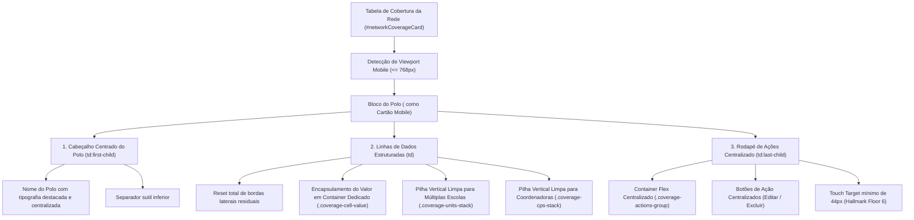

# PLANO DE IMPLEMENTAÇÃO — ALINHAMENTO CENTRALIZADO E REESTRUTURAÇÃO MOBILE DOS BLOCOS DE POLOS REGIONAIS (MATRIZ DE COBERTURA DA REDE)

> **Status:** Proposto / Em Análise (Etapa 1 - O Arquiteto)  
> **Data:** 29 de Outubro de 2026  
> **Alvo:** Card da Matriz de Distribuição e Cobertura da Rede por Polo Regional (`#networkCoverageCard`, `#networkCoverageTableBody`), arquivos `js/features/management.js`, `css/04_screens.css`, `index.html`, `js/audit/audit_engine.js` e espelhos do Firebase  
> **Padrão de Qualidade:** Hallmark Design Standard (v2.0.0 / `RULE[user_global]`)  
> **Objetivo Primário:** Solucionar em definitivo o problema de textos desalinhados e "fora de centro" nos blocos de polos regionais no modo mobile, eliminando a dispersão horizontal anômala de itens flex, estruturando o cabeçalho centrado de cada polo, alinhando verticalmente listas de escolas e coordenadoras, e centralizando os botões de ação em alvos de toque ergonômicos (mínimo de 44px).

---

## 0. Diretriz de Execução Obrigatória

> [!IMPORTANT]
> **Aviso ao Agente Executor (Etapa 2 - Operário):**  
> Antes de aplicar qualquer alteração de código resultante deste plano, você **DEVE OBRIGATORIAMENTE** ler o manual [`WORKFLOW_MACOS.md`](file:///Users/bruno/Desktop/gestor%20supervisao_patos/WORKFLOW_MACOS.md) e a skill [`.agents/skills/execucao-operario/SKILL.md`](file:///Users/bruno/Desktop/gestor%20supervisao_patos/.agents/skills/execucao-operario/SKILL.md).  
> 
> - **Trava Crítica da Etapa 1:** Durante a vigência deste plano, nenhum arquivo de código de produção deve ser comitado.
> - **Execução Mecânica da Etapa 2:** Na Etapa 2, execute o plano sem desvios, execute a blindagem sintática pré-voo (`python3 audit_platform.py --check-syntax`), crie o backup intermediário em `intermediárias/aplicativo_v1.57_alinhamento_blocos_polos_mobile.html`, atualize o changelog duplo (`CHANGELOG.md` e `#modalChangelog` / botão `.btn-changelog` para a Versão 1.57 - v8.2.24), sincronize as cópias espelhadas do Firebase (`firebase_deploy/public/`), realize o deploy via `git push origin main` e execute a auditoria pós-deploy via `python3 audit_platform.py --silent-on-success`.

---

## 1. Diagnóstico e Contexto (The Read — Hallmark Standard)

### 1.1. Contexto e Objeto da Demanda
Na aba **Gestão Pedagógica ➔ 🏢 Unidades Escolares & Polos** (`#homeGestaoView` ➔ `#pedagViewUnits`), o card principal superior **"Matriz de Distribuição e Cobertura da Rede por Polo Regional"** (`#networkCoverageCard`) apresenta a visão territorial consolidada dos Polos Regionais da Educação Infantil de Patos/PB.

No desktop, essa estrutura é renderizada como uma tabela (`<table class="data-table responsive-mobile-table">`) com 7 colunas: *Polo Regional, Formadora Responsável, Unidades Escolares Vinculadas, Coordenadoras Pedagógicas Atuantes, Docentes Atendidos, Status de Cobertura e Ações*.

No dispositivo móvel (telas com largura igual ou inferior a 768px), as regras CSS de `.responsive-mobile-table` transformam cada linha `<tr>` da tabela em um cartão ou bloco independente (cada um correspondendo a um Polo Regional).

### 1.2. Investigação Técnica da Causa Raiz dos Textos "Fora de Centro"

Ao inspecionar minuciosamente a renderização do DOM e as folhas de estilo aplicadas, identificamos **cinco causas estruturais complementares** que provocam o fenômeno visual relatado pelo usuário:

1. **Dispersão Horizontal Involuntária de Elementos Múltiplos via Flexbox (`space-between`):**
   - Na regra `@media (max-width: 768px)` em `css/04_screens.css`, cada célula da tabela recebe:
     ```css
     .responsive-mobile-table td {
       display: flex;
       justify-content: space-between;
       align-items: center;
       text-align: right;
     }
     ```
   - Na célula de **Unidades Vinculadas**, o JavaScript em `js/features/management.js` gera múltiplos `<div>` intercalados com tags `<br>`:
     ```javascript
     unitsInPolo.map(u => `<div ...>${u.name}</div>`).join('<br>')
     ```
   - Em CSS Flexbox, cada `<div>`, tag `<br>` e o pseudo-elemento `::before` (o rótulo "Unidades Vinculadas") tornam-se itens flex independentes no mesmo eixo principal horizontal.
   - Com `justify-content: space-between`, o flexbox distribui os itens ao longo de toda a largura: o rótulo fica na margem esquerda, a primeira escola é posicionada aproximadamente no meio (centro geométrico) da linha, o `<br>` ocupa espaço em branco e a segunda escola é jogada na margem direita. O texto parece estar literalmente "flutuando fora do centro".

2. **Fragmentação de Nós de Texto e Tags Inline nas Coordenadoras:**
   - Na célula de **Coordenadoras Pedagógicas**, o conteúdo é formatado com tags `<strong>` e texto puro intercalados por `<br>`:
     ```javascript
     `<strong>${c.name}</strong> (${c.school})`
     ```
   - No container flex, cada nó de texto solto e cada tag `<strong>` são fatiados como nós filhos flex separados, quebrando o nome da coordenadora e jogando pedaços do texto em posições randômicas no centro da tela.

3. **Conflito Triplo de Alinhamento de Eixos Textuais:**
   - O cabeçalho do cartão (`td:first-child`, nome do Polo) possui `text-align: left; display: block;`;
   - As linhas de dados intermediárias possuem `text-align: right; justify-content: space-between;`;
   - A célula de Ações (`td:last-child`) traz `style="text-align:center;"` inline, mas a regra CSS do mobile força `justify-content: flex-end;` e os botões trazem `width: 100%`.
   - Essa colisão de três direções em um mesmo bloco destrói o equilíbrio visual e a simetria da visualização móvel.

4. **Resíduo de Bordas Retangulares Herdadas do Desktop:**
   - A classe `.data-table td` define `border: 1px solid var(--border);`.
   - No mobile, `.responsive-mobile-table td` declarou apenas `border-bottom: 1px solid var(--gestao-border-subtle);`, sem resetar as bordas superior, esquerda e direita (`border: none`). Isso cria caixas retangulares assimétricas dentro de cada cartão.

5. **Falta de Destaque Simétrico e Centralizado para o Polo:**
   - Como entidade máxima do bloco, o nome do Polo Regional (ex: *Polo Regional 1 (Norte)*) deve ter presença visual nobre, centralizada e bem delineada no topo do bloco, servindo de âncora de leitura imediata para a gestão.

---

## 2. Arquitetura da Solução Proposta



### 2.1. Princípios de Design Hallmark Aplicados
1. **Hierarquia Clara e Simétrica (Tokens & Layout):** O título do Polo passa a ocupar o topo do cartão de forma centralizada (`text-align: center; justify-content: center;`), com peso tipográfico 800 e cor institucional sóbria (`var(--primary)`).
2. **Eliminação do Chaos Flex (Encapsulamento Semântico):** Cada célula de dados passa a encapsular seu valor dentro de um único elemento `<div class="coverage-cell-value">`. Assim, o flexbox pai (`display: flex; justify-content: space-between;`) lida estritamente com **2 elementos**: o rótulo à esquerda (`::before`) e o container de valor à direita.
3. **Pilhas Verticais Alinhadas:** Múltiplas UEs ou Coordenadoras passam a renderizar como pilhas verticais limpas (`display: flex; flex-direction: column; align-items: flex-end; gap: 4px;`), eliminando o uso de tags `<br>` que quebravam o flexbox.
4. **Ações Simétricas e Acessíveis:** O rodapé de ações é unificado com botões centralizados e alvos de toque adequados a smartphones (`min-height: 44px`).

---

## 3. Especificação de Implementação Passo a Passo (Snippets Exatos)

### 3.1. Passo 1 — Refatoração da Renderização em `js/features/management.js`

Localizar o loop `polos.forEach(poloName => { ... })` em `js/features/management.js` (linhas ~299 a ~334) e substituir a montagem do `innerHTML` da linha `<tr>` pelo snippet estruturado abaixo:

```javascript
        polos.forEach(poloName => {
          const unitsInPolo = appState.units.filter(u => u.polo === poloName);
          const unitNames = unitsInPolo.map(u => u.name);
          
          const formadora = appState.teamMembers.find(m => m.roleKey === 'formador' && m.school === poloName);
          const formadoraName = formadora ? formadora.name : '<span style="color:var(--text-secondary); font-style:italic;">A definir / Secretaria</span>';

          const cpsInPolo = appState.teamMembers.filter(m => m.roleKey === 'coordenador' && unitNames.includes(m.school));
          
          // Renderização estruturada de Coordenadoras em container empilhado
          const cpContent = cpsInPolo.length > 0 
            ? `<div class="coverage-cps-stack">${cpsInPolo.map(c => `<div class="coverage-cp-item"><strong>${c.name}</strong> <span class="coverage-cp-school">(${c.school})</span></div>`).join('')}</div>`
            : '<span style="color:var(--text-secondary); font-style:italic;">Nenhuma CP alocada</span>';

          // Renderização estruturada de Unidades Escolares em container empilhado
          const unitsContent = unitsInPolo.length > 0
            ? `<div class="coverage-units-stack">${unitsInPolo.map(u => `
                <div class="coverage-unit-item" onclick="openViewUnitClassesModal('${u.id}')" title="Clique para visualizar turmas e docentes atribuídos em ${u.name}">
                  ${u.name}
                </div>
              `).join('')}</div>`
            : '<span style="color:var(--text-secondary); font-style:italic;">Nenhuma UE alocada</span>';

          const teachersCount = appState.teamMembers.filter(m => m.roleKey === 'professora' && unitNames.includes(m.school)).length;

          const canEditPolo = isNucleoEI(user) || (user.roleKey === 'formador' && user.school === poloName);
          const canDeletePolo = isNucleoEI(user) && unitsInPolo.length === 0;

          const tr = document.createElement('tr');
          tr.className = 'coverage-polo-row';
          tr.innerHTML = `
            <td data-label="Polo Regional" class="coverage-cell-polo">
              <div class="coverage-polo-title">${poloName}</div>
            </td>
            <td data-label="Formadora" class="coverage-cell-formadora">
              <div class="coverage-cell-value"><span style="font-weight:700; color:var(--text-primary);">${formadoraName}</span></div>
            </td>
            <td data-label="Unidades Vinculadas" class="coverage-cell-units">
              <div class="coverage-cell-value">${unitsContent}</div>
            </td>
            <td data-label="Coordenadoras" class="coverage-cell-cps">
              <div class="coverage-cell-value">${cpContent}</div>
            </td>
            <td data-label="Docentes Atendidos" class="coverage-cell-teachers">
              <div class="coverage-cell-value"><span class="badge-hallmark-accent">${teachersCount} Docentes</span></div>
            </td>
            <td data-label="Status" class="coverage-cell-status">
              <div class="coverage-cell-value"><span class="badge-hallmark-active">Ativo</span></div>
            </td>
            <td data-label="Ações" class="coverage-cell-actions">
              <div class="coverage-actions-group">
                ${canEditPolo ? `<button class="btn btn-secondary coverage-btn-action" onclick="openEditPoloModal('${encodeURIComponent(poloName)}')">Editar</button>` : '<span style="color:var(--text-secondary); font-size:11px;">Somente Leitura</span>'}
                ${canDeletePolo ? `<button class="btn btn-secondary coverage-btn-action btn-action-delete" style="color:var(--red);" onclick="removePolo('${encodeURIComponent(poloName)}')">Excluir</button>` : ''}
              </div>
            </td>
          `;
          covTbody.appendChild(tr);
        });
```

### 3.2. Passo 2 — Estilização Responsiva Hallmark em `css/04_screens.css`

Adicionar regras especializadas para os blocos da Matriz de Cobertura no bloco `@media (max-width: 768px)` em `css/04_screens.css`:

```css
      /* =====================================================================
         ALINHAMENTO CENTRALIZADO DOS BLOCOS DE POLOS REGIONAIS (MOBILE)
         ===================================================================== */
      #networkCoverageCard .responsive-mobile-table tr.coverage-polo-row {
        background: var(--gestao-surface);
        border: 1px solid var(--gestao-border);
        border-radius: 12px;
        padding: 16px;
        margin-bottom: 16px;
        box-shadow: var(--shadow-sm);
        display: flex;
        flex-direction: column;
        gap: 0;
      }

      /* Cabeçalho do Bloco do Polo: 100% Centralizado no topo */
      #networkCoverageCard .responsive-mobile-table td.coverage-cell-polo {
        display: flex;
        justify-content: center;
        align-items: center;
        text-align: center;
        width: 100%;
        padding: 4px 0 12px 0;
        margin-bottom: 8px;
        border: none;
        border-bottom: 2px solid var(--gestao-border);
      }
      #networkCoverageCard .responsive-mobile-table td.coverage-cell-polo::before {
        display: none !important;
      }
      .coverage-polo-title {
        font-size: 16px;
        font-weight: 800;
        color: var(--primary);
        letter-spacing: -0.2px;
        text-align: center;
        width: 100%;
      }

      /* Linhas de Dados: Reset de Bordas e Alinhamento Perfeito */
      #networkCoverageCard .responsive-mobile-table td {
        border: none;
        border-bottom: 1px solid var(--gestao-border-subtle);
        padding: 8px 0;
        display: flex;
        justify-content: space-between;
        align-items: center;
        box-sizing: border-box;
        width: 100%;
      }
      #networkCoverageCard .responsive-mobile-table td::before {
        content: attr(data-label);
        font-weight: 600;
        color: var(--gestao-text-muted);
        font-size: 12px;
        text-align: left;
        margin-right: 12px;
        flex-shrink: 0;
      }

      /* Container de Valor Unificado (Impede dispersão de flexbox) */
      .coverage-cell-value {
        display: flex;
        flex-direction: column;
        align-items: flex-end;
        text-align: right;
        min-width: 0;
        flex-grow: 1;
      }

      /* Pilha de Unidades Escolares */
      .coverage-units-stack {
        display: flex;
        flex-direction: column;
        align-items: flex-end;
        gap: 4px;
        width: 100%;
      }
      .coverage-unit-item {
        cursor: pointer;
        color: var(--primary);
        font-weight: 600;
        font-size: 13px;
        text-align: right;
        line-height: 1.3;
        transition: color 0.15s ease;
      }
      .coverage-unit-item:hover {
        color: var(--primary-dark);
        text-decoration: underline;
      }

      /* Pilha de Coordenadoras Pedagógicas */
      .coverage-cps-stack {
        display: flex;
        flex-direction: column;
        align-items: flex-end;
        gap: 4px;
        width: 100%;
      }
      .coverage-cp-item {
        font-size: 12px;
        line-height: 1.35;
        text-align: right;
        color: var(--gestao-text-body);
      }
      .coverage-cp-item strong {
        color: var(--gestao-text-strong);
      }
      .coverage-cp-school {
        color: var(--gestao-text-muted);
        font-size: 11px;
      }

      /* Rodapé de Ações: Centralizado no Cartão */
      #networkCoverageCard .responsive-mobile-table td.coverage-cell-actions {
        border-bottom: none;
        padding-top: 14px;
        padding-bottom: 4px;
        display: flex;
        flex-direction: column;
        align-items: center;
        justify-content: center;
        width: 100%;
      }
      #networkCoverageCard .responsive-mobile-table td.coverage-cell-actions::before {
        display: none !important; /* Oculta rótulo textual 'Ações' no mobile */
      }
      .coverage-actions-group {
        display: flex;
        justify-content: center;
        align-items: center;
        gap: 10px;
        width: 100%;
      }
      .coverage-btn-action {
        flex: 1;
        max-width: 160px;
        min-height: var(--touch-target-min);
        padding: 8px 16px;
        font-size: 12px;
        font-weight: 700;
        justify-content: center;
        text-align: center;
        border-radius: 8px;
      }
```

E para manter a consistência no Desktop (`@media (min-width: 769px)`):
```css
    /* Estilos Desktop da Matriz de Cobertura */
    .coverage-polo-title {
      font-size: 13px;
      font-weight: 700;
      color: var(--primary);
    }
    .coverage-units-stack {
      display: flex;
      flex-direction: column;
      gap: 3px;
    }
    .coverage-unit-item {
      cursor: pointer;
      color: var(--primary);
      font-weight: 600;
      font-size: 13px;
      line-height: 1.3;
    }
    .coverage-cps-stack {
      display: flex;
      flex-direction: column;
      gap: 3px;
    }
    .coverage-cp-item {
      font-size: 12px;
      line-height: 1.3;
    }
    .coverage-actions-group {
      display: inline-flex;
      align-items: center;
      justify-content: center;
      gap: 6px;
    }
```

### 3.3. Passo 3 — Atualização do Changelog Duplo e Botão de Versão

1. No arquivo `index.html`:
   - Atualizar o botão `.btn-changelog` (linha ~84):
     ```html
     <span>Versão 1.57 (v8.2.24)</span>
     ```
   - Inserir o novo card de histórico no topo do container `#modalChangelog`:
     ```html
     <!-- VERSÃO 1.57 - ALINHAMENTO CENTRALIZADO DOS BLOCOS DE POLOS REGIONAIS NO MOBILE -->
     <div class="card" style="margin-bottom:16px; border-left:4px solid var(--primary); background:#F8FAFC;">
       <div style="display:flex; justify-content:space-between; align-items:center; margin-bottom:8px;">
         <span style="font-weight:800; font-size:14px; color:var(--primary-dark);">Versão 1.57 (v8.2.24)</span>
         <span style="font-size:11px; font-weight:700; color:var(--text-secondary);">29/10/2026</span>
       </div>
       <div style="font-size:12px; color:var(--text-primary); line-height:1.5;">
         Alinhamento Centralizado e Reestruturação Mobile dos Blocos de Polos Regionais:
         <ul style="margin:6px 0 0 16px; padding:0;">
           <li>🗺️ <strong>Cabeçalho Centrado de Polos Regionais:</strong> Destaque visual centralizado e simétrico do nome do Polo Regional no topo de cada bloco mobile na Matriz de Cobertura da Rede (<code>#networkCoverageCard</code>).</li>
           <li>📱 <strong>Eliminação da Dispersão de Flexbox:</strong> Encapsulamento de dados em containers estruturados (<code>.coverage-cell-value</code>), impedindo que escolas e coordenadoras fiquem flutuando fora de centro no celular.</li>
           <li>🏫 <strong>Pilhas Verticais Alinhadas de UEs e Coordenadoras:</strong> Exibição ordenada em coluna das unidades vinculadas e coordenadoras atuantes (<code>.coverage-units-stack</code> e <code>.coverage-cps-stack</code>).</li>
           <li>🎯 <strong>Rodapé de Ações Centralizado:</strong> Agrupamento simétrico dos botões de ação (Editar e Excluir) com alvos de toque de 44px para máxima ergonomia ao polegar.</li>
         </ul>
       </div>
     </div>
     ```

2. No arquivo `CHANGELOG.md`:
   - Adicionar o bloco da **Versão 1.57**:
     ```markdown
     ## [1.57] - 2026-10-29
     ### Modificado
     - **Alinhamento Centralizado e Reestruturação Mobile dos Blocos de Polos Regionais (`#networkCoverageCard`):**
       - Cabeçalho dos blocos de polos regionais 100% centralizado no topo com separador sutil;
       - Eliminação do espalhamento horizontal de flexbox em células com múltiplos itens (Unidades Escolares e Coordenadoras);
       - Criação dos componentes `.coverage-units-stack` e `.coverage-cps-stack` para exibição ordenada e verticalizada;
       - Centralização dos botões de ação (`.coverage-actions-group`) com alvos de toque ergonômicos de 44px;
       - Reset completo de bordas residuais da tabela desktop nas visualizações móveis;
       - Preservação rigorosa de todos os fluxos de consulta de turmas, edição de polo e auditoria modular.
     ```

---

## 4. Critérios de Aceite e Roteiro de Teste

### 4.1. Critérios de Aceite
1. [ ] **Blindagem Léxica e Sintática:** O comando `python3 audit_platform.py --check-syntax` reporta 100% de sucesso sem erros de sintaxe no JavaScriptCore nativo do macOS.
2. [ ] **Alinhamento do Cabeçalho do Bloco:** Em telas de até 768px de largura, o nome do Polo Regional (ex: *Polo Regional 1 (Norte)*) aparece perfeitamente centralizado no topo de cada cartão do `#networkCoverageCard`.
3. [ ] **Fim da Dispersão de Texto:** Nenhum elemento de escola vinculada ou coordenadora fica flutuando isoladamente no meio geométrico da linha; todos os itens aparecem alinhados e empilhados verticalmente.
4. [ ] **Centralização das Ações:** Os botões "Editar" (e "Excluir", quando aplicável) aparecem alinhados no centro horizontal do rodapé do bloco.
5. [ ] **Ergonomia e Touch Targets:** Todos os botões e links clicáveis possuem altura mínima de 44px.
6. [ ] **Funcionalidade Preservada:**
   - Clicar no nome de uma Unidade Escolar abre o modal `#modalViewUnitClasses` com turmas e regentes;
   - Clicar no botão "Editar" abre o modal `#modalEditPolo` com os dados corretos preenchidos;
   - O botão "+ Cadastrar Novo Polo" funciona perfeitamente.
7. [ ] **Desktop Intacto:** Em telas desktop (`> 768px`), a tabela mantém sua diagramação tabular intacta e alinhada.

### 4.2. Roteiro de Teste
1. **Verificação Léxica:**
   ```bash
   python3 audit_platform.py --check-syntax
   ```
2. **Checagem de Espelhamento do Firebase:**
   Garantir que `gestor supervisao_patos/index.html` e `gestor supervisao_patos/firebase_deploy/public/index.html` estejam idênticos.
3. **Auditoria Automatizada Pós-Deploy:**
   ```bash
   python3 audit_platform.py --silent-on-success
   ```

---

## 5. Seção Obrigatória: Alterações no Algoritmo de Auditoria (`audit_platform.py` / `audit_engine.js`)

Para assegurar a conformidade contínua e prevenir regressões na renderização dos blocos da Matriz de Cobertura, mapeamos as seguintes adições em `js/audit/audit_engine.js`:

### 5.1. Novas Asserções em `js/audit/audit_engine.js` (Módulo 22)
No bloco de testes de integridade da tela de Gestão Pedagógica, adicionar:

```javascript
// 22. VALIDAÇÃO DO ALINHAMENTO E COMPONENTES DOS BLOCOS DE POLOS NA MATRIZ DE COBERTURA (VERSÃO 1.57)
const coveragePoloTitles = document.querySelectorAll('#networkCoverageTableBody .coverage-polo-title');
const coverageUnitsStacks = document.querySelectorAll('#networkCoverageTableBody .coverage-units-stack');
const coverageActionsGroups = document.querySelectorAll('#networkCoverageTableBody .coverage-actions-group');

if (coveragePoloTitles.length === 0) {
  throw new Error('Matriz de Cobertura da Rede deve renderizar títulos com a classe .coverage-polo-title');
}
if (coverageUnitsStacks.length === 0) {
  throw new Error('Matriz de Cobertura da Rede deve renderizar pilhas estruturadas .coverage-units-stack');
}
if (coverageActionsGroups.length === 0) {
  throw new Error('Matriz de Cobertura da Rede deve renderizar grupo de ações com a classe .coverage-actions-group');
}
logger.log('Validação da Estruturação e Alinhamento dos Blocos de Polos na Matriz de Cobertura (Versão 1.57)', true, `${coveragePoloTitles.length} blocos validados`);

// Atualização da asserção de versão para 1.57
if (!btnChangelog.textContent.includes('Versão 1.57')) {
  throw new Error(`Botão de versão desatualizado: "${btnChangelog.textContent.trim()}"`);
}
if (!modalChg.innerHTML.includes('Versão 1.57')) {
  throw new Error('#modalChangelog não contém o card descritivo da Versão 1.57');
}
```

---

## 6. Conclusão da Etapa 1 e Solicitação de Autorização

O diagnóstico foi concluído, as causas raízes foram isoladas e todas as especificações técnicas (código JS, CSS responsivo, changelog e asserções de auditoria) foram minuciosamente mapeadas sem alterar qualquer arquivo de código em produção.

A árvore de trabalho do Git (`git status`) permanece limpa.

Aguardando a sua autorização expressa para prosseguir com a **Etapa 2 (Operário / Execução Mecânica Fiel)**.
