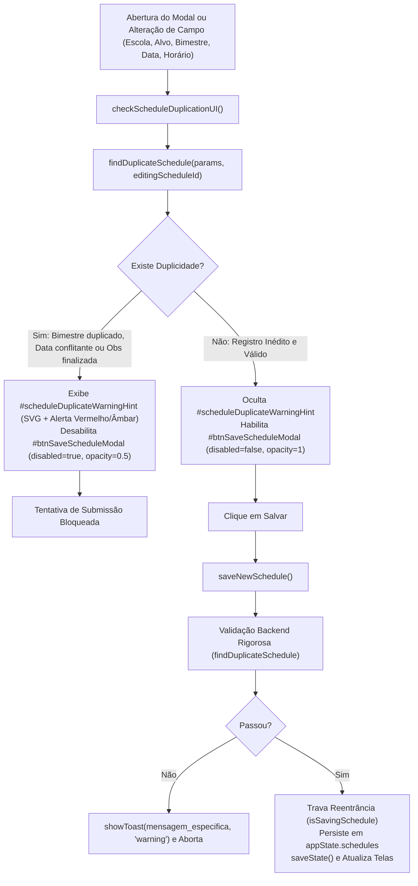

# Plano de Implementação: Bloqueio de Agendamentos Duplicados no Cronograma Longitudinal

> **Diretriz de Execução (Obrigatório):**  
> O assistente executor da **Etapa 2 (Operário)** DEVE OBRIGATORIAMENTE ler e seguir integralmente as diretrizes do arquivo [WORKFLOW_MACOS.md](file:///Users/bruno/Desktop/gestor%20supervisao_patos/WORKFLOW_MACOS.md), do [AGENTS.md](file:///Users/bruno/Desktop/gestor%20supervisao_patos/AGENTS.md) e a skill `.agents/skills/execucao-operario/SKILL.md` antes de aplicar quaisquer modificações no código-fonte. A execução deve ser estrita, cirúrgica e atenta à dupla checagem, validação de sintaxe pré-voo (`python3 audit_platform.py --check-syntax`), versionamento sequencial duplo (`CHANGELOG.md` e `#modalChangelog`), criação de cópia intermediária em `intermediárias/` e execução da auditoria pós-deploy silenciosa (`python3 audit_platform.py --silent-on-success`).

---

## 1. Diagnóstico do Problema e Análise Forense da Causa-Raiz

### 1.1 Sintoma Relatado
O usuário relatou expressamente:  
> *"o sistema está permitindo que eu lance agendamentos duplicados. isso não deve ser possível. crie um plano para modificar isso."*

Ao utilizar a aba **Cronograma** (ou os atalhos de agendamento na aba Início) através do modal `#modalAddSchedule`, o sistema permite que o usuário salve múltiplos agendamentos para o mesmo alvo (Turma para Coordenadoras ou Coordenadora para Formadoras) no mesmo bimestre, na mesma data ou através de cliques repetidos rápidos ("double-click"), gerando registros duplicados poluindo a agenda e distorcendo os indicadores de cobertura pedagógica longitudinal.

### 1.2 Análise Forense da Causa-Raiz Técnica
A inspeção analítica do arquivo `js/features/schedule.js` (especificamente da função `saveNewSchedule()`) identificou os seguintes fatores técnicos:

1. **Ausência Absoluta de Validação de Unicidade em `saveNewSchedule()`:**  
   Em `js/features/schedule.js` (linhas 817-898), a rotina de gravação apenas valida se o campo alvo está preenchido (`if (!targetVal) { showToast(...); return; }`). Em seguida, gera um ID unívoco baseado em timestamp (`id: 'sch-' + Date.now()`) e insere o novo objeto incondicionalmente no topo de `appState.schedules` via `appState.schedules.unshift(newSched)`. Não há qualquer checagem contra agendamentos pré-existentes.
2. **Vulnerabilidade ao Duplo Clique ("Double-Click"):**  
   O botão *"Salvar no Cronograma"* (`#btnSaveScheduleModal`) não desabilita a si mesmo nem possui flag de bloqueio de reentrância durante o salvamento. Cliques consecutivos rápidos geram dois ou mais registros idênticos com timestamps milissegundos apartados.
3. **Ausência de Feedback Visual Preventivo no Modal:**  
   Enquanto a tela de setup de observação (`#screenSetup`) possui o componente `updateSetupBimesterValidationUI()` alertando em tempo real sobre duplicidades de observação e pré-requisitos bimestrais, o modal de agendamento (`#modalAddSchedule`) não dispõe de nenhum feedback contextual. O usuário seleciona escola, turma/coordenador, bimestre e data sem saber se aquele ciclo já foi agendado ou concluído.
4. **Violação do Princípio Longitudinal da Educação Infantil (SerTão Criança):**  
   O modelo de acompanhamento pedagógico municipal estrutura-se em **4 ciclos bimestrais longitudinais**. Uma turma (ou coordenadora) deve possuir **no máximo um agendamento ativo por bimestre**. Permitir dois agendamentos da mesma turma no mesmo bimestre deturpa o cálculo da taxa de cobertura bimestral e as metas de monitoramento.
5. **Conflito de Agenda Física (Data e Horário):**  
   Não é pedagogicamente plausível que uma turma da Educação Infantil receba duas observações na mesma data, tampouco que o supervisor esteja em duas turmas/escolas diferentes no mesmo dia e horário.

---

## 2. Arquitetura da Solução e Pontos de Impacto



### Componentes e Arquivos Impactados:
1. **`index.html` e `gestor supervisao_patos/firebase_deploy/public/index.html`:**
   - Adição do elemento de aviso `#scheduleDuplicateWarningHint` dentro de `#modalAddSchedule` (padronizado com Hallmark Standard, tokens CSS e SVG).
   - Adição de `id="btnSaveScheduleModal"` no botão primário de salvar agendamento.
   - Adição do evento `onchange="checkScheduleDuplicationUI()"` e `oninput="checkScheduleDuplicationUI()"` nos campos de escola, alvo, bimestre, data e horário.
   - Atualização do modal de changelog (`#modalChangelog`) e botão `.btn-changelog`.
2. **`js/features/schedule.js`:**
   - Implementação do motor de verificação `findDuplicateSchedule(params, ignoreScheduleId)`.
   - Implementação do feedback visual e bloqueio do botão `checkScheduleDuplicationUI()`.
   - Modificação de `openAddScheduleModal()` e `openEditScheduleModal()` para disparar a checagem na abertura.
   - Modificação de `saveNewSchedule()` com dupla barreira de bloqueio, emissão de toast orientador e proteção contra múltiplos cliques.
   - Implementação da rotina de higienização retroativa `sanitizeDuplicateSchedules()`.
3. **`js/core/state.js`:**
   - Invocação de `sanitizeDuplicateSchedules()` durante a inicialização / saneamento de estado em `loadState()` para expurgar duplicatas geradas anteriormente na máquina do usuário.
4. **`js/audit/audit_engine.js`:**
   - Adição de casos de teste no módulo 8 (`agenda_cronograma`) para validação rigorosa da rejeição de agendamentos duplicados por bimestre, bloqueio de conflito de data/horário e verificação do elemento `#scheduleDuplicateWarningHint`.
5. **`CHANGELOG.md`:**
   - Registro da versão sequencial descrevendo a blindagem contra agendamentos duplicados.

---

## 3. Especificação Passo a Passo (Snippets Exatos)

### Passo 3.1: Estrutura HTML do Modal em `index.html` (e Espelho Firebase)

Localizar o modal `#modalAddSchedule` e:
1. Incluir o container `#scheduleDuplicateWarningHint` antes da linha de data/horário ou acima dos botões de ação.
2. Adicionar o identificador `id="btnSaveScheduleModal"` no botão de salvar.
3. Vincular `checkScheduleDuplicationUI()` aos seletores do modal.

```html
<!-- Localizar em index.html (por volta da linha 5143 a 5198): -->
      <div class="form-group">
        <label class="form-label">Unidade Escolar</label>
        <select id="scheduleSchool" class="form-select" onchange="onScheduleSchoolChange(); checkScheduleDuplicationUI();">
          <!-- Populated -->
        </select>
      </div>

      <div class="form-group">
        <label id="scheduleTargetLabel" class="form-label">Turma a ser Observada</label>
        <select id="scheduleTarget" class="form-select" onchange="onScheduleTargetChange(); checkScheduleDuplicationUI();">
          <!-- Populated dinamicamente com Turmas (Coordenadora) ou Coordenadoras (Formadora) -->
        </select>
      </div>

      <!-- Card Contextual de Docentes Regentes da Turma (Exibido para Coordenadoras) -->
      <div id="scheduleClassTeachersCard" style="display:none; background:#F8FAFC; border:1px solid #E2E8F0; border-radius:10px; padding:12px; margin-bottom:14px;">
        <div style="display:flex; justify-content:space-between; align-items:center; margin-bottom:6px;">
          <span style="font-size:11px; font-weight:800; text-transform:uppercase; color:var(--primary); letter-spacing:0.5px;">Equipe de Regência Titular</span>
          <span id="scheduleClassShiftBadge" class="badge" style="font-size:10px; background:#EFF6FF; color:#1E40AF;">Parcial</span>
        </div>
        <div id="scheduleClassTeachersList" style="display:flex; flex-wrap:wrap; gap:6px;">
          <!-- Preenchido via onScheduleTargetChange -->
        </div>
      </div>

      <div class="form-group">
        <label class="form-label">Bimestre de Acompanhamento</label>
        <select id="scheduleBimester" class="form-select" onchange="checkScheduleDuplicationUI();">
          <option value="1º Bimestre" selected>1º Bimestre</option>
          <option value="2º Bimestre">2º Bimestre</option>
          <option value="3º Bimestre">3º Bimestre</option>
          <option value="4º Bimestre">4º Bimestre</option>
        </select>
      </div>

      <div class="grid-2col" style="gap:12px;">
        <div class="form-group">
          <label class="form-label">Data Prevista</label>
          <input type="date" id="scheduleDate" class="form-input" onchange="checkScheduleDuplicationUI();" oninput="checkScheduleDuplicationUI();">
        </div>
        <div class="form-group">
          <label class="form-label">Horário Planejado</label>
          <input type="time" id="scheduleTime" class="form-input" value="08:00" onchange="checkScheduleDuplicationUI();" oninput="checkScheduleDuplicationUI();">
        </div>
      </div>

      <!-- BANNER DE AVISO CONTEXTUAL E BLOQUEIO DE DUPLICIDADE (HALLMARK STANDARD) -->
      <div id="scheduleDuplicateWarningHint" style="display:none; margin-top:8px; margin-bottom:14px; padding:10px 14px; border-radius:8px; font-size:12px; line-height:1.45;">
      </div>

      <div style="display:flex; gap:10px; justify-content:flex-end; align-items:center; margin-top:14px;">
        <button type="button" id="btnDeleteScheduleModal" class="btn btn-secondary" style="display:none; color:var(--red); border-color:var(--red); margin-right:auto;" onclick="confirmDeleteSchedule(editingScheduleId)">
          <svg class="btn-icon" viewBox="0 0 24 24"><polyline points="3 6 5 6 21 6"/><path d="M19 6v14a2 2 0 0 1-2 2H7a2 2 0 0 1-2-2V6m3 0V4a2 2 0 0 1 2-2h4a2 2 0 0 1 2 2v2"/></svg>
          Excluir Agendamento
        </button>
        <button type="button" class="btn btn-secondary" onclick="closeAddScheduleModal()">Cancelar</button>
        <button type="button" id="btnSaveScheduleModal" class="btn btn-primary" onclick="saveNewSchedule()">Salvar no Cronograma</button>
      </div>
```

---

### Passo 3.2: Motor de Validação e Bloqueio em `js/features/schedule.js`

Inserir as funções `findDuplicateSchedule()`, `checkScheduleDuplicationUI()` e `sanitizeDuplicateSchedules()`, além de atualizar `saveNewSchedule()`, `openAddScheduleModal()` e `openEditScheduleModal()`:

```javascript
    // --- MOTOR DE DETECÇÃO DE DUPLICIDADE EM AGENDAMENTOS (SSOT) ---
    let isSavingSchedule = false;

    function findDuplicateSchedule(params, ignoreScheduleId = null) {
      if (!appState.schedules || !Array.isArray(appState.schedules)) return null;
      const user = getCurrentUser();
      const { schoolName, targetType, targetName, className, bimester, plannedDate, plannedTime } = params;

      const cleanSchool = (schoolName || '').trim().toLowerCase();
      const cleanTarget = (targetName || '').trim().toLowerCase();
      const cleanClass = (className || '').trim().toLowerCase();
      const cleanBim = (bimester || '').trim();
      const cleanDate = (plannedDate || '').trim();
      const cleanTime = (plannedTime || '').trim();

      // 1. Duplicidade de Bimestre no Ciclo Longitudinal (Mesma Escola + Mesmo Alvo + Mesmo Bimestre)
      const bimDuplicate = appState.schedules.find(s => {
        if (ignoreScheduleId && s.id === ignoreScheduleId) return false;
        if (s.archived) return false;
        if ((s.schoolName || '').trim().toLowerCase() !== cleanSchool) return false;
        if ((s.bimester || '').trim() !== cleanBim) return false;

        if (targetType === 'turma') {
          const sClass = (s.className || s.targetName || '').trim().toLowerCase();
          return sClass === cleanClass || sClass === cleanTarget;
        } else {
          const sTarget = (s.targetName || '').trim().toLowerCase();
          return sTarget === cleanTarget;
        }
      });

      if (bimDuplicate) {
        const formattedDate = typeof formatDateBR === 'function' ? formatDateBR(bimDuplicate.plannedDate) : bimDuplicate.plannedDate;
        const targetLabel = targetType === 'turma' ? `a turma ${className || targetName}` : `a coordenadora ${targetName}`;
        const statusLabel = bimDuplicate.status === 'realizado' ? 'já realizada' : (bimDuplicate.status === 'atrasado' ? 'em atraso' : 'planejada');
        return {
          isDuplicate: true,
          type: 'bimester',
          existingSchedule: bimDuplicate,
          message: `Já existe uma observação (${statusLabel}) para ${targetLabel} no ${bimester} (agendada para ${formattedDate} às ${bimDuplicate.plannedTime || '08:00'}).`
        };
      }

      // 2. Duplicidade de Data no Alvo (Mesma Turma ou Mesma Coordenadora na mesma data)
      if (cleanDate) {
        const dateDuplicate = appState.schedules.find(s => {
          if (ignoreScheduleId && s.id === ignoreScheduleId) return false;
          if (s.archived) return false;
          if ((s.schoolName || '').trim().toLowerCase() !== cleanSchool) return false;
          if ((s.plannedDate || s.date || '').trim() !== cleanDate) return false;

          if (targetType === 'turma') {
            const sClass = (s.className || s.targetName || '').trim().toLowerCase();
            return sClass === cleanClass || sClass === cleanTarget;
          } else {
            const sTarget = (s.targetName || '').trim().toLowerCase();
            return sTarget === cleanTarget;
          }
        });

        if (dateDuplicate) {
          const formattedDate = typeof formatDateBR === 'function' ? formatDateBR(cleanDate) : cleanDate;
          const targetLabel = targetType === 'turma' ? `a turma ${className || targetName}` : `a coordenadora ${targetName}`;
          return {
            isDuplicate: true,
            type: 'date',
            existingSchedule: dateDuplicate,
            message: `Já existe uma visita marcada para ${targetLabel} na data ${formattedDate} (${dateDuplicate.bimester} às ${dateDuplicate.plannedTime || '08:00'}).`
          };
        }
      }

      // 3. Conflito de Horário do Supervisor (Mesmo observador no mesmo dia e horário)
      if (cleanDate && cleanTime && user && user.name) {
        const supervisorConflict = appState.schedules.find(s => {
          if (ignoreScheduleId && s.id === ignoreScheduleId) return false;
          if (s.archived) return false;
          if (s.supervisor && s.supervisor.trim().toLowerCase() !== user.name.trim().toLowerCase()) return false;
          return (s.plannedDate || s.date || '').trim() === cleanDate && (s.plannedTime || '').trim() === cleanTime;
        });

        if (supervisorConflict) {
          const formattedDate = typeof formatDateBR === 'function' ? formatDateBR(cleanDate) : cleanDate;
          return {
            isDuplicate: true,
            type: 'supervisor_time',
            existingSchedule: supervisorConflict,
            message: `Você já possui um agendamento neste mesmo dia e horário (${formattedDate} às ${cleanTime}) para ${supervisorConflict.className || supervisorConflict.targetName} na unidade ${supervisorConflict.schoolName}.`
          };
        }
      }

      // 4. Verificação de Observação Concluída / Em Andamento Existente para o Alvo no Bimestre
      if (appState.observations && Array.isArray(appState.observations)) {
        const bimNumMatch = cleanBim.match(/([1-4])/);
        const bimNum = bimNumMatch ? bimNumMatch[1] : '';

        const obsDuplicate = appState.observations.find(o => {
          if (o.status === 'archived') return false;
          if (cleanSchool && o.schoolName && (o.schoolName || '').trim().toLowerCase() !== cleanSchool) return false;
          const oBimNumMatch = (o.bimester || '').match(/([1-4])/);
          if (!oBimNumMatch || (bimNum && oBimNumMatch[1] !== bimNum)) return false;

          if (targetType === 'turma') {
            const oClass = (o.className || '').trim().toLowerCase();
            return oClass === cleanClass || oClass === cleanTarget;
          } else {
            const oTarget = (o.teacherName || '').trim().toLowerCase();
            return oTarget === cleanTarget;
          }
        });

        if (obsDuplicate) {
          const targetLabel = targetType === 'turma' ? `a turma ${className || targetName}` : `a coordenadora ${targetName}`;
          const obsStatus = (obsDuplicate.status === 'finalized' || obsDuplicate.status === 'concluida') ? 'concluída' : 'em rascunho';
          return {
            isDuplicate: true,
            type: 'observation',
            existingObservation: obsDuplicate,
            message: `Já existe uma observação (${obsStatus}) registrada para ${targetLabel} no ${bimester}. Não é necessário criar um novo agendamento.`
          };
        }
      }

      return null;
    }

    function checkScheduleDuplicationUI() {
      const hintEl = document.getElementById('scheduleDuplicateWarningHint');
      const saveBtn = document.getElementById('btnSaveScheduleModal');
      if (!hintEl) return;

      const schoolSelect = document.getElementById('scheduleSchool');
      const targetSelect = document.getElementById('scheduleTarget');
      const bimesterSelect = document.getElementById('scheduleBimester');
      const dateInput = document.getElementById('scheduleDate');
      const timeInput = document.getElementById('scheduleTime');

      if (!schoolSelect || !targetSelect || !bimesterSelect) return;

      const schoolName = schoolSelect.value;
      const targetVal = targetSelect.value;
      const bimester = bimesterSelect.value;
      const plannedDate = dateInput ? dateInput.value : '';
      const plannedTime = timeInput ? timeInput.value : '';

      if (!targetVal) {
        hintEl.style.display = 'none';
        if (saveBtn) {
          saveBtn.disabled = false;
          saveBtn.style.opacity = '1';
          saveBtn.style.cursor = 'pointer';
        }
        return;
      }

      const user = getCurrentUser();
      const targetType = user.roleKey === 'coordenador' ? 'turma' : 'coordenador';
      const className = targetType === 'turma' ? targetVal : 'Coordenação Pedagógica';
      const targetName = targetVal;

      const dup = findDuplicateSchedule({
        schoolName,
        targetType,
        targetName,
        className,
        bimester,
        plannedDate,
        plannedTime
      }, editingScheduleId);

      if (dup && dup.isDuplicate) {
        hintEl.style.display = 'flex';
        hintEl.style.alignItems = 'flex-start';
        hintEl.style.gap = '8px';
        hintEl.style.background = '#FEF2F2';
        hintEl.style.border = '1px solid #FCA5A5';
        hintEl.style.borderRadius = '8px';
        hintEl.style.padding = '10px 12px';
        hintEl.style.color = '#991B1B';
        hintEl.style.fontSize = '12px';
        hintEl.style.fontWeight = '500';
        hintEl.innerHTML = `
          <svg width="18" height="18" viewBox="0 0 24 24" fill="none" stroke="#DC2626" stroke-width="2" style="flex-shrink:0; margin-top:1px;"><circle cx="12" cy="12" r="10"/><line x1="12" y1="8" x2="12" y2="12"/><line x1="12" y1="16" x2="12.01" y2="16"/></svg>
          <div>
            <strong style="font-weight:700; color:#991B1B; display:block; margin-bottom:2px;">Agendamento Duplicado Detectado</strong>
            <span>${dup.message}</span>
          </div>
        `;
        if (saveBtn) {
          saveBtn.disabled = true;
          saveBtn.style.opacity = '0.5';
          saveBtn.style.cursor = 'not-allowed';
          saveBtn.title = dup.message;
        }
      } else {
        hintEl.style.display = 'none';
        if (saveBtn) {
          saveBtn.disabled = false;
          saveBtn.style.opacity = '1';
          saveBtn.style.cursor = 'pointer';
          saveBtn.title = '';
        }
      }
    }

    function sanitizeDuplicateSchedules() {
      if (!appState.schedules || !Array.isArray(appState.schedules)) return;
      const seenKeys = new Map();
      const sanitized = [];

      appState.schedules.forEach(s => {
        if (s.archived) {
          sanitized.push(s);
          return;
        }
        const targetKey = `${(s.schoolName || '').trim().toLowerCase()}::${(s.className || s.targetName || '').trim().toLowerCase()}::${(s.bimester || '').trim().toLowerCase()}`;
        if (!seenKeys.has(targetKey)) {
          seenKeys.set(targetKey, s);
          sanitized.push(s);
        } else {
          // Duplicata encontrada: preserva a que possuir observação vinculada
          const existing = seenKeys.get(targetKey);
          const sObs = typeof findObservationForSchedule === 'function' ? findObservationForSchedule(s) : null;
          const existingObs = typeof findObservationForSchedule === 'function' ? findObservationForSchedule(existing) : null;
          
          if (sObs && !existingObs) {
            const idx = sanitized.indexOf(existing);
            if (idx !== -1) sanitized[idx] = s;
            seenKeys.set(targetKey, s);
          }
        }
      });

      if (sanitized.length !== appState.schedules.length) {
        appState.schedules = sanitized;
        saveState();
      }
    }
```

E a substituição completa de `saveNewSchedule()`:

```javascript
    function saveNewSchedule() {
      if (isSavingSchedule) return;

      const user = getCurrentUser();
      const schoolName = document.getElementById('scheduleSchool').value;
      const targetVal = document.getElementById('scheduleTarget').value;
      const bimester = document.getElementById('scheduleBimester').value;
      const plannedDate = document.getElementById('scheduleDate').value;
      const plannedTime = document.getElementById('scheduleTime').value || '08:00';

      if (!targetVal) {
        showToast(user.roleKey === 'coordenador' ? 'Selecione a turma para o agendamento.' : 'Selecione o profissional para o agendamento.');
        return;
      }

      let targetType = 'turma';
      let className = targetVal;
      let targetName = targetVal;
      let classId = null;
      let teachersList = [];

      if (user.roleKey === 'coordenador') {
        targetType = 'turma';
        const schoolClasses = getClassesForSchool(schoolName);
        const targetClass = schoolClasses.find(c => c.name === targetVal);
        classId = targetClass ? targetClass.id : null;
        className = targetClass ? targetClass.name : targetVal;
        targetName = targetClass ? targetClass.name : targetVal;
        teachersList = targetClass ? (targetClass.teachers || []) : [];
      } else {
        targetType = 'coordenador';
        className = 'Coordenação Pedagógica';
        targetName = targetVal;
      }

      // --- BARREIRA DE PROTEÇÃO CONTRA AGENDAMENTOS DUPLICADOS ---
      const dup = findDuplicateSchedule({
        schoolName,
        targetType,
        targetName,
        className,
        bimester,
        plannedDate,
        plannedTime
      }, editingScheduleId);

      if (dup && dup.isDuplicate) {
        showToast(dup.message, 'warning');
        checkScheduleDuplicationUI();
        return;
      }

      isSavingSchedule = true;
      const saveBtn = document.getElementById('btnSaveScheduleModal');
      if (saveBtn) {
        saveBtn.disabled = true;
        saveBtn.style.opacity = '0.7';
      }

      try {
        if (editingScheduleId) {
          const schedIndex = appState.schedules.findIndex(s => s.id === editingScheduleId);
          if (schedIndex !== -1) {
            const schedToUpdate = appState.schedules[schedIndex];
            schedToUpdate.schoolName = schoolName;
            schedToUpdate.targetType = targetType;
            schedToUpdate.targetName = targetName;
            schedToUpdate.className = className;
            schedToUpdate.classId = classId;
            schedToUpdate.teachers = teachersList;
            schedToUpdate.bimester = bimester;
            schedToUpdate.plannedDate = plannedDate;
            schedToUpdate.date = plannedDate;
            schedToUpdate.plannedTime = plannedTime;

            // Sincronização relacional bidirecional com observação vinculada (se houver)
            const linkedObs = findObservationForSchedule(schedToUpdate);
            if (linkedObs) {
              linkedObs.date = plannedDate;
              linkedObs.startDate = plannedDate;
              linkedObs.endDate = plannedDate;
              if (plannedTime) linkedObs.startTime = plannedTime;

              if (linkedObs.isIntegral) {
                if (linkedObs.morningObs) linkedObs.morningObs.date = plannedDate;
                if (linkedObs.afternoonObs) linkedObs.afternoonObs.date = plannedDate;
              }
            }
          }
          showToast('Observação atualizada com sucesso!');
        } else {
          const newSched = {
            id: 'sch-' + Date.now(),
            schoolName: schoolName,
            targetType: targetType,
            targetName: targetName,
            className: className,
            classId: classId,
            teachers: teachersList,
            bimester: bimester,
            plannedDate: plannedDate,
            plannedTime: plannedTime,
            supervisor: user.name,
            status: 'planejado'
          };
          appState.schedules.unshift(newSched);
          showToast('Observação planejada adicionada ao cronograma!');
        }

        saveState();
        closeAddScheduleModal();
        renderScheduleScreen();
        if (typeof renderHomeScreen === 'function') renderHomeScreen();
      } finally {
        isSavingSchedule = false;
        if (saveBtn) {
          saveBtn.disabled = false;
          saveBtn.style.opacity = '1';
        }
      }
    }
```

E ao final de `openAddScheduleModal()` e `openEditScheduleModal()`:
```javascript
      // Adicionar no final de openAddScheduleModal():
      checkScheduleDuplicationUI();

      // Adicionar no final de openEditScheduleModal():
      checkScheduleDuplicationUI();
```

---

### Passo 3.3: Saneamento Automático na Carga do Estado em `js/core/state.js`

Em `js/core/state.js`, dentro da rotina de carga e migração defensiva (`loadState()`):
```javascript
          // Saneamento transparente contra agendamentos duplicados pré-existentes
          if (typeof sanitizeDuplicateSchedules === 'function') {
            sanitizeDuplicateSchedules();
          }
```

---

### Passo 3.4: Atualização dos Testes em `js/audit/audit_engine.js`

No módulo 8 (`agenda_cronograma`), expandir a suíte para validar:
1. Rejeição de tentativa de cadastrar o mesmo agendamento para a mesma turma e bimestre já agendados.
2. Comportamento do componente visual `#scheduleDuplicateWarningHint` e desabilitação de `#btnSaveScheduleModal`.
3. Preservação da contagem de agendamentos (`appState.schedules.length`).

```javascript
              // Validação da Barreira contra Agendamentos Duplicados
              const countBeforeDup = (appState.schedules || []).length;
              openAddScheduleModal();
              UI.select(document.getElementById('scheduleSchool'), 'CEI Professora Maria de Lourdes');
              UI.select(document.getElementById('scheduleTarget'), 'Infantil I - Turma A');
              UI.select(document.getElementById('scheduleBimester'), '3º Bimestre'); // Já criado anteriormente!
              UI.type(document.getElementById('scheduleDate'), getTodayDateString());
              checkScheduleDuplicationUI();

              const dupHint = document.getElementById('scheduleDuplicateWarningHint');
              if (!dupHint || dupHint.style.display === 'none') {
                throw new Error('Banner preventivo de duplicidade #scheduleDuplicateWarningHint não foi exibido para agendamento repetido');
              }
              const saveBtnModal = document.getElementById('btnSaveScheduleModal');
              if (!saveBtnModal || !saveBtnModal.disabled) {
                throw new Error('Botão de salvar #btnSaveScheduleModal não foi desabilitado perante duplicidade');
              }

              // Tentativa de forçar saveNewSchedule() diretamente
              saveNewSchedule();
              if ((appState.schedules || []).length !== countBeforeDup) {
                throw new Error('Sistema permitiu a inserção de agendamento duplicado no mesmo bimestre');
              }
              closeAddScheduleModal();
              logger.log('Bloqueio preventivo e rejeição mandatória de agendamento duplicado (#modalAddSchedule)', true);
```

---

## 4. Alterações / Adições / Exclusões no Algoritmo de Auditoria (`audit_platform.py` e `js/audit/audit_engine.js`)

Esta seção é **obrigatória** conforme as cláusulas de proteção de `AGENTS.md`.

### 4.1 Modificações no `audit_platform.py`:
- Nenhuma alteração estrutural no orquestrador python. O script `audit_platform.py` continuará acionando headless o navegador e validando a integridade léxica/sintática e os 12 módulos de auditoria.

### 4.2 Adições ao `js/audit/audit_engine.js`:
- **Módulo 8 (`agenda_cronograma`):**
  - **Inclusão:** Teste interativo de tentativa de duplicidade no `#modalAddSchedule` selecionando uma turma já agendada no mesmo bimestre.
  - **Asserção 1:** Verificar que `#scheduleDuplicateWarningHint` adquire `display: flex` e exibe o SVG e mensagem de alerta.
  - **Asserção 2:** Verificar que o botão `#btnSaveScheduleModal` adquire propriedade `disabled = true`.
  - **Asserção 3:** Chamar `saveNewSchedule()` e comprovar que `appState.schedules.length` não se altera.
  - **Asserção 4:** Confirmar que ao selecionar outro bimestre ou turma elegível, o hint desaparece e o botão volta a ficar habilitado.

### 4.3 Exclusões:
- Nenhuma exclusão de testes existentes. Todos os testes atuais permanecem 100% preservados e funcionais.

---

## 5. Critérios de Aceite e Roteiro de Verificação

### Critérios de Aceite:
1. **Bloqueio no Mesmo Bimestre:** Se a Turma (ou Coordenadora) já possui agendamento ativo no bimestre selecionado na mesma escola, o modal exibe imediatamente alerta explicativo e o salvamento é bloqueado.
2. **Bloqueio na Mesma Data:** A mesma turma ou coordenadora não pode receber duas visitas na mesma data.
3. **Bloqueio de Conflito de Horário:** O supervisor não pode ter dois agendamentos no mesmo dia e horário.
4. **Proteção Anti-Duplo Clique:** Múltiplos cliques rápidos no botão não geram duplicatas.
5. **Edição Segura:** Ao editar um agendamento existente (`editingScheduleId`), o registro em edição não acusa falso-positivo consigo mesmo.
6. **Saneamento Retroativo:** Bases locais com agendamentos duplicados anteriores são higienizadas de forma silenciosa e resiliente.
7. **Padrão Hallmark Floor:** O banner de aviso utiliza tokens CSS, fundo suave (`#FEF2F2`), borda delicada, tipografia semântica e ícones SVG inline (sem emojis soltos como iconografia).
8. **Blindagem Sintática:** `python3 audit_platform.py --check-syntax` retorna 100% de sucesso léxico/sintático.
9. **Auditoria Modular Headless:** `python3 audit_platform.py --silent-on-success` conclui com 100% de aprovação em todos os 12 módulos.

---

## 6. Checklist de Execução Operacional (Etapa 2 - Operário)

- [ ] Executar `git pull origin main` antes de iniciar.
- [ ] Aplicar as alterações nos arquivos `index.html`, `js/features/schedule.js`, `js/core/state.js` e `js/audit/audit_engine.js`.
- [ ] Copiar fielmente as alterações de `index.html` para `firebase_deploy/public/index.html`.
- [ ] Criar arquivo de backup em `intermediárias/aplicativo_v[N]_bloqueio_agendamentos_duplicados.html`.
- [ ] Atualizar número de versão sequencial no `CHANGELOG.md` e em `#modalChangelog` / `.btn-changelog` de `index.html`.
- [ ] Executar validação sintática obrigatória: `python3 audit_platform.py --check-syntax`.
- [ ] Executar checagem de concorrência com o repositório remoto (`git fetch origin main` e `git log HEAD..origin/main`).
- [ ] Realizar commit semântico: `feat: bloqueio rigoroso de agendamentos duplicados no cronograma e feedback preventivo em tempo real`.
- [ ] Enviar as alterações: `git push origin main`.
- [ ] Executar auditoria headless pós-deploy: `python3 audit_platform.py --silent-on-success`.
