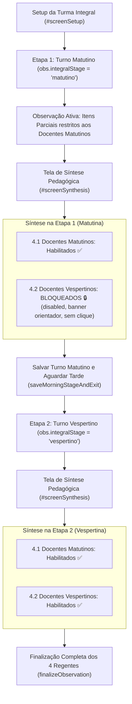

# PLANO DE IMPLEMENTAÇÃO: BLOQUEIO MANDATÓRIO DE AVALIAÇÃO DE DOCENTES VESPERTINOS NA ETAPA MATUTINA EM TURMAS INTEGRAIS (VERSÃO 1.14 · v7.92)

> **DIRETRIZ OBRIGATÓRIA DE EXECUÇÃO (ETAPA 2):**
> O assistente executor (Etapa 2) deve **obrigatoriamente ler e seguir as diretrizes dos arquivos [WORKFLOW_MACOS.md](file:///Users/bruno/Desktop/gestor%20supervisao_patos/WORKFLOW_MACOS.md), [WORKFLOW_GITHUB.md](file:///Users/bruno/Desktop/gestor%20supervisao_patos/WORKFLOW_GITHUB.md) e [AGENTS.md](file:///Users/bruno/Desktop/gestor%20supervisao_patos/AGENTS.md)** localizados na raiz do repositório antes de aplicar qualquer alteração de código. Nenhuma modificação deve ser executada sem conformidade estrita com o workflow, incluindo:
> 1. Execução prévia de sincronização com o repositório remoto (`git pull origin main`).
> 2. Preservação integral das regras de negócio existentes, dados cadastrais, matrizes curriculares oficiais, blindagens RBAC, série histórica e testes automatizados.
> 3. Verificação de integridade pós-edição com dupla checagem de leitura em cada trecho modificado.
> 4. Salvamento obrigatório do backup intermediário na pasta `intermediárias/` sob o nome `aplicativo_v114_bloqueio_docentes_vespertinos_etapa_matutina_integral.html`.
> 5. Gestão dupla de Changelog no arquivo `CHANGELOG.md` e no modal `#modalChangelog` do `index.html`, registrando a **Versão 1.14 (v7.92)**.
> 6. Sincronização idêntica entre o arquivo principal `index.html` da raiz, `gestor supervisao_patos/index.html` e `gestor supervisao_patos/firebase_deploy/public/index.html`.
> 7. Checagem pré-push (`git fetch origin main`), commit semântico (`feat: bloqueio de avaliacao de docentes vespertinos na etapa matutina em turmas integrais (v1.14)`), push para `origin main` e deploy automático no GitHub Pages.
> 8. Execução pós-deploy obrigatória do algoritmo de auditoria (`python3 audit_platform.py --silent-on-success`) com comunicação estrita a falhas.

---

## 1. Diagnóstico e Contexto

### 1.1 Cenário Atual
Na versão 1.12 / 1.13 do instrumento **SerTão Criança**, as turmas de Tempo Integral são estruturadas em formulário único de acompanhamento dividido em duas etapas temporais contínuas (Pilar 4):
1. **Etapa 1 (Turno Matutino):** Registro da rotina matutina, restrito às práticas pedagógicas da manhã conduzidas pelas duas docentes regentes do turno matutino (`teachersMorning`).
2. **Etapa 2 (Turno Vespertino):** Continuação da observação no período da tarde com a equipe de regência da tarde (`teachersAfternoon`), totalizando as 4 regentes titulares no fechamento da turma.

Embora a tela de observação ativa (`#screenActiveObs`) já restrinja a atribuição de critérios com pontuação parcial (`partial`) aos regentes da manhã durante a Etapa 1, na tela de Síntese Pedagógica (`#screenSynthesis`), na seção 4 (**"Avaliação Nominal e Devolutiva por Professor(a) Regente"**):
- A subseção 4.2 (**"Turno Vespertino"**) exibe os cards nominais das docentes da tarde (`aTeachers`) com todos os botões das 5 dimensões estruturantes (*Consistente*, *Parcial*, *Não Realizado*) e a caixa de texto de parecer formativo individual totalmente interativos e desprotegidos.
- Isso possibilita que o observador/coordenador pontue indevidamente docentes que ainda nem iniciaram sua jornada na turma, gerando distorções diagnósticas e avaliações precipitadas de práticas que pertencem exclusivamente ao turno vespertino.

### 1.2 Deliberação Expressa do Usuário e Requisito de Negócio
Conforme definido e confirmado via alinhamento direto:
- **Bloqueio Mandatório no Turno Matutino:** Durante a Etapa Matutina (`obs.integralStage === 'matutino'`), deve ser **estritamente impossível** avaliar qualquer dimensão estruturante ou redigir parecer para os docentes indicados como pertencentes ao turno vespertino (`teachersAfternoon`).
- **Disponibilidade Total no Turno Vespertino:** Ao avançar para a Etapa 2 (`obs.integralStage === 'vespertino'`), os 4 docentes da turma integral (dupla matutina + dupla vespertina) ficam integralmente disponíveis e habilitados para avaliação, revisão e emissão dos pareceres formativos individuais antes do envio definitivo.
- **Proteção em Duas Camadas:**
  1. *Camada Visual / DOM:* Desabilitação física (`disabled`), opacidade atenuada, banner contextual explicativo e selo de status `🔒 Bloqueado no Turno Matutino` nos cards dos docentes vespertinos.
  2. *Camada de Dados / Controladores JS:* Blindagem defensiva nas funções controladoras `setTeacherSynthesisDimension`, `setTeacherSynthesisFeedback` e `setCriterionPartialTeacher`, bloqueando qualquer mutação de estado caso o alvo pertença ao turno vespertino durante a Etapa Matutina.

---

## 2. Arquitetura e Pontos de Impacto



### Arquivos e Funções Afetadas:
1. **`index.html` (e espelho `firebase_deploy/public/index.html`):**
   - **Função `buildTeacherCard(tName, globalIdx, shiftTag = null, isBlocked = false)`:**
     - Adicionar o parâmetro booleano `isBlocked` (padrão `false`).
     - Quando `isBlocked === true`:
       - Adicionar classe visual `.teacher-card-blocked` e estilos atenuados (`opacity: 0.7; background: #F8FAFC; border: 1px dashed #CBD5E1;`).
       - Inserir badge no topo: `<span class="badge" style="background:#F1F5F9; color:#64748B; border:1px solid #CBD5E1; font-size:10px; font-weight:700;">🔒 Bloqueado no Turno Matutino</span>`.
       - Desabilitar todos os botões de dimensões (`<button ... disabled style="cursor:not-allowed; opacity:0.55;">`).
       - Desabilitar a caixa de parecer (`<textarea ... disabled placeholder="🔒 Avaliação bloqueada: esta docente atua no turno vespertino e será avaliada na Etapa 2 (Tarde)..." style="background:#F1F5F9; cursor:not-allowed; color:#94A3B8;"></textarea>`).
   - **Renderização em `renderSynthesisScreen`:**
     - Na iteração de `aTeachers`, calcular `const isBlocked = (obs.integralStage === 'matutino')` e passar para `buildTeacherCard`.
     - Atualizar o banner explicativo de aviso `#synthesisAfternoonBlockedNotice` para reforçar a regra de bloqueio.
   - **Controlador `setTeacherSynthesisDimension`:**
     - Blindar contra execução indevida para docentes vespertinos na etapa matutina.
   - **Controlador `setTeacherSynthesisFeedback`:**
     - Blindar contra execução indevida para docentes vespertinos na etapa matutina.
   - **Controlador `setCriterionPartialTeacher`:**
     - Blindar contra atribuição de item parcial a docentes vespertinos na etapa matutina.
   - **Auditoria Modular (Engine de Testes do `index.html`):**
     - Módulo 6 (`sintese_finalizacao`): inserção de asserções comportamentais verificando os botões desabilitados, badge de bloqueio e rejeição de chamadas diretas durante a etapa matutina, com desbloqueio integral na etapa vespertina.
   - **Changelog Duplo:**
     - Inclusão da Versão 1.14 (v7.92) no modal `#modalChangelog`, no botão `.btn-changelog` e no `CHANGELOG.md`.

---

## 3. Especificação de Implementação Passo a Passo (Snippets Exatos)

### Passo 3.1: Atualização da Função `buildTeacherCard` em `index.html`

**Localização aproximada:** Linhas 11574-11728 de `index.html`.

**Substituir:**
```javascript
          // Helper interno para gerar o card de cada docente
          function buildTeacherCard(tName, globalIdx, shiftTag = null) {
            if (!obs.teacherSynthesis[tName]) {
              obs.teacherSynthesis[tName] = {
                dimensions: {
                  estrategias: null,
                  gestao_grupo: null,
                  mediacao_individual: null,
                  respeito_integridade: null,
                  gestao_cuidados: null
                },
                feedback: ''
              };
            }
            const tData = obs.teacherSynthesis[tName];
            const tDims = tData.dimensions || {};

            // Mapeia critérios com nota parcial atribuídos a esta docente
            const assignedPartialItems = [];
            const responses = obs.responses || {};
            const attributions = obs.partialAttributions || {};
            const sections = getActiveSections(obs);

            Object.keys(responses).forEach(critId => {
              if (responses[critId] === 'partial') {
                const attr = attributions[critId];
                if (attr && Array.isArray(attr.teachers) && attr.teachers.includes(tName)) {
                  let critObj = null;
                  sections.forEach(s => s.subSections.forEach(sub => sub.criteria.forEach(c => {
                    if (c.id === critId) critObj = c;
                  })));
                  assignedPartialItems.push({
                    id: critId,
                    text: critObj ? critObj.text : `Critério ${critId}`,
                    justification: attr.justification || 'Sem justificativa registrada.'
                  });
                }
              }
            });

            const card = document.createElement('div');
            card.className = 'teacher-synthesis-card';
            card.id = `teacher-synthesis-card-${globalIdx}`;

            let cardHtml = `
              <div style="display:flex; justify-content:space-between; align-items:center; margin-bottom:14px; padding-bottom:10px; border-bottom:1px solid #E2E8F0;">
                <div style="display:flex; align-items:center; gap:10px;">
                  <div style="width:36px; height:36px; border-radius:18px; background:var(--primary); color:#fff; display:flex; align-items:center; justify-content:center; font-weight:800; font-size:14px;">
                    ${tName.split(' ').map(n=>n[0]).slice(0,2).join('')}
                  </div>
                  <div>
                    <div style="font-size:15px; font-weight:800; color:var(--text-primary);">${tName}</div>
                    <div style="font-size:11px; color:var(--text-secondary);">Docente Regente Titular</div>
                  </div>
                </div>
                <div style="display:flex; align-items:center; gap:6px;">
                  ${shiftTag ? `
                    <span class="badge" style="font-size:10px; font-weight:700; ${shiftTag.style}">
                      ${shiftTag.label}
                    </span>
                  ` : ''}
                  <span class="badge" style="background:#EFF6FF; color:#1E40AF; border:1px solid #BFDBFE; font-size:10px;">
                    Devolutiva Individual
                  </span>
                </div>
              </div>

              <!-- Grade das 5 Dimensões -->
              <div style="margin-bottom:16px;">
                <div style="font-size:12px; font-weight:800; color:var(--primary-dark); text-transform:uppercase; margin-bottom:8px;">
                  Avaliação nas 5 Dimensões Estruturantes:
                </div>
                <div style="display:flex; flex-direction:column; gap:8px;">
            `;

            dimLabels.forEach(d => {
              const currentVal = tDims[d.key];
              cardHtml += `
                <div style="display:flex; justify-content:space-between; align-items:center; flex-wrap:wrap; gap:6px; background:#F8FAFC; border:1px solid #E2E8F0; padding:8px 12px; border-radius:8px;">
                  <span style="font-size:12px; font-weight:700; color:#334155;">${d.title}</span>
                  <div style="display:flex; gap:6px;">
                    <button type="button" 
                            class="dim-pill-btn ${currentVal === 'consistent' ? 'active-cons' : ''}" 
                            onclick="setTeacherSynthesisDimension('${tName}', '${d.key}', 'consistent')"
                            ${appState.isReadOnly ? 'disabled' : ''}>
                      Consistente
                    </button>
                    <button type="button" 
                            class="dim-pill-btn ${currentVal === 'partial' ? 'active-parc' : ''}" 
                            onclick="setTeacherSynthesisDimension('${tName}', '${d.key}', 'partial')"
                            ${appState.isReadOnly ? 'disabled' : ''}>
                      Parcial
                    </button>
                    <button type="button" 
                            class="dim-pill-btn ${currentVal === 'not_done' ? 'active-notdone' : ''}" 
                            onclick="setTeacherSynthesisDimension('${tName}', '${d.key}', 'not_done')"
                            ${appState.isReadOnly ? 'disabled' : ''}>
                      Não Realizado
                    </button>
                  </div>
                </div>
              `;
            });

            cardHtml += `
                </div>
              </div>

              <!-- Rastreabilidade de Itens Parciais Atribuídos -->
              <div style="margin-bottom:16px;">
                <div style="font-size:12px; font-weight:800; color:#B45309; text-transform:uppercase; margin-bottom:6px;">
                  📌 Critérios com Nota Parcial Atribuída a esta Docente (${assignedPartialItems.length}):
                </div>
            `;

            if (assignedPartialItems.length === 0) {
              cardHtml += `
                <div style="font-size:11px; color:#15803D; background:#DCFCE7; border:1px solid #BBF7D0; border-radius:6px; padding:8px 12px;">
                  ✓ Nenhum apontamento de fragilidade pontual atribuído nos critérios individuais.
                </div>
              `;
            } else {
              cardHtml += `<div style="display:flex; flex-direction:column; gap:6px;">`;
              assignedPartialItems.forEach(item => {
                cardHtml += `
                  <div style="background:#FFFBEB; border:1px solid #FDE68A; border-left:4px solid #D97706; border-radius:6px; padding:8px 12px; font-size:11px;">
                    <div style="font-weight:700; color:#92400E;">[Item ${item.id}] ${item.text}</div>
                    <div style="color:#78350F; margin-top:2px;"><strong>Justificativa da Nota:</strong> ${item.justification}</div>
                  </div>
                `;
              });
              cardHtml += `</div>`;
            }

            cardHtml += `
              </div>

              <!-- Parecer Formativo e Combinados Individuais -->
              <div>
                <label style="font-size:12px; font-weight:800; color:var(--primary-dark); display:block; margin-bottom:4px;">
                  Parecer Formativo Individual e Combinados de Desenvolvimento:
                </label>
                <textarea class="form-textarea" 
                          id="teacherFeedback-${globalIdx}"
                          style="min-height:76px; font-size:12px;"
                          placeholder="${appState.isReadOnly ? 'Sem parecer individual registrado.' : 'Pontos fortes observados, evidências de práticas consistentes e combinados de aprimoramento individual para o próximo ciclo...'}"
                          onchange="setTeacherSynthesisFeedback('${tName}', this.value)"
                          ${appState.isReadOnly ? 'disabled' : ''}>${tData.feedback || ''}</textarea>
              </div>
            `;

            card.innerHTML = cardHtml;
            return card;
          }
```

**Por:**
```javascript
          // Helper interno para gerar o card de cada docente (com suporte a bloqueio condicional por turno)
          function buildTeacherCard(tName, globalIdx, shiftTag = null, isBlocked = false) {
            if (!obs.teacherSynthesis[tName]) {
              obs.teacherSynthesis[tName] = {
                dimensions: {
                  estrategias: null,
                  gestao_grupo: null,
                  mediacao_individual: null,
                  respeito_integridade: null,
                  gestao_cuidados: null
                },
                feedback: ''
              };
            }
            const tData = obs.teacherSynthesis[tName];
            const tDims = tData.dimensions || {};
            const isDisabled = appState.isReadOnly || isBlocked;

            // Mapeia critérios com nota parcial atribuídos a esta docente
            const assignedPartialItems = [];
            const responses = obs.responses || {};
            const attributions = obs.partialAttributions || {};
            const sections = getActiveSections(obs);

            Object.keys(responses).forEach(critId => {
              if (responses[critId] === 'partial') {
                const attr = attributions[critId];
                if (attr && Array.isArray(attr.teachers) && attr.teachers.includes(tName)) {
                  let critObj = null;
                  sections.forEach(s => s.subSections.forEach(sub => sub.criteria.forEach(c => {
                    if (c.id === critId) critObj = c;
                  })));
                  assignedPartialItems.push({
                    id: critId,
                    text: critObj ? critObj.text : `Critério ${critId}`,
                    justification: attr.justification || 'Sem justificativa registrada.'
                  });
                }
              }
            });

            const card = document.createElement('div');
            card.className = `teacher-synthesis-card ${isBlocked ? 'teacher-card-blocked' : ''}`;
            card.id = `teacher-synthesis-card-${globalIdx}`;
            if (isBlocked) {
              card.style.opacity = '0.72';
              card.style.background = '#F8FAFC';
              card.style.border = '1px dashed #CBD5E1';
              card.style.transition = 'all 0.2s ease';
            }

            let cardHtml = `
              <div style="display:flex; justify-content:space-between; align-items:center; margin-bottom:14px; padding-bottom:10px; border-bottom:1px solid #E2E8F0;">
                <div style="display:flex; align-items:center; gap:10px;">
                  <div style="width:36px; height:36px; border-radius:18px; background:${isBlocked ? '#94A3B8' : 'var(--primary)'}; color:#fff; display:flex; align-items:center; justify-content:center; font-weight:800; font-size:14px;">
                    ${tName.split(' ').map(n=>n[0]).slice(0,2).join('')}
                  </div>
                  <div>
                    <div style="font-size:15px; font-weight:800; color:${isBlocked ? '#64748B' : 'var(--text-primary)'};">${tName}</div>
                    <div style="font-size:11px; color:var(--text-secondary);">Docente Regente Titular</div>
                  </div>
                </div>
                <div style="display:flex; align-items:center; gap:6px;">
                  ${shiftTag ? `
                    <span class="badge" style="font-size:10px; font-weight:700; ${shiftTag.style}">
                      ${shiftTag.label}
                    </span>
                  ` : ''}
                  ${isBlocked ? `
                    <span class="badge" style="background:#F1F5F9; color:#475569; border:1px solid #CBD5E1; font-size:10px; font-weight:700;">
                      🔒 Bloqueado no Turno Matutino
                    </span>
                  ` : `
                    <span class="badge" style="background:#EFF6FF; color:#1E40AF; border:1px solid #BFDBFE; font-size:10px;">
                      Devolutiva Individual
                    </span>
                  `}
                </div>
              </div>

              ${isBlocked ? `
                <div style="background:#FFFBEB; border:1px solid #FDE68A; border-left:4px solid #D97706; border-radius:6px; padding:8px 12px; margin-bottom:14px; font-size:11px; color:#92400E; display:flex; align-items:center; gap:8px;">
                  <span>🔒</span>
                  <span><strong>Avaliação Bloqueada:</strong> Esta docente atua no <strong>Turno Vespertino (Tarde)</strong>. A avaliação das dimensões estruturantes e parecer pedagógico será habilitada na <strong>Etapa 2 (Tarde)</strong>.</span>
                </div>
              ` : ''}

              <!-- Grade das 5 Dimensões -->
              <div style="margin-bottom:16px;">
                <div style="font-size:12px; font-weight:800; color:${isBlocked ? '#64748B' : 'var(--primary-dark)'}; text-transform:uppercase; margin-bottom:8px;">
                  Avaliação nas 5 Dimensões Estruturantes:
                </div>
                <div style="display:flex; flex-direction:column; gap:8px;">
            `;

            dimLabels.forEach(d => {
              const currentVal = tDims[d.key];
              cardHtml += `
                <div style="display:flex; justify-content:space-between; align-items:center; flex-wrap:wrap; gap:6px; background:${isBlocked ? '#F1F5F9' : '#F8FAFC'}; border:1px solid ${isBlocked ? '#E2E8F0' : '#E2E8F0'}; padding:8px 12px; border-radius:8px;">
                  <span style="font-size:12px; font-weight:700; color:${isBlocked ? '#64748B' : '#334155'};">${d.title}</span>
                  <div style="display:flex; gap:6px;">
                    <button type="button" 
                            class="dim-pill-btn ${currentVal === 'consistent' ? 'active-cons' : ''}" 
                            onclick="setTeacherSynthesisDimension('${tName}', '${d.key}', 'consistent')"
                            ${isDisabled ? 'disabled' : ''}
                            style="${isDisabled ? 'cursor:not-allowed; opacity:0.55;' : ''}">
                      Consistente
                    </button>
                    <button type="button" 
                            class="dim-pill-btn ${currentVal === 'partial' ? 'active-parc' : ''}" 
                            onclick="setTeacherSynthesisDimension('${tName}', '${d.key}', 'partial')"
                            ${isDisabled ? 'disabled' : ''}
                            style="${isDisabled ? 'cursor:not-allowed; opacity:0.55;' : ''}">
                      Parcial
                    </button>
                    <button type="button" 
                            class="dim-pill-btn ${currentVal === 'not_done' ? 'active-notdone' : ''}" 
                            onclick="setTeacherSynthesisDimension('${tName}', '${d.key}', 'not_done')"
                            ${isDisabled ? 'disabled' : ''}
                            style="${isDisabled ? 'cursor:not-allowed; opacity:0.55;' : ''}">
                      Não Realizado
                    </button>
                  </div>
                </div>
              `;
            });

            cardHtml += `
                </div>
              </div>

              <!-- Rastreabilidade de Itens Parciais Atribuídos -->
              <div style="margin-bottom:16px;">
                <div style="font-size:12px; font-weight:800; color:${isBlocked ? '#94A3B8' : '#B45309'}; text-transform:uppercase; margin-bottom:6px;">
                  📌 Critérios com Nota Parcial Atribuída a esta Docente (${assignedPartialItems.length}):
                </div>
            `;

            if (assignedPartialItems.length === 0) {
              cardHtml += `
                <div style="font-size:11px; color:${isBlocked ? '#64748B' : '#15803D'}; background:${isBlocked ? '#F1F5F9' : '#DCFCE7'}; border:1px solid ${isBlocked ? '#E2E8F0' : '#BBF7D0'}; border-radius:6px; padding:8px 12px;">
                  ${isBlocked ? '🔒 Sem registros de fragilidades pontuais no período matutino.' : '✓ Nenhum apontamento de fragilidade pontual atribuído nos critérios individuais.'}
                </div>
              `;
            } else {
              cardHtml += `<div style="display:flex; flex-direction:column; gap:6px;">`;
              assignedPartialItems.forEach(item => {
                cardHtml += `
                  <div style="background:#FFFBEB; border:1px solid #FDE68A; border-left:4px solid #D97706; border-radius:6px; padding:8px 12px; font-size:11px;">
                    <div style="font-weight:700; color:#92400E;">[Item ${item.id}] ${item.text}</div>
                    <div style="color:#78350F; margin-top:2px;"><strong>Justificativa da Nota:</strong> ${item.justification}</div>
                  </div>
                `;
              });
              cardHtml += `</div>`;
            }

            cardHtml += `
              </div>

              <!-- Parecer Formativo e Combinados Individuais -->
              <div>
                <label style="font-size:12px; font-weight:800; color:${isBlocked ? '#64748B' : 'var(--primary-dark)'}; display:block; margin-bottom:4px;">
                  Parecer Formativo Individual e Combinados de Desenvolvimento:
                </label>
                <textarea class="form-textarea" 
                          id="teacherFeedback-${globalIdx}"
                          style="min-height:76px; font-size:12px; ${isBlocked ? 'background:#F1F5F9; cursor:not-allowed; color:#64748B; border-color:#CBD5E1;' : ''}"
                          placeholder="${isBlocked ? '🔒 Avaliação bloqueada: esta docente atua no turno vespertino e será avaliada na Etapa 2 (Tarde)...' : (appState.isReadOnly ? 'Sem parecer individual registrado.' : 'Pontos fortes observados, evidências de práticas consistentes e combinados de aprimoramento individual para o próximo ciclo...')}"
                          onchange="setTeacherSynthesisFeedback('${tName}', this.value)"
                          ${isDisabled ? 'disabled' : ''}>${tData.feedback || ''}</textarea>
              </div>
            `;

            card.innerHTML = cardHtml;
            return card;
          }
```

---

### Passo 3.2: Chamada Parametrizada de `buildTeacherCard` na Síntese Integral em `index.html`

**Localização aproximada:** Linhas 11784-11798 de `index.html`.

**Substituir:**
```javascript
            if (obs.integralStage === 'matutino') {
              const noticeCard = document.createElement('div');
              noticeCard.style.cssText = 'background:#FFFBEB; border:1px dashed #F59E0B; border-radius:8px; padding:10px 14px; margin-bottom:12px; font-size:12px; color:#B45309; line-height:1.4;';
              noticeCard.innerHTML = `
                ℹ️ <strong>Observação em Etapa Matutina:</strong> A avaliação nominal das docentes da tarde será preenchida durante a Etapa 2 (Vespertina). Salve o turno matutino para prosseguir à tarde.
              `;
              synthTeachersCardsContainer.appendChild(noticeCard);
            }

            aTeachers.forEach(tName => {
              const card = buildTeacherCard(tName, globalIdx, { label: '🌅 Turno Vespertino', style: 'background:#FFF7ED; color:#EA580C; border:1px solid #FED7AA;' });
              synthTeachersCardsContainer.appendChild(card);
              globalIdx++;
            });
```

**Por:**
```javascript
            const isMorningStage = (obs.integralStage === 'matutino');

            if (isMorningStage) {
              const noticeCard = document.createElement('div');
              noticeCard.id = 'synthesisAfternoonBlockedNotice';
              noticeCard.style.cssText = 'background:#FFFBEB; border:1px solid #F59E0B; border-left:5px solid #D97706; border-radius:8px; padding:12px 14px; margin-bottom:14px; font-size:12px; color:#B45309; line-height:1.5;';
              noticeCard.innerHTML = `
                <div style="font-weight:800; display:flex; align-items:center; gap:6px; margin-bottom:4px;">
                  <span>🔒</span> <span>Avaliação Bloqueada no Turno Matutino (Etapa 1/2)</span>
                </div>
                <div>Os docentes abaixo atuam no <strong>Turno Vespertino (Tarde)</strong> e não podem ser avaliados durante a observação matutina. A avaliação nominal das 5 dimensões e parecer individual será liberada na <strong>Etapa 2 (Tarde)</strong>, quando os 4 regentes estarão disponíveis para fechamento. Salve o turno matutino abaixo para retomar à tarde.</div>
              `;
              synthTeachersCardsContainer.appendChild(noticeCard);
            }

            aTeachers.forEach(tName => {
              const card = buildTeacherCard(
                tName, 
                globalIdx, 
                { label: '🌅 Turno Vespertino', style: 'background:#FFF7ED; color:#EA580C; border:1px solid #FED7AA;' },
                isMorningStage // isBlocked: true na etapa matutina, false na etapa vespertina
              );
              synthTeachersCardsContainer.appendChild(card);
              globalIdx++;
            });
```

---

### Passo 3.3: Blindagem Defensiva nos Controladores JS em `index.html`

**Localização aproximada:** Linhas 12267-12297 de `index.html`.

**Substituir:**
```javascript
    function setTeacherSynthesisDimension(teacherName, dimKey, rating) {
      if (!appState.currentObs) return;
      if (!appState.currentObs.teacherSynthesis) appState.currentObs.teacherSynthesis = {};
      if (!appState.currentObs.teacherSynthesis[teacherName]) {
        appState.currentObs.teacherSynthesis[teacherName] = {
          dimensions: {},
          feedback: ''
        };
      }
      if (!appState.currentObs.teacherSynthesis[teacherName].dimensions) {
        appState.currentObs.teacherSynthesis[teacherName].dimensions = {};
      }
      appState.currentObs.teacherSynthesis[teacherName].dimensions[dimKey] = rating;
      saveState();
      renderSynthesisScreen();
    }

    function setTeacherSynthesisFeedback(teacherName, feedbackText) {
      if (!appState.currentObs) return;
      if (!appState.currentObs.teacherSynthesis) appState.currentObs.teacherSynthesis = {};
      if (!appState.currentObs.teacherSynthesis[teacherName]) {
        appState.currentObs.teacherSynthesis[teacherName] = {
          dimensions: {},
          feedback: ''
        };
      }
      appState.currentObs.teacherSynthesis[teacherName].feedback = feedbackText;
      saveState();
    }
```

**Por:**
```javascript
    function setTeacherSynthesisDimension(teacherName, dimKey, rating) {
      if (appState.isReadOnly || !appState.currentObs) return;
      const obs = appState.currentObs;

      // BLINDAGEM DE TURNO: Em turma integral na etapa matutina, bloqueia avaliação de docentes da tarde!
      if (obs.isIntegral && obs.integralStage === 'matutino') {
        const afternoonTeachers = obs.teachersAfternoon || [];
        if (afternoonTeachers.includes(teacherName)) {
          showToast(`Ação bloqueada: ${teacherName} pertence ao turno vespertino e só pode ser avaliada na Etapa 2 (Tarde).`);
          return;
        }
      }

      if (!obs.teacherSynthesis) obs.teacherSynthesis = {};
      if (!obs.teacherSynthesis[teacherName]) {
        obs.teacherSynthesis[teacherName] = {
          dimensions: {},
          feedback: ''
        };
      }
      if (!obs.teacherSynthesis[teacherName].dimensions) {
        obs.teacherSynthesis[teacherName].dimensions = {};
      }
      obs.teacherSynthesis[teacherName].dimensions[dimKey] = rating;
      saveState();
      renderSynthesisScreen();
    }

    function setTeacherSynthesisFeedback(teacherName, feedbackText) {
      if (appState.isReadOnly || !appState.currentObs) return;
      const obs = appState.currentObs;

      // BLINDAGEM DE TURNO: Em turma integral na etapa matutina, bloqueia parecer de docentes da tarde!
      if (obs.isIntegral && obs.integralStage === 'matutino') {
        const afternoonTeachers = obs.teachersAfternoon || [];
        if (afternoonTeachers.includes(teacherName)) {
          showToast(`Ação bloqueada: ${teacherName} pertence ao turno vespertino e só pode receber parecer na Etapa 2 (Tarde).`);
          return;
        }
      }

      if (!obs.teacherSynthesis) obs.teacherSynthesis = {};
      if (!obs.teacherSynthesis[teacherName]) {
        obs.teacherSynthesis[teacherName] = {
          dimensions: {},
          feedback: ''
        };
      }
      obs.teacherSynthesis[teacherName].feedback = feedbackText;
      saveState();
    }
```

E em `setCriterionPartialTeacher` (linha 10998):
**Substituir:**
```javascript
    // PILAR 5: Manipulação Reativa de Atribuição a Docente em Itens Parciais
    function setCriterionPartialTeacher(critId, teacherName, isChecked) {
      if (appState.isReadOnly || !appState.currentObs) return;
      if (!appState.currentObs.partialAttributions) appState.currentObs.partialAttributions = {};
      if (!appState.currentObs.partialAttributions[critId]) {
        appState.currentObs.partialAttributions[critId] = { teachers: [], justification: '' };
      }

      let teachers = appState.currentObs.partialAttributions[critId].teachers || [];
      if (isChecked) {
        if (!teachers.includes(teacherName)) teachers.push(teacherName);
      } else {
        teachers = teachers.filter(t => t !== teacherName);
      }
      appState.currentObs.partialAttributions[critId].teachers = teachers;
      saveState();
      // Atualiza o banner de validação e contador de pendências sem perder foco
```

**Por:**
```javascript
    // PILAR 5: Manipulação Reativa de Atribuição a Docente em Itens Parciais
    function setCriterionPartialTeacher(critId, teacherName, isChecked) {
      if (appState.isReadOnly || !appState.currentObs) return;
      const obs = appState.currentObs;

      // BLINDAGEM DE TURNO: Em turma integral na etapa matutina, bloqueia atribuição a docente vespertino
      if (obs.isIntegral && obs.integralStage === 'matutino') {
        const afternoonTeachers = obs.teachersAfternoon || [];
        if (afternoonTeachers.includes(teacherName)) {
          showToast(`Ação bloqueada: ${teacherName} pertence ao turno vespertino.`);
          return;
        }
      }

      if (!obs.partialAttributions) obs.partialAttributions = {};
      if (!obs.partialAttributions[critId]) {
        obs.partialAttributions[critId] = { teachers: [], justification: '' };
      }

      let teachers = obs.partialAttributions[critId].teachers || [];
      if (isChecked) {
        if (!teachers.includes(teacherName)) teachers.push(teacherName);
      } else {
        teachers = teachers.filter(t => t !== teacherName);
      }
      obs.partialAttributions[critId].teachers = teachers;
      saveState();
      // Atualiza o banner de validação e contador de pendências sem perder foco
```

---

### Passo 3.4: Atualização da Gestão Dupla do Changelog (Versão 1.14 · v7.92)

1. **No arquivo `index.html` (botão `.btn-changelog`):**
   - Substituir `📌 Versão 1.13 (v7.91)` por `📌 Versão 1.14 (v7.92)`.

2. **No modal `#modalChangelog` do `index.html`:**
   - Inserir no topo da listagem de versões o bloco detalhado:
```html
      <!-- VERSÃO 1.14 - BLOQUEIO DE DOCENTES VESPERTINOS NA ETAPA MATUTINA EM TURMAS INTEGRAIS -->
      <div style="margin-bottom:20px; border-left:3px solid var(--primary); padding-left:14px;">
        <div style="display:flex; align-items:center; gap:8px;">
          <span style="font-size:14px; font-weight:800; color:var(--primary-dark);">Versão 1.14 · v7.92</span>
          <span style="font-size:11px; background:#EFF6FF; color:var(--primary); padding:2px 8px; border-radius:12px; font-weight:700;">22/10/2026</span>
        </div>
        <div style="font-size:12px; color:var(--text-secondary); margin-top:4px;">
          Bloqueio Mandatório de Avaliação de Docentes Vespertinos na Etapa Matutina em Turmas Integrais (Pilares 4 e 5):
        </div>
        <ul style="font-size:12px; color:var(--text-primary); margin-top:8px; line-height:1.6; padding-left:16px;">
          <li>🔒 <strong>Bloqueio Integral na Etapa Matutina:</strong> Em turmas de Tempo Integral, durante a Etapa 1 (Turno Matutino), os cards das docentes regentes do turno vespertino permanecem estritamente bloqueados e desabilitados na Síntese Pedagógica (dimensões e pareceres protegidos contra preenchimento precoce).</li>
          <li>🌤️ <strong>Banner Contextual de Bloqueio por Turno:</strong> Inclusão de aviso destacado (<code>#synthesisAfternoonBlockedNotice</code>) e selo <code>🔒 Bloqueado no Turno Matutino</code> orientando o observador de que a avaliação nominal da tarde será liberada na Etapa 2 (Vespertina).</li>
          <li>🛡️ <strong>Blindagem Lógica em Dupla Camada:</strong> Proteção nos controladores JavaScript <code>setTeacherSynthesisDimension</code>, <code>setTeacherSynthesisFeedback</code> e <code>setCriterionPartialTeacher</code> contra alterações diretas para docentes da tarde enquanto na etapa matutina.</li>
          <li>👥 <strong>Disponibilidade Plena na Etapa Vespertina:</strong> Na Etapa 2 (Tarde), todos os 4 docentes regentes titulares da turma integral tornam-se plenamente acessíveis e editáveis para validação e fechamento da turma.</li>
          <li>🔬 <strong>Auditoria Contínua com 100% de Aprovação:</strong> Módulo 6 (Síntese Pedagógica) ampliado com verificação determinística de desabilitação e bloqueio de docentes vespertinos na etapa matutina e desbloqueio integral na vespertina.</li>
        </ul>
      </div>
```

3. **No arquivo `CHANGELOG.md`:**
   - Adicionar a linha da **Versão 1.14** na tabela do *Sumário Executivo de Versões*.
   - Adicionar a seção completa da **Versão 1.14** com *Inclusões*, *Modificações* e *Exclusões*.

---

## 4. Critérios de Aceite e Roteiro de Teste/Validação

- [ ] **Critério 1 (Setup e Início de Turma Integral):** Ao iniciar uma observação para a turma *Maternal II - Turma Integral* (dupla matutina: *Mariana Santos*, *Roberta Dias*; dupla vespertina: *Patricia Souza*, *Camila Vasconcelos*), a observação inicia em rascunho com `integralStage === 'matutino'`.
- [ ] **Critério 2 (Observação Ativa na Etapa 1):** Ao marcar um critério com nota parcial, apenas as docentes da manhã (*Mariana Santos* e *Roberta Dias*) devem ser listadas para atribuição. Docentes da tarde não aparecem e chamadas a `setCriterionPartialTeacher` para elas são rejeitadas.
- [ ] **Critério 3 (Síntese Pedagógica na Etapa 1 - Bloqueio Vespertino):** Ao navegar para `#screenSynthesis`:
  - A subseção 4.1 (*Mariana Santos* e *Roberta Dias*) deve estar plenamente interativa (botões clicáveis e parecer editável).
  - O banner `#synthesisAfternoonBlockedNotice` deve ser exibido com ícone 🔒.
  - A subseção 4.2 (*Patricia Souza* e *Camila Vasconcelos*) deve exibir os cards bloqueados: badge `🔒 Bloqueado no Turno Matutino`, botões de dimensões desabilitados (`disabled`), caixa de parecer desabilitada (`disabled`).
  - Chamadas a `setTeacherSynthesisDimension` ou `setTeacherSynthesisFeedback` para *Patricia Souza* ou *Camila Vasconcelos* são bloqueadas com toast informativo.
- [ ] **Critério 4 (Salvamento da Etapa Matutina):** Ao clicar em *"SALVAR TURNO MATUTINO E AGUARDAR TARDE"*, o rascunho é persistido e avança para `integralStage = 'vespertino'`.
- [ ] **Critério 5 (Retomada na Etapa 2 - Liberação dos 4 Docentes):** Ao retomar a observação na Etapa 2:
  - O banner `#synthesisAfternoonBlockedNotice` desaparece.
  - Os cards de *Patricia Souza* e *Camila Vasconcelos* tornam-se plenamente habilitados e editáveis.
  - Os 4 docentes regentes da turma integral estão disponíveis para avaliação e fechamento.
- [ ] **Critério 6 (Finalização e Integridade dos Dados):** O preenchimento das 5 dimensões e parecer individual é exigido para os 4 regentes antes do envio definitivo (`finalizeObservation`), garantindo 100% de cobertura nos indicadores do Pilar 10.

---

## 5. Seção Obrigatória: Alterações / Adições / Exclusões no Algoritmo de Auditoria (Mandatório)

Em conformidade rigorosa com a seção 2 do `WORKFLOW_MACOS.md`, esta seção detalha modo-a-modo as alterações na suíte de testes do motor de auditoria (`index.html` e `audit_platform.py`).

### 5.1 Alterações no Módulo 6: Síntese Pedagógica, Escala de Materiais, Finalização e Cálculo de Tempo (`sintese_finalizacao`)
No arquivo `index.html` (linhas 21210-21230), **ADICIONAR** o seguinte teste determinístico:

```javascript
              // PILAR 4 & 5 (v1.14): Teste de Bloqueio Mandatório de Docentes Vespertinos na Etapa Matutina em Turma Integral
              const testIntegralMorningSynth = {
                id: 'obs-test-integral-morning-synth-' + Date.now(),
                evaluatedType: 'turma',
                unitOfAnalysis: 'turma',
                className: 'Maternal II - Turma Integral',
                schoolName: 'CEI Professora Maria de Lourdes',
                isIntegral: true,
                integralStage: 'matutino',
                teachersMorning: ['Mariana Santos', 'Roberta Dias'],
                teachersAfternoon: ['Patricia Souza', 'Camila Vasconcelos'],
                teachers: ['Mariana Santos', 'Roberta Dias', 'Patricia Souza', 'Camila Vasconcelos'],
                teacherName: 'Mariana, Roberta, Patricia e Camila',
                evaluatedBy: 'Mariana Ferreira',
                startDate: testDate,
                date: testDate,
                startTime: '08:00',
                endTime: '11:30',
                status: 'draft',
                synthesisMaterialDimension: 3,
                synthesisPredominant: 'Livros e materiais de desenho/pintura',
                synthesisOrg: 'Pequenos grupos e cantos de atividades',
                responses: {},
                partialAttributions: {},
                teacherSynthesis: {}
              };
              appState.currentObs = testIntegralMorningSynth;
              appState.isReadOnly = false;
              renderSynthesisScreen();

              // 1. Verifica presença do banner contextual de bloqueio
              const blockedNoticeEl = document.getElementById('synthesisAfternoonBlockedNotice');
              if (!blockedNoticeEl) {
                throw new Error('Banner #synthesisAfternoonBlockedNotice ausente na síntese de turma integral na Etapa Matutina');
              }

              // 2. Verifica desabilitação dos controles dos docentes da tarde (cards 2 e 3)
              const cardAft0 = document.getElementById('teacher-synthesis-card-2');
              const cardAft1 = document.getElementById('teacher-synthesis-card-3');
              if (!cardAft0 || !cardAft1) {
                throw new Error('Cards dos docentes vespertinos não encontrados para verificação de bloqueio');
              }
              if (!cardAft0.innerText.includes('Bloqueado no Turno Matutino') || !cardAft1.innerText.includes('Bloqueado no Turno Matutino')) {
                throw new Error('Selo "Bloqueado no Turno Matutino" ausente nos cards dos docentes vespertinos');
              }

              const aftButtons = cardAft0.querySelectorAll('.dim-pill-btn');
              aftButtons.forEach(btn => {
                if (!btn.disabled) throw new Error('Botão de dimensão em docente vespertino não está desabilitado na Etapa Matutina');
              });
              const aftTextarea = cardAft0.querySelector('textarea');
              if (!aftTextarea || !aftTextarea.disabled) {
                throw new Error('Textarea de parecer em docente vespertino não está desabilitado na Etapa Matutina');
              }

              // 3. Verifica rejeição da blindagem lógica JS
              const prevRating = testIntegralMorningSynth.teacherSynthesis['Patricia Souza']?.dimensions?.estrategias;
              setTeacherSynthesisDimension('Patricia Souza', 'estrategias', 'consistent');
              if (testIntegralMorningSynth.teacherSynthesis['Patricia Souza']?.dimensions?.estrategias === 'consistent') {
                throw new Error('setTeacherSynthesisDimension não bloqueou mutação para docente vespertino na Etapa Matutina');
              }

              // 4. Transiciona para Etapa Vespertina e verifica desbloqueio dos 4 docentes
              testIntegralMorningSynth.integralStage = 'vespertino';
              renderSynthesisScreen();
              const aftBtnUnlocked = cardAft0.querySelectorAll('.dim-pill-btn');
              aftBtnUnlocked.forEach(btn => {
                if (btn.disabled) throw new Error('Botão de dimensão em docente vespertino permaneceu desabilitado na Etapa Vespertina');
              });
              logger.log('Bloqueio Mandatório de Docentes Vespertinos na Etapa Matutina e Desbloqueio na Vespertina (v1.14)', true, '4 regentes liberados na tarde');
```

### 5.2 Alterações em `audit_platform.py`
- Nenhuma alteração estrutural necessária no orquestrador Python `audit_platform.py`, uma vez que ele executa dinamicamente os 12 módulos canônicos através do endpoint `/__test_report__` no Chrome Headless. O Módulo 6 executará automaticamente os novos testes criados no DOM, mantendo **100% de cobertura** e determinismo absoluto.

### 5.3 Resumo das Adições / Modificações / Exclusões no Algoritmo de Auditoria:
| Ação | Módulo | Descrição do Teste / Componente |
| :--- | :--- | :--- |
| **Adição** | Módulo 6 (`sintese_finalizacao`) | Asserção do banner `#synthesisAfternoonBlockedNotice` na etapa matutina. |
| **Adição** | Módulo 6 (`sintese_finalizacao`) | Asserção de botões `.dim-pill-btn` com atributo `disabled` nos cards de docentes da tarde na etapa matutina. |
| **Adição** | Módulo 6 (`sintese_finalizacao`) | Asserção de `textarea` com atributo `disabled` nos cards de docentes da tarde na etapa matutina. |
| **Adição** | Módulo 6 (`sintese_finalizacao`) | Asserção de rejeição em `setTeacherSynthesisDimension` para docentes vespertinos na etapa matutina. |
| **Adição** | Módulo 6 (`sintese_finalizacao`) | Asserção de desbloqueio pleno dos 4 docentes da turma integral ao transicionar para a etapa vespertina. |
| **Modificação** | Módulo 6 (`sintese_finalizacao`) | Atualização dos fixtures de síntese integral para contemplar os novos seletores e estados de bloqueio. |
| **Exclusão** | Nenhuma | Nenhuma exclusão de teste pré-existente; preservação total de 100% dos testes anteriores. |
