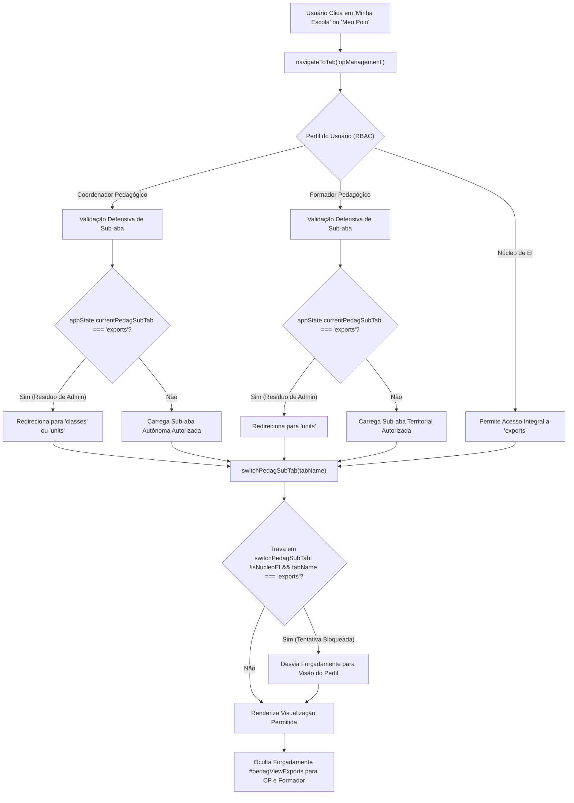

# Plano de Implementação: Bloqueio Rigoroso e Isolamento da Tela de Gestão da Base SSOT para Coordenação Pedagógica e Formadores

---

## 0. Diretriz de Execução (Obrigatória para Etapa 2)
> [!IMPORTANT]
> **Atenção:** Qualquer agente ou desenvolvedor que for executar este plano **DEVE LER OBRIGATORIAMENTE** o arquivo [WORKFLOW_MACOS.md](file:///Users/bruno/Desktop/gestor%20supervisao_patos/WORKFLOW_MACOS.md) e a skill [execucao-operario](file:///Users/bruno/Desktop/gestor%20supervisao_patos/.agents/skills/execucao-operario/SKILL.md) antes de iniciar.
> É expressamente proibido improvisar, alterar escopos não descritos ou pular etapas do checklist operacional (criação de backup intermediário, validação sintática via `python3 audit_platform.py --check-syntax`, changelog duplo, sincronização espelhada com `firebase_deploy/public/` e auditoria pós-deploy).

---

## 1. Diagnóstico e Contexto

### 1.1 O Problema Relatado
O usuário reportou a seguinte falha de isolamento de escopo e vazamento de governança na plataforma:
> *"o coordenador/formador, quando abre a aba minha escola/meu polo, é capaz de visualizar a tela de gestão da base ssot. crie um plano para que isso não mais aconteça."*

### 1.2 Análise Forense da Causa-Raiz
Ao investigar minuciosamente o ciclo de vida de navegação, persistência de estado e controle de acesso (RBAC) nos arquivos `js/core/navigation.js`, `js/core/rbac.js`, `js/features/history_notes.js`, `js/core/state.js`, `js/services/export_backup.js` e `index.html`, foram identificadas **cinco falhas estruturais conexas** que permitem que a tela de gestão da base SSOT (`#pedagViewExports` — *"Central de Extrações e Base Unificada (SSOT)"*) seja exibida indevidamente para Coordenadores Pedagógicos e Formadores:

1. **Ausência de Trava RBAC em `switchPedagSubTab()` (`js/features/history_notes.js`):**
   - A função `switchPedagSubTab(tabName)` controla a exibição das sub-abas do módulo operacional (`#homeGestaoView`).
   - Ela possui uma trava defensiva para a Coordenadora do Núcleo de EI:
     ```javascript
     if (isNucleoEI(user) && tabName === 'classes') {
       tabName = 'units';
     }
     ```
   - **Contudo, não existia nenhuma trava correspondente para a sub-aba `'exports'`**. Se `switchPedagSubTab('exports')` for chamada por ou para um Coordenador ou Formador, a função oculta todas as outras visualizações e torna `#pedagViewExports` visível (`display: block`), expondo os botões de backup completo (JSON), importação/sobrescrita de base e extrações de dados da rede inteira.

2. **Vazamento e Retenção de Estado em `appState.currentPedagSubTab` (`js/core/navigation.js`):**
   - No dispatcher de navegação da 2ª aba (`navigateToTab('opManagement')`), o código determina a sub-aba inicial da seguinte forma:
     ```javascript
     let initialSubTab = 'units';
     if (user.roleKey === 'coordenador') {
       initialSubTab = appState.currentPedagSubTab || 'classes';
     } else {
       initialSubTab = appState.currentPedagSubTab || 'units';
     }
     switchPedagSubTab(initialSubTab);
     ```
   - Quando uma usuária administradora (Helena - Núcleo de EI) acessa a sub-aba de Extrações e Base SSOT, `appState.currentPedagSubTab` é gravado como `'exports'`.
   - Essa propriedade faz parte do `appState` e é gravada no `localStorage` (`SERTAO_CRIANCA_APP_STATE_V6`).
   - Quando um Coordenador (Mariana Ferreira) ou Formador (Clarice Barbosa) faz login no mesmo dispositivo, ou alterna de conta:
     - `appState.currentPedagSubTab` permanece com o valor `'exports'`.
     - Ao clicar na aba **"Minha Escola"** ou **"Meu Polo"** (`navigateToTab('opManagement')`), `initialSubTab` assume o valor `'exports'`.
     - O sistema dispara `switchPedagSubTab('exports')`, abrindo diretamente a tela de gestão da base SSOT para esses perfis.

3. **Higienização Incompleta em `applyUserRoleUI()` (`js/core/rbac.js`):**
   - Ao aplicar o perfil do usuário ativo, `applyUserRoleUI()` executa:
     ```javascript
     if (pedagExportsTab) pedagExportsTab.style.display = 'none';
     ```
   - Isso oculta apenas o botão da sub-aba na barra de navegação (`#pedagTabExports`), mas **não oculta o contêiner de visualização (`#pedagViewExports`)** caso este já estivesse visível.
   - Pior: com o botão oculto, o Coordenador ou Formador que cai nessa tela fica preso sem nenhum botão de sub-aba destacado, visualizando controles administrativos críticos de banco de dados.
   - Além disso, `applyUserRoleUI()` não higienizava o valor residual de `appState.currentPedagSubTab`, permitindo que `'exports'` permanecesse ativo no estado.

4. **Ausência de Blindagem em Nível de Serviço (`js/services/export_backup.js`):**
   - As funções críticas de persistência total da rede:
     - `exportFullBaseJSON()`
     - `triggerImportFullBase()`
     - `importFullBaseJSON()`
   - Não realizavam a checagem de autoridade `isNucleoEI(getCurrentUser())`, dependendo exclusivamente da ocultação visual da interface para proteção.

5. **Exposição de Jargão Técnico Interno nos Subtítulos (`homeGestaoSubtitle`):**
   - Em `js/core/rbac.js`, os subtítulos operacionais para Coordenadores e Formadores exibiam termos internos de arquitetura de software:
     - Coordenador: *"Administração autônoma de turmas, docentes e caracterização da escola sob SSOT única."*
     - Formador: *"Supervisão territorial das Unidades Escolares e gestão de coordenações sob SSOT única."*
   - O termo "sob SSOT única" gera confusão semântica para os usuários finais e deve ser higienizado em prol de linguagem pedagógica institucional límpida.

---

## 2. Arquitetura e Pontos de Impacto



### Arquivos Envolvidos e Escopo de Modificação
1. `js/features/history_notes.js`:
   - Adicionar trava obrigatória em `switchPedagSubTab(tabName)` que impede qualquer usuário não pertencente ao Núcleo de EI de transitar para ou ativar `'exports'`, desviando para `'classes'` (Coordenador) ou `'units'` (Formador).
2. `js/core/navigation.js`:
   - Sanitizar a resolução de `initialSubTab` em `navigateToTab('opManagement')`, garantindo que se `appState.currentPedagSubTab` for `'exports'` ou inválido, o valor seja purgado e redirecionado para a sub-aba canônica do perfil.
3. `js/core/rbac.js`:
   - Em `applyUserRoleUI()`:
     - Adicionar o reset defensivo explícito de `#pedagViewExports` (`style.display = 'none'`) para os perfis `coordenador` e `formador`.
     - Sanitizar ativamente `appState.currentPedagSubTab` ao alternar ou inicializar sessões de Coordenador ou Formador.
     - Higienizar os subtítulos de `#homeGestaoSubtitle`, removendo menções residuais a jargão técnico ("sob SSOT única").
4. `js/services/export_backup.js`:
   - Implementar verificação `isNucleoEI(getCurrentUser())` no topo de `exportFullBaseJSON()`, `triggerImportFullBase()` e `importFullBaseJSON()`.
5. `js/audit/audit_engine.js`:
   - Adicionar suíte determinística de testes no módulo de segurança e RBAC comprovando que:
     - Coordenador e Formador nunca acessam `#pedagViewExports`.
     - Chamadas diretas a `switchPedagSubTab('exports')` desviam para sub-abas legítimas.
     - O estado `currentPedagSubTab` é purgado e protegido contra contaminação cruzada.
6. `index.html` e `firebase_deploy/public/index.html`:
   - Atualizar changelog duplo (versão 1.63) e manter sincronização espelhada.

---

## 3. Especificação de Implementação Passo a Passo (Snippets Exatos)

### Passo 1: Trava RBAC Inviolável em `switchPedagSubTab()` (`js/features/history_notes.js`)

Localizar a função `switchPedagSubTab(tabName)` no topo de `js/features/history_notes.js`:

```javascript
    // --- 8. HOME & HISTORY SCREENS ---
    
    function switchPedagSubTab(tabName) {
      const user = getCurrentUser();
      // Se for referenciada sub-aba legada 'rubrics', direciona para 'units'
      if (tabName === 'rubrics') tabName = 'units';
      // Núcleo de EI não possui a tela de turmas da rede municipal: direciona suavemente para 'units'
      if (isNucleoEI(user) && tabName === 'classes') {
        tabName = 'units';
      }
      appState.currentPedagSubTab = tabName;
```

**Substituir pelo seguinte bloco com dupla trava defensiva:**

```javascript
    // --- 8. HOME & HISTORY SCREENS ---
    
    function switchPedagSubTab(tabName) {
      const user = getCurrentUser();
      // Se for referenciada sub-aba legada 'rubrics', direciona para 'units'
      if (tabName === 'rubrics') tabName = 'units';
      // Núcleo de EI não possui a tela de turmas da rede municipal: direciona suavemente para 'units'
      if (isNucleoEI(user) && tabName === 'classes') {
        tabName = 'units';
      }
      // Blindagem RBAC: Coordenadores e Formadores NÃO podem acessar a tela de gestão da base SSOT / Extrações
      if (!isNucleoEI(user) && tabName === 'exports') {
        tabName = (user.roleKey === 'coordenador') ? 'classes' : 'units';
      }
      appState.currentPedagSubTab = tabName;
```

---

### Passo 2: Sanitização da Resolução de Sub-aba em `navigateToTab('opManagement')` (`js/core/navigation.js`)

Localizar no arquivo `js/core/navigation.js` o bloco correspondente a `tabName === 'opManagement' || tabName === 'units'` (linhas 42 a 61):

```javascript
        if (tabName === 'opManagement' || tabName === 'units') {
          const opNav = document.getElementById('deskTabOpManagement');
          if (opNav && opNav.style.display !== 'none') {
            opNav.classList.add('active');
          } else {
            document.getElementById('deskTabHome')?.classList.add('active');
          }
          if (targetScreenEl) targetScreenEl.classList.add('active');
          const homeStandardView = document.getElementById('homeStandardView');
          const homeGestaoView = document.getElementById('homeGestaoView');
          if (homeStandardView) homeStandardView.style.display = 'none';
          if (homeGestaoView) homeGestaoView.style.display = 'block';
          
          let initialSubTab = 'units';
          if (user.roleKey === 'coordenador') {
            initialSubTab = appState.currentPedagSubTab || 'classes';
          } else {
            initialSubTab = appState.currentPedagSubTab || 'units';
          }
          switchPedagSubTab(initialSubTab);
        }
```

**Substituir por:**

```javascript
        if (tabName === 'opManagement' || tabName === 'units') {
          const opNav = document.getElementById('deskTabOpManagement');
          if (opNav && opNav.style.display !== 'none') {
            opNav.classList.add('active');
          } else {
            document.getElementById('deskTabHome')?.classList.add('active');
          }
          if (targetScreenEl) targetScreenEl.classList.add('active');
          const homeStandardView = document.getElementById('homeStandardView');
          const homeGestaoView = document.getElementById('homeGestaoView');
          if (homeStandardView) homeStandardView.style.display = 'none';
          if (homeGestaoView) homeGestaoView.style.display = 'block';
          
          let initialSubTab = 'units';
          if (user.roleKey === 'coordenador') {
            // Se o estado anterior for 'exports' ou inválido, redireciona estritamente para 'classes'
            initialSubTab = (appState.currentPedagSubTab && appState.currentPedagSubTab !== 'exports') 
              ? appState.currentPedagSubTab 
              : 'classes';
          } else if (user.roleKey === 'formador') {
            // Se o estado anterior for 'exports', redireciona estritamente para 'units'
            initialSubTab = (appState.currentPedagSubTab && appState.currentPedagSubTab !== 'exports') 
              ? appState.currentPedagSubTab 
              : 'units';
          } else {
            initialSubTab = appState.currentPedagSubTab || 'units';
          }
          switchPedagSubTab(initialSubTab);
        }
```

---

### Passo 3: Reset Ativo, Sanitização e Higienização em `applyUserRoleUI()` (`js/core/rbac.js`)

Localizar a declaração de elementos em `applyUserRoleUI()` (`js/core/rbac.js`):

```javascript
      const pedagUnitsLabel = document.getElementById('pedagTabUnitsLabel');
      const pedagClassesLabel = document.getElementById('pedagTabClassesLabel');
      const pedagTeamLabel = document.getElementById('pedagTabTeamLabel');
      const pedagExportsTab = document.getElementById('pedagTabExports');
      const homeGestaoActionsCentral = document.getElementById('homeGestaoActionsCentral');
      const homeGestaoTitle = document.getElementById('homeGestaoTitle');
      const homeGestaoSubtitle = document.getElementById('homeGestaoSubtitle');
```

Adicionar a captura do contêiner de visualização:
```javascript
      const pedagExportsView = document.getElementById('pedagViewExports');
```

E no bloco do Coordenador (`user.roleKey === 'coordenador'`):
```javascript
      if (user.roleKey === 'coordenador') {
        ...
        if (pedagUnitsLabel) pedagUnitsLabel.innerHTML = '<span class="pedag-tab-full-text">Minha Escola</span><span class="pedag-tab-mobile-text">Escola</span>';
        if (pedagClassesLabel) pedagClassesLabel.innerHTML = '<span class="pedag-tab-full-text">Turmas & Regência</span><span class="pedag-tab-mobile-text">Turmas</span>';
        if (pedagTeamLabel) pedagTeamLabel.innerHTML = '<span class="pedag-tab-full-text">Docentes da UE</span><span class="pedag-tab-mobile-text">Docentes</span>';
        if (pedagExportsTab) pedagExportsTab.style.display = 'none';
        if (pedagExportsView) pedagExportsView.style.display = 'none';
        if (appState.currentPedagSubTab === 'exports') {
          appState.currentPedagSubTab = 'classes';
        }
        if (homeGestaoActionsCentral) homeGestaoActionsCentral.style.display = 'none';
        if (homeGestaoTitle) homeGestaoTitle.innerText = `Gestão da Unidade Escolar · ${user.school}`;
        if (homeGestaoSubtitle) {
          homeGestaoSubtitle.innerText = 'Administração autônoma de turmas, docentes e caracterização da escola.';
          homeGestaoSubtitle.style.display = 'block';
        }
```

E no bloco do Formador (`user.roleKey === 'formador'`):
```javascript
      } else if (user.roleKey === 'formador') {
        ...
        if (pedagUnitsLabel) pedagUnitsLabel.innerHTML = '<span class="pedag-tab-full-text">Escolas do Polo</span><span class="pedag-tab-mobile-text">Escolas</span>';
        if (pedagClassesLabel) pedagClassesLabel.innerHTML = '<span class="pedag-tab-full-text">Turmas do Polo</span><span class="pedag-tab-mobile-text">Turmas</span>';
        if (pedagTeamLabel) pedagTeamLabel.innerHTML = '<span class="pedag-tab-full-text">Coordenações Pedagógicas</span><span class="pedag-tab-mobile-text">Coordenações</span>';
        if (pedagExportsTab) pedagExportsTab.style.display = 'none';
        if (pedagExportsView) pedagExportsView.style.display = 'none';
        if (appState.currentPedagSubTab === 'exports') {
          appState.currentPedagSubTab = 'units';
        }
        if (homeGestaoActionsCentral) homeGestaoActionsCentral.style.display = 'none';
        if (homeGestaoTitle) homeGestaoTitle.innerText = `Gestão do Polo Regional · ${user.school}`;
        if (homeGestaoSubtitle) {
          homeGestaoSubtitle.innerText = 'Supervisão territorial das Unidades Escolares e gestão de coordenações.';
          homeGestaoSubtitle.style.display = 'block';
        }
```

---

### Passo 4: Blindagem de Segurança nas Operações de Base (`js/services/export_backup.js`)

No topo de `exportFullBaseJSON()`:
```javascript
    function exportFullBaseJSON() {
      const user = getCurrentUser();
      if (!isNucleoEI(user)) {
        showToast('Acesso exclusivo à Coordenadora do Núcleo de EI.');
        return;
      }
      const exportState = JSON.parse(JSON.stringify(appState));
```

No topo de `triggerImportFullBase()`:
```javascript
    function triggerImportFullBase() {
      const user = getCurrentUser();
      if (!isNucleoEI(user)) {
        showToast('Acesso exclusivo à Coordenadora do Núcleo de EI.');
        return;
      }
      const input = document.getElementById('importFullBaseFileInput');
      if (input) input.click();
    }
```

No topo de `importFullBaseJSON()`:
```javascript
    function importFullBaseJSON(event) {
      const user = getCurrentUser();
      if (!isNucleoEI(user)) {
        showToast('Acesso exclusivo à Coordenadora do Núcleo de EI.');
        if (event && event.target) event.target.value = '';
        return;
      }
      const file = event.target.files && event.target.files[0];
```

---

## 4. Critérios de Aceite e Roteiro de Teste

### Critérios de Aceite
1. **Coordenador Pedagógico (Mariana Ferreira):**
   - Ao clicar no botão **"Minha Escola"** (`#deskTabOpManagement`) ou no card da dashboard (`#homeOpManagementBtn`), a tela exibida NUNCA é a tela de Extrações e Base SSOT.
   - O contêiner `#pedagViewExports` permanece estritamente oculto (`display: none`).
   - O botão `#pedagTabExports` permanece estritamente oculto (`display: none`).
   - Se o `localStorage` contiver resíduo de `currentPedagSubTab = 'exports'`, a navegação o purga imediatamente e direciona para `'classes'` ou `'units'`.
   - Disparar programaticamente `switchPedagSubTab('exports')` no console redireciona automaticamente para `'classes'` sem renderizar a base SSOT.
2. **Formador Pedagógico (Clarice Barbosa):**
   - Ao clicar no botão **"Meu Polo"** (`#deskTabOpManagement`), a visualização abre exclusivamente em **"Escolas do Polo"** (`#pedagViewUnits`) ou na sub-aba territorial autorizada.
   - O contêiner `#pedagViewExports` e a aba `#pedagTabExports` permanecem com `display: none`.
   - Disparar `switchPedagSubTab('exports')` redireciona automaticamente para `'units'`.
3. **Coordenadora do Núcleo de EI (Helena - Admin):**
   - Mantém acesso integral, pleno e onisciente à aba **"Extrações & Relatórios SSOT"** (`#pedagTabExports`) e à tela de backup/restauração (`#pedagViewExports`).
4. **Higienização Terminológica:**
   - O subtítulo da aba em Coordenador e Formador não exibe o termo técnico "sob SSOT única".
5. **Blindagem Sintática Pré-Voo:**
   - 100% de aprovação léxica e sintática via `python3 audit_platform.py --check-syntax`.

---

## 5. Seção Obrigatória de Auditoria: Mapeamento para o `audit_platform.py` e `audit_engine.js`

### 5.1 Alterações / Adições no Motor de Testes (`js/audit/audit_engine.js`)
No módulo de auditoria de RBAC e Governança Descentralizada (Pilar 14):

```javascript
// Teste de Bloqueio Rigoroso da Tela de Gestão da Base SSOT para Coordenador e Formador (v1.63)
// 1. Simulação com Coordenadora (Mariana)
selectUserAccount('mariana');
appState.currentPedagSubTab = 'exports'; // Simula resíduo de admin no estado
navigateToTab('opManagement');

const exportTabCoord = document.getElementById('pedagTabExports');
const exportViewCoord = document.getElementById('pedagViewExports');
if (exportTabCoord && exportTabCoord.style.display !== 'none') {
  throw new Error('Aba #pedagTabExports está visível para a Coordenadora');
}
if (exportViewCoord && exportViewCoord.style.display !== 'none') {
  throw new Error('Tela de gestão da base SSOT (#pedagViewExports) foi indevidamente exibida para a Coordenadora');
}
if (appState.currentPedagSubTab === 'exports') {
  throw new Error('currentPedagSubTab não foi purgado de "exports" na visão da Coordenadora');
}

// Tentativa de invasão via switchPedagSubTab direto
switchPedagSubTab('exports');
if (exportViewCoord && exportViewCoord.style.display !== 'none') {
  throw new Error('switchPedagSubTab("exports") permitiu abertura da tela SSOT para a Coordenadora');
}
logger.log('Bloqueio rigoroso da tela de gestão da base SSOT para Coordenadora Pedagógica', true);

// 2. Simulação com Formadora (Clarice)
selectUserAccount('clarice');
appState.currentPedagSubTab = 'exports';
navigateToTab('opManagement');

const exportTabForm = document.getElementById('pedagTabExports');
const exportViewForm = document.getElementById('pedagViewExports');
if (exportTabForm && exportTabForm.style.display !== 'none') {
  throw new Error('Aba #pedagTabExports está visível para a Formadora');
}
if (exportViewForm && exportViewForm.style.display !== 'none') {
  throw new Error('Tela de gestão da base SSOT (#pedagViewExports) foi indevidamente exibida para a Formadora');
}
if (appState.currentPedagSubTab === 'exports') {
  throw new Error('currentPedagSubTab não foi purgado de "exports" na visão da Formadora');
}

switchPedagSubTab('exports');
if (exportViewForm && exportViewForm.style.display !== 'none') {
  throw new Error('switchPedagSubTab("exports") permitiu abertura da tela SSOT para a Formadora');
}
logger.log('Bloqueio rigoroso da tela de gestão da base SSOT para Formadora Pedagógica', true);

// 3. Validação de Preservação para Núcleo de EI (Helena)
selectUserAccount('helena');
const exportTabHelena = document.getElementById('pedagTabExports');
if (!exportTabHelena || exportTabHelena.style.display === 'none') {
  throw new Error('Aba #pedagTabExports deve estar visível para o Núcleo de EI');
}
switchPedagSubTab('exports');
const exportViewHelena = document.getElementById('pedagViewExports');
if (!exportViewHelena || exportViewHelena.style.display !== 'block') {
  throw new Error('Núcleo de EI não conseguiu acessar a tela de extrações e base SSOT');
}
logger.log('Preservação integral da tela de gestão da base SSOT para o Núcleo de EI', true);
```

### 5.2 Validação Sintática Pré-Voo
- Executar `python3 audit_platform.py --check-syntax` antes do commit.

### 5.3 Auditoria Pós-Deploy
- Executar `python3 audit_platform.py --silent-on-success` após o deploy na branch `main`.
