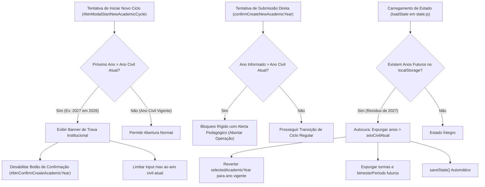

# Plano de Implementação: Bloqueio Rigoroso de Início e Planejamento Antecipado de Anos Letivos Futuros

---

## 0. Diretriz de Execução Obrigatória (Etapa 2)
> [!IMPORTANT]
> **Atenção Executor / Operário:** Antes de aplicar qualquer modificação em código, leia obrigatoriamente o manual [`WORKFLOW_MACOS.md`](file:///Users/bruno/Desktop/gestor%20supervisao_patos/WORKFLOW_MACOS.md) e a skill do Antigravity [`.agents/skills/execucao-operario/SKILL.md`](file:///Users/bruno/Desktop/gestor%20supervisao_patos/.agents/skills/execucao-operario/SKILL.md).
> Siga estritamente este plano sem improvisações, mantendo a integridade sintática via JSC (`python3 audit_platform.py --check-syntax`), gerando a versão intermediária de backup `intermediárias/aplicativo_v146_bloqueio_inicio_ano_letivo_futuro.html`, atualizando o changelog duplo para a versão **1.46** e rodando a auditoria modular silenciosa pós-deploy (`python3 audit_platform.py --silent-on-success`).

---

## 1. Diagnóstico e Contexto

### 1.1. O Cenário Atual
Na versão 1.28 do sistema, foi introduzida a arquitetura plurianual SSOT, viabilizando a coexistência de múltiplos anos letivos cadastrados em `appState.academicYears` (atualmente com anos base `['2026', '2025']`) e a transição anual controlada pela Coordenadora do Núcleo de Educação Infantil através do assistente `#modalCreateAcademicYear` ("Iniciar Novo Ciclo Avaliativo").

Na versão 1.35, esse acionador foi centralizado no modal de governança **"Ciclos Avaliativos & Calendário"** (`#modalBimesterPeriods`), sendo acionado pelo botão `#btnModalStartNewAcademicCycle`.

Atualmente, na rotina `openCreateNewAcademicYearModal()` em [`js/services/export_backup.js`](file:///Users/bruno/Desktop/gestor%20supervisao_patos/js/services/export_backup.js#L581-L584), o sistema calcula o ano sugerido de forma puramente aritmética a partir dos anos já cadastrados:
```javascript
const sortedYears = [...(appState.academicYears || ['2026'])].map(y => parseInt(y, 10)).sort((a, b) => b - a);
const nextSuggested = (sortedYears[0] || 2026) + 1;
inputYear.value = nextSuggested;
```

### 1.2. A Falha Identificada e Reclamação do Usuário
O usuário reportou a seguinte inconsistência operacional e pedagógica:
> *"não deve ser possível iniciar outro ano se ele não iniciou ainda, efetivamente. eu digo, eu inicidi o ano de 2027, mas como ele ainda não começou, não deve ser possível nem sequer planejá-lo"*

Quando a Coordenadora da EI abriu o assistente de transição, o sistema sugeriu automaticamente o ano de **2027**. Ao confirmar, o sistema:
1. Registrou `2027` em `appState.academicYears`.
2. Como os anos são ordenados decrescentemente, `2027` assumiu o status de **Ano Vigente** no sistema.
3. O ano real corrente (**2026**) foi rebaixado a "Ano Histórico", disparando indevidamente o banner de aviso amarelo nos lançamentos.
4. O sistema passou a permitir cadastrar turmas, alocar professores e agendar observações para um ano que **ainda não começou no calendário real**.
5. Como o usuário já clicou e iniciou 2027 em seu ambiente local, o estado salvo no `localStorage` persistiu resíduos de 2027 (`appState.academicYears`, `appState.bimesterPeriods['2027']`, turmas clonadas de 2027 e `selectedAcademicYear = '2027'`).

### 1.3. Justificativa Pedagógica e de Gestão Pública
Na gestão da Educação Infantil pública municipal:
- O ciclo avaliativo, a enturmação e a supervisão pedagógica acompanham rigorosamente o **ano civil oficial em curso**.
- É terminantemente vedado iniciar, antecipar ou "planejar" lançamentos e instrumentos de supervisão em um ciclo avaliativo de um ano que **ainda não começou cronologicamente** (ex: criar e planejar 2027 em pleno ano de 2026).
- Um novo ciclo avaliativo só pode ser iniciado na plataforma SerTão Criança a partir do momento em que o ano civil correspondente **inicia efetivamente** (isto é, a partir de 01/01 daquele ano, quando `anoLetivo <= anoCivilAtual`).
- Enquanto o ano não tiver iniciado efetivamente, o foco de toda a equipe gestora, coordenadoras e supervisoras deve permanecer 100% concentrado na consolidação diagnóstica e no fechamento bimestral do ano letivo vigente.

---

## 2. Arquitetura da Solução e Pontos de Impacto



### 2.1. Pontos de Impacto
1. **`js/core/state.js`:**
   - Adição de rotina transparente de **Autocura e Saneamento Temporal** em `loadState()`: se houver anos cadastrados em `appState.academicYears` maiores que `new Date().getFullYear()`, eles são expurgados imediatamente, restaurando `appState.selectedAcademicYear`, limpando `appState.bimesterPeriods` e turmas órfãs.
2. **`js/services/export_backup.js`:**
   - Em `openCreateNewAcademicYearModal()`: limitar o input dinamicamente via atributo `max = currentRealYear`. Se o próximo ano for futuro em relação ao ano civil atual, apresentar aviso visual impeditivo institucional no modal e desabilitar o botão de confirmação.
   - Em `confirmCreateNewAcademicYear()`: implementar trava estrita impeditiva: se `parseInt(yearVal, 10) > new Date().getFullYear()`, abortar imediatamente com feedback de bloqueio institucional.
3. **`index.html` (e espelho `firebase_deploy/public/index.html`):**
   - No modal `#modalCreateAcademicYear`: inclusão do card informativo de trava institucional (`#futureYearBlockNotice`), atribuição do ID `#btnConfirmCreateAcademicYear` ao botão de ação e ajuste do atributo `max="2026"`.
   - Atualização do botão `.btn-changelog`, `#modalChangelog` e `CHANGELOG.md` para a versão **1.46**.
4. **`js/audit/audit_engine.js`:**
   - Preservar integridade do teste 11.3 existente.
   - Inclusão do teste 11.4 no Módulo 11 da auditoria validando:
     1. Rejeição e bloqueio impeditivo de anos futuros em `confirmCreateNewAcademicYear()`.
     2. Mecanismo de autocura de `loadState()` ao detectar resíduos futuros.

---

## 3. Especificação de Implementação Passo a Passo

### 3.1. Autocura e Saneamento Temporal em `js/core/state.js`
Na função `loadState()`, logo após a verificação de `appState.academicYears` (linha 78-83), introduzir a sanitização universal contra anos futuros:

```javascript
          // Sanitização e Autocura contra Anos Letivos Futuros que ainda não iniciaram efetivamente
          const currentRealYear = new Date().getFullYear();
          if (Array.isArray(appState.academicYears)) {
            const hasFutureYears = appState.academicYears.some(y => parseInt(y, 10) > currentRealYear);
            if (hasFutureYears) {
              appState.academicYears = appState.academicYears.filter(y => {
                const parsed = parseInt(y, 10);
                return !isNaN(parsed) && parsed <= currentRealYear;
              });
              if (appState.academicYears.length === 0) {
                appState.academicYears = [...DEFAULT_ACADEMIC_YEARS].filter(y => parseInt(y, 10) <= currentRealYear);
              }
              // Expurgar períodos bimestrais de anos futuros
              if (appState.bimesterPeriods && typeof appState.bimesterPeriods === 'object') {
                Object.keys(appState.bimesterPeriods).forEach(k => {
                  if (/^\d{4}$/.test(k) && parseInt(k, 10) > currentRealYear) {
                    delete appState.bimesterPeriods[k];
                  }
                });
              }
              // Expurgar turmas vinculadas a anos futuros
              if (Array.isArray(appState.classes)) {
                appState.classes = appState.classes.filter(c => {
                  const clsYear = parseInt(c.academicYear, 10);
                  return isNaN(clsYear) || clsYear <= currentRealYear;
                });
              }
              saveState();
            }
          }
          if (appState.selectedAcademicYear && parseInt(appState.selectedAcademicYear, 10) > currentRealYear) {
            const validSortedYears = [...(appState.academicYears || ['2026'])].map(y => parseInt(y, 10)).sort((a, b) => b - a);
            appState.selectedAcademicYear = (validSortedYears[0] || currentRealYear).toString();
            saveState();
          }
```

### 3.2. Atualização dos Controles no Modal em `js/services/export_backup.js`
Atualizar as funções `openCreateNewAcademicYearModal` e `confirmCreateNewAcademicYear`:

```javascript
    // Modal Create New Academic Year Controls
    function openCreateNewAcademicYearModal() {
      const user = getCurrentUser();
      if (!isNucleoEI(user)) {
        showToast('Apenas a Coordenadora do Núcleo de EI pode iniciar um novo ciclo avaliativo.');
        return;
      }

      const currentRealYear = new Date().getFullYear();
      const inputYear = document.getElementById('inputNewAcademicYear');
      const blockNotice = document.getElementById('futureYearBlockNotice');
      const confirmBtn = document.getElementById('btnConfirmCreateAcademicYear');
      const sortedYears = [...(appState.academicYears || ['2026'])].map(y => parseInt(y, 10)).sort((a, b) => b - a);
      const nextSuggested = (sortedYears[0] || currentRealYear) + 1;

      if (inputYear) {
        inputYear.max = currentRealYear;
      }

      if (nextSuggested > currentRealYear) {
        // Próximo ano ainda não iniciou efetivamente
        if (inputYear) {
          inputYear.value = nextSuggested;
          inputYear.disabled = true;
        }
        if (blockNotice) {
          blockNotice.style.display = 'block';
          blockNotice.innerHTML = `
            <div style="font-size:12px; font-weight:700; color:#991B1B; margin-bottom:4px;">🛡️ Bloqueio de Conformidade Temporal:</div>
            <div style="font-size:11px; color:#B91C1C; line-height:1.4;">
              O ciclo do Ano Letivo <strong>${sortedYears[0] || currentRealYear}</strong> está vigente em andamento. O ciclo de <strong>${nextSuggested}</strong> só poderá ser iniciado quando o respectivo ano civil iniciar efetivamente (a partir de <strong>01/01/${nextSuggested}</strong>). Não é permitido iniciar ou planejar ciclos de anos futuros antecipadamente.
            </div>
          `;
        }
        if (confirmBtn) {
          confirmBtn.disabled = true;
          confirmBtn.style.opacity = '0.5';
          confirmBtn.style.cursor = 'not-allowed';
          confirmBtn.title = `O ano ${nextSuggested} só poderá ser iniciado em ${nextSuggested}.`;
        }
      } else {
        if (inputYear) {
          inputYear.value = nextSuggested;
          inputYear.disabled = false;
        }
        if (blockNotice) {
          blockNotice.style.display = 'none';
        }
        if (confirmBtn) {
          confirmBtn.disabled = false;
          confirmBtn.style.opacity = '1';
          confirmBtn.style.cursor = 'pointer';
          confirmBtn.title = '';
        }
      }

      const modal = document.getElementById('modalCreateAcademicYear');
      if (modal) {
        modal.classList.add('active');
        modal.classList.add('show');
      }
    }

    function confirmCreateNewAcademicYear() {
      const user = getCurrentUser();
      if (!isNucleoEI(user)) {
        showToast('Acesso negado.');
        return;
      }

      const inputYear = document.getElementById('inputNewAcademicYear');
      const yearVal = inputYear ? inputYear.value.trim() : '';

      if (!yearVal || !/^\d{4}$/.test(yearVal)) {
        alert('Por favor, informe um ano letivo válido com 4 dígitos (ex: 2026).');
        return;
      }

      const currentRealYear = new Date().getFullYear();
      const targetYearNum = parseInt(yearVal, 10);

      // Trava Impeditiva SSOT: Não permitir iniciar anos que não iniciaram efetivamente
      if (targetYearNum > currentRealYear) {
        alert(`Não é permitido iniciar o Ano Letivo ${targetYearNum}, pois ele ainda não iniciou efetivamente. O ciclo só poderá ser iniciado a partir de 01/01/${targetYearNum}.`);
        return;
      }

      if (appState.academicYears.includes(yearVal)) {
        alert(`O Ano Letivo ${yearVal} já está cadastrado no sistema.`);
        return;
      }

      const optionEl = document.querySelector('input[name="newYearClassesOption"]:checked');
      const option = optionEl ? optionEl.value : 'clone';

      // 1. Cadastra o novo ano na lista SSOT
      appState.academicYears.push(yearVal);
      appState.academicYears.sort();

      // 2. Inicializa os 4 bimestres do novo ano baseando-se no ano base
      const templatePeriods = DEFAULT_BIMESTER_PERIODS_BY_YEAR['2026'] || DEFAULT_BIMESTER_PERIODS;
      const newYearPeriods = {};
      const yearDiff = targetYearNum - 2026;
      ['1º Bimestre', '2º Bimestre', '3º Bimestre', '4º Bimestre'].forEach(bName => {
        const tmpl = templatePeriods[bName] || DEFAULT_BIMESTER_PERIODS[bName];
        const adjustDate = (isoStr) => {
          if (!isoStr) return '';
          const parts = isoStr.split('-');
          const y = parseInt(parts[0], 10) + yearDiff;
          return `${y}-${parts[1]}-${parts[2]}`;
        };
        newYearPeriods[bName] = {
          startDate: adjustDate(tmpl.startDate),
          endDate: adjustDate(tmpl.endDate),
          label: bName
        };
      });

      if (!appState.bimesterPeriods) appState.bimesterPeriods = {};
      appState.bimesterPeriods[yearVal] = newYearPeriods;

      // 3. Matriz de turmas
      if (option === 'clone') {
        const sortedYears = [...appState.academicYears].filter(y => y !== yearVal).sort((a, b) => b.localeCompare(a));
        const prevYear = sortedYears[0] || '2026';
        const prevClasses = (appState.classes || []).filter(c => (c.academicYear || '2026') === prevYear);

        prevClasses.forEach((prevC, idx) => {
          const clonedClass = {
            id: 'cls-' + yearVal + '-' + Date.now() + '-' + idx,
            name: prevC.name,
            school: prevC.school,
            academicYear: yearVal,
            stage: prevC.stage,
            shift: prevC.shift,
            teachers: [...(prevC.teachers || [])],
            teachersMorning: [...(prevC.teachersMorning || [])],
            teachersAfternoon: [...(prevC.teachersAfternoon || [])]
          };
          appState.classes.push(clonedClass);
        });
      }

      // 4. Define o novo ano como ativo
      appState.selectedAcademicYear = yearVal;
      saveState();

      closeCreateNewAcademicYearModal();
      renderGlobalAcademicYearSelector();

      // Se o modal de bimestres estava aberto ou for necessário atualizar telas:
      const modalBim = document.getElementById('modalBimesterPeriods');
      if (modalBim && modalBim.classList.contains('active')) {
        openBimesterPeriodsModal();
      }

      showToast(`Novo Ciclo Avaliativo (${yearVal}) iniciado com sucesso! Todas as UEs e Servidores foram mantidos.`);
      renderHomeScreen();
    }
```

### 3.3. Atualização Estrutural do Modal em `index.html` e `firebase_deploy/public/index.html`
Em `index.html` (linhas 5374-5403):
1. Inserir `#futureYearBlockNotice` logo acima do grupo do input.
2. Identificar o botão de confirmação com `id="btnConfirmCreateAcademicYear"`.
3. Atualizar `max="2026"` no input `id="inputNewAcademicYear"`.

```html
      <div style="padding:4px 0 16px 0;">
        <!-- Banner de Trava Temporal Preventiva -->
        <div id="futureYearBlockNotice" style="display:none; background:#FEF2F2; border:1px solid #FECACA; border-radius:8px; padding:12px; margin-bottom:14px;">
        </div>

        <div class="form-group" style="margin-bottom:14px;">
          <label class="form-label" style="font-weight:700;">Ano Letivo:</label>
          <input type="number" id="inputNewAcademicYear" class="form-input" style="font-size:16px; font-weight:700;" min="2024" max="2026" placeholder="Ex: 2026" />
        </div>
        
        <div style="background:#F0FDF4; border:1px solid #BBF7D0; border-radius:8px; padding:12px; margin-bottom:14px;">
          <div style="font-size:12px; font-weight:700; color:#166534; margin-bottom:4px;">🛡️ Patrimônio Municipal Preservado:</div>
          <div style="font-size:11px; color:#15803D; line-height:1.4;">
            As <strong>Unidades Escolares</strong>, a <strong>Equipe de Servidores (Professores e Usuários)</strong> e os <strong>Polos Regionais</strong> são integralmente mantidos e continuam disponíveis.
          </div>
        </div>

        <div class="form-group" style="margin-bottom:16px;">
          <label style="font-size:12px; font-weight:700; color:var(--text-primary); display:block; margin-bottom:6px;">Matriz de Turmas e Atribuições:</label>
          <label style="display:flex; align-items:center; gap:8px; font-size:13px; cursor:pointer; margin-bottom:6px;">
            <input type="radio" name="newYearClassesOption" value="clone" checked />
            <span><strong>Clonar turmas do ano anterior</strong> (Reaproveita turmas, turnos e docentes atribuídos como ponto de partida)</span>
          </label>
          <label style="display:flex; align-items:center; gap:8px; font-size:13px; cursor:pointer;">
            <input type="radio" name="newYearClassesOption" value="clean" />
            <span><strong>Iniciar sem turmas</strong> (Cadastrar ou importar nova enturmação do zero)</span>
          </label>
        </div>
      </div>
      <div style="display:flex; justify-content:flex-end; gap:8px;">
        <button class="btn btn-secondary" onclick="closeCreateNewAcademicYearModal()">Cancelar</button>
        <button class="btn btn-primary" id="btnConfirmCreateAcademicYear" onclick="confirmCreateNewAcademicYear()">Confirmar e Iniciar Ciclo</button>
      </div>
```

---

## 4. Critérios de Aceite e Roteiro de Teste

### 4.1. Critérios de Aceite
1. **Bloqueio no Modal:**
   - Ao abrir `#modalCreateAcademicYear` quando o ano corrente (2026) já estiver cadastrado, o campo de input e o botão "Confirmar e Iniciar Ciclo" devem permanecer desabilitados, com aviso de bloqueio institucional visível informando que 2027 só pode ser iniciado em 2027.
2. **Rejeição Funcional Estrita:**
   - Qualquer tentativa de chamar `confirmCreateNewAcademicYear()` com valor maior que o ano civil atual (ex: 2027, 2028) deve ser interceptada com bloqueio e sem alterar `appState.academicYears`.
3. **Autocura Imediata:**
   - Se o usuário recarregar o sistema tendo previamente criado `2027`, a rotina `loadState()` deve expurgar silenciosamente o ano 2027, restabelecendo o ano 2026 como vigente e limpando períodos e turmas de 2027.
4. **Preservação dos Anos Vigente e Histórico Válidos:**
   - Os anos 2026 (vigente) e 2025 (histórico) continuam funcionando com total integridade, sem qualquer alteração na navegação ou semáforo longitudinal.

---

## 5. Seção Obrigatória de Auditoria (`audit_platform.py` e `audit_engine.js`)

### 5.1. Impacto no Algoritmo de Auditoria (`audit_platform.py`)
- O script `audit_platform.py` não requer exclusão de testes.
- A validação sintática via JavaScriptCore (`python3 audit_platform.py --check-syntax`) deve cobrir `index.html` e os módulos desacoplados em `js/`.

### 5.2. Adições no Motor Modular de Auditoria (`js/audit/audit_engine.js`)
No **Módulo 11** da auditoria, complementar o fluxo do assistente de transição com o subteste 11.4:

```javascript
              // 11.4 TESTE DE CONFORMIDADE TEMPORAL: BLOQUEIO DE INÍCIO DE ANOS LETIVOS FUTUROS
              // 1. Testa bloqueio no modal quando o ano sugerido é futuro
              startCycleBtn.click();
              const blockNoticeEl = document.getElementById('futureYearBlockNotice');
              const confirmBtnEl = document.getElementById('btnConfirmCreateAcademicYear');
              const inputYearEl = document.getElementById('inputNewAcademicYear');
              const currentRealYear = new Date().getFullYear();

              if (!blockNoticeEl || blockNoticeEl.style.display === 'none') {
                throw new Error('Aviso institucional de trava temporal #futureYearBlockNotice não foi exibido para ano futuro');
              }
              if (!confirmBtnEl || !confirmBtnEl.disabled) {
                throw new Error('Botão #btnConfirmCreateAcademicYear deveria estar desabilitado para ano letivo futuro');
              }

              // 2. Testa rejeição programática de submissão de ano futuro
              const initialYearsCount = appState.academicYears.length;
              if (inputYearEl) inputYearEl.value = (currentRealYear + 1).toString();
              
              // Simula tentativa de confirmação forçada (bypassing disabled)
              let alertTriggered = false;
              const originalAlert = window.alert;
              window.alert = () => { alertTriggered = true; };
              try {
                confirmCreateNewAcademicYear();
              } finally {
                window.alert = originalAlert;
              }

              if (appState.academicYears.includes((currentRealYear + 1).toString())) {
                throw new Error('Falha de conformidade: Sistema permitiu cadastrar ano letivo futuro que ainda não iniciou efetivamente');
              }
              if (appState.academicYears.length !== initialYearsCount) {
                throw new Error('Tamanho de appState.academicYears foi modificado indevidamente após tentativa de cadastro futuro');
              }

              // 3. Testa autocura de loadState() contra resíduos de anos futuros
              appState.academicYears.push('2099');
              appState.selectedAcademicYear = '2099';
              if (!appState.bimesterPeriods) appState.bimesterPeriods = {};
              appState.bimesterPeriods['2099'] = { mock: true };
              localStorage.setItem('SERTAO_CRIANCA_APP_STATE_V6', JSON.stringify(appState));
              
              loadState();

              if (appState.academicYears.includes('2099')) {
                throw new Error('Autocura de loadState() falhou ao expurgar ano futuro 2099 de academicYears');
              }
              if (appState.selectedAcademicYear === '2099') {
                throw new Error('Autocura de loadState() falhou ao reverter selectedAcademicYear de 2099');
              }
              if (appState.bimesterPeriods['2099']) {
                throw new Error('Autocura de loadState() falhou ao remover bimesterPeriods de 2099');
              }

              closeCreateNewAcademicYearModal();
              closeBimesterPeriodsModal();
              logger.log('Bloqueio impeditivo e autocura contra anos letivos futuros que ainda não iniciaram efetivamente (Versão 1.46)', true);
```

### 5.3. Exclusões no Algoritmo de Auditoria
- **Nenhuma exclusão:** Todas as asserções de 1 a 16 permanecem ativas e compatíveis.
