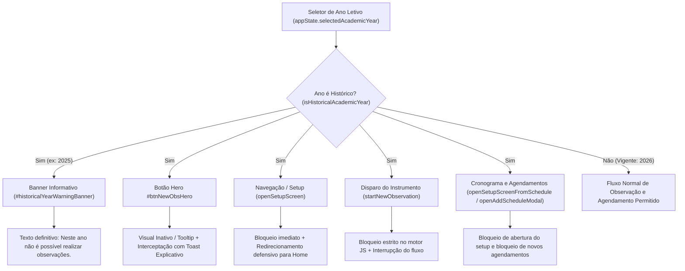

# Plano de Implementação: Bloqueio Rigoroso de Novas Observações em Anos Históricos e Alinhamento Hallmark

## 0. Diretriz de Execução (Obrigatória)
> [!IMPORTANT]
> O assistente executor (Etapa 2 - O Operário) DEVE obrigatoriamente ler o arquivo [`WORKFLOW_MACOS.md`](file:///Users/bruno/Desktop/gestor%20supervisao_patos/WORKFLOW_MACOS.md) e a skill [`.agents/skills/execucao-operario/SKILL.md`](file:///Users/bruno/Desktop/gestor%20supervisao_patos/.agents/skills/execucao-operario/SKILL.md) antes de iniciar qualquer alteração.
> 
> Durante a execução, é obrigatório:
> 1. Validar a sintaxe do JavaScript antes de commitar via `python3 audit_platform.py --check-syntax`.
> 2. Salvar backup intermediário em `intermediárias/aplicativo_v[N]_[descrição].html`.
> 3. Atualizar o changelog duplo (`CHANGELOG.md` e `#modalChangelog` / botão `.btn-changelog` em `index.html`).
> 4. Sincronizar simultaneamente as cópias espelhadas (`gestor supervisao_patos/index.html` e `firebase_deploy/public/index.html`).
> 5. Realizar checagem pré-push (`git fetch origin main`) e enviar com `git push origin main`.
> 6. Executar a auditoria pós-deploy via `python3 audit_platform.py --silent-on-success`.

---

## 1. Diagnóstico e Contexto

### 1.1 Cenário Atual
Atualmente, o sistema suporta múltiplos anos letivos através do seletor de ciclos (`appState.selectedAcademicYear`, ex: `'2026'` como vigente e `'2025'` como histórico). Ao selecionar um ano letivo anterior:
1. O banner informativo `#historicalYearWarningBanner` é exibido, porém utiliza redação permissiva e não restritiva:
   > *"Você está visualizando o histórico do Ano Letivo 2025. Novos lançamentos devem ser efetuados preferencialmente no ano letivo vigente."*
2. Os botões de início e agendamento de observação continuam completamente ativos e funcionais:
   - O botão hero `#btnNewObsHero` ("Nova observação") na tela inicial permite clicar e invoca `handleNewObsButtonClick()`.
   - Se o usuário não tiver visitas agendadas, ele é encaminhado diretamente para `openSetupScreen(null)`.
   - Na tela de setup (`#screenSetup`), os campos de data são preenchidos com o dia de hoje (`todayStr`, pertencente ao ano civil vigente `2026`), e o botão `#btnStartObservation` chama `startNewObservation()`.
   - Em `startNewObservation()`, não há verificação sobre se o ano selecionado é histórico. O objeto `newObs` sequer definia explicitamente `academicYear` (dependendo do fallback `(obs.academicYear || '2026')`), o que gerava uma observação do ano civil corrente no contexto de consulta do ano anterior, corrompendo a consistência temporal dos dados e desorientando o usuário pedagógico.
   - De forma análoga, cards de visitas planejadas em `renderHomeScreen()` e `renderScheduleScreen()` exibem o botão "Iniciar Observação →" (`openSetupScreenFromSchedule`), permitindo disparar instrumentos a partir de agendamentos de anos anteriores.

### 1.2 Objetivo
Implementar uma blindagem completa e uniforme em todos os pontos de entrada do sistema impedindo a criação, agendamento ou início de novas observações quando o usuário estiver navegando em um ano letivo histórico/anterior, exibindo comunicação imediata, clara e fundamentada:
> *"Neste ano letivo não é possível realizar observações. Alterne para o ano vigente para novos lançamentos."*

Adicionalmente, alinhar a apresentação visual aos padrões **Hallmark Standard**:
- Utilização estrita de tokens CSS (`var(--primary)`, `var(--warning-*)`, `var(--text-secondary)`, etc.).
- Proibição de emojis nos ícones e alertas (utilizar pictogramas vetoriais SVG monocromáticos e sóbrios).
- Estados de foco e desativação acessíveis (`aria-disabled="true"`, `:focus-visible`, títulos explicativos).
- Sem degradações visuais ou quebras de contraste.

---

## 2. Arquitetura e Pontos de Impacto



### Arquivos Impactados:
1. `gestor supervisao_patos/js/core/state.js`
   - Criação das funções canônicas SSOT de verificação temporal: `getLatestAcademicYear()`, `isCurrentAcademicYear(year)` e `isHistoricalAcademicYear(year)`.
2. `gestor supervisao_patos/index.html`
   - Atualização do texto do banner `#historicalYearWarningBanner` para explicitar a impossibilidade de observações no ano histórico.
   - Sincronização espelhada em `gestor supervisao_patos/firebase_deploy/public/index.html`.
3. `gestor supervisao_patos/js/core/navigation.js`
   - Interceptação preventiva em `handleNewObsButtonClick()`.
   - Trava de entrada em `openSetupScreen(prefilledSchedule)`.
4. `gestor supervisao_patos/js/features/observation.js`
   - Trava de execução em `startNewObservation()` com emissão de toast explicativo.
   - Vinculação canônica do atributo `academicYear: appState.selectedAcademicYear || getLatestAcademicYear()` no objeto `newObs` quando no ano vigente.
   - Proteção em `resumeObservation()` para forçar `isReadOnly = true` caso a observação pertença a um ano letivo histórico.
5. `gestor supervisao_patos/js/features/schedule.js`
   - Trava em `openSetupScreenFromSchedule(scheduleId)`.
   - Trava em `openAddScheduleModal()`.
   - Ajuste na renderização de botões de visitas em `renderScheduleScreen()` quando em ano histórico.
6. `gestor supervisao_patos/js/features/history_notes.js`
   - Ajuste na renderização de cards agendados da tela inicial (`renderHomeScreen()`) quando em ano histórico.
   - Atualização visual do `#btnNewObsHero` no contexto histórico.
7. `gestor supervisao_patos/js/services/export_backup.js`
   - Refatoração dos métodos de sincronização de ano para utilizarem as funções auxiliares canônicas.
8. `gestor supervisao_patos/js/audit/audit_engine.js`
   - Adição de asserções nos testes de governança e travas de segurança validando o bloqueio mecânico de novas observações em ano histórico.

---

## 3. Especificação de Implementação Passo a Passo (Snippets Exatos)

### Passo 1: Funções Canônicas SSOT em `js/core/state.js`
Local: logo após a definição de `appState` e utilitários globais.

```javascript
// --- UTILITÁRIOS DE CONTROLE TEMPORAL E ANOS LETIVOS (SSOT) ---
function getLatestAcademicYear() {
  const defaultYears = (typeof DEFAULT_ACADEMIC_YEARS !== 'undefined' && Array.isArray(DEFAULT_ACADEMIC_YEARS)) 
    ? DEFAULT_ACADEMIC_YEARS 
    : ['2026', '2025'];
  const years = (appState && Array.isArray(appState.academicYears) && appState.academicYears.length > 0)
    ? appState.academicYears
    : defaultYears;
  const sorted = [...years].sort((a, b) => b.localeCompare(a));
  return sorted[0] || '2026';
}

function isCurrentAcademicYear(year = null) {
  const target = year || (appState && appState.selectedAcademicYear) || getLatestAcademicYear();
  return target === getLatestAcademicYear();
}

function isHistoricalAcademicYear(year = null) {
  return !isCurrentAcademicYear(year);
}
```

### Passo 2: Atualização do Banner de Aviso em `index.html` (e Cópia Firebase)
Local: `#historicalYearWarningBanner` (aproximadamente linha 98-106 de `index.html`).

**Antes:**
```html
  <!-- Banner Informativo de Ano Letivo Anterior (Modo Consulta Histórica) -->
  <div id="historicalYearWarningBanner" style="display:none; background:#FFFBEB; border-bottom:1px solid #FDE68A; padding:8px 20px; font-size:12px; font-weight:600; color:#92400E; justify-content:space-between; align-items:center;">
    <div style="display:flex; align-items:center; gap:8px;">
      <svg width="16" height="16" viewBox="0 0 24 24" fill="none" stroke="#D97706" stroke-width="2.5" style="flex-shrink:0;"><path d="M10.29 3.86L1.82 18a2 2 0 0 0 1.71 3h16.94a2 2 0 0 0 1.71-3L13.71 3.86a2 2 0 0 0-3.42 0z"/><line x1="12" y1="9" x2="12" y2="13"/><line x1="12" y1="17" x2="12.01" y2="17"/></svg>
      <span><strong>Atenção:</strong> Você está visualizando o histórico do <strong>Ano Letivo <span id="historicalYearBannerLabel">2025</span></strong>. Novos lançamentos devem ser efetuados preferencialmente no ano letivo vigente.</span>
    </div>
    <button class="btn btn-secondary" style="padding:2px 8px; font-size:11px; font-weight:700; background:#FFFFFF; border:1px solid #D97706; color:#92400E;" onclick="returnToCurrentAcademicYear()">
      Voltar ao Ano Vigente
    </button>
  </div>
```

**Depois (Conforme Padrão Hallmark e Diretriz):**
```html
  <!-- Banner Informativo de Ano Letivo Anterior (Modo Consulta Histórica - Hallmark Standard) -->
  <div id="historicalYearWarningBanner" style="display:none; background:#FFFBEB; border-bottom:1px solid #FDE68A; padding:8px 20px; font-size:12px; font-weight:600; color:#92400E; justify-content:space-between; align-items:center;">
    <div style="display:flex; align-items:center; gap:8px;">
      <svg width="16" height="16" viewBox="0 0 24 24" fill="none" stroke="#D97706" stroke-width="2.5" style="flex-shrink:0;"><circle cx="12" cy="12" r="10"/><line x1="12" y1="8" x2="12" y2="12"/><line x1="12" y1="16" x2="12.01" y2="16"/></svg>
      <span><strong>Atenção:</strong> Você está visualizando o histórico do <strong>Ano Letivo <span id="historicalYearBannerLabel">2025</span></strong> (Modo Consulta). <strong>Neste ano não é possível realizar observações ou novos lançamentos.</strong></span>
    </div>
    <button class="btn btn-secondary" style="padding:3px 10px; font-size:11px; font-weight:700; background:#FFFFFF; border:1px solid #D97706; color:#92400E; border-radius:var(--radius-sm);" onclick="returnToCurrentAcademicYear()">
      Voltar ao Ano Vigente
    </button>
  </div>
```

### Passo 3: Intercepção no Botão Hero e Roteador em `js/core/navigation.js`
Local: `handleNewObsButtonClick()` e `openSetupScreen()`:

```javascript
function handleNewObsButtonClick() {
  const user = getCurrentUser();
  if (isNucleoEI(user)) {
    showToast('A Coordenadora do Núcleo de EI não aplica avaliações diretas.');
    return;
  }

  // TRAVA DE ANO HISTÓRICO: Impede abertura de nova observação em anos anteriores
  if (isHistoricalAcademicYear()) {
    showToast('Ação bloqueada: Neste ano letivo não é possível realizar observações. Alterne para o ano letivo vigente.');
    return;
  }

  // 1. Verifica observações pendentes de atribuição direta do usuário ativo
  const pendingSchedules = getActionablePendingSchedules();

  // 2. Se houver agendamentos pertinentes, abre o modal de escolha prévia
  if (pendingSchedules.length > 0) {
    openSelectScheduledObsModal();
  } else {
    openSetupScreen(null);
  }
}

function openSetupScreen(prefilledSchedule = null) {
  const user = getCurrentUser();

  // TRAVA DE ANO HISTÓRICO: Defesa em profundidade contra abertura direta do setup
  if (isHistoricalAcademicYear()) {
    showToast('Ação bloqueada: Neste ano letivo não é possível realizar observações.');
    navigateToTab('home');
    return;
  }

  // BLINDAGEM CANÔNICA DE CARGO
  if (prefilledSchedule) {
    const targetMember = (appState.teamMembers || []).find(m => m.name === prefilledSchedule.targetName);
    if (user.roleKey === 'formador' && targetMember && targetMember.roleKey === 'professora') {
      showToast('Ação bloqueada: Formadoras acompanham coordenadoras e não realizam observação direta de professoras.');
      navigateToTab('home');
      return;
    }
    if (user.roleKey === 'coordenador' && targetMember && targetMember.roleKey !== 'professora') {
      showToast('Ação bloqueada: Coordenadoras avaliam exclusivamente turmas e professoras da unidade escolar.');
      navigateToTab('home');
      return;
    }
  }

  document.querySelectorAll('.app-screen').forEach(s => s.classList.remove('active'));
  document.getElementById('screenSetup').classList.add('active');

  const roWarning = document.getElementById('readOnlyWarning');
  if (roWarning) roWarning.style.display = 'none';
  appState.isReadOnly = false;
  // ... restante do setup original ...
```

### Passo 4: Bloqueio Rigoroso e Atribuição SSOT em `js/features/observation.js`
Local: `startNewObservation()` e `resumeObservation()`:

```javascript
function startNewObservation() {
  const user = getCurrentUser();
  if (isNucleoEI(user)) {
    showToast('A Coordenadora do Núcleo de EI não aplica avaliações diretas.');
    return;
  }

  // TRAVA ESTRITA DE ANO HISTÓRICO: Bloqueia disparo mecânico
  if (isHistoricalAcademicYear()) {
    showToast('Ação bloqueada: Neste ano letivo não é possível realizar observações.');
    return;
  }

  // ... validações existentes de horário, escola, bimestre ...
  
  // No objeto newObs: Atribuição obrigatória e explícita do Ano Letivo Vigente
  const newObs = {
    id: 'obs-' + Date.now(),
    scheduleId: appState.currentSetupScheduleId || null,
    academicYear: appState.selectedAcademicYear || getLatestAcademicYear(), // <-- SSOT VINCULADA
    evaluatedType: user.roleKey === 'coordenador' ? 'turma' : 'coordenador',
    // ... restante dos atributos de newObs ...
  };
```

E em `resumeObservation()`:
```javascript
function resumeObservation(obsId, isReadOnly = false) {
  const obs = appState.observations.find(o => o.id === obsId);
  if (!obs) return;

  const user = getCurrentUser();

  // STRICT PROTECTION: If someone else tries to resume a draft, force read-only or deny!
  if (obs.status === 'draft' && obs.evaluatedBy !== user.name) {
    showToast('Acesso negado: este rascunho pertence a outro profissional.');
    return;
  }

  // Proteção de integridade histórica: Observações de anos anteriores sempre abrem em somente leitura
  if (obs.status === 'finalized' || isNucleoEI(user) || isHistoricalAcademicYear(obs.academicYear)) {
    isReadOnly = true;
  }

  // ... restante do resumeObservation ...
```

### Passo 5: Bloqueio em Agendamentos em `js/features/schedule.js`
Local: `openSetupScreenFromSchedule()` e `openAddScheduleModal()`:

```javascript
function openSetupScreenFromSchedule(scheduleId) {
  if (isHistoricalAcademicYear()) {
    showToast('Ação bloqueada: Neste ano letivo não é possível realizar observações.');
    return;
  }
  const sched = (appState.schedules || []).find(s => s.id === scheduleId);
  if (sched) openSetupScreen(sched);
}

function openAddScheduleModal() {
  if (isHistoricalAcademicYear()) {
    showToast('Ação bloqueada: Neste ano letivo não é possível agendar novas observações. Alterne para o ano vigente.');
    return;
  }
  // ... restante do openAddScheduleModal ...
}
```

E na renderização das listas em `renderScheduleScreen()` e `renderHomeScreen()`:
- Quando `isHistoricalAcademicYear()` for `true`, o botão `"Iniciar Observação →"` é substituído por um badge informativo neutro:
  `<span class="badge-status-neutral" style="font-size:11px; padding:4px 8px; border-radius:var(--radius-sm); color:var(--text-secondary); background:var(--background-secondary);">Ano Concluído (Consulta)</span>`
  ou um botão desabilitado estilizado sem interrupções abruptas.

### Passo 6: Atualização Visual do `#btnNewObsHero` em `js/features/history_notes.js` e `js/services/export_backup.js`
Na função `renderHomeScreen()` e `renderGlobalAcademicYearSelector()`:
```javascript
const heroBtn = document.getElementById('btnNewObsHero');
if (heroBtn) {
  if (isHistoricalAcademicYear()) {
    heroBtn.setAttribute('title', 'Neste ano letivo não é possível realizar observações. Alterne para o ano vigente.');
    heroBtn.setAttribute('aria-disabled', 'true');
    heroBtn.style.opacity = '0.65';
    heroBtn.style.cursor = 'not-allowed';
  } else {
    heroBtn.removeAttribute('title');
    heroBtn.removeAttribute('aria-disabled');
    heroBtn.style.opacity = '1';
    heroBtn.style.cursor = 'pointer';
  }
}
```

---

## 4. Critérios de Aceite e Roteiro de Teste

### Critérios de Aceite
1. **Bloqueio no Clique do Hero Button:**
   - Com o ano `2025` selecionado, clicar em `#btnNewObsHero` exibe imediatamente o toast: *"Ação bloqueada: Neste ano letivo não é possível realizar observações. Alterne para o ano letivo vigente."* e a tela não sai de `#screenHome`.
2. **Bloqueio ao Acessar Setup Diretamente:**
   - A chamada `openSetupScreen(null)` com ano `2025` é abortada, exibe toast e redireciona defensivamente para a tela inicial.
3. **Bloqueio ao Disparar Instrumento:**
   - A chamada `startNewObservation()` com ano `2025` não adiciona nenhum elemento a `appState.observations` e aborta a execução.
4. **Bloqueio em Agendamentos:**
   - A tentativa de iniciar observação a partir de um card de agendamento em ano histórico (`openSetupScreenFromSchedule`) é bloqueada com toast.
   - A tentativa de agendar nova visita em ano histórico (`openAddScheduleModal`) é bloqueada com toast.
5. **Banner Informativo Aclarado:**
   - O banner `#historicalYearWarningBanner` exibe a mensagem clara: *"Neste ano não é possível realizar observações ou novos lançamentos."*
   - O botão *"Voltar ao Ano Vigente"* restaura o ano `2026`, oculta o banner e reabilita instantaneamente o botão de nova observação.
6. **Hallmark Standard:**
   - Ausência de emojis novos na UI.
   - Cores e espaçamentos parametrizados via tokens CSS existentes.
   - Responsividade mantida em desktop e mobile sem rolagem horizontal residual.

---

## 5. Seção Obrigatória de Auditoria (`audit_platform.py` e `audit_engine.js`)

### Alterações / Adições no Motor de Testes (`js/audit/audit_engine.js`)
No **Módulo 6 (`travas_seguranca`)** ou **Módulo 12 (`navegacao_layout`)**, incluir a bateria de asserções determinísticas de bloqueio temporal:

```javascript
// TESTE: Blindagem de Integridade Temporal em Anos Históricos (Versão 1.41)
const previousYear = '2025';
const activeYear = '2026';

// 1. Alterna para o ano histórico
selectAcademicYear(previousYear);
if (!isHistoricalAcademicYear()) {
  throw new Error('isHistoricalAcademicYear() não retornou true para o ano histórico 2025');
}

// 2. Testa bloqueio no botão de nova observação
const initialActiveScreen = document.querySelector('.app-screen.active')?.id;
handleNewObsButtonClick();
const screenAfterClick = document.querySelector('.app-screen.active')?.id;
if (screenAfterClick === 'screenSetup') {
  throw new Error('handleNewObsButtonClick() permitiu indevidamente a abertura de #screenSetup no ano histórico 2025');
}

// 3. Testa bloqueio mecânico em startNewObservation()
const initialObsCount = (appState.observations || []).length;
startNewObservation();
if ((appState.observations || []).length !== initialObsCount) {
  throw new Error('startNewObservation() criou indevidamente uma observação enquanto em ano histórico 2025');
}

// 4. Testa bloqueio no agendamento de novas visitas
openAddScheduleModal();
const modalSchedule = document.getElementById('modalAddSchedule');
if (modalSchedule && modalSchedule.classList.contains('active')) {
  closeAddScheduleModal();
  throw new Error('openAddScheduleModal() abriu indevidamente o modal de agendamento no ano histórico 2025');
}

// 5. Restaura ano vigente e valida liberação funcional
returnToCurrentAcademicYear();
if (isHistoricalAcademicYear()) {
  throw new Error('isHistoricalAcademicYear() ainda retornou true após returnToCurrentAcademicYear()');
}
logger.log('Blindagem de integridade temporal: Bloqueio estrito de novas observações e agendamentos em anos históricos validado com 100% de sucesso', true);
```

### Validações Pré e Pós-Deploy:
1. `python3 audit_platform.py --check-syntax` (validação de integridade léxica/sintática no macOS via JavaScriptCore).
2. `python3 audit_platform.py --silent-on-success` (execução automatizada headless pós-deploy confirmando aprovação de todos os módulos).
