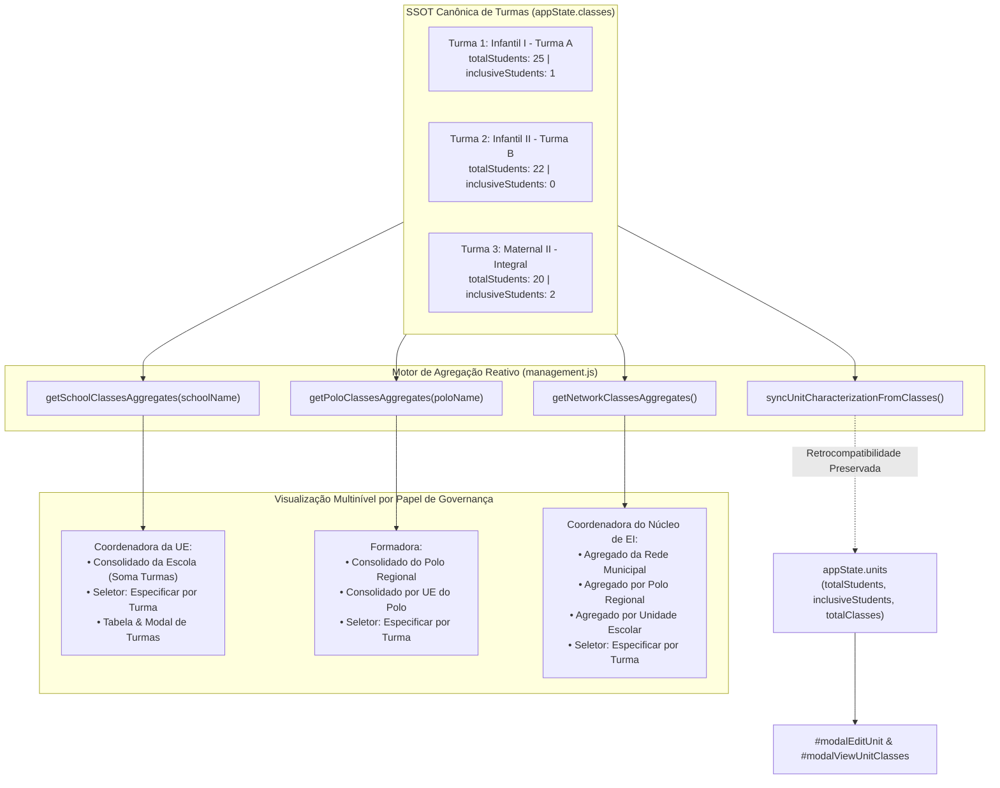

# Plano de Implementação: Caracterização Quantitativa por Turma com Suporte a Necessidades Especiais (AEE) e Visão Agregada Multinível (UE / Polo / Rede)

---

## 0. Diretriz de Execução (Obrigatória para Etapa 2)
> [!IMPORTANT]
> **Atenção:** Qualquer agente ou desenvolvedor que for executar este plano **DEVE LER OBRIGATORIAMENTE** o arquivo [WORKFLOW_MACOS.md](file:///Users/bruno/Desktop/gestor%20supervisao_patos/WORKFLOW_MACOS.md) e a skill [execucao-operario](file:///Users/bruno/Desktop/gestor%20supervisao_patos/.agents/skills/execucao-operario/SKILL.md) antes de iniciar qualquer ação.
> É terminantemente proibido improvisar, refatorar escopos não descritos ou pular etapas do checklist operacional obrigatório (backup intermediário, checagem sintática JSC via `python3 audit_platform.py --check-syntax`, changelog duplo, sincronização espelhada com `firebase_deploy/public/index.html`, checagem pré-push de concorrência, deploy e auditoria headless silenciosa).

---

## 1. Diagnóstico e Contexto

### 1.1 O Problema e a Solicitação do Usuário
O usuário solicitou a seguinte reformulação de regra de negócio e visualização:
> *"dentro da lógica da caracterização da UE, que implementamos em algum dos pilares que eu não lembro o qual, faremos uma mudança: ao invés de ser feita uma caracterização de n de alunos e n necessidade especial, quero que essa caracterização seja feita por turma, com o n de alunos e especificar se tem algum aluno com necessidade especial. ou seja, um n de 30 alunos e n de um com necessidade especial, significa que há um aluno dos 30 com necessidades especiais. aí, para a coordenadora da ue/formadora/coordenadora de ei, deve ser possível de especificar a turma ou agregado da rede. crie um plano para tanto."*

### 1.2 Análise Forense do Modelo Anterior (Pilar 14)
A funcionalidade de **Caracterização Escolar** foi introduzida no **Pilar 14** (*Governança Operacional Descentralizada e Gestão Autônoma sob SSOT Única* - Versão 1.17):
1. **Atribuição no Nível Incorreto da Entidade:**
   - A caracterização de alunos matriculados e público-alvo da educação inclusiva (AEE) foi originalmente alocada como propriedade da **Unidade Escolar** (`unit.totalStudents: 120`, `unit.inclusiveStudents: 6`, `unit.totalClasses: 4` em `appState.units`).
   - A Coordenadora Pedagógica preenchia inputs soltos no card `#coordinatorUnitCardContainer` (`#coordUnitTotalStudents` e `#coordUnitInclusiveStudents`), desconectados das turmas reais cadastradas.
2. **Incoerência Pedagógica e Operacional:**
   - As turmas cadastradas em `appState.classes` não continham registro do seu contingente de alunos.
   - Uma escola com 4 turmas exibia 120 alunos globais, mas era impossível para a equipe pedagógica identificar quais turmas específicas possuíam crianças com necessidades especiais para alocação de professor auxiliar, adaptação curricular e priorização de visitas de acompanhamento.
3. **Ausência de Visão Analítica Multinível:**
   - Nem a Formadora de Polo nem a Coordenadora de Educação Infantil dispunham de ferramenta para consultar o detalhe por turma ou alternar para o somatório agregado da sua jurisdição (Polo Regional ou Rede Municipal completa).

### 1.3 A Nova Lógica Canônica (A Solução sob a SSOT)
1. **Entidade Canônica = A Turma (`appState.classes`):**
   - Cada turma passa a carregar formalmente:
     - `totalStudents` (número inteiro $\ge 0$): total de crianças matriculadas na turma (ex: 30).
     - `inclusiveStudents` (número inteiro $\ge 0$): crianças com necessidades especiais / AEE (ex: 1).
   - **Relação de Conjunto e Semântica Estrita:** Os alunos com necessidades especiais estão **contidos** no número total de alunos da turma. Ou seja:
     $$\text{Alunos Regulares} = \text{totalStudents} - \text{inclusiveStudents}$$
     Exemplo: em uma turma com 30 alunos e 1 com necessidade especial, temos 1 aluno AEE e 29 alunos regulares.
   - **Trava de Integridade Pedagógica:** É mandatório validar que:
     $$0 \le \text{inclusiveStudents} \le \text{totalStudents}$$
     Se o usuário tentar informar mais alunos inclusivos do que o total de alunos da turma, o sistema bloqueia o salvamento e exibe orientação amigável.
2. **Agregação Dinâmica e Reativa (Somatório Canônico):**
   - Os totais de uma Unidade Escolar (`unit.totalStudents`, `unit.inclusiveStudents`, `unit.totalClasses`) deixam de ser preenchidos manualmente e passam a ser **calculados reativamente como a soma exata das suas turmas**.
   - O mesmo cálculo propaga em tempo real para os **Polos Regionais** e para o **Agregado da Rede Municipal**.
3. **Visualização e Seletores Específicos por Papel da Tríade:**
   - **Coordenadora da UE (`roleKey === 'coordenador'`):**
     - No Card da UE (`#coordinatorUnitCardContainer`): visualiza o **Consolidado da Escola** (agregado das suas turmas) com seletor para **Especificar por Turma** (dropdown com suas turmas, detalhando alunos matriculados, necessidades especiais, alunos regulares e taxa de inclusão).
     - Na aba "Turmas & Regência" (`#pedagViewClasses`): a tabela exibe colunas dedicadas de alunos e necessidades especiais, e o modal `#modalClassEditor` permite preenchimento direto.
   - **Formadora (`roleKey === 'formador'`):**
     - No escopo do seu Polo Regional, dispõe de seletor para alternar entre:
       1. *Consolidado do Polo Regional* (soma de todas as turmas do polo).
       2. *Consolidado por Unidade Escolar* (especifica uma UE do polo e visualiza seu total somado).
       3. *Especificar por Turma* (seleciona qualquer turma das UEs do polo para ver seus dados individuais).
   - **Coordenadora do Núcleo de EI (`isNucleoEI(user)` / Admin):**
     - No escopo global de toda a Rede Municipal:
       1. *Agregado da Rede Municipal* (Total Geral da Rede: soma de todas as turmas de todas as 32 UEs, taxa global de inclusão e distribuição por etapa).
       2. *Agregado por Polo Regional* (seleciona um polo e visualiza seu agregado).
       3. *Agregado por Unidade Escolar* (seleciona uma UE e visualiza seu agregado).
       4. *Especificar por Turma* (seleciona qualquer turma da rede municipal e visualiza a caracterização individual).

---

## 2. Arquitetura e Pontos de Impacto



### Arquivos Envolvidos
1. `js/config/catalog.js`:
   - Enriquecimento de `INITIAL_CLASSES` com `totalStudents` e `inclusiveStudents` realistas para cada turma canônica.
   - Atualização da função `getClassesForSchool` para que turmas geradas dinamicamente venham com caracterização padrão inicial (`totalStudents: 22`, `inclusiveStudents: 1`).
2. `js/core/state.js`:
   - Sanitização no boot em `loadState()`: assegurar que qualquer turma em `appState.classes` possua `totalStudents` e `inclusiveStudents` definidos como números válidos e que `inclusiveStudents <= totalStudents`.
   - Execução automática de `syncUnitCharacterizationFromClasses()` ao inicializar e salvar o estado.
3. `index.html`:
   - No modal de cadastro e edição de turma (`#modalClassEditor`): adição dos campos de "Total de Alunos Matriculados" e "Alunos com Necessidades Especiais (AEE)", com texto explicativo e validação.
   - Na sub-aba de Turmas (`#pedagViewClasses`):
     - Inclusão do container do Painel Analítico de Caracterização (`#characterizationFilterPanel`).
     - Atualização do cabeçalho da tabela `#classesTableBody` com colunas para "Alunos (Total)" e "Necessidades Especiais (AEE)".
   - No modal `#modalViewUnitClasses`: adição da coluna "Alunos (Total / AEE)" na tabela de turmas e exibição do somatório das turmas no card de metadados.
   - No modal `#modalEditUnit`: marcação dos campos de total de alunos e alunos inclusivos como informativos/calculados automaticamente da soma das turmas.
4. `js/features/management.js`:
   - Implementação das funções centrais de agregação: `getSchoolClassesAggregates()`, `getPoloClassesAggregates()`, `getNetworkClassesAggregates()` e `syncUnitCharacterizationFromClasses()`.
   - Refatoração de `renderUnitsScreen()`: atualização do `#coordinatorUnitCardContainer` com alternância entre "Consolidado da Escola" e "Especificar por Turma".
   - Refatoração de `renderClassesScreen()`: renderização reativa do Painel Analítico de Caracterização conforme o perfil do usuário e renderização das novas colunas na tabela de turmas.
   - Atualização de `openAddClassModal()` e `openEditClassModal()`: carga dos campos de alunos e AEE da turma.
   - Atualização de `saveClassEditor()`: validação de $0 \le \text{inclusiveStudents} \le \text{totalStudents}$, persistência no objeto da turma e recalculo automático dos agregados.
   - Atualização de `openViewUnitClassesModal()`: renderização da caracterização por turma na lista da UE.
5. `js/audit/audit_engine.js`:
   - Enriquecimento do Módulo 9 (`catalogo_dados` / Pilar 14) com asserções estritas de:
     - Presença de `totalStudents` e `inclusiveStudents` numéricos em todas as turmas.
     - Validação da invariante pedagógica `inclusiveStudents <= totalStudents`.
     - Fidelidade aritmética da soma das turmas no nível da UE e no nível da Rede.
     - Validação funcional dos seletores de exibição (Por Turma vs Agregado).

---

## 3. Especificação de Implementação Passo a Passo (Snippets Exatos)

### Passo 1: Atualização Canônica do Catálogo de Turmas em `js/config/catalog.js`

Em `js/config/catalog.js`, atualizar o array `INITIAL_CLASSES` para atribuir a caracterização de alunos a cada turma inicial:

```javascript
    // --- 1.2 CATÁLOGO CANÔNICO DE TURMAS DA REDE MUNICIPAL (PILAR 1, PILAR 4 & PILAR 13) ---
    const INITIAL_CLASSES = [
      {
        id: 'cls-pml-01',
        name: 'Infantil I - Turma A',
        school: 'CEI Professora Maria de Lourdes',
        stage: 'Infantil I',
        shift: 'Tempo Parcial (Matutino)',
        teachers: ['Ana Carolina Silva'],
        totalStudents: 25,
        inclusiveStudents: 1
      },
      {
        id: 'cls-pml-02',
        name: 'Berçário II - Turma Única',
        school: 'CEI Professora Maria de Lourdes',
        stage: 'Berçário II',
        shift: 'Tempo Parcial (Matutino)',
        teachers: ['Carla Beatriz Mendes'],
        totalStudents: 15,
        inclusiveStudents: 0
      },
      {
        id: 'cls-pml-03',
        name: 'Infantil II - Turma B',
        school: 'CEI Professora Maria de Lourdes',
        stage: 'Infantil II',
        shift: 'Tempo Parcial (Vespertino)',
        teachers: ['Juliana Roberta Rocha'],
        totalStudents: 24,
        inclusiveStudents: 2
      },
      {
        id: 'cls-pml-04',
        name: 'Maternal II - Turma Integral',
        school: 'CEI Professora Maria de Lourdes',
        stage: 'Maternal II',
        shift: 'Tempo Integral',
        teachersMorning: ['Mariana Santos', 'Roberta Dias'],
        teachersAfternoon: ['Patricia Souza', 'Camila Vasconcelos'],
        teachers: ['Mariana Santos', 'Roberta Dias', 'Patricia Souza', 'Camila Vasconcelos'],
        totalStudents: 20,
        inclusiveStudents: 1
      },
      {
        id: 'cls-pp-01',
        name: 'Maternal I - Turma A',
        school: 'EMEI Pequeno Príncipe',
        stage: 'Maternal I',
        shift: 'Tempo Parcial (Matutino)',
        teachers: ['Fernanda Lima'],
        totalStudents: 22,
        inclusiveStudents: 1
      },
      {
        id: 'cls-pp-02',
        name: 'Infantil I - Turma B',
        school: 'EMEI Pequeno Príncipe',
        stage: 'Infantil I',
        shift: 'Tempo Parcial (Vespertino)',
        teachers: ['Luciana Ramos'],
        totalStudents: 26,
        inclusiveStudents: 0
      },
      {
        id: 'cls-vz-01',
        name: 'Maternal II - Turma Única',
        school: 'CEI Vovó Zezé',
        stage: 'Maternal II',
        shift: 'Tempo Integral',
        teachersMorning: [],
        teachersAfternoon: [],
        teachers: [],
        totalStudents: 18,
        inclusiveStudents: 1
      }
    ];
```

E em `getClassesForSchool`, garantir que as turmas geradas por fallback contenham `totalStudents: 20, inclusiveStudents: 1`.

---

### Passo 2: Funções Canônicas de Agregação e Sincronização em `js/features/management.js`

Inserir no início do módulo de gestão (`js/features/management.js`):

```javascript
    // =========================================================================
    // MOTOR DE CARACTERIZAÇÃO QUANTITATIVA E AGREGAÇÃO SSOT
    // =========================================================================

    // Retorna agregados de uma unidade escolar a partir do somatório de suas turmas
    function getSchoolClassesAggregates(schoolName) {
      const classes = (appState.classes || []).filter(c => c.school === schoolName);
      let totalStudents = 0;
      let inclusiveStudents = 0;

      classes.forEach(c => {
        const tot = typeof c.totalStudents === 'number' && !isNaN(c.totalStudents) ? c.totalStudents : 20;
        const inc = typeof c.inclusiveStudents === 'number' && !isNaN(c.inclusiveStudents) ? c.inclusiveStudents : 0;
        totalStudents += tot;
        inclusiveStudents += inc;
      });

      const regularStudents = Math.max(0, totalStudents - inclusiveStudents);
      const inclusionRate = totalStudents > 0 ? ((inclusiveStudents / totalStudents) * 100).toFixed(1) : '0.0';
      const teachersCount = (appState.teamMembers || []).filter(m => m.school === schoolName && m.roleKey === 'professora').length;

      return {
        schoolName,
        totalClasses: classes.length,
        totalStudents,
        inclusiveStudents,
        regularStudents,
        inclusionRate,
        teachersCount,
        classes
      };
    }

    // Retorna agregados de um polo regional somando as turmas de todas as suas UEs
    function getPoloClassesAggregates(poloName) {
      const poloUnits = (appState.units || []).filter(u => u.polo === poloName).map(u => u.name);
      let totalClasses = 0;
      let totalStudents = 0;
      let inclusiveStudents = 0;

      poloUnits.forEach(uName => {
        const agg = getSchoolClassesAggregates(uName);
        totalClasses += agg.totalClasses;
        totalStudents += agg.totalStudents;
        inclusiveStudents += agg.inclusiveStudents;
      });

      const regularStudents = Math.max(0, totalStudents - inclusiveStudents);
      const inclusionRate = totalStudents > 0 ? ((inclusiveStudents / totalStudents) * 100).toFixed(1) : '0.0';

      return {
        poloName,
        totalUnits: poloUnits.length,
        totalClasses,
        totalStudents,
        inclusiveStudents,
        regularStudents,
        inclusionRate
      };
    }

    // Retorna o agregado global da Rede Municipal (soma de todas as turmas)
    function getNetworkClassesAggregates() {
      let totalClasses = 0;
      let totalStudents = 0;
      let inclusiveStudents = 0;

      const allClasses = appState.classes || [];
      allClasses.forEach(c => {
        const tot = typeof c.totalStudents === 'number' && !isNaN(c.totalStudents) ? c.totalStudents : 20;
        const inc = typeof c.inclusiveStudents === 'number' && !isNaN(c.inclusiveStudents) ? c.inclusiveStudents : 0;
        totalStudents += tot;
        inclusiveStudents += inc;
        totalClasses++;
      });

      const regularStudents = Math.max(0, totalStudents - inclusiveStudents);
      const inclusionRate = totalStudents > 0 ? ((inclusiveStudents / totalStudents) * 100).toFixed(1) : '0.0';
      const totalUnits = (appState.units || []).length;

      return {
        totalUnits,
        totalClasses,
        totalStudents,
        inclusiveStudents,
        regularStudents,
        inclusionRate
      };
    }

    // Sincroniza dinamicamente appState.units com o somatório de suas turmas
    function syncUnitCharacterizationFromClasses() {
      if (!Array.isArray(appState.units)) return;
      appState.units.forEach(u => {
        const agg = getSchoolClassesAggregates(u.name);
        u.totalClasses = agg.totalClasses;
        u.totalStudents = agg.totalStudents;
        u.inclusiveStudents = agg.inclusiveStudents;
      });
    }
```

---

### Passo 3: Sanitização Defensiva no Boot em `js/core/state.js`

Em `js/core/state.js`, dentro de `loadState()`, assegurar que todas as turmas possuam caracterização numérica válida e sincronizar as UEs:

```javascript
          if (Array.isArray(appState.classes)) {
            appState.classes.forEach(c => {
              if (typeof c.totalStudents !== 'number' || isNaN(c.totalStudents)) {
                c.totalStudents = 20;
              }
              if (typeof c.inclusiveStudents !== 'number' || isNaN(c.inclusiveStudents)) {
                c.inclusiveStudents = 0;
              }
              if (c.inclusiveStudents > c.totalStudents) {
                c.inclusiveStudents = c.totalStudents;
              }
            });
          }
          if (typeof syncUnitCharacterizationFromClasses === 'function') {
            syncUnitCharacterizationFromClasses();
          }
```

---

### Passo 4: Atualização da Caracterização da UE para Coordenadora em `js/features/management.js`

Refatorar a renderização do `#coordinatorUnitCardContainer` em `renderUnitsScreen()`:

```javascript
      if (user.roleKey === 'coordenador') {
        if (coordContainer) {
          coordContainer.style.display = 'block';
          const myUnit = (appState.units || []).find(u => u.name === user.school) || {
            name: user.school,
            polo: 'Polo Municipal',
            address: ''
          };
          const agg = getSchoolClassesAggregates(user.school);
          const schoolClasses = agg.classes;

          // Recupera modo de visualização ativo (consolidado ou turma específica)
          const activeViewMode = coordContainer.dataset.viewMode || 'aggregated';
          const selectedClassId = coordContainer.dataset.selectedClassId || (schoolClasses[0] ? schoolClasses[0].id : '');
          const currentClass = schoolClasses.find(c => c.id === selectedClassId) || schoolClasses[0];

          let detailHtml = '';
          if (activeViewMode === 'class' && currentClass) {
            const clsTot = typeof currentClass.totalStudents === 'number' ? currentClass.totalStudents : 20;
            const clsInc = typeof currentClass.inclusiveStudents === 'number' ? currentClass.inclusiveStudents : 0;
            const clsReg = Math.max(0, clsTot - clsInc);
            const clsTeachers = Array.isArray(currentClass.teachers) && currentClass.teachers.length > 0 ? currentClass.teachers.join(', ') : 'Aguardando atribuição';

            detailHtml = `
              <div style="background:#F8FAFC; border:1px solid var(--border); border-radius:10px; padding:16px; margin-bottom:16px;">
                <div style="display:flex; justify-content:space-between; align-items:center; flex-wrap:wrap; gap:10px; margin-bottom:12px;">
                  <div>
                    <h4 style="margin:0; font-size:15px; font-weight:800; color:var(--primary-dark);">${currentClass.name}</h4>
                    <span style="font-size:12px; color:var(--text-secondary);">${currentClass.stage || 'Educação Infantil'} · ${currentClass.shift || 'Parcial'}</span>
                  </div>
                  <button class="btn btn-secondary" style="font-size:11px; padding:5px 10px;" onclick="openEditClassModal('${currentClass.id}')">
                    ✏️ Editar Turma
                  </button>
                </div>
                <div style="display:grid; grid-template-columns:repeat(auto-fit, minmax(140px, 1fr)); gap:10px;">
                  <div style="background:#FFFFFF; border:1px solid var(--border); border-radius:8px; padding:10px;">
                    <div style="font-size:11px; font-weight:700; color:var(--text-secondary);">Total de Alunos</div>
                    <div style="font-size:20px; font-weight:800; color:#1E40AF; margin-top:2px;">${clsTot}</div>
                    <div style="font-size:10px; color:var(--text-secondary);">Crianças matriculadas</div>
                  </div>
                  <div style="background:#FFFFFF; border:1px solid var(--border); border-radius:8px; padding:10px;">
                    <div style="font-size:11px; font-weight:700; color:var(--text-secondary);">Necessidades Especiais</div>
                    <div style="font-size:20px; font-weight:800; color:#059669; margin-top:2px;">${clsInc}</div>
                    <div style="font-size:10px; color:var(--text-secondary);">${clsInc > 0 ? 'Público AEE nesta turma' : 'Nenhum aluno AEE'}</div>
                  </div>
                  <div style="background:#FFFFFF; border:1px solid var(--border); border-radius:8px; padding:10px;">
                    <div style="font-size:11px; font-weight:700; color:var(--text-secondary);">Alunos Regulares</div>
                    <div style="font-size:20px; font-weight:800; color:#475569; margin-top:2px;">${clsReg}</div>
                    <div style="font-size:10px; color:var(--text-secondary);">Sem necessidade especial</div>
                  </div>
                  <div style="background:#FFFFFF; border:1px solid var(--border); border-radius:8px; padding:10px;">
                    <div style="font-size:11px; font-weight:700; color:var(--text-secondary);">Docentes Regentes</div>
                    <div style="font-size:12px; font-weight:700; color:#1E293B; margin-top:6px; line-height:1.3;">${clsTeachers}</div>
                  </div>
                </div>
              </div>
            `;
          } else {
            detailHtml = `
              <!-- Grid de Métricas Agregadas da UE -->
              <div style="display:grid; grid-template-columns:repeat(auto-fit, minmax(200px, 1fr)); gap:14px; margin-bottom:20px;">
                <div style="background:#F8FAFC; border:1px solid var(--border); border-radius:10px; padding:14px;">
                  <div style="font-size:11px; font-weight:700; color:var(--text-secondary); text-transform:uppercase;">Alunos Matriculados (Soma)</div>
                  <div style="font-size:22px; font-weight:800; color:#1E40AF; margin-top:6px;">${agg.totalStudents}</div>
                  <div style="font-size:11px; color:var(--text-secondary); margin-top:4px;">Somatório de todas as ${agg.totalClasses} turmas</div>
                </div>

                <div style="background:#F8FAFC; border:1px solid var(--border); border-radius:10px; padding:14px;">
                  <div style="font-size:11px; font-weight:700; color:var(--text-secondary); text-transform:uppercase;">Educação Inclusiva / AEE</div>
                  <div style="font-size:22px; font-weight:800; color:#059669; margin-top:6px;">${agg.inclusiveStudents} <span style="font-size:13px; font-weight:600; color:var(--text-secondary);">(${agg.inclusionRate}%)</span></div>
                  <div style="font-size:11px; color:var(--text-secondary); margin-top:4px;">Crianças com necessidades especiais</div>
                </div>

                <div style="background:#F8FAFC; border:1px solid var(--border); border-radius:10px; padding:14px;">
                  <div style="font-size:11px; font-weight:700; color:var(--text-secondary); text-transform:uppercase;">Turmas em Atividade</div>
                  <div style="font-size:22px; font-weight:800; color:#6D28D9; margin-top:6px;">${agg.totalClasses}</div>
                  <div style="font-size:11px; color:var(--text-secondary); margin-top:4px;">Turmas ativas sob sua gestão</div>
                </div>

                <div style="background:#F8FAFC; border:1px solid var(--border); border-radius:10px; padding:14px;">
                  <div style="font-size:11px; font-weight:700; color:var(--text-secondary); text-transform:uppercase;">Docentes na UE</div>
                  <div style="font-size:22px; font-weight:800; color:#D97706; margin-top:6px;">${agg.teachersCount}</div>
                  <div style="font-size:11px; color:var(--text-secondary); margin-top:4px;">Professoras titulares lotadas</div>
                </div>
              </div>
            `;
          }

          coordContainer.innerHTML = `
            <div class="card" style="border-left: 4px solid var(--primary); padding: 20px;">
              <div style="display:flex; justify-content:space-between; align-items:flex-start; flex-wrap:wrap; gap:12px; margin-bottom:16px;">
                <div>
                  <div style="display:flex; align-items:center; gap:8px;">
                    <svg class="btn-icon" width="22" height="22" viewBox="0 0 24 24" fill="none" stroke="currentColor" stroke-width="2"><path d="M3 21h18M3 7l9-4 9 4v14M9 21V9h6v12"/></svg>
                    <h3 style="font-size:18px; font-weight:800; color:var(--primary-dark); margin:0;">${myUnit.name}</h3>
                  </div>
                  <p style="font-size:12px; color:var(--text-secondary); margin:4px 0 0 0;">Caracterização calculada a partir do somatório canônico de turmas da unidade escolar.</p>
                </div>
                
                <!-- Seletor de Modo de Visualização da Coordenadora -->
                <div style="display:flex; align-items:center; gap:8px; flex-wrap:wrap;">
                  <div class="btn-group" style="display:inline-flex; border:1px solid var(--border); border-radius:8px; overflow:hidden;">
                    <button class="btn btn-secondary ${activeViewMode === 'aggregated' ? 'active' : ''}" style="font-size:11px; padding:6px 12px; border:none; ${activeViewMode === 'aggregated' ? 'background:var(--primary); color:#FFF;' : ''}" onclick="setCoordinatorCharView('aggregated')">
                      Consolidado da Escola
                    </button>
                    <button class="btn btn-secondary ${activeViewMode === 'class' ? 'active' : ''}" style="font-size:11px; padding:6px 12px; border:none; ${activeViewMode === 'class' ? 'background:var(--primary); color:#FFF;' : ''}" onclick="setCoordinatorCharView('class')">
                      Especificar por Turma
                    </button>
                  </div>
                  ${activeViewMode === 'class' ? `
                    <select id="coordCharClassSelect" class="form-select" style="font-size:12px; padding:5px 10px; width:auto;" onchange="setCoordinatorCharClass(this.value)">
                      ${schoolClasses.map(c => `<option value="${c.id}" ${c.id === (currentClass ? currentClass.id : '') ? 'selected' : ''}>${c.name}</option>`).join('')}
                    </select>
                  ` : ''}
                </div>
              </div>

              ${detailHtml}

              <div class="form-group" style="margin-bottom:12px;">
                <label class="form-label" style="font-size:12px;">Endereço / Bairro da Unidade Escolar</label>
                <div style="display:flex; gap:10px;">
                  <input type="text" id="coordUnitAddress" class="form-input" value="${myUnit.address || ''}" placeholder="Ex: Bairro Alto das Flores, Rua das Acácias, nº 120">
                  <button class="btn btn-primary" onclick="saveSchoolAddressOnly()" style="font-size:12px; padding:8px 14px; white-space:nowrap;">
                    Salvar Endereço
                  </button>
                </div>
              </div>
            </div>
          `;
        }
        if (unitsMgmtContainer) unitsMgmtContainer.style.display = 'none';
        return;
      }
```

---

### Passo 5: Painel Analítico de Caracterização da Educação Infantil e Seletores Multinível em `renderClassesScreen()`

Em `js/features/management.js`, na tela de turmas (`renderClassesScreen`):
1. **Inserção do Painel Analítico com Seletor Multinível:**
   - Para a **Formadora**: Permite alternar entre "Consolidado do Polo Regional", "Consolidado por UE" e "Especificar por Turma".
   - Para o **Núcleo de EI**: Permite alternar entre "Agregado da Rede Municipal", "Agregado por Polo", "Agregado por UE" e "Especificar por Turma".
   - O painel exibe:
     - Total de Alunos Matriculados.
     - Total de Alunos com Necessidades Especiais (AEE) e taxa percentual de inclusão.
     - Alunos Regulares sem Necessidades Especiais.
     - Total de Turmas.
     - Quando no modo "Especificar por Turma", exibe o card da turma individual com a relação exata (ex: 30 alunos, 1 AEE, 29 regulares).
2. **Atualização da Tabela de Turmas (`#classesTableBody`):**
   Adicionar as duas colunas:
   ```javascript
   const totStudents = typeof cls.totalStudents === 'number' ? cls.totalStudents : 20;
   const incStudents = typeof cls.inclusiveStudents === 'number' ? cls.inclusiveStudents : 0;
   const incBadge = incStudents > 0 
     ? `<span class="status-badge" style="background:#DCFCE7; color:#166534; font-weight:700;">${incStudents} AEE</span>`
     : `<span style="color:var(--text-secondary); font-size:12px;">0</span>`;

   tr.innerHTML = `
     <td>
       <strong style="color:var(--primary-dark); font-size:13px;">${cls.name}</strong><br>
       <span class="status-badge" style="background:#F1F5F9; color:#475569; font-size:10px;">${cls.stage || 'Educação Infantil'}</span>
     </td>
     <td style="font-size:12px;">${cls.school}</td>
     <td style="font-size:13px; font-weight:700; color:#1E40AF;">${totStudents} alunos</td>
     <td>${incBadge}</td>
     <td>${jornadaBadge}</td>
     <td>${turnoBadge}</td>
     <td>${teachersDisplay}</td>
     <td style="text-align:center; white-space:nowrap;">
       <button class="btn btn-secondary" style="padding:4px 8px; font-size:11px; margin-right:4px;" onclick="openEditClassModal('${cls.id}')">Editar</button>
       <button class="btn btn-secondary" style="padding:4px 8px; font-size:11px; color:var(--red);" onclick="deleteClass('${cls.id}')">Excluir</button>
     </td>
   `;
   ```

---

### Passo 6: Modais de Turma e UE em `index.html` e `js/features/management.js`

1. **No Modal de Turma (`#modalClassEditor` em `index.html`):**
   Adicionar campos logo abaixo de Jornada/Turno:
   ```html
   <div class="form-group" style="display:grid; grid-template-columns:1fr 1fr; gap:12px;">
     <div>
       <label class="form-label" for="classEditorTotalStudents">Total de Alunos Matriculados</label>
       <input type="number" id="classEditorTotalStudents" class="form-input" min="1" max="100" placeholder="Ex: 30" value="25" required>
     </div>
     <div>
       <label class="form-label" for="classEditorInclusiveStudents">Alunos com Necessidades Especiais (AEE)</label>
       <input type="number" id="classEditorInclusiveStudents" class="form-input" min="0" max="100" placeholder="Ex: 1" value="0">
     </div>
   </div>
   <p style="font-size:11px; color:var(--text-secondary); margin-top:-6px; margin-bottom:14px;">
     Exemplo: Se a turma possui 30 crianças no total e 1 aluno com necessidade especial, informe 30 e 1 (restando 29 crianças regulares).
   </p>
   ```

2. **Na Função `saveClassEditor()` em `js/features/management.js`:**
   ```javascript
   const totalStudents = parseInt(document.getElementById('classEditorTotalStudents')?.value, 10);
   const inclusiveStudents = parseInt(document.getElementById('classEditorInclusiveStudents')?.value, 10);

   if (isNaN(totalStudents) || totalStudents < 1) {
     showToast('Informe o total de alunos matriculados na turma (mínimo 1).');
     return;
   }
   if (isNaN(inclusiveStudents) || inclusiveStudents < 0) {
     showToast('O número de alunos com necessidades especiais deve ser 0 ou superior.');
     return;
   }
   if (inclusiveStudents > totalStudents) {
     showToast(`Inconsistência: O número de alunos com necessidades especiais (${inclusiveStudents}) não pode ser maior que o total de alunos da turma (${totalStudents}).`);
     return;
   }
   ```
   E salvar no objeto:
   ```javascript
   cls.totalStudents = totalStudents;
   cls.inclusiveStudents = inclusiveStudents;
   ```
   E logo após salvar, disparar:
   ```javascript
   syncUnitCharacterizationFromClasses();
   saveState();
   ```

3. **No Modal `#modalViewUnitClasses`:**
   Adicionar a coluna no cabeçalho:
   `<th>Turma & Etapa</th><th>Alunos (Total / AEE)</th><th>Jornada Escolar</th><th>Turno</th><th>Professores Regentes Atribuídos</th>`
   E nas linhas:
   `<td><strong style="color:#1E40AF;">${tot} alunos</strong> ${inc > 0 ? `<br><span class="status-badge" style="background:#DCFCE7; color:#166534; font-size:10px;">${inc} com AEE</span>` : ''}</td>`

---

## 4. Critérios de Aceite e Roteiro de Teste

1. **Critério 1: Caracterização Centrada na Turma:**
   - Ao criar uma nova turma ou editar uma existente, o usuário pode definir `totalStudents` (ex: 30) e `inclusiveStudents` (ex: 1).
   - Ao definir 30 alunos e 1 inclusivo, o sistema entende que 1 dos 30 alunos possui necessidades especiais (e 29 regulares).
2. **Critério 2: Validação Pedagógica Estrita:**
   - Se o usuário tentar salvar uma turma com `inclusiveStudents: 35` e `totalStudents: 30`, o salvamento é sumariamente bloqueado com toast de inconsistência.
3. **Critério 3: Visão da Coordenadora da UE:**
   - A Coordenadora enxerga o Consolidado da sua Escola (soma de todas as turmas cadastradas na sua UE).
   - Ao selecionar "Especificar por Turma" e escolher uma de suas turmas, o sistema exibe os dados individuais daquela turma específica.
4. **Critério 4: Visão da Formadora:**
   - A Formadora consegue visualizar o Consolidado do seu Polo Regional, o Consolidado por UE do seu polo e especificar qualquer turma do seu polo.
5. **Critério 5: Visão da Coordenadora do Núcleo de EI:**
   - A Coordenadora de EI consegue visualizar o Agregado Geral da Rede Municipal (soma de todas as turmas de todas as escolas da rede), o Agregado por Polo, por UE ou especificar qualquer turma da rede.
6. **Critério 6: Integridade do DOM e Sintaxe Pré-Voo:**
   - Execução obrigatória de `python3 audit_platform.py --check-syntax` com 100% de sucesso léxico no JavaScriptCore.
7. **Critério 7: Conformidade Hallmark e Design System:**
   - Cores e fontes exclusivamente via variáveis de design (`var(--primary)`, `var(--text-secondary)`, `var(--border)`).
   - Sem emojis coloridos em elementos estruturais; uso estrito de pictogramas vetoriais SVG monocromáticos.

---

## 5. Seção Obrigatória de Auditoria: Mapeamento para `audit_platform.py` e `audit_engine.js`

### 5.1 Alterações no Módulo de Auditoria (`js/audit/audit_engine.js`)
No Módulo 9 (`catalogo_dados` / Governança Descentralizada SSOT - Pilar 14):
1. **Asserção de Integridade Canônica das Turmas:**
   - Verificar que 100% das turmas em `appState.classes` possuem `totalStudents` e `inclusiveStudents` do tipo `number`.
   - Verificar que para 100% das turmas, `inclusiveStudents <= totalStudents`.
2. **Asserção de Fidelidade da Agregação da UE:**
   - Para qualquer escola com turmas cadastradas, verificar que:
     `unit.totalStudents === classes.reduce((sum, c) => sum + c.totalStudents, 0)`
     e
     `unit.inclusiveStudents === classes.reduce((sum, c) => sum + c.inclusiveStudents, 0)`
3. **Asserção do Agregado da Rede Municipal:**
   - Chamar `getNetworkClassesAggregates()` e validar que `totalStudents` é exatamente a soma de todas as turmas da rede.
4. **Asserção de Bloqueio de Inconsistência:**
   - Testar o comportamento da função de validação garantindo que a tentativa de criar uma turma com mais alunos inclusivos do que o total retorne erro ou bloqueio.
5. **Asserção dos Seletores de Visualização:**
   - Validar que a interface possui os controles de alternância entre "Agregado" e "Especificar por Turma".

### 5.2 Impacto no `audit_platform.py`
- Nenhuma alteração estrutural necessária no runner Python `audit_platform.py`, pois a suite modular headless já consome dinamicamente o `js/audit/audit_engine.js`.
- A validação sintática pré-voo `python3 audit_platform.py --check-syntax` permanece como porta de segurança obrigatória antes do deploy.
