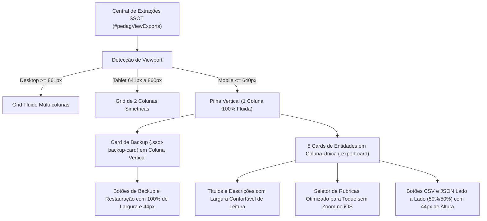

# PLANO DE IMPLEMENTAÇÃO — REDESIGN RESPONSIVO DA CENTRAL DE EXTRAÇÕES E BASE UNIFICADA (SSOT) NO MOBILE (PADRÃO HALLMARK)

> **Status:** Proposto / Em Análise (Etapa 1 - O Arquiteto)  
> **Data:** 29 de Outubro de 2026  
> **Alvo:** Sub-aba Central de Extrações e Base Unificada (SSOT) (`#pedagViewExports`), arquivos `css/04_screens.css`, `index.html`, `js/audit/audit_engine.js`, `CHANGELOG.md` e espelhos do Firebase (`firebase_deploy/public/`)  
> **Padrão de Qualidade:** Hallmark Design Standard (v2.0.0 / `RULE[user_global]`)  
> **Versão Alvo:** Versão 1.59 (v8.2.26) — sequencial imediata à consolidação de v1.58  
> **Objetivo Primário:** Eliminar em definitivo a visualização esmagada e distorcida dos cards de exportação e botões de backup no dispositivo móvel, substituindo a regra defeituosa `repeat(auto-fit, minmax(0, 1fr))` por um layout responsivo adaptativo (1 coluna fluida no mobile, 2 colunas em tablet e multi-coluna em desktop), padronizando alvos de toque com ergonomia de polegar (44px), erradicando estilos inline caóticos e aplicando tokens de design sóbrios do SerTão Criança.

---

## 0. Diretriz de Execução Obrigatória

> [!IMPORTANT]
> **Aviso ao Agente Executor (Etapa 2 - Operário):**  
> Antes de aplicar qualquer alteração de código resultante deste plano, você **DEVE OBRIGATORIAMENTE** ler o manual [`WORKFLOW_MACOS.md`](file:///Users/bruno/Desktop/gestor%20supervisao_patos/WORKFLOW_MACOS.md) e a skill [`.agents/skills/execucao-operario/SKILL.md`](file:///Users/bruno/Desktop/gestor%20supervisao_patos/.agents/skills/execucao-operario/SKILL.md).  
> 
> - **Trava Crítica da Etapa 1:** Durante a vigência deste plano, nenhum arquivo de código de produção deve ser comitado ou modificado prematuramente.
> - **Execução Mecânica da Etapa 2:** Na Etapa 2, execute o plano sem desvios, execute a blindagem sintática pré-voo (`python3 audit_platform.py --check-syntax`), crie o backup intermediário em `intermediárias/aplicativo_v1.59_central_extracoes_ssot_mobile_hallmark.html`, atualize o changelog duplo (`CHANGELOG.md` e `#modalChangelog` / botão `.btn-changelog` para a Versão 1.59 - v8.2.26), sincronize as cópias espelhadas do Firebase (`firebase_deploy/public/`), realize o deploy via `git push origin main` e execute a auditoria pós-deploy via `python3 audit_platform.py --silent-on-success`.

---

## 1. Diagnóstico e Contexto (The Read — Hallmark Standard)

### 1.1. Contexto da Funcionalidade
Na aba de **Gestão Pedagógica ➔ Relatórios SSOT** (`#homeGestaoView` ➔ `#pedagViewExports`), a **Central de Extrações e Base Unificada (SSOT)** consolida os mecanismos de exportação de dados brutos e integridade operacional do SerTão Criança:
1. **Bloco de Backup e Restauração Completa da Base (JSON):** Exportação global da base em `.json` e restauração emergencial com sobregravação integral.
2. **Grade de Extrações Setoriais (5 Entidades Primárias):**
   - Servidores & Membros da Rede (CSV / JSON);
   - Unidades Escolares & Polos (CSV / JSON);
   - Matriz de Rubricas & Critérios (com seletor de Matriz de Professores / Coordenadores + CSV / JSON);
   - Registros Formativos & Ocorrências (CSV / JSON);
   - Observações Realizadas (CSV / JSON).

### 1.2. Investigação Técnica da Causa Raiz da Visualização Estranha no Mobile
A análise da captura de tela enviada pelo usuário revelou **quatro graves anomalias estruturais**:

```
[Visão Mobile Atual na Captura (375px/390px)]
┌─────────────────────────────────────────────────────────────────┐
│ Backup & Restauração Completa da Base (JSON)                   │
│ [ Exportar Base (.JSON) ] [ Importar / Sobrescrever (.JSON) ]   │ <- Botões comprimidos
├─────┬─────┬─────┬─────┬─────┤
│Servi│Unida│Matri│Regis│Obser│ <- 5 cards esmagados lado a lado!
│dor..│de...│z de.│tro..│vaçã.│    Largura de cada card: ~60px
│CSV  │CSV  │[Sel]│CSV  │CSV  │    Texto quebrado por letra
│JSON │JSON │CSV  │JSON │JSON │    Botões deformados e inoperantes
└─────┴─────┴─────┴─────┴─────┘
```

1. **Causa Raiz Primária: Esmagamento via `minmax(0, 1fr)` em `repeat(auto-fit, ...)`:**
   - Em `css/04_screens.css` (linha 818):
     ```css
     .export-card-grid {
       display: grid;
       grid-template-columns: repeat(auto-fit, minmax(0, 1fr));
       gap: 16px;
       margin-top: 14px;
     }
     ```
   - Em CSS Grid, a função `repeat(auto-fit, minmax(MIN, MAX))` calcula quantas colunas cabem no container baseando-se no valor `MIN`.
   - Ao definir `MIN = 0`, o navegador interpreta que cada cartão pode encolher até `0px`.
   - Consequentemente, o Grid **nunca quebra linhas** em nenhuma resolução de tela. Em telas móveis de 375px ou 390px, todas as 5 entidades são forçadas em uma única linha horizontal de 5 colunas minúsculas (~60px cada), transformando os cards em fatias verticais ilegíveis.
   - O título quebra a cada sílaba, o parágrafo descritivo se torna uma coluna vertical estreita e os botões se espremem para 20px, cortando seus textos.

2. **Compressão Horizontal dos Botões de Backup & Restauração:**
   - O card de Backup global utiliza flexbox inline sem quebra responsiva adequada:
     ```html
     <div style="display:flex; justify-content:space-between; align-items:center; flex-wrap:wrap; gap:10px;">
       ...
       <div style="display:flex; gap:8px;">
         <button class="btn btn-secondary" onclick="exportFullBaseJSON()">Exportar Base Completa (.JSON)</button>
         <button class="btn btn-secondary" style="color:var(--red);" onclick="triggerImportFullBase()">Importar / Sobrescrever (.JSON)</button>
       </div>
     </div>
     ```
   - No celular, os dois botões disputam espaço horizontalmente, forçando quebras assimétricas de linha ("Importar /" e "Sobrescrever (.JSON)"), além de apresentarem alvos de toque inferiores aos 44px exigidos pelo Hallmark Floor.

3. **Inconsistência de Dimensionamento nos Botões das Entidades 4 e 5:**
   - Nos cards 1, 2 e 3, ambos os botões trazem `style="flex:1;"`.
   - Nos cards 4 (Registros Formativos) e 5 (Observações Realizadas), apenas o botão CSV traz `style="flex:1;"`, deixando o botão JSON com largura intrínseca. Isso gera assimetria visual injustificada.

4. **Violações dos Princípios Hallmark Floor (`RULE[user_global]`):**
   - **Tokens First:** Uso de cor literal `#F8FAFC` em `css/04_screens.css:825` para `.export-card` em vez do token `--gestao-surface` ou `--gestao-ground`.
   - **Layout & Viewport:** Falta de proteção contra auto-zoom no Safari iOS no `<select id="rubricMatrixSelectExports">` (necessário `font-size: 14px !important; min-height: 44px;`).
   - **Touch Targets:** Ausência de `min-height: var(--touch-target-min)` nos botões e selects no contexto móvel.

---

## 2. Arquitetura da Solução Proposta



### 2.1. Princípios de Design Hallmark Aplicados
1. **Tokens First:** Substituição de cores literais por `var(--gestao-surface)`, `var(--gestao-border)`, `var(--text-primary)`, `var(--text-secondary)` e `var(--primary-dark)`.
2. **Layout Responsivo Tri-fase:**
   - **Desktop (> 860px):** `grid-template-columns: repeat(auto-fill, minmax(260px, 1fr));` (cards fluidos e balanceados);
   - **Tablet (641px - 860px):** `grid-template-columns: repeat(2, minmax(0, 1fr));` (2 colunas perfeitas com respiro);
   - **Mobile (<= 640px):** `grid-template-columns: 1fr;` (1 coluna, cada entidade como um bloco sólido e imponente).
3. **Ergonomia Móvel e Alvos de Toque (Hallmark Floor 6):** Todos os botões e selects recebem `min-height: var(--touch-target-min)` (44px) no mobile, garantindo acionamento confortável sem erros de toque.
4. **Semântica e Desacoplamento:** Eliminação de estilos inline no card de Backup e nos cards de exportação, transferindo toda a responsabilidade para classes semânticas limpas (`.ssot-backup-card`, `.ssot-backup-layout`, `.ssot-backup-info`, `.ssot-backup-actions`, `.export-card-actions`).
5. **Preservação de Semiótica e Auditoria:** Manutenção estrita dos IDs DOM, handlers `onclick` e pictogramas SVG validados pelo módulo `backup_exportacao` em `js/audit/audit_engine.js`.

---

## 3. Especificação de Implementação Passo a Passo (Snippets Exatos)

### Passo 1: Atualização das Regras CSS em `css/04_screens.css`

Localizar o bloco das linhas 818-846 em `css/04_screens.css`:

```css
<<<<
    .export-card-grid {
      display: grid;
      grid-template-columns: repeat(auto-fit, minmax(0, 1fr));
      gap: 16px;
      margin-top: 14px;
    }
    .export-card {
      background: #F8FAFC;
      border: 1px solid var(--border);
      border-radius: 12px;
      padding: 16px;
      display: flex;
      flex-direction: column;
      justify-content: space-between;
      gap: 12px;
    }
    .export-card-title {
      font-size: 14px;
      font-weight: 800;
      color: var(--primary-dark);
      display: flex;
      align-items: center;
      gap: 8px;
    }
    .export-card-desc {
      font-size: 12px;
      color: var(--text-secondary);
      line-height: 1.5;
    }
====
    /* ================= CENTRAL DE EXTRAÇÕES E RELATÓRIOS SSOT (PADRÃO HALLMARK) ================= */
    .ssot-backup-card {
      background: var(--gestao-surface);
      border: 1px solid var(--gestao-border);
      border-radius: var(--radius);
      padding: 18px 20px;
      margin-bottom: 20px;
      box-shadow: var(--shadow-sm);
    }
    .ssot-backup-layout {
      display: flex;
      justify-content: space-between;
      align-items: center;
      gap: 16px;
      flex-wrap: wrap;
    }
    .ssot-backup-info {
      flex: 1 1 320px;
      min-width: 0;
    }
    .ssot-backup-title {
      font-size: 15px;
      font-weight: 800;
      color: var(--text-primary);
      letter-spacing: -0.1px;
    }
    .ssot-backup-desc {
      font-size: 12px;
      color: var(--text-secondary);
      margin-top: 4px;
      line-height: 1.5;
    }
    .ssot-backup-actions {
      display: flex;
      align-items: center;
      gap: 10px;
      flex-wrap: wrap;
    }
    .ssot-backup-btn {
      min-height: 38px;
      padding: 8px 16px;
      font-size: 13px;
      font-weight: 600;
      display: inline-flex;
      align-items: center;
      gap: 8px;
      white-space: nowrap;
      border-radius: 8px;
      transition: background-color 0.15s ease, border-color 0.15s ease, color 0.15s ease;
    }
    .ssot-backup-btn:focus-visible {
      outline: 2px solid var(--btn-focus-ring);
      outline-offset: 2px;
    }
    .ssot-backup-btn-danger {
      color: var(--red);
    }

    .export-card-grid {
      display: grid;
      grid-template-columns: repeat(auto-fill, minmax(260px, 1fr));
      gap: 16px;
      margin-top: 14px;
    }
    .export-card {
      background: var(--gestao-surface);
      border: 1px solid var(--gestao-border);
      border-radius: var(--radius);
      padding: 16px;
      display: flex;
      flex-direction: column;
      justify-content: space-between;
      gap: 14px;
      box-shadow: var(--shadow-sm);
      transition: border-color 0.15s ease, box-shadow 0.15s ease;
    }
    .export-card:hover {
      border-color: var(--primary);
    }
    .export-card-title {
      font-size: 14px;
      font-weight: 800;
      color: var(--primary-dark);
      display: flex;
      align-items: center;
      gap: 8px;
      line-height: 1.35;
      overflow-wrap: break-word;
      min-width: 0;
    }
    .export-card-desc {
      font-size: 12px;
      color: var(--text-secondary);
      line-height: 1.5;
    }
    .export-card-actions {
      display: flex;
      gap: 8px;
      align-items: center;
      width: 100%;
    }
    .export-card-actions .btn {
      flex: 1;
      min-height: 38px;
      font-size: 13px;
      font-weight: 600;
      justify-content: center;
      border-radius: 8px;
      transition: background-color 0.15s ease, border-color 0.15s ease, color 0.15s ease;
    }
    .export-card-actions .btn:focus-visible {
      outline: 2px solid var(--btn-focus-ring);
      outline-offset: 2px;
    }
>>>>
```

E dentro da seção de media queries mobile em `css/04_screens.css`:
1. No bloco `@media (max-width: 640px)`:

```css
      /* ================= RESPONSIVIDADE DA CENTRAL DE EXTRAÇÕES SSOT (MOBILE) ================= */
      .ssot-backup-card {
        padding: 14px;
        margin-bottom: 14px;
        border-radius: 10px;
      }
      .ssot-backup-layout {
        flex-direction: column;
        align-items: stretch;
        gap: 12px;
      }
      .ssot-backup-actions {
        flex-direction: column;
        width: 100%;
        gap: 8px;
      }
      .ssot-backup-btn {
        width: 100%;
        justify-content: center;
        min-height: var(--touch-target-min);
        font-size: 13px;
      }

      .export-card-grid {
        grid-template-columns: 1fr !important;
        gap: 12px !important;
        margin-top: 12px !important;
      }
      .export-card {
        padding: 14px;
        border-radius: 10px;
        gap: 12px;
      }
      .export-card-title {
        font-size: 15px;
      }
      .export-card-desc {
        font-size: 13px;
        line-height: 1.45;
        margin-top: 4px;
      }
      .export-card-actions .btn {
        min-height: var(--touch-target-min);
        font-size: 13px;
      }
      #rubricMatrixSelectExports {
        min-height: var(--touch-target-min);
        font-size: 14px !important; /* Previne auto-zoom no Safari iOS */
      }
```

2. No bloco `@media (min-width: 641px) and (max-width: 860px)`, assegurar suporte para tablets em 2 colunas:
```css
    @media (min-width: 641px) and (max-width: 860px) {
      .export-card-grid {
        grid-template-columns: repeat(2, minmax(0, 1fr));
        gap: 14px;
      }
    }
```

---

### Passo 2: Refatoração Semântica do HTML em `index.html`

Substituir o bloco em `index.html` (linhas 478-566):

```html
<<<<
        <div class="card" style="background:var(--gestao-surface); border:1px solid var(--gestao-border); margin-bottom:18px;">
          <div style="display:flex; justify-content:space-between; align-items:center; flex-wrap:wrap; gap:10px;">
            <div>
              <div style="font-size:15px; font-weight:800; color:var(--text-primary);">Backup & Restauração Completa da Base (JSON)</div>
              <div style="font-size:12px; color:var(--text-secondary); margin-top:4px;">
                Exporta ou sobrescreve integralmente todas as entidades do sistema: Servidores, UEs, Polos, Rubricas, Registros e Avaliações.
              </div>
            </div>
            <div style="display:flex; gap:8px;">
              <button class="btn btn-secondary" onclick="exportFullBaseJSON()">
                <svg class="btn-icon" viewBox="0 0 24 24"><path d="M21 15v4a2 2 0 0 1-2 2H5a2 2 0 0 1-2-2v-4"/><polyline points="17 8 12 3 7 8"/><line x1="12" y1="3" x2="12" y2="15"/></svg>
                Exportar Base Completa (.JSON)
              </button>
              <button class="btn btn-secondary" style="color:var(--red);" onclick="triggerImportFullBase()">
                <svg class="btn-icon" viewBox="0 0 24 24"><path d="M21 15v4a2 2 0 0 1-2 2H5a2 2 0 0 1-2-2v-4"/><polyline points="7 10 12 15 17 10"/><line x1="12" y1="15" x2="12" y2="3"/></svg>
                Importar / Sobrescrever (.JSON)
              </button>
              <input type="file" id="importFullBaseFileInput" accept=".json" style="display:none;" onchange="importFullBaseJSON(event)" />
            </div>
          </div>
        </div>

        <div class="export-card-grid">
          <!-- Card Servidores -->
          <div class="export-card">
            <div>
              <div class="export-card-title">Servidores & Membros da Rede</div>
              <div class="export-card-desc">Lista completa de profissionais: docentes, coordenadoras pedagógicas, formadoras e lotações.</div>
            </div>
            <div style="display:flex; gap:8px;">
              <button class="btn btn-secondary" style="flex:1;" onclick="exportTeamMembersCSV()">CSV</button>
              <button class="btn btn-secondary" style="flex:1;" onclick="exportTeamMembersJSON()">JSON</button>
            </div>
          </div>

          <!-- Card UEs e Polos -->
          <div class="export-card">
            <div>
              <div class="export-card-title">Unidades Escolares & Polos</div>
              <div class="export-card-desc">Relação cadastral de escolas infantis, polos territoriais vinculados e endereços.</div>
            </div>
            <div style="display:flex; gap:8px;">
              <button class="btn btn-secondary" style="flex:1;" onclick="exportUnitsCSV()">CSV</button>
              <button class="btn btn-secondary" style="flex:1;" onclick="exportUnitsJSON()">JSON</button>
            </div>
          </div>

          <!-- Card Rubricas -->
          <div class="export-card">
            <div>
              <div class="export-card-title">Matriz de Rubricas & Critérios</div>
              <div class="export-card-desc">Estrutura completa das 5 dimensões diagnósticas, subdimensões e descritores pedagógicos.</div>
            </div>
            <div style="display:flex; flex-direction:column; gap:8px;">
              <select id="rubricMatrixSelectExports" class="form-select" style="width: 100%; display: block;" onchange="syncRubricMatrixSelect(this.value)">
                <option value="teacher">Matriz de Professores</option>
                <option value="coordinator">Matriz de Coordenadores</option>
              </select>
              <div style="display:flex; gap:8px;">
                <button class="btn btn-secondary" style="flex:1;" onclick="exportRubricsCSV()">CSV</button>
                <button class="btn btn-secondary" style="flex:1;" onclick="exportRubricsJSON()">JSON</button>
              </div>
            </div>
          </div>

          <!-- Card Registros Formativos -->
          <div class="export-card">
            <div>
              <div class="export-card-title">Registros Formativos & Ocorrências</div>
              <div class="export-card-desc">Todas as anotações qualitativas de campo registradas pela supervisão pedagógica.</div>
            </div>
            <div style="display:flex; gap:8px;">
              <button class="btn btn-secondary" style="flex:1;" onclick="exportAllNotesCSV()">CSV</button>
              <button class="btn btn-secondary" onclick="exportAllNotesJSON()">JSON</button>
            </div>
          </div>

          <!-- Card Observações Pedagógicas -->
          <div class="export-card">
            <div>
              <div class="export-card-title">Observações Realizadas</div>
              <div class="export-card-desc">Base de acompanhamentos pedagógicos, sínteses, níveis de materiais e metadados.</div>
            </div>
            <div style="display:flex; gap:8px;">
              <button class="btn btn-secondary" style="flex:1;" onclick="exportAllObservationsCSV()">CSV</button>
              <button class="btn btn-secondary" onclick="exportAllObservationsJSON()">JSON</button>
            </div>
          </div>
        </div>
====
        <div class="ssot-backup-card">
          <div class="ssot-backup-layout">
            <div class="ssot-backup-info">
              <div class="ssot-backup-title">Backup & Restauração Completa da Base (JSON)</div>
              <div class="ssot-backup-desc">
                Exporta ou sobrescreve integralmente todas as entidades do sistema: Servidores, UEs, Polos, Rubricas, Registros e Avaliações.
              </div>
            </div>
            <div class="ssot-backup-actions">
              <button class="btn btn-secondary ssot-backup-btn" onclick="exportFullBaseJSON()">
                <svg class="btn-icon" viewBox="0 0 24 24"><path d="M21 15v4a2 2 0 0 1-2 2H5a2 2 0 0 1-2-2v-4"/><polyline points="17 8 12 3 7 8"/><line x1="12" y1="3" x2="12" y2="15"/></svg>
                Exportar Base Completa (.JSON)
              </button>
              <button class="btn btn-secondary ssot-backup-btn ssot-backup-btn-danger" onclick="triggerImportFullBase()">
                <svg class="btn-icon" viewBox="0 0 24 24"><path d="M21 15v4a2 2 0 0 1-2 2H5a2 2 0 0 1-2-2v-4"/><polyline points="7 10 12 15 17 10"/><line x1="12" y1="15" x2="12" y2="3"/></svg>
                Importar / Sobrescrever (.JSON)
              </button>
              <input type="file" id="importFullBaseFileInput" accept=".json" style="display:none;" onchange="importFullBaseJSON(event)" />
            </div>
          </div>
        </div>

        <div class="export-card-grid">
          <!-- Card Servidores -->
          <div class="export-card">
            <div>
              <div class="export-card-title">Servidores & Membros da Rede</div>
              <div class="export-card-desc">Lista completa de profissionais: docentes, coordenadoras pedagógicas, formadoras e lotações.</div>
            </div>
            <div class="export-card-actions">
              <button class="btn btn-secondary" onclick="exportTeamMembersCSV()">CSV</button>
              <button class="btn btn-secondary" onclick="exportTeamMembersJSON()">JSON</button>
            </div>
          </div>

          <!-- Card UEs e Polos -->
          <div class="export-card">
            <div>
              <div class="export-card-title">Unidades Escolares & Polos</div>
              <div class="export-card-desc">Relação cadastral de escolas infantis, polos territoriais vinculados e endereços.</div>
            </div>
            <div class="export-card-actions">
              <button class="btn btn-secondary" onclick="exportUnitsCSV()">CSV</button>
              <button class="btn btn-secondary" onclick="exportUnitsJSON()">JSON</button>
            </div>
          </div>

          <!-- Card Rubricas -->
          <div class="export-card">
            <div>
              <div class="export-card-title">Matriz de Rubricas & Critérios</div>
              <div class="export-card-desc">Estrutura completa das 5 dimensões diagnósticas, subdimensões e descritores pedagógicos.</div>
            </div>
            <div style="display:flex; flex-direction:column; gap:8px;">
              <select id="rubricMatrixSelectExports" class="form-select" style="width: 100%; display: block;" onchange="syncRubricMatrixSelect(this.value)">
                <option value="teacher">Matriz de Professores</option>
                <option value="coordinator">Matriz de Coordenadores</option>
              </select>
              <div class="export-card-actions">
                <button class="btn btn-secondary" onclick="exportRubricsCSV()">CSV</button>
                <button class="btn btn-secondary" onclick="exportRubricsJSON()">JSON</button>
              </div>
            </div>
          </div>

          <!-- Card Registros Formativos -->
          <div class="export-card">
            <div>
              <div class="export-card-title">Registros Formativos & Ocorrências</div>
              <div class="export-card-desc">Todas as anotações qualitativas de campo registradas pela supervisão pedagógica.</div>
            </div>
            <div class="export-card-actions">
              <button class="btn btn-secondary" onclick="exportAllNotesCSV()">CSV</button>
              <button class="btn btn-secondary" onclick="exportAllNotesJSON()">JSON</button>
            </div>
          </div>

          <!-- Card Observações Pedagógicas -->
          <div class="export-card">
            <div>
              <div class="export-card-title">Observações Realizadas</div>
              <div class="export-card-desc">Base de acompanhamentos pedagógicos, sínteses, níveis de materiais e metadados.</div>
            </div>
            <div class="export-card-actions">
              <button class="btn btn-secondary" onclick="exportAllObservationsCSV()">CSV</button>
              <button class="btn btn-secondary" onclick="exportAllObservationsJSON()">JSON</button>
            </div>
          </div>
        </div>
>>>>
```

---

### Passo 3: Sincronização Obrigatória com Espelhos do Firebase
Replicar os arquivos modificados em seus respectivos destinos no build de produção:
- Copiar `css/04_screens.css` para `firebase_deploy/public/css/04_screens.css` e `firebase_deploy/public/04_screens.css`.
- Copiar `index.html` para `firebase_deploy/public/index.html`.

---

### Passo 4: Registro de Versão e Changelog Duplo (Versão 1.59)

1. **No arquivo `index.html` (e espelho):**
   - Atualizar o botão de cabeçalho:
     ```html
     <span>Versão 1.59 (v8.2.26)</span>
     ```
   - Inserir no topo de `#modalChangelog`:
     ```html
     <!-- VERSÃO 1.59 - REDESIGN RESPONSIVO DA CENTRAL DE EXTRAÇÕES E SSOT (HALLMARK) -->
     <div style="margin-bottom:20px; border-left:3px solid var(--primary); padding-left:14px;">
       <div style="display:flex; align-items:center; gap:8px;">
         <span style="font-size:14px; font-weight:800; color:var(--primary-dark);">Versão 1.59 · v8.2.26</span>
         <span style="font-size:11px; background:#EFF6FF; color:var(--primary); padding:2px 8px; border-radius:12px; font-weight:700;">29/10/2026</span>
       </div>
       <div style="font-size:12px; color:var(--text-secondary); margin-top:4px;">
         Redesign Responsivo e Adaptação Mobile da Central de Extrações e Base Unificada (SSOT):
       </div>
       <ul style="font-size:12px; color:var(--text-primary); margin-top:8px; line-height:1.6; padding-left:16px;">
         <li>📱 <strong>Eliminação do Esmagamento Mobile:</strong> Correção definitiva de <code>.export-card-grid</code> com grid adaptativo fluido (1 coluna fluida no celular, 2 colunas em tablets e multi-coluna em desktops), erradicando a compressão estreita de 60px.</li>
         <li>💾 <strong>Reestruturação Ergonômica de Backup:</strong> Enquadramento do card de Backup & Restauração (<code>.ssot-backup-card</code>) com botões empilhados de largura total (100%) no mobile e alvos de toque mínimos de 44px (<code>--touch-target-min</code>).</li>
         <li>🎨 <strong>Tokens Institucionais Hallmark:</strong> Erradicação de cores literais e estilos inline soltos, padronizando os cartões sob <code>var(--gestao-surface)</code> e bordas calmas de <code>var(--gestao-border)</code>.</li>
         <li>🛡️ <strong>Simetria Operacional e Proteção contra Zoom iOS:</strong> Padronização dos botões CSV/JSON em <code>.export-card-actions</code> com distribuição simétrica 50%/50% e dimensionamento a 14px no seletor de rubricas para prevenir zoom automático no Safari iOS.</li>
       </ul>
     </div>
     ```

2. **No arquivo `CHANGELOG.md`:**
   - Adicionar entrada correspondente da **Versão 1.59** no Sumário Executivo e no Histórico Detalhado.

---

## 4. Critérios de Aceite e Roteiro de Teste

### 4.1. Critérios de Aceite Visuais e Comportamentais
- [ ] **Mobile (375px a 430px):**
  - A sub-aba "Relatórios SSOT" exibe os 5 cartões de entidades perfeitamente empilhados em 1 coluna vertical de largura total (100%).
  - Nenhum texto quebra por letra ou fica comprimido em colunas estreitas.
  - O card de Backup global exibe os botões "Exportar Base Completa (.JSON)" e "Importar / Sobrescrever (.JSON)" empilhados verticalmente, com largura de 100% e altura mínima de 44px.
  - Em cada um dos 5 cards, os botões de ação ("CSV" e "JSON") dividem o espaço horizontal em partes iguais (50% / 50%) com altura confortável de toque (44px).
  - O seletor `<select id="rubricMatrixSelectExports">` possui fonte de 14px e não provoca auto-zoom ao ser tocado no Safari iOS.
- [ ] **Tablet (641px a 860px):** Os cartões de exportação organizam-se em uma grade balanceada de 2 colunas.
- [ ] **Desktop (> 860px):** Os cartões distribuem-se fluidamente em múltiplas colunas conforme a largura do container, sem deformação.
- [ ] **Acessibilidade e Interação:** Todo botão e seletor exibe `:focus-visible` nítido instantaneamente.

### 4.2. Roteiro de Verificação Pré e Pós-Deploy
1. **Blindagem Sintática Pré-Voo:** Executar `python3 audit_platform.py --check-syntax` e confirmar 100% de integridade léxica no JavaScriptCore.
2. **Deploy Seguro:** Realizar `git push origin main`.
3. **Auditoria Headless Pós-Deploy:** Executar `python3 audit_platform.py --silent-on-success` e certificar que todos os 12 módulos foram aprovados com sucesso.

---

## 5. Seção Obrigatória de Auditoria (`audit_platform.py` / `js/audit/audit_engine.js`)

### 5.1. Impacto no Algoritmo de Auditoria Existente
- No Módulo 11 (`backup_exportacao`), os testes verificam a existência de:
  - `button[onclick*="exportFullBaseJSON()"]` com SVG de bandeja com seta para cima (`17 8 12 3 7 8` e `y1="3"`);
  - `button[onclick*="triggerImportFullBase()"]` com SVG de bandeja com seta para baixo (`7 10 12 15 17 10` e `y1="15"`).
  *Impacto:* **ZERO**. Todos os seletores, tags, IDs e atributos SVG permanecem 100% inalterados.
- No Módulo 12 (`navegacao_layout`), linhas 3373-3377:
  - O motor valida o rótulo do botão `.btn-changelog` e a presença do card da versão no `#modalChangelog`.
  *Impacto:* Como o projeto será elevado para a **Versão 1.59**, as asserções devem ser atualizadas para validar a Versão 1.59.

### 5.2. Alterações e Inclusões Exatas em `js/audit/audit_engine.js`

Em `js/audit/audit_engine.js`, atualizar as asserções do final do Módulo 12:

```javascript
<<<<
              // Validação do rótulo atualizado do botão de changelog e card da versão 1.58
              if (!btnChangelog.textContent.includes('Versão 1.58')) {
                throw new Error(`Botão de versão desatualizado: "${btnChangelog.textContent.trim()}"`);
              }
              if (!modalChg.innerHTML.includes('Versão 1.58')) {
                throw new Error('#modalChangelog não contém o card descritivo da Versão 1.58');
              }
              logger.log('Asserção de Integridade do Cabeçalho e Registro da Versão 1.58 (v8.2.25)', true);
====
              // Validação do rótulo atualizado do botão de changelog e card da versão 1.59
              if (!btnChangelog.textContent.includes('Versão 1.59')) {
                throw new Error(`Botão de versão desatualizado: "${btnChangelog.textContent.trim()}"`);
              }
              if (!modalChg.innerHTML.includes('Versão 1.59')) {
                throw new Error('#modalChangelog não contém o card descritivo da Versão 1.59');
              }
              logger.log('Asserção de Integridade do Cabeçalho e Registro da Versão 1.59 (v8.2.26)', true);

              // Validação da Estruturação Responsiva Hallmark da Central de Extrações SSOT
              const ssotBackupCard = document.querySelector('.ssot-backup-card');
              if (!ssotBackupCard) throw new Error('.ssot-backup-card não encontrado no DOM');

              const exportGrid = document.querySelector('.export-card-grid');
              if (!exportGrid) throw new Error('.export-card-grid não encontrada no DOM');

              const exportCards = exportGrid.querySelectorAll('.export-card');
              if (exportCards.length !== 5) {
                throw new Error(`Grade de exportações deve possuir exatamente 5 cards de entidades, encontrados: ${exportCards.length}`);
              }

              const exportActionGroups = exportGrid.querySelectorAll('.export-card-actions');
              if (exportActionGroups.length !== 5) {
                throw new Error(`Grade de exportações deve possuir 5 grupos de botões .export-card-actions, encontrados: ${exportActionGroups.length}`);
              }
              logger.log('Validação da Estruturação Semântica Hallmark da Central de Extrações SSOT (Versão 1.59)', true, '5 cards e grupos de ação validados');
>>>>
```

---

## 6. Próximo Passo
Aguardar autorização expressa do usuário para transição para a **Etapa 2 (Operário / Execução Mecânica Fiel)**. Nenhuma linha de código foi ou será alterada até a referida ordem.
