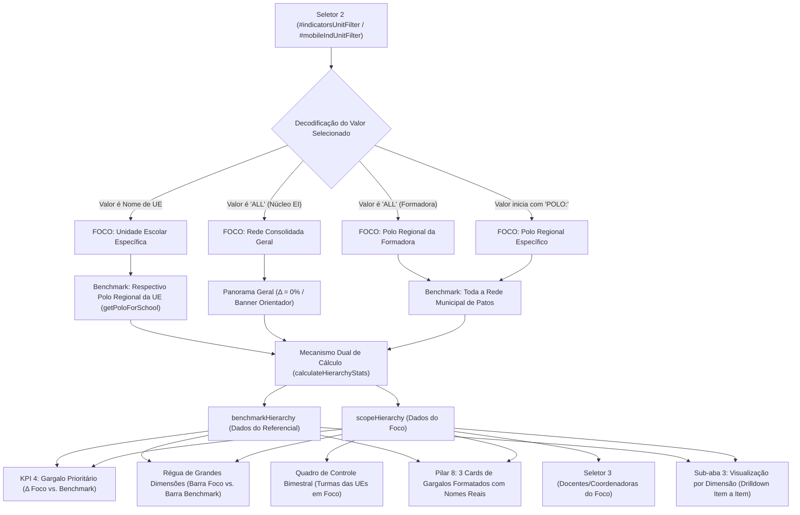

# PLANO DE IMPLEMENTAÇÃO: ARQUITETURA DUAL DE BENCHMARK PEDAGÓGICO — COMPARAÇÃO POLO VS. REDE E UNIDADE VS. RESPECTIVO POLO

---

## 0. Diretriz de Execução (Obrigatória)
> [!IMPORTANT]
> **Atenção, Executor (Etapa 2 - O Operário):**
> Antes de aplicar qualquer código deste plano, consulte e siga estritamente o [WORKFLOW_MACOS.md](file:///Users/bruno/Desktop/gestor%20supervisao_patos/WORKFLOW_MACOS.md) e a workspace skill [execucao-operario](file:///Users/bruno/Desktop/gestor%20supervisao_patos/.agents/skills/execucao-operario/SKILL.md).
> 
> **Travas Operacionais Inegociáveis:**
> 1. Proibição categórica de abrir o Google Chrome gráfico interativo (`open -a "Google Chrome"` ou subagentes interativos de navegação).
> 2. Validação sintática pré-voo obrigatória com JavaScriptCore nativo (`python3 audit_platform.py --check-syntax`) antes de qualquer commit.
> 3. Atualização do Changelog duplo (`CHANGELOG.md` e `#modalChangelog` / `.btn-changelog` em `index.html`).
> 4. Backup sequencial em `intermediárias/aplicativo_v1.68_comparacao_polo_vs_rede_e_unidade_vs_polo.html`.
> 5. Sincronização simultânea e obrigatória entre as árvores espelhadas:
>    - `gestor supervisao_patos/index.html` ↔ `gestor supervisao_patos/firebase_deploy/public/index.html`
>    - `gestor supervisao_patos/js/features/indicators.js` ↔ `gestor supervisao_patos/firebase_deploy/public/js/features/indicators.js`
>    - `gestor supervisao_patos/js/audit/audit_engine.js` ↔ `gestor supervisao_patos/firebase_deploy/public/js/audit/audit_engine.js`
> 6. Checagem pré-push de concorrência (`git fetch origin main`), rebase limpo se necessário e push seguro para deploy no GitHub Pages.
> 7. Auditoria modular pós-deploy estritamente headless (`python3 audit_platform.py --silent-on-success`).

---

## 1. Diagnóstico e Contexto

### 1.1 O Problema Identificado
Na plataforma atual do Gestor de Supervisão SerTão Criança, a análise comparativa de indicadores apresenta lacunas conceituais e limitações de interface:
1. **Impossibilidade de Comparar Polo vs. Rede:**
   - Na visualização de práticas docentes (`targetType = 'professora'`), o Seletor 2 (`#indicatorsUnitFilter`) não oferece opções para selecionar um **Polo Regional** consolidado como unidade analítica.
   - Os Polos são exibidos para a Coordenadora do Núcleo apenas como cabeçalhos `<optgroup>`, impedindo o clique ou a seleção de um polo inteiro para confrontar seu desempenho territorial com a média geral do município de Patos/PB.
   - Para a Formadora Pedagógica Regional (ex: `Clarice Barbosa`), a opção `"ALL"` recorria à lista genérica de escolas ou não isolava explicitamente o benchmark do seu Polo contra a Rede Municipal.
2. **Ausência da Comparação Territorial Micro (Unidade vs. Respectivo Polo):**
   - Ao selecionar uma Unidade Escolar específica (seja pela Formadora, pela Coordenadora do Núcleo ou pela Coordenadora Pedagógica da Escola), todo o referencial comparativo ($\Delta\%$, réguas, cards de gargalos prioritários e árvore de afunilamento) confronta a escola diretamente contra a **Média Global de toda a Rede Municipal**.
   - Na realidade formativa de Patos, a comparação direta de uma creche ou EMEI com a média genérica de 32 escolas da cidade é metodologicamente distante da gestão de proximidade: o referencial imediato da unidade escolar deve ser o **seu respectivo Polo Regional**, onde atuam os mesmos formadores e realidades territoriais afins.
3. **Falta de Clareza Hierárquica por Perfil:**
   - A **Formadora** deve ter a capacidade de ver seu **Polo vs. Rede** e cada **Unidade do seu polo vs. o respectivo Polo**.
   - A **Coordenadora do Núcleo de EI** (Helena Martins) deve ter a capacidade de comparar **qualquer Polo vs. Rede** ou qualquer **Unidade vs. o respectivo Polo**.
   - A **Coordenadora de Unidade Escolar** (ex: Ana Valéria) deve comparar a sua **Unidade vs. o respectivo Polo** ao qual pertence.

### 1.2 Objetivos da Implementação
- **Arquitetura Dual de Benchmark Pedagógico:**
  1. **Nível Macro Territorial (Polo vs. Rede):**
     - Foco: Polo Regional selecionado.
     - Comparador (Benchmark): Média Geral Consolidada da Rede Municipal de Patos.
     - Permite responder: *"Como este polo está desempenhando frente à média do município?"*.
  2. **Nível Micro Institucional (Unidade vs. Respectivo Polo):**
     - Foco: Unidade Escolar selecionada.
     - Comparador (Benchmark): Média Consolidada do Polo Regional ao qual aquela unidade pertence.
     - Permite responder: *"Como esta escola está desempenhando frente às demais escolas do seu polo territorial?"*.
- **Estruturação Reativa dos Seletores Conforme o Papel do Usuário:**
  - **Coordenadora do Núcleo de Educação Infantil (`isNucleoEI(user)`):**
    - Opção `ALL`: Rede Consolidada (Panorama Municipal de Patos).
    - Grupo de Seleção de Polos: Permite selecionar qualquer polo cadastrado (`POLO:Polo Regional 1 (Norte)`, etc.) com benchmark automático contra a Rede.
    - Grupos de Unidades Escolares: Agrupadas por polo; ao selecionar uma UE, o benchmark automático compara a UE com o seu respectivo Polo.
  - **Formadora Pedagógica Regional (`user.roleKey === 'formador'`):**
    - Opção `ALL`: *"Meu Polo: [Nome do Polo] vs. Rede (Consolidado)"* com benchmark automático contra a Rede Municipal.
    - Grupo de Unidades do Meu Polo: Permite selecionar qualquer UE do seu polo, comparando a UE vs. o seu próprio Polo.
  - **Coordenadora Pedagógica de Escola (`user.roleKey === 'coordenador'`):**
    - Unidade fixa em `user.school`, comparando automaticamente a sua unidade contra o seu respectivo Polo Regional.
- **Higienização e Dinamismo Contextual dos Textos (Padrão Hallmark):**
  - Rótulos contextuais nas réguas duplas da matriz: `${scopeLabelText}` vs. `${benchmarkLabelText}`.
  - Mini-cards de gargalos do Pilar 8 exibindo dinamicamente as colunas do foco e do benchmark correspondente.
  - Banners explicativos com indicação precisa do foco e do comparador ativo.

---

## 2. Arquitetura e Pontos de Impacto



### 2.1 Arquivos Envolvidos
1. `gestor supervisao_patos/js/features/indicators.js` (e espelho em `firebase_deploy/public/js/features/indicators.js`):
   - Inclusão dos utilitários `getPoloForSchool(schoolName)` e `getUnitsForPolo(poloName)`.
   - Modificação da função `focusUnitFilter(target)` para aceitar nomes de escolas ou polos com prefixo `POLO:`.
   - Atualização de `renderIndicatorsScreen()`:
     - População do Seletor 2 desktop e mobile com opções de Polos vs. Rede e UEs vs. Polo.
     - Decodificação do filtro ativo: identificação de `isPoloFocus`, `focusedPoloName`, `focusedUnitName`, `isRedeConsolidated`.
     - Filtragem resiliente de `scopedObs`, `scopedAvaliandos` e turmas das UEs mapeadas.
     - Cálculo de `benchmarkObs` (observações da rede ou do polo de pertencimento, com mesmo filtro de bimestre e público-alvo).
     - Geração de `scopeHierarchy` e `benchmarkHierarchy`.
     - Atualização dos rótulos `scopeLabelText` e `benchmarkLabelText`.
     - Atualização do card KPI 4, banner contextual, réguas de grandes dimensões, bloco de gargalos prioritários (Pilar 8) e drilldown item a item.
     - Adaptação das Tabelas Executivas institucionais.
   - Sincronização em `openMobileIndicatorsFiltersModal()` e `syncMobileToDesktopFilters()`.
2. `gestor supervisao_patos/js/audit/audit_engine.js` (e espelho em `firebase_deploy/public/js/audit/audit_engine.js`):
   - Atualização do Módulo 10 (`indicadores_decisao`):
     - Teste de Formadora: validação de Polo vs. Rede em `ALL` e UE vs. Polo ao selecionar escola do polo.
     - Teste de Coordenadora do Núcleo: validação de seleção de Polo vs. Rede (`POLO:...`) e UE vs. Polo.
     - Teste de Coordenadora de Escola: validação de UE vs. Polo.
     - Preservação integral dos testes de `<optgroup>`, cards decisórios, semáforo e pictogramas.
3. `gestor supervisao_patos/index.html` (e espelho em `firebase_deploy/public/index.html`):
   - Atualização da versão no modal e botão de changelog.
4. `CHANGELOG.md`:
   - Registro detalhado da nova versão.

---

## 3. Especificação de Implementação Passo a Passo (Snippets Exatos)

### Passo 3.1: Utilitários Territoriais de Polo e Unidade em `js/features/indicators.js`
Inserir no topo de `js/features/indicators.js` (ou antes de `renderIndicatorsScreen`):

```javascript
/**
 * Retorna o nome do Polo Regional de uma Unidade Escolar
 */
function getPoloForSchool(schoolName) {
  if (!schoolName) return null;
  const clean = schoolName.trim().toLowerCase();
  const unit = (appState.units || []).find(u => (u.name || '').trim().toLowerCase() === clean);
  return unit ? unit.polo : null;
}

/**
 * Retorna todas as Unidades Escolares pertencentes a um Polo Regional
 */
function getUnitsForPolo(poloName) {
  if (!poloName) return [];
  const pNorm = poloName.trim().toLowerCase();
  return (appState.units || []).filter(u => {
    if (!u.polo) return false;
    const up = u.polo.trim().toLowerCase();
    return up === pNorm || up.includes(pNorm) || pNorm.includes(up);
  }).map(u => u.name);
}
```

Atualizar `focusUnitFilter(target)` para suportar tanto nome de UE quanto Polo (`POLO:Nome`):
```javascript
function focusUnitFilter(target) {
  const unitSelect = document.getElementById('indicatorsUnitFilter');
  if (unitSelect) {
    unitSelect.value = target;
    const memberSelect = document.getElementById('indicatorsMemberFilter');
    if (memberSelect) memberSelect.value = 'ALL';
    renderIndicatorsScreen();
    const toolbar = document.getElementById('indicatorsFilterToolbar');
    if (toolbar) toolbar.scrollIntoView({ behavior: 'smooth', block: 'start' });
  }
}
```

---

### Passo 3.2: Reestruturação da População do Seletor 2 em `renderIndicatorsScreen()`
Substituir o bloco de população do seletor de unidades (linhas ~1640 a ~1730) para construir as opções hierárquicas e semânticas:

```javascript
<<<< TARGET
      // 1. Popula ou sincroniza opções do Seletor de Unidades Escolares / Polos Regionais
      let availableUnits = [];
      if (unitSelect) {
        const currentSelectedUnit = unitSelect.value || 'ALL';

        if (targetType === 'coordenador') {
          // =========================================================================
          // CASO COORDENADORAS: ESCOPO TERRITORIAL POR POLO REGIONAL
          // =========================================================================
          if (user.roleKey === 'formador') {
            // Formadora: somente o seu Polo atribuído vs. Rede Municipal
            const formadorPolo = user.school || 'Polo Regional';
            unitSelect.innerHTML = `<option value="${formadorPolo}">Meu Polo: ${formadorPolo}</option>`;
            unitSelect.value = formadorPolo;
            unitSelect.disabled = true;
          } else if (isNucleoEI(user)) {
            // Núcleo de EI: qualquer Polo Regional vs. Rede ou Todos os Polos (Rede Consolidada)
            const allPolos = (appState.polos || []).map(p => p.name).sort();
            let poloOptionsHtml = `<option value="ALL">Todos os Polos (Rede Consolidada)</option>`;
            allPolos.forEach(pName => {
              poloOptionsHtml += `<option value="${pName}">Polo: ${pName}</option>`;
            });
            unitSelect.innerHTML = poloOptionsHtml;
            unitSelect.disabled = false;
            if (allPolos.includes(currentSelectedUnit) || currentSelectedUnit === 'ALL') {
              unitSelect.value = currentSelectedUnit;
            } else {
              unitSelect.value = 'ALL';
            }
          }
        } else {
          // =========================================================================
          // CASO PROFESSORAS: ESCOPO TRADICIONAL POR UNIDADE ESCOLAR (PRESERVADO 100%)
          // =========================================================================
          if (isNucleoEI(user)) {
            availableUnits = (appState.units || []).map(u => u.name);
          } else if (user.roleKey === 'formador') {
            const userPolo = (user.school || '').trim().toLowerCase();
            const poloUnits = (appState.units || []).filter(u => {
              if (!u.polo) return false;
              const up = u.polo.trim().toLowerCase();
              return up === userPolo || up.includes(userPolo) || userPolo.includes(up);
            }).map(u => u.name);
            const supervisedCoords = (appState.teamMembers || []).filter(m => 
              m.roleKey === 'coordenador' && (m.supervisor === user.name || (m.school && poloUnits.includes(m.school)))
            );
            const formadorUnits = Array.from(new Set([...poloUnits, ...supervisedCoords.map(c => c.school)])).filter(Boolean);
            availableUnits = formadorUnits.length > 0 ? formadorUnits : (appState.units || []).map(u => u.name);
          } else if (user.roleKey === 'coordenador') {
            availableUnits = user.school ? [user.school] : [];
          }

          let unitOptionsHtml = '';
          if (user.roleKey !== 'coordenador') {
            unitOptionsHtml += `<option value="ALL">Todas as Unidades do Escopo (${availableUnits.length})</option>`;
          }

          // Agrupamento semântico por Polo para o Núcleo de Educação Infantil
          if (isNucleoEI(user)) {
            const unitsByPolo = {};
            (appState.units || []).forEach(u => {
              const pName = u.polo || 'Sem Polo Definido';
              if (!unitsByPolo[pName]) unitsByPolo[pName] = [];
              unitsByPolo[pName].push(u.name);
            });

            const sortedPolos = Object.keys(unitsByPolo).sort();
            sortedPolos.forEach(pName => {
              unitOptionsHtml += `<optgroup label="Polo: ${pName}">`;
              unitsByPolo[pName].sort().forEach(uName => {
                unitOptionsHtml += `<option value="${uName}">${uName}</option>`;
              });
              unitOptionsHtml += `</optgroup>`;
            });
          } else {
            availableUnits.forEach(uName => {
              unitOptionsHtml += `<option value="${uName}">${uName}</option>`;
            });
          }

          unitSelect.innerHTML = unitOptionsHtml;
          if (user.roleKey === 'coordenador') {
            unitSelect.value = user.school || '';
            unitSelect.disabled = true;
          } else {
            unitSelect.disabled = false;
            if (availableUnits.includes(currentSelectedUnit) || currentSelectedUnit === 'ALL') {
              unitSelect.value = currentSelectedUnit;
            } else {
              unitSelect.value = 'ALL';
            }
          }
        }
      }
====
      // 1. Popula ou sincroniza opções do Seletor de Unidades Escolares / Polos Regionais
      let availableUnits = [];
      if (unitSelect) {
        const currentSelectedUnit = unitSelect.value || 'ALL';

        if (targetType === 'coordenador') {
          // =========================================================================
          // PÚBLICO COORDENADORAS: ESCOPO POR POLO REGIONAL
          // =========================================================================
          if (user.roleKey === 'formador') {
            const formadorPolo = user.school || 'Polo Regional';
            unitSelect.innerHTML = `<option value="${formadorPolo}">Meu Polo: ${formadorPolo} [vs. Rede]</option>`;
            unitSelect.value = formadorPolo;
            unitSelect.disabled = true;
          } else if (isNucleoEI(user)) {
            const allPolos = (appState.polos || []).map(p => p.name).sort();
            let poloOptionsHtml = `<option value="ALL">Todos os Polos (Rede Consolidada)</option>`;
            allPolos.forEach(pName => {
              poloOptionsHtml += `<option value="${pName}">${pName} [vs. Rede]</option>`;
            });
            unitSelect.innerHTML = poloOptionsHtml;
            unitSelect.disabled = false;
            if (allPolos.includes(currentSelectedUnit) || currentSelectedUnit === 'ALL') {
              unitSelect.value = currentSelectedUnit;
            } else {
              unitSelect.value = 'ALL';
            }
          }
        } else {
          // =========================================================================
          // PÚBLICO PROFESSORAS: ARQUITETURA DUAL (POLO VS. REDE E UE VS. POLO)
          // =========================================================================
          let unitOptionsHtml = '';

          if (isNucleoEI(user)) {
            availableUnits = (appState.units || []).map(u => u.name);
            const allPolos = (appState.polos || []).map(p => p.name).sort();

            // Opção 1: Rede Consolidada
            unitOptionsHtml += `<option value="ALL">Rede Consolidada (Média Geral de Patos/PB)</option>`;

            // Grupo 1: Comparação de Qualquer Polo vs. Rede
            unitOptionsHtml += `<optgroup label="── POLOS REGIONAIS (Polo vs. Rede) ──">`;
            allPolos.forEach(pName => {
              unitOptionsHtml += `<option value="POLO:${pName}">Polo: ${pName} [vs. Rede]</option>`;
            });
            unitOptionsHtml += `</optgroup>`;

            // Grupos 2..N: Comparação de Unidade vs. Respectivo Polo
            const unitsByPolo = {};
            (appState.units || []).forEach(u => {
              const pName = u.polo || 'Sem Polo Definido';
              if (!unitsByPolo[pName]) unitsByPolo[pName] = [];
              unitsByPolo[pName].push(u.name);
            });

            allPolos.forEach(pName => {
              const uList = unitsByPolo[pName] || [];
              if (uList.length > 0) {
                unitOptionsHtml += `<optgroup label="── ${pName.toUpperCase()} (UE vs. Polo) ──">`;
                uList.sort().forEach(uName => {
                  unitOptionsHtml += `<option value="${uName}">${uName}</option>`;
                });
                unitOptionsHtml += `</optgroup>`;
              }
            });

            unitSelect.innerHTML = unitOptionsHtml;
            unitSelect.disabled = false;
            
            // Preserva seleção válida
            const validOptions = ['ALL', ...allPolos.map(p => `POLO:${p}`), ...availableUnits];
            if (validOptions.includes(currentSelectedUnit)) {
              unitSelect.value = currentSelectedUnit;
            } else {
              unitSelect.value = 'ALL';
            }
          } else if (user.roleKey === 'formador') {
            const formadorPolo = user.school || 'Polo Regional 1 (Norte)';
            const poloUnits = getUnitsForPolo(formadorPolo);
            const supervisedCoords = (appState.teamMembers || []).filter(m => 
              m.roleKey === 'coordenador' && (m.supervisor === user.name || (m.school && poloUnits.includes(m.school)))
            );
            availableUnits = Array.from(new Set([...poloUnits, ...supervisedCoords.map(c => c.school)])).filter(Boolean);
            if (availableUnits.length === 0) availableUnits = (appState.units || []).map(u => u.name);

            // Opção 1: Seu Polo vs. Rede
            unitOptionsHtml += `<option value="ALL">Meu Polo: ${formadorPolo} [vs. Rede Municipal]</option>`;

            // Grupo: Unidades do Polo (UE vs. Respectivo Polo)
            unitOptionsHtml += `<optgroup label="── UNIDADES DO MEU POLO (UE vs. ${formadorPolo}) ──">`;
            availableUnits.sort().forEach(uName => {
              unitOptionsHtml += `<option value="${uName}">${uName}</option>`;
            });
            unitOptionsHtml += `</optgroup>`;

            unitSelect.innerHTML = unitOptionsHtml;
            unitSelect.disabled = false;
            if (availableUnits.includes(currentSelectedUnit) || currentSelectedUnit === 'ALL') {
              unitSelect.value = currentSelectedUnit;
            } else {
              unitSelect.value = 'ALL';
            }
          } else if (user.roleKey === 'coordenador') {
            const schoolName = user.school || '';
            const schoolPolo = getPoloForSchool(schoolName) || 'Polo Regional';
            availableUnits = schoolName ? [schoolName] : [];
            unitSelect.innerHTML = `<option value="${schoolName}">Minha UE: ${schoolName} [vs. ${schoolPolo}]</option>`;
            unitSelect.value = schoolName;
            unitSelect.disabled = true;
          }
        }
      }
>>>>
```

---

### Passo 3.3: Decodificação da Seleção, Resolução de Escopo e Dual Benchmark
Substituir o bloco de resolução de escopo e cálculo estatístico (linhas ~1734 a ~1780 e ~2530 a ~2555 de `js/features/indicators.js`):

```javascript
<<<< TARGET
      const activeUnitFilter = (unitSelect && unitSelect.value) ? unitSelect.value : 'ALL';

      // PILAR 9: Resolução do Filtro de Bimestre de Referência
      const bimesterSelect = document.getElementById('indicatorsBimesterFilter');
      const activeBimesterFilter = (bimesterSelect && bimesterSelect.value) ? bimesterSelect.value : 'ALL';

      // 2. Resolução dos avaliandos e observações com respeito estrito ao escopo territorial e bimestre
      let scopedAvaliandos = getScopedAvaliandos(targetType);
      let scopedObs = getScopedObservations().filter(o => {
        if (o.status !== 'finalized' && o.status !== 'concluida') return false;
        if (targetType === 'coordenador') {
          return o.evaluatedType === 'coordenador';
        } else {
          return o.evaluatedType === 'professora' || o.evaluatedType === 'turma';
        }
      });

      if (targetType === 'coordenador') {
        const targetPolo = (user.roleKey === 'formador') ? (user.school || '') : activeUnitFilter;
        if (targetPolo && targetPolo !== 'ALL') {
          const poloUnits = (appState.units || []).filter(u => {
            if (!u.polo) return false;
            const up = u.polo.trim().toLowerCase();
            const tp = targetPolo.trim().toLowerCase();
            return up === tp || up.includes(tp) || tp.includes(up);
          }).map(u => u.name);

          scopedAvaliandos = scopedAvaliandos.filter(m => {
            if (m.school && poloUnits.includes(m.school)) return true;
            if (m.supervisor === user.name) return true;
            return false;
          });

          const allowedCoordNames = scopedAvaliandos.map(c => (c.name || '').trim().toLowerCase());
          scopedObs = scopedObs.filter(o => {
            if (o.schoolName && poloUnits.includes(o.schoolName)) return true;
            if (o.teacherName && allowedCoordNames.includes(o.teacherName.trim().toLowerCase())) return true;
            return false;
          });
        }
      } else {
        if (activeUnitFilter !== 'ALL') {
          scopedAvaliandos = scopedAvaliandos.filter(m => m.school === activeUnitFilter);
          scopedObs = scopedObs.filter(o => o.schoolName === activeUnitFilter);
        }
      }
====
      const rawUnitFilter = (unitSelect && unitSelect.value) ? unitSelect.value : 'ALL';

      // Resolução dos tipos de foco territorial
      let isPoloFocus = false;
      let focusedPoloName = null;
      let focusedUnitName = null;
      let isRedeConsolidated = false;

      if (targetType === 'coordenador') {
        if (user.roleKey === 'formador') {
          isPoloFocus = true;
          focusedPoloName = user.school || 'Polo Regional';
        } else {
          if (rawUnitFilter === 'ALL') {
            isRedeConsolidated = true;
          } else {
            isPoloFocus = true;
            focusedPoloName = rawUnitFilter;
          }
        }
      } else {
        if (rawUnitFilter.startsWith('POLO:')) {
          isPoloFocus = true;
          focusedPoloName = rawUnitFilter.replace('POLO:', '').trim();
        } else if (rawUnitFilter === 'ALL') {
          if (user.roleKey === 'formador') {
            isPoloFocus = true;
            focusedPoloName = user.school || 'Polo Regional 1 (Norte)';
          } else {
            isRedeConsolidated = true;
          }
        } else {
          focusedUnitName = rawUnitFilter;
          focusedPoloName = getPoloForSchool(focusedUnitName) || (user.roleKey === 'formador' ? user.school : 'Polo Regional');
        }
      }

      // PILAR 9: Resolução do Filtro de Bimestre de Referência
      const bimesterSelect = document.getElementById('indicatorsBimesterFilter');
      const activeBimesterFilter = (bimesterSelect && bimesterSelect.value) ? bimesterSelect.value : 'ALL';

      // 2. Base Geral de Observações Concluídas da Rede (com filtro de bimestre)
      let redeObs = (appState.observations || []).filter(o => {
        if (o.status !== 'finalized' && o.status !== 'concluida') return false;
        if (targetType === 'coordenador') {
          return o.evaluatedType === 'coordenador';
        } else {
          return o.evaluatedType === 'professora' || o.evaluatedType === 'turma';
        }
      });
      if (activeBimesterFilter !== 'ALL') {
        redeObs = redeObs.filter(o => o.bimester === activeBimesterFilter);
      }

      // 3. Resolução das UEs e Observações em Foco (scopedObs e scopedAvaliandos)
      let targetSchoolsInFocus = [];
      if (isRedeConsolidated) {
        targetSchoolsInFocus = (appState.units || []).map(u => u.name);
      } else if (isPoloFocus && focusedPoloName) {
        targetSchoolsInFocus = getUnitsForPolo(focusedPoloName);
      } else if (focusedUnitName) {
        targetSchoolsInFocus = [focusedUnitName];
      }

      let scopedAvaliandos = getScopedAvaliandos(targetType);
      let scopedObs = redeObs.filter(o => o.schoolName && targetSchoolsInFocus.includes(o.schoolName));

      if (targetType === 'coordenador') {
        if (focusedPoloName) {
          scopedAvaliandos = scopedAvaliandos.filter(m => {
            if (m.school && targetSchoolsInFocus.includes(m.school)) return true;
            if (m.supervisor === user.name) return true;
            return false;
          });
        }
      } else {
        if (focusedUnitName) {
          scopedAvaliandos = scopedAvaliandos.filter(m => m.school === focusedUnitName);
        } else if (isPoloFocus) {
          scopedAvaliandos = scopedAvaliandos.filter(m => m.school && targetSchoolsInFocus.includes(m.school));
        }
      }

      // 4. Determinação do Benchmark Comparador (benchmarkObs) e Rótulos Canônicos
      let benchmarkObs = [];
      let scopeLabelText = '';
      let benchmarkLabelText = '';
      let benchmarkBadgeHtml = '';

      if (isRedeConsolidated) {
        // PANORAMA GERAL DA REDE
        scopeLabelText = 'Rede Consolidada';
        benchmarkLabelText = 'Rede Municipal';
        benchmarkObs = redeObs;
        benchmarkBadgeHtml = `
          <div class="benchmark-info-bar" style="background:#F8FAFC; border:1px solid #E2E8F0; border-radius:8px; padding:10px 14px; margin-bottom:16px; display:flex; align-items:center; gap:8px; font-size:12px; color:var(--text-secondary);">
            <svg class="btn-icon-sm" style="color:var(--primary); flex-shrink:0;" viewBox="0 0 24 24" fill="none" stroke="currentColor" stroke-width="2" stroke-linecap="round" stroke-linejoin="round"><circle cx="12" cy="12" r="10"/><line x1="12" y1="16" x2="12" y2="12"/><line x1="12" y1="8" x2="12.01" y2="8"/></svg>
            <span><strong>Panorama Geral da Rede Municipal:</strong> Exibindo média consolidada de Patos/PB. Selecione um polo ou unidade escolar acima para ativar a análise comparativa com deltas formativos.</span>
          </div>
        `;
      } else if (isPoloFocus) {
        // POLO VS. REDE
        scopeLabelText = (user.roleKey === 'formador') ? `Meu Polo (${focusedPoloName})` : focusedPoloName;
        benchmarkLabelText = 'Rede Municipal';
        benchmarkObs = redeObs;
        benchmarkBadgeHtml = `
          <div class="benchmark-info-bar" style="background:#EFF6FF; border:1px solid #BFDBFE; border-radius:8px; padding:10px 14px; margin-bottom:16px; display:flex; align-items:center; gap:8px; font-size:12px; color:#1E40AF;">
            <svg class="btn-icon-sm" style="color:#2563EB; flex-shrink:0;" viewBox="0 0 24 24" fill="none" stroke="currentColor" stroke-width="2" stroke-linecap="round" stroke-linejoin="round"><polygon points="1 6 1 22 8 18 16 22 23 18 23 2 16 6 8 2 1 6"/><line x1="8" y1="2" x2="8" y2="18"/><line x1="16" y1="6" x2="16" y2="22"/></svg>
            <span><strong>Referencial da Rede Municipal:</strong> Comparando <strong>${focusedPoloName}</strong> com a Média Geral da Rede Municipal de Patos/PB.</span>
          </div>
        `;
      } else {
        // UNIDADE VS. RESPECTIVO POLO
        scopeLabelText = focusedUnitName;
        benchmarkLabelText = focusedPoloName || 'Polo Regional';
        const poloUnits = getUnitsForPolo(focusedPoloName);
        const poloObservations = redeObs.filter(o => o.schoolName && poloUnits.includes(o.schoolName));
        benchmarkObs = poloObservations.length > 0 ? poloObservations : redeObs;
        benchmarkBadgeHtml = `
          <div class="benchmark-info-bar" style="background:#F0FDF4; border:1px solid #BBF7D0; border-radius:8px; padding:10px 14px; margin-bottom:16px; display:flex; align-items:center; gap:8px; font-size:12px; color:#166534;">
            <svg class="btn-icon-sm" style="color:#16A34A; flex-shrink:0;" viewBox="0 0 24 24" fill="none" stroke="currentColor" stroke-width="2" stroke-linecap="round" stroke-linejoin="round"><path d="M3 9l9-7 9 7v11a2 2 0 0 1-2 2H5a2 2 0 0 1-2-2z"/><polyline points="9 22 9 12 15 12 15 22"/></svg>
            <span><strong>Referencial do Polo Regional:</strong> Comparando a unidade <strong>${focusedUnitName}</strong> com o seu <strong>${focusedPoloName || 'Polo Regional'}</strong>.</span>
          </div>
        `;
      }

      // 5. Computação Hierárquica Dupla: Escopo em Foco vs. Benchmark Ativo
      const scopeHierarchy = calculateHierarchyStats(scopedObs, activeSections);
      const benchmarkHierarchy = calculateHierarchyStats(benchmarkObs, activeSections);
>>>>
```

---

### Passo 3.4: Propagação dos Dados nos Componentes de Visualização

1. **Card KPI 4 (Dimensão Prioritária de Intervenção):**
```javascript
<<<< TARGET
          // Delta em relação à média da Rede Municipal de Patos
          const redeCandidate = redeHierarchy.dims[candidateIdx];
          if (redeCandidate && redeCandidate.validTotal > 0) {
            const redeScore = Math.round(((redeCandidate.consistent * 1.0 + redeCandidate.partial * 0.5) / redeCandidate.validTotal) * 100);
            lowestDimDelta = lowestDimPct - redeScore;
          }

          if (lowestDimPct >= 80) {
            lowestDimSubtitle = 'Todas as dimensões consistentes';
          } else {
            lowestDimSubtitle = lowestDimDelta !== null 
              ? `${lowestDimDelta > 0 ? '+' : ''}${lowestDimDelta}% vs. Rede Municipal`
              : 'Pauta prioritária para formação';
          }
====
          // Delta em relação ao benchmark ativo (Rede ou Respectivo Polo)
          const benchCandidate = (benchmarkHierarchy.dims && benchmarkHierarchy.dims[candidateIdx]) ? benchmarkHierarchy.dims[candidateIdx] : null;
          if (benchCandidate && benchCandidate.validTotal > 0) {
            const benchScore = Math.round(((benchCandidate.consistent * 1.0 + benchCandidate.partial * 0.5) / benchCandidate.validTotal) * 100);
            lowestDimDelta = lowestDimPct - benchScore;
          }

          if (lowestDimPct >= 80) {
            lowestDimSubtitle = 'Todas as dimensões consistentes';
          } else {
            lowestDimSubtitle = lowestDimDelta !== null 
              ? `${lowestDimDelta > 0 ? '+' : ''}${lowestDimDelta}% vs. ${benchmarkLabelText}`
              : 'Pauta prioritária para formação';
          }
>>>>
```

2. **Régua Síntese de Grandes Dimensões da Matriz:**
```javascript
<<<< TARGET
          const redeD = (redeHierarchy.dims && redeHierarchy.dims[idx]) ? redeHierarchy.dims[idx] : null;
          const redePts = redeD ? (redeD.consistent * 1.0 + redeD.partial * 0.5) : 0;
          const redeScore = (redeD && redeD.validTotal > 0) ? Math.round((redePts / redeD.validTotal) * 100) : null;
          const delta = (dScore !== null && redeScore !== null) ? (dScore - redeScore) : null;
====
          const benchD = (benchmarkHierarchy.dims && benchmarkHierarchy.dims[idx]) ? benchmarkHierarchy.dims[idx] : null;
          const benchPts = benchD ? (benchD.consistent * 1.0 + benchD.partial * 0.5) : 0;
          const benchScore = (benchD && benchD.validTotal > 0) ? Math.round((benchPts / benchD.validTotal) * 100) : null;
          const delta = (dScore !== null && benchScore !== null) ? (dScore - benchScore) : null;
>>>>
```

3. **Chamada e Renderização do Bloco de Gargalos (Pilar 8):**
Atualizar `renderBottlenecksPrioritySection` para receber `benchmarkLabelText`:
```javascript
function renderBottlenecksPrioritySection(scopeHierarchy, benchmarkHierarchy, scopeLabelText, targetType, benchmarkLabelText = 'Rede Patos') {
  ...
  // Na coluna do benchmark de cada card:
  <div>
    <div style="font-size:10px; font-weight:700; color:var(--text-secondary); text-transform:uppercase;">${benchmarkLabelText}</div>
    <div style="font-size:20px; font-weight:800; color:var(--primary);">${b.redeScore !== null ? b.redeScore + '%' : '—'}</div>
  </div>
  ...
}
```

4. **Visualização por Dimensão (Sub-aba Drilldown):**
Substituir a referência a `redeHierarchy` por `benchmarkHierarchy` e os rótulos fixos de `UE:` e `Rede:` por `${scopeLabelText}:` e `${benchmarkLabelText}:`.

5. **População e Filtragem do Seletor 3 (Docentes/Turmas):**
```javascript
let scopedTeachers = [];
if (focusedUnitName) {
  scopedTeachers = (appState.teamMembers || []).filter(m => m.roleKey === targetType && m.school === focusedUnitName);
} else if (isPoloFocus) {
  scopedTeachers = (appState.teamMembers || []).filter(m => m.roleKey === targetType && m.school && targetSchoolsInFocus.includes(m.school));
} else {
  scopedTeachers = (appState.teamMembers || []).filter(m => m.roleKey === targetType);
}
```

---

## 4. Critérios de Aceite e Roteiro de Teste

### Critérios de Aceite
1. **Formadora Pedagógica Regional (`Clarice Barbosa` - Polo Regional 1):**
   - Ao acessar Indicadores, o Seletor 2 inicia em `"Meu Polo: Polo Regional 1 (Norte) [vs. Rede Municipal]"`.
   - O banner contextual indica: *"Referencial da Rede Municipal: Comparando Polo Regional 1 (Norte) com a Média Geral da Rede Municipal de Patos/PB"*.
   - A régua de grandes dimensões, o card de dimensão prioritária e o drilldown confrontam o Polo 1 contra a Média da Rede Municipal de Patos.
   - O Quadro de Controle Bimestral lista somente as turmas das escolas do Polo 1.
   - Ao selecionar uma escola do seu polo (ex: `EMEI Pequeno Príncipe`):
     - O banner contextual indica: *"Referencial do Polo Regional: Comparando a unidade EMEI Pequeno Príncipe com o seu Polo Regional 1 (Norte)"*.
     - O comparador de benchmark passa a ser a média do **Polo Regional 1 (Norte)**, e **não a Rede**.
     - As métricas e deltas calculam `Score UE - Score Polo 1`.
2. **Coordenadora do Núcleo de Educação Infantil (`Helena Martins`):**
   - O Seletor 2 apresenta a opção `ALL` (Rede Consolidada), o optgroup de **Polos Regionais (Polo vs. Rede)** com todos os 4 polos, e os optgroups com as UEs de cada polo.
   - Ao selecionar qualquer polo (ex: `POLO:Polo Regional 2 (Sul)`):
     - A tela compara o **Polo Regional 2 (Sul)** contra a **Média da Rede Municipal**.
     - O Seletor 3 lista as professoras/turmas daquele polo.
   - Ao selecionar uma UE (ex: `CEI Vovó Zezé`):
     - O sistema identifica automaticamente que a escola pertence ao **Polo Regional 2 (Sul)**.
     - A tela compara a **CEI Vovó Zezé** contra a média do **Polo Regional 2 (Sul)**.
3. **Coordenadora Pedagógica de Unidade Escolar (`Ana Valéria`):**
   - O Seletor 2 permanece fixado na sua unidade escolar.
   - A comparação analítica confronta a sua unidade contra o seu respectivo polo de pertencimento.
4. **Conformidade Visual e Hallmark:**
   - Erradicação de emojis residuais em deltas e rótulos.
   - Tipografia limpa, numerais tabulares e pictogramas SVG canônicos.
   - Validação sintática JSC pré-voo com 100% de aprovação.

---

## 5. Seção Obrigatória de Auditoria (`audit_platform.py` e `audit_engine.js`)

### 5.1 Alterações e Preservações em `js/audit/audit_engine.js` (Módulo 10: `indicadores_decisao`)
- **Preservação:** O teste de agrupamento por polo (`const optgroups = unitSelEl.querySelectorAll('optgroup'); if (!optgroups || optgroups.length === 0) throw ...`) permanece 100% satisfeito, pois o novo seletor do Núcleo de EI possui tanto o optgroup de Polos quanto os optgroups de UEs por polo.
- **Inclusões de Asserções Automatizadas no Módulo 10:**
  1. **Validação da Formadora (Clarice):**
     - Simular `appState.currentUserKey = 'clarice'`.
     - Renderizar Indicadores com `indicatorsUnitFilter.value = 'ALL'`.
     - Validar que `infoBar.innerText` contém `Referencial da Rede Municipal` e `Polo Regional 1`.
     - Selecionar a UE `CEI Professora Maria de Lourdes`.
     - Validar que `infoBar.innerText` contém `Referencial do Polo Regional` e `Polo Regional 1`.
  2. **Validação do Núcleo de EI (Helena):**
     - Simular `appState.currentUserKey = 'helena'`.
     - Selecionar `POLO:Polo Regional 2 (Sul)`.
     - Validar que o escopo ativo foca o Polo 2 e o benchmark é a Rede Municipal.
     - Selecionar a UE `CEI Vovó Zezé`.
     - Validar que o benchmark comparador é o `Polo Regional 2 (Sul)`.
  3. **Restauração de Estado:**
     - Garantir restauração de `appState.currentUserKey` ao usuário anterior ao final do bloco de testes.

### 5.2 Validação Sintática Pré-Voo
Executar obrigatoriamente antes do commit:
```bash
python3 audit_platform.py --check-syntax
```

### 5.3 Auditoria Headless Pós-Deploy
Executar após o `git push origin main`:
```bash
python3 audit_platform.py --silent-on-success
```

---

## 6. Conclusão e Próximos Passos
O plano acima estabelece com rigor matemático e elegância pedagógica a lógica solicitada pelo usuário, atendendo integralmente à segregação entre Formadora (Polo vs. Rede e UE vs. Polo) e Coordenadora (qualquer Polo vs. Rede e UE vs. Polo).

**Aguardando autorização expressa do usuário para avançar à Etapa 2 (Execução Operária).**
