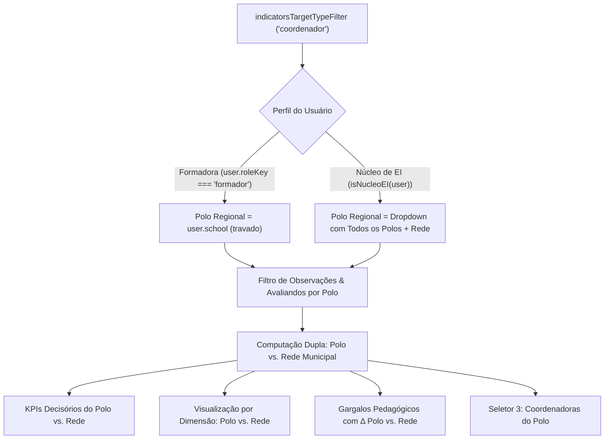

# PLANO DE IMPLEMENTAÇÃO: COMPARAÇÃO POLO VS. REDE NOS INDICADORES DA COORDENAÇÃO PEDAGÓGICA (HALLMARK)

---

## 0. Diretriz de Execução (Obrigatória)
> [!IMPORTANT]
> **Atenção, Executor (Etapa 2 - O Operário):**
> Antes de aplicar qualquer código deste plano, consulte e siga estritamente o [WORKFLOW_MACOS.md](file:///Users/bruno/Desktop/gestor%20supervisao_patos/WORKFLOW_MACOS.md) e a workspace skill [execucao-operario](file:///Users/bruno/Desktop/gestor%20supervisao_patos/.agents/skills/execucao-operario/SKILL.md).
> 
> **Travas Operacionais Inegociáveis:**
> 1. Proibição categórica de abrir o Google Chrome gráfico interativo (`open -a "Google Chrome"` ou subagentes interativos).
> 2. Validação sintática pré-voo obrigatória com JavaScriptCore nativo (`python3 audit_platform.py --check-syntax`) antes de qualquer commit.
> 3. Atualização do Changelog duplo (`CHANGELOG.md` e `#modalChangelog` em `index.html`).
> 4. Backup sequencial em `intermediárias/aplicativo_v1.60_comparacao_polo_vs_rede_indicadores_coordenacao.html`.
> 5. Sincronização simultânea e obrigatória entre as árvores espelhadas:
>    - `gestor supervisao_patos/index.html` ↔ `gestor supervisao_patos/firebase_deploy/public/index.html`
>    - `gestor supervisao_patos/js/features/indicators.js` ↔ `gestor supervisao_patos/firebase_deploy/public/js/features/indicators.js`
>    - `gestor supervisao_patos/js/audit/audit_engine.js` ↔ `gestor supervisao_patos/firebase_deploy/public/js/audit/audit_engine.js`
> 6. Checagem pré-push de concorrência (`git fetch origin main`), rebase limpo e push seguro para deploy no GitHub Pages.
> 7. Auditoria modular pós-deploy estritamente headless (`python3 audit_platform.py --silent-on-success`).

---

## 1. Diagnóstico e Contexto

### 1.1 O Problema Identificado
Na aba de **Painel & Indicadores** (`#screenIndicators`), usuárias gestoras com perfil de **Formadora Pedagógica Regional** (ex: `Clarice Barbosa`) e de **Coordenadora do Núcleo de Educação Infantil** (ex: `Helena Martins`) possuem permissão para alternar o seletor de Público-Alvo (`#indicatorsTargetTypeFilter`) entre:
- `Professores(as)` (`targetType = 'professora'`)
- `Coordenadores(as)` (`targetType = 'coordenador'`)

Contudo, ao selecionar `Coordenadores(as)`:
1. **Distorção Terminológica e Conceitual de Escopo:** O seletor 2 permanece rotulado como *"Unidade Escolar"* (tanto na barra desktop quanto na bottom sheet móvel). O cabeçalho da sub-aba de *Visualização por Dimensão* afirma textualmente: *"Referencial comparativo item a item entre a sua Unidade Escolar e a Média da Rede Municipal de Patos"*.
2. **Ausência de Comparação Territorial por Polo Regional:** A governança da Educação Infantil de Patos/PB organiza as Coordenadoras Pedagógicas por **Polos Regionais** (Polo Norte, Polo Sul, Polo Leste, Sede). Na prática formativa, cada escola tem 1 (ou no máximo 2) coordenadoras. A análise decisória e o benchmark pedagógico de coordenação **não fazem sentido como "UE vs. Rede"**, mas sim como **"Polo Regional vs. Média da Rede Municipal"**!
3. **Restrição Indevida para a Coordenadora do Núcleo de EI:** A Coordenadora do Núcleo (`isNucleoEI(user)`, Helena) não tem como selecionar um Polo para comparar seu desempenho frente à Rede consolidada: o seletor apenas lista UEs individuais agrupadas por optgroup.
4. **Falta de Isolamento Automático do Polo para a Formadora:** A Formadora (`roleKey === 'formador'`, Clarice), cuja supervisão é circunscrita ao seu Polo (`user.school = 'Polo Regional 1 (Norte)'`), deve comparar **exclusiva e automaticamente o seu Polo vs. a Rede Municipal**, sem ser forçada a selecionar escolas individuais com a redação errônea de "UE vs. Rede".

### 1.2 Objetivo da Mudança
- **Reconfiguração Reativa de Rótulo e Semântica do Seletor 2:**
  - Quando `targetType === 'coordenador'`: O rótulo do seletor 2 muda dinamicamente de *"Unidade Escolar"* para **"Polo Regional"** (desktop `#indicatorsUnitLabel` e mobile `#mobileIndUnitLabel`).
  - Quando `targetType === 'professora'`: O rótulo permanece **"Unidade Escolar"**.
- **Comportamento por Perfil:**
  1. **Para a Formadora (`user.roleKey === 'formador'`):**
     - O seletor de Polo Regional é fixado em seu Polo atribuído (`user.school`, ex: `Polo Regional 1 (Norte)`), com trava institucional.
     - A comparação analítica e o benchmark passam a confrontar: **Seu Polo vs. Rede Municipal de Patos**.
     - O Seletor 3 (`#indicatorsMemberFilter`) lista as Coordenadoras do seu Polo, permitindo visão geral do Polo ou foco individual no raio-x longitudinal.
  2. **Para a Coordenadora do Núcleo de EI (`isNucleoEI(user)`):**
     - O seletor de Polo Regional exibe a opção `ALL` (*"Todos os Polos (Rede Consolidada)"*) e todas as opções territoriais de Polos cadastrados (`Polo Regional 1 (Norte)`, `Polo Regional 2 (Sul)`, etc.).
     - Helena pode alternar e comparar **qualquer Polo Regional vs. Rede Municipal**, ou visualizar o panorama consolidado da rede.
     - Ao focar um Polo, o Seletor 3 reativamente filtra as Coordenadoras pertencentes àquele Polo.
- **Higienização de Textos e Banners Conforme o Padrão Hallmark:**
  - Substituição da redação genérica "UE vs. Rede" por redação precisa contextual: *"Referencial comparativo item a item entre o [Nome do Polo] e a Média da Rede Municipal de Patos"*.
  - Banners e cards informativos com sobriedade cromática, SVG canônicos sem emojis residuais, numerais tabulares e tipografia serena.

---

## 2. Arquitetura e Pontos de Impacto



### 2.1 Arquivos Envolvidos
1. `index.html` (e espelho em `firebase_deploy/public/index.html`):
   - Inclusão dos identificadores de rótulo `id="indicatorsUnitLabel"` (L1065) e `id="mobileIndUnitLabel"` (L4794).
2. `js/features/indicators.js` (e espelho em `firebase_deploy/public/js/features/indicators.js`):
   - Atualização da função `renderIndicatorsScreen()`:
     - Alternância de rótulo desktop/mobile (`Unidade Escolar` ↔ `Polo Regional`).
     - População dinâmica do seletor 2 para Formadora (Polo exclusivo travado) e Coordenadora de EI (qualquer Polo ou Rede).
     - Filtragem resiliente de `scopedAvaliandos` e `scopedObs` por Polo quando `targetType === 'coordenador'`.
     - Atualização do Seletor 3 (`#indicatorsMemberFilter`) para exibir as Coordenadoras do Polo em foco.
     - Ajuste dinâmico de `scopeLabelText` para refletir o Polo em análise.
     - Adaptação dos títulos, textos de ajuda e banners na sub-aba de Visualização por Dimensão (`#indicatorsSectionDrilldown`).
     - Renderização de Tabela Executiva de Polos quando Helena estiver na visão consolidada de coordenadores.
     - Adaptação contextual do texto de cópia de gargalos em `copyMeetingAgendaToClipboard()`.
   - Atualização de `openMobileIndicatorsFiltersModal()` e `syncMobileToDesktopFilters()`.
3. `js/audit/audit_engine.js` (e espelho em `firebase_deploy/public/js/audit/audit_engine.js`):
   - Adição de casos de teste automatizados no Módulo 10 (`indicadores_decisao`):
     - Validação da alternância para `coordenador` por Formadora (`clarice`): trava do Polo Regional 1, benchmark Polo vs. Rede.
     - Validação da alternância para `coordenador` por Núcleo de EI (`helena`): seletor de Polos ativos, seleção de Polo 2 vs. Rede, e retorno a `professora` restaurando UEs com `<optgroup>`.

---

## 3. Especificação de Implementação Passo a Passo (Snippets Exatos)

### Passo 3.1: Identificação dos Rótulos em `index.html`
**Alvo 1 (Desktop - L1065):**
```html
<<<< TARGET
          <!-- Seletor 2: Unidade Escolar -->
          <div style="display:flex; flex-direction:column; gap:6px;">
            <label style="font-size:12px; font-weight:700; color:var(--text-secondary);">Unidade Escolar</label>
            <select id="indicatorsUnitFilter" class="form-select form-control" onchange="onIndicatorsUnitChange()" style="font-weight:600; color:var(--text-primary);">
==== REPLACEMENT
          <!-- Seletor 2: Unidade Escolar / Polo Regional -->
          <div style="display:flex; flex-direction:column; gap:6px;">
            <label id="indicatorsUnitLabel" style="font-size:12px; font-weight:700; color:var(--text-secondary);">Unidade Escolar</label>
            <select id="indicatorsUnitFilter" class="form-select form-control" onchange="onIndicatorsUnitChange()" style="font-weight:600; color:var(--text-primary);">
>>>>
```

**Alvo 2 (Mobile - L4794):**
```html
<<<< TARGET
        <!-- Unidade Escolar -->
        <div class="form-group" style="margin-bottom:0;">
          <label class="form-label" style="font-size:12px; font-weight:700; color:var(--text-secondary);">Unidade Escolar</label>
          <select id="mobileIndUnitFilter" class="form-select form-control" onchange="syncMobileToDesktopFilters('unit')" style="width:100%; height:44px; font-weight:600; font-size:13px;">
==== REPLACEMENT
        <!-- Unidade Escolar / Polo Regional (Mobile) -->
        <div class="form-group" style="margin-bottom:0;">
          <label id="mobileIndUnitLabel" class="form-label" style="font-size:12px; font-weight:700; color:var(--text-secondary);">Unidade Escolar</label>
          <select id="mobileIndUnitFilter" class="form-select form-control" onchange="syncMobileToDesktopFilters('unit')" style="width:100%; height:44px; font-weight:600; font-size:13px;">
>>>>
```

---

### Passo 3.2: Reestruturação do Seletor e Escopo em `js/features/indicators.js`

Em `renderIndicatorsScreen()`:

#### A. Atualização dos Rótulos do Seletor 2
```javascript
      // Atualiza rótulo do Seletor 2 conforme Público-Alvo (Polo Regional vs. Unidade Escolar)
      const unitLabelDesk = document.getElementById('indicatorsUnitLabel');
      const unitLabelMob = document.getElementById('mobileIndUnitLabel');
      const unitLabelText = targetType === 'coordenador' ? 'Polo Regional' : 'Unidade Escolar';
      if (unitLabelDesk) unitLabelDesk.innerText = unitLabelText;
      if (unitLabelMob) unitLabelMob.innerText = unitLabelText;
```

#### B. População do Seletor 2 para `targetType === 'coordenador'`
```javascript
      // 1. Popula ou sincroniza opções do Seletor 2 (Unidade Escolar / Polo Regional)
      if (unitSelect) {
        const currentSelectedUnit = unitSelect.value || 'ALL';

        if (targetType === 'coordenador') {
          // =========================================================================
          // CASO COORDENADORAS: ESCOPO TERRITORIAL POR POLO REGIONAL
          // =========================================================================
          if (user.roleKey === 'formador') {
            // Formadora: somente o seu Polo atribuído vs. Rede Municipal
            const formadorPolo = user.school || 'Polo Regional';
            unitSelect.innerHTML = `<option value="${formadorPolo}">Meu Polo: ${formadorPolo}</option>`;
            unitSelect.value = formadorPolo;
            unitSelect.disabled = true;
          } else if (isNucleoEI(user)) {
            // Núcleo de EI: qualquer Polo Regional vs. Rede ou Todos os Polos (Rede Consolidada)
            const allPolos = (appState.polos || []).map(p => p.name).sort();
            let poloOptionsHtml = `<option value="ALL">Todos os Polos (Rede Consolidada)</option>`;
            allPolos.forEach(pName => {
              poloOptionsHtml += `<option value="${pName}">Polo: ${pName}</option>`;
            });
            unitSelect.innerHTML = poloOptionsHtml;
            unitSelect.disabled = false;
            if (allPolos.includes(currentSelectedUnit) || currentSelectedUnit === 'ALL') {
              unitSelect.value = currentSelectedUnit;
            } else {
              unitSelect.value = 'ALL';
            }
          }
        } else {
          // =========================================================================
          // CASO PROFESSORAS: ESCOPO TRADICIONAL POR UNIDADE ESCOLAR (PRESERVADO 100%)
          // =========================================================================
          let availableUnits = [];
          if (isNucleoEI(user)) {
            availableUnits = (appState.units || []).map(u => u.name);
          } else if (user.roleKey === 'formador') {
            const userPolo = (user.school || '').trim().toLowerCase();
            const poloUnits = (appState.units || []).filter(u => {
              if (!u.polo) return false;
              const up = u.polo.trim().toLowerCase();
              return up === userPolo || up.includes(userPolo) || userPolo.includes(up);
            }).map(u => u.name);
            const supervisedCoords = (appState.teamMembers || []).filter(m => 
              m.roleKey === 'coordenador' && (m.supervisor === user.name || (m.school && poloUnits.includes(m.school)))
            );
            const formadorUnits = Array.from(new Set([...poloUnits, ...supervisedCoords.map(c => c.school)])).filter(Boolean);
            availableUnits = formadorUnits.length > 0 ? formadorUnits : (appState.units || []).map(u => u.name);
          } else if (user.roleKey === 'coordenador') {
            availableUnits = user.school ? [user.school] : [];
          }

          let unitOptionsHtml = '';
          if (user.roleKey !== 'coordenador') {
            unitOptionsHtml += `<option value="ALL">Todas as Unidades do Escopo (${availableUnits.length})</option>`;
          }

          // Agrupamento semântico por Polo para o Núcleo de Educação Infantil
          if (isNucleoEI(user)) {
            const unitsByPolo = {};
            (appState.units || []).forEach(u => {
              const pName = u.polo || 'Sem Polo Definido';
              if (!unitsByPolo[pName]) unitsByPolo[pName] = [];
              unitsByPolo[pName].push(u.name);
            });

            const sortedPolos = Object.keys(unitsByPolo).sort();
            sortedPolos.forEach(pName => {
              unitOptionsHtml += `<optgroup label="Polo: ${pName}">`;
              unitsByPolo[pName].sort().forEach(uName => {
                unitOptionsHtml += `<option value="${uName}">${uName}</option>`;
              });
              unitOptionsHtml += `</optgroup>`;
            });
          } else {
            availableUnits.forEach(uName => {
              unitOptionsHtml += `<option value="${uName}">${uName}</option>`;
            });
          }

          unitSelect.innerHTML = unitOptionsHtml;
          if (user.roleKey === 'coordenador') {
            unitSelect.value = user.school || '';
            unitSelect.disabled = true;
          } else {
            unitSelect.disabled = false;
            if (availableUnits.includes(currentSelectedUnit) || currentSelectedUnit === 'ALL') {
              unitSelect.value = currentSelectedUnit;
            } else {
              unitSelect.value = 'ALL';
            }
          }
        }
      }
```

#### C. Filtragem de Avaliandos e Observações por Polo vs. UE
```javascript
      const activeUnitFilter = (unitSelect && unitSelect.value) ? unitSelect.value : 'ALL';

      // 2. Resolução dos avaliandos e observações com respeito estrito ao escopo territorial e bimestre
      let scopedAvaliandos = getScopedAvaliandos(targetType);
      let scopedObs = getScopedObservations().filter(o => {
        if (o.status !== 'finalized' && o.status !== 'concluida') return false;
        if (targetType === 'coordenador') {
          return o.evaluatedType === 'coordenador';
        } else {
          return o.evaluatedType === 'professora' || o.evaluatedType === 'turma';
        }
      });

      if (targetType === 'coordenador') {
        const targetPolo = (user.roleKey === 'formador') ? (user.school || '') : activeUnitFilter;
        if (targetPolo && targetPolo !== 'ALL') {
          const poloUnits = (appState.units || []).filter(u => {
            if (!u.polo) return false;
            const up = u.polo.trim().toLowerCase();
            const tp = targetPolo.trim().toLowerCase();
            return up === tp || up.includes(tp) || tp.includes(up);
          }).map(u => u.name);

          scopedAvaliandos = scopedAvaliandos.filter(m => {
            if (m.school && poloUnits.includes(m.school)) return true;
            if (m.supervisor === user.name) return true;
            return false;
          });

          const allowedCoordNames = scopedAvaliandos.map(c => (c.name || '').trim().toLowerCase());
          scopedObs = scopedObs.filter(o => {
            if (o.schoolName && poloUnits.includes(o.schoolName)) return true;
            if (o.teacherName && allowedCoordNames.includes(o.teacherName.trim().toLowerCase())) return true;
            return false;
          });
        }
      } else {
        if (activeUnitFilter !== 'ALL') {
          scopedAvaliandos = scopedAvaliandos.filter(m => m.school === activeUnitFilter);
          scopedObs = scopedObs.filter(o => o.schoolName === activeUnitFilter);
        }
      }

      // Filtragem por Bimestre no escopo da UE/Polo
      if (activeBimesterFilter !== 'ALL') {
        scopedObs = scopedObs.filter(o => o.bimester === activeBimesterFilter);
      }
```

#### D. População do Seletor de Avaliando Específico (Seletor 3)
```javascript
      // 3. Popula ou sincroniza opções do Seletor de Avaliando Específico
      if (memberSelect) {
        const currentSelectedMember = memberSelect.value || 'ALL';
        const memberRoleName = targetType === 'coordenador' ? 'Coordenadores(as)' : 'Professoras';
        const generalScopeLabel = targetType === 'coordenador' 
          ? (activeUnitFilter !== 'ALL' ? `Todas do Polo (${activeUnitFilter})` : 'Todas da Rede (Visão Geral)')
          : 'Todas (Visão Geral)';
        let memberOptionsHtml = `<option value="ALL">${memberRoleName}: ${generalScopeLabel}</option>`;
        
        if (targetType === 'coordenador') {
          scopedAvaliandos.sort((a,b) => a.name.localeCompare(b.name)).forEach(m => {
            const schInfo = m.school ? ` · ${m.school}` : '';
            memberOptionsHtml += `<option value="${m.name}">${m.name}${schInfo}</option>`;
          });
        } else {
          // Lógica anterior preservada para docentes (agrupamento por escola se ALL)
          const bySchool = {};
          scopedAvaliandos.forEach(m => {
            const sch = m.school || 'Unidade Geral';
            if (!bySchool[sch]) bySchool[sch] = [];
            bySchool[sch].push(m);
          });

          const schoolList = Object.keys(bySchool).sort();
          if (schoolList.length > 1 && activeUnitFilter === 'ALL') {
            schoolList.forEach(sch => {
              memberOptionsHtml += `<optgroup label="${sch}">`;
              bySchool[sch].sort((a,b) => a.name.localeCompare(b.name)).forEach(m => {
                const roleInfo = m.classAssigned ? ` (${m.classAssigned})` : '';
                memberOptionsHtml += `<option value="${m.name}">${m.name}${roleInfo}</option>`;
              });
              memberOptionsHtml += `</optgroup>`;
            });
          } else {
            scopedAvaliandos.sort((a,b) => a.name.localeCompare(b.name)).forEach(m => {
              const roleInfo = m.classAssigned ? ` · ${m.classAssigned}` : '';
              memberOptionsHtml += `<option value="${m.name}">${m.name}${roleInfo}</option>`;
            });
          }
        }
        memberSelect.innerHTML = memberOptionsHtml;
```

#### E. Resolução de `scopeLabelText`
```javascript
      // Definição do escopo ativo de visualização e rótulo de benchmark
      let scopeLabelText = 'Minha UE';
      if (targetType === 'coordenador') {
        if (user.roleKey === 'formador') {
          scopeLabelText = user.school || 'Meu Polo';
        } else {
          // isNucleoEI
          scopeLabelText = (activeUnitFilter !== 'ALL') ? activeUnitFilter : 'Rede Consolidada';
        }
      } else {
        if (user.roleKey === 'coordenador') {
          scopeLabelText = 'Minha UE';
        } else if (user.roleKey === 'formador') {
          scopeLabelText = (activeUnitFilter !== 'ALL') ? activeUnitFilter : 'Meu Polo';
        } else {
          scopeLabelText = (activeUnitFilter !== 'ALL') ? activeUnitFilter : 'Rede Consolidada';
        }
      }
```

#### F. Textos Editoriais na Sub-Aba de Visualização por Dimensão (`#indicatorsSectionDrilldown`)
```html
          <div class="page-title-row" style="margin-top:4px; margin-bottom:12px;">
            <div>
              <h3 style="font-size:17px; font-weight:800; color:var(--primary-dark);">
                Visualização por Dimensão dos Indicadores Pedagógicos (${targetType === 'coordenador' ? 'Coordenação' : 'Docência'})
              </h3>
              <p style="font-size:12px; color:var(--text-secondary);">
                ${targetType === 'coordenador'
                  ? (scopeLabelText === 'Rede Consolidada' 
                      ? 'Referencial consolidado dos indicadores de coordenação pedagógica na Rede Municipal de Patos'
                      : `Referencial comparativo item a item entre o ${scopeLabelText} e a Média da Rede Municipal de Patos`)
                  : (scopeLabelText === 'Rede Consolidada'
                      ? 'Referencial consolidado dos indicadores docentes na Rede Municipal de Patos'
                      : `Referencial comparativo item a item entre a sua Unidade Escolar (${scopeLabelText}) e a Média da Rede Municipal de Patos`)}
              </p>
            </div>
          </div>

          <!-- Banner Informativo de Contexto do Referencial da Rede Municipal -->
          <div class="benchmark-info-bar">
            ${(scopeLabelText === 'Rede Consolidada' || (activeUnitFilter === 'ALL' && targetType !== 'coordenador' && !user.schoolKey && user.roleKey !== 'coordenador')) ? `
              <div style="display:flex; align-items:center; justify-content:space-between; flex-wrap:wrap; gap:8px; width:100%;">
                <div style="display:flex; align-items:center; gap:8px;">
                  <svg class="btn-icon-sm" viewBox="0 0 24 24" fill="none" stroke="currentColor" stroke-width="2" stroke-linecap="round" stroke-linejoin="round" style="color:var(--primary); flex-shrink:0;">
                    <path d="M3 21h18M3 10h18M5 10v11M19 10v11M9 10v11M15 10v11M12 2L2 7h20L12 2z"></path>
                  </svg>
                  <span>
                    <strong>Panorama Geral da Rede Municipal:</strong> Exibindo a média consolidada de Patos/PB (${redeObs.length} observação(ões) na base).
                  </span>
                </div>
                <span style="font-size:11px; background:var(--sem-green-bg); color:var(--sem-green-ink); border:1px solid var(--sem-green-border); padding:3px 8px; border-radius:4px; font-weight:700; display:inline-flex; align-items:center; gap:4px;">
                  <svg class="btn-icon-sm" viewBox="0 0 24 24" fill="none" stroke="currentColor" stroke-width="2" stroke-linecap="round" stroke-linejoin="round" style="width:12px; height:12px;">
                    <line x1="9" y1="18" x2="15" y2="18"></line>
                    <line x1="10" y1="22" x2="14" y2="22"></line>
                    <path d="M15.09 14c.18-.98.65-1.74 1.41-2.5A4.65 4.65 0 0 0 18 8 6 6 0 0 0 6 8c0 1 .23 2.23 1.5 3.5A4.61 4.61 0 0 1 8.91 14"></path>
                  </svg>
                  <span>${targetType === 'coordenador' ? 'Selecione um Polo no filtro para comparar com a Rede' : 'Selecione uma Escola no filtro para comparar com a Rede'}</span>
                </span>
              </div>
            ` : `
              <div style="display:flex; align-items:center; gap:8px;">
                <svg class="btn-icon-sm" viewBox="0 0 24 24" fill="none" stroke="currentColor" stroke-width="2" stroke-linecap="round" stroke-linejoin="round" style="color:var(--primary); flex-shrink:0;">
                  <path d="M3 21h18M3 10h18M5 10v11M19 10v11M9 10v11M15 10v11M12 2L2 7h20L12 2z"></path>
                </svg>
                <span>
                  <strong>Referencial da Rede Municipal:</strong> Comparando <strong>${scopeLabelText}</strong> com a <strong>Média Geral da Rede Municipal (${redeObs.length} observação(ões) na base)</strong>.
                </span>
              </div>
            `}
          </div>
```

#### G. Tabela Executiva de Polos para Núcleo de EI (`targetType === 'coordenador'`)
Quando Helena estiver com `targetType === 'coordenador'` e `activeUnitFilter === 'ALL'`, renderiza uma tabela executiva institucional de Polos Regionais:
- Nome do Polo
- Coordenadoras Vinculadas
- Observações no Bimestre
- Consistência do Polo
- Botão sóbrio Hallmark: `Focar Polo ➔` (invocando `focusUnitFilter(pName)`).

---

## 4. Critérios de Aceite e Roteiro de Teste

### 4.1 Critérios de Aceite
1. **Formadora Clarice Barbosa (`roleKey: 'formador'`):**
   - Ao acessar Indicadores e alternar para `Coordenadores(as)`:
     - O rótulo do seletor 2 passa a exibir `Polo Regional`.
     - O seletor 2 é travado/desabilitado com o valor do seu polo (`Polo Regional 1 (Norte)`).
     - O banner de benchmark exibe expressamente: *"Comparando Polo Regional 1 (Norte) com a Média Geral da Rede Municipal"*.
     - O Seletor 3 exibe apenas coordenadoras do seu polo (`Mariana Ferreira`, `Sônia Regina Alcantara`).
     - Nenhum texto afirma que está comparando "UE vs. Rede".
2. **Coordenadora do Núcleo Helena Martins (`isNucleoEI`):**
   - Ao alternar para `Coordenadores(as)`:
     - O rótulo do seletor 2 passa a exibir `Polo Regional`.
     - O seletor 2 permite selecionar `Todos os Polos (Rede Consolidada)` ou qualquer um dos Polos (`Polo Regional 1 (Norte)`, `Polo Regional 2 (Sul)`, etc.).
     - Ao escolher `Polo Regional 2 (Sul)`, o banner exibe: *"Comparando Polo Regional 2 (Sul) com a Média Geral da Rede Municipal"*.
     - Ao escolher `Todos os Polos`, o badge orienta: *"Selecione um Polo no filtro para comparar com a Rede"*.
3. **Perfil Docente e Coordenadora Escolar (`professora`, `coordenador`):**
   - O seletor de Público-Alvo permanece oculto, travado em `professora`.
   - O seletor 2 mantém o rótulo `Unidade Escolar`.
4. **Mobile Bottom Sheet (`#modalIndicatorsFiltersMobile`):**
   - Sincronização espelhada perfeita do rótulo e opções entre desktop e mobile.
5. **Padrão Hallmark:**
   - 0 emojis como ícones; tokens CSS obrigatórios; visibilidade imediata com `:focus-visible`; tipografia sóbria.

---

## 5. Seção Obrigatória de Auditoria (`audit_platform.py` e `audit_engine.js`)

### 5.1 Alterações e Adições no Motor de Testes (`js/audit/audit_engine.js`)
No Módulo 10 (`indicadores_decisao`):
- **Adição do Teste 9.3.5:** Validação da Governança Territorial de Indicadores de Coordenação (Polo vs. Rede):
  1. Login como `clarice` (Formadora):
     - Selecionar `indicatorsTargetTypeFilter = 'coordenador'` e invocar `onIndicatorsTargetTypeChange()`.
     - Validar que `#indicatorsUnitLabel.innerText` é `"Polo Regional"`.
     - Validar que `#indicatorsUnitFilter.value` é `"Polo Regional 1 (Norte)"` e `disabled === true`.
     - Validar que a barra de contexto `.benchmark-info-bar` contém `"Comparando Polo Regional 1 (Norte) com a Média Geral da Rede Municipal"`.
     - Validar que NÃO contém `"UE vs. Rede"` ou `"entre a sua Unidade Escolar"`.
  2. Login como `helena` (Núcleo de EI):
     - Selecionar `indicatorsTargetTypeFilter = 'coordenador'`.
     - Validar que `#indicatorsUnitFilter.disabled === false`.
     - Selecionar `indicatorsUnitFilter.value = 'Polo Regional 2 (Sul)'` e invocar `renderIndicatorsScreen()`.
     - Validar que o banner exibe `"Comparando Polo Regional 2 (Sul) com a Média Geral da Rede Municipal"`.
     - Retornar `indicatorsTargetTypeFilter.value = 'professora'` e invocar `onIndicatorsTargetTypeChange()`.
     - Validar que `#indicatorsUnitLabel.innerText` volta a ser `"Unidade Escolar"` e que os `<optgroup>` de polos voltam a ser exibidos.
  3. Restauração defensiva de estado e usuário padrão (`mariana`).

### 5.2 Exclusões ou Modificações de Testes Pré-existentes
- **Nenhuma exclusão necessária:** Todos os testes de métricas decisórias, KPIs (Pilar 7), Semáforo (Pilar 10) e agrupamento de UEs por optgroup para Helena mantêm 100% de conformidade quando `targetType === 'professora'`.
- O script automatizado `audit_platform.py` rodará sem alterações no Python, validando 100% dos 14 módulos headless com sucesso silencioso.

---

## 6. Checklist de Execução para a Etapa 2 (Operário)
- [ ] Ler `WORKFLOW_MACOS.md` e a skill `execucao-operario`.
- [ ] Aplicar alterações em `index.html` e `js/features/indicators.js`.
- [ ] Aplicar os novos testes em `js/audit/audit_engine.js`.
- [ ] Espelhar as alterações em `firebase_deploy/public/index.html`, `firebase_deploy/public/js/features/indicators.js` e `firebase_deploy/public/js/audit/audit_engine.js`.
- [ ] Salvar backup em `intermediárias/aplicativo_v1.60_comparacao_polo_vs_rede_indicadores_coordenacao.html`.
- [ ] Atualizar o Changelog duplo para a versão **1.60** (`CHANGELOG.md` e `#modalChangelog` em `index.html`).
- [ ] Executar validação sintática pré-voo JSC: `python3 audit_platform.py --check-syntax`.
- [ ] Checagem pré-push de concorrência (`git fetch origin main`), rebase e commit semântico.
- [ ] Push para `main` (deploy no GitHub Pages).
- [ ] Executar auditoria pós-deploy: `python3 audit_platform.py --silent-on-success`.
