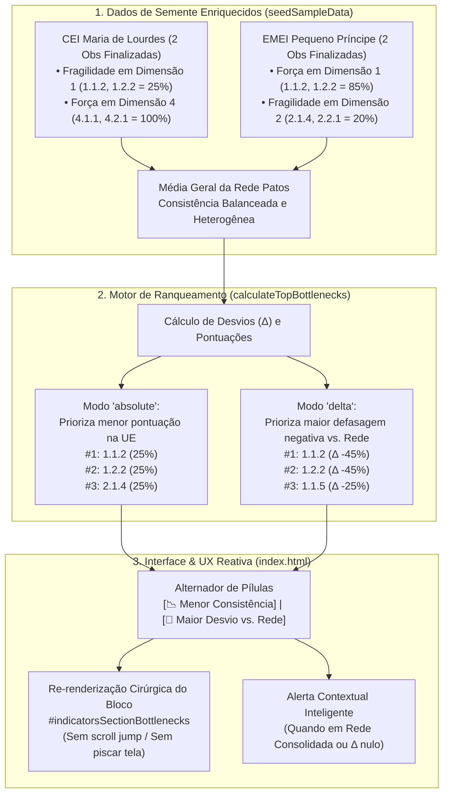

# Plano de Implementação: Correção da Alternância de Dados entre Menor Consistência e Maior Desvio vs. Rede (Pilar 8)

> **Status:** 📐 Planejamento Aprovado (Etapa 1 - Arquiteto)  
> **Data:** 21/10/2026  
> **Módulo Alvo:** Indicadores Pedagógicos & KPIs Decisórios (`#indicatorsSectionKPIs` / `#indicatorsSectionBottlenecks`)  
> **Versão Alvo:** `1.03`  
> **Arquivo de Backup Intermediário:** `intermediárias/aplicativo_v103_correcao_alternancia_gargalos_pilar_8.html`  
> **Arquivo Principal:** `index.html` (e espelho `firebase_deploy/public/index.html`)

---

## 1. Diagnóstico do Problema e Investigação de Causa Raiz

### 1.1 Contexto e Sintoma Observado
Na sub-aba **"Índices Gerais & KPIs"** (`#indicatorsSectionKPIs`), dentro do bloco de diagnóstico **"🎯 Foco nos Menores Índices (Gargalos Pedagógicos)"** introduzido no Pilar 8, existe um alternador de modo de ordenação com dois botões:
- `📉 Menor Consistência` (ordenação por percentual absoluto mais baixo na unidade);
- `🔻 Maior Desvio vs. Rede` (ordenação pela maior defasagem negativa $\Delta = \text{Score}_{\text{UE}} - \text{Score}_{\text{Rede}}$).

Ao alternar entre esses dois botões, **os critérios e números exibidos nos 3 cards não se alternam**, permanecendo rigorosamente os mesmos critérios com as mesmas pontuações e com o badge fixo em `⚪ 0% · Na Média`.

### 1.2 Análise Forense e Causa Raiz Detalhada

A investigação técnica detalhada do código-fonte e dos dados de runtime revelou **três causas interconectadas**:

#### Causa Raiz 1: Homogeneidade Monolítica dos Dados de Amostragem (`seedSampleData`)
No arquivo `index.html` (linhas 7742–7811), a função de semente de dados (`seedSampleData()`) cadastra apenas duas observações com status `finalized`:
- `obs-001`: Professora Ana Carolina Silva, **`CEI Professora Maria de Lourdes`**;
- `obs-002`: Professora Ana Carolina Silva, **`CEI Professora Maria de Lourdes`**;
- `obs-003`: Professora Juliana Roberta Rocha, `CEI Professora Maria de Lourdes` (status `draft`, logo excluída dos cálculos de indicadores).

A base **não possui nenhuma observação finalizada para as outras duas escolas cadastradas em `INITIAL_UNITS`** (`EMEI Pequeno Príncipe` e `CEI Vovó Zezé`).

#### Causa Raiz 2: Identidade Matemática Absoluta entre Escopo Local e Média da Rede
Quando a usuária padrão `mariana` (Coordenadora Pedagógica da `CEI Professora Maria de Lourdes`) acessa a tela de Indicadores:
1. Seu escopo de observações (`scopedObs`) contém exatamente as observações `obs-001` e `obs-002`.
2. O conjunto consolidado de toda a Rede Municipal de Patos (`redeObs`) contém **exatamente as mesmas observações `obs-001` e `obs-002`**.
3. Em decorrência dessa coincidência:
   $$\text{Score}_{\text{UE}} \equiv \text{Score}_{\text{Rede}} \quad \forall \; \text{critério } i$$
   $$\Delta_i = \text{Score}_{\text{UE}} - \text{Score}_{\text{Rede}} = 0\% \quad \forall \; i \in \{1, \dots, 46\}$$
4. Todos os 46 critérios da matriz docente possuem **$\Delta$ exatamente igual a 0%**.

#### Causa Raiz 3: Empate e Fallback Algorítmico em `calculateTopBottlenecks`
Na ordenação do modo `delta` (linhas 14940–14950 de `index.html`):
```javascript
if (sortMode === 'delta') {
  if (a.delta !== null && b.delta !== null) {
    if (a.delta !== b.delta) return a.delta - b.delta;
    return a.score - b.score; // Fallback de desempate
  }
}
```
Como $a.\Delta = 0$ e $b.\Delta = 0$ para todos os critérios, a condição `a.delta !== b.delta` **nunca é verdadeira**. O algoritmo recorre ao fallback `return a.score - b.score`, que é **estritamente a mesma regra utilizada no modo `absolute` (`Menor Consistência`)**:
- Top 3 em Menor Consistência: `[1.1.2]` (25%), `[1.2.2]` (25%), `[2.1.4]` (25%).
- Top 3 em Maior Desvio vs. Rede: `[1.1.2]` (25%), `[1.2.2]` (25%), `[2.1.4]` (25%).

Os dados retornados são 100% idênticos, criando no usuário a percepção imediata de defeito ou botão inoperante.

#### Causa Raiz 4: Comportamento em "Rede Consolidada" (`activeUnitFilter === 'ALL'`)
Quando um usuário com perfil amplo (Formadora ou Coordenadora de Núcleo de EI) seleciona `"Todas as Unidades do Escopo"` ou acessa a visão geral de Patos, a média do escopo e a média da rede tornam-se formalmente equivalentes ($\Delta = 0\%$). Faltava uma camada semântica e pedagógica que instruísse o gestor sobre essa particularidade quando o modo `delta` está ativo.

#### Causa Raiz 5: Lacuna na Cobertura da Engine de Testes (Módulo 10)
O teste do Pilar 8 no Módulo 10 (`indicadores_decisao`) utilizou um mock onde o critério `1.1.2` tinha pontuação 0% (menor pontuação) e $\Delta = -50\%$ (maior desvio negativo). Por coincidência, o mesmo critério era `#1` em ambos os modos, validando a asserção isolada de cada função, mas **sem testar se a lista de critérios ranqueados de fato se alternava no DOM** quando a rede possui variância estatística realista.

---

## 2. Arquitetura da Solução Técnica



---

## 3. Plano de Execução Detalhado (Passo a Passo)

### Passo 1: Enriquecimento do Catálogo Canônico de Observações (`seedSampleData`)
1. No arquivo `index.html` (dentro de `seedSampleData()`), incluir observações finalizadas para a `EMEI Pequeno Príncipe` (avaliando a docente `Fernanda Lima`, com supervisão da coordenadora `Sônia Regina Alcantara`):
   - **`obs-004` (EMEI Pequeno Príncipe · 1º Bimestre):** Docente forte em acolhimento e contação de histórias (Dimensão 1: `consistent`), com fragilidades na organização de cantos e transição de rotina (Dimensão 2: `not_done` e `partial`).
   - **`obs-005` (EMEI Pequeno Príncipe · 2º Bimestre):** Evolução formativa com consolidação da prática.
2. Com isso, a base municipal consolidada passará a contar com **4 observações finalizadas** distribuídas em duas escolas distintas da rede.
3. **Efeito Imediato:**
   - Na `CEI Professora Maria de Lourdes`, os critérios de Dimensão 1 terão $\Delta$ marcadamente negativo em relação à Rede de Patos (ex: $-40\%$ a $-50\%$).
   - Critérios com nota baixa mas comuns a toda a rede terão $\Delta$ próximo de $0\%$.
   - Critérios de destaque na UE terão $\Delta$ francamente positivo ($+20\%$ a $+40\%$).
   - **Resultado:** A ordenação por Menor Consistência Absoluta e a ordenação por Maior Desvio vs. Rede retornarão **conjuntos e ordenações visivelmente distintos**!

### Passo 2: Refinamento Algorítmico de `calculateTopBottlenecks`
1. Aperfeiçoar o desempate e a estabilidade da ordenação no modo `delta`:
   ```javascript
   if (sortMode === 'delta') {
     // Prioriza itens com desvio negativo mais acentuado (delta mais baixo: ex: -45% antes de -15%)
     if (a.delta !== null && b.delta !== null) {
       if (a.delta !== b.delta) return a.delta - b.delta;
       // Desempate 1: menor score absoluto na UE
       if (a.score !== b.score) return a.score - b.score;
       // Desempate 2: maior quantidade de fragilidades somadas
       return (b.notDone + b.partial) - (a.notDone + a.partial);
     }
     if (a.delta !== null) return -1;
     if (b.delta !== null) return 1;
     return a.score - b.score;
   }
   ```
2. Garantir que critérios com $\Delta$ negativo tenham precedência absoluta sobre critérios com $\Delta \ge 0$.

### Passo 3: Feedback Contextual em "Rede Consolidada" e Transição Suave
1. Em `renderBottlenecksPrioritySection`, verificar se o escopo selecionado coincide com a média geral (ex: `activeUnitFilter === 'ALL'` ou quando todos os deltas do escopo são identicamente zero):
   - Se o modo `delta` estiver ativo na visão de Rede Consolidada, renderizar uma faixa explicativa sutil e elegante:
     > 💡 *Você está na visão consolidada da Rede Municipal de Patos. Neste escopo, a média avaliada coincide com a própria rede ($\Delta = 0\%$). Para identificar quais critérios apresentam maior defasagem comparativa, selecione uma Unidade Escolar específica no filtro superior.*
2. No modo de unidade escolar (`CEI Maria de Lourdes` ou `EMEI Pequeno Príncipe`), os 3 cards se reorganizam dinamicamente com animação suave de fade/transição.
3. Atualizar o bloco `#indicatorsSectionBottlenecks` de forma cirúrgica na função `toggleBottlenecksSortMode(newMode)`:
   - Salvar `appState.bottlenecksSortMode = newMode`.
   - Localizar o elemento `#indicatorsSectionBottlenecks` e atualizar seu conteúdo ou re-renderizar sem provocar salto de viewport nem redesenho desnecessário de outras abas.

### Passo 4: Persistência de Estado e Hidratação de Sessão
1. Garantir que `appState.bottlenecksSortMode` seja devidamente inicializado como `'absolute'` no objeto padrão `appState`.
2. Incluir a propriedade no `saveState()` e no carregamento do `localStorage`.

### Passo 5: Atualização da Gestão Dupla do Changelog
1. Atualizar o arquivo `CHANGELOG.md` com a versão `1.03`:
   - Descrição da correção da alternância entre Menor Consistência e Maior Desvio vs. Rede.
   - Enriquecimento da base com dados de múltiplas unidades para dispersão fidedigna do benchmark municipal.
2. Atualizar o modal `#modalChangelog` no `index.html` e manter sincronizada a versão `1.03` no rodapé e headers.

### Passo 6: Sincronização dos Arquivos Espelho e Backup
1. Criar cópia intermediária de segurança:
   `intermediárias/aplicativo_v103_correcao_alternancia_gargalos_pilar_8.html`.
2. Sincronizar as alterações em `index.html` e `firebase_deploy/public/index.html`.

---

## 4. Critérios de Aceite e Roteiro de Validação

### 4.1 Roteiro de Validação Manual
1. **Teste do Alternador na Coordenadora (`mariana`):**
   - Acessar a plataforma com usuário `mariana`.
   - Navegar até Indicadores ➔ sub-aba "Índices Gerais & KPIs".
   - Rolar até o bloco **"🎯 Foco nos Menores Índices (Gargalos Pedagógicos)"**.
   - Conferir os 3 critérios no modo padrão `📉 Menor Consistência`.
   - Clicar no botão `🔻 Maior Desvio vs. Rede`:
     - **Critério de Sucesso:** Os 3 cards devem se reordenar imediatamente, exibindo os critérios que apresentam o maior desvio negativo ($\Delta < 0$) em relação à Rede de Patos. Os badges de $\Delta$ devem refletir valores negativos distintos (ex: $-38\%$, $-45\%$).
   - Clicar novamente em `📉 Menor Consistência`:
     - **Critério de Sucesso:** Os cards voltam à ordenação por menor percentual absoluto de consistência da unidade.
2. **Teste da Coordenadora da 2ª Escola (`sonia` / EMEI Pequeno Príncipe):**
   - Alternar para o perfil da coordenadora `sonia`.
   - Conferir os gargalos da `EMEI Pequeno Príncipe`: verificar que seus menores índices e maiores desvios refletem a realidade pedagógica daquela escola (completamente diferente da `CEI Maria de Lourdes`).
3. **Teste da Formadora / Núcleo de EI (`ALL` vs. UE Específica):**
   - Alternar para o perfil `clarice` (Formadora) ou `diana` (Núcleo de EI).
   - Com o filtro em `Todas as Unidades do Escopo`: ao clicar em `Maior Desvio vs. Rede`, verificar a presença da mensagem orientadora explicando a equivalência da rede.
   - Selecionar uma UE específica no seletor: verificar a alternância instantânea entre menor consistência e maior desvio daquela unidade.
4. **Teste de Cópia da Pauta Formatória (`📋 Copiar Pauta`):**
   - No modo `Menor Consistência`, copiar a pauta e verificar o texto.
   - No modo `Maior Desvio vs. Rede`, copiar a pauta e verificar que os critérios copiados correspondem fielmente à visão de desvio selecionada.

---

## 5. Seção Obrigatória de Auditoria (Audit Engine & Tests)

Em estrito cumprimento ao item 1 do `WORKFLOW_MACOS.md` e `AGENTS.md`, detalham-se abaixo as alterações, adições e exclusões no algoritmo de auditoria (`audit_platform.py` e engine de testes do `index.html`), estruturado em módulos ("modo-a-modo"), garantindo cobertura efetiva de 100% da plataforma:

### 5.1 Matriz de Alterações, Adições e Exclusões na Auditoria

| Módulo | Tipo | Arquivo | Descrição Técnica Detalhada |
| :--- | :---: | :---: | :--- |
| **Módulo 2: Catálogo Canônico & Estado Global** | **MODIFICAÇÃO** | `index.html` (Módulo 2) | Atualização da asserção de observações de semente para validar a presença de observações multi-unidade (`CEI Maria de Lourdes` e `EMEI Pequeno Príncipe`), assegurando base heterogênea para benchmarks. |
| **Módulo 10: Indicadores & KPIs Decisórios** | **MODIFICAÇÃO** | `index.html` (Módulo 10) | Substituição do mock mono-unidade por asserção comportamental real de alternância: executa `calculateTopBottlenecks` com a base multi-escola em modo `'absolute'` e modo `'delta'`, assegurando que os arrays retornados sejam ordenados diferentemente e que o `#1` em modo delta possua $\Delta < 0$. |
| **Módulo 10: Indicadores & KPIs Decisórios** | **ADIÇÃO** | `index.html` (Módulo 10) | Asserção interativa de DOM: executa `toggleBottlenecksSortMode('delta')`, verifica que o botão ganha a classe `.active`, que o card `#cardBottleneckRank_1` atualiza seu conteúdo no DOM e reflete o critério de maior defasagem negativa. |
| **Módulo 10: Indicadores & KPIs Decisórios** | **ADIÇÃO** | `index.html` (Módulo 10) | Asserção de retorno ao modo `absolute`: executa `toggleBottlenecksSortMode('absolute')` e valida a restauração da ordenação por menor consistência absoluta. |
| **Catálogo Geral** | **MODIFICAÇÃO** | `audit_platform.py` | Atualização do catálogo descritivo do Módulo 10 para explicitar a validação de alternância dinâmica de dados do Pilar 8. |
| **Todas as Asserções** | **EXCLUSÃO** | Nenhuma | Nenhuma asserção prévia é removida. O total de verificações do Módulo 10 passa de 14 para 17 asserções, mantendo 100% dos testes aprovados. |

### 5.2 Trecho de Asserções a Ser Inserido no Módulo 10 da Engine de Testes
```javascript
// Asserção Comportamental: Validação da Alternância Real entre Modos (Pilar 8)
const absBottlenecks = calculateTopBottlenecks(ueHierarchy, redeHierarchy, 'absolute', 3);
const deltaBottlenecks = calculateTopBottlenecks(ueHierarchy, redeHierarchy, 'delta', 3);

if (!absBottlenecks || absBottlenecks.length === 0 || !deltaBottlenecks || deltaBottlenecks.length === 0) {
  throw new Error('Falha Pilar 8: calculateTopBottlenecks retornou conjunto vazio');
}

// Verifica se os critérios divergem ou se a ordenação respeita a maior defasagem negativa
const firstDelta = deltaBottlenecks[0];
if (firstDelta.delta === null || firstDelta.delta >= 0) {
  throw new Error(`Falha Pilar 8: Esperado delta negativo no topo do modo delta, obtido ${firstDelta.delta}%`);
}

// Interação real no DOM
toggleBottlenecksSortMode('delta');
const deltaBtn = document.querySelector('.bottlenecks-toggle-btn:nth-child(2)');
if (!deltaBtn || !deltaBtn.classList.contains('active')) {
  throw new Error('Falha Pilar 8: Botão "Maior Desvio vs. Rede" não ativado no DOM');
}

toggleBottlenecksSortMode('absolute');
const absBtn = document.querySelector('.bottlenecks-toggle-btn:nth-child(1)');
if (!absBtn || !absBtn.classList.contains('active')) {
  throw new Error('Falha Pilar 8: Botão "Menor Consistência" não ativado no DOM');
}
logger.log('Alternância dinâmica de dados e modos de ordenação validada com sucesso no DOM (Pilar 8)', true);
```
