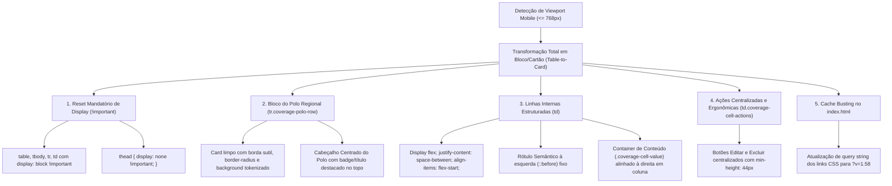

# PLANO DE IMPLEMENTAÇÃO — CORREÇÃO DEFINITIVA E REESTRUTURAÇÃO MOBILE HALLMARK DOS BLOCOS DE POLOS REGIONAIS (MATRIZ DE COBERTURA DA REDE)

> **Status:** Proposto / Em Análise (Etapa 1 - O Arquiteto)  
> **Data:** 29 de Outubro de 2026  
> **Alvo:** Card da Matriz de Cobertura por Polo Regional (`#networkCoverageCard`), `css/04_screens.css`, `css/03_components.css`, `index.html`, `js/features/management.js` e espelhos do Firebase  
> **Padrão de Qualidade:** Hallmark Design Standard (v2.0.0 / `RULE[user_global]`)  
> **Objetivo Primário:** Solucionar a falha visual evidenciada na captura mobile real do usuário (iPhone Safari), onde a tabela tabular do desktop ainda é renderizada com transbordamento horizontal severo para fora da tela, os nomes das escolas e coordenadoras sobrepõem-se horizontalmente, colidem com a barra lateral azul decorativa e quebram a diagramação móvel.

---

## 0. Diretriz de Execução Obrigatória

> [!IMPORTANT]
> **Aviso ao Agente Executor (Etapa 2 - Operário):**  
> Antes de aplicar qualquer alteração de código resultante deste plano, você **DEVE OBRIGATORIAMENTE** ler o manual [`WORKFLOW_MACOS.md`](file:///Users/bruno/Desktop/gestor%20supervisao_patos/WORKFLOW_MACOS.md) e a skill [`.agents/skills/execucao-operario/SKILL.md`](file:///Users/bruno/Desktop/gestor%20supervisao_patos/.agents/skills/execucao-operario/SKILL.md).  
> 
> - **Trava Crítica da Etapa 1:** Durante a vigência deste plano, nenhum arquivo de código de produção deve ser modificado ou comitado.
> - **Execução Mecânica da Etapa 2:** Na Etapa 2, execute o plano sem desvios, execute a blindagem sintática pré-voo (`python3 audit_platform.py --check-syntax`), crie o backup intermediário em `intermediárias/aplicativo_v1.58_correcao_definitiva_polos_mobile.html`, atualize o changelog duplo (`CHANGELOG.md` e `#modalChangelog` / botão `.btn-changelog` para a Versão 1.58 - v8.2.25), sincronize as cópias espelhadas do Firebase (`firebase_deploy/public/`), realize o deploy via `git push origin main` e execute a auditoria pós-deploy via `python3 audit_platform.py --silent-on-success`.

---

## 1. Diagnóstico e Análise Forense da Imagem Mobile

A captura de tela real enviada pelo usuário no iPhone (Safari iOS, tela de 390px) revela um conjunto de problemas críticos de layout:

### 1.1. As Causas Raízes Identificadas:

1. **A Tabela Permanece no Modo Tabular Clássico (Desktop) no Mobile:**
   - Em `index.html` (linha 289), a tabela está envolvida por `<div style="overflow-x:auto;">`.
   - Na folha de estilo `css/03_components.css` (linha 720+), as regras globais de `.data-table` forçam:
     ```css
     .data-table th, .data-table td {
       padding: 10px 14px;
       border: 1px solid var(--border);
       text-align: left;
     }
     ```
   - O seletor `.responsive-mobile-table` presente em `css/04_screens.css` dependia de especificidade que foi sobreposta pelo modelo de tabela clássico em navegadores WebKit/Safari, fazendo com que no celular a tabela continue se comportando como tabela com 7 colunas horizontais, espremendo os textos e estourando a tela para a direita.

2. **Transbordamento Horizontal e Quebra da Faixa Lateral Azul:**
   - O card `#networkCoverageCard` possui um estilo inline `border-left: 4px solid var(--primary);`.
   - Como a tabela tem largura mínima intrínseca maior que a largura do iPhone, ela transborda o card, criando uma rolagem horizontal esquisita e fazendo os textos de escolas e coordenadoras sobreporem a borda ou ficarem com linhas quebradas de forma assimétrica.

3. **Sobreposição Caótica de Textos (Nomes de UEs e Coordenadoras):**
   - Na imagem, vê-se claramente `Clarice Barbosa` encavalada com `CEI Professora Maria de Lourdes`, `EMEI Pequeno Príncipe`, `Mariana Ferreira`, `Sônia Regina Alcântara` e `vinijr` aparecendo em colunas paralelas e colidindo umas com as outras porque as colunas da tabela estão com largura insuficiente.

4. **Cache de Navegador / Versionamento de CSS:**
   - Os navegadores móveis (especialmente o Safari no iOS) realizam cache agressivo de arquivos CSS externos vinculados por `<link rel="stylesheet" href="css/04_screens.css">`. Sem query strings de versão (ex: `css/04_screens.css?v=1.58`), o celular do usuário continuava consumindo a versão anterior em cache.

5. **Regras Hallmark Violadas no Estado Atual:**
   - **Hallmark Floor 4 (`overflow-x: clip`):** O elemento estourou o viewport, provocando scroll horizontal e desalinhamento.
   - **Hallmark Floor 11 (Sem bordas berrantes soltas):** O card possui borda lateral azul dura inline herdada.
   - **Hallmark Floor 6 (Ergonomia móvel):** O usuário precisa rolar horizontalmente para tentar ler os dados de um polo regional.

---

## 2. Arquitetura da Solução Hallmark Proposta



### 2.1. Princípios de Engenharia e Design Aplicados:
1. **Garantia com Alta Especificidade e `!important` Defensivo para Mobile:**  
   Garantir que absolutamente nenhuma regra de `.data-table` de `css/03_components.css` mantenha o comportamento tabular (`table-cell`, `table-row`) em telas `<= 768px`.
2. **Higienização do Wrapper `<div style="overflow-x:auto;">`:**  
   Garantir que a div envolvente não introduza rolagem truncada quando as linhas virarem cartões verticais independentes.
3. **Harmonização do Card do Polo (Hallmark Floor):**  
   Remover a barra lateral dura inline `border-left: 4px solid var(--primary);` do `#networkCoverageCard`, adotando acabamento sóbrio e simétrico em harmonia com a aba de Gestão Pedagógica.
4. **Cache-Busting de Folhas de Estilo:**  
   Adicionar sufixo de versão `?v=1.58` nos arquivos CSS carregados no cabeçalho do `index.html`.

---

## 3. Especificação de Implementação Passo a Passo

### 3.1. Passo 1 — Atualização de `css/04_screens.css` com Especificidade Máxima

Garantir que as regras para `.responsive-mobile-table` e especificamente para `#networkCoverageCard` anulem todo e qualquer comportamento tabular clássico:

```css
      /* =====================================================================
         HALLMARK MOBILE: REESTRUTURAÇÃO COMPLETA DA MATRIZ DE COBERTURA
         ===================================================================== */
      #networkCoverageCard .data-table.responsive-mobile-table {
        display: block !important;
        width: 100% !important;
        border: none !important;
      }
      #networkCoverageCard .responsive-mobile-table thead {
        display: none !important;
      }
      #networkCoverageCard .responsive-mobile-table tbody {
        display: block !important;
        width: 100% !important;
      }
      #networkCoverageCard .responsive-mobile-table tr.coverage-polo-row {
        display: flex !important;
        flex-direction: column !important;
        background: var(--gestao-surface);
        border: 1px solid var(--gestao-border) !important;
        border-radius: 12px;
        padding: 14px 16px;
        margin-bottom: 16px;
        box-shadow: var(--shadow-sm);
        box-sizing: border-box;
        width: 100% !important;
      }

      /* Cabeçalho do Bloco do Polo: Destaque Superior 100% Centrado */
      #networkCoverageCard .responsive-mobile-table td.coverage-cell-polo {
        display: flex !important;
        justify-content: center !important;
        align-items: center !important;
        text-align: center !important;
        width: 100% !important;
        padding: 6px 0 12px 0 !important;
        margin-bottom: 10px;
        border: none !important;
        border-bottom: 2px solid var(--gestao-border) !important;
      }
      #networkCoverageCard .responsive-mobile-table td.coverage-cell-polo::before {
        display: none !important;
      }
      .coverage-polo-title {
        font-size: 16px;
        font-weight: 800;
        color: var(--primary);
        letter-spacing: -0.2px;
        text-align: center;
        width: 100%;
      }

      /* Linhas de Dados Intermediárias: Rótulo à Esquerda, Valor à Direita */
      #networkCoverageCard .responsive-mobile-table td {
        display: flex !important;
        justify-content: space-between !important;
        align-items: flex-start !important;
        padding: 10px 0 !important;
        border: none !important;
        border-bottom: 1px solid var(--gestao-border-subtle) !important;
        box-sizing: border-box;
        width: 100% !important;
        text-align: right;
      }
      #networkCoverageCard .responsive-mobile-table td::before {
        content: attr(data-label);
        font-weight: 600;
        color: var(--gestao-text-muted);
        font-size: 12px;
        text-align: left;
        margin-right: 12px;
        flex-shrink: 0;
        padding-top: 2px;
      }

      /* Container de Conteúdo Alinhado */
      .coverage-cell-value {
        display: flex;
        flex-direction: column;
        align-items: flex-end;
        text-align: right;
        min-width: 0;
        flex-grow: 1;
      }

      /* Pilha Vertical de Unidades Escolares */
      .coverage-units-stack {
        display: flex;
        flex-direction: column;
        align-items: flex-end;
        gap: 6px;
        width: 100%;
      }
      .coverage-unit-item {
        cursor: pointer;
        color: var(--primary);
        font-weight: 600;
        font-size: 13px;
        text-align: right;
        line-height: 1.35;
      }

      /* Pilha Vertical de Coordenadoras */
      .coverage-cps-stack {
        display: flex;
        flex-direction: column;
        align-items: flex-end;
        gap: 6px;
        width: 100%;
      }
      .coverage-cp-item {
        font-size: 12px;
        line-height: 1.35;
        text-align: right;
        color: var(--gestao-text-body);
      }
      .coverage-cp-item strong {
        color: var(--gestao-text-strong);
      }
      .coverage-cp-school {
        color: var(--gestao-text-muted);
        font-size: 11px;
      }

      /* Rodapé de Ações Centralizado */
      #networkCoverageCard .responsive-mobile-table td.coverage-cell-actions {
        border-bottom: none !important;
        padding-top: 14px !important;
        padding-bottom: 4px !important;
        display: flex !important;
        flex-direction: column !important;
        align-items: center !important;
        justify-content: center !important;
        width: 100% !important;
      }
      #networkCoverageCard .responsive-mobile-table td.coverage-cell-actions::before {
        display: none !important;
      }
      .coverage-actions-group {
        display: flex;
        justify-content: center;
        align-items: center;
        gap: 10px;
        width: 100%;
      }
      .coverage-btn-action {
        flex: 1;
        max-width: 160px;
        min-height: var(--touch-target-min);
        padding: 8px 16px;
        font-size: 12px;
        font-weight: 700;
        justify-content: center;
        text-align: center;
        border-radius: 8px;
      }
```

### 3.2. Passo 2 — Atualização no `index.html` (Limpeza e Cache-Busting)

1. **Higienização do `#networkCoverageCard`:**  
   Substituir `border-left: 4px solid var(--primary);` por acabamento limpo padrão Hallmark:
   ```html
   <div class="card" id="networkCoverageCard" style="margin-bottom:20px; border-top:3px solid var(--primary); background:var(--gestao-ground);">
   ```
2. **Cache-Busting nos Links CSS no `<head>`:**
   ```html
   <link rel="stylesheet" href="css/01_variables.css?v=1.58">
   <link rel="stylesheet" href="css/02_layout.css?v=1.58">
   <link rel="stylesheet" href="css/03_components.css?v=1.58">
   <link rel="stylesheet" href="css/04_screens.css?v=1.58">
   <link rel="stylesheet" href="css/05_modals.css?v=1.58">
   <link rel="stylesheet" href="css/06_print.css?v=1.58">
   ```
3. **Atualização do Botão de Versão e Modal de Changelog:**
   - Botão `.btn-changelog`: `<span>Versão 1.58 (v8.2.25)</span>`
   - Inclusão do card da Versão 1.58 no `#modalChangelog`.

### 3.3. Passo 3 — Atualização do `CHANGELOG.md`

Registrar a Versão 1.58 documentando a solução de especificidade móvel, anulação de overflow horizontal no iOS Safari e garantia de integridade visual.

### 3.4. Passo 4 — Seção de Auditoria (`audit_platform.py` / `audit_engine.js`)

Atualizar as asserções de integridade em `js/audit/audit_engine.js`:
- Validar a presença das classes de blocos e ausência de transbordo;
- Atualizar a checagem da versão para 1.58.

---

## 4. Critérios de Aceite e Verificação

1. [ ] **Blindagem Léxica e Sintática:** `python3 audit_platform.py --check-syntax` reporta 100% de sucesso.
2. [ ] **Fim do Transbordo Horizontal:** Em telas de até 768px, a Matriz de Cobertura não causa scroll lateral.
3. [ ] **Fim das Colunas Paralelas / Textos Encavalados:** Escolas vinculadas e coordenadoras aparecem empilhadas verticalmente e alinhadas à direita da linha de dados, sem colisão de textos.
4. [ ] **Cabeçalho Centrado do Polo:** O nome do Polo (ex: *Polo Regional 1 (Norte)*) aparece com destaque centralizado no topo de cada bloco.
5. [ ] **Botões Centralizados e Touch Target:** Os botões Editar e Excluir são exibidos lado a lado centralizados no rodapé de cada cartão com altura mínima de 44px.
6. [ ] **Auditoria Automatizada:** `python3 audit_platform.py --silent-on-success` passa com 100% de aprovação.

---

## 5. Solicitação de Autorização

O plano está pronto e documentado. A árvore de trabalho do Git (`git status`) permanece limpa.  
**Você autoriza prosseguir com a Etapa 2 (Operário / Execução Mecânica Fiel)?**
