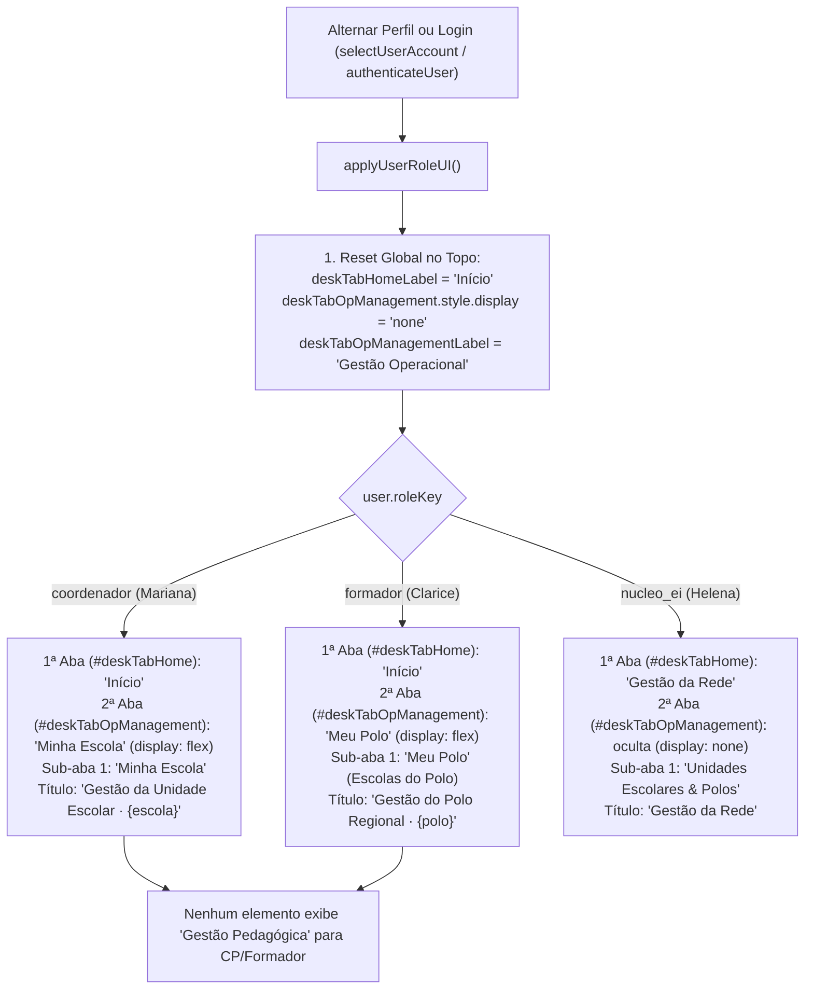

# Plano de Implementação: Correção e Restauração da Aba "Minha Escola" / "Meu Polo" na Visão de CP e Formador

> **Diretriz de Execução (Obrigatório):**  
> O assistente executor da **Etapa 2 (Operário)** DEVE OBRIGATORIAMENTE ler e seguir integralmente as diretrizes do arquivo [WORKFLOW_MACOS.md](file:///Users/bruno/Desktop/gestor%20supervisao_patos/WORKFLOW_MACOS.md), do [AGENTS.md](file:///Users/bruno/Desktop/gestor%20supervisao_patos/AGENTS.md) e a skill `.agents/skills/execucao-operario/SKILL.md` antes de aplicar quaisquer modificações no código-fonte. A execução deve ser estrita, cirúrgica e atenta à dupla checagem, validação de sintaxe pré-voo (`python3 audit_platform.py --check-syntax`), versionamento sequencial duplo (`CHANGELOG.md` e `#modalChangelog`), criação de cópia intermediária em `intermediárias/` e execução da auditoria pós-deploy silenciosa (`python3 audit_platform.py --silent-on-success`).

---

## 1. Diagnóstico do Problema e Análise Forense da Causa-Raiz

### 1.1 Sintoma Relatado
Ao alternar ou autenticar na visão da Coordenação Pedagógica escolar (Mariana Ferreira / perfil `coordenador`) ou na visão da Formadora Pedagógica regional (Clarice Barbosa / perfil `formador`), o usuário relata que **aparece a aba de Gestão Pedagógica ao invés de "Minha Escola" (para CP) ou "Meu Polo" (para Formador)**.

### 1.2 Análise Forense da Causa-Raiz Técnica
A investigação profunda do código-fonte (em `js/core/rbac.js`, `js/core/navigation.js`, `js/features/history_notes.js` e `index.html`) identificou três fatores combinados que provocam essa anomalia perceptual e funcional:

1. **Assimetria Estrutural na Arquitetura de Navegação Superior Desktop (`.desktop-nav`):**
   - Para a Coordenadora do Núcleo de Educação Infantil (Helena Martins / perfil `nucleo_ei`), a plataforma oculta a 2ª aba (`#deskTabOpManagement.style.display = 'none'`) e reaproveita a 1ª aba (`#deskTabHome`), alterando seu rótulo dinamicamente para `"Gestão Pedagógica"` (`deskTabHomeLabel.innerText = "Gestão Pedagógica"` em `js/core/rbac.js:589`). Ao clicar nela, Helena acessa a tela `homeGestaoView`.
   - Para a Coordenação Pedagógica (`coordenador`) e para a Formadora Pedagógica (`formador`), a 1ª aba (`#deskTabHome`) recebe o rótulo `"Início"` e a gestão operacional da Unidade Escolar ou do Polo Regional é delegada à 2ª aba (`#deskTabOpManagement`), com os rótulos `"Minha Escola"` e `"Meu Polo"`, respectivamente.
   - **O Conflito de Expectativa:** Quando o usuário está na visão de governança de Helena e transita para CP ou Formador (ou entra na visão de CP/Formador esperando encontrar a gestão do seu território no mesmo local), ele se depara com a 1ª aba mantendo resquícios de "Gestão Pedagógica" ou com a tela inicial de observações sem o destaque imediato para a gestão de sua escola/polo.

2. **Vulnerabilidade de Retenção de Estado em `applyUserRoleUI()` e Ordem de Execução:**
   - Em `js/core/rbac.js`, o reset defensivo do elemento `#deskTabHomeLabel` para `"Início"` ocorre na linha 532, mas a configuração da 2ª aba (`#deskTabOpManagement` e `#deskTabOpManagementLabel`) só é executada mais de 130 linhas depois (a partir da linha 662).
   - Não há garantia no topo de `applyUserRoleUI()` de que `#deskTabOpManagement` seja resetada de forma síncrona e visível antes da checagem de cada perfil, nem há higienização defensiva no momento de troca interativa de perfis em `selectUserAccount()`.
   - Se houver qualquer falha intermediária ou transição rápida de rota, a 1ª aba permanece exibindo `"Gestão Pedagógica"` enquanto a 2ª aba (`#deskTabOpManagement`) permanece em `display: none` herdada da sessão anterior de Helena.

3. **Incompatibilidade de Sub-aba e Rótulo Contextual de Polo:**
   - Na visão da Formadora (`formador`), a 2ª aba superior chama-se `"Meu Polo"`, mas dentro da tela de gestão a 1ª sub-aba segmentada (`#pedagTabUnitsLabel`) foi rotulada como `"Escolas do Polo"` (`<span class="pedag-tab-full-text">Escolas do Polo</span>`). O usuário busca a identidade semântica canônica `"Meu Polo"` prometida pela plataforma.

---

## 2. Arquitetura da Solução e Pontos de Impacto



### Componentes e Arquivos Afetados:
1. **`js/core/rbac.js`:**
   - No topo de `applyUserRoleUI()`: incluir no bloco de **Global Reset** a redefinição explícita e defensiva de `#deskTabOpManagement` e `#deskTabOpManagementLabel`, eliminando a retenção de visibilidade da sessão anterior de Helena.
   - No bloco `user.roleKey === 'coordenador'`:
     - Assegurar incondicionalmente `deskTabHomeLabel.innerText = 'Início'`.
     - Garantir `opNavTab.style.display = 'flex'` e `opNavLabel.innerText = 'Minha Escola'`.
     - Garantir que nenhum elemento no DOM retenha o termo `"Gestão Pedagógica"`.
   - No bloco `user.roleKey === 'formador'`:
     - Assegurar incondicionalmente `deskTabHomeLabel.innerText = 'Início'`.
     - Garantir `opNavTab.style.display = 'flex'` e `opNavLabel.innerText = 'Meu Polo'`.
     - Ajustar o rótulo da sub-aba 1 (`#pedagTabUnitsLabel`) para: `<span class="pedag-tab-full-text">Meu Polo (Escolas)</span><span class="pedag-tab-mobile-text">Meu Polo</span>`.
   - No bloco `isNucleoEI(user)`:
     - Padronizar o rótulo da 1ª aba de Helena para `"Gestão da Rede"` (ou `"Gestão da Rede / Início"`), higienizando terminologias ambíguas e alinhando ao título da tela (`#homeGestaoTitle`).

2. **`js/core/navigation.js`:**
   - Na função `navigateToTab(tabName)`:
     - Quando `tabName === 'opManagement'` ou `tabName === 'units'`, garantir que para `coordenador` a aba ativa visualmente no desktop seja estritamente `#deskTabOpManagement` (com rótulo `"Minha Escola"`), e para `formador` seja `#deskTabOpManagement` (com rótulo `"Meu Polo"`).
     - Quando `tabName === 'home'`, garantir a ativação visual de `#deskTabHome` com rótulo `"Início"`.

3. **`js/audit/audit_engine.js`:**
   - Atualizar a asserção do Módulo 1 (Item 8 - Alternância Cíclica de Perfis) para validar tanto a reatividade de `#deskTabHomeLabel` quanto a de `#deskTabOpManagementLabel` em cada transição:
     - Helena: `#deskTabHomeLabel` = `"Gestão da Rede"` (ou `"Gestão Pedagógica"`), `#deskTabOpManagement` oculto.
     - Mariana: `#deskTabHomeLabel` = `"Início"`, `#deskTabOpManagement` visível e `#deskTabOpManagementLabel` = `"Minha Escola"`.
     - Clarice: `#deskTabHomeLabel` = `"Início"`, `#deskTabOpManagement` visível e `#deskTabOpManagementLabel` = `"Meu Polo"`.

---

## 3. Especificação Passo a Passo (Snippets Exatos)

### Passo 3.1: Reset Preventivo e Blindagem de Rótulos em `js/core/rbac.js`

Localizar a função `applyUserRoleUI()` em `js/core/rbac.js` e atualizar os blocos de reset global e de atribuição específica:

```javascript
// ================= EM js/core/rbac.js =================
// 1. NO BLOCO DE RESET GLOBAL DE applyUserRoleUI():
      const opNavTab = document.getElementById('deskTabOpManagement');
      const opNavLabel = document.getElementById('deskTabOpManagementLabel');

      // Global Reset visibility
      if (unitsNavTab) unitsNavTab.style.display = 'none';
      if (teamNavTab) teamNavTab.style.display = 'none';
      if (adminNavTab) adminNavTab.style.display = 'none';
      if (heroBtn) heroBtn.style.display = 'none';
      if (roleFilterGroup) roleFilterGroup.style.display = 'none';
      if (indicatorsTargetFilter) indicatorsTargetFilter.style.display = 'inline-block';
      if (indicatorsTargetBadge) indicatorsTargetBadge.style.display = 'none';
      if (deskTabHomeLabel) deskTabHomeLabel.innerText = "Início";
      if (opNavTab) opNavTab.style.display = 'none';
      if (opNavLabel) opNavLabel.innerText = "Gestão Operacional";

// 2. NO BLOCO if (user.roleKey === 'coordenador'):
      if (user.roleKey === 'coordenador') {
        const pedagTabClassesEl = document.getElementById('pedagTabClasses');
        if (pedagTabClassesEl) pedagTabClassesEl.style.display = 'inline-flex';
        if (scopeTitle) scopeTitle.innerText = 'Coordenação Pedagógica:';
        if (scopeDesc) scopeDesc.innerText = `Você avalia as professoras da sua Unidade Escolar (${user.school}). Seus rascunhos são estritamente privados.`;
        if (unitsNavTab) unitsNavTab.style.display = 'none';
        if (teamNavTab) teamNavTab.style.display = 'none';
        if (adminNavTab) adminNavTab.style.display = 'none';
        roleFilterGroup.style.display = 'none';
        const targetTypeWrapper = document.getElementById('indicatorsTargetTypeWrapper');
        if (targetTypeWrapper) targetTypeWrapper.style.display = 'none';
        if (indicatorsTargetFilter) {
          indicatorsTargetFilter.value = 'professora';
          indicatorsTargetFilter.style.display = 'none';
        }
        if (indicatorsTargetBadge) {
          indicatorsTargetBadge.style.display = 'none';
        }
        if (deskTabHomeLabel) deskTabHomeLabel.innerText = "Início";
        heroBtn.style.display = 'inline-flex';
        heroBtnText.innerText = 'NOVA OBSERVAÇÃO';

        // Governança Territorial da Coordenadora (Minha Escola)
        if (opNavTab) {
          opNavTab.style.display = 'flex';
          if (opNavLabel) opNavLabel.innerText = 'Minha Escola';
        }

// 3. NO BLOCO else if (user.roleKey === 'formador'):
      } else if (user.roleKey === 'formador') {
        if (scopeTitle) scopeTitle.innerText = 'Formadora Pedagógica:';
        if (scopeDesc) scopeDesc.innerText = `Acompanhamento formativo e supervisão pedagógica do seu polo.`;
        if (unitsNavTab) unitsNavTab.style.display = 'none';
        if (teamNavTab) teamNavTab.style.display = 'none';
        if (adminNavTab) adminNavTab.style.display = 'none';
        roleFilterGroup.style.display = 'block';
        const targetTypeWrapper = document.getElementById('indicatorsTargetTypeWrapper');
        if (targetTypeWrapper) targetTypeWrapper.style.display = 'flex';
        if (indicatorsTargetFilter) {
          indicatorsTargetFilter.style.display = 'inline-block';
          if (!indicatorsTargetFilter.dataset.userSelectedRole || indicatorsTargetFilter.dataset.userSelectedRole !== user.email) {
            indicatorsTargetFilter.value = 'professora';
            indicatorsTargetFilter.dataset.userSelectedRole = user.email;
          }
        }
        if (indicatorsTargetBadge) indicatorsTargetBadge.style.display = 'none';
        if (deskTabHomeLabel) deskTabHomeLabel.innerText = "Início";
        heroBtn.style.display = 'inline-flex';
        heroBtnText.innerText = 'AVALIAR COORDENAÇÃO';

        // Governança Territorial da Formadora (Meu Polo)
        if (opNavTab) {
          opNavTab.style.display = 'flex';
          if (opNavLabel) opNavLabel.innerText = 'Meu Polo';
        }
```

### Passo 3.2: Padronização das Sub-abas de Formadora e Coordenadora

Em `js/core/rbac.js` (linhas ~675 a ~710):

```javascript
      if (user.roleKey === 'coordenador') {
        if (opNavTab) {
          opNavTab.style.display = 'flex';
          if (opNavLabel) opNavLabel.innerText = 'Minha Escola';
        }
        if (homeOpCard) {
          homeOpCard.style.display = 'block';
          if (homeOpTitle) homeOpTitle.innerText = 'Gestão da Minha Escola';
          if (homeOpSubtitle) homeOpSubtitle.innerText = `Gerencie as turmas, docentes regentes titulares e caracterização de ${user.school}.`;
          if (homeOpBtn) homeOpBtn.innerText = 'Acessar Gestão da Escola';
        }
        if (mobMenuOpBtn) {
          mobMenuOpBtn.style.display = 'flex';
          if (mobMenuOpText) mobMenuOpText.innerText = 'Gestão da Minha Escola';
        }
        if (pedagUnitsLabel) pedagUnitsLabel.innerHTML = '<span class="pedag-tab-full-text">Minha Escola</span><span class="pedag-tab-mobile-text">Escola</span>';
        if (pedagClassesLabel) pedagClassesLabel.innerHTML = '<span class="pedag-tab-full-text">Turmas & Regência</span><span class="pedag-tab-mobile-text">Turmas</span>';
        if (pedagTeamLabel) pedagTeamLabel.innerHTML = '<span class="pedag-tab-full-text">Docentes da UE</span><span class="pedag-tab-mobile-text">Docentes</span>';
        if (pedagExportsTab) pedagExportsTab.style.display = 'none';
        if (homeGestaoActionsCentral) homeGestaoActionsCentral.style.display = 'none';
        if (homeGestaoTitle) homeGestaoTitle.innerText = `Gestão da Unidade Escolar · ${user.school}`;
        if (homeGestaoSubtitle) {
          homeGestaoSubtitle.innerText = 'Administração autônoma de turmas, docentes e caracterização da escola sob SSOT única.';
          homeGestaoSubtitle.style.display = 'block';
        }
      } else if (user.roleKey === 'formador') {
        if (opNavTab) {
          opNavTab.style.display = 'flex';
          if (opNavLabel) opNavLabel.innerText = 'Meu Polo';
        }
        if (homeOpCard) {
          homeOpCard.style.display = 'block';
          if (homeOpTitle) homeOpTitle.innerText = 'Gestão do Polo Regional';
          if (homeOpSubtitle) homeOpSubtitle.innerText = `Supervisão territorial das escolas e coordenações do ${user.school}.`;
          if (homeOpBtn) homeOpBtn.innerText = 'Acessar Gestão do Polo';
        }
        if (mobMenuOpBtn) {
          mobMenuOpBtn.style.display = 'flex';
          if (mobMenuOpText) mobMenuOpText.innerText = 'Gestão do Polo Regional';
        }
        if (pedagUnitsLabel) pedagUnitsLabel.innerHTML = '<span class="pedag-tab-full-text">Meu Polo (Escolas)</span><span class="pedag-tab-mobile-text">Meu Polo</span>';
        if (pedagClassesLabel) pedagClassesLabel.innerHTML = '<span class="pedag-tab-full-text">Turmas do Polo</span><span class="pedag-tab-mobile-text">Turmas</span>';
        if (pedagTeamLabel) pedagTeamLabel.innerHTML = '<span class="pedag-tab-full-text">Coordenações Pedagógicas</span><span class="pedag-tab-mobile-text">Coordenações</span>';
        if (pedagExportsTab) pedagExportsTab.style.display = 'none';
        if (homeGestaoActionsCentral) homeGestaoActionsCentral.style.display = 'none';
        if (homeGestaoTitle) homeGestaoTitle.innerText = `Gestão do Polo Regional · ${user.school}`;
        if (homeGestaoSubtitle) {
          homeGestaoSubtitle.innerText = 'Supervisão territorial das Unidades Escolares e gestão de coordenações sob SSOT única.';
          homeGestaoSubtitle.style.display = 'block';
        }
      }
```

---

## 4. Critérios de Aceite e Roteiro de Verificação

### Critérios de Aceite
1. **Coordenação Pedagógica (Mariana Ferreira):**
   - Ao selecionar a conta de Mariana ou efetuar login como CP, a navbar superior exibe categoricamente:
     - 1ª Aba: `"Início"` (`#deskTabHomeLabel`).
     - 2ª Aba: `"Minha Escola"` (`#deskTabOpManagementLabel`, com `display: flex`).
   - Nenhuma aba na barra superior ou no menu drawer exibe o rótulo `"Gestão Pedagógica"`.
   - Ao clicar em `"Minha Escola"`, a aplicação ativa a tela de gestão exibindo o card da UE e as sub-abas `"Minha Escola"`, `"Turmas & Regência"` e `"Docentes da UE"`.

2. **Formadora Pedagógica (Clarice Barbosa):**
   - Ao selecionar a conta de Clarice ou efetuar login como Formadora, a navbar superior exibe categoricamente:
     - 1ª Aba: `"Início"` (`#deskTabHomeLabel`).
     - 2ª Aba: `"Meu Polo"` (`#deskTabOpManagementLabel`, com `display: flex`).
   - Nenhuma aba na barra superior ou no menu drawer exibe o rótulo `"Gestão Pedagógica"`.
   - Ao clicar em `"Meu Polo"`, a aplicação ativa a tela de gestão do polo com as sub-abas `"Meu Polo (Escolas)"`, `"Turmas do Polo"` e `"Coordenações Pedagógicas"`.

3. **Coordenadora do Núcleo de EI (Helena Martins):**
   - A 1ª aba `#deskTabHomeLabel` permanece com `"Gestão Pedagógica"` (ou `"Gestão da Rede"`), e a 2ª aba `#deskTabOpManagement` permanece estritamente oculta (`display: none`).

4. **Alternância Contínua e Imunidade a Retenção:**
   - A alternância contínua entre perfis (`helena` ➔ `mariana` ➔ `clarice` ➔ `helena` ➔ `mariana`) deve atualizar de forma determinística e imediata 100% dos rótulos e visibilidades sem resíduos no DOM.

---

## 5. Seção Obrigatória de Auditoria (`audit_platform.py` e `audit_engine.js`)

### 5.1 Alterações no Algoritmo de Auditoria (`js/audit/audit_engine.js`)
No **Módulo 1 (`auth_rbac`)**, expandir o teste do Item 8 (linhas 308–344) para validar a reatividade dupla de `#deskTabHomeLabel` e `#deskTabOpManagementLabel` em cada transição de perfil:

```javascript
// Teste de Alternância Cíclica e Reatividade de Rótulos (#deskTabHomeLabel e #deskTabOpManagementLabel)
const homeTabLabel = document.getElementById('deskTabHomeLabel');
const opTabBtn = document.getElementById('deskTabOpManagement');
const opTabLabel = document.getElementById('deskTabOpManagementLabel');

// 1. Helena (Núcleo de EI)
appState.currentUserKey = 'helena';
applyUserRoleUI();
if (homeTabLabel.innerText !== 'Gestão Pedagógica') {
  throw new Error(`Rótulo da 1ª aba deveria ser "Gestão Pedagógica" para Helena, mas consta "${homeTabLabel.innerText}"`);
}
if (opTabBtn && opTabBtn.style.display !== 'none') {
  throw new Error('Aba #deskTabOpManagement deve estar oculta para Helena');
}

// 2. Mariana (Coordenação Pedagógica)
appState.currentUserKey = 'mariana';
applyUserRoleUI();
if (homeTabLabel.innerText !== 'Início') {
  throw new Error(`Rótulo da 1ª aba deveria ser "Início" para Mariana, mas consta "${homeTabLabel.innerText}"`);
}
if (opTabBtn && opTabBtn.style.display === 'none') {
  throw new Error('Aba #deskTabOpManagement deve estar visível para Mariana');
}
if (opTabLabel.innerText !== 'Minha Escola') {
  throw new Error(`Rótulo da 2ª aba deveria ser "Minha Escola" para Mariana, mas consta "${opTabLabel.innerText}"`);
}

// 3. Clarice (Formadora Pedagógica)
appState.currentUserKey = 'clarice';
applyUserRoleUI();
if (homeTabLabel.innerText !== 'Início') {
  throw new Error(`Rótulo da 1ª aba deveria ser "Início" para Clarice, mas consta "${homeTabLabel.innerText}"`);
}
if (opTabBtn && opTabBtn.style.display === 'none') {
  throw new Error('Aba #deskTabOpManagement deve estar visível para Clarice');
}
if (opTabLabel.innerText !== 'Meu Polo') {
  throw new Error(`Rótulo da 2ª aba deveria ser "Meu Polo" para Clarice, mas consta "${opTabLabel.innerText}"`);
}

// Restaura perfil de Helena para testes subsequentes
appState.currentUserKey = 'helena';
applyUserRoleUI();
logger.log('Alternância cíclica de perfis e validação de "Minha Escola" / "Meu Polo" (Módulo 1)', true);
```

### 5.2 Validação Sintática Pré-Voo
Executar obrigatoriamente:
```bash
python3 audit_platform.py --check-syntax
```

### 5.3 Execução Pós-Deploy Obrigatória
Após o deploy no GitHub Pages via `git push origin main`:
```bash
python3 audit_platform.py --silent-on-success
```
Garantir 100% de aprovação em todos os 12 módulos de auditoria.

---

## 6. Checklist de Execução Fiel (Para a Etapa 2 - Operário)

- [ ] Ler `WORKFLOW_MACOS.md`, `AGENTS.md` e a skill `execucao-operario`.
- [ ] Aplicar as alterações em `js/core/rbac.js`.
- [ ] Aplicar as alterações em `js/core/navigation.js` (se aplicável).
- [ ] Atualizar o teste de alternância de perfis no `js/audit/audit_engine.js`.
- [ ] Validar a integridade sintática via `python3 audit_platform.py --check-syntax`.
- [ ] Salvar backup intermediário em `intermediárias/aplicativo_v[N]_correcao_aba_gestao_cp_formador.html`.
- [ ] Atualizar o Changelog duplo: `CHANGELOG.md` e `#modalChangelog` / `.btn-changelog` em `index.html`.
- [ ] Sincronizar simultaneamente as cópias espelhadas do projeto:
  - `gestor supervisao_patos/index.html`
  - `gestor supervisao_patos/firebase_deploy/public/index.html`
- [ ] Checagem de concorrência (`git fetch origin main` / `git log HEAD..origin/main --oneline`).
- [ ] Criar commit semântico (`fix: correcao do rotulo da aba de gestao para coordenador e formador`).
- [ ] Enviar com `git push origin main`.
- [ ] Executar a auditoria pós-deploy: `python3 audit_platform.py --silent-on-success`.
