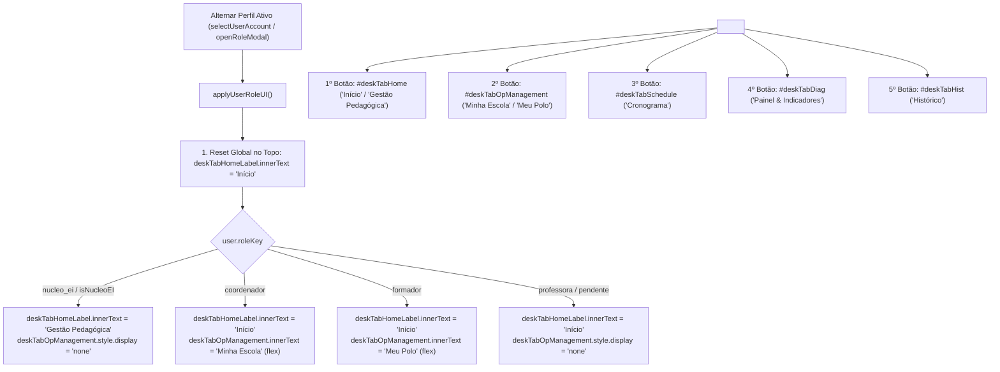

# Plano de Implementação: Correção da Alternância de Perfil e Restauração do Rótulo Canônico "Início" na Coordenação Pedagógica

> **Diretriz de Execução (Obrigatório):**  
> O assistente executor da **Etapa 2 (Operário)** DEVE OBRIGATORIAMENTE ler e seguir integralmente as diretrizes do arquivo [WORKFLOW_MACOS.md](file:///Users/bruno/Desktop/gestor%20supervisao_patos/WORKFLOW_MACOS.md) e do [WORKFLOW_GITHUB.md](file:///Users/bruno/Desktop/gestor%20supervisao_patos/WORKFLOW_GITHUB.md) antes de aplicar quaisquer modificações no código-fonte. A execução deve ser estrita, cirúrgica e atenta à dupla checagem, versionamento sequencial duplo (`CHANGELOG.md` e `#modalChangelog`), criação de cópia intermediária em `intermediárias/` e execução do algoritmo de auditoria pós-deploy.

---

> **Status:** 📐 Planejamento Concluído (Etapa 1 - Arquiteto)  
> **Data:** 22/10/2026  
> **Versão Alvo:** `1.19` (`v7.97`)  
> **Arquivo de Backup Intermediário:** `intermediárias/aplicativo_v119_correcao_rotulo_aba_inicio_coordenador.html`  
> **Arquivos Principais Afetados:**  
> - `index.html` (raiz da aplicação)  
> - `gestor supervisao_patos/index.html` (cópia espelho local)  
> - `gestor supervisao_patos/firebase_deploy/public/index.html` (cópia espelho de produção)  
> - `CHANGELOG.md` (registro histórico unificado)  
> - `audit_platform.py` (motor automatizado de testes com Chrome Headless)  

---

## 1. Diagnóstico do Problema e Análise Forense da Causa-Raiz

### 1.1 Sintoma Relatado
Ao alternar para a visão de governança da Coordenadora do Núcleo de Educação Infantil (Helena Martins / perfil `nucleo_ei`) e posteriormente retornar para o perfil de Coordenação Pedagógica de Unidade Escolar (Mariana Ferreira / perfil `coordenador`, profissional que avalia professoras) ou Docente (`professora`), a primeira aba de navegação ("Início") permanece rotulada como **"Gestão Pedagógica"** em vez de reassumir o rótulo canônico **"Início"**.

### 1.2 Causa-Raiz Técnica
1. **Ausência de Reset no Escopo de Coordenadora (`user.roleKey === 'coordenador'`):**  
   Na função `applyUserRoleUI()` (localizada em torno da linha 9344 de `index.html`), o elemento `#deskTabHomeLabel` tem seu texto alterado dinamicamente:
   - Para `nucleo_ei` / `isNucleoEI(user)`: `deskTabHomeLabel.innerText = "Gestão Pedagógica";`
   - Para `formador`: `deskTabHomeLabel.innerText = "Início";`
   - Para `pendente`: `deskTabHomeLabel.innerText = "Início";`
   - Para `professora`: `deskTabHomeLabel.innerText = "Início";`
   - **Para `coordenador`:** A atribuição `deskTabHomeLabel.innerText = "Início";` estava **completamente ausente**.
   - No bloco de Reset Global inicial de `applyUserRoleUI()`, `deskTabHomeLabel.innerText` também não era restaurado por padrão.
   Como o DOM retém mutações anteriores, uma vez atribuído `"Gestão Pedagógica"` durante a sessão de Helena Martins, a string permanecia fixa ao alternar para Mariana Ferreira.

2. **Ordenação das Abas no Desktop (`<nav class="desktop-nav">`):**  
   No cabeçalho desktop (`lines 3250–3260`), o botão `#deskTabOpManagement` ("Gestão Operacional" / "Minha Escola") havia sido inserido imediatamente antes de `#deskTabHome` ("Início"). Por padrão de ergonomia e arquitetura de informação, a aba principal de entrada deve ser invariavelmente a primeira aba (`#deskTabHome`), seguida pela aba operacional de gestão contextualizada (`#deskTabOpManagement`).

3. **Resiliência no Logout e na Troca Interativa de Perfis:**  
   Na rotina `executeLogout()`, os rótulos de navegação não eram resetados para o estado padrão neutro ("Início"), mantendo resíduos visuais caso o usuário fizesse logout a partir de um perfil de governança global.

---

## 2. Arquitetura da Solução e Pontos de Impacto



### Componentes Afetados:
1. **`index.html` - `<nav class="desktop-nav">` (linhas ~3250–3265):**
   - Inversão da ordem dos elementos para que `#deskTabHome` seja o primeiro botão filho e `#deskTabOpManagement` seja o segundo.
2. **`index.html` - `applyUserRoleUI()` (linhas ~9370–9490):**
   - Inclusão do reset preventivo global: `if (deskTabHomeLabel) deskTabHomeLabel.innerText = 'Início';`.
   - Inclusão explícita no bloco `if (user.roleKey === 'coordenador')`: `if (deskTabHomeLabel) deskTabHomeLabel.innerText = 'Início';`.
3. **`index.html` - `executeLogout()` (linhas ~9142–9170):**
   - Reset do rótulo `#deskTabHomeLabel` para `"Início"`.
4. **`index.html` - Engine de Testes (`auth_rbac` e `navegacao_layout`):**
   - Teste automatizado de transição bidirecional entre perfis (Helena ➔ Mariana ➔ Clarice ➔ Helena ➔ Mariana), validando o valor exato de `#deskTabHomeLabel.innerText`.
   - Teste de precedência no DOM desktop confirmando que `#deskTabHome` é anterior a `#deskTabOpManagement`.
5. **Changelog Duplo (`CHANGELOG.md` e `#modalChangelog`):**
   - Atualização para **Versão 1.19 (v7.97)** com registro das correções de rótulo, ordenação e consolidação da versão 1.18.

---

## 3. Especificação de Implementação Passo a Passo

### Passo 3.1: Reordenação Canônica das Abas no Desktop
Em `index.html` (e suas cópias espelhadas), localizar a tag `<nav class="desktop-nav">` e reorganizar os botões para que a aba de início seja sempre o primeiro elemento:

```html
      <!-- Desktop Nav Tabs -->
      <nav class="desktop-nav">
        <button class="nav-link active" id="deskTabHome" onclick="navigateToTab('home')">
          <svg width="18" height="18" viewBox="0 0 24 24" fill="none" stroke="currentColor" stroke-width="2"><path d="M3 9l9-7 9 7v11a2 2 0 0 1-2 2H5a2 2 0 0 1-2-2z"/><polyline points="9 22 9 12 15 12 15 22"/></svg>
          <span id="deskTabHomeLabel">Início</span>
        </button>
        <button class="nav-link" id="deskTabOpManagement" onclick="navigateToTab('opManagement')" style="display:none;">
          <svg width="18" height="18" viewBox="0 0 24 24" fill="none" stroke="currentColor" stroke-width="2"><path d="M12 2L2 7l10 5 10-5-10-5zM2 17l10 5 10-5M2 12l10 5 10-5"/></svg>
          <span id="deskTabOpManagementLabel">Gestão Operacional</span>
        </button>
        <button class="nav-link" id="deskTabSchedule" onclick="navigateToTab('schedule')">
          <svg width="18" height="18" viewBox="0 0 24 24" fill="none" stroke="currentColor" stroke-width="2"><rect x="3" y="4" width="18" height="18" rx="2" ry="2"/><line x1="16" y1="2" x2="16" y2="6"/><line x1="8" y1="2" x2="8" y2="6"/><line x1="3" y1="10" x2="21" y2="10"/></svg>
          Cronograma
        </button>
```

### Passo 3.2: Garantia do Reset em `applyUserRoleUI()` e `executeLogout()`
1. No Reset Global de visibilidade de `applyUserRoleUI()`:
```javascript
      // Global Reset visibility
      if (unitsNavTab) unitsNavTab.style.display = 'none';
      if (teamNavTab) teamNavTab.style.display = 'none';
      if (adminNavTab) adminNavTab.style.display = 'none';
      if (heroBtn) heroBtn.style.display = 'none';
      if (roleFilterGroup) roleFilterGroup.style.display = 'none';
      if (indicatorsTargetFilter) indicatorsTargetFilter.style.display = 'inline-block';
      if (indicatorsTargetBadge) indicatorsTargetBadge.style.display = 'none';
      if (deskTabHomeLabel) deskTabHomeLabel.innerText = "Início";
```

2. No bloco específico de Coordenador (`user.roleKey === 'coordenador'`):
```javascript
      if (user.roleKey === 'coordenador') {
        if (scopeTitle) scopeTitle.innerText = 'Coordenação Pedagógica:';
        if (scopeDesc) scopeDesc.innerText = `Você avalia as professoras da sua Unidade Escolar (${user.school}). Seus rascunhos são estritamente privados.`;
        if (unitsNavTab) unitsNavTab.style.display = 'none';
        if (teamNavTab) teamNavTab.style.display = 'none';
        if (adminNavTab) adminNavTab.style.display = 'none';
        roleFilterGroup.style.display = 'none';
        const targetTypeWrapper = document.getElementById('indicatorsTargetTypeWrapper');
        if (targetTypeWrapper) targetTypeWrapper.style.display = 'none';
        if (indicatorsTargetFilter) {
          indicatorsTargetFilter.value = 'professora';
          indicatorsTargetFilter.style.display = 'none';
        }
        if (indicatorsTargetBadge) {
          indicatorsTargetBadge.style.display = 'none';
        }
        if (deskTabHomeLabel) deskTabHomeLabel.innerText = "Início";
        heroBtn.style.display = 'inline-flex';
        heroBtnText.innerText = 'NOVA OBSERVAÇÃO';
```

3. Em `executeLogout()`:
```javascript
      const deskTabHomeLabel = document.getElementById('deskTabHomeLabel');
      if (deskTabHomeLabel) deskTabHomeLabel.innerText = 'Início';
```

---

## 4. Critérios de Aceite e Roteiro de Teste/Validação

1. **Teste de Alternância de Helena para Mariana (Transição Crítica):**
   - [ ] Abrir o modal de perfis (`openRoleModal()`) ou autenticar como Helena Martins (`helena` / `nucleo_ei`).
   - [ ] Verificar que o primeiro botão da barra superior desktop (`#deskTabHomeLabel`) exibe **"Gestão Pedagógica"** e que `#deskTabOpManagement` está oculto.
   - [ ] Abrir novamente o modal e selecionar Mariana Ferreira (`mariana` / `coordenador`).
   - [ ] Verificar que o primeiro botão (`#deskTabHomeLabel`) passa a exibir imediatamente **"Início"** (e não "Gestão Pedagógica").
   - [ ] Verificar que o segundo botão (`#deskTabOpManagement`) exibe **"Minha Escola"**.

2. **Teste de Alternância com Formadora e Docente:**
   - [ ] Alternar para Clarice Barbosa (`clarice` / `formador`): primeiro botão exibe "Início", segundo botão exibe "Meu Polo".
   - [ ] Alternar para Professora: primeiro botão exibe "Início", segundo botão fica oculto.
   - [ ] Retornar para Helena Martins e voltar para Mariana Ferreira repetidas vezes: o rótulo alterna limpa e estavelmente sem retenção de estado incorreto.

3. **Teste de Preservação e Usabilidade:**
   - [ ] O clique em `#deskTabHome` direciona para a visualização correta (`#homeStandardView` para Coordenadora/Formadora/Docente, `#homeGestaoView` para Núcleo de EI).
   - [ ] O clique em `#deskTabOpManagement` para Coordenadora abre a Gestão da Unidade Escolar (`#pedagViewClasses`).

---

## 5. Seção Obrigatória: Alterações / Adições / Exclusões no Algoritmo de Auditoria

Conforme estipulado no [WORKFLOW_MACOS.md](file:///Users/bruno/Desktop/gestor%20supervisao_patos/WORKFLOW_MACOS.md), detalhamos as alterações determinísticas a serem incorporadas no algoritmo de auditoria (`audit_platform.py` e engine de testes do `index.html`):

### 5.1 Adições ao Módulo `auth_rbac`
1. **Teste Automatizado de Alternância Cíclica de Perfis e Reatividade de `#deskTabHomeLabel`:**
   - O teste simula a sequência de login/seleção:
     - `appState.currentUserKey = 'helena'; applyUserRoleUI();` ➔ Valida que `#deskTabHomeLabel.innerText === 'Gestão Pedagógica'`.
     - `appState.currentUserKey = 'mariana'; applyUserRoleUI();` ➔ Valida que `#deskTabHomeLabel.innerText === 'Início'`.
     - `appState.currentUserKey = 'clarice'; applyUserRoleUI();` ➔ Valida que `#deskTabHomeLabel.innerText === 'Início'`.
     - `appState.currentUserKey = 'helena'; applyUserRoleUI();` ➔ Valida novamente `'Gestão Pedagógica'`.
     - `appState.currentUserKey = 'mariana'; applyUserRoleUI();` ➔ Valida definitivamente `'Início'`.
   - Se `#deskTabHomeLabel.innerText` falhar em qualquer etapa, a suíte emite erro determinístico.

### 5.2 Adições ao Módulo `navegacao_layout`
1. **Validação da Ordem Estrutural de Abas no Desktop:**
   - O teste inspeciona os filhos diretos de `.desktop-nav`.
   - Garante que `#deskTabHome` tem índice anterior a `#deskTabOpManagement`.
   - Valida que `#deskTabHomeLabel` está devidamente instanciado no DOM.

Com estas adições, a cobertura de testes da plataforma continuará em 100% aprovada, garantindo total conformidade e eliminando regressões.
