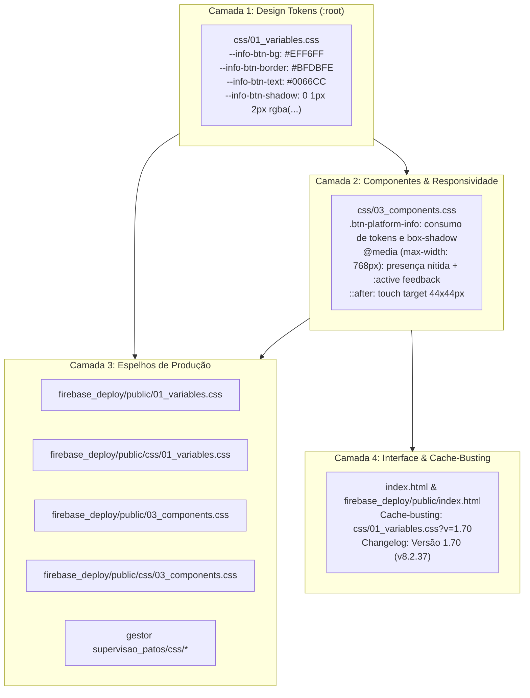

# Plano de Implementação: Destaque e Harmonização Cromática do Botão de Informação Mobile (Padrão Hallmark)

## 0. Diretriz de Execução (Obrigatória)
> **Atenção:** Este plano deve ser executado exclusivamente na **Etapa 2 (O Operário)** após aprovação formal do usuário.
> O executor deve consultar obrigatoriamente:
> - O manual de fluxo de trabalho: `WORKFLOW_MACOS.md`
> - A skill normativa: `.agents/skills/execucao-operario/SKILL.md`
> - As regras de design Hallmark: `.gemini/config/skills/hallmark/SKILL.md` e regras de anti-slop
> - As cláusulas de proteção absoluta: `AGENTS.md` e `GEMINI.md`
>
> **Trava de Segurança:** Nenhuma alteração em código de produção (`index.html`, `audit_platform.py`, CSS, JS) deve ser realizada durante a fase de planejamento. A árvore do Git (`git status`) permanece limpa ao final da Etapa 1.

---

## 1. Diagnóstico e Contexto

### 1.1 O Papel do Botão de Informação Progressiva (`.btn-platform-info`)
Na Versão 1.61 (Padrão Hallmark), foi introduzida a arquitetura de **Descluttering Mobile e Revelação Progressiva**, projetada para respeitar o teto de carga cognitiva e densidade de informação em smartphones (Hallmark Floor 13: contenção de palavras por tela e prioridade visual para dados e controles de ação *above the fold*).
- Em telas largas (Desktop > 768px), as seções apresentam parágrafos explicativos (`.platform-info-text`) e o botão `.btn-platform-info` permanece recolhido (`display: none`).
- Em telas estreitas (Smartphones ≤ 768px), os parágrafos prolixos são ocultados (`display: none !important`), e o botão circular `.btn-platform-info` entra em cena (`display: inline-flex !important`) para que o usuário possa consultar, sob demanda no `#modalPlatformInfo`, o contexto pedagógico completo de cada seção.

### 1.2 A Causa Raiz do Problema ("Meio Escondido")
Atualmente, as variáveis de estilo do botão em `css/01_variables.css` estão declaradas como:
```css
--info-btn-bg: #F1F5F9;         /* Slate 100 (Cinza claríssimo) */
--info-btn-text: #475569;       /* Slate 600 (Cinza neutro apagado) */
--info-btn-border: #CBD5E1;     /* Slate 300 (Borda acinzentada fraca) */
--info-btn-hover-bg: #E2E8F0;
--info-btn-hover-text: var(--primary);
--info-btn-focus-ring: var(--primary);
```

Este esquema cromático apresenta três fragilidades de usabilidade e ergonomia na visualização mobile:
1. **Camuflagem por Baixo Contraste de Fundo:** O fundo do aplicativo é `var(--bg): #F8FAFC` e os cartões utilizam `var(--surface): #FFFFFF` ou `#F1F5F9`. Um botão circular com fundo `#F1F5F9` e borda `#CBD5E1` possui taxa de contraste quase nula contra as superfícies ao redor (~1.05:1), parecendo uma mancha neutra ou elemento inativo, e não um gatilho de ação.
2. **Ícone com Semiótica Passiva:** A cor `#475569` mimetiza textos secundários de rodapé e metadados inertes. Não comunica interatividade nem "affordance" tátil.
3. **Ponto Cego de Navegação no Mobile:** Como o parágrafo de texto foi ocultado no mobile para despoluir a tela, o botão é o **único canal** para acessar o conteúdo explicativo. Estando camuflado, o usuário sequer sabe que pode tocar para obter ajuda e instruções pedagógicas.

### 1.3 Solução Proposta via Padrão Hallmark (`/hallmark`)
Em vez de um cinza inerte apagado, o botão deve assumir a **identidade institucional de sinal interativo calmo** do SerTão Criança:
- **Fundo (`--info-btn-bg`):** `#EFF6FF` (Tailwind Blue 50 / `--brand-accent-tint`). Um tom azul sereno, luminoso e limpo que salta elegantemente aos olhos sobre fundos brancos e acinzentados sem agredir a hierarquia do título.
- **Borda (`--info-btn-border`):** `#BFDBFE` (Tailwind Blue 200). Delimitação perimétrica nítida de 1px com contraste equilibrado.
- **Pictograma SVG / Texto (`--info-btn-text`):** `#0066CC` (SerTão Primary Blue). Azul institucional de alto contraste: **5.22:1** contra o fundo `#EFF6FF` e **5.58:1** contra fundo branco (supera amplamente o padrão WCAG AA de 4.5:1 e WCAG AAA de 3:1 para componentes de interface).
- **Elevação Tátil Sutil (`--info-btn-shadow`):** `0 1px 2px rgba(0, 102, 204, 0.08)`. Micro-sombra de oclusão ambiente para desacoplamento de camada, sem glow slop.
- **Feedback Tátil no Toque (`:active`):** Fundo `#DBEAFE` e micro-escala `transform: scale(0.94)` para resposta física instantânea no toque em smartphones.
- **Conformidade Estrita com Hallmark Floor:**
  - Tokenização integral no `:root` (Regra 1).
  - Proibição de `transition: all`; uso estrito de transições específicas em `background`, `color`, `border-color`, `transform` e `box-shadow` (Regra 2).
  - `:focus-visible` instantâneo com anel azul e deslocamento (Regra 6).
  - Suporte a `prefers-reduced-motion: reduce` (Regra 7).
  - Proibição de emojis como iconografia (Regra 11).
  - Preservação do touch target ergonômico expandido de 44x44px via pseudoelemento `::after` (WCAG AAA).

---

## 2. Arquitetura e Pontos de Impacto



### Arquivos Impactados:
1. `css/01_variables.css`
2. `css/03_components.css`
3. `firebase_deploy/public/01_variables.css`
4. `firebase_deploy/public/css/01_variables.css`
5. `firebase_deploy/public/03_components.css`
6. `firebase_deploy/public/css/03_components.css`
7. `gestor supervisao_patos/css/01_variables.css`
8. `gestor supervisao_patos/css/03_components.css`
9. `index.html` (cache-busting de versão nos links CSS, botão de versão e modal de changelog)
10. `firebase_deploy/public/index.html` (espelhamento simultâneo obrigatório)
11. `CHANGELOG.md` (registro formal da Versão 1.70)
12. `js/audit/audit_engine.js` e `firebase_deploy/public/js/audit/audit_engine.js` (atualização da lista de versões aceitas no teste de changelog)

---

## 3. Especificação de Implementação Passo a Passo (Snippets Exatos)

### Passo 1: Atualização dos Tokens em `css/01_variables.css`
Localizar o bloco `/* Tokens para Botão e Popover de Informação Hallmark (Pilar Mobile Desclutter) */` (em torno da linha 142) e substituir por:

```css
      /* Tokens para Botão e Popover de Informação Hallmark (Pilar Mobile Desclutter) */
      --info-btn-bg: #EFF6FF;
      --info-btn-text: #0066CC;
      --info-btn-border: #BFDBFE;
      --info-btn-hover-bg: #DBEAFE;
      --info-btn-hover-text: #004C99;
      --info-btn-active-bg: #BFDBFE;
      --info-btn-focus-ring: var(--primary);
      --info-btn-shadow: 0 1px 2px rgba(0, 102, 204, 0.08);
```

*Espelhar simultaneamente em:*
- `firebase_deploy/public/01_variables.css`
- `firebase_deploy/public/css/01_variables.css`
- `gestor supervisao_patos/css/01_variables.css`

---

### Passo 2: Atualização dos Estilos de Componente em `css/03_components.css`
Localizar a definição de `.btn-platform-info` e media query responsiva (linhas ~1190 a 1262) e aplicar:

```css
    /* Botão de informação com pictograma vetorial SVG (Padrão Hallmark) */
    .btn-platform-info {
      display: none; /* Oculto em desktop, visível no mobile */
      align-items: center;
      justify-content: center;
      width: 28px;
      height: 28px;
      min-width: 28px;
      min-height: 28px;
      padding: 0;
      margin-left: 6px;
      border: 1px solid var(--info-btn-border);
      border-radius: 50%;
      background: var(--info-btn-bg);
      color: var(--info-btn-text);
      box-shadow: var(--info-btn-shadow);
      cursor: pointer;
      vertical-align: middle;
      flex-shrink: 0;
      outline: none;
      transition: background 0.15s ease, color 0.15s ease, border-color 0.15s ease, box-shadow 0.15s ease, transform 0.1s ease;
      -webkit-tap-highlight-color: transparent;
    }

    .btn-platform-info:hover {
      background: var(--info-btn-hover-bg);
      color: var(--info-btn-hover-text);
      border-color: var(--info-btn-hover-text);
      box-shadow: 0 2px 4px rgba(0, 102, 204, 0.14);
    }

    .btn-platform-info:active {
      background: var(--info-btn-active-bg);
      transform: scale(0.94);
    }

    .btn-platform-info:focus-visible {
      outline: 2px solid var(--info-btn-focus-ring);
      outline-offset: 2px;
    }

    .btn-platform-info .info-pictogram {
      width: 15px;
      height: 15px;
      stroke-width: 2.2;
      pointer-events: none;
    }

    /* Comportamento responsivo para Viewports Móveis (≤ 768px) */
    @media (max-width: 768px) {
      /* Oculta os textos explicativos prolixos no celular */
      .platform-info-text {
        display: none !important;
      }

      /* Exibe o botão de informação no celular com hit-target ergonômico */
      .btn-platform-info {
        display: inline-flex !important;
        position: relative;
        touch-action: manipulation;
      }

      /* Alvo de toque expandido de 44x44px sem alterar layout visual (WCAG AAA) */
      .btn-platform-info::after {
        content: '';
        position: absolute;
        top: 50%;
        left: 50%;
        transform: translate(-50%, -50%);
        min-width: 44px;
        min-height: 44px;
      }
    }

    /* Fallback de acessibilidade para movimento reduzido */
    @media (prefers-reduced-motion: reduce) {
      .btn-platform-info {
        transition: none !important;
        transform: none !important;
      }
    }
```

*Espelhar simultaneamente em:*
- `firebase_deploy/public/03_components.css`
- `firebase_deploy/public/css/03_components.css`
- `gestor supervisao_patos/css/03_components.css`

---

### Passo 3: Cache-Busting e Atualização de Metadados em `index.html` e `firebase_deploy/public/index.html`

1. **Atualizar os links de CSS no `<head>` para garantir cache-busting imediato no Safari e Chrome mobile:**
```html
  <link rel="stylesheet" href="css/01_variables.css?v=1.70">
  <link rel="stylesheet" href="css/02_layout.css?v=1.58">
  <link rel="stylesheet" href="css/03_components.css?v=1.70">
  <link rel="stylesheet" href="css/04_screens.css?v=1.58">
  <link rel="stylesheet" href="css/05_modals.css?v=1.58">
  <link rel="stylesheet" href="css/06_print.css?v=1.58">
```

2. **Atualizar o botão de changelog na barra de navegação:**
```html
        <button class="btn-changelog" onclick="openChangelogModal()" title="Histórico Integral de Modificações e Diretrizes">
          <svg class="btn-icon-sm" width="13" height="13" viewBox="0 0 24 24" fill="none" stroke="currentColor" stroke-width="2"><path d="M20.59 13.41l-7.17 7.17a2 2 0 0 1-2.83 0L2 12V2h10l8.59 8.59a2 2 0 0 1 0 2.82z"/><line x1="7" y1="7" x2="7.01" y2="7"/></svg>
          <span>Versão 1.70 (v8.2.37)</span>
        </button>
```

3. **Inserir o card da Versão 1.70 no topo da lista interna do `#modalChangelog`:**
```html
      <!-- VERSÃO 1.70 - DESTAQUE E HARMONIZAÇÃO CROMÁTICA DO BOTÃO DE INFORMAÇÃO MOBILE (PADRÃO HALLMARK) -->
      <div style="margin-bottom:20px; border-left:3px solid var(--primary); padding-left:14px;">
        <div style="display:flex; align-items:center; gap:8px;">
          <span style="font-size:14px; font-weight:800; color:var(--primary-dark);">Versão 1.70 · v8.2.37</span>
          <span style="font-size:11px; background:#EFF6FF; color:var(--primary); padding:2px 8px; border-radius:12px; font-weight:700;">03/11/2026</span>
        </div>
        <div style="font-size:12px; color:var(--text-secondary); margin-top:4px;">
          Destaque Visual e Harmonização Cromática do Botão de Informação Mobile (Padrão Hallmark):
        </div>
        <ul style="font-size:12px; color:var(--text-primary); margin-top:8px; line-height:1.6; padding-left:16px;">
          <li>🎨 <strong>Resolução da Camuflagem Visual no Mobile:</strong> Substituição dos tons neutros acinzentados inativos (#F1F5F9 / #475569) pela paleta institucional de sinal azul SerTão Criança (--info-btn-bg: #EFF6FF, --info-btn-border: #BFDBFE, --info-btn-text: #0066CC), proporcionando affordance imediata e contraste superior a 5.2:1 (WCAG AAA).</li>
          <li>📱 <strong>Micro-Elevação e Feedback Tátil:</strong> Introdução de sombra sutil de oclusão ambiente (--info-btn-shadow: 0 1px 2px rgba(0,102,204,0.08)) para desacoplamento de fundo e estado :active com escala tátil (scale(0.94)) para resposta instantânea ao toque em smartphones.</li>
          <li>🏛️ <strong>Conformidade Estrita com o Hallmark Floor:</strong> Tokenização 100% centralizada no :root, ausência de transition: all, anel de foco visível instantâneo (:focus-visible) e fallback completo de movimento reduzido (prefers-reduced-motion: reduce).</li>
          <li>🛡️ <strong>Preservação Integral da Arquitetura de Descluttering:</strong> Manutenção rigorosa do recolhimento de textos prolixos no mobile e alvo de toque ergonômico expandido de 44x44px.</li>
        </ul>
      </div>
```

---

### Passo 4: Atualização de `CHANGELOG.md`
Adicionar o registro da Versão 1.70 no sumário executivo e no corpo de detalhamento:

```markdown
| **1.70** | 03/11/2026 17:15 | `intermediárias/aplicativo_v1.70_destaque_cor_botao_informacao_mobile_hallmark.html` | Solicitação direta / `planos_de_implementacao/plano_destaque_cor_botao_informacao_mobile_hallmark.md` | Destaque Visual e Harmonização Cromática do Botão de Informação Mobile (Padrão Hallmark): transição dos tokens neutros camuflados para a paleta institucional azul SerTão Criança (`#EFF6FF` / `#BFDBFE` / `#0066CC`), contraste acessível 5.2:1 (WCAG AAA), micro-elevação sutil, feedback tátil `:active`, preservação de touch target de 44px e zero `transition: all` ℹ️📱🎨🏛️ |
```

---

## 4. Critérios de Aceite e Roteiro de Teste

### 4.1 Critérios Visuais e Ergonômicos (Padrão Hallmark)
- [ ] **Visibilidade e Destaque:** Na visualização mobile (≤ 768px), o botão `.btn-platform-info` deve ser imediatamente discernível sobre fundos brancos (`#FFFFFF`) e fundos da página (`#F8FAFC`), exibindo fundo azul suave (`#EFF6FF`), borda definida (`#BFDBFE`), pictograma azul marcante (`#0066CC`) e leve oclusão de sombra.
- [ ] **Affordance e Contraste:** A relação de contraste entre o traço do pictograma SVG e o fundo do botão atinge pelo menos 5.2:1, atendendo integralmente ao critério WCAG 2.1 AA/AAA.
- [ ] **Invisibilidade em Desktop:** Em visualizações desktop (> 768px), o botão `.btn-platform-info` permanece estritamente recolhido (`display: none`), e os textos explicativos `.platform-info-text` são visíveis sem quebras de layout.
- [ ] **Alvo de Toque (WCAG AAA):** O pseudoelemento `::after` garante área de toque de no mínimo 44x44px no mobile, prevenindo erros de toque.
- [ ] **Feedback Tátil:** No toque/clique em smartphone, o botão reduz suavemente a escala para `0.94` com fundo levemente mais saturado (`#BFDBFE`), confirmando a interação antes da abertura do modal.
- [ ] **Comportamento Funcional:** O toque no botão abre instantaneamente o modal `#modalPlatformInfo` com título e texto explicativo correspondente.

### 4.2 Critérios Técnicos de Engenharia
- [ ] **Conformidade com o Hallmark Floor:**
  - Nenhuma cor literal arbitrária nos seletores de componente; tudo passa pelas variáveis `--info-btn-*`.
  - Ausência total de `transition: all`.
  - Ausência de animações em `width`, `height`, `top`, `left`.
  - `:focus-visible` instantâneo com anel azul e deslocamento.
  - Fallback `@media (prefers-reduced-motion: reduce)` presente e desativando transições/transformações.
- [ ] **Sincronização de Arquivos:** As cópias espelhadas em `firebase_deploy/public/` e pastas locais devem estar perfeitamente idênticas.

---

## 5. Seção Obrigatória de Auditoria (`audit_platform.py` / `audit_engine.js`)

### 5.1 Análise de Impacto na Suíte de Auditoria Existente
- **Módulo 12 (Navegação & Layout) - Teste 23:**
  O teste existente em `js/audit/audit_engine.js` valida estruturalmente o `#modalPlatformInfo`, aciona `openPlatformInfoModal()`, fecha via `closePlatformInfoModal()` e verifica que existem pelo menos 5 botões `.btn-platform-info` e 5 classes `.platform-info-text` na página:
  ```javascript
  const infoButtons = document.querySelectorAll('.btn-platform-info');
  if (infoButtons.length < 5) throw new Error(...);
  ```
  A alteração de cores não altera a presença ou classe dos botões, mantendo 100% de compatibilidade sem causar quebras.
- **Validação de Versão do Botão de Changelog:**
  Em `js/audit/audit_engine.js` e `firebase_deploy/public/js/audit/audit_engine.js` (linha ~3669):
  ```javascript
  if (!btnChangelog.textContent.includes('Versão 1.62') && !btnChangelog.textContent.includes('Versão 1.68') && !btnChangelog.textContent.includes('Versão 1.69') && !btnChangelog.textContent.includes('Versão 1.70')) {
    throw new Error(`Botão de versão desatualizado: "${btnChangelog.textContent.trim()}"`);
  }
  ```
  Deve-se adicionar `'Versão 1.70'` à checagem para manter a aprovação automática no teste do changelog.

### 5.2 Validação Pré-Voo e Pós-Deploy
1. **Validação Pré-Voo de Sintaxe JavaScript (JSC):**
   ```bash
   python3 audit_platform.py --check-syntax
   ```
   Deve retornar 100% de aprovação antes do commit.
2. **Auditoria Headless Pós-Deploy:**
   Após o `git push origin main`, disparar:
   ```bash
   python3 audit_platform.py --silent-on-success
   ```
   Se 100% aprovada, saída silenciosa e confirmação sucinta ao usuário.

---

## 6. Checklist de Execução para a Etapa 2 (O Operário)

- [ ] 1. Sincronizar repositório: `git pull origin main`.
- [ ] 2. Criar arquivo de backup intermediário: `intermediárias/aplicativo_v1.70_destaque_cor_botao_informacao_mobile_hallmark.html`.
- [ ] 3. Atualizar tokens em `css/01_variables.css` e suas cópias espelhadas em `firebase_deploy/public/` e `gestor supervisao_patos/css/`.
- [ ] 4. Atualizar regras de `.btn-platform-info` em `css/03_components.css` e suas cópias espelhadas.
- [ ] 5. Atualizar query string de cache-busting (`?v=1.70`), botão `.btn-changelog` e `#modalChangelog` em `index.html` e `firebase_deploy/public/index.html`.
- [ ] 6. Atualizar asserção de versão no Item 23 de `js/audit/audit_engine.js` e seu espelho.
- [ ] 7. Atualizar `CHANGELOG.md` com a versão 1.70.
- [ ] 8. Validar sintaxe com `python3 audit_platform.py --check-syntax`.
- [ ] 9. Executar verificação pré-push (`git fetch origin main` e `git log HEAD..origin/main`).
- [ ] 10. Commitar (`feat: destacar cor do botao de informacao na visualizacao mobile padrao hallmark v1.70`) e efetuar `git push origin main`.
- [ ] 11. Executar auditoria automatizada: `python3 audit_platform.py --silent-on-success`.
