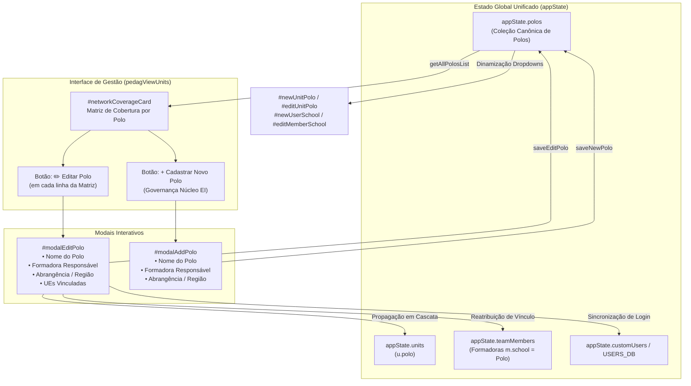

# PLANO DE IMPLEMENTAÇÃO: EDIÇÃO E GESTÃO AUTÔNOMA DE POLOS REGIONAIS SOB A SSOT ÚNICA

> **DIRETRIZ DE EXECUÇÃO OBRIGATÓRIA (FASE 2 - O OPERÁRIO):**  
> Antes de aplicar qualquer alteração em código de produção, o executor **DEVE OBRIGATORIAMENTE** ler integralmente o [WORKFLOW_MACOS.md](file:///Users/bruno/Desktop/gestor%20supervisao_patos/WORKFLOW_MACOS.md) e a skill `.agents/skills/execucao-operario/SKILL.md`.  
> É terminantemente proibido abrir o Google Chrome interativo (`open -a "Google Chrome"` ou `/browser`).  
> A árvore de trabalho do Git deve permanecer 100% limpa durante o planejamento. A execução mecânica só deve iniciar após autorização expressa do usuário.

---

## 1. Diagnóstico e Contexto

### 1.1 O Problema Identificado
Na plataforma **SerTão Criança**, a organização territorial da Educação Infantil municipal é estruturada em **Polos Regionais** (ex.: *Polo Regional 1 (Norte)*, *Polo Regional 2 (Sul)*, etc.), os quais agrupam Unidades Escolares (UEs), vinculam Formadoras Pedagógicas e coordenam a distribuição de Coordenadoras e Docentes.

Entretanto, **não existe qualquer mecanismo na plataforma que permita editar os Polos cadastrados**:
1. **Ausência de Ações na Matriz de Cobertura:** Na aba *Gestão Pedagógica ➔ 🏢 Unidades Escolares & Polos*, o card `🗺️ Matriz de Distribuição e Cobertura da Rede por Polo Regional` (`#networkCoverageCard`) lista os polos com dados de Formadora, UEs vinculadas, CPs e Docentes, porém sua tabela (`#networkCoverageTableBody`) **não possui coluna nem botões de Ações**.
2. **Inexistência de Modais de Edição/Cadastro de Polos:** Não há modal para editar o nome do polo, alterar ou vincular a formadora responsável, nem para ajustar as unidades escolares alocadas a cada polo.
3. **Falta de Entidade Canônica na SSOT (`appState.polos`):** Os polos são tratados apenas como strings dispersas na propriedade `u.polo` das escolas (`appState.units`) ou como valor de `m.school` para formadoras (`appState.teamMembers`), com seletores HTML (`<select id="newUnitPolo">`) fixados com opções hardcoded no HTML estático.
4. **Desconexão Relacional:** Caso uma unidade precise ser transferida territorialmente ou um polo seja renomeado (ex.: por expansão da rede municipal), o usuário é forçado a editar escola por escola manualmente, e a Formadora vinculada ao polo antigo fica órfã ou desatualizada.

### 1.2 Objetivo da Intervenção
Implementar o ciclo completo de **Edição e Gestão Autônoma de Polos Regionais** sob a SSOT única (`appState.polos`), viabilizando:
- **Botão e Modal de Edição de Polo (`#modalEditPolo`):** Permite alterar o nome do polo, atribuir/reatribuir a Formadora Pedagógica responsável e visualizar/remanejar as Unidades Escolares vinculadas diretamente pela matriz.
- **Botão e Modal de Novo Polo (`#modalAddPolo`):** Permite cadastrar novos polos territoriais para expansão da rede pela Coordenadora do Núcleo de EI.
- **Propagação Relacional Automática:** Ao alterar o nome de um polo ou sua formadora, o sistema propaga instantaneamente a mudança para `appState.units`, `appState.teamMembers` (formadoras e coordenadoras vinculadas) e base de autenticação (`USERS_DB` / `appState.customUsers`).
- **Dinamização Universal de Dropdowns:** Substituição de opções hardcoded nos modais de UEs e Usuários pela função SSOT `getAllPolosList()`.

---

## 2. Arquitetura e Pontos de Impacto



### Pontos de Impacto no Código:
1. **Estado Inicial e Migração (`INITIAL_POLOS`, `appState.polos`, `loadState`):**
   - Criação da constante `INITIAL_POLOS` e adição de `polos` ao `appState`.
   - Inicialização resiliente em `loadState()`: se `appState.polos` não existir no `localStorage`, extrair polos existentes em `appState.units` e mesclar com `INITIAL_POLOS`.
2. **Motor Auxiliar SSOT (`getAllPolosList()`):**
   - Função unificada para retornar a lista ordenada e única de nomes de polos cadastrados.
3. **Markup HTML da Matriz de Cobertura (`#networkCoverageCard`):**
   - Inclusão do botão `+ Cadastrar Novo Polo` (`#btnAddPoloMain`) no cabeçalho do card.
   - Inclusão do cabeçalho `<th>Ações</th>` na tabela `#networkCoverageTableBody`.
4. **Renderização Dinâmica (`renderUnitsScreen`):**
   - Renderização da coluna de ações com o botão `✏️ Editar Polo` (`openEditPoloModal(poloName)`).
   - Botão opcional de excluir polo se não houver UEs vinculadas a ele.
   - Atualização dinâmica de `#unitsFilterPolo`.
5. **Modais Dedicados:**
   - `#modalEditPolo`: Edição de nome, formadora responsável, região territorial e remanejamento rápido de UEs.
   - `#modalAddPolo`: Cadastro simplificado de novos polos territoriais.
6. **Funções Controladoras:**
   - `openEditPoloModal(poloName)`
   - `closeEditPoloModal()`
   - `saveEditPolo()` (com validação, verificação de duplicidade e propagação relacional)
   - `openAddPoloModal()`
   - `closeAddPoloModal()`
   - `saveNewPolo()`
   - `removePolo(poloName)` (com trava contra exclusão de polos com escolas vinculadas)
7. **Dinamização de Seletores de Polos:**
   - `openAddUnitModal`: popular `#newUnitPolo` via `getAllPolosList()`.
   - `openEditUnitModal`: popular `#editUnitPolo` via `getAllPolosList()`.
   - `onNewUserRoleChange` / `onNewMemberRoleChange` / `onEditMemberRoleChange`: carregar polos dinamicamente para o cargo de formador.
8. **Exportação e Importação SSOT:**
   - `exportFullBaseJSON()`: incluir `appState.polos`.
   - `importFullBaseJSON()`: restaurar `data.polos`.
9. **Changelog Duplo:**
   - Registro da Versão 1.25 no `CHANGELOG.md` e no `#modalChangelog` do `index.html`.
10. **Espelhamento:**
    - Cópia fiel de `gestor supervisao_patos/index.html` para `gestor supervisao_patos/firebase_deploy/public/index.html`.

---

## 3. Especificação de Implementação Passo a Passo (Snippets Exatos)

### Passo 1: Definição Canônica de `INITIAL_POLOS` e `appState.polos`

Localizar a linha ~8524 (próximo a `INITIAL_UNITS`) em `index.html` e adicionar:

```javascript
    // Initial Polos Regionais (SSOT Territorial)
    const INITIAL_POLOS = [
      { id: 'polo-1', name: 'Polo Regional 1 (Norte)', region: 'Região Norte / Bairros Urbanos' },
      { id: 'polo-2', name: 'Polo Regional 2 (Sul)', region: 'Região Sul / Zona Rural' },
      { id: 'polo-3', name: 'Polo Regional 3 (Leste)', region: 'Região Leste' },
      { id: 'polo-4', name: 'Sede Central', region: 'Sede Central da Educação Infantil' }
    ];
```

No objeto `appState` (linha ~8687):
```javascript
    let appState = {
      currentUserKey: 'mariana',
      activeSectionsTeacher: JSON.parse(JSON.stringify(DEFAULT_SECTIONS_TEACHER)), activeSectionsCoordinator: JSON.parse(JSON.stringify(DEFAULT_SECTIONS_COORDINATOR)),
      polos: JSON.parse(JSON.stringify(INITIAL_POLOS)), // <-- SSOT POLOS REGIONAIS
      units: JSON.parse(JSON.stringify(INITIAL_UNITS)),
      classes: JSON.parse(JSON.stringify(INITIAL_CLASSES)),
      ...
```

Em `loadState()` (linha ~8713):
```javascript
          if (!appState.units || appState.units.length === 0) appState.units = JSON.parse(JSON.stringify(INITIAL_UNITS));
          if (!appState.polos || !Array.isArray(appState.polos) || appState.polos.length === 0) {
            const existingPolosNames = Array.from(new Set((appState.units || []).map(u => u.polo).filter(Boolean)));
            if (existingPolosNames.length > 0) {
              appState.polos = existingPolosNames.map((pName, idx) => ({
                id: 'polo-' + (idx + 1),
                name: pName,
                region: ''
              }));
            } else {
              appState.polos = JSON.parse(JSON.stringify(INITIAL_POLOS));
            }
          }
```

E em `seedSampleData()` (linha ~9019):
```javascript
      appState.polos = JSON.parse(JSON.stringify(INITIAL_POLOS));
      appState.units = JSON.parse(JSON.stringify(INITIAL_UNITS));
```

### Passo 2: Função Auxiliar SSOT `getAllPolosList()`

Inserir logo após as definições de estado global:
```javascript
    function getAllPolosList() {
      if (Array.isArray(appState.polos) && appState.polos.length > 0) {
        const list = appState.polos.map(p => (typeof p === 'string' ? p : p.name)).filter(Boolean);
        // Garante inclusão de qualquer polo registrado em unidades existentes
        (appState.units || []).forEach(u => {
          if (u.polo && !list.includes(u.polo)) list.push(u.polo);
        });
        return Array.from(new Set(list));
      }
      const fromUnits = Array.from(new Set((appState.units || []).map(u => u.polo).filter(Boolean)));
      return fromUnits.length > 0 ? fromUnits : ['Polo Regional 1 (Norte)', 'Polo Regional 2 (Sul)'];
    }
```

### Passo 3: Atualização do Card da Matriz de Cobertura no HTML (`#networkCoverageCard`)

Localizar o bloco da Matriz de Cobertura (~linha 3462 de `index.html`):
```html
          <!-- Matriz de Cobertura por Polo Regional (Requisito 7) -->
          <div class="card" id="networkCoverageCard" style="margin-bottom:20px; border-left:4px solid var(--primary);">
            <div style="display:flex; justify-content:space-between; align-items:center; margin-bottom:6px; flex-wrap:wrap; gap:10px;">
              <div style="font-size:15px; font-weight:800; color:var(--primary-dark);">
                🗺️ Matriz de Distribuição e Cobertura da Rede por Polo Regional
              </div>
              <button class="btn btn-secondary" id="btnAddPoloMain" onclick="openAddPoloModal()" style="font-size:12px; padding:6px 12px; font-weight:700;">
                + Cadastrar Novo Polo
              </button>
            </div>
            <p style="font-size:12px; color:var(--text-secondary); margin-bottom:14px;">
              Mapeamento consolidado das Coordenadoras Pedagógicas e Unidades Escolares alocadas em cada Polo da Rede Municipal.
            </p>
            <div style="overflow-x:auto;">
              <table class="data-table">
                <thead>
                  <tr>
                    <th>Polo Regional</th>
                    <th>Formadora Responsável</th>
                    <th>Unidades Escolares Vinculadas</th>
                    <th>Coordenadoras Pedagógicas Atuantes</th>
                    <th>Docentes Atendidos</th>
                    <th>Status de Cobertura</th>
                    <th style="width:130px; text-align:center;">Ações</th>
                  </tr>
                </thead>
                <tbody id="networkCoverageTableBody">
                  <!-- Dynamically populated -->
                </tbody>
              </table>
            </div>
          </div>
```

### Passo 4: Atualização da Lógica de Renderização em `renderUnitsScreen()`

Modificar a renderização da Matriz de Cobertura em `renderUnitsScreen` (~linha 15890):
```javascript
      // 1. Matriz de Cobertura da Rede por Polo Regional (Requisito 7)
      const covTbody = document.getElementById('networkCoverageTableBody');
      const addPoloBtn = document.getElementById('btnAddPoloMain');
      if (addPoloBtn) {
        addPoloBtn.style.display = isNucleoEI(user) ? 'inline-flex' : 'none';
      }

      if (covTbody) {
        covTbody.innerHTML = '';
        
        let polos = getAllPolosList();

        if (user.roleKey === 'formador') {
          polos = polos.filter(p => p === user.school || p.toLowerCase().includes(user.school.toLowerCase()));
        }

        polos.forEach(poloName => {
          const unitsInPolo = appState.units.filter(u => u.polo === poloName);
          const unitNames = unitsInPolo.map(u => u.name);
          
          const formadora = appState.teamMembers.find(m => m.roleKey === 'formador' && m.school === poloName);
          const formadoraName = formadora ? formadora.name : '<span style="color:var(--text-secondary); font-style:italic;">A definir / Secretaria</span>';

          const cpsInPolo = appState.teamMembers.filter(m => m.roleKey === 'coordenador' && unitNames.includes(m.school));
          const cpNames = cpsInPolo.length > 0 ? cpsInPolo.map(c => `<strong>${c.name}</strong> (${c.school})`).join('<br>') : '<span style="color:var(--text-secondary); font-style:italic;">Nenhuma CP alocada</span>';

          const teachersCount = appState.teamMembers.filter(m => m.roleKey === 'professora' && unitNames.includes(m.school)).length;

          const canEditPolo = isNucleoEI(user) || (user.roleKey === 'formador' && user.school === poloName);
          const canDeletePolo = isNucleoEI(user) && unitsInPolo.length === 0;

          const tr = document.createElement('tr');
          tr.innerHTML = `
            <td><strong style="color:var(--primary);">${poloName}</strong></td>
            <td><span style="font-weight:700; color:#1E293B;">${formadoraName}</span></td>
            <td>
              ${unitsInPolo.map(u => `<div>🏢 ${u.name}</div>`).join('') || '<span style="color:var(--text-secondary); font-style:italic;">Nenhuma UE alocada</span>'}
            </td>
            <td style="font-size:12px; line-height:1.4;">${cpNames}</td>
            <td><span class="status-badge" style="background:#EFF6FF; color:#1E40AF; font-weight:700;">${teachersCount} Docentes</span></td>
            <td><span class="status-badge" style="background:#DCFCE7; color:#166534; font-weight:700;">Ativo</span></td>
            <td style="text-align:center; white-space:nowrap;">
              ${canEditPolo ? `<button class="btn btn-secondary" style="padding:4px 8px; font-size:11px; margin-right:4px;" onclick="openEditPoloModal('${encodeURIComponent(poloName)}')">✏️ Editar</button>` : '<span style="color:var(--text-secondary); font-size:11px;">Somente Leitura</span>'}
              ${canDeletePolo ? `<button class="btn btn-secondary" style="padding:4px 8px; font-size:11px; color:var(--red);" onclick="removePolo('${encodeURIComponent(poloName)}')">Excluir</button>` : ''}
            </td>
          `;
          covTbody.appendChild(tr);
        });
      }

      // 2. Popular Dropdown de Filtro por Polo (Requisito 3)
      const filterPoloSelect = document.getElementById('unitsFilterPolo');
      if (filterPoloSelect) {
        const curVal = filterPoloSelect.value;
        filterPoloSelect.innerHTML = '<option value="ALL">Todos os Polos Regionais</option>';
        let uniquePolos = getAllPolosList();
        if (user.roleKey === 'formador') {
          uniquePolos = uniquePolos.filter(p => p === user.school);
        }
        uniquePolos.forEach(p => {
          const opt = document.createElement('option');
          opt.value = p;
          opt.text = p;
          if (p === curVal) opt.selected = true;
          filterPoloSelect.appendChild(opt);
        });
      }
```

### Passo 5: Modais `#modalEditPolo` e `#modalAddPolo` no HTML

Inserir logo antes de `<!-- ================= MODAL: ADICIONAR NOVA UE (MANUAL) ================= -->` (~linha 7450):

```html
  <!-- ================= MODAL: EDITAR POLO REGIONAL ================= -->
  <div id="modalEditPolo" class="modal-backdrop" onclick="closeEditPoloModal()">
    <div class="modal-panel" onclick="event.stopPropagation()" style="max-width:550px;">
      <div style="display:flex; justify-content:space-between; align-items:center; margin-bottom:14px;">
        <div style="font-size:17px; font-weight:800; color:var(--primary-dark);" id="modalEditPoloTitle">Editar Polo Regional</div>
        <button class="btn btn-secondary" style="padding:6px 10px;" onclick="closeEditPoloModal()">✕</button>
      </div>

      <input type="hidden" id="editPoloOriginalName">

      <div class="form-group">
        <label class="form-label">Nome do Polo Regional</label>
        <input type="text" id="editPoloName" class="form-input" placeholder="Ex: Polo Regional 1 (Norte)">
      </div>

      <div class="form-group">
        <label class="form-label">Formadora Pedagógica Responsável</label>
        <select id="editPoloFormadora" class="form-select">
          <!-- Populado dinamicamente -->
        </select>
      </div>

      <div class="form-group">
        <label class="form-label">Região Territorial / Abrangência <span style="font-size:11px; font-weight:normal; color:var(--text-secondary);">(Opcional)</span></label>
        <input type="text" id="editPoloRegion" class="form-input" placeholder="Ex: Zona Norte e Bairros Adjacentes">
      </div>

      <div class="form-group">
        <label class="form-label">Unidades Escolares Vinculadas</label>
        <div style="font-size:11px; color:var(--text-secondary); margin-bottom:6px;">
          Selecione as escolas que integram este Polo Regional:
        </div>
        <div id="editPoloUnitsList" style="max-height:160px; overflow-y:auto; border:1px solid var(--border); border-radius:6px; padding:10px; background:var(--bg-light);">
          <!-- Populado dinamicamente com checkboxes -->
        </div>
      </div>

      <div style="display:flex; gap:10px; justify-content:flex-end; margin-top:16px;">
        <button class="btn btn-secondary" onclick="closeEditPoloModal()">Cancelar</button>
        <button class="btn btn-primary" onclick="saveEditPolo()">Salvar Alterações</button>
      </div>
    </div>
  </div>

  <!-- ================= MODAL: CADASTRAR NOVO POLO REGIONAL ================= -->
  <div id="modalAddPolo" class="modal-backdrop" onclick="closeAddPoloModal()">
    <div class="modal-panel" onclick="event.stopPropagation()" style="max-width:500px;">
      <div style="display:flex; justify-content:space-between; align-items:center; margin-bottom:14px;">
        <div style="font-size:17px; font-weight:800; color:var(--primary-dark);">Cadastrar Novo Polo Regional</div>
        <button class="btn btn-secondary" style="padding:6px 10px;" onclick="closeAddPoloModal()">✕</button>
      </div>

      <div class="form-group">
        <label class="form-label">Nome do Polo Regional</label>
        <input type="text" id="newPoloName" class="form-input" placeholder="Ex: Polo Regional 4 (Oeste)">
      </div>

      <div class="form-group">
        <label class="form-label">Formadora Pedagógica Responsável</label>
        <select id="newPoloFormadora" class="form-select">
          <!-- Populado dinamicamente -->
        </select>
      </div>

      <div class="form-group">
        <label class="form-label">Região Territorial / Abrangência <span style="font-size:11px; font-weight:normal; color:var(--text-secondary);">(Opcional)</span></label>
        <input type="text" id="newPoloRegion" class="form-input" placeholder="Ex: Zona Oeste e Área Rural">
      </div>

      <div style="display:flex; gap:10px; justify-content:flex-end; margin-top:16px;">
        <button class="btn btn-secondary" onclick="closeAddPoloModal()">Cancelar</button>
        <button class="btn btn-primary" onclick="saveNewPolo()">Cadastrar Polo</button>
      </div>
    </div>
  </div>
```

### Passo 6: Controladores JavaScript de Edição, Cadastro e Remoção de Polo

Implementar as funções no bloco script (~linha 16025):

```javascript
    // --- GESTÃO E EDIÇÃO DE POLOS REGIONAIS (SSOT) ---
    function openEditPoloModal(encodedPoloName) {
      const poloName = decodeURIComponent(encodedPoloName);
      const poloObj = (appState.polos || []).find(p => (typeof p === 'object' ? p.name : p) === poloName) || { name: poloName, region: '' };

      document.getElementById('editPoloOriginalName').value = poloName;
      document.getElementById('editPoloName').value = poloName;
      document.getElementById('editPoloRegion').value = poloObj.region || '';
      document.getElementById('modalEditPoloTitle').innerText = `Editar ${poloName}`;

      // Formadora responsável atual
      const formadoraSelect = document.getElementById('editPoloFormadora');
      formadoraSelect.innerHTML = '<option value="">Nenhuma formadora vinculada / A definir</option>';
      const currentFormadora = (appState.teamMembers || []).find(m => m.roleKey === 'formador' && m.school === poloName);

      const allFormadoras = (appState.teamMembers || []).filter(m => m.roleKey === 'formador');
      allFormadoras.forEach(f => {
        const opt = document.createElement('option');
        opt.value = f.name;
        opt.text = `${f.name} (${f.school || 'Sem Polo'})`;
        if (currentFormadora && currentFormadora.name === f.name) opt.selected = true;
        formadoraSelect.appendChild(opt);
      });

      // Lista de UEs vinculadas com checkboxes
      const unitsListContainer = document.getElementById('editPoloUnitsList');
      unitsListContainer.innerHTML = '';
      (appState.units || []).forEach(u => {
        const isBelonging = u.polo === poloName;
        const row = document.createElement('div');
        row.style.cssText = 'display:flex; align-items:center; gap:8px; margin-bottom:6px; font-size:12px;';
        row.innerHTML = `
          <input type="checkbox" id="chkPoloUnit_${u.id}" class="edit-polo-unit-chk" value="${u.id}" ${isBelonging ? 'checked' : ''} style="cursor:pointer;">
          <label for="chkPoloUnit_${u.id}" style="cursor:pointer; color:var(--text-primary); margin:0;">
            🏢 <strong>${u.name}</strong> ${!isBelonging && u.polo ? `<span style="color:var(--text-secondary); font-size:11px;">(${u.polo})</span>` : ''}
          </label>
        `;
        unitsListContainer.appendChild(row);
      });

      document.getElementById('modalEditPolo').classList.add('active');
    }

    function closeEditPoloModal() {
      document.getElementById('modalEditPolo').classList.remove('active');
    }

    function saveEditPolo() {
      const oldName = document.getElementById('editPoloOriginalName').value.trim();
      const newName = document.getElementById('editPoloName').value.trim();
      const selectedFormadoraName = document.getElementById('editPoloFormadora').value;
      const region = document.getElementById('editPoloRegion').value.trim();

      if (!newName) {
        showToast('Informe o nome do Polo Regional.');
        return;
      }

      const allPolos = getAllPolosList();
      if (newName !== oldName && allPolos.includes(newName)) {
        showToast('Já existe um Polo cadastrado com este nome.');
        return;
      }

      if (!confirm(`Deseja salvar as alterações no Polo Regional "${newName}"?`)) {
        return;
      }

      // 1. Atualiza na coleção de polos
      if (!Array.isArray(appState.polos)) appState.polos = [];
      const poloIndex = appState.polos.findIndex(p => (typeof p === 'object' ? p.name : p) === oldName);
      if (poloIndex !== -1) {
        appState.polos[poloIndex] = {
          id: appState.polos[poloIndex].id || ('polo-' + Date.now()),
          name: newName,
          region: region
        };
      } else {
        appState.polos.push({ id: 'polo-' + Date.now(), name: newName, region: region });
      }

      // 2. Propagação de renomeação em unidades existentes
      if (oldName !== newName) {
        (appState.units || []).forEach(u => {
          if (u.polo === oldName) u.polo = newName;
        });
      }

      // 3. Atualização das UEs selecionadas no checklist
      const chks = document.querySelectorAll('.edit-polo-unit-chk');
      chks.forEach(chk => {
        const u = (appState.units || []).find(unit => unit.id === chk.value);
        if (u) {
          if (chk.checked) {
            u.polo = newName;
          } else if (u.polo === newName || u.polo === oldName) {
            u.polo = 'Sede Central'; // Destino padrão seguro se desmarcada
          }
        }
      });

      // 4. Propagação da Formadora Responsável e Supervisão de Coordenadoras
      const currentPoloUnits = (appState.units || []).filter(u => u.polo === newName).map(u => u.name);

      if (selectedFormadoraName) {
        (appState.teamMembers || []).forEach(m => {
          // Se for a formadora escolhida, atualiza sua escola/polo
          if (m.roleKey === 'formador' && m.name === selectedFormadoraName) {
            m.school = newName;
            if (appState.customUsers && appState.customUsers[m.id]) appState.customUsers[m.id].school = newName;
            if (typeof USERS_DB !== 'undefined' && USERS_DB[m.id]) USERS_DB[m.id].school = newName;
          }
          // Coordenadoras das unidades do polo passam a ter esta formadora como supervisora
          if (m.roleKey === 'coordenador' && currentPoloUnits.includes(m.school)) {
            m.supervisor = selectedFormadoraName;
          }
        });
      }

      // Se renomeou o polo, atualiza a formadora que estava vinculada a ele anteriormente
      if (oldName !== newName) {
        (appState.teamMembers || []).forEach(m => {
          if (m.roleKey === 'formador' && m.school === oldName) {
            m.school = newName;
            if (appState.customUsers && appState.customUsers[m.id]) appState.customUsers[m.id].school = newName;
            if (typeof USERS_DB !== 'undefined' && USERS_DB[m.id]) USERS_DB[m.id].school = newName;
          }
        });
        const curr = getCurrentUser();
        if (curr && curr.school === oldName) curr.school = newName;
      }

      saveState();
      closeEditPoloModal();
      renderUnitsScreen();
      showToast(`Polo Regional "${newName}" atualizado com sucesso!`);
    }

    function openAddPoloModal() {
      document.getElementById('newPoloName').value = '';
      document.getElementById('newPoloRegion').value = '';
      const formadoraSelect = document.getElementById('newPoloFormadora');
      formadoraSelect.innerHTML = '<option value="">Nenhuma formadora vinculada / A definir</option>';
      const allFormadoras = (appState.teamMembers || []).filter(m => m.roleKey === 'formador');
      allFormadoras.forEach(f => {
        const opt = document.createElement('option');
        opt.value = f.name;
        opt.text = `${f.name} (${f.school || 'Sem Polo'})`;
        formadoraSelect.appendChild(opt);
      });
      document.getElementById('modalAddPolo').classList.add('active');
    }

    function closeAddPoloModal() {
      document.getElementById('modalAddPolo').classList.remove('active');
    }

    function saveNewPolo() {
      const name = document.getElementById('newPoloName').value.trim();
      const region = document.getElementById('newPoloRegion').value.trim();
      const formadoraName = document.getElementById('newPoloFormadora').value;

      if (!name) {
        showToast('Informe o nome do Polo Regional.');
        return;
      }

      const allPolos = getAllPolosList();
      if (allPolos.includes(name)) {
        showToast('Já existe um Polo cadastrado com este nome.');
        return;
      }

      if (!confirm(`Deseja cadastrar o novo Polo Regional "${name}"?`)) {
        return;
      }

      if (!Array.isArray(appState.polos)) appState.polos = [];
      appState.polos.push({
        id: 'polo-' + Date.now(),
        name: name,
        region: region
      });

      if (formadoraName) {
        const fMember = (appState.teamMembers || []).find(m => m.roleKey === 'formador' && m.name === formadoraName);
        if (fMember) {
          fMember.school = name;
          if (appState.customUsers && appState.customUsers[fMember.id]) appState.customUsers[fMember.id].school = name;
          if (typeof USERS_DB !== 'undefined' && USERS_DB[fMember.id]) USERS_DB[fMember.id].school = name;
        }
      }

      saveState();
      closeAddPoloModal();
      renderUnitsScreen();
      showToast(`Polo Regional "${name}" cadastrado com sucesso!`);
    }

    function removePolo(encodedPoloName) {
      const poloName = decodeURIComponent(encodedPoloName);
      const unitsInPolo = (appState.units || []).filter(u => u.polo === poloName);
      if (unitsInPolo.length > 0) {
        alert(`Não é possível excluir o "${poloName}" pois existem ${unitsInPolo.length} Unidade(s) Escolar(es) vinculada(s) a ele. Reatribua as escolas antes de excluir.`);
        return;
      }

      if (!confirm(`Tem certeza que deseja remover o Polo Regional "${poloName}"?`)) {
        return;
      }

      appState.polos = (appState.polos || []).filter(p => (typeof p === 'object' ? p.name : p) !== poloName);
      // Desvincula formadoras que tinham este polo
      (appState.teamMembers || []).forEach(m => {
        if (m.roleKey === 'formador' && m.school === poloName) {
          m.school = 'A definir / Secretaria';
        }
      });

      saveState();
      renderUnitsScreen();
      showToast(`Polo Regional "${poloName}" removido com sucesso.`);
    }
```

### Passo 7: Dinamização dos Modais de Cadastro e Edição de Unidades Escolares

Ajustar `openAddUnitModal` e `openEditUnitModal` para popular as opções de polos exclusivamente via `getAllPolosList()`:

```javascript
    function openAddUnitModal() {
      document.getElementById('newUnitName').value = '';
      document.getElementById('newUnitAddress').value = '';
      const poloSelect = document.getElementById('newUnitPolo');
      if (poloSelect) {
        poloSelect.innerHTML = '';
        getAllPolosList().forEach(p => {
          const opt = document.createElement('option');
          opt.value = p;
          opt.text = p;
          poloSelect.appendChild(opt);
        });
      }
      document.getElementById('modalAddUnit').classList.add('active');
    }
```

E em `openEditUnitModal`:
```javascript
      const poloSelect = document.getElementById('editUnitPolo');
      if (poloSelect) {
        poloSelect.innerHTML = '';
        getAllPolosList().forEach(p => {
          const opt = document.createElement('option');
          opt.value = p;
          opt.text = p;
          if (p === unit.polo) opt.selected = true;
          poloSelect.appendChild(opt);
        });
      }
```

### Passo 8: Integração com Exportação e Importação de Base SSOT

Em `exportFullBaseJSON` (~linha 22385):
`appState.polos` já faz parte do clone de `appState` e será exportado naturalmente no JSON.

Em `importFullBaseJSON` (~linha 22446):
Adicionar restauração de `polos`:
```javascript
          if (data && typeof data === 'object') {
            if (Array.isArray(data.polos)) {
              appState.polos = data.polos;
            }
            ...
```

---

## 4. Critérios de Aceite e Roteiro de Teste

1. **Visibilidade da Coluna de Ações:**
   - Ao acessar a sub-aba *🏢 Unidades Escolares & Polos*, a Matriz de Cobertura por Polo Regional (`#networkCoverageCard`) deve exibir a coluna **Ações** com botões `✏️ Editar`.
2. **Edição do Nome do Polo:**
   - Clicar em `✏️ Editar` no *Polo Regional 2 (Sul)*.
   - Renomear para *Polo Regional 2 (Sul - Zona Rural)*.
   - Confirmar o salvamento.
   - A Matriz e todas as escolas vinculadas (`CEI Vovó Zezé`) devem refletir a nova nomenclatura sem quebra de integridade.
3. **Reatribuição de Formadora no Polo:**
   - No modal de edição, selecionar uma formadora para o polo.
   - Ao salvar, verificar se a propriedade `m.school` da formadora foi atualizada e se as Coordenadoras Pedagógicas das escolas daquele polo tiveram seu supervisor atualizado para a formadora.
4. **Remanejamento de Unidades Escolares:**
   - Marcar uma escola no checklist do modal de edição de um polo.
   - Ao salvar, verificar que o `u.polo` da escola foi imediatamente migrado para o polo editado.
5. **Cadastro de Novo Polo:**
   - Com o perfil de Helena Martins (Núcleo de EI), clicar em `+ Cadastrar Novo Polo`.
   - Criar o *Polo Regional 4 (Oeste)*.
   - O novo polo deve constar imediatamente na matriz e nos seletores de unidades e novos membros.
6. **Validação de Sintaxe Pré-Voo JSC:**
   - `python3 audit_platform.py --check-syntax` deve retornar 100% de sucesso sem erros de sintaxe JS.
7. **Execução Silenciosa Pós-Deploy:**
   - `python3 audit_platform.py --silent-on-success` deve executar os 12 módulos canônicos sem falhas.

---

## 5. Seção Obrigatória de Auditoria (`audit_platform.py` e `index.html`)

### 5.1 Alterações no Módulo de Testes do `index.html` (`catalogo_dados`)
No teste determinístico ponta a ponta (`MÓDULO 2: catalogo_dados`), adicionar validação interativa do ciclo de vida dos polos:
```javascript
              // 7. CICLO COMPLETO DE GESTÃO E EDIÇÃO DE POLOS REGIONAIS (SSOT)
              const initialPolos = getAllPolosList();
              if (!Array.isArray(initialPolos) || initialPolos.length === 0) {
                throw new Error('getAllPolosList retornou lista vazia de polos');
              }
              logger.log('SSOT de Polos Regionais inicializada e consultável', true, `${initialPolos.length} polos mapeados`);

              // Teste de Edição Interativa de Polo (#modalEditPolo)
              const targetPolo = 'Polo Regional 1 (Norte)';
              openEditPoloModal(encodeURIComponent(targetPolo));
              const editPoloModal = document.getElementById('modalEditPolo');
              if (!editPoloModal.classList.contains('active')) {
                throw new Error('Modal #modalEditPolo não abriu corretamente');
              }
              const editPoloInp = document.getElementById('editPoloName');
              const editFormadoraSel = document.getElementById('editPoloFormadora');
              if (!editPoloInp || editPoloInp.value !== targetPolo) {
                throw new Error(`Campo #editPoloName não reteve o nome original do polo: esperado "${targetPolo}", obtido "${editPoloInp?.value}"`);
              }

              const tempEditedPoloName = 'Polo Regional 1 (Norte - Teste Auditoria)';
              UI.type(editPoloInp, tempEditedPoloName);

              const originalConfirm = window.confirm;
              window.confirm = () => true;
              saveEditPolo();
              window.confirm = originalConfirm;

              if (!getAllPolosList().includes(tempEditedPoloName)) {
                throw new Error('Novo nome do polo não foi persistido em appState.polos');
              }
              const updatedUnits = (appState.units || []).filter(u => u.polo === tempEditedPoloName);
              if (updatedUnits.length === 0) {
                throw new Error('Propagação em cascata da renomeação do polo falhou para appState.units');
              }
              logger.log('Ciclo completo de edição de Polo (#modalEditPolo) e propagação em cascata nas UEs', true, `${targetPolo} ➔ ${tempEditedPoloName}`);

              // Restauração idempotente do nome original
              openEditPoloModal(encodeURIComponent(tempEditedPoloName));
              UI.type(document.getElementById('editPoloName'), targetPolo);
              window.confirm = () => true;
              saveEditPolo();
              window.confirm = originalConfirm;
              logger.log('Restauração idempotente do Polo canônico concluída com sucesso', true, targetPolo);
```

### 5.2 Validação Pré e Pós-Deploy via `audit_platform.py`
- Executar validação sintática nativa:
  ```bash
  python3 audit_platform.py --check-syntax
  ```
- Após o commit e deploy no branch `main`, executar o teste headless silencioso:
  ```bash
  python3 audit_platform.py --silent-on-success
  ```
- Nenhuma alteração é necessária na estrutura do runner `audit_platform.py`, pois a suíte de testes modular em `index.html` cobre a funcionalidade de forma nativa e integrada via Chrome Headless.

---

## 6. Checklist de Execução (Etapa 2 - O Operário)

- [ ] Sincronizar repositório: `git pull origin main`
- [ ] Criar backup em `intermediárias/aplicativo_v125_edicao_e_gestao_autonoma_polos_regionais_ssot.html`
- [ ] Aplicar modificações em `gestor supervisao_patos/index.html`
- [ ] Espelhar alterações em `gestor supervisao_patos/firebase_deploy/public/index.html`
- [ ] Atualizar `CHANGELOG.md` e o modal de changelog de `index.html` para a Versão 1.25
- [ ] Validar sintaxe JS pré-voo: `python3 audit_platform.py --check-syntax`
- [ ] Checagem pré-push: `git fetch origin main` e verificar concorrência
- [ ] Commit semântico: `feat: edicao e gestao autonoma de polos regionais sob a ssot unica (v1.25)`
- [ ] Push para o GitHub: `git push origin main`
- [ ] Executar auditoria headless: `python3 audit_platform.py --silent-on-success`
- [ ] Reportar conclusão de forma sucinta ao usuário.
