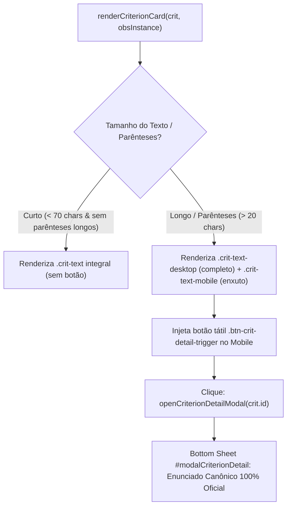

# PLANO DE IMPLEMENTAÇÃO: ENXUGAMENTO VISUAL MOBILE DE TEXTOS LONGOS E SOBERANIA DA MATRIZ CURRICULAR

> **DIRETRIZ DE EXECUÇÃO OBRIGATÓRIA (WORKFLOW ETAPA 1 - ARQUITETO):**  
> Este documento rege o planejamento arquitetural da funcionalidade de ergonomia mobile nos critérios de observação, conforme estipulado em [`WORKFLOW_MACOS.md`](file:///Users/bruno/Desktop/gestor%20supervisao_patos/WORKFLOW_MACOS.md) e [`AGENTS.md`](file:///Users/bruno/Desktop/gestor%20supervisao_patos/AGENTS.md).  
> **Regra Pétrea:** O assistente não deve, sob nenhuma hipótese, inventar ou simular lógicas pedagógicas, réguas de gradação ou rubricas que não constem na matriz normativa oficial de Patos.

---

## 1. Diagnóstico, Contexto e Função dos Botões de Observação

### 1.1 Qual a real função dos botões de observação?
No instrumento de observação pedagógica de chão de sala, cada critério precisa ser avaliado com rapidez e precisão pelo supervisor/coordenador.
- **No Desktop:** Há espaço horizontal amplo (telas > 768px), permitindo que critérios com textos descritivos longos sejam lidos com conforto sem poluir o layout.
- **No Celular (Mobile):** A largura útil de visualização é reduzida (geralmente entre 360px e 428px). Diversos critérios oficiais contêm enunciados longos (com mais de 150 a 260 caracteres), repletos de parênteses explicativos, listas de exemplos de materiais e orientações regulatórias (como os itens `1.3.1`, `1.3.3`, `2.1.6`, `2.3.3`, `2.3.4`).
- **Problema de UX:** Se todo o parágrafo for exibido integralmente no card do celular, o card se torna gigantesco, exigindo rolagem excessiva e dificultando o acompanhamento dinâmico da rotina das crianças.
- **A Função Precisa do Botão no Mobile:**  
  A função do botão é **substituir visualmente o bloco de texto longo na visão mobile**, condensando o enunciado no card e fornecendo um atalho tátil discreto (ex: `ℹ️ Detalhes` ou `(ver mais)`). Ao ser acionado, o botão exibe o **enunciado canônico integral e oficial** em uma gaveta inferior limpa (*bottom sheet*), mantendo a interface móvel **clean, legível e ágil**.

### 1.2 O que NÃO deve ser feito (Lições Aprendidas)
- **Não inventar rubricas artificiais:** Não criar banco de dados com orientações fictícias de "O que observar", "Evidências concretas" ou réguas de gradação inventadas por IA.
- **Não poluir critérios curtos:** Critérios que já são sucintos (como `1.1.1` - *"Realiza leitura ou contação de histórias"*) **NÃO** devem possuir botões adicionais, pois seu texto já é 100% legível diretamente no card.

---

## 2. Regras de Negócio e Heurística de Enxugamento Mobile

### 2.1 Heurística Determinística de Detecção de Textos Longos
Um critério será classificado para enxugamento mobile se atender a qualquer uma das condições:
1. **Presença de parênteses explicativo longo:** Contém texto entre parênteses `(...)` com comprimento superior a 20 caracteres (ex: `(práticas relacionadas à oralidade...)` ou `(Aqui fazer observação...)`).
2. **Extensão total excessiva:** Comprimento total do enunciado superior a 90 caracteres e divisível logicamente por dois pontos `:` ou travessão `—`.

### 2.2 Comportamento Visual no Mobile vs. Desktop

| Cenário | Desktop (>= 768px) | Mobile (< 768px) |
| :--- | :--- | :--- |
| **Critério Curto** (ex: `1.1.1`, `1.1.3`, `2.1.2`) | Exibe texto completo oficial. Nenhum botão. | Exibe texto completo oficial. Nenhum botão. |
| **Critério com Parênteses Longo** (ex: `1.3.1`, `2.1.6`, `2.3.4`) | Exibe texto completo oficial com parênteses. | Exibe o enunciado principal enxuto + gatilho discreto `ℹ️ Detalhes` (ou `(mais...)`). |
| **Critério Extenso com Subtítulo** (ex: `1.2.1`, `1.2.3`) | Exibe texto completo oficial. | Exibe título conciso + botão `ℹ️ Detalhes`. |

### 2.3 Modal / Bottom Sheet Oficial de Visualização (`#modalCriterionDetail`)
Ao tocar no gatilho de detalhe no mobile:
1. Abre-se uma bottom sheet elegante e nativa para telas touch.
2. Cabeçalho: Crachá do item (ex: `Critério 1.3.1 · Estratégias Didáticas`) + botão fechar `✕`.
3. Conteúdo: **O enunciado canônico oficial completo, na íntegra**, com destaque visual para os exemplos práticos e notas normativas originais.
4. Rodapé: Botão `Entendido / Fechar`.
5. **Zero conteúdo inventado:** Nenhuma palavra além do texto oficial aprovado pela rede municipal.

---

## 3. Arquitetura de Código e Componentes Afetados



### 3.1 CSS Responsivo
```css
/* Card de Critério */
.crit-text-desktop { display: inline; }
.crit-text-mobile { display: none; }
.btn-crit-detail-trigger { display: none; }

@media (max-width: 768px) {
  .crit-text-desktop { display: none !important; }
  .crit-text-mobile { display: inline !important; }
  .btn-crit-detail-trigger {
    display: inline-flex;
    align-items: center;
    gap: 4px;
    background: #EFF6FF;
    border: 1px solid #BFDBFE;
    color: #1D4ED8;
    font-size: 11px;
    font-weight: 700;
    padding: 3px 8px;
    border-radius: 6px;
    cursor: pointer;
    margin-left: 6px;
    vertical-align: middle;
  }
}
```

### 3.2 Função Helper Determinística
```javascript
function formatCriterionMobileDisplay(crit) {
  if (!crit || !crit.text) return { isLong: false, mainText: '', fullText: '' };
  const text = crit.text;
  const parenMatch = text.match(/\(([^)]+)\)/);
  if (parenMatch && parenMatch[1].length > 20) {
    const mainText = text.replace(/\s*\([^)]+\)/, '').trim();
    return { isLong: true, mainText: mainText, fullText: text };
  }
  return { isLong: false, mainText: text, fullText: text };
}
```

---

## 4. Seção Obrigatória de Auditoria e Testes

Conforme estipulado no [`WORKFLOW_MACOS.md`](file:///Users/bruno/Desktop/gestor%20supervisao_patos/WORKFLOW_MACOS.md), esta seção detalha as modificações estruturadas na suíte de testes automatizados (`audit_platform.py` e engine interna do `index.html`).

### 4.1 Módulo 4: `rubricas_observacao` (Observação Ativa e Matrizes Curriculares)
* **Alterações:**
  - Corrigir a asserção no card `crit-card-1.1.1` para validar seu texto oficial correto: `"Realiza leitura ou contação de histórias"` (eliminando o falso-positivo que procurava por `Realiza perguntas abertas`, pertencente ao item `1.1.2`).
* **Adições:**
  - Teste determinístico de ausência de botão em critérios curtos: confirmar que `#crit-card-1.1.1` **NÃO** possui o botão `.btn-crit-detail-trigger`.
  - Teste determinístico de presença de botão em critérios com textos longos: confirmar que `#crit-card-1.3.1` possui o botão `.btn-crit-detail-trigger`.
  - Simulação interativa de abertura da bottom sheet: disparar clique no botão do item `1.3.1`, validar que `#modalCriterionDetail` recebe a classe `active` e contém o texto integral canônico oficial.
  - Simulação interativa de fechamento da bottom sheet: disparar fechamento e verificar remoção da classe `active`.
* **Exclusões:**
  - Erradicação de asserções que validavam dicionários de apoio pedagógico inventados (`RUBRIC_GUIDANCE_DB`).

### 4.2 Módulo 12: `navegacao_layout` (Acessibilidade e Layout Responsivo)
* **Adições:**
  - Validação de regras de mídia e visibilidade das tags `.crit-text-desktop` e `.crit-text-mobile`.
  - Teste de conformidade touch target: garantir que o botão `.btn-crit-detail-trigger` possua área de toque confortável para uso no celular (mínimo de 32px de altura efetiva).

---

## 5. Roteiro Sequencial de Execução (Etapa 2 - Operário)

1. **Sincronização:** Garantir repositório alinhado via `git pull origin main`.
2. **Implementação de Estilos e DOM:**
   - Adicionar modal `#modalCriterionDetail` no DOM do `index.html`.
   - Adicionar regras CSS de enxugamento mobile para textos com parênteses longos.
3. **Refatoração do Renderizador:**
   - Atualizar `renderCriterionCard` para aplicar `formatCriterionMobileDisplay`.
   - Injetar `.btn-crit-detail-trigger` exclusivamente nos itens identificados como longos.
4. **Atualização da Engine de Auditoria:**
   - Ajustar o Módulo 4 em `index.html` e `audit_platform.py`.
5. **Cópia Intermediária e Changelog Duplo:**
   - Salvar em `intermediárias/aplicativo_v113_enxugamento_mobile_textos_longos_criterios.html`.
   - Registrar no `CHANGELOG.md` e `#modalChangelog` (Versão 1.13 · v7.91).
   - Espelhar em `firebase_deploy/public/index.html`.
6. **Auditoria Pós-Deploy:** Executar `python3 audit_platform.py --silent-on-success`.
