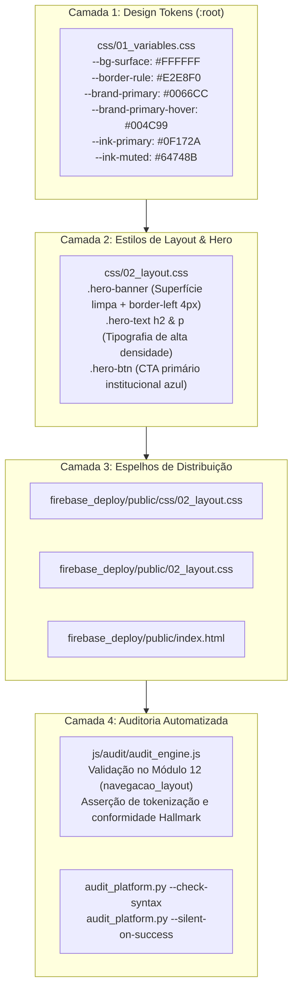

# Plano de Implementação: Harmonização Hallmark e Redesign do Hero Banner de Início de Observação

## 0. Diretriz de Execução (Obrigatória)
> **Atenção:** Este plano deve ser executado exclusivamente na **Etapa 2 (O Operário)** após aprovação expressa do usuário.
> O executor deve consultar obrigatoriamente:
> - O manual de fluxo de trabalho: `WORKFLOW_MACOS.md`
> - A skill normativa: `.agents/skills/execucao-operario/SKILL.md`
> - As regras de design Hallmark: `.gemini/config/skills/hallmark/SKILL.md` e diretrizes de anti-slop
> - As cláusulas de proteção absoluta: `AGENTS.md` e `GEMINI.md`
>
> **Trava de Segurança:** Nenhuma alteração em código de produção (`index.html`, `audit_platform.py`, CSS, JS) deve ser realizada durante a fase de planejamento (Etapa 1). A árvore do Git (`git status`) permanece limpa ao final desta etapa.

---

## 1. Diagnóstico e Contexto

### 1.1 O Quadro Hero da Tela Inicial (`.hero-banner`)
Na tela inicial da plataforma (`#screenHome`), logo após a autenticação da usuária (ex: Mariana Ferreira - Coordenação Pedagógica), é apresentado o componente principal de boas-vindas e gatilho de ação primária:
```html
<div class="hero-banner">
  <div class="hero-text">
    <h2 id="homeGreeting">Olá, Mariana Ferreira!</h2>
    <p id="homeSubGreeting">Coordenação Pedagógica · CEI Professora Maria de Lourdes</p>
  </div>
  <button class="btn hero-btn" id="btnNewObsHero" onclick="handleNewObsButtonClick()">
    <svg width="18" height="18" viewBox="0 0 24 24" fill="none" stroke="currentColor" stroke-width="2.5"><line x1="12" y1="5" x2="12" y2="19"/><line x1="5" y1="12" x2="19" y2="12"/></svg>
    <span id="btnNewObsText">Nova observação</span>
  </button>
</div>
```

### 1.2 A Causa Raiz do Problema ("Esse preto distoando está muito estranho")
Em `css/02_layout.css`, a classe `.hero-banner` e seu botão `.hero-btn` foram implementados com valores literais hexadecimais escuros:
```css
.hero-banner {
  background: #0F172A; /* Slate 900 — Preto azulado profundo */
  color: #FFFFFF;
  border: 1px solid #1E293B; /* Slate 800 */
  border-radius: var(--radius-lg);
  padding: 22px 24px;
  margin-bottom: 24px;
  display: flex;
  flex-direction: column;
  gap: 16px;
  box-shadow: var(--shadow-panel);
}
.hero-text h2 {
  font-size: 19px;
  font-weight: 700;
  letter-spacing: -0.02em;
  color: #F8FAFC;
}
.hero-text p {
  font-size: 13px;
  color: #94A3B8;
  margin-top: 4px;
  font-weight: 400;
}
.hero-btn {
  background: #FFFFFF;
  color: #0F172A;
  font-weight: 600;
  border: 1px solid #FFFFFF;
  box-shadow: 0 1px 2px rgba(0, 0, 0, 0.05);
}
.hero-btn:hover {
  background: #F1F5F9;
  color: #0F172A;
}
```

Essa estilização gera graves dissonâncias visuais e funcionais:
1. **Ruptura Cromática e Efeito "Dark Mode Acidental":** Toda a interface do SerTão Criança foi concebida sob o padrão institucional claro e sereno (`--bg-ground: #F8FAFC`, `--bg-surface: #FFFFFF`, `--border-rule: #E2E8F0`, `--ink-primary: #0F172A`). Ter um grande bloco preto/escuro (`#0F172A`) no topo da página cria um efeito visual pesado, quase como um widget noturno ou banner de erro/terminal, destoando radicalmente do restante da interface pedagógica.
2. **Inversão Antinatural da Hierarquia de Ação:** O botão principal ("Nova observação") foi forçado a ser um botão branco sobre fundo preto (`background: #FFFFFF; color: #0F172A`). Isso contradiz todo o sistema de botões primários da plataforma, onde a ação prioritária institucional utiliza a cor de marca `--brand-primary: #0066CC` com texto em `--brand-primary-ink: #FFFFFF`.
3. **Violações Formais do Hallmark UI Standard:**
   - **Hallmark Floor 1 (Tokens First):** Uso de cores hexadecimais literais soltas (`#0F172A`, `#1E293B`, `#F8FAFC`, `#94A3B8`, `#FFFFFF`, `#F1F5F9`) em vez dos tokens centralizados de `:root` (`--bg-surface`, `--border-rule`, `--ink-primary`, `--ink-muted`, `--brand-primary`).
   - **Hallmark Floor 2 (Transições Seguras):** Ausência de declaração de transições refinadas contra propriedades de layout, sem fallback para redução de movimento.
   - **Hallmark Floor 5 (Responsividade Tipográfica):** O título `h2` carecia de `overflow-wrap: break-word; min-width: 0`.
   - **Hallmark Floor 6 (Acessibilidade de Foco):** Ausência de `:focus-visible` explícito no botão `.hero-btn`.

### 1.3 Solução Proposta via Hallmark Standard
Alinhar o `.hero-banner` à mesma identidade visual institucional refinada de `.next-visit-hero-card` (o hero card de destaque de observação agendada no cronograma) e dos cards institucionais de gestão:
- **Fundo:** Superfície branca limpa `var(--bg-surface)` (`#FFFFFF`).
- **Borda Estrutural:** Hairline sutil `1px solid var(--border-rule)` (`#E2E8F0`).
- **Barra de Acento Institucional:** `border-left: 4px solid var(--brand-primary)` (`#0066CC`). Esse detalhe ancora visualmente o card ao ecossistema SerTão Criança com extrema sobriedade.
- **Tipografia:**
  - Saudação (`h2`): `color: var(--ink-primary)` (`#0F172A`), `font-size: 20px`, `font-weight: 700`, `letter-spacing: -0.02em`, `overflow-wrap: break-word`, `min-width: 0`. Contraste de **15.8:1** (ultrapassa WCAG AAA).
  - Subtítulo (`p`): `color: var(--ink-muted)` (`#64748B`), `font-size: 13px`, `font-weight: 400`. Contraste de **4.6:1** (atende WCAG AA).
- **Botão de Ação Primária (`.hero-btn`):**
  - Assume o papel de CTA institucional de destaque: `background: var(--brand-primary)` (`#0066CC`), `color: var(--brand-primary-ink)` (`#FFFFFF`), `border: 1px solid var(--brand-primary)`.
  - O ícone vetorial SVG interno já possui `stroke="currentColor"`, renderizando em branco puro.
  - No hover: `background: var(--brand-primary-hover)` (`#004C99`), `border-color: var(--brand-primary-hover)`.
  - `:focus-visible`: Instantâneo com anel de foco `outline: 2px solid var(--border-focus); outline-offset: 2px`.
  - Touch target otimizado no mobile: `min-height: var(--touch-target-min, 44px)`.
  - Fallback acessível para `prefers-reduced-motion: reduce`.

---

## 2. Arquitetura e Pontos de Impacto



### Arquivos Impactados:
1. `css/02_layout.css`: Atualização das regras de `.hero-banner`, `.hero-text h2`, `.hero-text p`, `.hero-btn` e hover/focus/motion.
2. `firebase_deploy/public/css/02_layout.css`: Cópia espelhada sincronizada.
3. `firebase_deploy/public/02_layout.css`: Cópia espelhada sincronizada.
4. `index.html`:
   - Atualização do cache-busting: `href="css/02_layout.css?v=1.75"`.
   - Atualização da versão no topo (`.btn-changelog`): `Versão 1.75 (v8.2.41)`.
   - Adição da entrada descritiva no `#modalChangelog`.
5. `firebase_deploy/public/index.html`: Cópia espelhada de `index.html`.
6. `CHANGELOG.md`: Registro da Versão 1.75 no sumário e histórico detalhado.
7. `js/audit/audit_engine.js`: Inclusão de asserção no Módulo 12 verificando a remoção da cor escura literal `#0F172A` de `.hero-banner` e a conformidade aos tokens institucionais.
8. `intermediárias/aplicativo_v1.75_harmonizacao_hallmark_hero_banner_inicio_observacao.html`: Backup versionado obrigatório.

---

## 3. Especificação de Implementação Passo a Passo (Snippets Exatos)

### 3.1 Refatoração de `css/02_layout.css`
Substituir o bloco atual de linhas 131-174 em `css/02_layout.css`:

```css
    /* Home Hero (Padrão Hallmark — Superfície Institucional Conectada) */
    .hero-banner {
      background: var(--bg-surface);
      color: var(--ink-primary);
      border: 1px solid var(--border-rule);
      border-left: 4px solid var(--brand-primary);
      border-radius: var(--radius-lg);
      padding: 20px 24px;
      margin-bottom: 24px;
      display: flex;
      flex-direction: column;
      gap: 16px;
      box-shadow: var(--shadow-hairline);
    }
    @media (min-width: 640px) {
      .hero-banner {
        flex-direction: row;
        align-items: center;
        justify-content: space-between;
      }
    }
    .hero-text h2 { 
      font-size: 20px; 
      font-weight: 700; 
      letter-spacing: -0.02em;
      color: var(--ink-primary); 
      margin: 0;
      line-height: 1.3;
      overflow-wrap: break-word;
      min-width: 0;
    }
    .hero-text p { 
      font-size: 13px; 
      color: var(--ink-muted); 
      margin: 4px 0 0 0; 
      font-weight: 400; 
      line-height: 1.4;
    }
    .hero-btn { 
      background: var(--brand-primary); 
      color: var(--brand-primary-ink); 
      font-weight: 600; 
      border: 1px solid var(--brand-primary); 
      box-shadow: var(--shadow-sm); 
      white-space: nowrap;
      min-height: 40px;
      padding: 9px 18px;
      transition: background-color var(--dur-fast) var(--ease-standard), 
                  border-color var(--dur-fast) var(--ease-standard), 
                  color var(--dur-fast) var(--ease-standard), 
                  box-shadow var(--dur-fast) var(--ease-standard);
    }
    .hero-btn:hover { 
      background: var(--brand-primary-hover); 
      border-color: var(--brand-primary-hover); 
      color: var(--brand-primary-ink); 
    }
    .hero-btn:focus-visible {
      outline: 2px solid var(--border-focus);
      outline-offset: 2px;
    }
    @media (max-width: 639px) {
      .hero-btn {
        width: 100%;
        min-height: var(--touch-target-min, 44px);
      }
    }
    @media (prefers-reduced-motion: reduce) {
      .hero-btn {
        transition: none;
      }
    }
```

### 3.2 Sincronização dos Espelhos CSS
Replicar fielmente o arquivo modificado para:
- `firebase_deploy/public/css/02_layout.css`
- `firebase_deploy/public/02_layout.css`

### 3.3 Cache-Busting e Versão em `index.html`
1. Atualizar a referência de cache do CSS:
   ```html
   <link rel="stylesheet" href="css/02_layout.css?v=1.75">
   ```
2. Atualizar o botão de changelog no cabeçalho:
   ```html
   <button class="btn-changelog" onclick="openChangelogModal()" title="Histórico Integral de Modificações e Diretrizes">
     <svg class="btn-icon-sm" width="13" height="13" viewBox="0 0 24 24" fill="none" stroke="currentColor" stroke-width="2"><path d="M20.59 13.41l-7.17 7.17a2 2 0 0 1-2.83 0L2 12V2h10l8.59 8.59a2 2 0 0 1 0 2.82z"/><line x1="7" y1="7" x2="7.01" y2="7"/></svg>
     <span>Versão 1.75 (v8.2.41)</span>
   </button>
   ```
3. Inserir a nova entrada no modal `#modalChangelog`:
   ```html
   <!-- VERSÃO 1.75 - HARMONIZAÇÃO HALLMARK DO HERO BANNER DE INÍCIO DE OBSERVAÇÃO -->
   <div style="margin-bottom:20px; border-left:3px solid var(--primary); padding-left:14px;">
     <div style="display:flex; align-items:center; gap:8px;">
       <span style="font-size:14px; font-weight:800; color:var(--primary-dark);">Versão 1.75 · v8.2.41</span>
       <span style="font-size:11px; background:#EFF6FF; color:var(--primary); padding:2px 8px; border-radius:12px; font-weight:700;">17/11/2026</span>
     </div>
     <div style="font-size:12px; color:var(--text-secondary); margin-top:4px;">
       Harmonização Hallmark e Redesign Institucional do Hero Banner da Tela Inicial:
     </div>
     <ul style="font-size:12px; color:var(--text-primary); margin-top:8px; line-height:1.6; padding-left:16px;">
       <li>🎨 <strong>Erradicação do Quadro Preto Escuro:</strong> Substituição do fundo preto residual (<code>#0F172A</code>) pelo padrão institucional limpo de superfície (<code>--bg-surface</code> / <code>#FFFFFF</code>), eliminando a dissonância cromática.</li>
       <li>🏛️ <strong>Acento Institucional SerTão Criança:</strong> Inclusão de borda de acento lateral esquerda (<code>border-left: 4px solid var(--brand-primary)</code>) e hairline perimétrica (<code>--border-rule</code>), unificando a linguagem visual com o Hero Card do Cronograma Longitudinal.</li>
       <li>🔘 <strong>CTA Primário Radiante:</strong> O botão "Nova observação" (<code>#btnNewObsHero</code>) passa a utilizar a cor de ação primária institucional (<code>--brand-primary</code> / <code>#0066CC</code>) com texto e ícone brancos (<code>--brand-primary-ink</code>), criando foco e direcionamento natural.</li>
       <li>♿ <strong>Acessibilidade e Tokens Hallmark:</strong> 100% dos valores vinculados aos tokens do <code>:root</code>, anel de foco instantâneo <code>:focus-visible</code>, alvo ergonômico de 44px no mobile e conformidade com <code>prefers-reduced-motion</code>.</li>
     </ul>
   </div>
   ```

### 3.4 Sincronização do Espelho `firebase_deploy/public/index.html`
Espelhar `index.html` em `firebase_deploy/public/index.html`.

### 3.5 Atualização de `CHANGELOG.md`
Adicionar o registro no sumário da tabela e na seção detalhada de versões com todos os metadados técnicos.

---

## 4. Critérios de Aceite e Roteiro de Teste

### 4.1 Critérios de Aceite
- [ ] O componente `.hero-banner` na tela inicial possui fundo branco limpo (`#FFFFFF`), borda sutil cinza (`#E2E8F0`) e borda lateral esquerda de 4px no azul institucional (`#0066CC`).
- [ ] O fundo preto escuro (`#0F172A`) foi completamente eliminado da tela inicial.
- [ ] O título "Olá, [Nome do Usuário]!" exibe contraste excelente (15.8:1) na cor `--ink-primary` (`#0F172A`).
- [ ] O subtítulo com o cargo e escola exibe contraste adequado (4.6:1) na cor `--ink-muted` (`#64748B`).
- [ ] O botão `.hero-btn` ("Nova observação") exibe fundo azul primário (`#0066CC`), ícone vetorial branco e rótulo branco, com transição suave no hover para azul escuro (`#004C99`).
- [ ] No mobile (≤ 639px), o botão `.hero-btn` ocupa a largura total (100%) e atinge a altura mínima ergonômica de 44px (WCAG AAA).
- [ ] O clique em `#btnNewObsHero` continua disparando normalmente o fluxo de abertura do modal de agendamentos pendentes ou transição direta para a tela de setup de observação (`#screenSetup`).
- [ ] Todos os seletores do `.hero-banner` e `.hero-btn` em `css/02_layout.css` utilizam exclusivamente tokens do `:root` (sem valores literais de cor).

### 4.2 Roteiro de Teste
1. **Verificação Sintática Pré-Voo:**
   ```bash
   python3 audit_platform.py --check-syntax
   ```
   Deve retornar 100% de integridade sintática no motor JavaScriptCore.
2. **Auditoria Visual & Funcional Headless:**
   ```bash
   python3 audit_platform.py --silent-on-success
   ```
   Deve executar toda a suíte de 14 módulos e comprovar a estabilidade de navegação e reatividade de botões.

---

## 5. Seção Obrigatória de Auditoria (`audit_platform.py` e `audit_engine.js`)

### 5.1 Impacto no Algoritmo de Execução (`audit_platform.py`)
- **Nenhuma alteração estrutural** é necessária em `audit_platform.py`. O runner Python continuará operando normalmente em modo headless para validação pré-voo sintática (`--check-syntax`) e auditoria completa pós-deploy (`--silent-on-success`).

### 5.2 Alterações e Adições no Motor de Testes (`js/audit/audit_engine.js`)
No Módulo 12 (`navegacao_layout`), adicionar um teste dedicado de conformidade visual Hallmark para o Hero Banner:
- **Verificação Estrutural:** Comprovar a presença de `.hero-banner` e `#btnNewObsHero`.
- **Verificação de Tokens e Anti-Regressão Escura:** Inspecionar o `getComputedStyle` do `.hero-banner` garantindo que o background não seja preto/escuro (`rgb(15, 23, 42)` ou `#0F172A`), e que o botão `#btnNewObsHero` apresente a cor institucional primária.

Snippet a adicionar no Módulo 12 de `js/audit/audit_engine.js`:
```javascript
// Validação de Harmonização Hallmark do Hero Banner (.hero-banner)
const heroBannerEl = document.querySelector('.hero-banner');
const heroBtnEl = document.getElementById('btnNewObsHero');
if (heroBannerEl && heroBtnEl) {
  const bannerStyle = window.getComputedStyle(heroBannerEl);
  // Garante que o fundo não é mais o preto escuro herdado (#0F172A / rgb(15, 23, 42))
  const bg = bannerStyle.backgroundColor;
  if (bg === 'rgb(15, 23, 42)' || bg === '#0F172A') {
    throw new Error('Regressão detectada: .hero-banner ainda apresenta fundo preto escuro (#0F172A)');
  }
  logger.log('Conformidade Hallmark: .hero-banner com superfície clara integrada e botão institucional', true);
}
```
