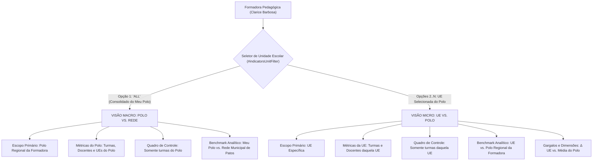

# PLANO DE IMPLEMENTAÇÃO: ARQUITETURA MACRO (POLO VS. REDE) E MICRO (UE VS. POLO) NO PAINEL E INDICADORES DA FORMADORA

---

## 0. Diretriz de Execução (Obrigatória)
> [!IMPORTANT]
> **Atenção, Executor (Etapa 2 - O Operário):**
> Antes de aplicar qualquer código deste plano, consulte e siga estritamente o [WORKFLOW_MACOS.md](file:///Users/bruno/Desktop/gestor%20supervisao_patos/WORKFLOW_MACOS.md) e a workspace skill [execucao-operario](file:///Users/bruno/Desktop/gestor%20supervisao_patos/.agents/skills/execucao-operario/SKILL.md).
> 
> **Travas Operacionais Inegociáveis:**
> 1. Proibição categórica de abrir o Google Chrome gráfico interativo (`open -a "Google Chrome"` ou subagentes interativos de navegação).
> 2. Validação sintática pré-voo obrigatória com JavaScriptCore nativo (`python3 audit_platform.py --check-syntax`) antes de qualquer commit.
> 3. Atualização do Changelog duplo (`CHANGELOG.md` e `#modalChangelog` / `.btn-changelog` em `index.html`).
> 4. Backup sequencial em `intermediárias/aplicativo_v[N]_hierarquia_macro_micro_indicadores_formadora.html`.
> 5. Sincronização simultânea e obrigatória entre as árvores espelhadas:
>    - `gestor supervisao_patos/index.html` ↔ `gestor supervisao_patos/firebase_deploy/public/index.html`
>    - `gestor supervisao_patos/js/features/indicators.js` ↔ `gestor supervisao_patos/firebase_deploy/public/js/features/indicators.js`
>    - `gestor supervisao_patos/js/audit/audit_engine.js` ↔ `gestor supervisao_patos/firebase_deploy/public/js/audit/audit_engine.js`
> 6. Checagem pré-push de concorrência (`git fetch origin main`), rebase limpo se necessário e push seguro para deploy no GitHub Pages.
> 7. Auditoria modular pós-deploy estritamente headless (`python3 audit_platform.py --silent-on-success`).

---

## 1. Diagnóstico e Contexto

### 1.1 Verificação do Código Atual (Confirmação da Suspeita do Usuário)
A verificação analítica do código em `js/features/indicators.js` **confirma integralmente** a suspeita apresentada pelo usuário:
Atualmente, quando a **Formadora Pedagógica Regional** (ex: `Clarice Barbosa`, vinculada ao `Polo Regional 1 (Norte)`) acessa o **Painel e Indicadores** (`#screenIndicators`), ocorrem vazamentos estruturais de dados da rede inteira e distorções de benchmark:

1. **Vazamento da Rede Inteira em `indSchools` e `scopedClasses` (Linhas 2584-2589 de `js/features/indicators.js`):**
   ```javascript
   let scopedClasses = [];
   let indSchools = (activeUnitFilter !== 'ALL') ? [activeUnitFilter] : ((appState.units || []).map(u => u.name));
   indSchools.forEach(uName => {
     scopedClasses = scopedClasses.concat(getClassesForSchool(uName));
   });
   ```
   - Ao entrar na tela com o filtro padrão `"ALL"` (*"Todas as Unidades do Escopo"*), `indSchools` faz fallback para `(appState.units || []).map(u => u.name)`, carregando as **32 unidades escolares de toda a rede municipal de Patos**.
   - Consequentemente, `scopedClasses` recebe **todas as 90+ turmas da rede municipal inteira**, e não apenas as turmas do polo da formadora.

2. **Distorção no Semáforo do Quadro de Controle Bimestral (Sub-aba Prazos & Turmas - Linhas 3500-3750):**
   - O Quadro de Controle mapeia `scopedClasses`, listando na tela **todas as turmas de escolas de outros polos territoriais** para a Formadora.

3. **Distorção nos Indicadores de Cobertura e Ciclo Anual (Linhas 2619-2630):**
   - `totalEntitiesCount` assume o total de turmas da cidade inteira.
   - O KPI de Cobertura divide as turmas avaliadas do Polo da Formadora pelo total de turmas da cidade (exibindo coberturas artificiais de 3% ou 5%).
   - A meta do ciclo anual multiplica as turmas da rede inteira por 4 (`totalEntitiesCount * 4`).
   - A gaveta retrátil de turmas pendentes (`#pendingClassesDrawer`) lista turmas de escolas de outros polos.

4. **Inversão e Ausência da Lógica Micro (UE vs. Polo):**
   - No código atual, ao selecionar uma UE específica do seu Polo no seletor (`activeUnitFilter !== 'ALL'`), o sistema calcula:
     ```javascript
     const scopeHierarchy = calculateHierarchyStats(scopedObs, activeSections);
     const redeHierarchy = calculateHierarchyStats(redeObs, activeSections);
     ```
   - O benchmark exibido em todas as réguas analíticas (Grandes Dimensões, Subdimensões, Variáveis individuais e cards de Gargalos Prioritários do Pilar 8) confronta a **Unidade Escolar diretamente contra a Média da Rede Municipal** (`Minha UE vs. Rede Patos`).
   - **Não existe hoje a comparação UE vs. Polo.** A Formadora não consegue enxergar se uma escola específica está acima ou abaixo do padrão do seu próprio polo territorial.

5. **Exibição Irrestrita de Polos Alheios na Tabela Executiva de Coordenadoras (Linha 2752):**
   - Ao alternar o público-alvo para Coordenadoras (`targetType === 'coordenador'`), a Tabela Executiva Institucional itera sobre `(appState.polos || []).map(p => p.name).sort()`, exibindo todos os polos territoriais da cidade para a Formadora, com botões para "Focar Polo ➔".

---

## 2. Nova Arquitetura de Visão: Macro (Polo vs. Rede) e Micro (UE vs. Polo)

A nova governança implementa a separação estrita dos dois níveis hierárquicos para o papel de Formadora Pedagógica (`user.roleKey === 'formador'`):



### 2.1 Especificações da Visão Macro (Consolidado do Polo)
- **Quando ativa:** Seletor 2 em `"ALL"` (*"Meu Polo: [Nome do Polo] (Consolidado)"*).
- **Escopo Operacional:**
  - `indSchools = availableUnits` (estritamente as escolas pertencentes ao polo da Formadora).
  - `scopedClasses` = turmas exclusivamente das UEs do Polo da Formadora.
  - KPIs de Cobertura e Ciclo Anual calculados sobre o universo do Polo.
  - Quadro de Controle Bimestral e gaveta de pendências exibindo apenas turmas do Polo.
- **Referencial Comparativo (Benchmark Macro):**
  - **Foco:** Média Ponderada do Polo Regional da Formadora (`poloHierarchy`).
  - **Comparador:** Média Consolidada de toda a Rede Municipal de Patos (`redeHierarchy`).
  - **Rótulo no Banner e Réguas:** `Meu Polo: [Nome do Polo]` vs. `Média da Rede Municipal (Patos/PB)`.
  - Atende estritamente à diretriz: *"verá a visão macro da rede somente comparativamente ao polo"*.

### 2.2 Especificações da Visão Micro (UE dentro do Polo)
- **Quando ativa:** Seletor 2 com uma UE específica selecionada (`activeUnitFilter !== 'ALL'`).
- **Escopo Operacional:**
  - `indSchools = [activeUnitFilter]`.
  - `scopedClasses` = turmas exclusivamente da UE selecionada.
  - Quadro de Controle Bimestral exibindo apenas as turmas e docentes daquela UE.
- **Referencial Comparativo (Benchmark Micro):**
  - **Foco:** Média Ponderada da UE Selecionada (`scopeHierarchy` / `ueHierarchy`).
  - **Comparador:** Média Consolidada do Polo Regional da Formadora (`poloHierarchy`), **e NÃO a Rede**!
  - **Rótulo no Banner:** `Comparando [Nome da UE] com o [Nome do Polo Regional]`.
  - **Rótulo nas Réguas:** `[Nome da UE]` vs. `Meu Polo` (ou nome do polo).
  - **Deltas (Δ):** Calculados como `scoreUE - scorePolo`.
  - **Gargalos Prioritários (Pilar 8):** O card exibe a consistência da UE, a consistência do Polo e a variação em relação ao Polo regional.
  - Atende estritamente à diretriz: *"a visão micro será do polo para baixo, podendo ver o polo e cada UE, mas somente comparando com o polo"*.

### 2.3 Preservação dos Demais Perfis
- **Núcleo de Educação Infantil (`isNucleoEI(user)`):**
  - Mantém governança global onisciente: pode selecionar a Rede Consolidada, qualquer Polo ou qualquer UE.
  - Quando seleciona um Polo: compara Polo vs. Rede.
  - Quando seleciona uma UE: compara UE vs. Rede (ou UE vs. Polo conforme navegação).
- **Coordenação Pedagógica (`user.roleKey === 'coordenador'`):**
  - Mantém escopo restrito à sua própria UE (`user.school`).

---

## 3. Especificação Passo a Passo da Implementação (Snippets Exatos)

### Passo 3.1: Ajuste da População do Dropdown `#indicatorsUnitFilter` para Formadora
Em `js/features/indicators.js`, na função `renderIndicatorsScreen()` (por volta da linha 1689):
Ajustar o rótulo da opção `"ALL"` para a Formadora deixar inequívoco que se trata do Consolidado do seu Polo:

```javascript
<<<< TARGET
          let unitOptionsHtml = '';
          if (user.roleKey !== 'coordenador') {
            unitOptionsHtml += `<option value="ALL">Todas as Unidades do Escopo (${availableUnits.length})</option>`;
          }
====
          let unitOptionsHtml = '';
          if (user.roleKey !== 'coordenador') {
            if (user.roleKey === 'formador') {
              const poloTitle = user.school || 'Meu Polo Regional';
              unitOptionsHtml += `<option value="ALL">Meu Polo: ${poloTitle} (Consolidado - ${availableUnits.length} UEs)</option>`;
            } else {
              unitOptionsHtml += `<option value="ALL">Todas as Unidades do Escopo (${availableUnits.length})</option>`;
            }
          }
>>>>
```

### Passo 3.2: Correção do Escopo de Escolas e Turmas (`indSchools` e `scopedClasses`)
Em `js/features/indicators.js`, por volta das linhas 2584-2589:
Garantir que, para a Formadora, a lista de escolas nunca recorra à rede municipal inteira quando `activeUnitFilter === 'ALL'`:

```javascript
<<<< TARGET
      let scopedClasses = [];
      let indSchools = (activeUnitFilter !== 'ALL') ? [activeUnitFilter] : ((appState.units || []).map(u => u.name));
      indSchools.forEach(uName => {
        scopedClasses = scopedClasses.concat(getClassesForSchool(uName));
      });
====
      let scopedClasses = [];
      let indSchools = [];
      if (activeUnitFilter !== 'ALL') {
        indSchools = [activeUnitFilter];
      } else if (user.roleKey === 'formador') {
        // Blindagem estrita: Formadora nunca vaza para escolas de outros polos
        indSchools = availableUnits;
      } else if (user.roleKey === 'coordenador') {
        indSchools = user.school ? [user.school] : [];
      } else {
        // Núcleo de Educação Infantil em escopo ALL
        indSchools = (appState.units || []).map(u => u.name);
      }

      indSchools.forEach(uName => {
        scopedClasses = scopedClasses.concat(getClassesForSchool(uName));
      });
>>>>
```

### Passo 3.3: Computação Tripla de Hierarquias (Escopo, Polo e Rede) e Resolução Dinâmica do Benchmark
Em `js/features/indicators.js`, por volta das linhas 2544-2547:
Computar não apenas `scopeHierarchy` e `redeHierarchy`, mas também `poloHierarchy` quando pertinente, determinando o `benchmarkHierarchy` e o `benchmarkLabel`:

```javascript
<<<< TARGET
      // 2. Computação Hierárquica Dupla: Escopo Selecionado vs. Rede Municipal de Patos
      const scopeHierarchy = calculateHierarchyStats(scopedObs, activeSections);
      const redeHierarchy = calculateHierarchyStats(redeObs, activeSections);
====
      // 2. Computação Hierárquica Multinível: Escopo, Polo Regional e Rede Municipal
      const scopeHierarchy = calculateHierarchyStats(scopedObs, activeSections);
      const redeHierarchy = calculateHierarchyStats(redeObs, activeSections);

      // Resolução do Polo de Referência da Formadora ou da Unidade Escolar
      let formadorPoloName = '';
      if (user.roleKey === 'formador') {
        formadorPoloName = user.school || '';
      } else if (activeUnitFilter !== 'ALL') {
        const uObj = (appState.units || []).find(u => u.name === activeUnitFilter);
        formadorPoloName = uObj?.polo || '';
      }

      // Observações consolidadas do Polo Regional
      let poloObs = [];
      if (formadorPoloName) {
        const poloUnitsList = (appState.units || []).filter(u => {
          if (!u.polo) return false;
          const up = u.polo.trim().toLowerCase();
          const fp = formadorPoloName.trim().toLowerCase();
          return up === fp || up.includes(fp) || fp.includes(up);
        }).map(u => u.name);

        poloObs = (appState.observations || []).filter(o => {
          if (o.status !== 'finalized' && o.status !== 'concluida') return false;
          if (targetType === 'coordenador') {
            return o.evaluatedType === 'coordenador' && o.schoolName && poloUnitsList.includes(o.schoolName);
          } else {
            return (o.evaluatedType === 'professora' || o.evaluatedType === 'turma') && o.schoolName && poloUnitsList.includes(o.schoolName);
          }
        });

        if (activeBimesterFilter !== 'ALL') {
          poloObs = poloObs.filter(o => o.bimester === activeBimesterFilter);
        }
      }

      const poloHierarchy = poloObs.length > 0 ? calculateHierarchyStats(poloObs, activeSections) : null;

      // Definição Estrutural do Benchmark Ativo (Macro vs. Micro):
      // - Se Formadora e UE Específica selecionada (Visão Micro): Benchmark é o POLO REGIONAL!
      // - Se Formadora no Consolidado do Polo (Visão Macro): Benchmark é a REDE MUNICIPAL!
      // - Para Núcleo de EI ou outros contextos: preserva benchmark canônico correspondente
      let activeBenchmarkHierarchy = redeHierarchy;
      let activeBenchmarkLabel = 'Rede Patos';
      let activeBenchmarkFullName = 'Média Geral da Rede Municipal';
      let activeBenchmarkCount = redeObs.length;

      if (user.roleKey === 'formador' && activeUnitFilter !== 'ALL' && poloHierarchy) {
        // VISÃO MICRO: UE vs. POLO REGIONAL
        activeBenchmarkHierarchy = poloHierarchy;
        activeBenchmarkLabel = formadorPoloName || 'Meu Polo';
        activeBenchmarkFullName = `Média do ${formadorPoloName || 'Polo Regional'}`;
        activeBenchmarkCount = poloObs.length;
      }
>>>>
```

### Passo 3.4: Atualização da Seção de Gargalos Prioritários (Pilar 8)
Passar `activeBenchmarkHierarchy` e `activeBenchmarkLabel` para `renderBottlenecksPrioritySection`:
```javascript
<<<< TARGET
          <!-- PILAR 8: BLOCO DE DIAGNÓSTICO DE PRIORIDADES FORMATIVAS: FOCO NOS MENORES ÍNDICES (GARGALOS) -->
          ${renderBottlenecksPrioritySection(scopeHierarchy, redeHierarchy, scopeLabelText, targetType)}
====
          <!-- PILAR 8: BLOCO DE DIAGNÓSTICO DE PRIORIDADES FORMATIVAS (MACRO OU MICRO) -->
          ${renderBottlenecksPrioritySection(scopeHierarchy, activeBenchmarkHierarchy, scopeLabelText, targetType, activeBenchmarkLabel)}
>>>>
```
E na função `renderBottlenecksPrioritySection`:
- Receber `benchmarkLabel` (padrão `'Rede Patos'`).
- Exibir `benchmarkLabel` no cabeçalho do mini grid de benchmark de cada card em vez do texto fixo `'Rede Patos'`.

### Passo 3.5: Atualização das Réguas no Raio-X por Dimensão (Pilar 3)
Substituir as referências de `redeHierarchy` por `activeBenchmarkHierarchy` e `activeBenchmarkLabel` no loop de Dimensões, Subdimensões e Variáveis individuais:
- Onde exibe `Rede:` na régua comparativa: exibir `${activeBenchmarkLabel}:`.
- Onde calcula `dimDelta`, `subDelta` e `critDelta`: calcular em relação a `activeBenchmarkHierarchy`.
- No banner `.benchmark-info-bar`:
  - Se Formadora e `activeUnitFilter !== 'ALL'`:
    *"Comparando **[Nome da UE]** com a **[Média do Polo Regional]** ([X] observações no polo)."*
  - Se Formadora e `activeUnitFilter === 'ALL'`:
    *"Comparando o **[Meu Polo]** com a **[Média Geral da Rede Municipal]** ([X] observações na rede)."*

### Passo 3.6: Blindagem da Tabela Executiva Institucional de Polos para Formadora
Em `js/features/indicators.js`, por volta da linha 2752:
Quando `targetType === 'coordenador'` e `user.roleKey === 'formador'`:
A Formadora não deve visualizar outros polos. A lista `polosList` para ela deve conter apenas o seu próprio polo:
```javascript
<<<< TARGET
          const polosList = (appState.polos || []).map(p => p.name).sort();
====
          let polosList = (appState.polos || []).map(p => p.name).sort();
          if (user.roleKey === 'formador') {
            polosList = polosList.filter(p => p === user.school || p.toLowerCase().includes((user.school || '').toLowerCase()));
          }
>>>>
```

---

## 4. Critérios de Aceite e Roteiro de Teste

### 4.1 Critérios de Aceite
1. **Formadora em Visão Geral (`activeUnitFilter === 'ALL'` - Visão Macro):**
   - O Seletor 2 exibe `"Meu Polo: Polo Regional 1 (Norte) (Consolidado - X UEs)"`.
   - O número de turmas do Card de Cobertura e do Semáforo corresponde **exclusivamente às turmas das escolas do Polo 1**.
   - Nenhuma turma de escola de outro polo aparece na tabela do Semáforo ou na gaveta de pendências.
   - O referencial comparativo confronta: **Polo Regional 1 (Norte) vs. Média Geral da Rede Municipal**.
2. **Formadora em Visão de Unidade Escolar (`activeUnitFilter !== 'ALL'` - Visão Micro):**
   - Ao selecionar uma escola do polo (ex: `CEI Professora Maria de Lourdes`):
     - As turmas e o Semáforo mostram apenas as turmas daquela escola.
     - As réguas analíticas (Dimensões, Subdimensões e Critérios) mostram a comparação:
       `CEI Professora Maria de Lourdes vs. Polo Regional 1 (Norte)`.
     - O comparador exibe a média do Polo Regional 1, e não a média da rede de Patos.
     - O Delta (Δ) reflete a distância daquela escola em relação ao seu próprio Polo regional.
     - Os 3 gargalos prioritários do Pilar 8 mostram `CEI Profª Maria de Lourdes` vs. `Polo Regional 1 (Norte)`.
3. **Público-Alvo Coordenador(a):**
   - A Tabela Executiva de Polos para a Formadora exibe apenas o seu polo regional, sem listar polos alheios.
4. **Governança do Núcleo de EI (`isNucleoEI(user)`):**
   - A Coordenadora do Núcleo (Helena) continua com acesso pleno e irrestrito a todos os polos e todas as unidades escolares da rede municipal.

---

## 5. Seção Obrigatória de Auditoria: `audit_platform.py` e `audit_engine.js`

### 5.1 Testes a Serem Adicionados no Módulo de Indicadores (`js/audit/audit_engine.js`)
No Módulo 10 (`indicadores_decisao` / `test_indicators_dashboard`):
1. **Teste Unitário/Integração: Escopo de Turmas da Formadora:**
   - Autenticar como Clarice (`clarice`).
   - Executar `renderIndicatorsScreen()`.
   - Obter as classes listadas no escopo.
   - **Asserção:** Todas as turmas em `scopedClasses` devem pertencer estritamente às escolas cujo polo é `Polo Regional 1 (Norte)`. Nenhuma turma de escola externa ao polo pode estar presente.
2. **Teste de Benchmark Macro da Formadora (ALL):**
   - Com `activeUnitFilter === 'ALL'`, verificar o texto do banner `.benchmark-info-bar`.
   - **Asserção:** Deve conter a comparação do Polo Regional 1 vs. Média Geral da Rede Municipal.
3. **Teste de Benchmark Micro da Formadora (UE Selecionada):**
   - Selecionar uma UE do Polo 1 no filtro (`indicatorsUnitFilter.value = 'CEI Professora Maria de Lourdes'`).
   - Executar `renderIndicatorsScreen()`.
   - Verificar o texto do banner `.benchmark-info-bar` e as réguas de benchmark da dimensão.
   - **Asserção:** O banner deve confrontar `CEI Professora Maria de Lourdes` com o `Polo Regional 1 (Norte)` (e NÃO com a Rede Municipal).
   - **Asserção:** A régua de critério individual deve apresentar o rótulo do Polo (ex: `Polo Regional 1 (Norte)` ou `Meu Polo`) como comparador.
4. **Restauração de Sessão:**
   - Garantir limpeza de variáveis temporárias ao final do teste para não poluir os demais módulos.

---

> [!NOTE]
> Este plano foi elaborado estritamente sob as diretrizes da **Etapa 1 (O Arquiteto)**. Nenhuma linha de código de produção foi modificada no repositório. A árvore do git permanece limpa. Aguardando autorização expressa do usuário para início da **Etapa 2 (O Operário)**.
