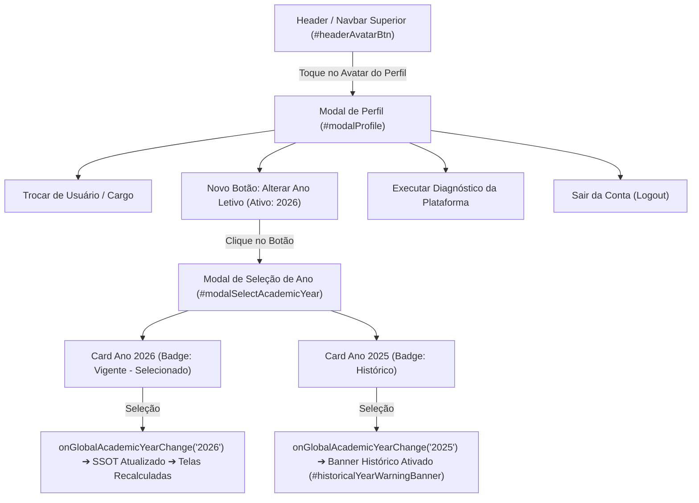

# Plano de Implementação: Alocação do Botão "Alterar Ano Letivo" na Tela de Perfil (Trocar Usuário/Cargo e Executar Diagnóstico)

---

## 0. Diretriz de Execução Obrigatória (Etapa 2)
> [!IMPORTANT]
> **Atenção Executor / Operário:** Antes de aplicar qualquer modificação em código, leia obrigatoriamente o manual [`WORKFLOW_MACOS.md`](file:///Users/bruno/Desktop/gestor%20supervisao_patos/WORKFLOW_MACOS.md) e a skill do Antigravity [`.agents/skills/execucao-operario/SKILL.md`](file:///Users/bruno/Desktop/gestor%20supervisao_patos/.agents/skills/execucao-operario/SKILL.md).
> Siga estritamente este plano sem improvisações, mantendo a integridade sintática via JSC (`python3 audit_platform.py --check-syntax`), gerando a versão intermediária de backup `intermediárias/aplicativo_v140_botao_alterar_ano_letivo_tela_perfil.html`, atualizando o changelog duplo para a versão **1.40 (v8.2.7)** e rodando a auditoria modular silenciosa pós-deploy (`python3 audit_platform.py --silent-on-success`).

---

## 1. Diagnóstico e Contexto

### 1.1. O Cenário Atual
Atualmente, a alternância de contexto temporal entre anos letivos (arquitetura plurianual SSOT implementada na v1.28) é efetuada por meio de um elemento `<select>` inline alocado na barra superior de navegação (`.navbar-actions #headerAcademicYearWrapper`, linhas 3575–3582 de `index.html`):

```html
<!-- Seletor Global de Ano Letivo (SSOT Multi-Ano) -->
<div class="academic-year-selector-wrapper" id="headerAcademicYearWrapper" style="display:flex; align-items:center; background:var(--bg); border:1px solid var(--border); border-radius:8px; padding:2px 8px; gap:6px;">
  <span style="font-size:12px;" title="Ano Letivo Ativo">📅</span>
  <select id="headerAcademicYearSelect" class="form-select" onchange="onGlobalAcademicYearChange(this.value)" style="border:none; background:transparent; font-size:12px; font-weight:800; color:var(--text-primary); cursor:pointer; padding:2px 4px; outline:none;" title="Alternar Ano Letivo em Visualização">
    <!-- Populado dinamicamente via renderGlobalAcademicYearSelector() -->
  </select>
</div>
```

Embora funcional, essa abordagem acarreta sérios inconvenientes de interface e ergonomia cognitiva:
1. **Sobrecarga do Cabeçalho Superior:** O cabeçalho desktop concentra a marca institucional, abas de navegação (Registros, Matrizes, Rubricas), crachá de perfil ativo (`#headerRoleBadge`), botão de versão (`.btn-changelog`) e avatar de perfil (`#headerAvatarBtn`). A presença adicional de um seletor dropdown solto satura o espaço horizontal em telas menores e laptops (860px a 1200px).
2. **Degradação no Mobile:** Em telas verticais de smartphones, o seletor na barra superior disputa pixels preciosos com o logo e o botão do usuário, gerando truncamentos ou comprometendo a área de toque segura.
3. **Fragmentação de Funções de Sessão e Governança:** O ano letivo é uma variável global de contexto do sistema, equivalente à identidade do usuário ativo ("Trocar de Usuário / Cargo") e ao diagnóstico da aplicação ("Executar Diagnóstico"). Manter o ano letivo na barra geral e as demais configurações de sessão dentro do modal de perfil gerava inconsistência semiótica e arquitetural.

### 1.2. A Demanda e a Solução Solicitada
O usuário instruiu:
> *"o botão de alterar ano letivo deve ficar na tela de trocar usuário/cargo e executar diagnóstico."*

A tela referida pelo usuário é o **Modal de Perfil do Usuário** (`#modalProfile`, acionado pelo clique no avatar `#headerAvatarBtn`), onde já residem as ações centrais de contexto do sistema:
- `Trocar de Usuário / Cargo` (`onclick="openRoleModal(); closeProfileModal();"`)
- `🔬 Executar Diagnóstico da Plataforma` (`onclick="triggerPlatformAuditUI()"`)
- `Sair da Conta (Logout)` (`onclick="executeLogout()"`)

A solução de arquitetura consiste em:
1. **Remover o seletor solto da barra de navegação superior (`#headerAcademicYearWrapper`)**, despoluindo o topo do sistema tanto no desktop quanto no mobile.
2. **Inserir o botão padronizado `Alterar Ano Letivo` dentro de `#modalProfile`**, posicionado ergonomicamente entre "Trocar de Usuário / Cargo" e "Executar Diagnóstico da Plataforma". O botão exibe em tempo real o ano ativo (ex: `Alterar Ano Letivo (2026)`).
3. **Criar o modal de seleção `modalSelectAcademicYear`**, estruturado com o mesmo padrão refinado de cards interativos (`.level-box`) adotado em `#modalRole`, permitindo selecionar com 1 toque o ano desejado com crachás informativos (`Vigente` vs `Histórico`) e descrições contextuais claras.
4. **Preservar a autocura e o banner de aviso histórico (`#historicalYearWarningBanner`)**, garantindo que consultas a períodos passados (ex: 2025) mantenham o alerta visual amarelo com o botão direto "Voltar ao Ano Vigente".

---

## 2. Arquitetura e Pontos de Impacto



### Arquivos e Pontos de Impacto no Repositório:
1. **[`index.html`](file:///Users/bruno/Desktop/gestor%20supervisao_patos/index.html):**
   - **Cabeçalho (`.navbar-actions`):** Remoção de `#headerAcademicYearWrapper` do fluxo visível.
   - **Modal de Perfil (`#modalProfile`):** Inclusão do botão `#btnProfileChangeAcademicYear` com ícone vetorial SVG institucional e rótulo dinâmico com o ano corrente (`#userProfileAcademicYearLabel`).
   - **Novo Modal (`#modalSelectAcademicYear`):** Criação da estrutura modal com `#academicYearBoxesContainer`.
   - **Funções JS de Ciclos e Anos:**
     - `openSelectAcademicYearModal()` e `closeSelectAcademicYearModal()`.
     - `renderAcademicYearBoxes()`: geração dinâmica dos cards `.level-box`.
     - `selectAcademicYear(year)`: despacho seguro e idempotente.
     - `renderGlobalAcademicYearSelector()`: adaptação para atualizar `#userProfileAcademicYearLabel` e `#academicYearBoxesContainer`, com proteção defensiva para a ausência do select no header.
     - `openProfileModal()`: sincronização imediata do rótulo do ano letivo.
   - **Changelog Duplo:** Versão 1.40 (v8.2.7) no `#modalChangelog` e `.btn-changelog`.
   - **Auditoria Modular (Módulo 12):** Nova bateria de testes determinísticos para o fluxo do botão de ano letivo em `#modalProfile`.
2. **[`firebase_deploy/public/index.html`](file:///Users/bruno/Desktop/gestor%20supervisao_patos/firebase_deploy/public/index.html):** Cópia idêntica e espelhada.
3. **[`CHANGELOG.md`](file:///Users/bruno/Desktop/gestor%20supervisao_patos/CHANGELOG.md):** Registro canônico da Versão 1.40.
4. **`audit_platform.py`:** Harness Python inalterado (executa headless e processa os novos testes do Módulo 12 via index.html).

---

## 3. Especificação de Implementação Passo a Passo (Snippets Exatos)

### Passo 1: Limpeza da Barra de Ações Superior (`.navbar-actions`)
Localizar as linhas 3575–3585 de `index.html`:

```html
<!-- CÓDIGO ATUAL A SER SUBSTITUÍDO: -->
      <!-- Right Header Actions -->
      <div class="navbar-actions">
        <!-- Seletor Global de Ano Letivo (SSOT Multi-Ano) -->
        <div class="academic-year-selector-wrapper" id="headerAcademicYearWrapper" style="display:flex; align-items:center; background:var(--bg); border:1px solid var(--border); border-radius:8px; padding:2px 8px; gap:6px;">
          <span style="font-size:12px;" title="Ano Letivo Ativo">📅</span>
          <select id="headerAcademicYearSelect" class="form-select" onchange="onGlobalAcademicYearChange(this.value)" style="border:none; background:transparent; font-size:12px; font-weight:800; color:var(--text-primary); cursor:pointer; padding:2px 4px; outline:none;" title="Alternar Ano Letivo em Visualização">
            <!-- Populado dinamicamente via renderGlobalAcademicYearSelector() -->
          </select>
        </div>

        <button class="role-badge-btn" onclick="openRoleModal()" id="headerRoleBadge" title="Alternar usuário e cargo ativo">
```

Substituir por:
```html
<!-- NOVO CÓDIGO (Header limpo e sem saturação visual): -->
      <!-- Right Header Actions -->
      <div class="navbar-actions">
        <button class="role-badge-btn" onclick="openRoleModal()" id="headerRoleBadge" title="Alternar usuário e cargo ativo">
```
*(Nota: seletor de ano letivo é removido da barra superior e realocado com destaque na tela de perfil).*

---

### Passo 2: Inclusão do Botão "Alterar Ano Letivo" no Modal de Perfil (`#modalProfile`)
Localizar o bloco de `#modalProfile` (linhas 7795–7825 de `index.html`):

```html
<!-- CÓDIGO ATUAL EM #modalProfile: -->
      <button class="btn btn-secondary btn-full" onclick="openRoleModal(); closeProfileModal();" style="margin-bottom:10px;">
        Trocar de Usuário / Cargo
      </button>

      <button class="btn btn-secondary btn-full" onclick="triggerPlatformAuditUI()" style="margin-bottom:10px; font-weight:700; color:var(--primary);">
        🔬 Executar Diagnóstico da Plataforma
      </button>
      <button class="btn btn-danger btn-full" onclick="executeLogout()">
        Sair da Conta (Logout)
      </button>
```

Substituir por:
```html
<!-- NOVO CÓDIGO COM O BOTÃO DE ALTERAR ANO LETIVO: -->
      <button class="btn btn-secondary btn-full" onclick="openRoleModal(); closeProfileModal();" style="margin-bottom:10px;">
        Trocar de Usuário / Cargo
      </button>

      <button class="btn btn-secondary btn-full" id="btnProfileChangeAcademicYear" onclick="openSelectAcademicYearModal(); closeProfileModal();" style="margin-bottom:10px; display:flex; align-items:center; justify-content:center; gap:8px;">
        <svg class="btn-icon" width="16" height="16" viewBox="0 0 24 24" fill="none" stroke="currentColor" stroke-width="2"><rect x="3" y="4" width="18" height="18" rx="2" ry="2"/><line x1="16" y1="2" x2="16" y2="6"/><line x1="8" y1="2" x2="8" y2="6"/><line x1="3" y1="10" x2="21" y2="10"/></svg>
        <span>Alterar Ano Letivo (<strong id="userProfileAcademicYearLabel">2026</strong>)</span>
      </button>

      <button class="btn btn-secondary btn-full" onclick="triggerPlatformAuditUI()" style="margin-bottom:10px; font-weight:700; color:var(--primary);">
        🔬 Executar Diagnóstico da Plataforma
      </button>
      <button class="btn btn-danger btn-full" onclick="executeLogout()">
        Sair da Conta (Logout)
      </button>
```

---

### Passo 3: Criação do Modal de Seleção de Ano Letivo (`#modalSelectAcademicYear`)
Inserir logo após o fechamento de `#modalProfile` (ou junto aos demais modais de sistema):

```html
  <!-- ================= MODAL: ALTERAR ANO LETIVO ================= -->
  <div id="modalSelectAcademicYear" class="modal-backdrop" onclick="closeSelectAcademicYearModal()">
    <div class="modal-panel" onclick="event.stopPropagation()">
      <div style="display:flex; justify-content:space-between; align-items:center; margin-bottom:16px;">
        <div style="font-size:18px; font-weight:800; color:var(--primary-dark); display:flex; align-items:center; gap:8px;">
          <svg width="20" height="20" viewBox="0 0 24 24" fill="none" stroke="currentColor" stroke-width="2"><rect x="3" y="4" width="18" height="18" rx="2" ry="2"/><line x1="16" y1="2" x2="16" y2="6"/><line x1="8" y1="2" x2="8" y2="6"/><line x1="3" y1="10" x2="21" y2="10"/></svg>
          Alternar Ano Letivo
        </div>
        <button class="btn btn-secondary" style="padding:6px 10px;" onclick="closeSelectAcademicYearModal()">✕</button>
      </div>
      <p style="font-size:12px; color:var(--text-secondary); margin-bottom:16px; line-height:1.4;">
        Selecione o ano letivo para navegação, relatórios, histórico e lançamentos de acompanhamento pedagógico:
      </p>

      <div id="academicYearBoxesContainer" style="display:flex; flex-direction:column; gap:10px;">
        <!-- Populado dinamicamente via renderAcademicYearBoxes() -->
      </div>
    </div>
  </div>
```

---

### Passo 4: Implementação das Funções JavaScript de Suporte
Localizar o bloco `// PILAR 15: GESTÃO DE CICLOS LETIVOS E ANOS PLURIANUAIS (SSOT)` (em torno da linha 24210 de `index.html`):

Refatorar `renderGlobalAcademicYearSelector()` e adicionar os novos controladores:

```javascript
    function openSelectAcademicYearModal() {
      renderAcademicYearBoxes();
      const m = document.getElementById('modalSelectAcademicYear');
      if (m) m.classList.add('active');
    }

    function closeSelectAcademicYearModal() {
      const m = document.getElementById('modalSelectAcademicYear');
      if (m) m.classList.remove('active');
    }

    function renderAcademicYearBoxes() {
      const container = document.getElementById('academicYearBoxesContainer');
      if (!container) return;

      const defaultYears = (typeof DEFAULT_ACADEMIC_YEARS !== 'undefined' && Array.isArray(DEFAULT_ACADEMIC_YEARS)) ? DEFAULT_ACADEMIC_YEARS : ['2026', '2025'];
      const defaultSelected = (typeof DEFAULT_SELECTED_ACADEMIC_YEAR !== 'undefined') ? DEFAULT_SELECTED_ACADEMIC_YEAR : '2026';

      if (!appState.academicYears || !Array.isArray(appState.academicYears) || appState.academicYears.length === 0) {
        appState.academicYears = [...defaultYears];
      }
      if (!appState.selectedAcademicYear) {
        appState.selectedAcademicYear = defaultSelected;
      }

      const sortedYears = [...appState.academicYears].sort((a, b) => b.localeCompare(a));
      const latestYear = sortedYears[0];
      const currentSelected = appState.selectedAcademicYear || latestYear;

      container.innerHTML = sortedYears.map(y => {
        const isSelected = (y === currentSelected);
        const isVigente = (y === latestYear);
        const tagBadge = isVigente
          ? '<span style="background:#DCFCE7; color:#15803D; font-size:10px; font-weight:800; padding:2px 8px; border-radius:12px; text-transform:uppercase;">Vigente</span>'
          : '<span style="background:#FEF3C7; color:#B45309; font-size:10px; font-weight:800; padding:2px 8px; border-radius:12px; text-transform:uppercase;">Histórico</span>';
        const descText = isVigente
          ? 'Ano letivo em andamento. Lançamentos, acompanhamentos e observações regulares.'
          : 'Modo de consulta histórica dos registros e indicadores consolidados deste período.';

        return `
          <div class="level-box ${isSelected ? 'selected' : ''}" onclick="selectAcademicYear('${y}')" style="cursor:pointer;">
            <div style="display:flex; justify-content:space-between; align-items:center; margin-bottom:4px;">
              <div class="level-box-title" style="display:flex; align-items:center; gap:8px;">
                <svg width="15" height="15" viewBox="0 0 24 24" fill="none" stroke="currentColor" stroke-width="2"><rect x="3" y="4" width="18" height="18" rx="2" ry="2"/><line x1="16" y1="2" x2="16" y2="6"/><line x1="8" y1="2" x2="8" y2="6"/><line x1="3" y1="10" x2="21" y2="10"/></svg>
                <span>Ano Letivo ${y}</span>
              </div>
              ${tagBadge}
            </div>
            <div class="level-box-desc">${descText}</div>
          </div>
        `;
      }).join('');
    }

    function selectAcademicYear(year) {
      closeSelectAcademicYearModal();
      onGlobalAcademicYearChange(year);
    }

    function renderGlobalAcademicYearSelector() {
      try {
        const defaultYears = (typeof DEFAULT_ACADEMIC_YEARS !== 'undefined' && Array.isArray(DEFAULT_ACADEMIC_YEARS)) ? DEFAULT_ACADEMIC_YEARS : ['2026', '2025'];
        const defaultSelected = (typeof DEFAULT_SELECTED_ACADEMIC_YEAR !== 'undefined') ? DEFAULT_SELECTED_ACADEMIC_YEAR : '2026';

        if (!appState.academicYears || !Array.isArray(appState.academicYears) || appState.academicYears.length === 0) {
          appState.academicYears = [...defaultYears];
        }
        if (!appState.selectedAcademicYear) {
          appState.selectedAcademicYear = defaultSelected;
        }

        const sortedYears = [...appState.academicYears].sort((a, b) => b.localeCompare(a));
        const latestYear = sortedYears[0];

        // Atualiza rótulo no botão do modal de perfil se presente
        const profileLabel = document.getElementById('userProfileAcademicYearLabel');
        if (profileLabel) {
          profileLabel.innerText = appState.selectedAcademicYear;
        }

        // Suporte defensivo caso o select ainda exista em algum contexto
        const select = document.getElementById('headerAcademicYearSelect');
        if (select) {
          select.innerHTML = sortedYears.map(y => `<option value="${y}" ${y === appState.selectedAcademicYear ? 'selected' : ''}>Ano ${y}</option>`).join('');
        }

        // Se o modal de seleção estiver aberto, sincroniza seus cards
        const modalSel = document.getElementById('modalSelectAcademicYear');
        if (modalSel && modalSel.classList.contains('active')) {
          renderAcademicYearBoxes();
        }

        // Banner informativo se estiver visualizando ano anterior ao mais recente
        const banner = document.getElementById('historicalYearWarningBanner');
        const bannerLabel = document.getElementById('historicalYearBannerLabel');
        if (banner) {
          if (appState.selectedAcademicYear !== latestYear) {
            banner.style.display = 'flex';
            if (bannerLabel) bannerLabel.innerText = appState.selectedAcademicYear;
          } else {
            banner.style.display = 'none';
          }
        }
      } catch (errSel) {
        console.warn('Falha defensiva ao renderizar renderGlobalAcademicYearSelector:', errSel);
      }
    }
```

E em `openProfileModal()` (linha 10280 de `index.html`), garantir a sincronização do rótulo:
```javascript
    function openProfileModal() {
      const u = getCurrentUser();
      document.getElementById('userProfileName').innerText = u.name;
      document.getElementById('userProfileRoleDesc').innerText = `Cargo: ${u.roleTitle}`;
      
      const emailEl = document.getElementById('userProfileEmail');
      if (emailEl) {
        emailEl.innerText = u.email ? `E-mail: ${u.email}` : 'Sem e-mail vinculado';
      }
      
      document.getElementById('userProfileSchool').innerText = u.school;
      document.getElementById('userProfileAvatar').innerText = u.avatarText;

      const yearLabel = document.getElementById('userProfileAcademicYearLabel');
      if (yearLabel) {
        yearLabel.innerText = appState.selectedAcademicYear || '2026';
      }

      document.getElementById('modalProfile').classList.add('active');
    }
```

---

### Passo 5: Atualização da Suíte de Auditoria (Módulo 12 - Navegação e Layout)
Adicionar asserções específicas para o novo botão e fluxo de seleção em `index.html` (em torno da linha 27350):

```javascript
              // 15.1 TESTE DE CONFORMIDADE: BOTÃO ALTERAR ANO LETIVO NA TELA DE PERFIL (VERSÃO 1.40)
              headerAvatarBtn.click();
              const modalProf = document.getElementById('modalProfile');
              if (!modalProf || !modalProf.classList.contains('active')) {
                throw new Error('Clique em #headerAvatarBtn não abriu o modal #modalProfile');
              }

              // Asserção do botão de Alterar Ano Letivo em #modalProfile
              const btnChangeYear = document.getElementById('btnProfileChangeAcademicYear');
              if (!btnChangeYear) {
                throw new Error('Botão #btnProfileChangeAcademicYear não encontrado em #modalProfile');
              }

              const yearLabel = document.getElementById('userProfileAcademicYearLabel');
              if (!yearLabel) {
                throw new Error('#userProfileAcademicYearLabel não encontrado no botão de alterar ano');
              }

              // Asserção Negativa: Seletor não deve existir solto e visível na barra de ações da navbar
              const orphanHeaderSelect = document.querySelector('.navbar-actions #headerAcademicYearSelect');
              if (orphanHeaderSelect && orphanHeaderSelect.offsetParent !== null) {
                throw new Error('Seletor de ano letivo ainda está visível na barra de ações da navbar');
              }

              // Teste de acionamento do modal de seleção de ano
              btnChangeYear.click();
              const modalSelYear = document.getElementById('modalSelectAcademicYear');
              if (!modalSelYear || !modalSelYear.classList.contains('active')) {
                throw new Error('Clique em #btnProfileChangeAcademicYear não abriu o modal #modalSelectAcademicYear');
              }

              // Verifica presença das caixas de seleção de ano letivo (.level-box)
              const yearBoxes = modalSelYear.querySelectorAll('#academicYearBoxesContainer .level-box');
              if (yearBoxes.length === 0) {
                throw new Error('Nenhuma opção de ano letivo renderizada em #academicYearBoxesContainer');
              }

              // Testa seleção do ano 2025 (histórico)
              selectAcademicYear('2025');
              if (appState.selectedAcademicYear !== '2025') {
                throw new Error('selectAcademicYear("2025") não atualizou appState.selectedAcademicYear');
              }

              const bannerHist = document.getElementById('historicalYearWarningBanner');
              if (!bannerHist || bannerHist.style.display === 'none') {
                throw new Error('Banner de aviso de ano histórico não foi exibido após selecionar 2025');
              }

              // Restaura ano vigente via função returnToCurrentAcademicYear
              returnToCurrentAcademicYear();
              if (appState.selectedAcademicYear !== '2026') {
                throw new Error('returnToCurrentAcademicYear() não restaurou o ano vigente 2026');
              }
              if (bannerHist.style.display !== 'none') {
                throw new Error('Banner histórico permaneceu visível após retornar ao ano vigente');
              }

              closeSelectAcademicYearModal();
              closeProfileModal();
              logger.log('Conformidade do botão Alterar Ano Letivo em #modalProfile e modal de seleção (Versão 1.40)', true);
```

---

### Passo 6: Atualização do Changelog Duplo e Botão de Versão (v1.40 - v8.2.7)
1. **Botão `.btn-changelog` (linha 3597 de `index.html`):**
   ```html
   <button class="btn-changelog" onclick="openChangelogModal()" title="Histórico Integral de Modificações e Diretrizes">
     <svg class="btn-icon-sm" width="13" height="13" viewBox="0 0 24 24" fill="none" stroke="currentColor" stroke-width="2"><path d="M20.59 13.41l-7.17 7.17a2 2 0 0 1-2.83 0L2 12V2h10l8.59 8.59a2 2 0 0 1 0 2.82z"/><line x1="7" y1="7" x2="7.01" y2="7"/></svg>
     <span>Versão 1.40 (v8.2.7)</span>
   </button>
   ```
2. **Entrada no `#modalChangelog` em `index.html`:**
   Registrar os itens da versão 1.40 documentando a alocação de "Alterar Ano Letivo" na tela de perfil, limpeza do topo e criação do modal interativo `.level-box`.
3. **Registro no topo de `CHANGELOG.md`:**
   Documentar de forma canônica os mesmos itens para auditoria histórica.

---

### Passo 7: Sincronização Obrigatória do Repositório Espelhado
Copiar integralmente `gestor supervisao_patos/index.html` para `gestor supervisao_patos/firebase_deploy/public/index.html`.

---

## 4. Critérios de Aceite e Roteiro de Teste

1. **Validação Estrutural e Visual:**
   - [ ] No topo desktop e mobile, a navbar não contém mais o dropdown solto de ano letivo.
   - [ ] Ao clicar no avatar `#headerAvatarBtn`, o modal `#modalProfile` exibe o botão `Alterar Ano Letivo (2026)` com pictograma vetorial e o ano ativo visível.
   - [ ] O botão está perfeitamente posicionado entre "Trocar de Usuário / Cargo" e "🔬 Executar Diagnóstico da Plataforma".
2. **Interação e Alternância de Anos:**
   - [ ] Ao clicar em `Alterar Ano Letivo`, `#modalProfile` fecha e abre o modal `#modalSelectAcademicYear`.
   - [ ] Os anos cadastrados (ex: 2026 e 2025) são renderizados como cards interativos `.level-box`.
   - [ ] O ano vigente (2026) apresenta crachá verde "Vigente" e o ano 2025 apresenta crachá amarelo "Histórico".
   - [ ] Ao clicar em "Ano Letivo 2025", o contexto muda imediatamente para 2025, o toast confirma a alteração e o banner contextual amarelo surge no topo.
   - [ ] Ao clicar em "Voltar ao Ano Vigente" no banner, o sistema retorna ao ano 2026 e o banner desaparece.
3. **Validação Sintática e Auditoria Pós-Deploy:**
   - [ ] `python3 audit_platform.py --check-syntax` retorna 100% de sucesso léxico/sintático sem warnings.
   - [ ] `python3 audit_platform.py --silent-on-success` roda pós-deploy e aprova todos os 12 subsistemas.

---

## 5. Seção Obrigatória de Auditoria (`audit_platform.py` e Testes de `index.html`)

### 5.1. No Harness Python (`audit_platform.py`):
- **Alterações:** Nenhuma alteração de código necessária no script Python `audit_platform.py`. O harness continuará servindo a aplicação local e acionando o Google Chrome Headless com a flag `--silent-on-success`.
- **Adições:** Nenhuma adição necessária em Python.
- **Exclusões:** Nenhuma exclusão.

### 5.2. Na Suíte de Auditoria Executada pelo Navegador (`index.html`):
- **Alterações:**
  - Atualização da verificação do botão `.btn-changelog` para refletir `Versão 1.40 (v8.2.7)`.
  - Adaptação das asserções de navegação do Módulo 12 (`navegacao_layout`) para cobrir a ausência de elementos invasivos no header.
- **Adições:**
  - Teste 15.1 no Módulo 12: asserção de que `#btnProfileChangeAcademicYear` e `#userProfileAcademicYearLabel` existem no `#modalProfile`.
  - Asserção negativa: validação de que nenhum dropdown solto de ano letivo está visível em `.navbar-actions`.
  - Teste comportamental de despacho: clique no botão, verificação de abertura de `#modalSelectAcademicYear`, presença de cards `.level-box`, seleção de 2025 com disparo do banner de histórico e restauração para o ano 2026.
- **Exclusões:**
  - Remoção de qualquer dependência de teste que buscasse o select `#headerAcademicYearSelect` como elemento obrigatório no cabeçalho.
