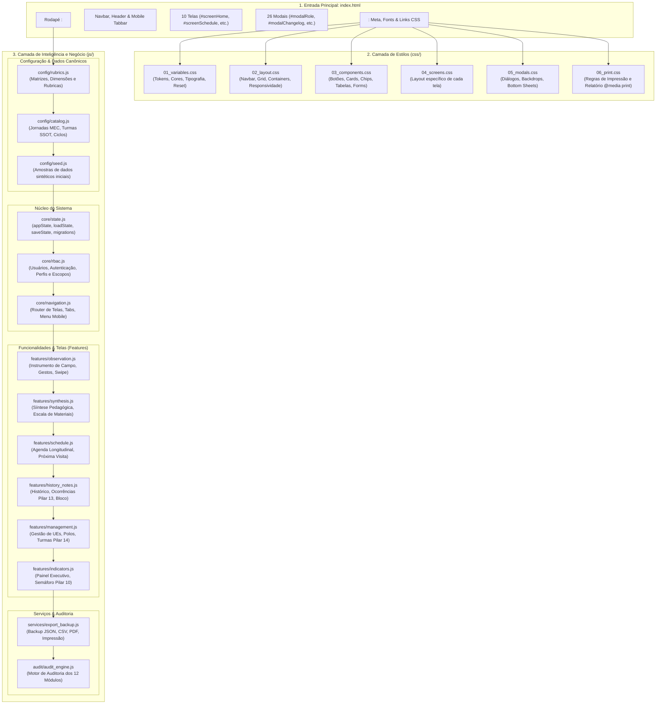

# Plano de Implementação: Arquitetura Modular e Divisão do Arquivo Principal (`index.html`)

> **Diretriz de Execução (Obrigatório):**  
> O assistente executor da **Etapa 2 (Operário)** DEVE OBRIGATORIAMENTE ler e seguir integralmente as diretrizes do arquivo [WORKFLOW_MACOS.md](file:///Users/bruno/Desktop/gestor%20supervisao_patos/WORKFLOW_MACOS.md), do [WORKFLOW_GITHUB.md](file:///Users/bruno/Desktop/gestor%20supervisao_patos/WORKFLOW_GITHUB.md) e a skill `.agents/skills/execucao-operario/SKILL.md` antes de aplicar quaisquer modificações no código-fonte.  
> A execução deve ser estrita, cirúrgica, atenta à integridade sintática via JSC nativo (`python3 audit_platform.py --check-syntax`), versionamento sequencial duplo (`CHANGELOG.md` e `#modalChangelog`), criação de cópia intermediária em `intermediárias/` e execução do algoritmo de auditoria modular pós-deploy (`python3 audit_platform.py --silent-on-success`).

---

> **Status:** 📐 Planejamento Concluído (Etapa 1 - Arquiteto)  
> **Data:** 27/10/2026  
> **Versão Alvo:** `1.45` (`v8.2.12`)  
> **Arquivo de Backup Intermediário:** `intermediárias/aplicativo_v145_modularizacao_e_divisao_index_html.html`  
> **Arquivos Principais Afetados:**  
> - `index.html` (redução drástica de 28.668 linhas para ~5.400 linhas de HTML semântico limpo)  
> - `css/` (criação de 6 folhas de estilo desacopladas por escopo)  
> - `js/` (criação de 14 módulos desacoplados organizados por domínio funcional)  
> - `audit_platform.py` (adaptação da blindagem sintática pré-voo JSC para inspecionar todos os arquivos `.js`)  
> - `CHANGELOG.md` (registro histórico da transição arquitetural)  

---

## 1. Diagnóstico e Contexto

### 1.1 Contexto e Justificativa da Demanda
Atualmente, a aplicação **SerTão Criança** está concentrada em um único arquivo monolítico de **28.668 linhas e 1,56 MB**:
- **3.580 linhas de CSS** em um bloco inline `<style>`.
- **5.487 linhas de HTML** (esqueleto, 10 telas e 26 modais).
- **19.547 linhas de JavaScript** em um único bloco inline `<script>`.

Esse gigantismo gera graves custos operacionais e riscos de sustentabilidade para o desenvolvimento:
1. **Consumo Excessivo de Janela de Contexto e Tokens:** Toda e qualquer alteração — mesmo a substituição de uma única linha ou classe visual — exige varrer ou injetar blocos em um arquivo de quase 30 mil linhas, esgotando tokens e tornando as interações lentas.
2. **Fragilidade Sintática Léxica (JavaScriptCore / JSC):** Em um script inline de 19.500 linhas, uma chave órfã (`}`), parêntese ausente ou vírgula fora de lugar derruba a execução de 100% dos botões da interface. Como todo o código compartilha o mesmo bloco, um erro em uma função isolada de exportação bloqueia o login e o cronograma.
3. **Dificuldade de Rastreabilidade e Colaboração:** Comparar `diffs` de Git em um arquivo de 1,5 MB é confuso e propício a conflitos de mesclagem. A navegação no editor de código exige scrolls contínuos de milhares de linhas.

### 1.2 Objetivo Arquitetural
"Paginar" e dividir o arquivo principal, decompondo-o em módulos desacoplados, organizados e autoexplicativos, sem quebrar nenhuma regra de negócio pedagógica, mantendo 100% de compatibilidade com:
- O servidor estático do GitHub Pages (`https://silvabrun0.github.io/supervisao-st-crianca/`).
- O motor headless de testes automatizados (`audit_platform.py`).
- Todos os manipuladores de eventos inline já existentes (`onclick="..."`, `onchange="..."`).
- O estado reativo persistido em `localStorage` (`SERTAO_CRIANCA_APP_STATE_V6`).

---

## 2. Arquitetura da Solução e Lógica de Divisão

### 2.1 Princípios Norteadores da Divisão
1. **Zero Breaking Changes no HTML Declarativo:** Centenas de botões possuem handlers nativos como `onclick="navigateToTab('home')"`, `onclick="closeModal()"` ou `onclick="saveState()"`. A modularização do JavaScript **não utilizará empacotamento com isolamento hermético cego (bundlers opacos)** que oculte as funções do escopo `window`. Em vez disso, utilizará scripts modulares carregados de forma síncrona/topológica, preservando o escopo global compartilhado no navegador.
2. **Carregamento Topológico Sequencial:** Os scripts serão divididos respeitando estritamente a ordem de dependência:
   `Configurações & Catálogos ➔ Estado Global & Storage ➔ RBAC & Sessão ➔ Navegação & UI ➔ Telas & Funcionalidades (Features) ➔ Exportação & Serviços ➔ Motor de Auditoria`.
3. **Desacoplamento Visual (CSS):** Separação de estilos em camadas (Design Tokens/Variáveis, Layout/Estrutura, Componentes reutilizáveis, Telas e Modais).
4. **HTML Semântico no `index.html`:** O arquivo `index.html` permanecerá como ponto de entrada estático, contendo as tags `<link rel="stylesheet">`, os containers `<section class="app-screen">`, os modais `<div class="modal-backdrop">` e a sequência de `<script src="...">`. Isso assegura que o DOM esteja imediatamente disponível no primeiro ciclo de renderização (`DOMContentLoaded`), sem depender de chamadas assíncronas de `fetch()` que poderiam gerar *Flash of Unstyled Content (FOUC)* ou race conditions no motor de auditoria.

### 2.2 Diagrama Arquitetural de Camadas e Dependências



---

## 3. Mapeamento Exato de Extração (De-Para das Linhas)

### 3.1 Camada CSS (`css/`) — Linhas 11 a 3590 de `index.html` (3.580 linhas)

| Arquivo Destino | Linhas em `index.html` | Conteúdo e Responsabilidade |
| :--- | :---: | :--- |
| `css/01_variables.css` | 11 – 345 | `:root`, cores canônicas, tipografia Inter, reset CSS universal (`*, *::before`), sombras, bordas e variáveis de layout. |
| `css/02_layout.css` | 346 – 818 | Estrutura geral, `.navbar`, `.desktop-nav`, `.mobile-tabbar`, containers de tela `.app-screen`, grid responsivo e transbordos. |
| `css/03_components.css` | 819 – 1541 | Botões (`.btn`, `.btn-primary`, `.btn-secondary`), cards, badges, chips, tabelas, formulários, inputs, switches e acordions. |
| `css/04_screens.css` | 1542 – 3083 | Estilos contextuais das telas: instrumentação de observação, radar de rubricas, semáforo bimestral, agenda longitudinal e painel de indicadores. |
| `css/05_modals.css` | 3084 – 3464 | Backdrop de modais, caixas de diálogo, animações de entrada, bottom-sheets mobile, cabeçalhos e botões de fechamento. |
| `css/06_print.css` | 3465 – 3590 | Regras de impressão institucional (`@media print`), paginação de relatórios, quebras de página e ocultação de elementos interativos. |

### 3.2 Camada HTML (`index.html`) — Linhas 3591 a 9077 de `index.html` (~5.480 linhas)
O esqueleto principal permanece no `index.html`, totalmente limpo de CSS inline e JS inline:
- **Linhas 1 – 20:** `<!DOCTYPE html>`, `<head>`, fontes do Google e tags `<link rel="stylesheet">`.
- **Linhas 3591 – 3717:** Barra de navegação superior (`.navbar`, perfil ativo, botão de versão, logout).
- **Linhas 3718 – 5107:** As 10 telas canônicas da aplicação (`screenHome`, `screenSchedule`, `screenSetup`, `screenActiveObs`, `screenSynthesis`, `screenIndicators`, `screenHistory`, `screenNotes`, `screenRefDocs`, `screenRubricsAdmin`).
- **Linhas 5108 – 5179:** Menus e barras de navegação mobile inferiores.
- **Linhas 5180 – 9077:** Os 26 modais do sistema (incluindo `#modalChangelog`, modais de governança, edição de polos, turmas, servidores e auditoria).
- **Rodapé:** 14 tags `<script src="js/...">` ordenadas topologicamente e fechamento `</body></html>`.

### 3.3 Camada JavaScript (`js/`) — Linhas 9078 a 28624 de `index.html` (19.547 linhas)

| Arquivo Destino | Linhas em `index.html` | Responsabilidade e Funções Principais |
| :--- | :---: | :--- |
| `js/config/rubrics.js` | 9079 – 9441 | `RUBRICS_DB`, `DIMENSIONS_ORDER`, `DEFAULT_SECTIONS_TEACHER`, `DEFAULT_SECTIONS_COORDINATOR`, matrizes de referência. |
| `js/config/catalog.js` | 9442 – 9790 | Catálogo canônico de jornadas MEC, `INITIAL_UNITS`, `INITIAL_POLOS`, `INITIAL_CLASSES`, períodos bimestrais SSOT (`DEFAULT_BIMESTER_PERIODS`). |
| `js/config/seed.js` | 10167 – 10340 | `seedSampleData()`, dados mock de observações prévias para demonstração pedagógica e testes. |
| `js/core/state.js` | 9791 – 10166 | Declaração de `appState`, `loadState()`, `saveState()`, migrações de versão, sanitização de turmas e persistência `localStorage`. |
| `js/core/rbac.js` | 10341 – 11076 | `USERS_DB`, `getCurrentUser()`, `switchUser()`, `isNucleoEI()`, controle de permissões por perfil (Helena Martins, Mariana, etc.). |
| `js/core/navigation.js` | 11077 – 12028 | `navigateToTab()`, `switchPedagSubTab()`, controle de abas ativas, menu mobile overlay, toasts (`showToast()`). |
| `js/features/observation.js` | 12029 – 13281 | `renderRubrics()`, seleção de níveis/critérios, swipe em telas mobile, botão flutuante de navegação (FAB), verificação de pendências. |
| `js/features/synthesis.js` | 13282 – 14971 | `renderSynthesis()`, escala de materiais, registro formativo, cálculo de tempo de observação, finalização de visitas. |
| `js/features/schedule.js` | 15634 – 16528 | `renderScheduleScreen()`, agendamento de observações, destaque da próxima visita da semana, baixa automática após visita. |
| `js/features/history_notes.js` | 14972 – 15633<br>+ 16529 – 17001 | Histórico com filtros multidimensionais, exclusão segura de rascunhos, ocorrências de campo do Pilar 13 (`saveQualitativeNote()`). |
| `js/features/management.js` | 17002 – 19435 | Gestão de UEs, cadastro e edição de Polos Regionais (SSOT), turmas descentralizadas (Pilar 14), quadro de pessoal e importação de planilhas. |
| `js/features/indicators.js` | 19436 – 24644 | Painel executivo de indicadores, semáforo bimestral de turmas/docentes (Pilar 10), Visualização por Dimensão, referencial da rede municipal. |
| `js/services/export_backup.js` | 24645 – 25409 | `exportFullBaseJSON()`, `importFullBaseJSON()`, exportações em CSV, rotinas de impressão PDF e backup de segurança. |
| `js/audit/audit_engine.js` | 25410 – 28624 | Motor automatizado de auditoria com os 12 módulos canônicos determinísticos, captura de erros e comunicação com `audit_platform.py`. |

---

## 4. Especificação de Implementação Passo a Passo

### 4.1 Criação da Estrutura de Diretórios
```bash
mkdir -p css
mkdir -p js/config
mkdir -p js/core
mkdir -p js/features
mkdir -p js/services
mkdir -p js/audit
```

### 4.2 Script de Fatiamento Automatizado e Determinístico (`tools/split_index.py`)
Para garantir precisão milimétrica sem perda de caracteres, o fatiamento será realizado via script Python utilitário que lê o `index.html` original e distribui os blocos nos arquivos correspondentes:

```python
# tools/split_index.py (trecho conceitual de execução segura)
# 1. Lê index.html linha a linha.
# 2. Extrai as faixas exatas de CSS para css/01_variables.css até css/06_print.css.
# 3. Extrai as faixas exatas de JS para js/config/*.js, js/core/*.js, etc.
# 4. Reconstrói o index.html contendo apenas o esqueleto semântico e as tags de importação.
```

### 4.3 Estrutura do Novo Cabeçalho em `index.html`
```html
<!DOCTYPE html>
<html lang="pt-BR">
<head>
  <meta charset="UTF-8">
  <meta name="viewport" content="width=device-width, initial-scale=1.0, maximum-scale=1.0, user-scalable=no, viewport-fit=cover">
  <title>SerTão Criança · Supervisão Pedagógica</title>
  <!-- Google Fonts: Inter -->
  <link rel="preconnect" href="https://fonts.googleapis.com">
  <link rel="preconnect" href="https://fonts.gstatic.com" crossorigin>
  <link href="https://fonts.googleapis.com/css2?family=Inter:wght@300;400;500;600;700;800&display=swap" rel="stylesheet">
  
  <!-- CSS Modular Desacoplado -->
  <link rel="stylesheet" href="css/01_variables.css">
  <link rel="stylesheet" href="css/02_layout.css">
  <link rel="stylesheet" href="css/03_components.css">
  <link rel="stylesheet" href="css/04_screens.css">
  <link rel="stylesheet" href="css/05_modals.css">
  <link rel="stylesheet" href="css/06_print.css">
</head>
```

### 4.4 Estrutura do Rodapé em `index.html`
```html
  <!-- ================= CARREGAMENTO TOPOLÓGICO DE SCRIPTS JS ================= -->
  <!-- 1. Configurações & Catálogos Canônicos -->
  <script src="js/config/rubrics.js"></script>
  <script src="js/config/catalog.js"></script>
  <script src="js/config/seed.js"></script>

  <!-- 2. Núcleo, Estado Global & Navegação -->
  <script src="js/core/state.js"></script>
  <script src="js/core/rbac.js"></script>
  <script src="js/core/navigation.js"></script>

  <!-- 3. Funcionalidades & Telas (Features) -->
  <script src="js/features/observation.js"></script>
  <script src="js/features/synthesis.js"></script>
  <script src="js/features/schedule.js"></script>
  <script src="js/features/history_notes.js"></script>
  <script src="js/features/management.js"></script>
  <script src="js/features/indicators.js"></script>

  <!-- 4. Serviços de Backup, Exportação & Relatórios -->
  <script src="js/services/export_backup.js"></script>

  <!-- 5. Motor Automatizado de Auditoria Modular (12 Módulos Canônicos) -->
  <script src="js/audit/audit_engine.js"></script>
</body>
</html>
```

---

## 5. Alterações no Algoritmo de Auditoria (`audit_platform.py`)

### 5.1 Diagnóstico do `audit_platform.py` Atual
Atualmente, a função `check_javascript_syntax` de `audit_platform.py` valida apenas scripts dentro de tags `<script>` inline via regex:
```python
scripts = re.findall(r'<script>(.*?)</script>', content, re.DOTALL)
```
Com a extração para arquivos `.js` desacoplados, essa rotina precisa ser atualizada para validar:
1. Qualquer script inline remanescente em `index.html`.
2. **Todos os arquivos `.js`** referenciados em tags `<script src="...">` no `index.html`, ou varrendo iterativamente o diretório `js/`.

### 5.2 Evolução da Blindagem Sintática JSC Pré-Voo
A função `check_javascript_syntax` será atualizada em `audit_platform.py` para inspecionar cada módulo de script individualmente:

```python
def check_javascript_syntax(html_path):
    """Valida a integridade sintática dos scripts inline e externos (.js) via JSC nativo do macOS antes do Chrome Headless."""
    jsc_path = "/System/Library/Frameworks/JavaScriptCore.framework/Versions/Current/Helpers/jsc"
    if not os.path.exists(jsc_path) or not os.path.exists(html_path):
        return True # Fallback seguro se não for macOS

    import re
    with open(html_path, 'r', encoding='utf-8') as f:
        content = f.read()

    # Mocks básicos do ambiente browser para o motor headless JSC
    mock_env = (
        "var window = { addEventListener: function() {}, location: { search: '' } };\n"
        "var document = { addEventListener: function() {}, querySelector: function() { return null; }, querySelectorAll: function() { return []; }, getElementById: function() { return null; } };\n"
        "var localStorage = { getItem: function() { return null; }, setItem: function() {} };\n"
    )

    # 1. Validação de arquivos externos <script src="...">
    script_srcs = re.findall(r'<script\s+src=["\']([^"\']+)["\']\s*></script>', content)
    base_dir = os.path.dirname(os.path.abspath(html_path))

    for src in script_srcs:
        src_path = os.path.normpath(os.path.join(base_dir, src))
        if not os.path.exists(src_path):
            print(f"❌ ERRO: Arquivo referenciado no index.html não encontrado: {src}")
            return False

        with open(src_path, 'r', encoding='utf-8') as sf:
            script_code = sf.read()

        with tempfile.NamedTemporaryFile('w', suffix='.js', delete=False) as tf:
            tf.write(mock_env)
            tf.write(script_code)
            tf_path = tf.name

        try:
            res = subprocess.run([jsc_path, tf_path], capture_output=True, text=True)
            if res.returncode != 0 and 'SyntaxError' in res.stderr:
                print("=" * 80)
                print(f"❌ ERRO FATAL DE SINTAXE JS DETECTADO NO ARQUIVO: {src}")
                for line in res.stderr.strip().splitlines():
                    if 'SyntaxError' in line or 'at ' in line:
                        print(f"   {line}")
                print("=" * 80)
                return False
        finally:
            if os.path.exists(tf_path):
                os.remove(tf_path)

    # 2. Validação de blocos inline remanescentes
    inline_scripts = re.findall(r'<script(?![^>]*\bsrc\b)[^>]*>(.*?)</script>', content, re.DOTALL)
    for i, script in enumerate(inline_scripts):
        if not script.strip():
            continue
        with tempfile.NamedTemporaryFile('w', suffix='.js', delete=False) as tf:
            tf.write(mock_env)
            tf.write(script)
            tf_path = tf.name

        try:
            res = subprocess.run([jsc_path, tf_path], capture_output=True, text=True)
            if res.returncode != 0 and 'SyntaxError' in res.stderr:
                print("=" * 80)
                print(f"❌ ERRO FATAL DE SINTAXE JS DETECTADO NO BLOCO INLINE #{i+1}")
                for line in res.stderr.strip().splitlines():
                    if 'SyntaxError' in line or 'at ' in line:
                        print(f"   {line}")
                print("=" * 80)
                return False
        finally:
            if os.path.exists(tf_path):
                os.remove(tf_path)

    return True
```

### 5.3 Ganho Operacional da Auditoria
Com essa alteração, caso o assistente introduza um erro de sintaxe, o terminal não informará apenas um erro genérico: ele indicará com exatidão o arquivo onde o erro ocorreu (ex.: `js/features/indicators.js: line 45: SyntaxError: Unexpected token '}'`), permitindo correção cirúrgica imediata!

---

## 6. Critérios de Aceite e Roteiro de Teste

### 6.1 Critérios de Aceite (Definição de Pronto)
1. **Redução Dimensional:** `index.html` passa a ter aproximadamente 5.400 linhas (redução superior a 80% do arquivo original).
2. **Desacoplamento Completo:** Todo o CSS reside exclusivamente na pasta `css/` (6 arquivos) e todo o JS na pasta `js/` (14 arquivos).
3. **Validação Sintática JSC 100%:** `python3 audit_platform.py --check-syntax` valida com sucesso todos os 14 arquivos JavaScript externos e blocos inline sem nenhum `SyntaxError`.
4. **Zero Erros de Console (Rede / 404):** Nenhum arquivo CSS ou JS retorna código 404 ou MIME type incorreto no carregamento.
5. **Auditoria Modular 100% Aprovada:** `python3 audit_platform.py --silent-on-success` roda todos os 12 módulos canônicos em Chrome Headless e retorna código de saída `0` com 100% de sucesso.
6. **Integridade de Estado:** Acesso contínuo ao `appState`, transições de abas, semáforos e filtros preservados.

### 6.2 Roteiro de Execução da Etapa 2 (Operário)
1. [ ] **Verificação Inicial de Sincronia:** `git status` limpo e `git pull origin main`.
2. [ ] **Criação da Cópia Intermediária:** Salvar `intermediárias/aplicativo_v145_modularizacao_e_divisao_index_html.html` como snapshot de segurança.
3. [ ] **Criação das Pastas:** Criar diretórios `css/` e `js/config/`, `js/core/`, `js/features/`, `js/services/`, `js/audit/`.
4. [ ] **Execução do Fatiamento Cirúrgico:** Extrair as seções de CSS e JS para seus respectivos arquivos, garantindo que nenhum bloco seja truncado.
5. [ ] **Reconstrução Limpa de `index.html`:** Inserir os `<link rel="stylesheet">` no `<head>` e as 14 tags `<script src="...">` no rodapé.
6. [ ] **Atualização de `audit_platform.py`:** Atualizar a rotina `check_javascript_syntax` para varrer os scripts externos.
7. [ ] **Validação Pré-Voo de Sintaxe:** Executar `python3 audit_platform.py --check-syntax`.
8. [ ] **Atualização do Changelog Duplo:**
   - Adicionar registro detalhado no topo de `CHANGELOG.md` para a versão `1.45 (v8.2.12)`.
   - Adicionar card descritivo no `#modalChangelog` e atualizar rótulo do botão `.btn-changelog` para `Versão 1.45 (v8.2.12)`.
9. [ ] **Checagem de Concorrência Pré-Push:** `git fetch origin main` e `git log HEAD..origin/main --oneline`.
10. [ ] **Commit e Deploy:**
    ```bash
    git add index.html css/ js/ audit_platform.py CHANGELOG.md
    git commit -m "feat(arch): modularizacao e divisao do arquivo principal em modais e subpastas css e js v1.45"
    git push origin main
    ```
11. [ ] **Auditoria Pós-Deploy:** Executar `python3 audit_platform.py --silent-on-success` e confirmar aprovação integral.
