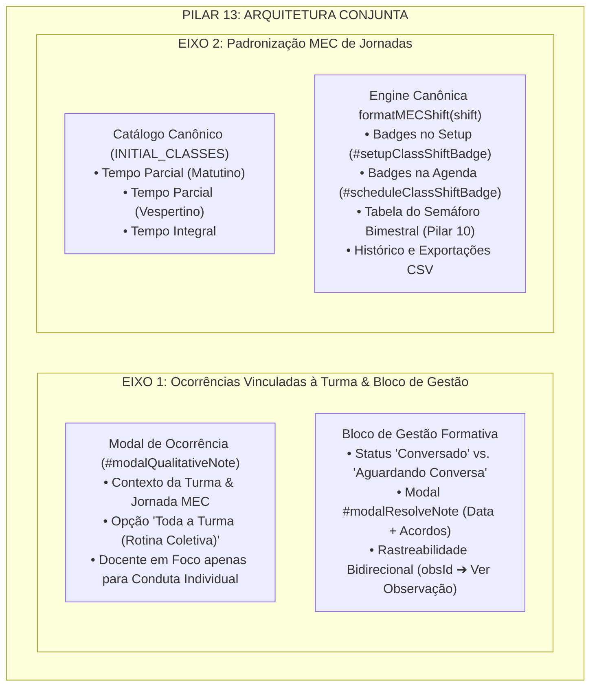

# PLANO DE IMPLEMENTAÇÃO: PILAR 13 - GESTÃO DE OCORRÊNCIAS CRÍTICAS VINCULADAS À TURMA E PADRONIZAÇÃO MEC

> **DIRETRIZ OBRIGATÓRIA DE EXECUÇÃO (ETAPA 2):**
> O assistente executor (Etapa 2) deve **obrigatoriamente ler e seguir as diretrizes dos arquivos `WORKFLOW_MACOS.md`, `WORKFLOW_GITHUB.md`, `AGENTS.md` e `GEMINI.md`** localizados na raiz do repositório antes de aplicar qualquer modificação no código. Nenhuma modificação deve ser realizada sem conformidade estrita com o workflow, incluindo:
> 1. Execução prévia de sincronização com o repositório remoto (`git pull origin main`).
> 2. Preservação integral de todas as regras de negócio consolidadas, dados cadastrais, blindagens RBAC, série histórica, ciclo longitudinal, turmas integrais (Pilar 4), fechamento nominal com justificativa parcial (Pilar 5), higienização terminológica para "observação" (Pilar 6), KPIs decisórios (Pilar 7), foco nos menores índices e gargalos (Pilar 8), popup mobile de filtros em bottom sheet (Pilar 9), semáforo bimestral de turmas e docentes regentes (Pilar 10), popups e bottom sheet de apoio às rubricas (Pilar 11) e integridade dos testes automatizados.
> 3. Verificação de integridade pós-edição com dupla checagem de leitura em cada trecho modificado.
> 4. Salvamento obrigatório do backup intermediário na pasta `intermediárias/` sob o nome `aplicativo_v112_pilar_13_gestao_ocorrencias_padrao_mec.html`.
> 5. Gestão dupla de Changelog no arquivo `CHANGELOG.md` e no modal `#modalChangelog` do `index.html`, registrando a **Versão 1.12 (ou v7.90)**.
> 6. Sincronização idêntica entre o arquivo principal `index.html` da raiz, `gestor supervisao_patos/index.html` e `gestor supervisao_patos/firebase_deploy/public/index.html`.
> 7. Checagem pré-push (`git fetch origin main`), commit semântico (`feat: implementar pilar 13 - gestao de ocorrencias criticas vinculadas a turma e padrao mec (v1.12)`), push para `origin main` e deploy automático no GitHub Pages.
> 8. Execução pós-deploy obrigatória do algoritmo de auditoria (`python3 audit_platform.py --silent-on-success`) com comunicação estrita e exclusiva a problemas/falhas.

---

## 1. Diagnóstico e Contexto Técnico-Pedagógico

### 1.1 Cenário Atual
O Sistema de Supervisão Pedagógica **SerTão Criança** consolidou a inversão da unidade de análise para a **TURMA** (Pilar 1), a governança em 3 níveis (Pilar 2), o benchmark no Afunilamento (Pilar 3), a rotina de Turmas Integrais (Pilar 4), o fechamento nominal com justificativa em itens parciais (Pilar 5), a higienização terminológica (Pilar 6), KPIs decisórios (Pilar 7), o diagnóstico de gargalos (Pilar 8), a navegação mobile de filtros (Pilar 9), o semáforo bimestral de turmas e docentes (Pilar 10) e os pop-ups de apoio pedagógico às rubricas (Pilar 11).

Entretanto, dois eixos operacionais estruturantes definidos no documento oficial de insights (`docs/documento_insights_supervisao_pedagogica_20261020.md`) ainda necessitam de sistematização e padronização definitiva:

#### Eixo 1: Gestão de Ocorrências Críticas Vinculadas à Turma
1. **Obrigatoriedade Indevida de Seleção Individual:**  
   No modal atual de registro de ocorrência (`#modalQualitativeNote`), quando a turma observada possui regência compartilhada (2 ou mais docentes), o seletor `#noteTeacher` exige obrigatoriamente a escolha de um docente individual específico (`Docente A` ou `Docente B`). Se o fato observado referir-se à **rotina coletiva da sala**, à **organização dos espaços e cantos**, ao **tempo de transição** ou à **dinâmica conjunta das crianças**, a supervisora é forçada a imputar o registro a uma única professora. Isso contraria o princípio basilar do Pilar 13, que preconiza: *a ocorrência é vinculada primariamente à turma, indicando o docente apenas quando couber conduta estritamente individual*.
2. **Fragilidade no Ciclo de Gestão ("Conversado"):**  
   Atualmente, as ocorrências contam apenas com uma flag booleana `n.resolved: boolean`. Ao clicar no botão de ação rápida, a anotação ganha o badge genérico `✓ Intervenção Realizada`. Não há campo nem registro formal de:
   - **Data do Diálogo Formativo** com a equipe docente;
   - **Responsável pelo Diálogo** (quem realizou a devolutiva);
   - **Acordos Pedagógicos e Encaminhamentos** pactuados no diálogo formativo;
   - O vocábulo deliberado pela rede municipal é expressamente **"Conversado"** (conforme deliberação SerTão Criança), diferenciando itens pendentes de itens já alinhados.
3. **Ausência de Rastreabilidade Bidirecional:**  
   Embora o registro guarde o `obsId`, o card da ocorrência exibe apenas um badge textual estático (`🔗 Vinculada à Observação`). A coordenadora não consegue visualizar o contexto da observação originária (data, bimestre, avaliador) nem clicar para abri-la em modo de leitura a fim de cruzar a ocorrência com as notas das rubricas daquele mesmo dia. Da mesma forma, na visualização da observação finalizada, as ocorrências vinculadas precisam estar claramente expostas com seu status de resolução.

#### Eixo 2: Padronização MEC das Jornadas e Turnos
1. **Terminologia Ambígua e Resquícios Legados:**  
   Em diversos pontos do sistema e nos cadastros canônicos de turmas (`INITIAL_CLASSES`), encontram-se designações heterogêneas como `'Parcial Matutino'`, `'Parcial Vespertino'`, `'Integral'`, `'Parcial'` e referências residuais à palavra ambígua *"regular"*.
2. **Exigência Formal do Padrão MEC / Censo Escolar:**  
   De acordo com as Diretrizes Curriculares Nacionais para a Educação Infantil (DCNEI) e o Censo Escolar do MEC/INEP, a jornada escolar na Educação Infantil divide-se estritamente em:
   - **Turma em Tempo Parcial** (com definição do turno: **Matutino** ou **Vespertino**, com carga horária mínima de 4 horas diárias);
   - **Turma em Tempo Integral** (com jornada igual ou superior a 7 horas diárias, compreendendo os dois turnos).
   O vocábulo "regular" é abolido por ser ambíguo e inadequado para diferenciar tempo parcial de integral na Educação Infantil.

---

### 1.2 Fundamentação Técnico-Pedagógica Oficial
Conforme deliberações registradas na transcrição da Reunião SerTão Criança de 19 de Outubro de 2026 (timestamps 00:56:18 e 02:40:57) e documentadas formalmente em `docs/documento_insights_supervisao_pedagogica_20261020.md`:

> **PILAR 13: Gestão de Ocorrências Críticas Vinculadas à Turma e Padrão MEC**  
> * **Diretriz Aprovada (00:56:18 e 02:40:57):**  
>   - **Ocorrências de Campo Vinculadas à Turma:** As ocorrências são atribuídas primariamente à Turma ativa em observação, com campo contextual para indicar qual docente regente esteve envolvido no fato (apenas quando couber conduta individual). Conta com bloco de gestão para marcação de status **"Conversado"** e arquivamento com rastreabilidade da observação.  
>   - **Padronização MEC:** Uso rigoroso de **"Turma em Tempo Parcial"** (Matutino/Vespertino) e **"Turma em Tempo Integral"**, abolindo o termo ambíguo "regular".

---

## 2. Arquitetura e Mapeamento de Pontos de Impacto



### 2.1 Tabela de Mapeamento de Impacto no Código

| Componente / Elemento | Localização Atual (`index.html`) | Comportamento Atual | Novo Comportamento Homologado (Pilar 13) |
| :--- | :--- | :--- | :--- |
| **Catálogo de Turmas (`INITIAL_CLASSES`)** | Linhas ~8476 a 8533 | Strings mistas: `'Parcial Matutino'`, `'Integral'`, `'Parcial Vespertino'`. | Padronização formal MEC: `'Tempo Parcial (Matutino)'`, `'Tempo Parcial (Vespertino)'`, `'Tempo Integral'`. |
| **Helper Global `formatMECShift(shift)`** | Nova função canônica (~8470) | Inexistente. Lógicas dispersas com `cls.shift \|\| 'Parcial'`. | Função padronizada que sanitiza e devolve a nomenclatura MEC oficial para qualquer string de jornada. |
| **Helper Global `getMECShiftBadgeHtml(shift)`** | Nova função canônica (~8475) | Badges inline com textos heterogêneos. | Devolve badges estilizados com ícones representativos (`☀️`, `⛅`, `🌟`). |
| **Setup de Observação (`onSetupClassChange`)** | Linhas ~10276 a 10295 | Badge com texto simples `'Parcial Matutino'`. | Badge padronizado: `☀️ Tempo Parcial (Matutino)`, `⛅ Tempo Parcial (Vespertino)` ou `🌟 Tempo Integral`. |
| **Modal de Ocorrência (`#modalQualitativeNote`)** | Linhas ~6725 a 6757 | Exibe apenas o seletor `#noteTeacher` forçando seleção de docente. | Cabeçalho com Turma e Jornada MEC; opção `__TURMA_GERAL__` para rotina coletiva e opções nominais para condutas individuais. |
| **Lógica de Salvamento (`saveQualitativeNote`)** | Linhas ~14708 a 14781 | Obriga `teacherName` individual. | Permite ocorrência da turma (`isIndividualConduct: false`) ou individual (`isIndividualConduct: true`), com metadados de rastreabilidade (`obsId`, `bimester`). |
| **Modal de Resolução de Ocorrência (`#modalResolveNote`)** | Novo modal no DOM | Inexistente. Apenas função direta `resolveNote()`. | Modal interativo para registrar Data da Devolutiva, Responsável e Acordos/Encaminhamentos pedagógicos. |
| **Cards de Ocorrência (`renderNotesScreen`)** | Linhas ~14510 a 14595 | Exibe badge estático `✓ Intervenção Realizada`. Botão simples. | Status oficial `🟢 Conversado` vs `🟡 Aguardando Conversa`, bloco de devolutiva documentada e botão com link de rastreabilidade `🔍 Ver Observação Vinculada`. |
| **Filtro de Status em Ocorrências (`#notesFilterStatus`)** | Linhas ~4327 a 4331 | Opções: `active`, `archived`, `all`. | Opções completas: `active`, `pending` (Aguardando Conversa), `resolved` (Conversadas), `archived`, `all`. |
| **Exportação CSV (`exportNotesFilteredCSV`)** | Linhas ~20744 a 20761 | Colunas antigas sem rastreabilidade completa. | Colunas atualizadas: `ID, Data, Unidade, Turma, Jornada_MEC, Tipo_Fato, Docente_Foco, Registrado_Por, Topico, Conteudo, Status, Data_Conversa, Conversado_Por, Acordos_Pedagogicos, ID_Observacao`. |
| **Auditoria Automatizada (`audit_platform.py` & `index.html`)** | Módulos 2, 3, 6, 9, 11 e 12 | Testes de ocorrências da v0.97. | Testes atualizados com 100% de cobertura determinística das novas regras do Pilar 13. |

---

## 3. Especificação Passo a Passo de Implementação (Etapa 2)

### Passo 3.1: Criação dos Helpers Canônicos de Padronização MEC
**Arquivo:** `index.html` (e cópias espelhadas)  
**Localização:** Imediatamente antes de `INITIAL_CLASSES` (em torno da linha 8470).

Inserir as funções canônicas de tratamento de jornadas e turnos segundo a diretriz MEC:

```javascript
    // --- 1.1 PADRONIZAÇÃO MEC DE JORNADAS E TURNOS (PILAR 13) ---
    function formatMECShift(shift) {
      if (!shift) return 'Tempo Parcial (Matutino)';
      const s = String(shift).trim().toLowerCase();
      if (s.includes('integral')) return 'Tempo Integral';
      if (s.includes('vesp')) return 'Tempo Parcial (Vespertino)';
      if (s.includes('mat')) return 'Tempo Parcial (Matutino)';
      if (s.includes('parcial')) return 'Tempo Parcial (Matutino)';
      return 'Tempo Parcial (Matutino)';
    }

    function getMECShiftBadgeHtml(shift) {
      const formatted = formatMECShift(shift);
      if (formatted === 'Tempo Integral') {
        return '<span class="status-badge" style="background:#FAF5FF; color:#7C3AED; border:1px solid #DDD6FE; font-weight:700;">🌟 Tempo Integral</span>';
      } else if (formatted === 'Tempo Parcial (Vespertino)') {
        return '<span class="status-badge" style="background:#EFF6FF; color:#1E40AF; border:1px solid #BFDBFE; font-weight:700;">⛅ Tempo Parcial (Vespertino)</span>';
      } else {
        return '<span class="status-badge" style="background:#EFF6FF; color:#1E40AF; border:1px solid #BFDBFE; font-weight:700;">☀️ Tempo Parcial (Matutino)</span>';
      }
    }
```

---

### Passo 3.2: Atualização do Catálogo Canônico `INITIAL_CLASSES`
**Arquivo:** `index.html` (e cópias espelhadas)  
**Localização:** Linhas ~8476 a 8533.

Substituir as strings de `shift` legadas pelas nomenclaturas MEC oficiais:

```javascript
    // --- 1.2 CATÁLOGO CANÔNICO DE TURMAS DA REDE MUNICIPAL (PILAR 1, PILAR 4 & PILAR 13) ---
    const INITIAL_CLASSES = [
      {
        id: 'cls-pml-01',
        name: 'Infantil I - Turma A',
        school: 'CEI Professora Maria de Lourdes',
        stage: 'Infantil I',
        shift: 'Tempo Parcial (Matutino)',
        teachers: ['Ana Carolina Silva', 'Juliana Roberta Rocha']
      },
      {
        id: 'cls-pml-02',
        name: 'Berçário II - Turma Única',
        school: 'CEI Professora Maria de Lourdes',
        stage: 'Berçário II',
        shift: 'Tempo Parcial (Matutino)',
        teachers: ['Carla Beatriz Mendes']
      },
      {
        id: 'cls-pml-03',
        name: 'Infantil II - Turma B',
        school: 'CEI Professora Maria de Lourdes',
        stage: 'Infantil II',
        shift: 'Tempo Parcial (Vespertino)',
        teachers: ['Juliana Roberta Rocha']
      },
      {
        id: 'cls-pml-04',
        name: 'Maternal II - Turma Integral',
        school: 'CEI Professora Maria de Lourdes',
        stage: 'Maternal II',
        shift: 'Tempo Integral',
        teachers: ['Ana Carolina Silva', 'Juliana Roberta Rocha', 'Carla Beatriz Mendes', 'Patricia Souza']
      },
      {
        id: 'cls-pp-01',
        name: 'Maternal I - Turma A',
        school: 'EMEI Pequeno Príncipe',
        stage: 'Maternal I',
        shift: 'Tempo Parcial (Matutino)',
        teachers: ['Fernanda Lima']
      },
      {
        id: 'cls-pp-02',
        name: 'Infantil I - Turma B',
        school: 'EMEI Pequeno Príncipe',
        stage: 'Infantil I',
        shift: 'Tempo Parcial (Vespertino)',
        teachers: ['Fernanda Lima']
      },
      {
        id: 'cls-vz-01',
        name: 'Maternal II - Turma Única',
        school: 'CEI Vovó Zezé',
        stage: 'Maternal II',
        shift: 'Tempo Integral',
        teachers: []
      }
    ];
```

E no helper `getClassesForSchool(schoolName)` (linhas ~8560-8590), assegurar que a criação dinâmica de turmas utilize `formatMECShift()`.

---

### Passo 3.3: Atualização do Modal HTML de Ocorrência (`#modalQualitativeNote`)
**Arquivo:** `index.html` (e cópias espelhadas)  
**Localização:** Linhas ~6725 a 6757.

Substituir o HTML do modal para incluir o cabeçalho contextual da turma com crachá MEC e a distinção clara entre fato coletivo da turma vs. conduta individual:

```html
  <!-- ================= MODAL: OCORRÊNCIA DE CAMPO (PILAR 13) ================= -->
  <div id="modalQualitativeNote" class="modal-backdrop" onclick="closeQualitativeNoteModal()">
    <div class="modal-panel" onclick="event.stopPropagation()">
      <div style="display:flex; justify-content:space-between; align-items:center; margin-bottom:12px;">
        <div style="font-size:17px; font-weight:800; color:var(--primary-dark);">Registro de Ocorrência de Campo</div>
        <button class="btn btn-secondary" style="padding:6px 10px;" onclick="closeQualitativeNoteModal()">✕</button>
      </div>
      
      <!-- Contexto Ativo da Turma e Jornada MEC -->
      <div id="noteClassContextCard" style="background:#F8FAFC; border:1px solid #E2E8F0; padding:10px 12px; border-radius:8px; margin-bottom:14px; display:flex; justify-content:space-between; align-items:center; flex-wrap:wrap; gap:8px;">
        <div>
          <div style="font-size:11px; text-transform:uppercase; color:var(--text-secondary); font-weight:700;">Turma em Observação</div>
          <div style="font-size:14px; font-weight:800; color:var(--text-primary);" id="noteContextClassName">Infantil I - Turma A</div>
          <div style="font-size:12px; color:var(--text-secondary);" id="noteContextSchoolName">CEI Professora Maria de Lourdes</div>
        </div>
        <div id="noteContextShiftBadge">
          <span class="status-badge" style="background:#EFF6FF; color:#1E40AF;">☀️ Tempo Parcial (Matutino)</span>
        </div>
      </div>

      <p style="font-size:12px; color:var(--text-secondary); margin-bottom:14px; line-height:1.4;">
        Ocorrência atribuída primariamente à <strong>Turma</strong>. Aponte o(a) docente regente apenas quando o fato envolver conduta estritamente individual.
      </p>

      <!-- SELEÇÃO DE CONDUTA: TURMA COLETIVA OU DOCENTE INDIVIDUAL -->
      <div class="form-group" id="groupNoteTeacher">
        <label class="form-label" id="labelNoteTeacher">
          Foco da Ocorrência
          <span style="font-size:11px; font-weight:normal; color:var(--text-secondary); margin-left:4px;" id="subLabelNoteTeacher"></span>
        </label>
        <select id="noteTeacher" class="form-select">
          <!-- Populated dinamicamente com opção coletiva e docentes individuais -->
        </select>
        <div id="noteTeacherHint" style="font-size:11px; margin-top:4px; line-height:1.3;"></div>
      </div>

      <div class="form-group">
        <label class="form-label">Descrição Circunstanciada dos Fatos <span style="color:var(--red);">*</span></label>
        <textarea id="noteContent" class="form-textarea" style="height:110px;" placeholder="Descreva os fatos observados e os pontos para o diálogo formativo..."></textarea>
      </div>

      <div style="display:flex; gap:10px; justify-content:flex-end;">
        <button class="btn btn-secondary" onclick="closeQualitativeNoteModal()">Cancelar</button>
        <button class="btn btn-primary" id="btnSaveQualitativeNote" onclick="saveQualitativeNote()">Salvar Ocorrência</button>
      </div>
    </div>
  </div>
```

---

### Passo 3.4: Inclusão do Modal de Gestão / Devolutiva Formativa (`#modalResolveNote`)
**Arquivo:** `index.html` (e cópias espelhadas)  
**Localização:** Logo após o `#modalQualitativeNote` (em torno da linha 6758).

Inserir o modal oficial para documentar a realização da conversa formativa (status "Conversado"):

```html
  <!-- ================= MODAL: DIÁLOGO FORMATIVO / MARCAR COMO CONVERSADO (PILAR 13) ================= -->
  <div id="modalResolveNote" class="modal-backdrop" onclick="closeResolveNoteModal()">
    <div class="modal-panel" onclick="event.stopPropagation()">
      <div style="display:flex; justify-content:space-between; align-items:center; margin-bottom:12px;">
        <div style="font-size:17px; font-weight:800; color:var(--primary-dark);">Diálogo Formativo · Marcar como Conversado</div>
        <button class="btn btn-secondary" style="padding:6px 10px;" onclick="closeResolveNoteModal()">✕</button>
      </div>

      <div style="background:#F0FDF4; border:1px solid #BBF7D0; padding:10px 12px; border-radius:8px; margin-bottom:14px;">
        <div style="font-size:11px; font-weight:700; color:#166534; text-transform:uppercase;">Ocorrência Selecionada</div>
        <div style="font-size:13px; font-weight:800; color:#14532D; margin-top:2px;" id="resolveNoteSummaryHeader">Turma: Infantil I - Turma A</div>
        <div style="font-size:12px; color:#166534; margin-top:4px; font-style:italic;" id="resolveNoteSummaryContent">"..."</div>
      </div>

      <input type="hidden" id="resolveNoteTargetId" value="">

      <div class="form-group">
        <label class="form-label">Data do Diálogo Formativo <span style="color:var(--red);">*</span></label>
        <input type="date" id="resolveNoteDate" class="form-input">
      </div>

      <div class="form-group">
        <label class="form-label">Acordos Pedagógicos e Encaminhamentos Combinados <span style="color:var(--red);">*</span></label>
        <textarea id="resolveNoteResolutionNotes" class="form-textarea" style="height:90px;" placeholder="Descreva os encaminhamentos acordados com a equipe docente (ex: reorganização dos cantos de leitura, ajuste no tempo de acolhida)..."></textarea>
      </div>

      <div style="display:flex; gap:10px; justify-content:flex-end;">
        <button class="btn btn-secondary" onclick="closeResolveNoteModal()">Cancelar</button>
        <button class="btn btn-primary" onclick="confirmResolveNote()" style="background:#15803D; border-color:#166534;">
          ✓ Confirmar como Conversado
        </button>
      </div>
    </div>
  </div>
```

---

### Passo 3.5: Atualização das Funções JavaScript de Ocorrências (`index.html`)
**Arquivo:** `index.html` (e cópias espelhadas)  
**Localização:** Linhas ~14595 a 14845.

Substituir o bloco de abertura, salvamento e resolução de ocorrências com o tratamento completo do Pilar 13:

```javascript
    // --- 10. QUALITATIVE FORMATIVE NOTES (PILAR 13: GESTÃO & RASTREABILIDADE) ---
    
    function openQualitativeNoteModal() {
      const user = getCurrentUser();
      if (isNucleoEI(user)) {
        showToast('A Coordenadora do Núcleo de EI não realiza lançamento de ocorrências de campo.');
        return;
      }

      // VINCULAÇÃO ESTRITA: Ocorrências exigem observação pedagógica em andamento
      if (!appState.currentObs) {
        showToast('Para registrar uma ocorrência de campo, inicie ou continue uma observação pedagógica.');
        return;
      }

      const obs = appState.currentObs;
      const schoolName = obs.schoolName;
      const className = obs.className;
      const classShift = obs.classShift || (obs.isIntegral ? 'Tempo Integral' : 'Tempo Parcial (Matutino)');
      
      const teacherSelect = document.getElementById('noteTeacher');
      const teacherHint = document.getElementById('noteTeacherHint');
      const subLabel = document.getElementById('subLabelNoteTeacher');
      const btnSave = document.getElementById('btnSaveQualitativeNote');

      // Atualiza o Cabeçalho Contextual do Modal com Padrão MEC
      const ctxClassEl = document.getElementById('noteContextClassName');
      const ctxSchoolEl = document.getElementById('noteContextSchoolName');
      const ctxBadgeEl = document.getElementById('noteContextShiftBadge');
      if (ctxClassEl) ctxClassEl.textContent = className;
      if (ctxSchoolEl) ctxSchoolEl.textContent = schoolName;
      if (ctxBadgeEl) ctxBadgeEl.innerHTML = getMECShiftBadgeHtml(classShift);

      teacherSelect.innerHTML = '';
      if (teacherHint) {
        teacherHint.innerHTML = '';
        teacherHint.style.display = 'none';
      }

      // Identifica os docentes vinculados à turma
      let teachers = (Array.isArray(obs.teachers) && obs.teachers.length > 0) ? [...obs.teachers] : [];
      if (teachers.length === 0) {
        const schoolClasses = getClassesForSchool(schoolName);
        const targetClass = schoolClasses.find(c => c.name === className);
        if (targetClass && Array.isArray(targetClass.teachers) && targetClass.teachers.length > 0) {
          teachers = [...targetClass.teachers];
        } else if (obs.teacherName) {
          teachers = [obs.teacherName];
        }
      }

      // 1. CASO DOCENTE ÚNICO REGENTE: TRAVA MANDATÓRIA
      if (teachers.length === 1) {
        const singleTeacher = teachers[0];
        const opt = document.createElement('option');
        opt.value = singleTeacher;
        opt.text = `${singleTeacher} (Docente Único Regente Titular)`;
        opt.selected = true;
        teacherSelect.appendChild(opt);
        teacherSelect.disabled = true;

        if (subLabel) subLabel.textContent = '(Docente único travado)';
        if (teacherHint) {
          teacherHint.style.display = 'block';
          teacherHint.style.color = 'var(--text-secondary)';
          teacherHint.innerHTML = `🔒 <strong>Docente único titular:</strong> Ocorrência vinculada a <strong>${singleTeacher}</strong>.`;
        }
      }
      // 2. CASO REGÊNCIA COMPARTILHADA (2 OU MAIS DOCENTES / TEMPO INTEGRAL):
      // Opção primária: Toda a Turma (Rotina Coletiva). Opções secundárias: Conduta Individual
      else if (teachers.length >= 2) {
        teacherSelect.disabled = false;

        // Opção Primária Coletiva
        const optTurma = document.createElement('option');
        optTurma.value = '__TURMA_GERAL__';
        optTurma.text = '👥 Toda a Turma / Ambas as Regentes (Rotina Coletiva da Sala)';
        optTurma.selected = true;
        teacherSelect.appendChild(optTurma);

        // Opções Nominais Individuais
        teachers.forEach((tName, idx) => {
          const opt = document.createElement('option');
          opt.value = tName;
          opt.text = `👤 ${tName} (Conduta Individual · Docente Regente ${String.fromCharCode(65 + idx)})`;
          teacherSelect.appendChild(opt);
        });

        if (subLabel) subLabel.textContent = '(Selecione se for conduta individual)';
        if (teacherHint) {
          teacherHint.style.display = 'block';
          teacherHint.style.color = '#1D4ED8';
          teacherHint.innerHTML = `👥 <strong>Atribuição Primária à Turma:</strong> Mantenha em <em>Toda a Turma</em> para aspectos da rotina ou escolha a docente se houver conduta individual.`;
        }
      }
      // 3. SEM DOCENTES ATRIBUÍDOS
      else {
        const opt = document.createElement('option');
        opt.value = '__TURMA_GERAL__';
        opt.text = '👥 Toda a Turma (Equipe Docente)';
        opt.selected = true;
        teacherSelect.appendChild(opt);
        teacherSelect.disabled = false;
      }

      if (btnSave) {
        btnSave.disabled = false;
        btnSave.style.opacity = '1';
        btnSave.style.cursor = 'pointer';
      }

      document.getElementById('noteContent').value = '';
      document.getElementById('modalQualitativeNote').classList.add('active');
    }

    function closeQualitativeNoteModal() {
      document.getElementById('modalQualitativeNote').classList.remove('active');
    }

    function saveQualitativeNote() {
      const user = getCurrentUser();

      if (!appState.currentObs) {
        showToast('Nenhuma observação pedagógica em andamento para vincular a ocorrência.');
        return;
      }

      const obs = appState.currentObs;
      const schoolName = obs.schoolName;
      const className = obs.className;
      const classId = obs.classId || null;
      const classShift = formatMECShift(obs.classShift || (obs.isIntegral ? 'Tempo Integral' : 'Tempo Parcial (Matutino)'));

      const teacherSelect = document.getElementById('noteTeacher');
      const rawTeacherVal = teacherSelect ? teacherSelect.value : '__TURMA_GERAL__';
      const content = document.getElementById('noteContent').value.trim();

      if (!content) {
        showToast('Por favor, informe a anotação formativa dos fatos observados.');
        return;
      }

      const isIndividualConduct = (rawTeacherVal !== '__TURMA_GERAL__');
      const teacherName = isIndividualConduct ? rawTeacherVal : 'Geral da Turma (Rotina Coletiva)';

      const targetClassObj = getClassesForSchool(schoolName).find(c => c.name === className);
      const teachersList = (Array.isArray(obs.teachers) && obs.teachers.length > 0)
        ? obs.teachers
        : ((targetClassObj && targetClassObj.teachers) ? targetClassObj.teachers : (isIndividualConduct ? [teacherName] : []));

      const newNote = {
        id: 'not-' + Date.now(),
        date: new Date().toISOString().split('T')[0],
        schoolName: schoolName,
        className: className,
        classId: classId || targetClassObj?.id || null,
        classShift: classShift,
        targetType: 'turma',
        isIndividualConduct: isIndividualConduct,
        teacherName: teacherName,
        teachers: teachersList,
        reportedBy: user.name,
        topic: isIndividualConduct ? `Ocorrência: ${teacherName}` : 'Ocorrência: Toda a Turma',
        content: content,
        resolved: false,
        resolvedAt: null,
        resolvedBy: null,
        resolutionNotes: '',
        archived: false,
        obsId: obs.id,
        bimester: obs.bimester || 'Bimestre Corrente',
        isSample: false
      };

      appState.notes.unshift(newNote);

      // Vinculação mandatória e imediata à observação ativa
      if (!obs.linkedNotes) {
        obs.linkedNotes = [];
      }
      const labelDocente = isIndividualConduct ? `[Docente: ${teacherName}]` : '[Toda a Turma]';
      const textToLink = `${labelDocente} ${newNote.content}`;
      if (!obs.linkedNotes.includes(textToLink)) {
        obs.linkedNotes.push(textToLink);
      }

      saveState();
      closeQualitativeNoteModal();
      applyUserRoleUI();

      if (document.getElementById('screenNotes').classList.contains('active')) {
        renderNotesScreen();
      }
      if (document.getElementById('screenSynthesis').classList.contains('active')) {
        renderSynthesisScreen();
      }

      showToast('Ocorrência de campo registrada com sucesso!');
    }
```

---

### Passo 3.6: Renderização da Tela de Ocorrências com Padrão MEC, Status "Conversado" e Rastreabilidade
**Arquivo:** `index.html` (e cópias espelhadas)  
**Localização:** Substituição da função `renderNotesScreen()` e handlers de resolução/arquivamento (linhas ~14510 a 14595).

```javascript
    function renderNotesScreen() {
      checkAndAutoArchive(true);
      const container = document.getElementById('notesListContainer');
      const filterStatusEl = document.getElementById('notesFilterStatus');
      const filterStatus = filterStatusEl ? filterStatusEl.value : 'active';
      let notes = getScopedNotes();

      // Filtragem por status de gestão
      if (filterStatus === 'active') {
        notes = notes.filter(n => !n.archived);
      } else if (filterStatus === 'pending') {
        notes = notes.filter(n => !n.archived && !n.resolved);
      } else if (filterStatus === 'resolved') {
        notes = notes.filter(n => !n.archived && n.resolved === true);
      } else if (filterStatus === 'archived') {
        notes = notes.filter(n => n.archived === true);
      }

      if (notes.length === 0) {
        container.innerHTML = `
          <div class="card" style="text-align:center; padding:40px; color:var(--text-secondary);">
            Nenhuma ocorrência encontrada para os filtros selecionados.
          </div>
        `;
        return;
      }

      container.innerHTML = '';
      notes.forEach((not) => {
        const card = document.createElement('div');
        card.className = 'card';
        card.style.borderLeft = not.archived 
          ? '4px solid #94A3B8' 
          : (not.resolved ? '4px solid #16A34A' : '4px solid #EAB308');

        // Status Badge Canônico do Pilar 13
        let badgeHtml = '';
        if (not.archived) {
          badgeHtml = '<span class="status-badge archived">📦 Arquivada</span>';
        } else if (not.resolved) {
          badgeHtml = '<span class="status-badge note" style="background:#DCFCE7; color:#15803D; border:1px solid #86EFAC; font-weight:700;">🟢 Conversado</span>';
        } else {
          badgeHtml = '<span class="status-badge note" style="background:#FEF9C3; color:#A16207; border:1px solid #FDE047; font-weight:700;">🟡 Aguardando Conversa</span>';
        }

        // Metadados MEC da Turma e Conduta
        const shiftBadge = getMECShiftBadgeHtml(not.classShift || 'Tempo Parcial');
        const condutaBadge = not.isIndividualConduct 
          ? `<span style="font-size:11px; background:#EFF6FF; color:#1E40AF; padding:2px 6px; border-radius:4px; font-weight:700;">👤 Conduta Individual: ${not.teacherName}</span>`
          : `<span style="font-size:11px; background:#F1F5F9; color:#475569; padding:2px 6px; border-radius:4px; font-weight:700;">👥 Rotina Coletiva da Turma</span>`;

        // Rastreabilidade da Observação Originária
        let obsTraceHtml = '';
        if (not.obsId) {
          const originObs = (appState.observations || []).find(o => o.id === not.obsId);
          const obsDateStr = originObs ? (originObs.date || originObs.startDate || 'Data da visita') : not.date;
          const obsBimStr = originObs ? (originObs.bimester || not.bimester || '') : (not.bimester || '');
          obsTraceHtml = `
            <div style="background:#EFF6FF; border:1px solid #DBEAFE; padding:8px 12px; border-radius:6px; margin-top:8px; display:flex; justify-content:space-between; align-items:center; flex-wrap:wrap; gap:6px;">
              <div style="font-size:12px; color:#1E40AF;">
                🔗 <strong>Origem:</strong> Observação de <strong>${not.className}</strong> · ${obsBimStr ? obsBimStr + ' · ' : ''}Em ${obsDateStr}
              </div>
              <button class="btn btn-secondary" style="font-size:11px; padding:3px 8px; color:var(--primary); font-weight:700;" onclick="resumeObservation('${not.obsId}', true)">
                🔍 Ver Observação Vinculada →
              </button>
            </div>
          `;
        }

        // Bloco de Conversa Formativa Concluída
        let resolutionBlockHtml = '';
        if (not.resolved) {
          resolutionBlockHtml = `
            <div style="background:#F0FDF4; border:1px solid #BBF7D0; padding:10px 12px; border-radius:6px; margin-top:8px;">
              <div style="display:flex; justify-content:space-between; align-items:center; flex-wrap:wrap; gap:4px;">
                <div style="font-size:12px; font-weight:800; color:#15803D;">
                  💬 Diálogo Formativo Realizado em ${not.resolvedAt || not.date}
                </div>
                <div style="font-size:11px; color:#166534;">
                  Registrado por: <strong>${not.resolvedBy || not.reportedBy}</strong>
                </div>
              </div>
              ${not.resolutionNotes ? `
                <div style="font-size:12px; color:#14532D; margin-top:4px; line-height:1.4;">
                  <strong>Acordos Pedagógicos:</strong> ${not.resolutionNotes}
                </div>
              ` : ''}
            </div>
          `;
        }

        card.innerHTML = `
          <div style="display:flex; justify-content:space-between; align-items:flex-start; margin-bottom:8px; flex-wrap:wrap; gap:8px;">
            <div>
              <div style="display:flex; align-items:center; gap:8px; flex-wrap:wrap;">
                <span style="font-size:15px; font-weight:800; color:var(--primary-dark);">📚 ${not.className || 'Turma'}</span>
                ${shiftBadge}
                ${condutaBadge}
              </div>
              <div style="font-size:12px; color:var(--text-secondary); margin-top:4px;">
                Unidade: <strong>${not.schoolName}</strong> · Registrado em <strong>${not.date}</strong> por <strong>${not.reportedBy}</strong>
              </div>
            </div>
            ${badgeHtml}
          </div>

          <div style="background:#F8FAFC; border:1px solid #E2E8F0; padding:12px; border-radius:8px; font-size:13px; color:var(--text-primary); line-height:1.5; margin-top:8px;">
            ${not.content}
          </div>

          ${resolutionBlockHtml}
          ${obsTraceHtml}

          <div style="display:flex; justify-content:flex-end; align-items:center; gap:8px; margin-top:12px; flex-wrap:wrap;">
            ${!not.resolved && !not.archived ? `
              <button class="btn btn-primary" style="font-size:11px; padding:5px 12px; background:#15803D; border-color:#166534;" onclick="openResolveNoteModal('${not.id}')">
                💬 Marcar como Conversado
              </button>
            ` : ''}
            ${not.resolved && !not.archived ? `
              <button class="btn btn-secondary" style="font-size:11px; padding:5px 10px;" onclick="reopenNoteForConversation('${not.id}')" title="Reabrir ocorrência para novo diálogo">
                ↩️ Reabrir Conversa
              </button>
            ` : ''}
            ${not.archived ? `
              <button class="btn btn-secondary" style="font-size:11px; padding:5px 10px;" onclick="unarchiveNote('${not.id}')" title="Desarquivar ocorrência">
                📥 Desarquivar
              </button>
            ` : `
              <button class="btn btn-secondary" style="font-size:11px; padding:5px 10px;" onclick="archiveNote('${not.id}')" title="Arquivar esta ocorrência">
                📦 Arquivar
              </button>
            `}
            <button class="btn btn-secondary" style="font-size:11px; padding:5px 10px; color:var(--red);" onclick="deleteNote('${not.id}')">
              Excluir
            </button>
          </div>
        `;
        container.appendChild(card);
      });
    }

    // Modal de Resolução e Diálogo Formativo
    function openResolveNoteModal(noteId) {
      const note = appState.notes.find(n => n.id === noteId);
      if (!note) return;

      document.getElementById('resolveNoteTargetId').value = noteId;
      const headerEl = document.getElementById('resolveNoteSummaryHeader');
      const contentEl = document.getElementById('resolveNoteSummaryContent');
      if (headerEl) {
        headerEl.textContent = `📚 ${note.className} · ${note.isIndividualConduct ? 'Docente: ' + note.teacherName : 'Rotina Coletiva da Turma'}`;
      }
      if (contentEl) {
        contentEl.textContent = `"${note.content}"`;
      }

      const dateEl = document.getElementById('resolveNoteDate');
      if (dateEl) {
        const todayStr = getTodayDateString();
        dateEl.value = todayStr;
        dateEl.max = todayStr;
      }
      const notesEl = document.getElementById('resolveNoteResolutionNotes');
      if (notesEl) {
        notesEl.value = '';
      }

      document.getElementById('modalResolveNote').classList.add('active');
    }

    function closeResolveNoteModal() {
      document.getElementById('modalResolveNote').classList.remove('active');
    }

    function confirmResolveNote() {
      const noteId = document.getElementById('resolveNoteTargetId').value;
      const note = appState.notes.find(n => n.id === noteId);
      if (!note) return;

      const dateVal = document.getElementById('resolveNoteDate').value || getTodayDateString();
      const resolutionNotes = document.getElementById('resolveNoteResolutionNotes').value.trim();
      const user = getCurrentUser();

      if (!resolutionNotes) {
        showToast('Por favor, registre os acordos pedagógicos e encaminhamentos acordados no diálogo.');
        return;
      }

      note.resolved = true;
      note.resolvedAt = dateVal;
      note.resolvedBy = user.name;
      note.resolutionNotes = resolutionNotes;

      saveState();
      closeResolveNoteModal();
      renderNotesScreen();
      applyUserRoleUI();
      showToast('Ocorrência marcada como CONVERSADA e diálogo formativo registrado!');
    }

    function reopenNoteForConversation(noteId) {
      const note = appState.notes.find(n => n.id === noteId);
      if (!note) return;

      if (!confirm('Deseja reabrir esta ocorrência para novo diálogo formativo?')) return;

      note.resolved = false;
      saveState();
      renderNotesScreen();
      applyUserRoleUI();
      showToast('Ocorrência reaberta como pendente de diálogo.');
    }

    function archiveAllResolvedNotes() {
      const scopedNotes = getScopedNotes();
      const resolvedActive = scopedNotes.filter(n => n.resolved && !n.archived);

      if (resolvedActive.length === 0) {
        showToast('Não há ocorrências conversadas ativas para arquivar.');
        return;
      }

      if (!confirm(`Deseja arquivar ${resolvedActive.length} ocorrência(s) já conversada(s)?`)) {
        return;
      }

      resolvedActive.forEach(n => {
        n.archived = true;
        n.manuallyUnarchived = false;
      });

      saveState();
      renderNotesScreen();
      applyUserRoleUI();
      showToast(`${resolvedActive.length} ocorrência(s) arquivada(s) com sucesso!`);
    }
```

---

### Passo 3.7: Atualização da Exportação CSV de Ocorrências com Metadados MEC e Rastreabilidade
**Arquivo:** `index.html` (e cópias espelhadas)  
**Localização:** Linhas ~20744 a 20761.

```javascript
    function exportNotesFilteredCSV() {
      const items = getScopedNotes();
      const headers = [
        "ID", "Data_Registro", "Unidade", "Turma", "Jornada_MEC", 
        "Tipo_Ocorrencia", "Docente_Foco", "Registrado_Por", 
        "Conteudo", "Status_Conversado", "Data_Conversa", 
        "Conversado_Por", "Acordos_Pedagogicos", "ID_Observacao_Origem"
      ];
      const rows = items.map(n => [
        n.id,
        n.date,
        `"${n.schoolName}"`,
        `"${n.className || 'Turma'}"`,
        `"${n.classShift || formatMECShift(n.shift)}"`,
        n.isIndividualConduct ? '"Conduta Individual"' : '"Rotina Coletiva da Turma"',
        `"${n.teacherName || 'Geral'}"`,
        `"${n.reportedBy}"`,
        `"${(n.content || '').replace(/"/g, '""')}"`,
        n.resolved ? '"Conversado"' : '"Aguardando Conversa"',
        `"${n.resolvedAt || ''}"`,
        `"${n.resolvedBy || ''}"`,
        `"${(n.resolutionNotes || '').replace(/"/g, '""')}"`,
        `"${n.obsId || ''}"`
      ]);
      const csv = [headers.join(','), ...rows.map(r => r.join(','))].join('\n');
      downloadFile(csv, 'sertao_crianca_ocorrencias_campo.csv', 'text/csv');
      showToast('Ocorrências de campo exportadas com sucesso (CSV).');
    }
```

---

## 4. Critérios de Aceite e Roteiro de Teste/Validação

### 4.1 Critérios de Aceite Funcionais e Pedagógicos
1. **Conformidade Terminológica MEC:**
   - 100% dos seletores de turma (`#setupClass`, `#scheduleTargetSelect`), cards de cabeçalho (`#setupClassShiftBadge`, `#scheduleClassShiftBadge`) e visualizações de semáforo (Pilar 10) devem utilizar a nomenclatura oficial MEC: `Tempo Parcial (Matutino)`, `Tempo Parcial (Vespertino)` e `Tempo Integral`.
   - O termo ambíguo "regular" não deve ser utilizado em nenhuma interface do sistema para classificar turmas ou turnos.
2. **Atribuição Primária à Turma no Modal de Ocorrência:**
   - Ao disparar o registro de ocorrência com observação ativa para turma compartilhada (2 ou mais docentes), o modal deve apresentar como primeira opção selecionada: `👥 Toda a Turma / Ambas as Regentes (Rotina Coletiva da Sala)`.
   - As opções nominais de cada professor devem constar no seletor para os casos em que couber conduta estritamente individual.
   - Em turmas com docente único regente (ex: Berçário II), o sistema deve identificar a titularidade unívoca, travar o campo (`disabled = true`) e informar o bloqueio.
3. **Ciclo de Gestão e Status "Conversado":**
   - Ocorrências não conversadas devem exibir o crachá visual `🟡 Aguardando Conversa`.
   - Ao clicar em `💬 Marcar como Conversado`, abre-se o modal `#modalResolveNote` exigindo o preenchimento da Data do Diálogo e dos Acordos/Encaminhamentos Pedagógicos.
   - Ao confirmar, o card da ocorrência passa ao status `🟢 Conversado`, exibindo a data, o responsável e a caixa de acordos pedagógicos.
4. **Rastreabilidade com a Observação Originária:**
   - Toda ocorrência gerada durante uma observação ativa vincula o `obsId`.
   - O card da ocorrência exibe o bloco de rastreabilidade informando a observação de origem e um botão direto `🔍 Ver Observação Vinculada` que navega para a observação originária em modo de leitura.
5. **Preservação de Todas as Regras Anteriores (Regressão Zero):**
   - Não interferir no cálculo do Semáforo Bimestral (Pilar 10), na ordenação de Gargalos (Pilar 8), nos KPIs Decisórios (Pilar 7), na higienização terminológica de observação (Pilar 6) e nos pop-ups de apoio (Pilar 11).

---

## 5. Seção Obrigatória de Auditoria: Alterações, Adições e Exclusões no Algoritmo de Auditoria (`audit_platform.py` e `index.html`)

Em conformidade rigorosa com a seção 2 e 6 do `WORKFLOW_MACOS.md`, a suíte determinística de auditoria deve cobrir **100% da plataforma** de maneira modular ("modo-a-modo"). A seguir, detalham-se as alterações, adições e exclusões:

### 5.1 Adições e Alterações na Engine de Testes (`index.html`)

#### No Módulo 2 (`catalogo_dados`):
- **Adição:** Validação da padronização MEC em `INITIAL_CLASSES` e helper canônico `formatMECShift()`:
  ```javascript
  // Validação da Padronização MEC das Jornadas Escolares (Pilar 13)
  const mecValidShifts = ['Tempo Parcial (Matutino)', 'Tempo Parcial (Vespertino)', 'Tempo Integral'];
  const invalidShifts = INITIAL_CLASSES.filter(c => !mecValidShifts.includes(formatMECShift(c.shift)));
  if (invalidShifts.length > 0) throw new Error('Turmas em INITIAL_CLASSES fora do padrão MEC de jornadas');
  if (formatMECShift('Parcial Matutino') !== 'Tempo Parcial (Matutino)') throw new Error('Falha no helper formatMECShift matutino');
  if (formatMECShift('Integral') !== 'Tempo Integral') throw new Error('Falha no helper formatMECShift integral');
  logger.log('Conformidade do Catálogo de Turmas com o Padrão MEC de Jornadas (Pilar 13)', true, 'Tempo Parcial & Tempo Integral');
  ```

#### No Módulo 3 (`setup_longitudinal`):
- **Alteração:** Validação de que ao selecionar turma em `#screenSetup`, o badge `#setupClassShiftBadge` renderiza os rótulos oficiais MEC (`☀️ Tempo Parcial (Matutino)`, `⛅ Tempo Parcial (Vespertino)` ou `🌟 Tempo Integral`).

#### No Módulo 6 (`travas_seguranca`):
- **Substituição e Expansão Completa dos Testes de Ocorrência (Pilar 13):**
  1. *Guardião Estrito:* Bloqueio de abertura do modal sem observação ativa (`appState.currentObs = null`).
  2. *Docente Único Regente:* Abertura com turma `Berçário II - Turma Única` (Carla Beatriz Mendes). Validação de que o seletor `#noteTeacher` é pré-preenchido e travado (`disabled = true`).
  3. *Regência Compartilhada (Pilar 13):* Abertura com turma `Infantil I - Turma A` (dupla regente). Validação de que a opção primária padrão é `__TURMA_GERAL__` (`👥 Toda a Turma / Ambas as Regentes`) e que o seletor está habilitado (`disabled = false`).
  4. *Persistência de Fato Coletivo da Turma:* Salvamento com `__TURMA_GERAL__`. Validação de que `isIndividualConduct === false` e `teacherName === 'Geral da Turma (Rotina Coletiva)'`, vinculado a `obsId`.
  5. *Persistência de Conduta Individual:* Nova ocorrência selecionando nominalmente a docente `Juliana Roberta Rocha`. Validação de que `isIndividualConduct === true` e `teacherName === 'Juliana Roberta Rocha'`.
  6. *Ciclo de Gestão Formativa (Status "Conversado"):* Simulação de acionamento de `openResolveNoteModal(createdNote.id)`, preenchimento de data e acordos formativos, e confirmação via `confirmResolveNote()`. Validação de que `createdNote.resolved === true`, `createdNote.resolvedAt` e `createdNote.resolutionNotes` foram devidamente persistidos.
  7. *Rastreabilidade:* Validação de que a ocorrência gravada possui `obsId` válido correspondente à observação ativa.

#### No Módulo 9 (`historico_governanca`):
- **Adição:** Validação do seletor de filtros de status de ocorrências (`#notesFilterStatus`) suportando `pending` (Aguardando Conversa) e `resolved` (Conversado).

#### No Módulo 11 (`backup_exportacao`):
- **Alteração:** Validação da integridade do cabeçalho de exportação CSV (`exportNotesFilteredCSV`) contendo os novos campos do Pilar 13 (`Jornada_MEC`, `Tipo_Ocorrencia`, `Status_Conversado`, `Acordos_Pedagogicos`, `ID_Observacao_Origem`).

#### No Módulo 12 (`navegacao_layout`):
- **Alteração:** Validação do modal de Changelog contendo a **Versão 1.12 (v7.90)** e o sumário oficial das inclusões e exclusões do Pilar 13.

### 5.2 Alterações em `audit_platform.py`
- Atualização do catálogo de módulos e títulos para refletir o **Pilar 13**:
  - `travas_seguranca`: `'Travas de Duplo Lançamento, Gestão de Ocorrências (Pilar 13) e Segurança'`
  - `catalogo_dados`: `'Catálogo Canônico, Escolas, Turmas, Padronização MEC (Pilar 13) e Estado Global'`

---

## 6. Procedimento de Deploy e Pós-Deploy Obrigatório

Após a execução da Etapa 2:
```bash
# 1. Dupla checagem de integridade e sincronização de espelhos
# 2. Backup intermediário salvo em:
#    intermediárias/aplicativo_v112_pilar_13_gestao_ocorrencias_padrao_mec.html
# 3. Atualização do CHANGELOG.md e modal #modalChangelog para a Versão 1.12 (v7.90)
# 4. Checagem pré-push de concorrência
git fetch origin main
git log HEAD..origin/main --oneline

# 5. Commit semântico e deploy automático (GitHub Pages)
git add .
git commit -m "feat: implementar pilar 13 - gestao de ocorrencias criticas vinculadas a turma e padrao mec (v1.12)"
git push origin main

# 6. Execução pós-deploy do algoritmo de auditoria
python3 audit_platform.py --silent-on-success
```
*Comunicação Restrita a Problemas: Reportar ao usuário apenas caso ocorram falhas.*
