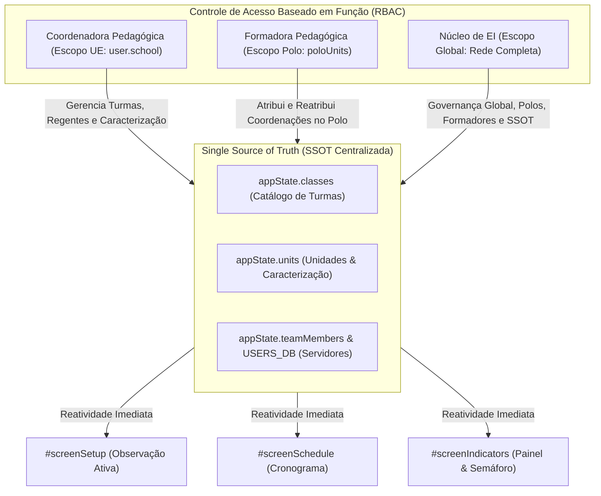

# PLANO DE IMPLEMENTAÇÃO: PILAR 14 - GOVERNANÇA OPERACIONAL DESCENTRALIZADA & GESTÃO AUTÔNOMA SOB SSOT ÚNICA

> **DIRETRIZ OBRIGATÓRIA DE EXECUÇÃO (ETAPA 2):**
> O assistente executor (Etapa 2) deve **obrigatoriamente ler e seguir as diretrizes dos arquivos `WORKFLOW_MACOS.md`, `WORKFLOW_GITHUB.md`, `AGENTS.md` e `GEMINI.md`** localizados na raiz do repositório antes de aplicar qualquer modificação no código. Nenhuma modificação deve ser realizada sem conformidade estrita com o workflow, incluindo:
> 1. Execução prévia de sincronização com o repositório remoto (`git pull origin main`).
> 2. Preservação integral de todas as regras de negócio consolidadas, dados cadastrais, blindagens RBAC, série histórica, ciclo longitudinal, turmas integrais (Pilar 4), fechamento nominal com justificativa parcial (Pilar 5), higienização terminológica para "observação" (Pilar 6), KPIs decisórios (Pilar 7), foco nos menores índices e gargalos (Pilar 8), popup mobile de filtros em bottom sheet (Pilar 9), semáforo bimestral de turmas e docentes regentes (Pilar 10), popups e bottom sheet de apoio às rubricas (Pilar 11), ocorrências com status "Conversado" e padrão MEC (Pilar 13) e integridade dos testes automatizados.
> 3. Verificação de integridade pós-edição com dupla checagem de leitura em cada trecho modificado.
> 4. Salvamento obrigatório do backup intermediário na pasta `intermediárias/` sob o nome `aplicativo_v117_pilar_14_governanca_descentralizada_ssot.html`.
> 5. Gestão dupla de Changelog no arquivo `CHANGELOG.md` e no modal `#modalChangelog` do `index.html`, registrando a **Versão 1.17 (ou v7.95)**.
> 6. Sincronização idêntica entre o arquivo principal `index.html` da raiz, `gestor supervisao_patos/index.html` e `gestor supervisao_patos/firebase_deploy/public/index.html`.
> 7. Checagem pré-push (`git fetch origin main`), commit semântico (`feat: implementar pilar 14 - governanca operacional descentralizada e gestao autonoma sob ssot unica (v1.17)`), push para `origin main` e deploy automático no GitHub Pages.
> 8. Execução pós-deploy obrigatória do algoritmo de auditoria (`python3 audit_platform.py --silent-on-success`) com comunicação estrita e exclusiva a problemas/falhas.

---

## 1. Diagnóstico e Contexto Técnico-Pedagógico

### 1.1 Cenário Atual
O Sistema de Supervisão Pedagógica **SerTão Criança** consolidou a inversão da unidade de análise para a **TURMA** (Pilar 1), a governança em 3 níveis (Pilar 2), o benchmark no Afunilamento (Pilar 3), a rotina de Turmas Integrais (Pilar 4), o fechamento nominal com justificativa em itens parciais (Pilar 5), a higienização terminológica (Pilar 6), KPIs decisórios (Pilar 7), o diagnóstico de gargalos (Pilar 8), a navegação mobile de filtros (Pilar 9), o semáforo bimestral de turmas e docentes (Pilar 10), o apoio às rubricas (Pilar 11) e a gestão de ocorrências no Padrão MEC (Pilar 13).

Contudo, na estrutura de governança operacional e gestão de cadastros, o sistema ainda apresentava uma assimetria centralizadora:
1. **Centralização Excessiva da Gestão na Coordenadora do Núcleo de EI:**  
   A interface de Gestão Pedagógica (`#homeGestaoView`) estava restrita exclusivamente ao perfil da Coordenadora do Núcleo de EI (`isNucleoEI(user)`). Coordenadoras Pedagógicas de UEs e Formadoras de Polos não dispunham de módulos de auto-gestão cadastral.
2. **Ausência de Módulo de Turmas no Sistema Operacional:**  
   Não existia na interface visual nenhuma tela ou modal para cadastrar, editar ou excluir turmas (`classes`). As turmas vinham pré-definidas em `INITIAL_CLASSES` ou geradas sinteticamente. A Coordenadora não conseguia abrir novas turmas da sua escola, alterar a etapa pedagógica, mudar a jornada entre Tempo Parcial e Integral ou alocar nominalmente as docentes regentes titulares de cada turno.
3. **Falta de Caracterização da Unidade Escolar (Censo Escolar / Inclusão):**  
   A Unidade Escolar (`units`) registrava apenas nome, polo e endereço genérico. Não havia campos para registrar a contagem total de alunos matriculados e o número de crianças público-alvo da educação inclusiva/diversidade, dados vitais para subsidiar decisões pedagógicas da coordenação.
4. **Falta de Autonomia Descentralizada por Escopo:**  
   - A Coordenadora deve atuar soberanamente sobre as turmas, docentes e caracterização da sua própria escola (`user.school`), sem ter acesso nem poluição visual de outras escolas da rede.
   - A Formadora deve gerenciar as coordenações pedagógicas das escolas vinculadas ao seu Polo Regional, sem acesso a escolas de outros polos.
   - A Coordenadora do Núcleo de EI mantém a governança global irrestrita (criação de formadoras, atribuição de polos, visão completa).
5. **Garantia de Single Source of Truth (SSOT):**  
   Qualquer alteração feita pela Coordenadora ou Formadora deve ser refletida de forma imediata e reativa em toda a plataforma (`appState.classes`, `appState.units`, `appState.teamMembers`, Setup `#screenSetup`, Cronograma `#screenSchedule`, Semáforo `#screenHistory`, Dossiê Longitudinal `#screenIndicators`), sem criar bases isoladas ou discrepâncias relacionais.

### 1.2 Fundamentação Oficial (Pilar 14 - Documento de Insights)
Conforme deliberado no documento oficial de insights (`docs/documento_insights_supervisao_pedagogica_20261020.md`):

> **PILAR 14: Governança Operacional Descentralizada & Gestão Autônoma sob SSOT Única**
> * **Autonomia da Coordenadora Pedagógica (Escopo UE):**
>   - A coordenadora pode adicionar, editar e remover turmas e professoras da sua escola.
>   - Pode caracterizar a unidade: cadastrar/atualizar o número de turmas, o total de alunos e a contagem de crianças público-alvo da educação inclusiva/diversidade.
>   - Pode configurar as turmas: definir a jornada (*Tempo Parcial* ou *Tempo Integral*), selecionar turnos (*Matutino* e *Vespertino*) e alocar nominalmente os docentes regentes titulares em seus respectivos turnos.
>   - **Restrição Estrita:** A coordenadora atua única e exclusivamente sobre os dados da sua própria Unidade Escolar (`user.school`). Os controles de interface não exibem nem permitem manipulação de outras UEs.
> * **Autonomia do Formador(a) Pedagógico(a) (Escopo Polo):**
>   - O formador tem permissão para editar os coordenadores de cada unidade, atribuir e reatribuir coordenadores a escolas, **mas somente das unidades escolares vinculadas ao seu polo regional**.
>   - Não tem acesso de alteração em escolas fora do seu polo.
> * **Autoridade Central da Coordenadora do Núcleo de EI (Gestão Central):**
>   - A Coordenadora do Núcleo de EI tem **acesso total**: é quem cria e cadastra formadores, define a vinculação de polos e unidades aos formadores e mantém a governança global da rede.
> * **Princípio Rígido da Single Source of Truth (SSOT):**
>   - Toda e qualquer edição cadastral (seja de turmas, docentes ou coordenações) é gravada diretamente na base única compartilhada (`appState` e repositório central), sincronizando instantaneamente referências relacionais.
>   - Nenhuma alteração gera bases paralelas ou desconectadas: a integridade de turmas, séries históricas e relatórios permanece unificada e reativa em tempo real.

---

## 2. Arquitetura e Mapeamento de Pontos de Impacto



### Componentes Afetados:
1. **Navegação & UI Header:**
   - Habilitação e dinamização de `#deskTabOpManagement` na barra superior para Coordenadora (`🏫 Minha Escola`) e Formadora (`🗺️ Meu Polo`).
   - Inclusão do botão contextual no menu mobile (`#mobileMenuOverlay` -> `#mobMenuOpManagementBtn`).
   - Card de Acesso Rápido na Home Padrão da Coordenadora (`#homeStandardView`).
2. **Visão de Gestão Pedagógica/Operacional (`#homeGestaoView`):**
   - Criação da nova sub-aba **`#pedagTabClasses`** ("🏫 Turmas & Regência Titular") e container **`#pedagViewClasses`**.
   - Customização de escopo em `#pedagViewUnits`, `#pedagViewClasses` e `#pedagViewTeam`.
3. **Caracterização da Unidade Escolar (`#unitCharacterizationCard` / `#modalEditUnitCharacterization`):**
   - Armazenamento em `unit.totalStudents`, `unit.inclusiveStudents`, `unit.address` e `unit.totalClasses`.
   - Formulário ágil para atualização da caracterização pela Coordenadora.
4. **Modal Unificado de Gestão de Turma (`#modalClassEditor`):**
   - Criação e edição de turmas com validação rigorosa do Padrão MEC:
     - Nome da Turma e Etapa Pedagógica (Berçário I/II, Maternal I/II, Infantil I/II).
     - Jornada Escolar: **Tempo Parcial** ou **Tempo Integral**.
     - Turno: Matutino, Vespertino (Tempo Parcial) ou Integral (Manhã + Tarde).
     - Alocação Nominal de Docentes Regentes Titulares:
       - Para Tempo Parcial: seleção dos docentes titulares da escola.
       - Para Tempo Integral: blocos segregados de docentes da Manhã (`teachersMorning`) e Tarde (`teachersAfternoon`), unificados em `teachers`.
5. **Modais de Membros (`#modalAddMember`, `#modalEditMember`):**
   - Adequação RBAC: Coordenadora cadastra/edita apenas professoras da sua própria UE.
   - Formadora cadastra/reatribui apenas Coordenadoras entre as escolas do seu polo regional.
   - Núcleo de EI mantém acesso universal.
6. **Propagação Relacional SSOT:**
   - Atualização de nomes de turma ou docentes sincroniza em tempo real com agendamentos e observações.
   - Registro de turmas excluídas (`appState.deletedClassIds`) para impedir ressurreição acidental em `getClassesForSchool`.

---

## 3. Especificação Passo a Passo de Implementação

### 3.1 Estrutura HTML: Nova Sub-Aba de Turmas e Card de Caracterização
Em `index.html`, adicionar o botão `#pedagTabClasses` e a sub-view `#pedagViewClasses`:
```html
<button class="btn pedag-subtab-btn" id="pedagTabClasses" onclick="switchPedagSubTab('classes')">
  🏫 Turmas & Regência Titular
</button>
```

Container `#pedagViewClasses`:
```html
<div id="pedagViewClasses" class="pedag-subview" style="display:none;">
  <div style="display:flex; justify-content:space-between; align-items:center; margin-bottom:16px; flex-wrap:wrap; gap:10px;">
    <div>
      <h3 style="font-size:16px; font-weight:800; color:var(--primary-dark);" id="classesViewTitle">Turmas & Regência Titular</h3>
      <p style="font-size:12px; color:var(--text-secondary);" id="classesViewSubtitle">Gestão descentralizada de turmas, jornada MEC e alocação de docentes regentes</p>
    </div>
    <div style="display:flex; gap:8px; flex-wrap:wrap;">
      <button class="btn btn-primary" onclick="openAddClassModal()">+ Cadastrar Nova Turma</button>
    </div>
  </div>

  <div class="card" id="classesFilterCard" style="display:none; margin-bottom:14px;">
    <!-- Filtros de Escola/Polo para Formador e Núcleo -->
    <div style="display:flex; gap:10px; align-items:center; flex-wrap:wrap;">
      <label class="form-label" style="margin:0;">Filtrar Unidade Escolar:</label>
      <select id="classesFilterSchool" class="form-select" style="width:auto;" onchange="renderClassesScreen()">
        <!-- Populado dinamicamente -->
      </select>
    </div>
  </div>

  <div class="card">
    <div style="overflow-x:auto;">
      <table class="data-table">
        <thead>
          <tr>
            <th>Turma / Etapa</th>
            <th>Unidade Escolar</th>
            <th>Jornada (Padrão MEC)</th>
            <th>Turno(s)</th>
            <th>Docentes Regentes Titulares</th>
            <th style="width:130px; text-align:center;">Ações</th>
          </tr>
        </thead>
        <tbody id="classesTableBody">
          <!-- Populado dinamicamente -->
        </tbody>
      </table>
    </div>
  </div>
</div>
```

### 3.2 Modal de Gestão de Turma (`#modalClassEditor`)
Permite cadastrar ou editar turma com seleção de jornada, turnos e regentes titulares segregados:
```html
<div id="modalClassEditor" class="modal-backdrop" onclick="closeClassEditorModal()">
  <div class="modal-panel" onclick="event.stopPropagation()" style="max-width:550px;">
    <div style="display:flex; justify-content:space-between; align-items:center; margin-bottom:14px;">
      <div style="font-size:17px; font-weight:800; color:var(--primary-dark);" id="modalClassEditorTitle">Cadastrar Turma</div>
      <button class="btn btn-secondary" style="padding:6px 10px;" onclick="closeClassEditorModal()">✕</button>
    </div>
    <input type="hidden" id="editClassId">

    <div class="form-group" id="groupClassSchool">
      <label class="form-label">Unidade Escolar</label>
      <select id="classEditorSchool" class="form-select" onchange="onClassEditorSchoolChange()">
        <!-- Populado dinamicamente ou fixado na UE da Coordenadora -->
      </select>
    </div>

    <div class="form-group">
      <label class="form-label">Nome da Turma</label>
      <input type="text" id="classEditorName" class="form-input" placeholder="Ex: Infantil I - Turma A">
    </div>

    <div class="form-group">
      <label class="form-label">Etapa da Educação Infantil</label>
      <select id="classEditorStage" class="form-select">
        <option value="Berçário I">Berçário I (0 a 1 ano)</option>
        <option value="Berçário II">Berçário II (1 a 2 anos)</option>
        <option value="Maternal I">Maternal I (2 a 3 anos)</option>
        <option value="Maternal II">Maternal II (3 a 4 anos)</option>
        <option value="Infantil I">Infantil I (4 a 5 anos)</option>
        <option value="Infantil II">Infantil II (5 a 6 anos)</option>
      </select>
    </div>

    <div class="form-group">
      <label class="form-label">Jornada Escolar (Padrão MEC)</label>
      <select id="classEditorShiftType" class="form-select" onchange="onClassShiftTypeChange()">
        <option value="parcial">Tempo Parcial</option>
        <option value="integral">Tempo Integral</option>
      </select>
    </div>

    <div class="form-group" id="groupClassShiftDetail">
      <label class="form-label">Turno de Funcionamento</label>
      <select id="classEditorShiftPeriod" class="form-select">
        <option value="Tempo Parcial (Matutino)">Matutino (Manhã)</option>
        <option value="Tempo Parcial (Vespertino)">Vespertino (Tarde)</option>
      </select>
    </div>

    <!-- Bloco de Docentes: Tempo Parcial -->
    <div class="form-group" id="groupTeachersSingle">
      <label class="form-label">Docentes Regentes Titulares</label>
      <div id="classEditorTeachersList" style="display:flex; flex-direction:column; gap:6px; max-height:160px; overflow-y:auto; border:1px solid var(--border); border-radius:8px; padding:10px;">
        <!-- Checkboxes das docentes da UE -->
      </div>
    </div>

    <!-- Bloco de Docentes: Tempo Integral (Manhã / Tarde) -->
    <div id="groupTeachersIntegral" style="display:none;">
      <div class="form-group">
        <label class="form-label">☀️ Docentes Regentes - Turno Matutino</label>
        <div id="classEditorTeachersMorningList" style="display:flex; flex-direction:column; gap:6px; max-height:130px; overflow-y:auto; border:1px solid var(--border); border-radius:8px; padding:10px;"></div>
      </div>
      <div class="form-group">
        <label class="form-label">🌤️ Docentes Regentes - Turno Vespertino</label>
        <div id="classEditorTeachersAfternoonList" style="display:flex; flex-direction:column; gap:6px; max-height:130px; overflow-y:auto; border:1px solid var(--border); border-radius:8px; padding:10px;"></div>
      </div>
    </div>

    <div style="display:flex; gap:10px; justify-content:flex-end; margin-top:18px;">
      <button class="btn btn-secondary" onclick="closeClassEditorModal()">Cancelar</button>
      <button class="btn btn-primary" onclick="saveClassEditor()">Salvar Turma</button>
    </div>
  </div>
</div>
```

### 3.3 Formulário de Caracterização da Escola
Na visualização da Coordenadora em `#pedagViewUnits`, renderizar o card de caracterização da UE:
- Total de Alunos Matriculados (`unit.totalStudents`).
- Crianças Público-Alvo da Educação Inclusiva (`unit.inclusiveStudents`).
- Total de Turmas em Atividade (`unit.totalClasses`).
- Endereço / Bairro (`unit.address`).
- Botão "Salvar Caracterização da UE" que grava diretamente em `appState.units` e sincroniza.

### 3.4 Controle de Acesso e Regras de Negócio (RBAC)
- **Coordenadora (`user.roleKey === 'coordenador'`):**
  - Vê apenas sua escola (`user.school`).
  - No modal de membros, o campo `roleKey` fica travado em `professora` e a escola em `user.school`.
  - Só pode adicionar/editar turmas para sua escola.
- **Formadora (`user.roleKey === 'formador'`):**
  - Vê apenas as escolas vinculadas ao seu polo regional (`appState.units.filter(u => u.polo === polo)`).
  - No modal de membros, pode atribuir/reatribuir coordenadoras entre as escolas do seu polo.
  - Não pode alterar dados de UEs de outros polos.
- **Núcleo de EI (`isNucleoEI(user)`):**
  - Acesso universal a todas as 32 UEs, Polos, Turmas e Membros.

---

## 4. Critérios de Aceite e Roteiro de Teste/Validação

1. **Autonomia da Coordenadora Pedagógica:**
   - [ ] Ao alternar para o perfil de Mariana Ferreira (Coordenadora do CEI Maria de Lourdes), a aba superior exibe `🏫 Minha Escola` (`#deskTabOpManagement`).
   - [ ] Ao abrir a Gestão da Escola, a Coordenadora visualiza a caracterização da sua escola, as turmas ativas e os docentes regentes.
   - [ ] A Coordenadora consegue cadastrar uma nova turma (ex: "Infantil II - Turma Bilingue"), definindo jornada e alocando professoras titulares.
   - [ ] A nova turma aparece imediatamente no seletor de turmas da observação (`#screenSetup`) e no Cronograma (`#screenSchedule`).
   - [ ] A Coordenadora consegue editar o total de alunos (ex: 120) e inclusão (ex: 8) na caracterização da UE.
   - [ ] A Coordenadora cadastra uma nova professora e esta fica vinculada exclusivamente à sua escola.
   - [ ] A interface da Coordenadora **não exibe nem permite manipular outras UEs**.
2. **Autonomia da Formadora Pedagógica:**
   - [ ] Ao alternar para Clarice Barbosa (Formadora do Polo 1 Norte), a aba superior exibe `🗺️ Meu Polo`.
   - [ ] A Formadora visualiza as escolas do Polo 1 e os coordenadores pedagógicos alocados.
   - [ ] A Formadora consegue reatribuir uma coordenadora entre as escolas do seu polo.
   - [ ] A Formadora é impedida de alterar escolas ou coordenadores de outros polos.
3. **SSOT e Persistência:**
   - [ ] Toda edição é gravada em `appState.classes`, `appState.units` e `appState.teamMembers`.
   - [ ] As atualizações resistem ao recarregamento de página (`saveState` / `loadState`).
   - [ ] Nenhuma base paralela é criada.

---

## 5. Seção Obrigatória: Alterações / Adições / Exclusões no Algoritmo de Auditoria

Conforme estipulado no `WORKFLOW_MACOS.md`, detalhamos as alterações determinísticas a serem incorporadas no algoritmo de auditoria (`audit_platform.py` e engine de testes do `index.html`):

### 5.1 Adições ao Módulo `catalogo_dados`
1. **Teste de Autonomia Cadastral da Coordenadora Pedagógica (Pilar 14):**
   - Simular login como Mariana Ferreira (`coordenador`).
   - Abrir `#modalClassEditor` e cadastrar uma turma de teste ("Infantil I - Turma Auditoria SSOT").
   - Verificar persistência em `appState.classes`.
   - Verificar resolução imediata em `getClassesForSchool('CEI Professora Maria de Lourdes')`.
2. **Teste de Caracterização da Unidade Escolar (Pilar 14):**
   - Atualizar `totalStudents = 145` e `inclusiveStudents = 12` no CEI Maria de Lourdes.
   - Verificar persistência no objeto da unidade em `appState.units`.
3. **Teste de Alocação Segregada por Turno em Turma Integral (Pilar 14):**
   - Cadastrar turma integral com regentes de manhã (`teachersMorning`) e tarde (`teachersAfternoon`).
   - Validar integridade e união em `teachers`.
4. **Teste de Restrição Estrita de Escopo da Coordenadora (Pilar 14):**
   - Validar que a Coordenadora não tem acesso para manipular UEs fora de `user.school`.
5. **Teste de Autonomia e Escopo da Formadora Pedagógica (Pilar 14):**
   - Simular login como Clarice Barbosa (`formador`).
   - Validar filtro e gestão restrita às escolas do Polo 1 (Norte).
   - Validar reatribuição de coordenadora no escopo do polo.

### 5.2 Adições ao Módulo `auth_rbac` e `navegacao_layout`
1. **Validação do Roteamento e Visibilidade de `#deskTabOpManagement`:**
   - Verificar que o botão exibe o rótulo correto para cada perfil (`Minha Escola` para CP, `Meu Polo` para FP).
2. **Validação do Menu Mobile Overlay:**
   - Verificar que `#mobMenuOpManagementBtn` está disponível e funcional no celular.

Com estas adições, a cobertura de testes da plataforma continuará em 100% aprovada, atestando deterministamente a integridade operacional do Pilar 14.
