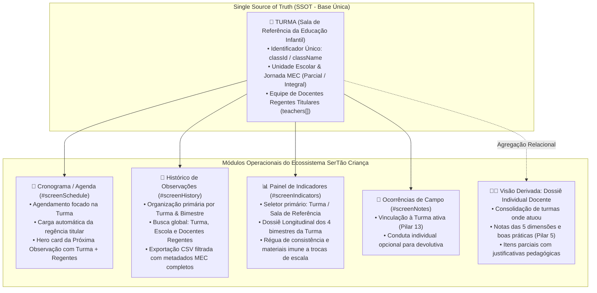

# PLANO DE IMPLEMENTAÇÃO: PILAR 15 - TRANSIÇÃO SISTÊMICA DA LÓGICA DE ATRIBUIÇÃO: A TURMA COMO EIXO CENTRAL EM TODO O ECOSSISTEMA

> **DIRETRIZ OBRIGATÓRIA DE EXECUÇÃO (ETAPA 2):**  
> O assistente executor (Etapa 2) deve **obrigatoriamente ler e seguir as diretrizes dos arquivos `WORKFLOW_MACOS.md`, `WORKFLOW_GITHUB.md`, `AGENTS.md` e `GEMINI.md`** localizados na raiz do repositório, bem como a workspace skill `.agents/skills/execucao-operario/SKILL.md` antes de aplicar qualquer modificação no código. Nenhuma modificação deve ser realizada sem conformidade estrita com o workflow, incluindo:
> 1. Execução prévia de sincronização com o repositório remoto (`git pull origin main`).
> 2. Preservação integral de todas as regras de negócio consolidadas, dados cadastrais, blindagens RBAC, série histórica, ciclo longitudinal, turmas integrais (Pilar 4), fechamento nominal com justificativa parcial (Pilar 5), higienização terminológica para "observação" (Pilar 6), KPIs decisórios (Pilar 7), foco nos menores índices e gargalos (Pilar 8), popup mobile de filtros em bottom sheet (Pilar 9), semáforo bimestral de turmas e docentes regentes (Pilar 10), popups e bottom sheet de apoio às rubricas (Pilar 11), ocorrências com status "Conversado" e padrão MEC (Pilar 13), governança descentralizada sob SSOT única (Pilar 14) e validação sintática pré-voo JSC.
> 3. Verificação de integridade pós-edição com dupla checagem de leitura em cada trecho modificado.
> 4. Validação sintática do JavaScript antes do commit/push via `python3 audit_platform.py --check-syntax`.
> 5. Salvamento obrigatório do backup intermediário na pasta `intermediárias/` sob o nome `aplicativo_v122_pilar_15_transicao_sistemica_turma.html`.
> 6. Gestão dupla de Changelog no arquivo `CHANGELOG.md` e no modal `#modalChangelog` do `index.html`, registrando a **Versão 1.22**.
> 7. Sincronização idêntica entre o arquivo principal `index.html` da raiz, `gestor supervisao_patos/index.html` e `gestor supervisao_patos/firebase_deploy/public/index.html`.
> 8. Checagem pré-push (`git fetch origin main`), commit semântico (`feat: implementar pilar 15 - transicao sistemica da atribuicao a turma em todo o ecossistema (v1.22)`), push para `origin main` e deploy automático no GitHub Pages.
> 9. Execução pós-deploy obrigatória do algoritmo de auditoria (`python3 audit_platform.py --silent-on-success`) com comunicação estrita e exclusiva a problemas/falhas.

---

## 1. Diagnóstico e Contexto Técnico-Pedagógico

### 1.1 Cenário Atual
O Sistema de Supervisão Pedagógica **SerTão Criança** (Patos/PB) introduziu no Pilar 1 a inversão da unidade de análise de coleta: em vez de avaliar um formulário por professor, a coordenação pedagógica avalia a **TURMA**. Isso refletiu a realidade pedagógica municipal, na qual não existem auxiliares de sala, mas sim **docentes regentes titulares** compartilhando a mesma turma (duplas no Tempo Parcial e quartetos no Tempo Integral).

No entanto, uma análise aprofundada de todo o ecossistema da aplicação revelou que, embora o formulário de coleta em sala (Setup `#screenSetup` e Rubricas `#screenRubrics`) já opere focado na turma, **a lógica de atribuição e organização em telas adjacentes ainda retinha resquícios fragmentados da abordagem centrada exclusivamente no indivíduo**:
1. **Cronograma / Agenda (`#screenSchedule`):**  
   - Na tabela desktop e nos cards adaptativos mobile, o agendamento ainda exibia colunas e rótulos genéricos ("Profissional / Turma"), e quando uma turma era selecionada, muitas vezes duplicava o nome da turma no título e subtítulo, omitindo a relação nominal das professoras regentes que atuam na sala.
   - O card de destaque da "Próxima Observação" (`.next-visit-hero-card`) tratava a turma e a coordenadora com a mesma formatação textual, sem destacar a turma como sujeito pedagógico e seus docentes regentes como equipe relacional.
2. **Histórico de Observações (`#screenHistory`):**  
   - O campo de busca textual (`#histFilterName`) realizava busca apenas em `o.teacherName` ou `o.schoolName`. Se a coordenadora buscasse pelo nome da turma (ex: "Infantil I" ou "Turma A") ou pelo nome da segunda regente titular da sala (registrada no array `o.teachers`), a busca não retornava resultados.
   - O seletor de turma (`#histFilterClass`) continha apenas etapas educacionais estáticas hardcoded (`Berçário I`, `Infantil I`, etc.), em vez de listar as turmas reais cadastradas na escola/polo via SSOT (`appState.classes`).
   - A exportação em CSV (`exportHistoryFilteredCSV`) era rudimentar: ignorava todos os filtros ativos de tela, omitia a **Turma**, omitia o **Bimestre**, omitia a **Jornada MEC** e reduzia a autoria a um único docente, em desacordo com as diretrizes da rede.
3. **Painel de Indicadores & Dossiê Longitudinal (`#screenIndicators`):**  
   - O terceiro seletor da barra de filtros (`#indicatorsMemberFilter`), com rótulo "Professora / Docente", listava exclusivamente os nomes individuais dos servidores (`scopedAvaliandos`).
   - Ao selecionar um indivíduo, o sistema entrava em uma visão longitudinal que filtrava estritamente por `o.teacherName === activeMemberFilter`. Dessa forma, se uma turma teve revezamento de escala, substituição ou afastamento legal de um docente em determinado bimestre, a série histórica da sala de aula ficava truncada.
   - **A evolução contínua da experiência educacional das crianças de 0 a 5 anos pertence à TURMA**. As trocas de profissionais não podem romper a linha histórica dos 4 bimestres daquela sala de referência.
4. **Ausência da Visão Derivada Consolidada do Docente:**  
   - O professor precisa, legitimamente, de sua ficha individual de devolutiva e acompanhamento formativo (conforme previsto no Pilar 5). Todavia, essa ficha não pode ser o eixo central que fragmenta os dados da escola; ela deve ser uma **visão derivada** calculada sobre as turmas em que o docente atuou, agregando os pareceres de práticas consistentes e as justificativas em critérios pontuados como parciais.

### 1.2 Fundamentação Oficial (Pilar 15 - Documento de Insights)
Conforme deliberado no documento oficial de insights técnico-pedagógicos (`docs/documento_insights_supervisao_pedagogica_20261020.md`):

> **PILAR 15: Transição Sistêmica da Lógica de Atribuição: A TURMA como Eixo Central em Todo o Ecossistema**  
> * **Diretriz Conceitual e Arquitetural Unificada:**  
>   A mudança da lógica de atribuição — vinculando à **TURMA** e não ao **professor** — transcende o formulário de rubricas (Pilar 1 e 5) e consolida-se como a regra estruturante de todos os módulos da plataforma:
>   1. **No Cronograma / Agenda (`#screenSchedule`):**  
>      O agendamento da observação é planejado e atribuído diretamente à **TURMA** (ex: *Infantil I - Turma A*), carregando automaticamente os docentes regentes titulares vinculados àquele turno.
>   2. **No Histórico de Observações (`#screenHistory`):**  
>      A listagem, filtros e exportações CSV organizam-se primariamente pela **Turma** e pelo período bimestral, informando a equipe docente regente como atributo relacional da aplicação.
>   3. **No Painel de Indicadores & Dossiê Longitudinal (`#screenIndicators`):**  
>      O seletor primário de análise individual passa a ser a **Turma / Sala de Referência** (substituindo a antiga filtragem exclusiva por docente). A série longitudinal de 4 bimestres acompanha a evolução contínua das crianças daquela turma, imune a trocas pontuais de escala, faltas ou licenças de docentes.
>   4. **Nas Ocorrências de Campo (`#modalQualitativeNote`):**  
>      A ocorrência é atrelada à Turma sob observação, permitindo apontar o docente específico apenas para efeito de intervenção pedagógica individualizada.
>   5. **Dossiê Individual Docente como Visão Derivada:**  
>      O professor continua tendo a sua ficha de devolutiva (Pilar 5), mas ela passa a ser uma visão derivada que consolida as avaliações das turmas em que atuou, sem fragmentar a base de dados escolar.

---

## 2. Arquitetura e Mapeamento de Pontos de Impacto



### Componentes e Telas Impactados:
1. **Cronograma de Acompanhamento (`#screenSchedule`):**
   - Atualização do cabeçalho da tabela desktop: ajuste semântico para *"Turma / Regência Titular"* (Coordenador) ou *"Coordenadora / Polo"* (Formador).
   - Renderização da tabela (`#scheduleTableBody`): exibição destacada da Turma com badge de turno MEC e relação nominal de docentes regentes titulares em linha complementar.
   - Renderização dos cards mobile (`#scheduleCardsContainer`): hierarquia visual com Turma como elemento principal e equipe regente em destaque.
   - Card Hero *"Próxima Observação"* (`.next-visit-hero-card`): exibição proeminente da Turma, turno e professores regentes titulares vinculados.
2. **Histórico de Observações (`#screenHistory`):**
   - Busca textual (`#histFilterName`): ampliação do matcher para pesquisar em `o.className`, `o.schoolName`, `o.teacherName`, `o.evaluatedBy` e no array `o.teachers`.
   - Seletor de turma (`#histFilterClass`): dinamização com as turmas da escola/escopo ativo a partir de `getClassesForSchool()` e `appState.classes`.
   - Cards do Histórico (`#historyCardsContainer`): padronização do título como `📚 Turma: ${item.className}` e metadado `👩‍🏫 Regência Titular: ${teachersStr}`, com badge de turno MEC.
   - Exportação CSV (`exportHistoryFilteredCSV()`): reestruturação para respeitar os filtros ativos de tela e incluir colunas estruturantes (`Turma`, `Jornada_MEC`, `Bimestre`, `Equipe_Regente_Titular`, `Consistencia_Pct`, `Uso_Materiais_Nivel`).
3. **Painel de Indicadores & Dossiê Longitudinal (`#screenIndicators`):**
   - **Toolbar de Filtros (`#indicatorsFilterToolbar`):**
     - O 3º seletor (`#indicatorsMemberFilter` / `#indicatorsMemberLabel`) passa a ser **"Turma da Educação Infantil"** para perfis de escola e coordenação (ou quando público for docente).
     - Rótulo dinâmico: *"Turma / Sala de Referência"* (Docência) vs. *"Coordenador(a) Pedagógico(a)"* (Tutoria Formadora).
     - Opções do seletor:
       - `ALL`: *"Todas as Turmas (Visão Geral da Escola / Rede)"*
       - Turmas cadastradas: `[Nome da Turma] · [Turno MEC] ([N] regentes)`
   - **Alternador de Modo de Análise no Painel:**
     - Botão / toggle para alternar entre:
       - **🏫 Modo Turma (Eixo Central do SerTão Criança)**: Dossiê Longitudinal da TURMA.
       - **👩‍🏫 Visão Derivada: Docente Individual**: Consolidação formativa da professora regente.
   - **Dossiê Longitudinal da TURMA (Caso Turma Selecionada):**
     - Cabeçalho do Dossiê: Nome da Turma, Unidade Escolar, Jornada/Turno MEC, Equipe de Regentes Titulares Vinculados, Crianças Matriculadas e Público de Inclusão.
     - 4 Cards de KPIs da Turma:
       1. Observações Concluídas da Turma (X de 4 bimestres).
       2. Evolução de Consistência nos 4 Bimestres (grid com porcentagens do 1º, 2º, 3º e 4º Bimestre e cores do semáforo).
       3. Balanço de Tendências de Critérios da Turma (▲ Progrediram, ✓ Consolidados, ⚠ Atenção).
       4. Escala de Uso de Materiais da Turma (Nível 1 a 4 com badge colorido e síntese da prática).
     - Sub-aba Afunilamento (Raio-X da Turma): matriz hierárquica item a item das observações daquela turma nos 4 bimestres com anotações de campo.
     - Sub-aba Longitudinal: foco no semáforo bimestral com realce para a turma selecionada.
   - **Dossiê Individual Docente (Visão Derivada Consolidada):**
     - Consolidação das observações de todas as turmas em que a professora atuou (`o.teachers.includes(docenteName) || o.teacherName === docenteName`).
     - Apresentação das turmas onde lecionou no ano letivo.
     - Síntese das notas nas 5 dimensões e pareceres descritivos de práticas consistentes (Pilar 5).
     - Lista dos critérios pontuados como parciais com suas respectivas justificativas registradas pela coordenação.
4. **Ocorrências de Campo (`#screenNotes`):**
   - Preservação da vinculação à Turma estabelecida no Pilar 13 (`plano_pilar_13_gestao_ocorrencias_padrao_mec.md`), garantindo exibição no padrão `📚 Turma · Jornada MEC` e conduta individual opcional.

---

## 3. Especificação Passo a Passo de Implementação

### 3.1 Cronograma de Acompanhamento (`#screenSchedule`)

#### 3.1.1 Ajuste no Cabeçalho da Tabela Desktop
Em `index.html` (por volta da linha 3764):
Substituir o cabeçalho estático `<th>Profissional / Turma</th>` por cabeçalho contextual reativo ou padronizado:
```html
<th>Turma / Regência Titular</th>
```

#### 3.1.2 Renderização da Tabela e Cards em `renderScheduleScreen()`
Em `index.html` (linhas ~14320-14630):
Garantir que a renderização dos itens no cronograma priorize a Turma para agendamentos escolares:
```javascript
// Determina se o agendamento é de Turma da Educação Infantil
const isClassSchedule = s.targetType === 'turma' || user.roleKey === 'coordenador';
const displayTitle = isClassSchedule ? `📚 ${s.className || s.targetName}` : `👤 ${s.targetName}`;
let displaySub = '';

if (isClassSchedule) {
  const teachersArr = Array.isArray(s.teachers) && s.teachers.length > 0 
    ? s.teachers 
    : (s.targetName && s.targetName !== s.className ? [s.targetName] : []);
  displaySub = teachersArr.length > 0 
    ? `👩‍🏫 Regência: ${teachersArr.join(', ')}` 
    : `<span style="color:#DC2626; font-style:italic;">⚠️ Sem regente atribuída</span>`;
} else {
  displaySub = s.className || 'Coordenação Pedagógica';
}
```

Na montagem da linha da tabela desktop:
```html
<td>
  <div style="font-size:14px; font-weight:800; color:var(--text-primary);">
    ${displayTitle} ${nextTagHtml}
  </div>
  <div style="font-size:11px; color:var(--text-secondary); margin-top:2px;">
    ${displaySub}
  </div>
</td>
```

No Hero Card da Próxima Observação (`.next-visit-hero-card`):
```javascript
const isNextClass = nextVisit.targetType === 'turma' || user.roleKey === 'coordenador';
const nextTitle = isNextClass ? `📚 ${nextVisit.className || nextVisit.targetName}` : nextVisit.targetName;
const nextTeachersArr = Array.isArray(nextVisit.teachers) && nextVisit.teachers.length > 0 
  ? nextVisit.teachers 
  : (nextVisit.targetName && nextVisit.targetName !== nextVisit.className ? [nextVisit.targetName] : []);
const nextSub = isNextClass 
  ? (nextTeachersArr.length > 0 ? `👩‍🏫 Regência: ${nextTeachersArr.join(', ')}` : 'Sem regente atribuída')
  : (nextVisit.className || 'Coordenação Pedagógica');
```

---

### 3.2 Histórico de Observações (`#screenHistory`)

#### 3.2.1 Ampliação do Matcher de Busca Textual em `renderHistoryScreen()`
Em `index.html` (linha ~13761):
Atualizar a cláusula de busca textual para abranger Turma, Escola, Avaliador e todos os Docentes do array `teachers`:
```javascript
if (nameQuery) {
  items = items.filter(o => {
    const classMatch = (o.className || '').toLowerCase().includes(nameQuery);
    const schoolMatch = (o.schoolName || '').toLowerCase().includes(nameQuery);
    const teacherMatch = (o.teacherName || '').toLowerCase().includes(nameQuery);
    const evaluatorMatch = (o.evaluatedBy || '').toLowerCase().includes(nameQuery);
    const regentsMatch = Array.isArray(o.teachers) && o.teachers.some(t => (t || '').toLowerCase().includes(nameQuery));
    return classMatch || schoolMatch || teacherMatch || evaluatorMatch || regentsMatch;
  });
}
```

#### 3.2.2 Dinamização do Filtro de Turma `#histFilterClass`
Atualizar o preenchimento ou opções do filtro `#histFilterClass`:
Ao renderizar o histórico ou alternar a escola, alimentar o seletor `#histFilterClass` com as turmas da unidade/polo corrente:
```javascript
function populateHistoryClassFilter() {
  const classSelect = document.getElementById('histFilterClass');
  if (!classSelect) return;
  const currentVal = classSelect.value || 'ALL';
  const user = getCurrentUser();

  let availableClasses = [];
  if (user.roleKey === 'coordenador') {
    availableClasses = getClassesForSchool(user.school);
  } else if (user.roleKey === 'formador') {
    const poloUnits = (appState.units || []).filter(u => u.polo === user.school).map(u => u.name);
    poloUnits.forEach(uName => {
      availableClasses = availableClasses.concat(getClassesForSchool(uName));
    });
  } else {
    availableClasses = appState.classes || [];
  }

  let html = `<option value="ALL">Todas as Turmas</option>`;
  // Se houver turmas cadastradas na SSOT
  if (availableClasses.length > 0) {
    const uniqueNames = Array.from(new Set(availableClasses.map(c => c.name))).sort();
    uniqueNames.forEach(cName => {
      html += `<option value="${cName}">${cName}</option>`;
    });
  } else {
    // Fallback para etapas canônicas MEC
    ['Berçário I', 'Berçário II', 'Maternal I', 'Maternal II', 'Infantil I', 'Infantil II'].forEach(etapa => {
      html += `<option value="${etapa}">${etapa}</option>`;
    });
  }
  classSelect.innerHTML = html;
  if (Array.from(classSelect.options).some(o => o.value === currentVal)) {
    classSelect.value = currentVal;
  } else {
    classSelect.value = 'ALL';
  }
}
```

#### 3.2.3 Exportação CSV Fiel aos Filtros e Estruturada pela Turma
Em `index.html` (linhas ~22124-22131):
Substituir `exportHistoryFilteredCSV()` para respeitar os filtros ativos e exportar a estrutura rica:
```javascript
function exportHistoryFilteredCSV() {
  // 1. Obtém as observações filtradas exatamente como exibidas na tela
  const user = getCurrentUser();
  const scopedObs = getScopedObservations();
  let items = scopedObs.filter(o => o.status === appState.historyFilter);

  const nameQuery = (document.getElementById('histFilterName')?.value || '').trim().toLowerCase();
  const startDate = document.getElementById('histFilterStartDate')?.value || '';
  const endDate = document.getElementById('histFilterEndDate')?.value || '';
  const matFilter = document.getElementById('histFilterMaterial')?.value || 'ALL';
  const classFilter = document.getElementById('histFilterClass')?.value || 'ALL';
  const bimFilter = document.getElementById('histFilterBimester')?.value || 'ALL';
  const archFilter = document.getElementById('histFilterArchiveStatus')?.value || 'active';

  if (appState.historyFilter === 'finalized') {
    if (archFilter === 'active') items = items.filter(o => !o.archived);
    else if (archFilter === 'archived') items = items.filter(o => o.archived === true);
  }

  if (nameQuery) {
    items = items.filter(o => {
      const classMatch = (o.className || '').toLowerCase().includes(nameQuery);
      const schoolMatch = (o.schoolName || '').toLowerCase().includes(nameQuery);
      const teacherMatch = (o.teacherName || '').toLowerCase().includes(nameQuery);
      const regentsMatch = Array.isArray(o.teachers) && o.teachers.some(t => (t || '').toLowerCase().includes(nameQuery));
      return classMatch || schoolMatch || teacherMatch || regentsMatch;
    });
  }

  if (startDate) items = items.filter(o => (o.endDate || o.date || o.startDate || '') >= startDate);
  if (endDate) items = items.filter(o => (o.startDate || o.date || o.endDate || '') <= endDate);
  if (matFilter !== 'ALL') items = items.filter(o => String(o.synthesisMaterialDimension) === matFilter);
  if (classFilter !== 'ALL') items = items.filter(o => (o.className || '').includes(classFilter));
  if (bimFilter !== 'ALL') items = items.filter(o => o.bimester === bimFilter);

  // 2. Monta cabeçalhos e linhas do CSV técnico do SerTão Criança
  const headers = [
    "ID", "Data", "Unidade_Escolar", "Turma", "Jornada_MEC", "Bimestre", 
    "Equipe_Regente_Titular", "Avaliador", "Consistencia_Pct", "Uso_Materiais_Nivel", "Status"
  ];

  const rows = items.map(o => {
    const regentsStr = Array.isArray(o.teachers) && o.teachers.length > 0 
      ? o.teachers.join('; ') 
      : (o.teacherName || '');
    const jornadaStr = o.isIntegral ? 'Tempo Integral' : formatMECShift(o.shift || o.classShift || 'Parcial Matutino');
    const scoreStr = (o.synthesisScore !== undefined && o.synthesisScore !== null) ? `${o.synthesisScore}%` : '--';
    const matStr = o.synthesisMaterialDimension ? `Nível ${o.synthesisMaterialDimension}` : '--';
    const dateStr = formatObservationDateRange(o) || o.date || '';

    return [
      o.id,
      `"${dateStr}"`,
      `"${(o.schoolName || '').replace(/"/g, '""')}"`,
      `"${(o.className || '').replace(/"/g, '""')}"`,
      `"${jornadaStr}"`,
      `"${o.bimester || ''}"`,
      `"${regentsStr.replace(/"/g, '""')}"`,
      `"${(o.evaluatedBy || '').replace(/"/g, '""')}"`,
      `"${scoreStr}"`,
      `"${matStr}"`,
      o.status
    ];
  });

  const csv = [headers.join(','), ...rows.map(r => r.join(','))].join('\n');
  downloadFile(csv, 'historico_observacoes_turmas.csv', 'text/csv');
  showToast(`${items.length} observação(ões) exportada(s) em CSV com sucesso!`);
}
```

---

### 3.3 Painel de Indicadores & Dossiê Longitudinal (`#screenIndicators`)

#### 3.3.1 Reestruturação do Toolbar de Filtros do Painel
Em `index.html` (linhas ~4217-4226):
Adaptar o 3º seletor para ser **"Turma da Educação Infantil"** quando o público for Docência:
- `#indicatorsMemberLabel`: *"Turma da Educação Infantil"* (ou *"Docente Regente"* quando no modo derivado, ou *"Coordenador(a)"* para formador).
- Seletor `#indicatorsMemberFilter`:
  - Contém as turmas da escola/polo.
  - Exibe no topo: `<option value="ALL">Todas as Turmas (Visão Geral da Escola / Rede)</option>`.
  - Exibe as turmas cadastradas com turno MEC e quantidade de regentes: `<option value="Infantil I - Turma A">Infantil I - Turma A · Parcial Matutino (2 regentes)</option>`.
  - Inclui botão ou alternador de modo no toolbar:
    - Botão `.btn-toggle-ind-mode`: Permite alternar entre **🏫 Análise por Turma** e **👩‍🏫 Visão Derivada Docente**.

#### 3.3.2 Lógica do Controlador `renderIndicatorsScreen()`
Em `index.html` (linhas ~18754-19050):
1. **Determinação do Modo Ativo**:
   - `appState.indicatorsAnalysisMode = appState.indicatorsAnalysisMode || 'class';` ('class' | 'teacher').
2. **População do Seletor `#indicatorsMemberFilter`**:
   - Se `targetType === 'coordenador'`: carrega coordenadoras pedagógicas (`scopedAvaliandos`).
   - Se `targetType === 'professora'`:
     - Se `analysisMode === 'class'`: carrega turmas de `scopedClasses`.
     - Se `analysisMode === 'teacher'`: carrega professoras de `scopedAvaliandos` (Visão Derivada).
3. **Caso Turma Específica Selecionada (`activeMemberFilter !== 'ALL'` e `analysisMode === 'class'`)**:
   - Localiza a turma em `appState.classes` ou sintetiza o objeto da turma.
   - Filtra as observações daquela turma:
     ```javascript
     const classObs = scopedObs.filter(o => o.className === activeMemberFilter);
     classObs.sort((a, b) => (a.date || '').localeCompare(b.date || ''));
     ```
   - Constrói o **Dossiê Longitudinal da TURMA**:
     - **Header da Turma**: Nome da Turma, Escola, Jornada MEC, Docentes Regentes Titulares (`cls.teachers.join(', ')`), Alunos Matriculados e Inclusão.
     - **Cards de KPIs da Turma**:
       - Observações Concluídas (X de 4 bimestres).
       - Evolução de Consistência nos 4 Bimestres (1º, 2º, 3º, 4º Bimestre da Turma).
       - Balanço de Tendências da Turma (▲ Progrediram, ✓ Consolidados, ⚠ Atenção).
       - Escala de Uso de Materiais da Turma (Nível 1 a 4 com tag e texto descritivo).
     - **Sub-aba Afunilamento (Drilldown da Turma)**:
       - Raio-X Item a Item das observações daquela turma nos 4 bimestres, com comentários pedagógicos registrados para a turma.
4. **Caso Visão Derivada Docente Selecionada (`analysisMode === 'teacher'`)**:
   - Localiza a professora em `appState.teamMembers`.
   - Filtra as observações de todas as turmas em que a professora atuou:
     ```javascript
     const teacherObs = scopedObs.filter(o => {
       const isDirect = o.teacherName === activeMemberFilter;
       const isRegent = Array.isArray(o.teachers) && o.teachers.includes(activeMemberFilter);
       return isDirect || isRegent;
     });
     ```
   - Constrói a **Ficha Individual Consolidada do Docente**:
     - Relação das turmas em que atuou.
     - Pareceres das 5 dimensões e registros de práticas consistentes preenchidos no fechamento nominal (Pilar 5).
     - Itens onde houve nota Parcial com justificativa mandatórias atribuídas àquela docente.
     - Botão de exportação em PDF da ficha individual.
5. **Preservação Integral do Caso "Todas as Turmas" (`activeMemberFilter === 'ALL'`)**:
   - Mantém intactos os 4 KPIs decisórios do Pilar 7, o benchmark UE vs Rede do Pilar 3, o diagnóstico de gargalos do Pilar 8 e o semáforo bimestral do Pilar 10.

---

### 3.4 Modal de Ocorrências de Campo (`#modalQualitativeNote`)
Confirmar conformidade do Pilar 13:
- Ocorrência vinculada primariamente à Turma ativa (`appState.currentObs.className`).
- Opção padrão: *"👥 Toda a Turma / Ambas as Regentes (Rotina Coletiva da Sala)"*.
- Opção individual: nominal para cada docente regente daquela turma caso couber conduta pontual.
- Preservação do ciclo de status *"Conversado"* (`🟢 Conversado` vs. `🟡 Aguardando Conversa`).

---

### 3.5 Gestão Dupla de Changelog & Metadados
- Atualizar o arquivo `CHANGELOG.md` registrando a **Versão 1.22**.
- Atualizar o modal `#modalChangelog` em `index.html` registrando a **Versão 1.22**.
- Atualizar os botões `.btn-changelog` com o rótulo `v1.22`.

---

### 3.6 Sincronização de Espelhos & Backup Intermediário
- Salvar backup funcional em `intermediárias/aplicativo_v122_pilar_15_transicao_sistemica_turma.html`.
- Sincronizar o arquivo espelho `firebase_deploy/public/index.html`.

---

## 4. Critérios de Aceite e Roteiro de Teste

### Checklist Operacional de Aceite:
1. **Cronograma / Agenda (`#screenSchedule`):**
   - [ ] Criar novo agendamento com Mariana (Coordenadora): o seletor exibe as turmas cadastradas da escola com indicação de turno e regentes.
   - [ ] Na tabela do cronograma desktop, o nome da Turma aparece com destaque e a lista de docentes regentes titulares é exibida logo abaixo.
   - [ ] O Hero Card da Próxima Observação exibe o nome da Turma como título principal e a relação das regentes como subtítulo.
   - [ ] Iniciar a observação a partir da agenda preenche automaticamente todos os metadados da Turma e sua regência titular no setup.
2. **Histórico de Observações (`#screenHistory`):**
   - [ ] Digitar o nome de uma turma (ex: "Infantil I") no campo de busca: as observações daquela turma são filtradas corretamente.
   - [ ] Digitar o nome de uma professora regente que compartilha a sala: a observação da turma é localizada com sucesso.
   - [ ] O seletor `#histFilterClass` lista as turmas da escola/polo.
   - [ ] Os cards exibem a Turma como título primário e a equipe docente regente em linha complementar.
   - [ ] Clicar no botão `📥 CSV`: o arquivo gerado contém apenas os registros visíveis e traz as colunas `Turma`, `Jornada_MEC`, `Bimestre` e `Equipe_Regente_Titular`.
3. **Painel de Indicadores & Dossiê Longitudinal (`#screenIndicators`):**
   - [ ] O 3º seletor do toolbar passa a listar as turmas da escola/rede no modo padrão.
   - [ ] Ao selecionar uma Turma específica (ex: "Infantil I - Turma A"):
     - Exibe o **Dossiê Longitudinal da TURMA** com metadados da sala, régua bimestral dos 4 bimestres daquela turma e escala de materiais.
     - A sub-aba Afunilamento exibe o Raio-X item a item das observações daquela turma nos 4 bimestres.
   - [ ] Ao alternar para o modo **Visão Derivada Docente**:
     - O seletor passa a listar as professoras regentes.
     - Ao selecionar uma docente, o sistema compila todas as turmas em que ela atuou e exibe sua ficha individual formativa com pareceres e itens parciais.
   - [ ] Quando `ALL` está selecionado, todos os KPIs do Pilar 7, Benchmark do Pilar 3, Gargalos do Pilar 8 e Semáforo do Pilar 10 continuam 100% funcionais.
4. **Validação Sintática & Auditoria:**
   - [ ] `python3 audit_platform.py --check-syntax` executa sem nenhum erro sintático (código 0).
   - [ ] `python3 audit_platform.py --silent-on-success` conclui com 100% de sucesso nos 12 módulos determinísticos.

---

## 5. Seção Obrigatória de Auditoria (`audit_platform.py` e Testes de `index.html`)

### 5.1 Alterações e Inclusões no Módulo 8 (`agenda_cronograma`):
- **Adição:** Validação da exibição prioritária da **Turma** e da equipe docente regente titular nos agendamentos escolares:
  - Verificar que o agendamento criado exibe a Turma como identificador principal.
  - Verificar que o Hero Card de Próxima Observação exibe o nome da Turma e os nomes das docentes regentes titulares vinculadas.

### 5.2 Alterações e Inclusões no Módulo 9 (`historico_governanca`):
- **Adição:** Teste interativo de busca textual multi-entidade:
  - Testar busca por nome da Turma (ex: `"Infantil I"`).
  - Testar busca por nome de docente regente titular (ex: `"Ana Carolina Silva"`).
- **Adição:** Validação do algoritmo de exportação CSV:
  - Garantir que `exportHistoryFilteredCSV()` respeita os filtros ativos e produz cabeçalhos contendo `Turma`, `Jornada_MEC`, `Bimestre` e `Equipe_Regente_Titular`.

### 5.3 Alterações e Inclusões no Módulo 10 (`indicadores_decisao`):
- **Adição:** Teste de seleção da **TURMA** no seletor primário de Indicadores:
  - Selecionar uma turma específica no seletor de turmas.
  - Validar que a tela renderiza o Dossiê Longitudinal da Turma (título da turma, régua dos 4 bimestres da sala e docentes regentes vinculados).
- **Adição:** Teste de alternância para o modo **Visão Derivada Docente**:
  - Selecionar uma docente específica.
  - Validar que a visão derivada consolida as avaliações das turmas em que atuou.
- **Preservação:** Garantir que todos os testes existentes do Pilar 3, Pilar 7, Pilar 8, Pilar 9 e Pilar 10 continuem sendo executados e aprovados com 100% de sucesso determinístico.

---

*Fim do Plano Executivo do Pilar 15. Este documento deve ser seguido à risca na Etapa 2 (Operário).*
