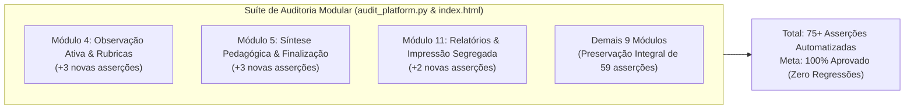

# PLANO DE IMPLEMENTAÇÃO: PILAR 5 - FECHAMENTO NOMINAL COM PARECER EM PRÁTICAS CONSISTENTES E ATRIBUIÇÃO MANDATÓRIA EM ITENS PARCIAIS

> **DIRETRIZ OBRIGATÓRIA DE EXECUÇÃO (ETAPA 2):**
> O assistente executor (Etapa 2) deve **obrigatoriamente ler e seguir as diretrizes dos arquivos `WORKFLOW_MACOS.md` e `AGENTS.md`** localizados na raiz do projeto antes de aplicar qualquer modificação no código. Nenhuma modificação deve ser realizada sem conformidade estrita com o workflow, incluindo:
> 1. Execução prévia de sincronização com o repositório remoto (`git pull origin main`).
> 2. Preservação integral das regras de negócio existentes, dados cadastrais, blindagens RBAC, série histórica, ciclo longitudinal, turmas integrais (Pilar 4) e testes automatizados.
> 3. Verificação de integridade pós-edição com dupla checagem de leitura em cada trecho modificado.
> 4. Salvamento obrigatório do backup intermediário na pasta `intermediárias/` sob o nome `aplicativo_v98_pilar_5_fechamento_nominal_atribuicao_parcial.html` (e espelho em subpastas caso aplicável).
> 5. Gestão dupla de Changelog no arquivo `CHANGELOG.md` e no modal `#modalChangelog` do `index.html`, registrando a **Versão 0.98**.
> 6. Sincronização idêntica entre o arquivo principal `index.html` da raiz, `gestor supervisao_patos/index.html` e `gestor supervisao_patos/firebase_deploy/public/index.html`.
> 7. Checagem pré-push (`git fetch origin main`), commit semântico (`feat: implementar pilar 5 - fechamento nominal, parecer em praticas consistentes, atribuicao parcial e exportacao segregada`), push para `origin main` e deploy automático no GitHub Pages.
> 8. Execução pós-deploy obrigatória do algoritmo de auditoria (`python3 audit_platform.py --silent-on-success`) com comunicação estrita a falhas.

---

## 1. Diagnóstico e Contexto Técnico-Pedagógico

### 1.1 Cenário Atual
Após a consolidação dos Pilares 1 a 4:
- **Pilar 1:** Inverteu a unidade de observação da sala de aula para a **TURMA**, refletindo o direito de acesso da criança às experiências pedagógicas e assegurando a série histórica da turma regida por duplas ou quartetos de docentes titulares.
- **Pilar 2:** Formalizou a tríade canônica de governança (Coordenadora da UE ➔ Formadora do Polo ➔ Coordenadora do Núcleo de Educação Infantil).
- **Pilar 3:** Estabeleceu o benchmark comparativo `% da UE vs. Rede` item a item no Afunilamento de Indicadores.
- **Pilar 4:** Unificou o instrumento para turmas em Tempo Integral em formulário único de 2 etapas (Manhã e Tarde).
- **Simplificação das Ocorrências (Versão 0.97):** Removeu do modal avulso de ocorrências de campo a seleção genérica de *Dimensão/Tópico*, concentrando a coleta de ocorrências no relato puro de fatos e condutas em sala de aula.

Entretanto, essa estrutura ainda apresenta três lacunas operacionais e pedagógicas críticas no preenchimento e no encerramento da observação:
1. **Anonimato e Abstração da Nota "Parcial":**
   Ao avaliar um critério das rubricas como `"Parcial"` no formulário da turma, o sistema atualmente apenas armazena `'partial'` no objeto `responses[critId]`. Não existe qualquer mecanismo para identificar **qual(is) professor(a)(es) daquela regência foi(ram) responsável(is) pela fragilidade observada**, nem qual foi a justificativa concreta da pontuação parcial. Isso gera um "dilema do carona" e desestimula a equipe: o docente que planejou e conduziu perfeitamente a sua intervenção é penalizado pela nota parcial gerada por fragilidade de outro colega, sem que a coordenação consiga detalhar quem precisa de apoio formativo específico.
2. **Subnotificação de Práticas Consistentes de Destaque:**
   Historicamente, os instrumentos de supervisão tendem a colher anotações apenas quando há falhas ou ocorrências negativas. Carolina Machado destacou na reunião técnica de deliberação que o nível **Consistente deve ter incentivo explícito e campo para documentação de boas práticas**. Sem essa valorização, perdem-se evidências de experiências exitosas que poderiam ser replicadas na rede municipal de Patos e perde-se o padrão avaliativo da coordenação frente ao Núcleo de EI.
3. **Fechamento Homogêneo e Ausência de Devolutiva Segregada:**
   Na tela de Síntese Final (`#screenSynthesis`), o parecer pedagógico e formativo atual (`#synthesisGeneralComments`) é um campo único aberto voltado à turma de forma genérica. Não há fechamento nominal por professor regente, nem avaliação das 5 grandes dimensões pedagógicas por docente, tampouco a possibilidade de gerar uma **Ficha Individual de Devolutiva Pedagógica (PDF Segregado)** para entregar a cada professora em sua reunião de alinhamento individual.

### 1.2 Fundamentação Técnico-Pedagógica (Documento de Insights / Deliberação ST Criança 19/10/2026 - Carolina Machado, 01:13:16)
Conforme estabelecido nas diretrizes oficiais do programa SerTão Criança:
1. **Feedback Individualizado e Valorização do Corpo Docente:**
   Para garantir que os professores recebam feedback individualizado e evitar o desincentivo de quem conduz bem a sala, o formulário da turma fecha com blocos nominais e traz rastreabilidade direta no preenchimento dos critérios da matriz.
2. **Documentação Descritiva de Boas Práticas (Nível Consistente):**
   O nível Consistente também deve ter campo de anotação descritiva, documentando a boa prática pedagógica para fins de replicação e fornecendo dados ao Núcleo de EI sobre o padrão avaliativo da coordenação.
3. **Nova Lógica de Atribuição Mandatória em Itens "Parcial":**
   Em substituição à seleção de dimensão/tópico retirada das ocorrências avulsas, estabelece-se a seguinte regra estrita para qualquer observação (parcial ou integral):
   - **Gatilho de Atribuição Mandatória:** Sempre que, dentro da escala de rubricas, o avaliador pontuar qualquer item como `"Parcial"`, o sistema exigirá **obrigatoriamente**:
     1. **Atribuição a Docente(s):** Vincular a nota a um (ou mais) professor(a)(es) regente(s) daquela turma responsável(is) pela prática naquele momento.
     2. **Descrição / Justificativa da Nota:** Campo de texto obrigatório para que o avaliador descreva o porquê da atribuição da nota parcial (evidências concretas da prática, fragilidades na mediação ou aspectos parciais observados).
   - Sem o cumprimento desses dois requisitos, o item é tratado como pendência impeditiva no motor de validação (`getObservationPendencies`), impossibilitando a finalização da observação.
4. **Fechamento Nominal e Devolutiva Segregada:**
   Ao término do instrumento, a síntese exibe os blocos individuais dos professores regentes da turma (duplas no parcial e quartetos no integral), com pontuação simplificada nas 5 grandes dimensões (`Consistente`, `Parcial`, `Não Realizado`), parecer formativo aberto e exportação de PDF segregado (relatório integrado da turma vs. ficha individual por professor).

### 1.3 Resultado Esperado com o Pilar 5
1. **Atribuição Mandatória Dinâmica no Card do Critério:**
   - Ao clicar em `Parcial`, expande-se dinamicamente no card do critério um contêiner estilizado contendo:
     - Seleção de Docente(s) Regente(s) da turma (chips com seleção ativa; trava automática para docente único).
     - Campo de justificativa descritiva da nota parcial (validação de tamanho mínimo).
   - Ao alterar para outro valor (`Consistente`, `Não Realizado`, `Não se Aplica`), o bloco é recolhido e a pendência é liberada.
2. **Destaque e Estímulo a Evidências em Práticas Consistentes:**
   - Ao marcar `Consistente`, o card do critério exibe badge positivo: `✨ Prática Consistente · Evidência de Boa Prática` e orienta o registro descritivo para fins de replicação.
3. **Motor de Pendências em Tempo Real (`getObservationPendencies`):**
   - O validador reconhece itens parciais não atribuídos ou sem justificativa como pendências críticas impeditivas de finalização, tanto no banner da observação ativa quanto na síntese.
4. **Blocos Finais Nominais na Síntese Pedagógica (`#screenSynthesis`):**
   - Inserção da seção **"Avaliação Nominal e Devolutiva por Professor(a) Regente"**:
     - Card individual para cada docente regente da turma.
     - Avaliação sintetizada nas 5 dimensões canônicas da prática docente infantil.
     - Consolidação automática dos critérios parciais atribuídos àquele docente específico com suas respectivas justificativas.
     - Campo de parecer formativo individual e combinados de desenvolvimento.
5. **Exportação Parametrizada de PDF Segregado (`#modalExportPdfOptions`):**
   - Modal de escolha ao acionar a impressão:
     - **Opção A:** Relatório Geral Integrado da Turma (visão macro com rubricas, materiais e blocos nominais de todos os docentes).
     - **Opção B:** Ficha Individual Formativa de Devolutiva Pedagógica (relatório limpo de 1 a 2 páginas por professor regente, com identificação, notas das 5 dimensões, itens parciais detalhados, parecer descritivo e campos de assinatura formal do supervisor e do professor).
6. **Auditoria Automatizada Completa (Cobertura 100%):**
   - Inclusão de novas asserções no Módulo 4 (`rubricas_observacao`), Módulo 5 (`sintese_finalizacao`) e Módulo 11 (`relatorio_impressao`), garantindo a integridade dos 67 testes atuais e elevando a suíte para 75+ testes determinísticos com 100% de aprovação.

---

## 2. Arquitetura e Modelagem de Dados

### 2.1 Arquivos Afetados
```
gestor supervisao_patos/
├── index.html                                                                 # Aplicação mestre servida via GitHub Pages
├── gestor supervisao_patos/index.html                                         # Cópia espelhada local
├── gestor supervisao_patos/firebase_deploy/public/index.html                  # Cópia espelhada de deploy Firebase
├── CHANGELOG.md                                                               # Registro histórico de versões (Versão 0.98)
├── intermediárias/aplicativo_v98_pilar_5_fechamento_nominal_atribuicao_parcial.html # Backup intermediário funcional
├── audit_platform.py                                                          # Algoritmo de auditoria modular da plataforma
└── docs/documento_insights_supervisao_pedagogica_20261020.md                  # Matriz de governança e documentação oficial
```

### 2.2 Estrutura do Objeto de Observação (`obs` / `appState.currentObs`)

O objeto de observação passará a conter dois novos nós estruturais dedicados, garantindo isolamento relacional e resiliência:

```javascript
{
  id: 'obs-1729524000000',
  evaluatedType: 'turma', // ou 'coordenador'
  className: 'Infantil I - Turma A',
  schoolName: 'CEI Professora Maria de Lourdes',
  bimester: '1º Bimestre',
  evaluatedBy: 'Mariana Ferreira',
  teachers: ['Ana Carolina Silva', 'Juliana Roberta Rocha'], // Dupla ou quarteto
  
  // Respostas tradicionais do instrumento
  responses: {
    '1.1.1': 'consistent',
    '1.1.2': 'partial',
    '1.1.3': 'consistent',
    // ...
  },
  criterionComments: {
    '1.1.1': 'Excelente uso de fantoches na contação de histórias com grande engajamento das crianças.',
    // ...
  },

  // =========================================================================
  // PILAR 5: ATRIBUIÇÃO MANDATÓRIA DE ITENS PONTUADOS COMO "PARCIAL"
  // =========================================================================
  partialAttributions: {
    '1.1.2': {
      teachers: ['Ana Carolina Silva'], // Array de nomes dos docentes regentes responsáveis
      justification: 'A professora utilizou apenas perguntas fechadas de sim/não durante a roda, sem instigar a formulação de hipóteses pelas crianças.'
    }
  },

  // =========================================================================
  // PILAR 5: SÍNTESE NOMINAL E DEVOLUTIVA FORMATIVA INDIVIDUAL POR DOCENTE
  // =========================================================================
  teacherSynthesis: {
    'Ana Carolina Silva': {
      dimensions: {
        estrategias: 'partial',            // 'consistent' | 'partial' | 'not_done'
        gestao_grupo: 'consistent',
        mediacao_individual: 'consistent',
        respeito_integridade: 'consistent',
        gestao_cuidados: 'consistent'
      },
      feedback: 'A professora Ana Carolina demonstrou excelente condução dos momentos de rotina e acolhimento afetuoso. Como combinado formativo para o próximo bimestre, iremos focar no planejamento de perguntas abertas que estimulem o pensamento crítico e a imaginação das crianças nas rodas de conversa.'
    },
    'Juliana Roberta Rocha': {
      dimensions: {
        estrategias: 'consistent',
        gestao_grupo: 'consistent',
        mediacao_individual: 'consistent',
        respeito_integridade: 'consistent',
        gestao_cuidados: 'consistent'
      },
      feedback: 'A professora Juliana apresentou grande intencionalidade pedagógica em todos os cantos temáticos. Prática consistente de mediação e organização dos materiais ao alcance autônomo das crianças.'
    }
  },

  // Parecer consolidado da dinâmica coletiva da turma
  comments: 'A turma demonstra rotina bem estabelecida e forte interação afetiva entre as crianças e a equipe docente.'
}
```

### 2.3 Matriz das 5 Dimensões Canônicas da Prática Docente na Educação Infantil
Para a avaliação simplificada nos blocos nominais de docentes, utilizam-se as 5 dimensões canônicas estruturantes já consagradas no referencial curricular:
1. `estrategias`: **Estratégias Didáticas**
2. `gestao_grupo`: **Gestão do Grupo e Ambiente**
3. `mediacao_individual`: **Mediação Individualizada**
4. `respeito_integridade`: **Respeito, Diversidade e Proteção à Integridade**
5. `gestao_cuidados`: **Gestão dos Cuidados e Promoção da Autonomia**

---

## 3. Especificação Detalhada de Interface e Experiência do Usuário (UI/UX)

```mermaid
flowchart TD
    subgraph Observacao["1. Durante a Observação Ativa (#screenActiveObs)"]
        Crit["Critério da Matriz de Rubricas"]
        Cons["Opção Consistente"]
        Parc["Opção Parcial"]
        
        Crit -->|Usuário clica em| Cons
        Crit -->|Usuário clica em| Parc
        
        Cons --> BadgeCons["Exibe Badge: ✨ Prática Consistente\nIncentivo para registrar boa prática"]
        Parc --> BoxParc["Expande Bloco de Atribuição Mandatória\n• Seleção de Docente(s) da Turma\n• Campo Obrigatório de Justificativa"]
        
        BoxParc --> CheckPend{"Docente selecionado e\nJustificativa >= 5 chars?"}
        CheckPend -- Não --> Pendencia["⚠️ Gera Pendência Bloqueante\n(#activeObsValidationBanner)"]
        CheckPend -- Sim --> OkCrit["Item Completo ✓"]
    end

    subgraph Sintese["2. Síntese Final (#screenSynthesis)"]
        NavSynth["Navegação para a Síntese"]
        BlocosDocentes["Blocos Finais Nominais dos Docentes Regentes"]
        DimDocente["Avaliação nas 5 Dimensões por Docente\n(Consistente / Parcial / Não Realizado)"]
        AutoList["Listagem Automática dos Itens Parciais\nAtribuídos ao Docente na Observação"]
        DevIndividual["Parecer Formativo e Combinados Individuais"]
        
        NavSynth --> BlocosDocentes
        BlocosDocentes --> DimDocente
        BlocosDocentes --> AutoList
        BlocosDocentes --> DevIndividual
    end

    subgraph Finalizacao["3. Finalização e Exportação de PDF"]
        BtnFin["Finalizar e Sincronizar"]
        ValidaFinal["Validação Integral (Rubricas + Atribuições Parciais + Sínteses Docentes)"]
        ModalPdf["#modalExportPdfOptions\nOpções de Exportação em PDF"]
        PdfTurma["📄 Relatório Integrado da Turma"]
        PdfDocente["👤 Ficha Formativa Individual do Docente"]
        
        BtnFin --> ValidaFinal
        ValidaFinal --> StatusFinal["Status: finalized / Sincronizado"]
        StatusFinal --> ModalPdf
        ModalPdf --> PdfTurma
        ModalPdf --> PdfDocente
    end
```



### 3.1 Bloco de Atribuição Mandatória no Card de Critério (`renderCriterionCard`)
Quando `resp === 'partial'`:
- Abaixo do seletor de 4 opções da escala, renderiza-se o container `#partial-attribution-box-${crit.id}`:
  - **Identificação Visual:** Borda esquerda âmbar (`border-left: 4px solid #D97706; background: #FFFBEB;`).
  - **Cabeçalho:** `⚠️ ATRIBUIÇÃO MANDATÓRIA (ITEM PARCIAL)` com subtítulo explicativo: *"Indique o(a) docente regente responsável por esta prática e justifique a pontuação parcial com evidências objetivas."*
  - **Seletores de Docente(s):**
    - Se a turma possui apenas 1 docente regente cadastrado: o docente é marcado e travado automaticamente (`disabled`), exibindo texto informativo.
    - Se a turma possui 2 ou mais docentes (parcial ou integral): são renderizados chips interativos para cada docente regente (`obs.teachers`), permitindo selecionar 1 ou múltiplos docentes.
  - **Área de Texto da Justificativa:**
    - Textarea obrigatório com estilo visual em destaque.
    - Contador de caracteres ou hint: *"Mínimo de 5 caracteres descrevendo a fragilidade ou aspecto parcial observado."*
    - Evento `onchange` / `oninput`: salva em `obs.partialAttributions[crit.id]` e recalcula pendências em tempo real.

### 3.2 Destaque para Práticas Consistentes
Quando `resp === 'consistent'`:
- No contêiner de comentários do critério, renderiza-se um badge visual discreto e incentivador:
  `<span class="badge-good-practice">✨ Evidência de Boa Prática (Consistente)</span>`
- O placeholder do textarea é adaptado dinamicamente:
  *"Descreva a boa prática pedagógica observada para fins de replicação e subsídio à devolutiva formativa..."*

### 3.3 Seção de Fechamento Nominal na Síntese (`#screenSynthesis`)
Logo após os blocos de materiais/organização e antes do Parecer Pedagógico Geral, insere-se a seção `#synthesisTeachersSection`:
- **Título da Seção:** `4. Avaliação Nominal e Devolutiva por Professor(a) Regente`
- **Subtítulo:** `Fechamento individualizado da prática de cada docente regente titular da turma`
- Para cada docente da lista `obs.teachers`:
  - **Card do Docente (`.teacher-synthesis-card`):**
    - **Header:** Nome da professora em destaque, avatar circular e badge indicativo (ex: *"Regente Titular"*).
    - **Grade das 5 Dimensões:**
      - Linhas compactas para cada dimensão:
        1. *Estratégias Didáticas*
        2. *Gestão do Grupo e Ambiente*
        3. *Mediação Individualizada*
        4. *Respeito, Diversidade e Proteção*
        5. *Gestão dos Cuidados e Autonomia*
      - Cada linha apresenta o trio de botões de cápsula:
        - `[ Consistente ]` (Verde)
        - `[ Parcial ]` (Âmbar)
        - `[ Não Realizado ]` (Vermelho)
    - **Painel de Rastreabilidade de Itens Parciais Vinculados:**
      - Se a docente recebeu apontamentos parciais nos critérios das rubricas, este bloco lista automaticamente:
        `📌 Critérios com Nota Parcial Atribuída:`
        - Card interno cinza/âmbar: `[Item 1.1.2] Realiza perguntas abertas... ➔ Motivo anotado: "Perguntas fechadas..."`
      - Se a docente não possui apontamentos parciais:
        `✓ Nenhum apontamento de fragilidade pontual atribuído nos critérios individuais.`
    - **Campo de Parecer e Combinados Formativos Individuais:**
      - Textarea específico para a professora:
        `#teacherFeedback-${index}`
        - Placeholder: *"Pontos fortes observados, evidências de práticas consistentes e combinados de aprimoramento individual para o próximo ciclo..."*

### 3.4 Modal de Seleção de PDF (`#modalExportPdfOptions`)
Ao clicar no botão de exportação em PDF na Síntese ou no Histórico:
- Se for uma observação de turma (`obs.evaluatedType === 'turma'`):
  - Abre modal com duas alternativas de exportação:
    1. **"📄 Relatório Geral Integrado da Turma"**
       - Imprime o relatório completo unificado com todas as rubricas, evidências, fotos, ocorrências, síntese coletiva e blocos nominais.
    2. **"👤 Ficha Formativa Individual do(a) Docente"**
       - Exibe um botão para cada professor(a) regente da turma:
         - `[ 🖨️ Ficha Devolutiva: Ana Carolina Silva ]`
         - `[ 🖨️ Ficha Devolutiva: Juliana Roberta Rocha ]`
- Se for observação de coordenação pedagógica (feita pela Formadora):
  - Dispara a impressão direta do instrumento de coordenação (sem abrir o seletor de turmas).

### 3.5 Ficha Individual Formativa de Devolutiva Pedagógica (Template de Impressão)
Injeta-se no DOM uma seção oculta para tela, mas acionada sob medida via classe de impressão `body.printing-teacher-devolutiva`:
- **Cabeçalho Oficial Institucional:**
  - Prefeitura Municipal de Patos / PB · Secretaria Municipal de Educação
  - Programa SerTão Criança · Supervisão e Acompanhamento Pedagógico da Educação Infantil
- **Identificação da Visita e do Docente:**
  - Docente: Nome completo
  - Escola / Unidade Escolar
  - Agrupamento / Turma e Turno
  - Bimestre / Ciclo Longitudinal
  - Data da Observação e Período Efetivo em Sala
  - Supervisor(a) Pedagógico(a) / Coordenador(a)
- **Tabela de Avaliação das 5 Dimensões:**
  - Grid formal exibindo o conceito alcançado pelo docente em cada uma das 5 dimensões estruturantes.
- **Relatório de Fragilidades e Oportunidades de Aprendizagem (Itens Parciais Atribuídos):**
  - Tabela com os critérios onde houve apontamento parcial, o texto canônico do item e a justificativa detalhada inserida pelo supervisor.
- **Parecer Pedagógico Formativo Individual e Combinados:**
  - Transcrição formatada do parecer do coordenador, destacando pontos fortes, boas práticas observadas e metas para a próxima observação.
- **Bloco de Assinaturas Formais e Ciência:**
  - Linha de Assinatura: *Supervisor(a) Pedagógico(a) Avaliador(a)*
  - Linha de Assinatura: *Professor(a) Regente Acompanhado(a)*
  - Data de Ciência e Devolutiva

---

## 4. Mapeamento de Funções Existentes e Novas Rotinas

| Função / Identificador | Status | Localização Estimada | Descrição do Impacto e Responsabilidade no Pilar 5 |
| :--- | :---: | :---: | :--- |
| `renderCriterionCard(crit, obsInstance)` | Modificada | ~9165 | Renderiza o contêiner de Atribuição Mandatória quando `resp === 'partial'`, renderiza badge de boa prática quando `resp === 'consistent'` e vincula eventos de docentes e justificativa. |
| `setCriterionPartialTeacher(critId, teacherName, isChecked)` | **Nova** | ~9360 | Gerencia a seleção/deseleção de docentes no array `obs.partialAttributions[critId].teachers` e persiste o estado. |
| `setCriterionPartialJustification(critId, text)` | **Nova** | ~9385 | Salva a justificativa em `obs.partialAttributions[critId].justification` e atualiza a contagem de pendências. |
| `getObservationPendencies(obs)` | Modificada | ~8748 | Adiciona a verificação de integridade dos itens parciais: exige pelo menos 1 docente e justificativa >= 5 caracteres para cada critério com `partial`. |
| `renderSynthesisScreen(preserveScroll)` | Modificada | ~9495 | Renderiza os blocos finais nominais por professor regente, preenche a avaliação das 5 dimensões e lista automaticamente os itens parciais atribuídos a cada docente. |
| `setTeacherSynthesisDimension(teacherName, dimKey, rating)` | **Nova** | ~10120 | Registra o conceito (`consistent`, `partial`, `not_done`) para uma dimensão específica de um professor regente em `obs.teacherSynthesis[teacherName].dimensions`. |
| `setTeacherSynthesisFeedback(teacherName, feedbackText)` | **Nova** | ~10145 | Salva o parecer pedagógico individual do docente em `obs.teacherSynthesis[teacherName].feedback`. |
| `finalizeObservation()` | Modificada | ~10370 | Adiciona validação obrigatória dos blocos nominais de docentes antes de permitir a finalização de observações de turmas. |
| `openExportPdfModal()` | **Nova** | ~10515 | Abre o modal `#modalExportPdfOptions` para que o coordenador escolha entre o Relatório Integrado da Turma e a Ficha Individual de cada docente. |
| `printIndividualTeacherDevolutiva(teacherName)` | **Nova** | ~10540 | Monta dinamicamente a Ficha Formativa Individual do docente selecionado, aplica a classe de impressão no `body` e aciona `window.print()`. |
| `exportSynthesisToPdf()` | Modificada | ~10512 | Se for turma, redireciona para `openExportPdfModal()`; se for coordenador, executa a impressão direta legada. |

---

## 5. Roteiro Passo a Passo de Implementação (Etapa 2)

### Passo 1: Inicialização das Novas Estruturas no Objeto de Observação
Em `startNewObservation()` (~linha 8661) e `resumeObservation()` (~linha 8720):
- Garantir que `newObs` seja instanciado com:
  ```javascript
  partialAttributions: {},
  teacherSynthesis: {}
  ```
- Ao iniciar a observação para uma turma, inicializar preliminarmente os nós de cada professor regente da turma em `teacherSynthesis`:
  ```javascript
  teachersList.forEach(tName => {
    newObs.teacherSynthesis[tName] = {
      dimensions: {
        estrategias: null,
        gestao_grupo: null,
        mediacao_individual: null,
        respeito_integridade: null,
        gestao_cuidados: null
      },
      feedback: ''
    };
  });
  ```

### Passo 2: Atualização do Card de Critério (`renderCriterionCard`)
1. No template HTML retornado por `renderCriterionCard()`:
   - Identificar se a observação é de turma (`obs.evaluatedType === 'turma'`).
   - Se a resposta atual for `'partial'`:
     - Gerar o bloco `#partial-box-${crit.id}`.
     - Obter a lista de professores regentes da turma: `const teachers = obsInstance.teachers || [];`.
     - Renderizar os seletores de professor (checkboxes/chips estilizados) e o textarea de justificativa:
       ```javascript
       const currentAttr = (obsInstance.partialAttributions && obsInstance.partialAttributions[crit.id]) || { teachers: [], justification: '' };
       ```
   - Se a resposta for `'consistent'`:
     - Injetar no topo do campo de comentários o selo indicativo:
       `<div class="consistent-evidence-badge">✨ Evidência de Boa Prática (Consistente)</div>`
2. Implementar as funções de manipulação reativa:
   - `setCriterionPartialTeacher(critId, teacherName, isChecked)`
   - `setCriterionPartialJustification(critId, text)`

### Passo 3: Atualização do Motor de Pendências (`getObservationPendencies`)
Em `getObservationPendencies(obs)`:
- Iterar sobre as respostas da matriz.
- Se `responses[crit.id] === 'partial'` e a observação for de turma (`obs.evaluatedType === 'turma'`):
  - Obter `const attr = obs.partialAttributions && obs.partialAttributions[crit.id];`
  - Validar se `!attr || !attr.teachers || attr.teachers.length === 0`:
    - Adicionar pendência: `{ criterionId: crit.id, dimensionIndex: sIdx, message: 'Item Parcial requer seleção do(a) docente responsável' }`
  - Validar se `!attr.justification || attr.justification.trim().length < 5`:
    - Adicionar pendência: `{ criterionId: crit.id, dimensionIndex: sIdx, message: 'Item Parcial requer justificativa descritiva' }`

### Passo 4: Implementação dos Blocos Nominais na Síntese (`renderSynthesisScreen`)
1. No HTML de `screenSynthesis`, inserir o contêiner:
   ```html
   <div id="synthesisTeachersSection" style="margin-top:24px; margin-bottom:20px; page-break-inside:avoid;">
     <div style="font-size:15px; font-weight:800; color:var(--primary-dark); margin-bottom:4px; display:flex; align-items:center; gap:8px;">
       <svg width="20" height="20" viewBox="0 0 24 24" fill="none" stroke="currentColor" stroke-width="2.2"><path d="M17 21v-2a4 4 0 0 0-4-4H5a4 4 0 0 0-4 4v2"/><circle cx="9" cy="7" r="4"/><path d="M23 21v-2a4 4 0 0 0-3-3.87"/><path d="M16 3.13a4 4 0 0 1 0 7.75"/></svg>
       <span>4. Avaliação Nominal e Devolutiva por Professor(a) Regente</span>
     </div>
     <div style="font-size:12px; color:var(--text-secondary); margin-bottom:14px;">
       Fechamento pedagógico individualizado da regência de cada docente titular da turma.
     </div>
     <div id="synthesisTeacherCardsContainer"></div>
   </div>
   ```
2. Na função `renderSynthesisScreen()`, quando `obs.evaluatedType === 'turma'`:
   - Exibir `#synthesisTeachersSection`.
   - Iterar sobre `obs.teachers`.
   - Para cada docente:
     - Renderizar o card individual contendo as 5 dimensões com os 3 botões em formato de cápsula (`Consistente`, `Parcial`, `Não Realizado`).
     - Realizar a busca reativa de quais critérios da observação possuem esse docente vinculado em `obs.partialAttributions`.
     - Exibir o bloco de critérios parciais vinculados com a justificativa registrada.
     - Renderizar o textarea do parecer formativo individual (`#teacherFeedback-${idx}`).

### Passo 5: Validação na Finalização da Observação (`finalizeObservation`)
Em `finalizeObservation()`:
- Além das pendências das rubricas e dos horários de turma integral, se `obs.evaluatedType === 'turma'`:
  - Verificar se para cada professor em `obs.teachers`:
    - Todas as 5 dimensões foram avaliadas (`teacherSynthesis[tName].dimensions[dim]`). Se faltar alguma dimensão, disparar aviso toast e focar no bloco do docente.
    - O parecer formativo individual possui conteúdo (`feedback` não vazio).

### Passo 6: Criação do Modal de Exportação e Ficha Individual
1. Inserir no HTML o modal `#modalExportPdfOptions`:
   - Modal com estilo moderno, apresentando botões para o Relatório Completo da Turma e botões nominais para a ficha de cada docente.
2. Inserir a seção de impressão dedicada `#teacherIndividualDevolutivaPrintSection` com estilos em `@media print`:
   - Ativada exclusivamente quando o `body` possuir a classe `printing-teacher-devolutiva`.
   - Estrutura formal com cabeçalho oficial de Patos, identificação, tabela das 5 dimensões, lista de fragilidades pontuais, parecer e linhas de assinatura.
3. Implementar a rotina `printIndividualTeacherDevolutiva(teacherName)`.

### Passo 7: Gestão do Changelog Duplo e Backup Intermediário
1. Registrar a **Versão 0.98** no arquivo `CHANGELOG.md` e no modal `#modalChangelog` do `index.html`.
2. Salvar backup funcional em `intermediárias/aplicativo_v98_pilar_5_fechamento_nominal_atribuicao_parcial.html`.
3. Sincronizar os arquivos espelhos `gestor supervisao_patos/index.html` e `gestor supervisao_patos/firebase_deploy/public/index.html`.

---

## 6. Seção Obrigatória de Auditoria Modular (Cobertura 100% Modo-a-Modo)

Conforme determinado no **`WORKFLOW_MACOS.md`** e no checklist obrigatório de agentes, esta seção especifica minuciosamente as alterações, adições e exclusões a serem implementadas no algoritmo de auditoria da plataforma (`audit_platform.py` e engine de testes do `index.html`), estruturado módulo a módulo ("modo-a-modo"):



### 6.1 Módulos com Alterações e Adições Específicas

#### MÓDULO 4: Observação Ativa, Matrizes Curriculares, Rubricas e Pendências
- **Novas Asserções a Implementar:**
  1. `✔ PASS | Atribuição Mandatória em Item Parcial: expansão dinâmica do bloco ao marcar 'partial'`:
     - Simular clique na opção `Parcial` de um critério (ex: `1.1.2`).
     - Verificar que o container de atribuição mandatória `#partial-attribution-box-1.1.2` é renderizado no DOM com os nomes dos docentes regentes da turma.
  2. `✔ PASS | Guardião de Pendência em Item Parcial: bloqueio sem docente ou justificativa`:
     - Avaliar o retorno de `getObservationPendencies()`.
     - Confirmar que, enquanto o docente não for selecionado ou a justificativa tiver menos de 5 caracteres, o item é retornado na lista de pendências da observação ativa.
  3. `✔ PASS | Resolução de Pendência de Item Parcial e incentivo em Prática Consistente`:
     - Selecionar o docente regente e preencher justificativa válida.
     - Confirmar que a pendência do item é removida de `getObservationPendencies()`.
     - Simular marcação de item como `consistent` e verificar exibição do badge de boa prática.

#### MÓDULO 5: Síntese Pedagógica, Escala de Materiais, Finalização e Cálculo de Tempo
- **Novas Asserções a Implementar:**
  1. `✔ PASS | Renderização dos Blocos Finais Nominais por Professor Regente na Síntese`:
     - Navegar para `#screenSynthesis` com observação de turma ativa.
     - Verificar que a seção `#synthesisTeachersSection` é renderizada com um card individual para cada docente de `obs.teachers`.
  2. `✔ PASS | Rastreabilidade e Vínculo Automático de Itens Parciais no Card do Docente`:
     - Verificar que o critério pontuado como parcial no Módulo 4 aparece listado dentro do card da docente atribuída, contendo o ID do item e o texto da justificativa inserida.
  3. `✔ PASS | Avaliação das 5 Dimensões e Parecer Individual com Validação na Finalização`:
     - Testar preenchimento dos conceitos das 5 dimensões para cada docente regente (`consistent`, `partial`, `not_done`).
     - Testar preenchimento do parecer individual descritivo.
     - Confirmar que a função `finalizeObservation()` valida a completude de todos os docentes regentes antes de consolidar o status para `finalized`.

#### MÓDULO 11: Persistência Local, Backup JSON, Restauração e Relatório para Impressão
- **Novas Asserções a Implementar:**
  1. `✔ PASS | Modal de Opções de Exportação em PDF Segregado (#modalExportPdfOptions)`:
     - Disparar `exportSynthesisToPdf()` em observação de turma finalizada.
     - Verificar a abertura do modal `#modalExportPdfOptions` contendo a opção do Relatório Integrado e os botões individuais de cada docente regente.
  2. `✔ PASS | Geração e Integridade da Ficha Formativa Individual do Docente`:
     - Acionar a rotina `printIndividualTeacherDevolutiva(teacherName)`.
     - Verificar que a seção `#teacherIndividualDevolutivaPrintSection` é populada com cabeçalho de Patos, notas das 5 dimensões, itens parciais detalhados e linhas de assinatura.

### 6.2 Módulos Preservados sem Regressão (Garantia de Integridade Integral)
- **Módulo 1 (`auth_rbac`):** Preservação das 7 asserções de login, isolamento de perfis e resiliência de `isNucleoEI()`.
- **Módulo 2 (`catalogo_dados`):** Preservação das 7 asserções de escolas, turmas, docentes e retenção nos modais.
- **Módulo 3 (`setup_longitudinal`):** Preservação das 7 asserções de setup por turma, bloqueio de avisos e detecção de tempo integral.
- **Módulo 6 (`travas_seguranca`):** Preservação das 7 asserções de duplo lançamento, ocorrências vinculadas à turma e guardião de observação.
- **Módulo 7 (`formadora_coordenacao`):** Preservação das 4 asserções de matriz de coordenação e bloqueio de avaliação direta do Núcleo de EI.
- **Módulo 8 (`cronograma_agenda`):** Preservação das 6 asserções de agenda, baixa automática e botão de devolutiva.
- **Módulo 9 (`historico_governanca`):** Preservação das 2 asserções de filtros multidimensionais e histórico de concluídas.
- **Módulo 10 (`indicadores_benchmark`):** Preservação das 6 asserções de KPIs, afunilamento, réguas duplas e deltas do Pilar 3.
- **Módulo 12 (`rotas_changelog`):** Preservação das 4 asserções de navegação, modal changelog e atualização da versão para 0.98.

### 6.3 Critérios Inegociáveis de Homologação Pós-Deploy
1. Executar `python3 audit_platform.py --silent-on-success`.
2. Obter **100% de sucesso (75+/75+ asserções aprovadas)**.
3. Comunicação ao usuário restrita a eventuais falhas (se 100% aprovado, emitir confirmação sucinta e limpa).
