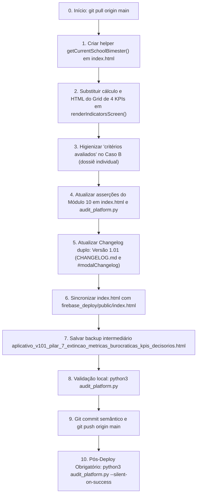

# PLANO DE IMPLEMENTAÇÃO: PILAR 7 - EXTINÇÃO DE MÉTRICAS BUROCRÁTICAS ("VISITAS AUDITADAS" E "ITENS VÁLIDOS / N.A.") E REORGANIZAÇÃO DOS KPIS DECISÓRIOS

> **DIRETRIZ OBRIGATÓRIA DE EXECUÇÃO (ETAPA 2):**
> O assistente executor (Etapa 2) deve **obrigatoriamente ler e seguir as diretrizes dos arquivos `WORKFLOW_MACOS.md` e `AGENTS.md`** localizados na raiz do projeto antes de aplicar qualquer modificação no código. Nenhuma modificação deve ser realizada sem conformidade estrita com o workflow, incluindo:
> 1. Execução prévia de sincronização com o repositório remoto (`git pull origin main`).
> 2. Preservação integral das regras de negócio existentes, dados cadastrais, blindagens RBAC, série histórica, ciclo longitudinal, turmas integrais (Pilar 4), fechamento nominal e parecer em práticas consistentes (Pilar 5), higienização terminológica para "observação" (Pilar 6) e testes automatizados.
> 3. Verificação de integridade pós-edição com dupla checagem de leitura em cada trecho modificado.
> 4. Salvamento obrigatório do backup intermediário na pasta `intermediárias/` sob o nome `aplicativo_v101_pilar_7_extincao_metricas_burocraticas_kpis_decisorios.html`.
> 5. Gestão dupla de Changelog no arquivo `CHANGELOG.md` e no modal `#modalChangelog` do `index.html`, registrando a **Versão 1.01 (ou 0.101)**.
> 6. Sincronização idêntica entre o arquivo principal `index.html` da raiz, `gestor supervisao_patos/index.html` e `gestor supervisao_patos/firebase_deploy/public/index.html`.
> 7. Checagem pré-push (`git fetch origin main`), commit semântico (`feat: implementar pilar 7 - extincao de metricas burocraticas e novos kpis decisorios com cobertura no bimestre corrente (v1.01)`), push para `origin main` e deploy automático no GitHub Pages.
> 8. Execução pós-deploy obrigatória do algoritmo de auditoria (`python3 audit_platform.py --silent-on-success`) com comunicação estrita a falhas.

---

## 1. Diagnóstico e Contexto Técnico-Pedagógico

### 1.1 Cenário Atual
Após a implementação e homologação dos Pilares 1 a 6 do Sistema de Supervisão Pedagógica **SerTão Criança**:
- **Pilar 1:** Inverteu a unidade de observação da sala de aula para a **TURMA**, preservando a rotina coletiva das crianças e consolidando a série histórica da turma regida por duplas ou quartetos de docentes regentes titulares.
- **Pilar 2:** Formalizou a governança canônica em 3 níveis (Coordenadora da UE ➔ Formadora do Polo ➔ Coordenadora do Núcleo de Educação Infantil).
- **Pilar 3:** Estabeleceu o benchmark comparativo `% da UE vs. Rede` item a item no Afunilamento de Indicadores com régua dupla e categorização de desvios pedagógicos.
- **Pilar 4:** Unificou o instrumento para turmas em Tempo Integral em formulário único de 2 etapas (Manhã e Tarde), com soma de tempos e preservação de planejamento conjunto.
- **Pilar 5:** Implementou o fechamento nominal por docente regente, avaliação nas 5 dimensões estruturantes, parecer descritivo aberto em práticas consistentes, trava e justificativa obrigatória em itens parciais e geração segregada de fichas individuais em PDF.
- **Pilar 6:** Concluiu a higienização terminológica completa de *"visita"* para **"observação"** em 100% dos fluxos e telas da aplicação.

Contudo, na tela de **Indicadores Pedagógicos** (`#screenIndicators`), o Grid Superior de KPIs da Visão Panorâmica Geral (`#indicatorsSectionKPIs`) ainda apresenta uma estrutura herdada da fase inicial de desenvolvimento estatístico do protótipo, exibindo métricas cartoriais e burocráticas que desviam a atenção dos gestores:
1. **Card "Observações Auditadas" (antigo "Visitas Auditadas"):** Limita-se a exibir uma contagem agregada e bruta de formulários finalizados no banco (`scopedObs.length`). Essa métrica é puramente burocrática, pois não informa se as turmas foram acompanhadas no bimestre corrente, se a escola está dentro do prazo regulamentar ou se há turmas descobertas.
2. **Card "Itens Válidos / N.A.":** Exibe uma contagem de critérios da matriz excluindo o "Não se Aplica" (ex: `460 (12 N/A)`). Trata-se de uma métrica técnica de depuração estatística da matriz curricular que **não possui nenhuma utilidade prática para a tomada de decisão da Coordenadora da UE, da Formadora ou do Núcleo de EI**.
3. **Card de Cobertura Atual:** O card existente calcula a cobertura considerando qualquer observação histórica realizada ao longo de todo o ano letivo, mascarando o déficit de turmas no ciclo bimestral em andamento.

### 1.2 Fundamentação Técnico-Pedagógica (Documento de Insights / Deliberação ST Criança 19/10/2026)
Conforme estabelecido explicitamente no Documento Oficial de Referência de Produto, Governança e Arquitetura (`documento_insights_supervisao_pedagogica_20261020.md`):
> **PILAR 7: Extinção de Métricas Burocráticas ("Visitas Auditadas" e "Itens Válidos / N.A.")**
> - O card `Visitas Auditadas` é removido.
> - O card `Itens Válidos / N.A.` é removido.
> - O grid superior de 4 colunas é reorganizado com métricas 100% orientadas à ação e intervenção, com destaque para a **Cobertura de Turmas** (% de turmas da unidade/polo com observação concluída no bimestre corrente).

E de acordo com a Seção 3 do `WORKFLOW_MACOS.md`:
> *"O assistente deve sempre trabalhar na lógica de dados e indicadores como apoiadores para a tomada de decisão, com foco e atenção redobrada na aba de Indicadores. Dados, gráficos, médias, distribuições e métricas não devem existir como meros elementos visuais, informativos ou burocráticos. Toda informação apresentada deve responder a uma pergunta prática de gestão ou acompanhamento pedagógico."*

### 1.3 Resultado Esperado com o Pilar 7
1. **Extinção Definitiva das Métricas Burocráticas:**
   - Remoção completa dos cards `Observações Auditadas` e `Itens Válidos / N.A.`.
   - Higienização residual no Caso B (dossiê individual do docente): substituição da frase `critérios auditados na matriz` por `critérios avaliados na matriz`.
2. **Reorganização do Grid Superior em 4 KPIs Decisórios de Alto Impacto:**
   ```
   ┌───────────────────────┬───────────────────────┬───────────────────────┬───────────────────────┐
   │ CARD 1: CONSISTÊNCIA  │ CARD 2: COBERTURA NO  │ CARD 3: META DO       │ CARD 4: DIMENSÃO      │
   │ GERAL                 │ BIMESTRE CORRENTE     │ CICLO ANUAL           │ PRIORITÁRIA (GARGALO) │
   │                       │ (DESTAQUE MÁXIMO)     │                       │                       │
   │        78%            │     3 de 4 turmas     │   7 de 16 previstas   │ 1. Planejamento       │
   │  ● Consistência Forte │       [ 75% ]         │        [ 44% ]        │         62%           │
   │ Média ponderada no    │ ⚠ 1 turma pendente    │ ● 3 turmas c/ ciclo   │ 🔻 -14% vs. Rede      │
   │ escopo selecionado    │ de observação         │ iniciado no ano       │ Foco formativo        │
   └───────────────────────┴───────────────────────┴───────────────────────┴───────────────────────┘
   ```
   - **Card 1 (Índice de Consistência Geral):** Visão sintética da qualidade das práticas pedagógicas observadas, com semáforo de consistência (Consistência Forte $\ge 80\%$, Atenção Necessária $60-79\%$, Alerta de Fragilidade $< 60\%$).
   - **Card 2 (Cobertura no Bimestre Corrente - Destaque Central):** Quantidade e percentual de turmas da UE/Polo com observação concluída no bimestre ativo do ano letivo, informando expressamente quantas turmas ainda estão pendentes de observação para zerar a meta regulamentar.
   - **Card 3 (Meta do Ciclo Anual · Avanço Longitudinal):** Acompanhamento do progresso da escola rumo à meta das 4 observações anuais por turma ($4 \times \text{Total de Turmas}$), indicando quantas turmas já iniciaram e quantas concluíram o ciclo completo.
   - **Card 4 (Dimensão Prioritária de Intervenção · Gargalo da UE/Polo):** Identificação algorítmica imediata da Grande Dimensão pedagógica que registrou o menor índice de consistência (ou maior defasagem $\Delta$ negativa em relação à Rede), indicando à coordenadora exatamente onde concentrar a pauta do próximo alinhamento formativo da escola.
3. **Criação da Função Canônica Global `getCurrentSchoolBimester()`:**
   - Determina com exatidão o bimestre em curso do calendário letivo municipal de Patos/PB com base na data do sistema (`Date`), mantendo resiliência total e interoperabilidade com todos os módulos.
4. **Preservação de 100% dos Dados, RBAC e Suíte de Testes Automatizada:**
   - Adaptação do Módulo 10 (`indicadores_decisao`) em `audit_platform.py` e `index.html` para validar a extinção das métricas burocráticas e a conformidade matemática dos novos 4 cards decisórios.

---

## 2. Arquitetura e Mapeamento de Pontos de Impacto

### 2.1 Arquivos Afetados
```
gestor supervisao_patos/
├── index.html                                                                                  # Aplicação servida em produção (GitHub Pages)
├── firebase_deploy/public/index.html                                                           # Cópia espelhada obrigatória
├── audit_platform.py                                                                           # Motor de auditoria modular da plataforma
├── CHANGELOG.md                                                                                # Histórico oficial de versões
├── docs/documento_insights_supervisao_pedagogica_20261020.md                                   # Atualização de status do Pilar 7
└── intermediárias/aplicativo_v101_pilar_7_extincao_metricas_burocraticas_kpis_decisorios.html  # Backup intermediário da Versão 1.01
```

### 2.2 Mapeamento por Módulo Funcional

| Módulo / Tela | Elemento / Função | Linhas Estimadas em `index.html` | Ação de Alteração |
| :--- | :--- | :---: | :--- |
| **Helper Global de Bimestres** | Nova função canônica `getCurrentSchoolBimester()` | Após linha 8486 | Implementar determinação determinística do bimestre corrente do ano letivo |
| **Painel de Indicadores (Caso A - Panorâmico)** | Linhas de cálculo estatístico de turmas e cobertura | ~15174 a 15206 | Adicionar cômputo da Cobertura no Bimestre Corrente, Cumprimento do Ciclo Anual ($4 \times T$) e detecção algorítmica da Dimensão Prioritária (menor índice) |
| **Grid Superior de KPIs (`#indicatorsSectionKPIs`)** | Bloco HTML do grid `.kpi-row` | ~15208 a 15235 | Substituir o grid antigo de 4 cards pelos 4 novos cards decisórios: 1) Consistência Geral; 2) Cobertura no Bimestre Corrente (destaque); 3) Meta do Ciclo Anual; 4) Dimensão Prioritária (Gargalo) |
| **Painel de Indicadores (Caso B - Individual)** | Subtítulo do Card de Balanço de Critérios | ~14749 | Substituir "critérios auditados na matriz" por "critérios avaliados na matriz" |
| **Engine de Testes do Browser** | Módulo 10: `indicadores_decisao` em `runFullPlatformAudit()` | ~18261 a 18342 | Inserir asserções de ausência das métricas extintas e asserções estritas de validação dos 4 novos cards decisórios |
| **Script CLI de Auditoria** | Catálogo `MODULE_CATALOG['indicadores_decisao']` em `audit_platform.py` | Linha 32 | Atualizar descrição oficial do Módulo 10 para refletir o Pilar 7 |
| **Changelog Duplo** | `CHANGELOG.md` e modal `#modalChangelog` em `index.html` | Topo do log e linhas ~4250 | Registrar a entrega da Versão 1.01 (ou 0.101) com resumo das mudanças |

---

## 3. Especificação de Implementação Passo a Passo (Obrigatório)

### BLOCO 1: Criação da Função Canônica `getCurrentSchoolBimester()`

#### 1.1 Localização em `index.html` (por volta da linha 8486, logo antes de `getNextEligibleBimesterForClass`):
Inserir a função global que resolve o bimestre do calendário escolar municipal de Patos/PB:

```javascript
    // =========================================================================
    // PILAR 7: Resolução do Bimestre Corrente do Ano Letivo (Patos/PB)
    // =========================================================================
    function getCurrentSchoolBimester(referenceDate = new Date()) {
      const d = (referenceDate instanceof Date && !isNaN(referenceDate)) ? referenceDate : new Date(referenceDate);
      const month = d.getMonth() + 1; // 1 a 12
      // Calendário Escolar Oficial da Educação Infantil:
      // 1º Bimestre: Fevereiro a Abril (meses 2, 3, 4)
      // 2º Bimestre: Maio a Julho (meses 5, 6, 7)
      // 3º Bimestre: Agosto a Outubro (meses 8, 9, 10)
      // 4º Bimestre: Novembro a Janeiro (meses 11, 12, 1)
      if (month >= 2 && month <= 4) return '1º Bimestre';
      if (month >= 5 && month <= 7) return '2º Bimestre';
      if (month >= 8 && month <= 10) return '3º Bimestre';
      return '4º Bimestre';
    }
```

---

### BLOCO 2: Ajuste no Dossiê Individual Docente (Caso B em `renderIndicatorsScreen`)

#### 2.1 Em `index.html` (linha ~14749):
**Substituir:**
```html
              <div style="font-size:12px; color:var(--text-secondary); text-align:center;">${countTotalCriteria} critérios auditados na matriz</div>
```
**Por:**
```html
              <div style="font-size:12px; color:var(--text-secondary); text-align:center;">${countTotalCriteria} critérios avaliados na matriz</div>
```

---

### BLOCO 3: Reestruturação dos Cálculos e do Grid de KPIs Panorâmicos (Caso A em `renderIndicatorsScreen`)

#### 3.1 Em `index.html` (linhas ~15174 a ~15235):
**Localizar o trecho existente:**
```javascript
      // CÁLCULO DE COBERTURA DE TURMAS (PILAR 1 & PILAR 7)
      const totalAvaliandos = scopedAvaliandos.length;
      let coverageLabel = 'Avaliandos / Cobertura';
      let evaluatedCount = 0;
      let totalCount = 0;
      let coveragePct = 0;

      if (targetType === 'professora') {
        coverageLabel = 'Cobertura de Turmas';
        let scopedClasses = [];
        let indSchools = (activeUnitFilter !== 'ALL') ? [activeUnitFilter] : ((appState.units || []).map(u => u.name));
        indSchools.forEach(uName => {
          scopedClasses = scopedClasses.concat(getClassesForSchool(uName));
        });
        totalCount = scopedClasses.length;
        evaluatedCount = scopedClasses.filter(cls => 
          scopedObs.some(o => o.className === cls.name && (o.status === 'finalized' || o.status === 'concluida'))
        ).length;
        coveragePct = totalCount > 0 ? Math.round((evaluatedCount / totalCount) * 100) : 0;
      } else {
        coverageLabel = 'Coordenadoras / Cobertura';
        totalCount = scopedAvaliandos.length;
        evaluatedCount = scopedAvaliandos.filter(av => 
          scopedObs.some(o => o.teacherName === av.name && (o.status === 'finalized' || o.status === 'concluida'))
        ).length;
        coveragePct = totalCount > 0 ? Math.round((evaluatedCount / totalCount) * 100) : 0;
      }

      const overallPercent = totalValidResp > 0 ? Math.round((totalPts / totalValidResp) * 100) : null;
      const overallColor = overallPercent === null ? 'var(--text-secondary)' : (overallPercent >= 80 ? 'var(--green)' : overallPercent >= 60 ? 'var(--yellow)' : 'var(--red)');
      const overallLabel = overallPercent === null ? 'Sem Observações Finalizadas' : (overallPercent >= 80 ? 'Consistência Forte' : overallPercent >= 60 ? 'Atenção Necessária' : 'Alerta de Fragilidade');
      const overallDisplay = overallPercent !== null ? `${overallPercent}%` : '—';

      // 1. Linha de KPIs Superiores
      let html = `
        <div id="indicatorsSectionKPIs" style="display:${currentSubTab === 'kpis' ? 'block' : 'none'};">
          <div class="kpi-row" style="display:grid; grid-template-columns:repeat(auto-fit, minmax(200px, 1fr)); gap:16px; margin-bottom:20px;">
            <div class="card" style="margin:0;">
              <div style="font-size:11px; font-weight:700; color:var(--text-secondary); text-transform:uppercase;">Índice de Consistência</div>
              <div style="font-size:28px; font-weight:800; color:${overallColor}; margin:4px 0;">${overallDisplay}</div>
              <div style="font-size:12px; color:var(--text-secondary);">● ${overallLabel}</div>
            </div>
            <div class="card" style="margin:0;">
              <div style="font-size:11px; font-weight:700; color:var(--text-secondary); text-transform:uppercase;">Observações Auditadas</div>
              <div style="font-size:28px; font-weight:800; color:var(--primary-dark); margin:4px 0;">${scopedObs.length}</div>
              <div style="font-size:12px; color:var(--text-secondary);">Finalizadas no escopo selecionado</div>
            </div>
            <div class="card" style="margin:0; border-left:4px solid var(--primary);">
              <div style="font-size:11px; font-weight:700; color:var(--primary); text-transform:uppercase;">${coverageLabel}</div>
              <div style="font-size:28px; font-weight:800; color:var(--primary-dark); margin:4px 0;">
                ${evaluatedCount} <span style="font-size:16px; color:var(--text-secondary); font-weight:600;">de ${totalCount}</span>
              </div>
              <div style="font-size:12px; color:var(--text-secondary);">● ${coveragePct}% de turmas observadas</div>
            </div>
            <div class="card" style="margin:0;">
              <div style="font-size:11px; font-weight:700; color:var(--text-secondary); text-transform:uppercase;">Itens Válidos / N.A.</div>
              <div style="font-size:28px; font-weight:800; color:var(--text-primary); margin:4px 0;">${totalValidResp} <span style="font-size:14px; color:var(--text-secondary); font-weight:600;">(${totalNA} N/A)</span></div>
              <div style="font-size:12px; color:var(--text-secondary);">Excluindo "Não se Aplica"</div>
            </div>
          </div>
        </div>
      `;
```

**Substituir integralmente pelo novo motor estatístico decisório do Pilar 7:**
```javascript
      // =========================================================================
      // PILAR 7: CÁLCULO ESTRUTURADO DOS 4 KPIS DECISÓRIOS (EXTINÇÃO DE MÉTRICAS CARTORIAIS)
      // =========================================================================

      // 1. KPI 1: ÍNDICE DE CONSISTÊNCIA GERAL (Média Ponderada Formativa)
      const overallPercent = totalValidResp > 0 ? Math.round((totalPts / totalValidResp) * 100) : null;
      const overallColor = overallPercent === null ? 'var(--text-secondary)' : (overallPercent >= 80 ? 'var(--green)' : overallPercent >= 60 ? 'var(--yellow)' : 'var(--red)');
      const overallLabel = overallPercent === null ? 'Sem Observações Finalizadas' : (overallPercent >= 80 ? 'Consistência Forte' : overallPercent >= 60 ? 'Atenção Necessária' : 'Alerta de Fragilidade');
      const overallDisplay = overallPercent !== null ? `${overallPercent}%` : '—';

      // 2. KPI 2: COBERTURA NO BIMESTRE CORRENTE (DESTAQUE MÁXIMO DO PILAR 7)
      const currentBimester = getCurrentSchoolBimester();
      const currentBimNumMatch = currentBimester.match(/([1-4])/);
      const currentBimNum = currentBimNumMatch ? currentBimNumMatch[1] : '1';

      let totalEntitiesCount = 0;
      let evaluatedEntitiesCurrentBim = 0;
      let pendingEntitiesCurrentBim = 0;
      let coverageCurrentBimPct = 0;
      let kpiCoverageTitle = `Cobertura · ${currentBimester}`;
      let kpiCoverageSubtitle = '';
      let kpiCoverageBorderColor = 'var(--primary)';

      // 3. KPI 3: META DO CICLO ANUAL (Avanço Longitudinal: Meta 4 Observações por Turma)
      let totalAnnualTargetObs = 0;
      let completedAnnualObs = scopedObs.length;
      let annualCycleProgressPct = 0;
      let entitiesStartedCycleCount = 0;
      let kpiCycleTitle = 'Meta do Ciclo Anual';
      let kpiCycleSubtitle = '';

      if (targetType === 'professora') {
        let scopedClasses = [];
        let indSchools = (activeUnitFilter !== 'ALL') ? [activeUnitFilter] : ((appState.units || []).map(u => u.name));
        indSchools.forEach(uName => {
          scopedClasses = scopedClasses.concat(getClassesForSchool(uName));
        });
        totalEntitiesCount = scopedClasses.length;

        // Turmas com observação finalizada no bimestre corrente
        evaluatedEntitiesCurrentBim = scopedClasses.filter(cls => {
          const cleanClassName = (cls.name || '').trim().toLowerCase();
          return scopedObs.some(o => {
            if (o.status !== 'finalized' && o.status !== 'concluida') return false;
            if (!o.className || o.className.trim().toLowerCase() !== cleanClassName) return false;
            const obsBimMatch = (o.bimester || '').match(/([1-4])/);
            return obsBimMatch && obsBimMatch[1] === currentBimNum;
          });
        }).length;

        pendingEntitiesCurrentBim = Math.max(0, totalEntitiesCount - evaluatedEntitiesCurrentBim);
        coverageCurrentBimPct = totalEntitiesCount > 0 ? Math.round((evaluatedEntitiesCurrentBim / totalEntitiesCount) * 100) : 0;

        // Turmas que possuem pelo menos 1 observação no ano letivo (ciclo iniciado)
        entitiesStartedCycleCount = scopedClasses.filter(cls => {
          const cleanClassName = (cls.name || '').trim().toLowerCase();
          return scopedObs.some(o => {
            if (o.status !== 'finalized' && o.status !== 'concluida') return false;
            return o.className && o.className.trim().toLowerCase() === cleanClassName;
          });
        }).length;

        totalAnnualTargetObs = totalEntitiesCount * 4; // 4 bimestres obrigatórios
        annualCycleProgressPct = totalAnnualTargetObs > 0 ? Math.round((completedAnnualObs / totalAnnualTargetObs) * 100) : 0;

        kpiCoverageTitle = `Cobertura Turmas · ${currentBimester}`;
        if (totalEntitiesCount === 0) {
          kpiCoverageSubtitle = 'Nenhuma turma mapeada';
          kpiCoverageBorderColor = 'var(--text-secondary)';
        } else if (pendingEntitiesCurrentBim === 0) {
          kpiCoverageSubtitle = '✓ 100% das turmas concluídas';
          kpiCoverageBorderColor = 'var(--green)';
        } else {
          kpiCoverageSubtitle = `⚠ ${pendingEntitiesCurrentBim} turma(s) pendente(s)`;
          kpiCoverageBorderColor = coverageCurrentBimPct >= 50 ? 'var(--yellow)' : 'var(--red)';
        }

        kpiCycleSubtitle = `${entitiesStartedCycleCount} de ${totalEntitiesCount} turmas com ciclo iniciado`;
      } else {
        // Escopo de Coordenação Pedagógica (Formadores)
        totalEntitiesCount = scopedAvaliandos.length;
        evaluatedEntitiesCurrentBim = scopedAvaliandos.filter(av => {
          const cleanAvName = (av.name || '').trim().toLowerCase();
          return scopedObs.some(o => {
            if (o.status !== 'finalized' && o.status !== 'concluida') return false;
            if (!o.teacherName || o.teacherName.trim().toLowerCase() !== cleanAvName) return false;
            const obsBimMatch = (o.bimester || '').match(/([1-4])/);
            return obsBimMatch && obsBimMatch[1] === currentBimNum;
          });
        }).length;

        pendingEntitiesCurrentBim = Math.max(0, totalEntitiesCount - evaluatedEntitiesCurrentBim);
        coverageCurrentBimPct = totalEntitiesCount > 0 ? Math.round((evaluatedEntitiesCurrentBim / totalEntitiesCount) * 100) : 0;

        entitiesStartedCycleCount = scopedAvaliandos.filter(av => {
          const cleanAvName = (av.name || '').trim().toLowerCase();
          return scopedObs.some(o => {
            if (o.status !== 'finalized' && o.status !== 'concluida') return false;
            return o.teacherName && o.teacherName.trim().toLowerCase() === cleanAvName;
          });
        }).length;

        totalAnnualTargetObs = totalEntitiesCount * 4;
        annualCycleProgressPct = totalAnnualTargetObs > 0 ? Math.round((completedAnnualObs / totalAnnualTargetObs) * 100) : 0;

        kpiCoverageTitle = `Cobertura Coord. · ${currentBimester}`;
        if (totalEntitiesCount === 0) {
          kpiCoverageSubtitle = 'Nenhuma coordenação vinculada';
          kpiCoverageBorderColor = 'var(--text-secondary)';
        } else if (pendingEntitiesCurrentBim === 0) {
          kpiCoverageSubtitle = '✓ 100% das coordenadoras atendidas';
          kpiCoverageBorderColor = 'var(--green)';
        } else {
          kpiCoverageSubtitle = `⚠ ${pendingEntitiesCurrentBim} coord. pendente(s)`;
          kpiCoverageBorderColor = coverageCurrentBimPct >= 50 ? 'var(--yellow)' : 'var(--red)';
        }

        kpiCycleSubtitle = `${entitiesStartedCycleCount} de ${totalEntitiesCount} coord. com ciclo iniciado`;
      }

      // 4. KPI 4: DIMENSÃO PRIORITÁRIA DE INTERVENÇÃO (Gargalo Pedagógico da UE / Polo)
      let lowestDimTitle = '—';
      let lowestDimPct = null;
      let lowestDimDelta = null;
      let lowestDimColor = 'var(--text-secondary)';
      let lowestDimSubtitle = 'Sem dados suficientes';

      if (scopeHierarchy.dims && scopeHierarchy.dims.length > 0) {
        let minScore = 999;
        let candidateDim = null;
        let candidateIdx = -1;

        scopeHierarchy.dims.forEach((d, idx) => {
          if (d.validTotal > 0) {
            const score = Math.round(((d.consistent * 1.0 + d.partial * 0.5) / d.validTotal) * 100);
            if (score < minScore) {
              minScore = score;
              candidateDim = d;
              candidateIdx = idx;
            }
          }
        });

        if (candidateDim) {
          lowestDimPct = minScore;
          lowestDimColor = lowestDimPct >= 80 ? 'var(--green)' : (lowestDimPct >= 60 ? 'var(--yellow)' : 'var(--red)');
          
          const cleanDimTitle = (candidateDim.title || '')
            .replace(/^Dimens[aã]o\s*\d*\s*[:\.\-]?\s*/i, '')
            .trim();
          lowestDimTitle = `${candidateIdx + 1}. ${cleanDimTitle}`;

          // Delta em relação à média da Rede Municipal de Patos
          const redeCandidate = redeHierarchy.dims[candidateIdx];
          if (redeCandidate && redeCandidate.validTotal > 0) {
            const redeScore = Math.round(((redeCandidate.consistent * 1.0 + redeCandidate.partial * 0.5) / redeCandidate.validTotal) * 100);
            lowestDimDelta = lowestDimPct - redeScore;
          }

          if (lowestDimPct >= 80) {
            lowestDimSubtitle = '✓ Todas as dimensões consistentes';
          } else {
            lowestDimSubtitle = lowestDimDelta !== null 
              ? `${lowestDimDelta > 0 ? '+' : ''}${lowestDimDelta}% vs. Rede Municipal`
              : 'Pauta prioritária para formação';
          }
        }
      }

      // 1. Linha de KPIs Superiores Decisórios (Grid de 4 Colunas do Pilar 7)
      let html = `
        <div id="indicatorsSectionKPIs" style="display:${currentSubTab === 'kpis' ? 'block' : 'none'};">
          <div class="kpi-row" style="display:grid; grid-template-columns:repeat(auto-fit, minmax(210px, 1fr)); gap:16px; margin-bottom:20px;">
            
            <!-- CARD 1: QUALIDADE FORMATIVA (ÍNDICE DE CONSISTÊNCIA) -->
            <div class="card" style="margin:0; display:flex; flex-direction:column; justify-content:space-between;">
              <div>
                <div style="font-size:11px; font-weight:700; color:var(--text-secondary); text-transform:uppercase; letter-spacing:0.5px;">Índice de Consistência</div>
                <div style="font-size:28px; font-weight:800; color:${overallColor}; margin:4px 0;">${overallDisplay}</div>
              </div>
              <div style="font-size:12px; color:var(--text-secondary); line-height:1.3;">● ${overallLabel}</div>
            </div>

            <!-- CARD 2: COBERTURA NO BIMESTRE CORRENTE (DESTAQUE MÁXIMO DO PILAR 7) -->
            <div class="card" style="margin:0; border-left:4px solid ${kpiCoverageBorderColor}; display:flex; flex-direction:column; justify-content:space-between; background:#FFFFFF;">
              <div>
                <div style="font-size:11px; font-weight:700; color:var(--primary); text-transform:uppercase; letter-spacing:0.5px;">${kpiCoverageTitle}</div>
                <div style="font-size:28px; font-weight:800; color:var(--primary-dark); margin:4px 0;">
                  ${evaluatedEntitiesCurrentBim} <span style="font-size:15px; color:var(--text-secondary); font-weight:600;">de ${totalEntitiesCount}</span>
                  <span style="font-size:16px; font-weight:800; color:${coverageCurrentBimPct >= 80 ? 'var(--green)' : (coverageCurrentBimPct >= 50 ? 'var(--yellow)' : 'var(--red)')}; margin-left:6px;">(${coverageCurrentBimPct}%)</span>
                </div>
              </div>
              <div style="font-size:12px; font-weight:600; color:${pendingEntitiesCurrentBim === 0 && totalEntitiesCount > 0 ? 'var(--green)' : 'var(--text-secondary)'}; line-height:1.3;">
                ${kpiCoverageSubtitle}
              </div>
            </div>

            <!-- CARD 3: META DO CICLO ANUAL (AVANÇO LONGITUDINAL DAS 4 OBSERVAÇÕES) -->
            <div class="card" style="margin:0; display:flex; flex-direction:column; justify-content:space-between;">
              <div>
                <div style="font-size:11px; font-weight:700; color:var(--text-secondary); text-transform:uppercase; letter-spacing:0.5px;">${kpiCycleTitle}</div>
                <div style="font-size:28px; font-weight:800; color:var(--primary-dark); margin:4px 0;">
                  ${completedAnnualObs} <span style="font-size:15px; color:var(--text-secondary); font-weight:600;">de ${totalAnnualTargetObs}</span>
                  <span style="font-size:16px; font-weight:800; color:var(--primary); margin-left:6px;">(${annualCycleProgressPct}%)</span>
                </div>
              </div>
              <div style="font-size:12px; color:var(--text-secondary); line-height:1.3;">● ${kpiCycleSubtitle}</div>
            </div>

            <!-- CARD 4: DIMENSÃO PRIORITÁRIA DE INTERVENÇÃO (GARGALO DA UE / POLO) -->
            <div class="card" style="margin:0; display:flex; flex-direction:column; justify-content:space-between;">
              <div>
                <div style="font-size:11px; font-weight:700; color:var(--text-secondary); text-transform:uppercase; letter-spacing:0.5px;">Dimensão Prioritária</div>
                <div style="font-size:15px; font-weight:800; color:var(--text-primary); margin:6px 0 2px 0; line-height:1.3; white-space:nowrap; overflow:hidden; text-overflow:ellipsis;" title="${lowestDimTitle}">
                  ${lowestDimTitle}
                </div>
                <div style="font-size:18px; font-weight:800; color:${lowestDimColor}; margin-bottom:4px;">
                  ${lowestDimPct !== null ? lowestDimPct + '%' : '—'}
                </div>
              </div>
              <div style="font-size:12px; color:${lowestDimDelta !== null && lowestDimDelta < 0 ? 'var(--red)' : 'var(--text-secondary)'}; font-weight:600; line-height:1.3;">
                ● ${lowestDimSubtitle}
              </div>
            </div>

          </div>
        </div>
      `;
```

---

### BLOCO 4: Atualização do Modal de Changelog (`index.html`) e `CHANGELOG.md`

#### 4.1 No modal `#modalChangelog` em `index.html` (inserir no topo da lista de versões):
```html
      <!-- VERSÃO 1.01 - PILAR 7: EXTINÇÃO DE MÉTRICAS BUROCRÁTICAS E NOVOS KPIS DECISÓRIOS -->
      <div style="margin-bottom:20px; border-left:3px solid var(--primary); padding-left:14px;">
        <div style="display:flex; align-items:center; gap:8px;">
          <span style="font-size:14px; font-weight:800; color:var(--primary-dark);">Versão 1.01 · v7.80</span>
          <span style="font-size:11px; background:#EFF6FF; color:var(--primary); padding:2px 8px; border-radius:12px; font-weight:700;">21/10/2026</span>
        </div>
        <div style="font-size:12px; color:var(--text-secondary); margin-top:4px;">
          Pilar 7: Extinção de Métricas Burocráticas e Reorganização Decisória do Painel de Indicadores:
        </div>
        <ul style="font-size:12px; color:var(--text-primary); margin-top:8px; line-height:1.6; padding-left:16px;">
          <li>🧹 <strong>Extinção de Métricas Burocráticas:</strong> Remoção definitiva dos cards cartoriais "Observações Auditadas" e "Itens Válidos / N.A.", eliminando ruído estatístico sem valor pedagógico.</li>
          <li>🎯 <strong>Cobertura no Bimestre Corrente:</strong> Novo KPI em destaque visual com borda adaptativa exibindo a quantidade e o percentual de turmas observadas no bimestre ativo (<code>getCurrentSchoolBimester()</code>) e alerta acionável de turmas pendentes.</li>
          <li>📈 <strong>Meta do Ciclo Anual (Longitudinal):</strong> Monitoramento do avanço acumulado das 4 observações anuais obrigatórias por turma (meta de $4 \times \text{Turmas}$) e acompanhamento de início do ciclo.</li>
          <li>🧭 <strong>Dimensão Prioritária (Gargalo Pedagógico):</strong> Identificação algorítmica imediata da Grande Dimensão mais frágil e cálculo do desvio $\Delta$ frente à média da Rede Municipal de Patos para orientação formativa.</li>
          <li>🔬 <strong>Auditoria Modular (100% de Cobertura):</strong> Módulo <code>indicadores_decisao</code> adaptado com asserções negativas para métricas extintas e testes determinísticos dos novos cards.</li>
        </ul>
      </div>
```

#### 4.2 Atualização do botão de versão no cabeçalho de `index.html`:
Atualizar o texto do botão `.btn-changelog` para:
```html
📌 Versão 1.01 (v7.80)
```

#### 4.3 No arquivo `CHANGELOG.md`:
Adicionar na tabela do *Sumário Executivo de Versões*:
```markdown
| **1.01** | 21/10/2026 16:30 | `intermediárias/aplicativo_v101_pilar_7_extincao_metricas_burocraticas_kpis_decisorios.html` | Deliberação SerTão Criança / Pilar 7 | Pilar 7: Extinção dos cards burocráticos ("Observações Auditadas" e "Itens Válidos / N.A."), novo KPI em destaque de Cobertura no Bimestre Corrente, Meta do Ciclo Anual e Dimensão Prioritária (Gargalo) 🎯 |
```
E incluir a seção detalhada de versão:
```markdown
### Versão 1.01 · v7.80 (21/10/2026 16:30)
- **Insumos:** Deliberação oficial do Programa SerTão Criança (Pilar 7 do Documento de Insights Técnico-Pedagógicos).
- **Inclusões:**
  - Função global `getCurrentSchoolBimester()` mapeando o ciclo escolar de Patos/PB.
  - Card 2 do Grid de KPIs: Cobertura de Turmas no Bimestre Corrente com semáforo, percentual e contagem de pendências.
  - Card 3 do Grid de KPIs: Meta do Ciclo Anual ($4 \times \text{Turmas}$) com taxa de cumprimento e turmas com ciclo iniciado.
  - Card 4 do Grid de KPIs: Dimensão Prioritária de Intervenção (menor índice de consistência e delta comparativo vs. Rede).
- **Exclusões:**
  - Extinção definitiva do card burocrático "Observações Auditadas".
  - Extinção definitiva do card puramente estatístico "Itens Válidos / N.A.".
  - Higienização da expressão residual "critérios auditados na matriz" no dossiê docente.
- **Modificações:**
  - Reestruturação do Módulo 10 (`indicadores_decisao`) na engine de auditoria modular.
```

---

## 4. Critérios de Aceite e Roteiro de Teste / Validação

### 4.1 Critérios de Aceite
1. **Ausência Absoluta das Métricas Extintas:**
   - Inspecionar o DOM da tela de Indicadores com o seletor `#indicatorsSectionKPIs` ativo e certificar-se de que os textos `"Observações Auditadas"`, `"Visitas Auditadas"` e `"Itens Válidos / N.A."` NÃO existem em nenhum elemento visual.
2. **Exibição dos 4 Novos Cards Decisórios:**
   - O grid superior de 4 colunas deve renderizar com clareza:
     1. `Índice de Consistência`
     2. `Cobertura Turmas · [N]º Bimestre` (com destaque visual de borda e indicação de pendências)
     3. `Meta do Ciclo Anual` (com avanço sobre o total de 4 observações por turma)
     4. `Dimensão Prioritária` (com o nome e índice da dimensão mais frágil)
3. **Resolução Dinâmica do Bimestre Corrente:**
   - `getCurrentSchoolBimester()` deve retornar `'3º Bimestre'` em outubro de 2026, `'4º Bimestre'` em novembro/dezembro/janeiro, `'1º Bimestre'` entre fevereiro e abril, e `'2º Bimestre'` entre maio e julho.
4. **Precisão Matemática dos Indicadores:**
   - A Cobertura do Bimestre Corrente deve contar apenas turmas com observação finalizada no bimestre corrente. Se a escola possui 4 turmas e 1 foi observada no 3º Bimestre, o card deve exibir `1 de 4 (25%)` e `⚠ 3 turma(s) pendente(s)`.
   - A Meta do Ciclo Anual deve multiplicar as turmas da escola por 4 e calcular a proporção correta de observações acumuladas.
   - A Dimensão Prioritária deve ordenar corretamente as médias das dimensões e destacar aquela com menor pontuação formativa.
5. **Responsividade Mobile:**
   - Em telas móveis (`<= 600px`), os 4 cards devem quebrar em linhas fluidas (`minmax(210px, 1fr)`) sem rolagem horizontal ou sobreposição de textos.
6. **Harmonia com o Perfil Formadora:**
   - Ao selecionar público `coordenador`, os cards devem se adaptar automaticamente para Cobertura de Coordenadoras no Bimestre Corrente e Dimensão Prioritária da Matriz de Coordenação.

### 4.2 Roteiro de Teste Manual Passo a Passo
1. Fazer login como Coordenadora da UE (`mariana@sertao.edu` / `123456`).
2. Acessar a aba **Indicadores** (`#screenIndicators`).
3. Verificar a sub-aba ativa **Índices Gerais & KPIs**:
   - Confirmar a presença dos 4 novos cards.
   - Confirmar que "Observações Auditadas" e "Itens Válidos / N.A." desapareceram completamente.
   - Verificar se o Card 2 traz o rótulo do bimestre em curso e o semáforo de pendências.
4. Selecionar uma docente específica no seletor de avaliandos (ex: `Ana Carolina Silva`):
   - Verificar se o card de Balanço de Critérios exibe `"critérios avaliados na matriz"`.
5. Retornar para a visão geral e alternar para a sub-aba **Afunilamento**:
   - Confirmar que a árvore de Afunilamento com Benchmark (Pilar 3) continua funcionando 100%.
6. Executar a suíte de testes modular:
   - Acionar `window.runFullPlatformAudit()` no console e certificar-se de 100% de aprovação verde em todos os 12 módulos.

---

## 5. Seção Obrigatória de Auditoria: Alterações, Adições e Exclusões nos Algoritmos de Teste

Em conformidade estrita com o `WORKFLOW_MACOS.md`, a tabela abaixo detalha todas as intervenções a serem realizadas no algoritmo de auditoria (`audit_platform.py` e engine in-browser de `index.html`) para manter **100% de cobertura determinística ("modo-a-modo")**:

### 5.1 Atualizações no Módulo 10: `indicadores_decisao` (`index.html`)

**Localização:** Linhas ~18261 a 18342 de `index.html`.

#### Modificações e Adições no Bloco do Teste:
```javascript
        // --- MÓDULO 10: Indicadores Pedagógicos, Cobertura no Bimestre Corrente (Pilar 7), KPIs Decisórios e Apoio à Decisão ---
        {
          id: 'indicadores_decisao',
          name: 'Indicadores Pedagógicos, Cobertura no Bimestre Corrente (Pilar 7), KPIs Decisórios e Apoio à Decisão',
          run: function(logger) {
            try {
              appState.currentUserKey = 'mariana';
              navigateToTab('indicators');
              renderIndicatorsScreen();
              const kpiSection = document.getElementById('indicatorsSectionKPIs');
              if (!kpiSection) throw new Error('Seção de KPIs ausente em indicadores');
              logger.log('Renderização do Painel de Indicadores e seção de KPIs', true);

              // 1. PILAR 7: ASSERÇÕES NEGATIVAS ESTRITAS (EXTINÇÃO DE MÉTRICAS BUROCRÁTICAS)
              const kpiHtml = kpiSection.innerHTML;
              const hasOldAuditadas = kpiHtml.includes('Observações Auditadas') || kpiHtml.includes('Visitas Auditadas');
              const hasOldValidosNA = kpiHtml.includes('Itens Válidos / N.A.') || kpiHtml.includes('Excluindo "Não se Aplica"');
              if (hasOldAuditadas) throw new Error('Falha Pilar 7: Métrica burocrática "Auditadas" ainda presente no DOM dos KPIs');
              if (hasOldValidosNA) throw new Error('Falha Pilar 7: Métrica burocrática "Itens Válidos / N.A." ainda presente no DOM dos KPIs');
              logger.log('Extinção confirmada de métricas burocráticas ("Auditadas" e "Itens Válidos / N.A.")', true);

              // 2. PILAR 7: RESOLUÇÃO E VALIDAÇÃO DO BIMESTRE CORRENTE
              const currentBim = getCurrentSchoolBimester();
              if (!currentBim || !currentBim.includes('Bimestre')) {
                throw new Error('Falha ao resolver o bimestre escolar corrente via getCurrentSchoolBimester()');
              }
              logger.log(`Resolução do bimestre escolar corrente (Pilar 7) ➔ ${currentBim}`, true);

              // 3. PILAR 7: VALIDAÇÃO DOS 4 NOVOS CARDS DECISÓRIOS
              const hasConsistencyCard = kpiHtml.includes('Índice de Consistência');
              const hasCurrentBimCoverageCard = kpiHtml.includes('Cobertura Turmas') && kpiHtml.includes(currentBim);
              const hasAnnualCycleCard = kpiHtml.includes('Meta do Ciclo Anual');
              const hasPriorityDimCard = kpiHtml.includes('Dimensão Prioritária');

              if (!hasConsistencyCard) throw new Error('Card 1 (Índice de Consistência) ausente no grid');
              if (!hasCurrentBimCoverageCard) throw new Error('Card 2 (Cobertura no Bimestre Corrente) ausente no grid');
              if (!hasAnnualCycleCard) throw new Error('Card 3 (Meta do Ciclo Anual) ausente no grid');
              if (!hasPriorityDimCard) throw new Error('Card 4 (Dimensão Prioritária) ausente no grid');
              logger.log('Validação estrutural dos 4 novos Cards Decisórios do Grid Superior (Pilar 7)', true);

              // 4. PILAR 1 & 7: CÁLCULO E AGREGAÇÃO DE TURMAS
              const indSchools = (appState.units || []).map(u => u.name);
              let totalClasses = 0;
              indSchools.forEach(uName => {
                totalClasses += getClassesForSchool(uName).length;
              });
              logger.log('Cálculo e agregação de turmas mapeadas para cobertura na rede (Pilar 1 e 7)', totalClasses > 0, `${totalClasses} turmas totais`);

              // 5. PILAR 3: BENCHMARK AFUNILAMENTO (UE VS. REDE)
              const sampleSections = appState.activeSectionsTeacher || DEFAULT_SECTIONS_TEACHER;
              const mockObsUE = [{
                evaluatedType: 'turma',
                className: 'Infantil I - Turma A',
                schoolName: 'EMEI Pequeno Príncipe',
                status: 'finalized',
                responses: { 'c1': 'consistent', 'c2': 'partial', 'c3': 'not_done' }
              }];
              const mockObsRede = [
                mockObsUE[0],
                {
                  evaluatedType: 'turma',
                  className: 'Infantil II - Turma B',
                  schoolName: 'CEI Professora Maria de Lourdes',
                  status: 'finalized',
                  responses: { 'c1': 'consistent', 'c2': 'consistent', 'c3': 'consistent' }
                }
              ];

              const hierUE = calculateHierarchyStats(mockObsUE, sampleSections);
              const hierRede = calculateHierarchyStats(mockObsRede, sampleSections);
              if (!hierUE.dims || hierUE.dims.length === 0) throw new Error('Falha no cálculo hierárquico da UE');
              if (!hierRede.dims || hierRede.dims.length === 0) throw new Error('Falha no cálculo hierárquico da Rede');
              logger.log('Motor canônico de agregação hierárquica (calculateHierarchyStats)', true, `${hierUE.dims.length} dimensões processadas`);

              const deltaSample = formatBenchmarkDelta(-50, true);
              if (!deltaSample.includes('Atenção Crítica') && !deltaSample.includes('-50%')) {
                throw new Error('Formatação de Delta crítico inválida');
              }
              logger.log('Cálculo determinístico do Delta e categorização de Atenção Crítica (Pilar 3)', true, 'Δ: -50%');

              // 6. ALTERNÂNCIA INTERATIVA DE SUB-ABAS
              switchIndicatorsSubTab('kpis');
              switchIndicatorsSubTab('drilldown');
              const drillSection = document.getElementById('indicatorsSectionDrilldown');
              if (!drillSection || drillSection.style.display !== 'block') {
                throw new Error('Sub-aba de Afunilamento não ativada corretamente');
              }

              const infoBar = drillSection.querySelector('.benchmark-info-bar');
              if (!infoBar) throw new Error('.benchmark-info-bar ausente na sub-aba Afunilamento');
              logger.log('Renderização da Régua Dupla e Banner de Benchmark no DOM (Pilar 3)', true);

              switchIndicatorsSubTab('longitudinal');
              const longSection = document.getElementById('indicatorsSectionLongitudinal');
              if (!longSection || longSection.style.display !== 'block') {
                throw new Error('Sub-aba Longitudinal não ativada corretamente');
              }
              logger.log('Alternância e renderização interativa da aba Longitudinal de Indicadores', true);
            } catch (e) {
              logger.log('Erro de execução no módulo indicadores_decisao', false, e.message);
            }
          }
        },
```

### 5.2 Atualização no Catálogo Oficial de Módulos (`audit_platform.py`)

**Localização:** Linha 32 de `audit_platform.py`.

**Substituição:**
```python
    'indicadores_decisao': 'Indicadores Pedagógicos, Cobertura no Bimestre Corrente (Pilar 7), KPIs Decisórios e Apoio à Decisão',
```

---

## 6. Sumário de Execução para a Etapa 2 (Operário)


