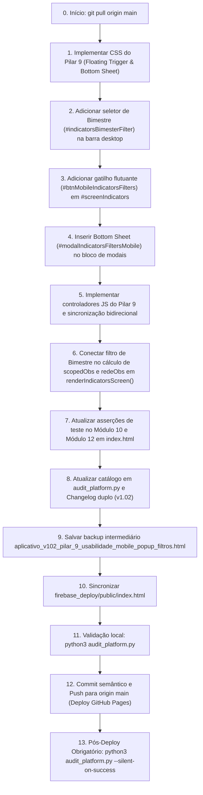

# PLANO DE IMPLEMENTAÇÃO: PILAR 9 - USABILIDADE E DESIGN MOBILE: BOTÃO POP-UP DE FILTROS (LIBERAÇÃO DO VIEWPORT E RETOMADA INSTANTÂNEA)

> **DIRETRIZ OBRIGATÓRIA DE EXECUÇÃO (ETAPA 2):**
> O assistente executor (Etapa 2) deve **obrigatoriamente ler e seguir as diretrizes dos arquivos `WORKFLOW_MACOS.md` e `AGENTS.md`** localizados na raiz do projeto antes de aplicar qualquer modificação no código. Nenhuma modificação deve ser realizada sem conformidade estrita com o workflow, incluindo:
> 1. Execução prévia de sincronização com o repositório remoto (`git pull origin main`).
> 2. Preservação integral das regras de negócio existentes, dados cadastrais, blindagens RBAC, série histórica, ciclo longitudinal, turmas integrais (Pilar 4), fechamento nominal e parecer em práticas consistentes (Pilar 5), higienização terminológica para "observação" (Pilar 6), KPIs decisórios com cobertura no bimestre corrente (Pilar 7) e testes automatizados.
> 3. Verificação de integridade pós-edição com dupla checagem de leitura em cada trecho modificado.
> 4. Salvamento obrigatório do backup intermediário na pasta `intermediárias/` sob o nome `aplicativo_v102_pilar_9_usabilidade_mobile_popup_filtros.html`.
> 5. Gestão dupla de Changelog no arquivo `CHANGELOG.md` e no modal `#modalChangelog` do `index.html`, registrando a **Versão 1.02 (ou 0.102)**.
> 6. Sincronização idêntica entre o arquivo principal `index.html` da raiz, `gestor supervisao_patos/index.html` e `gestor supervisao_patos/firebase_deploy/public/index.html`.
> 7. Checagem pré-push (`git fetch origin main`), commit semântico (`feat: implementar pilar 9 - usabilidade mobile com botao popup de filtros bottom sheet e liberacao do viewport (v1.02)`), push para `origin main` e deploy automático no GitHub Pages.
> 8. Execução pós-deploy obrigatória do algoritmo de auditoria (`python3 audit_platform.py --silent-on-success`) com comunicação estrita a falhas.

---

## 1. Diagnóstico e Contexto Técnico-Pedagógico

### 1.1 Cenário Atual
Após a homologação dos Pilares 1 a 7 do Sistema de Supervisão Pedagógica **SerTão Criança**:
- O sistema opera com a **TURMA** como unidade central de observação pedagógica (Pilar 1);
- Estabeleceu a governança em 3 níveis com o Núcleo de EI como autoridade máxima (Pilar 2);
- Implementou o benchmark comparativo `% da UE vs. Rede` no Afunilamento por Dimensão (Pilar 3);
- Consolidou o formulário único de 2 etapas para turmas integrais (Pilar 4);
- Garantiu o fechamento nominal docente, parecer em práticas consistentes e justificativa em itens parciais (Pilar 5);
- Higienizou 100% dos fluxos e telas banindo o vocábulo policialesco "visita" em favor de "observação" (Pilar 6);
- Reorganizou os KPIs decisórios no topo do Painel de Indicadores com destaque para a Cobertura de Turmas no Bimestre Corrente (Pilar 7).

Contudo, na experiência de uso em dispositivos móveis (**smartphones**), a tela de **Indicadores Pedagógicos** (`#screenIndicators`) ainda apresenta um desafio ergonômico crítico:
1. **Compressão Severa do Viewport Vertical:** A barra superior de filtros de indicadores (`indicatorsTargetTypeWrapper`, `indicatorsUnitFilter`, `indicatorsMemberFilter` e botão de exportação) empilha verticalmente no celular, ocupando espaço expressivo da tela.
2. **Inviabilidade da Barra Fixa (*Sticky Bar*):** Experimentos preliminares que tentaram fixar a barra de filtros inteira no topo da tela (`position: sticky`) consumiam entre 25% e 40% da altura útil do visor do smartphone. Isso criava uma "fresta de leitura" minúscula, sufocando as réguas comparativas, as três sub-abas (KPIs, Afunilamento e Longitudinal) e a árvore detalhada de critérios e subdimensões.
3. **Fadiga de Rolagem para Ajuste de Escopo:** Sem a barra fixa, os filtros rolam para fora do visor assim que a coordenadora ou formadora desce pela árvore de afunilamento (que pode conter dezenas de variáveis). Para trocar a turma, o docente ou a escola, o usuário é obrigado a rolar exaustivamente de volta ao topo da página.
4. **Ausência de Filtro de Bimestre na Análise Comparativa:** Embora o sistema calcule a Cobertura no Bimestre Corrente nos KPIs (Pilar 7), a árvore de Afunilamento (Pilar 3) processa todas as observações consolidadas sem permitir que a gestora filtre especificamente o afunilamento de um determinado bimestre letivo (1º, 2º, 3º ou 4º Bimestre).

### 1.2 Fundamentação Técnico-Pedagógica (Deliberação ST Criança / Documento Oficial de Insights)
Conforme documentado textualmente no documento oficial `docs/documento_insights_supervisao_pedagogica_20261020.md`:
> **PILAR 9: Usabilidade e Design Mobile: Botão Pop-up de Filtros (Liberação do Viewport e Retomada Instantânea)**  
> * **Diagnóstico da Evolução do Design (Superação da Barra Sticky):**  
>   A ideia inicial previa "travar a aba de filtros" (`position: sticky`) no topo da tela. No entanto, a análise ergonômica voltada estritamente para o uso no celular revelou que fixar a barra de filtros inteira (com seletores de UE, Turma, Bimestre e sub-abas) consome entre 25% e 40% da altura útil do visor, comprimindo o espaço de leitura das rubricas e forçando a coordenadora a enxergar critérios e réguas por uma fresta minúscula.  
> * **Nova Lógica Ergonômica Mobile-First (Gatilho Pop-up):**  
>   1. **Liberação Integral do Viewport:** Os filtros não ficam mais colados de forma intrusiva no topo da tela durante a rolagem no celular. Eles rolam naturalmente junto com o fluxo da página, deixando 100% da tela livre para visualização das dimensões e réguas comparativas.  
>   2. **Botão Pop-up de Retomada (Filtros sob Demanda):**  
>      - Durante a navegação no celular, exibe-se um gatilho compacto e ergonômico posicionado na zona de alcance natural do polegar (ex: pill button flutuante `🔘 Filtros (Turma · Bimestre)` ou chip de status).  
>      - O botão exibe um badge resumido de uma linha informando o contexto ativo (ex: `📍 Infantil I - Turma A · 2º Bim`), mantendo a coordenadora sempre orientada sem roubar espaço.  
>   3. **Modal / Gaveta Deslizante (Pop-up de Filtros):**  
>      - Ao tocar no botão, abre-se uma folha deslizante (Bottom Sheet / Modal Pop-up) suave contendo todos os seletores organizados verticalmente:  
>        - Unidade Escolar (com trava automática para a escola da coordenadora).  
>        - Turma da Educação Infantil (com indicação de jornada e docentes vinculados).  
>        - Bimestre de referência.  
>        - Botão de aplicação rápida (`"Aplicar e Fechar"`).  
>      - Ao confirmar, o pop-up fecha e a tela recalcula o afunilamento imediatamente, combinando máxima velocidade de filtragem com área de leitura limpa e espaçosa.

### 1.3 Resultado Esperado com o Pilar 9
1. **Liberação de 100% da Altura Útil da Tela:**  
   Em celulares, a área de visualização das sub-abas, KPIs, réguas de Afunilamento e Dossiê Longitudinal ganha amplitude total, permitindo uma leitura limpa, fluida e contínua.
2. **Gatilho Flutuante Compacto de Retomada no Polegar:**  
   Botão tipo *floating pill* posicionado estrategicamente na parte inferior da tela (`bottom: calc(var(--tabbar-height) + 12px)`), dentro da zona de alcance natural do polegar (*thumb zone*), contendo:
   - Ícone intuitivo de filtros (`⚙️` ou `🔘`);
   - Título descritivo em micropadrão (`FILTROS DA ANÁLISE`);
   - Chip dinâmico contextual informando a configuração ativa (ex: `📍 CEI Maria de Lourdes · Infantil I - Turma A · 1º Bim`);
   - Indicador de expansão (`▲`).
3. **Gaveta Deslizante / Bottom Sheet Modal (`#modalIndicatorsFiltersMobile`):**  
   Ao tocar no gatilho flutuante, uma folha deslizante suave sobe a partir da borda inferior da tela (*bottom sheet*), apresentando:
   - Alça de toque tátil (*drag handle*);
   - Título formal com botão discreto de fechar (`✕`);
   - Seletor de Unidade Escolar (com trava/desabilitação automática para o perfil Coordenador da UE);
   - Seletor de Turma da Educação Infantil / Docente;
   - Seletor de Bimestre de Referência (Ano Letivo Completo vs. 1º, 2º, 3º e 4º Bimestres);
   - Seletor de Público-Alvo (exibido apenas para Formadores e Núcleo de EI);
   - Botões de ação direta: "Restaurar Padrão" e "✓ Aplicar e Fechar".
4. **Sincronização Bidirecional Transparente:**  
   As escolhas efetuadas no modal móvel refletem instantaneamente nos seletores canônicos desktop da tela (`indicatorsUnitFilter`, `indicatorsMemberFilter`, `indicatorsBimesterFilter`) e vice-versa, disparando o recálculo do afunilamento e dos KPIs sem recarregar a página.
5. **Harmonização do Filtro de Bimestre no Desktop:**  
   Inclusão do seletor `#indicatorsBimesterFilter` também na barra de filtros do desktop, permitindo que a árvore de Afunilamento (`calculateHierarchyStats`) processe observações específicas de cada bimestre ou o agregado anual.

---

## 2. Arquitetura e Mapeamento de Pontos de Impacto

### 2.1 Arquivos Afetados
```
gestor supervisao_patos/
├── index.html                                                                                  # Aplicação servida em produção (GitHub Pages)
├── firebase_deploy/public/index.html                                                           # Cópia espelhada obrigatória
├── audit_platform.py                                                                           # Motor de auditoria modular da plataforma
├── CHANGELOG.md                                                                                # Histórico oficial de versões
├── docs/documento_insights_supervisao_pedagogica_20261020.md                                   # Atualização de status do Pilar 9
└── intermediárias/aplicativo_v102_pilar_9_usabilidade_mobile_popup_filtros.html                # Backup intermediário da Versão 1.02
```

### 2.2 Mapeamento por Módulo Funcional

| Módulo / Tela | Elemento / Função | Localização Estimada em `index.html` | Ação de Alteração |
| :--- | :--- | :---: | :--- |
| **Estilos CSS Mobile** | Regras para Bottom Sheet e Floating Trigger | Bloco `@media (max-width: 768px)` (~linha 1340) | Adicionar classes `.mobile-ind-filters-trigger`, `.mobile-bottom-sheet-backdrop`, `.mobile-bottom-sheet-panel` e animações de deslizamento |
| **Barra Desktop de Indicadores** | Grid de filtros em `#screenIndicators` | Linhas ~3404 a 3441 | Inserir seletor de Bimestre (`#indicatorsBimesterFilter`) em harmonia com Unidade e Docente/Turma |
| **Gatilho Flutuante Mobile** | Botão `#btnMobileIndicatorsFilters` | Final de `#screenIndicators` (~linha 3463) | Inserir o gatilho flutuante tipo pill com badge de contexto ativo |
| **Gaveta Deslizante (Modal)** | Estrutura `#modalIndicatorsFiltersMobile` | Bloco de modais (~linha 5880) | Inserir HTML da folha deslizante (Bottom Sheet) com seletores verticais e ações |
| **Engine de Indicadores** | Função `renderIndicatorsScreen()` | Linhas ~14434 a 14535 | Incorporar filtragem de `scopedObs` por `activeBimesterFilter` e sincronizar badge móvel |
| **Controladores JS do Pilar 9** | Novas funções de controle mobile | Bloco de helpers de indicadores (~linha 14430) | Implementar `openMobileIndicatorsFiltersModal()`, `closeMobileIndicatorsFiltersModal()`, `syncMobileToDesktopFilters()`, `applyAndCloseMobileIndicatorsFilters()`, `resetMobileIndicatorsFilters()` e `updateMobileIndicatorsActiveBadge()` |
| **Engine de Testes do Browser** | Módulo 10: `indicadores_decisao` em `runFullPlatformAudit()` | Linhas ~18485 a 18590 | Adicionar asserções estritas do Pilar 9 (abertura do modal, sincronização, alteração de bimestre, atualização do badge e recálculo) |
| **Script CLI de Auditoria** | Catálogo `MODULE_CATALOG['indicadores_decisao']` em `audit_platform.py` | Linha 32 | Atualizar descrição oficial do Módulo 10 para registrar o Pilar 9 |
| **Changelog Duplo** | `CHANGELOG.md` e modal `#modalChangelog` em `index.html` | Topo do log e linhas ~4250 | Registrar a entrega da Versão 1.02 com resumo das melhorias |

### 2.3 Comparativo Visual: Experiência Mobile Antes vs. Depois do Pilar 9

```
┌─────────────────────────────────────────────────────────┐   ┌─────────────────────────────────────────────────────────┐
│            ANTES (COMPRESSÃO DO VIEWPORT)              │   │             DEPOIS (PILAR 9: VIEWPORT LIVRE)            │
├─────────────────────────────────────────────────────────┤   ├─────────────────────────────────────────────────────────┤
│ [Cabeçalho do App]                                      │   │ [Cabeçalho do App]                                      │
│                                                         │   │                                                         │
│ [Barra de Filtros empilhada verticalmente]:             │   │ [Barra de Filtros rola naturalmente para fora da tela] │
│ - Público-Alvo: Professores                             │   │                                                         │
│ - Unidade Escolar: EMEI Pequeno Príncipe                │   │ 📊 [Sub-abas: KPIs | Afunilamento | Longitudinal]       │
│ - Docente/Turma: Infantil I - Turma B                   │   │                                                         │
│ - Botão PDF                                             │   │ ═══════════════ AFUNILAMENTO POR DIMENSÃO ══════════════│
│                                                         │   │ 1. PLANEJAMENTO DIDÁTICO PEDAGÓGICO                     │
│ 📊 [Sub-abas comprimidas]                              │   │    UE: [████████████░░] 74% | Rede: 81% (Δ -7%)         │
│                                                         │   │                                                         │
│ ── Fresta minúscula para leitura de rubricas ──         │   │    ▼ 1.1 Organização dos Espaços e Rotina               │
│                                                         │   │       • [1.1.1] Materiais ao alcance das crianças       │
│                                                         │   │         UE: 60% | Rede: 75% | Δ: 🔻 -15% [Crítico]      │
│                                                         │   │       • [1.1.2] Cantos temáticos diversificados         │
│                                                         │   │         UE: 88% | Rede: 78% | Δ: 🟢 +10% [Destaque]     │
│                                                         │   │                                                         │
│                                                         │   │ [🔘 FILTROS: Pequeno Príncipe · Infantil I · 1º Bim ▲]  │
│ [Menu Inferior de Navegação - Tabbar]                   │   │ [Menu Inferior de Navegação - Tabbar]                   │
└─────────────────────────────────────────────────────────┘   └─────────────────────────────────────────────────────────┘
```

---

## 3. Especificação de Implementação Passo a Passo (Obrigatório)

### BLOCO 1: Estilização CSS do Gatilho Flutuante e da Bottom Sheet

#### 1.1 Localização em `index.html` (inserir dentro da seção de estilos responsivos móveis por volta da linha 1350):
```css
    /* =========================================================================
       PILAR 9: Usabilidade Mobile - Gatilho Flutuante e Bottom Sheet de Filtros
       ========================================================================= */
    .mobile-ind-filters-trigger {
      display: none; /* Oculto por padrão em telas desktop */
    }

    @media (max-width: 768px) {
      /* Exibição contextual estrita: visível apenas quando #screenIndicators está ativo */
      #screenIndicators.active .mobile-ind-filters-trigger {
        display: flex;
      }

      .mobile-ind-filters-trigger {
        position: fixed;
        bottom: calc(var(--tabbar-height) + 12px);
        left: 14px;
        right: 14px;
        max-width: calc(100% - 28px);
        margin: 0 auto;
        height: 48px;
        background: #0F172A;
        background: linear-gradient(135deg, #1E293B 0%, #0F172A 100%);
        color: #FFFFFF;
        border: 1px solid rgba(255, 255, 255, 0.16);
        border-radius: 24px;
        box-shadow: 0 6px 20px rgba(0, 0, 0, 0.32);
        padding: 0 16px;
        align-items: center;
        justify-content: space-between;
        gap: 10px;
        z-index: 95;
        cursor: pointer;
        transition: transform 0.15s ease, box-shadow 0.15s ease;
      }

      .mobile-ind-filters-trigger:active {
        transform: scale(0.98);
        box-shadow: 0 2px 10px rgba(0, 0, 0, 0.25);
      }

      .mobile-ind-filters-icon {
        font-size: 16px;
        flex-shrink: 0;
      }

      .mobile-ind-filters-summary {
        display: flex;
        flex-direction: column;
        align-items: flex-start;
        min-width: 0;
        flex: 1;
      }

      .mobile-ind-filters-title {
        font-size: 10px;
        font-weight: 800;
        text-transform: uppercase;
        letter-spacing: 0.6px;
        color: #94A3B8;
        line-height: 1.1;
      }

      .mobile-ind-filters-badge {
        font-size: 12px;
        font-weight: 700;
        color: #F8FAFC;
        white-space: nowrap;
        overflow: hidden;
        text-overflow: ellipsis;
        width: 100%;
        line-height: 1.25;
      }

      .mobile-ind-filters-chevron {
        font-size: 12px;
        color: #94A3B8;
        flex-shrink: 0;
      }

      /* Modal Bottom Sheet Móvel */
      .mobile-bottom-sheet-backdrop {
        align-items: flex-end !important;
        padding: 0 !important;
      }

      .mobile-bottom-sheet-panel {
        border-radius: 20px 20px 0 0 !important;
        max-height: 85vh !important;
        padding: 16px 20px 24px 20px !important;
        width: 100% !important;
        max-width: 100% !important;
        animation: slideUpBottom 0.24s cubic-bezier(0.16, 1, 0.3, 1) !important;
        box-sizing: border-box;
      }

      .mobile-bottom-sheet-handle {
        width: 44px;
        height: 5px;
        background: #CBD5E1;
        border-radius: 3px;
        margin: 0 auto 12px auto;
      }
    }

    @keyframes slideUpBottom {
      from { transform: translateY(100%); }
      to { transform: translateY(0); }
    }
```

---

### BLOCO 2: Inclusão do Filtro de Bimestre na Barra Desktop de Indicadores

#### 2.1 Em `index.html` (linhas ~3404 a 3441):
Substituir o grid de filtros desktop de `#screenIndicators` para incluir o novo seletor de Bimestre com harmonização completa:

```html
      <!-- Barra de Filtros Integrada e Harmônica (Pilar 9: Desktop Grid com Bimestre) -->
      <div style="background:var(--surface); border:1px solid var(--border); border-radius:12px; padding:16px; margin-bottom:20px; box-shadow:0 1px 3px rgba(0,0,0,0.03);">
        <div style="display:grid; grid-template-columns:repeat(auto-fit, minmax(180px, 1fr)); gap:14px; align-items:flex-end;">
          
          <!-- Seletor 1: Público-Alvo -->
          <div id="indicatorsTargetTypeWrapper" style="display:flex; flex-direction:column; gap:6px;">
            <label style="font-size:12px; font-weight:700; color:var(--text-secondary); text-transform:uppercase;">Público-Alvo</label>
            <select id="indicatorsTargetTypeFilter" class="form-control" onchange="onIndicatorsTargetTypeChange()" style="font-weight:700; color:var(--primary-dark); width:100%; height:42px; font-size:13px;">
              <option value="professora">👩‍🏫 Professores(as)</option>
              <option value="coordenador">👤 Coordenadores(as)</option>
            </select>
            <span id="indicatorsTargetTypeBadge" style="display:none; height:42px; padding:0 14px; background:#EFF6FF; color:#1D4ED8; border:1px solid #BFDBFE; border-radius:8px; font-weight:700; font-size:13px; align-items:center; gap:6px;">
              👩‍🏫 Indicadores Docentes
            </span>
          </div>

          <!-- Seletor 2: Unidade Escolar -->
          <div style="display:flex; flex-direction:column; gap:6px;">
            <label style="font-size:12px; font-weight:700; color:var(--text-secondary); text-transform:uppercase;">Unidade Escolar</label>
            <select id="indicatorsUnitFilter" class="form-control" onchange="onIndicatorsUnitChange()" style="font-weight:600; color:var(--text-primary); width:100%; height:42px; font-size:13px;">
              <option value="ALL">Todas as Unidades do Escopo</option>
            </select>
          </div>

          <!-- Seletor 3: Turma / Docente -->
          <div style="display:flex; flex-direction:column; gap:6px;">
            <div style="display:flex; justify-content:space-between; align-items:center;">
              <label id="indicatorsMemberLabel" style="font-size:12px; font-weight:700; color:var(--text-secondary); text-transform:uppercase;">Professora / Docente</label>
              <a href="javascript:void(0)" id="btnIndicatorsClearMember" onclick="clearTeacherLongitudinalFilter()" style="font-size:11px; font-weight:700; color:var(--primary); text-decoration:none; display:none;">✕ Ver Todas</a>
            </div>
            <select id="indicatorsMemberFilter" class="form-control" onchange="renderIndicatorsScreen()" style="font-weight:600; color:var(--primary); width:100%; height:42px; font-size:13px;" title="Selecione para análise individual">
              <option value="ALL">Todas (Visão Geral)</option>
            </select>
          </div>

          <!-- Seletor 4: Bimestre de Referência (Pilar 9) -->
          <div style="display:flex; flex-direction:column; gap:6px;">
            <label style="font-size:12px; font-weight:700; color:var(--text-secondary); text-transform:uppercase;">Bimestre</label>
            <select id="indicatorsBimesterFilter" class="form-control" onchange="renderIndicatorsScreen()" style="font-weight:700; color:var(--text-primary); width:100%; height:42px; font-size:13px;" title="Filtre as observações por bimestre escolar">
              <option value="ALL">Ano Completo (Todos)</option>
              <option value="1º Bimestre">1º Bimestre</option>
              <option value="2º Bimestre">2º Bimestre</option>
              <option value="3º Bimestre">3º Bimestre</option>
              <option value="4º Bimestre">4º Bimestre</option>
            </select>
          </div>

          <!-- Ação: Exportar PDF -->
          <div style="display:flex; flex-direction:column; gap:6px;">
            <label style="font-size:12px; font-weight:700; color:var(--text-secondary); text-transform:uppercase;">Relatório</label>
            <button class="btn btn-secondary" id="btnExportIndicatorsView" onclick="exportCurrentIndicatorsView()" title="Exportar Relatório em PDF" style="width:100%; height:42px; font-size:13px; font-weight:700; justify-content:center; display:inline-flex; align-items:center; gap:8px;">
              📄 PDF
            </button>
          </div>
        </div>
      </div>
```

---

### BLOCO 3: Estrutura HTML do Gatilho Flutuante Mobile e do Modal Bottom Sheet

#### 3.1 Em `index.html` (inserir antes do fechamento de `</section>` de `#screenIndicators`, por volta da linha 3463):
```html
      <!-- PILAR 9: Botão Flutuante Mobile de Retomada no Polegar (Viewports <= 768px) -->
      <button type="button" id="btnMobileIndicatorsFilters" class="mobile-ind-filters-trigger" onclick="openMobileIndicatorsFiltersModal()" title="Abrir Filtros da Análise">
        <div class="mobile-ind-filters-icon">⚙️</div>
        <div class="mobile-ind-filters-summary">
          <span class="mobile-ind-filters-title">Filtros da Análise</span>
          <span class="mobile-ind-filters-badge" id="mobileIndFiltersActiveBadge">📍 Carregando filtros...</span>
        </div>
        <span class="mobile-ind-filters-chevron">▲</span>
      </button>
```

#### 3.2 Em `index.html` (inserir junto aos demais modais do sistema, por volta da linha 5880):
```html
  <!-- =========================================================================
       PILAR 9: MODAL / BOTTOM SHEET DESLIZANTE DE FILTROS MOBILE
       ========================================================================= -->
  <div id="modalIndicatorsFiltersMobile" class="modal-backdrop mobile-bottom-sheet-backdrop" onclick="closeMobileIndicatorsFiltersModal(event)">
    <div class="modal-panel mobile-bottom-sheet-panel" onclick="event.stopPropagation()">
      <div class="mobile-bottom-sheet-handle"></div>
      
      <div style="display:flex; justify-content:space-between; align-items:center; width:100%; margin-bottom:4px;">
        <div style="display:flex; align-items:center; gap:8px;">
          <span style="font-size:18px;">⚙️</span>
          <h3 style="margin:0; font-size:16px; font-weight:800; color:var(--primary-dark);">Filtros para Diagnóstico</h3>
        </div>
        <button type="button" class="btn-close-modal" onclick="closeMobileIndicatorsFiltersModal()" style="background:none; border:none; font-size:20px; font-weight:700; cursor:pointer; color:var(--text-secondary); line-height:1;">&times;</button>
      </div>
      <p style="margin:0 0 16px 0; font-size:12px; color:var(--text-secondary);">
        Defina a unidade, turma ou docente e o bimestre para recalcular instantaneamente os índices e o afunilamento.
      </p>

      <div class="mobile-bottom-sheet-body" style="display:flex; flex-direction:column; gap:14px;">
        
        <!-- Público-Alvo (se aplicável ao perfil) -->
        <div id="mobileIndTargetTypeGroup" class="form-group" style="margin-bottom:0;">
          <label class="form-label" style="font-size:12px; font-weight:700; text-transform:uppercase; color:var(--text-secondary);">Público-Alvo</label>
          <select id="mobileIndTargetTypeFilter" class="form-control" onchange="syncMobileToDesktopFilters('targetType')" style="width:100%; height:44px; font-weight:700; color:var(--primary-dark); font-size:13px;">
            <option value="professora">👩‍🏫 Professores(as)</option>
            <option value="coordenador">👤 Coordenadores(as)</option>
          </select>
        </div>

        <!-- Unidade Escolar -->
        <div class="form-group" style="margin-bottom:0;">
          <label class="form-label" style="font-size:12px; font-weight:700; text-transform:uppercase; color:var(--text-secondary);">Unidade Escolar</label>
          <select id="mobileIndUnitFilter" class="form-control" onchange="syncMobileToDesktopFilters('unit')" style="width:100%; height:44px; font-weight:600; font-size:13px;">
          </select>
        </div>

        <!-- Turma / Docente -->
        <div class="form-group" style="margin-bottom:0;">
          <div style="display:flex; justify-content:space-between; align-items:center; margin-bottom:5px;">
            <label id="mobileIndMemberLabel" class="form-label" style="margin:0; font-size:12px; font-weight:700; text-transform:uppercase; color:var(--text-secondary);">Professora / Docente</label>
            <a href="javascript:void(0)" id="btnMobileIndClearMember" onclick="clearMobileIndicatorsMemberFilter()" style="font-size:11px; font-weight:700; color:var(--primary); text-decoration:none; display:none;">✕ Ver Todas</a>
          </div>
          <select id="mobileIndMemberFilter" class="form-control" onchange="syncMobileToDesktopFilters('member')" style="width:100%; height:44px; font-weight:600; color:var(--primary); font-size:13px;">
          </select>
        </div>

        <!-- Bimestre de Referência -->
        <div class="form-group" style="margin-bottom:0;">
          <label class="form-label" style="font-size:12px; font-weight:700; text-transform:uppercase; color:var(--text-secondary);">Bimestre de Referência</label>
          <select id="mobileIndBimesterFilter" class="form-control" onchange="syncMobileToDesktopFilters('bimester')" style="width:100%; height:44px; font-weight:700; color:var(--text-primary); font-size:13px;">
            <option value="ALL">Ano Letivo Completo (Todos os Bimestres)</option>
            <option value="1º Bimestre">1º Bimestre</option>
            <option value="2º Bimestre">2º Bimestre</option>
            <option value="3º Bimestre">3º Bimestre</option>
            <option value="4º Bimestre">4º Bimestre</option>
          </select>
        </div>
      </div>

      <!-- Ações da Bottom Sheet -->
      <div style="margin-top:20px; display:flex; gap:10px;">
        <button type="button" class="btn btn-secondary" onclick="resetMobileIndicatorsFilters()" style="flex:1; height:46px; font-weight:700; font-size:13px; justify-content:center;">
          Restaurar Padrão
        </button>
        <button type="button" class="btn btn-primary" onclick="applyAndCloseMobileIndicatorsFilters()" style="flex:2; height:46px; font-weight:800; font-size:13px; display:flex; align-items:center; justify-content:center; gap:6px;">
          <span>✓ Aplicar e Fechar</span>
        </button>
      </div>
    </div>
  </div>
```

---

### BLOCO 4: Controladores JavaScript do Pilar 9 e Sincronização Bidirecional

#### 4.1 Inserir em `index.html` (logo antes da definição de `renderIndicatorsScreen()`, por volta da linha 14430):
```javascript
    // =========================================================================
    // PILAR 9: CONTROLADORES DA GAVETA DESLIZANTE E GATILHO FLUTUANTE MOBILE
    // =========================================================================

    function openMobileIndicatorsFiltersModal() {
      const modal = document.getElementById('modalIndicatorsFiltersMobile');
      if (!modal) return;

      const user = getCurrentUser();
      const deskTarget = document.getElementById('indicatorsTargetTypeFilter');
      const deskUnit = document.getElementById('indicatorsUnitFilter');
      const deskMember = document.getElementById('indicatorsMemberFilter');
      const deskBim = document.getElementById('indicatorsBimesterFilter');

      const mobTargetGroup = document.getElementById('mobileIndTargetTypeGroup');
      const mobTarget = document.getElementById('mobileIndTargetTypeFilter');
      const mobUnit = document.getElementById('mobileIndUnitFilter');
      const mobMember = document.getElementById('mobileIndMemberFilter');
      const mobMemberLabel = document.getElementById('mobileIndMemberLabel');
      const mobBim = document.getElementById('mobileIndBimesterFilter');
      const mobClearBtn = document.getElementById('btnMobileIndClearMember');

      // 1. Sincroniza visibilidade do seletor de Público-Alvo
      if (user.roleKey === 'coordenador' || user.roleKey === 'professora') {
        if (mobTargetGroup) mobTargetGroup.style.display = 'none';
      } else {
        if (mobTargetGroup) mobTargetGroup.style.display = 'block';
        if (mobTarget && deskTarget) mobTarget.value = deskTarget.value || 'professora';
      }

      // 2. Clona opções e sincroniza valor de Unidade Escolar
      if (mobUnit && deskUnit) {
        mobUnit.innerHTML = deskUnit.innerHTML;
        mobUnit.value = deskUnit.value;
        mobUnit.disabled = deskUnit.disabled;
      }

      // 3. Clona opções e sincroniza valor de Docente/Turma
      if (mobMember && deskMember) {
        mobMember.innerHTML = deskMember.innerHTML;
        mobMember.value = deskMember.value;
        const currentMember = mobMember.value;
        if (mobClearBtn) {
          mobClearBtn.style.display = (currentMember && currentMember !== 'ALL') ? 'inline' : 'none';
        }
      }
      if (mobMemberLabel && deskMember) {
        const targetType = (deskTarget && deskTarget.value) || 'professora';
        mobMemberLabel.innerText = targetType === 'coordenador' ? 'Coordenador(a)' : 'Professora / Docente';
      }

      // 4. Sincroniza valor de Bimestre
      if (mobBim && deskBim) {
        mobBim.value = deskBim.value || 'ALL';
      }

      modal.classList.add('active');
    }

    function closeMobileIndicatorsFiltersModal(e) {
      if (e && e.target && e.target.id !== 'modalIndicatorsFiltersMobile') return;
      const modal = document.getElementById('modalIndicatorsFiltersMobile');
      if (modal) modal.classList.remove('active');
    }

    function syncMobileToDesktopFilters(field) {
      const deskTarget = document.getElementById('indicatorsTargetTypeFilter');
      const deskUnit = document.getElementById('indicatorsUnitFilter');
      const deskMember = document.getElementById('indicatorsMemberFilter');
      const deskBim = document.getElementById('indicatorsBimesterFilter');

      const mobTarget = document.getElementById('mobileIndTargetTypeFilter');
      const mobUnit = document.getElementById('mobileIndUnitFilter');
      const mobMember = document.getElementById('mobileIndMemberFilter');
      const mobBim = document.getElementById('mobileIndBimesterFilter');
      const mobClearBtn = document.getElementById('btnMobileIndClearMember');

      if (field === 'targetType' && deskTarget && mobTarget) {
        deskTarget.value = mobTarget.value;
        onIndicatorsTargetTypeChange();
        // Repopula o seletor móvel de membros
        if (deskMember && mobMember) {
          mobMember.innerHTML = deskMember.innerHTML;
          mobMember.value = deskMember.value;
        }
      } else if (field === 'unit' && deskUnit && mobUnit) {
        deskUnit.value = mobUnit.value;
        onIndicatorsUnitChange();
        // Repopula o seletor móvel de membros após mudança de unidade
        if (deskMember && mobMember) {
          mobMember.innerHTML = deskMember.innerHTML;
          mobMember.value = deskMember.value;
        }
      } else if (field === 'member' && deskMember && mobMember) {
        deskMember.value = mobMember.value;
        if (mobClearBtn) {
          mobClearBtn.style.display = (mobMember.value !== 'ALL') ? 'inline' : 'none';
        }
      } else if (field === 'bimester' && deskBim && mobBim) {
        deskBim.value = mobBim.value;
      }
    }

    function clearMobileIndicatorsMemberFilter() {
      const mobMember = document.getElementById('mobileIndMemberFilter');
      const deskMember = document.getElementById('indicatorsMemberFilter');
      if (mobMember) mobMember.value = 'ALL';
      if (deskMember) deskMember.value = 'ALL';
      const mobClearBtn = document.getElementById('btnMobileIndClearMember');
      if (mobClearBtn) mobClearBtn.style.display = 'none';
    }

    function resetMobileIndicatorsFilters() {
      const user = getCurrentUser();
      const deskTarget = document.getElementById('indicatorsTargetTypeFilter');
      const deskUnit = document.getElementById('indicatorsUnitFilter');
      const deskMember = document.getElementById('indicatorsMemberFilter');
      const deskBim = document.getElementById('indicatorsBimesterFilter');

      if (deskTarget) deskTarget.value = 'professora';
      if (deskUnit) deskUnit.value = (user.roleKey === 'coordenador' && user.school) ? user.school : 'ALL';
      if (deskMember) deskMember.value = 'ALL';
      if (deskBim) deskBim.value = 'ALL';

      // Re-executa os handlers para repopular dependências
      if (typeof onIndicatorsUnitChange === 'function') onIndicatorsUnitChange();
      else renderIndicatorsScreen();

      // Atualiza os seletores móveis espelhados
      openMobileIndicatorsFiltersModal();
      showToast('Filtros restaurados para o padrão.');
    }

    function applyAndCloseMobileIndicatorsFilters() {
      const mobTarget = document.getElementById('mobileIndTargetTypeFilter');
      const mobUnit = document.getElementById('mobileIndUnitFilter');
      const mobMember = document.getElementById('mobileIndMemberFilter');
      const mobBim = document.getElementById('mobileIndBimesterFilter');

      const deskTarget = document.getElementById('indicatorsTargetTypeFilter');
      const deskUnit = document.getElementById('indicatorsUnitFilter');
      const deskMember = document.getElementById('indicatorsMemberFilter');
      const deskBim = document.getElementById('indicatorsBimesterFilter');

      if (deskTarget && mobTarget && mobTarget.value) deskTarget.value = mobTarget.value;
      if (deskUnit && mobUnit && mobUnit.value) deskUnit.value = mobUnit.value;
      if (deskMember && mobMember && mobMember.value) deskMember.value = mobMember.value;
      if (deskBim && mobBim && mobBim.value) deskBim.value = mobBim.value;

      renderIndicatorsScreen();

      const modal = document.getElementById('modalIndicatorsFiltersMobile');
      if (modal) modal.classList.remove('active');

      showToast('Filtros aplicados com sucesso!');
    }

    function updateMobileIndicatorsActiveBadge() {
      const badgeEl = document.getElementById('mobileIndFiltersActiveBadge');
      if (!badgeEl) return;

      const user = getCurrentUser();
      const unitSelect = document.getElementById('indicatorsUnitFilter');
      const memberSelect = document.getElementById('indicatorsMemberFilter');
      const bimesterSelect = document.getElementById('indicatorsBimesterFilter');

      const activeUnit = (unitSelect && unitSelect.value) ? unitSelect.value : (user.school || 'Todas UEs');
      const activeMember = (memberSelect && memberSelect.value) ? memberSelect.value : 'ALL';
      const activeBim = (bimesterSelect && bimesterSelect.value) ? bimesterSelect.value : 'ALL';

      let unitLabel = activeUnit === 'ALL' ? 'Todas UEs' : activeUnit.replace(/^(CEI|EMEI|CMEI)\s+/i, '');
      let memberLabel = activeMember === 'ALL' ? 'Visão Geral' : activeMember.split(' ')[0];
      let bimLabel = activeBim === 'ALL' ? 'Ano Todo' : activeBim.replace('º Bimestre', 'º Bim');

      badgeEl.innerText = `📍 ${unitLabel} · ${memberLabel} · ${bimLabel}`;
      badgeEl.title = `Unidade: ${activeUnit} | Avaliando: ${activeMember} | Período: ${activeBim}`;
    }
```

---

### BLOCO 5: Integração do Filtro de Bimestre na Lógica de Cálculo de `renderIndicatorsScreen()`

#### 5.1 Em `index.html` (linhas ~14515 a 14535):
Localizar a resolução de `scopedObs` e `scopedAvaliandos` e injetar a filtragem por `activeBimesterFilter`:

```javascript
      const activeUnitFilter = (unitSelect && unitSelect.value) ? unitSelect.value : 'ALL';

      // PILAR 9: Resolução do Filtro de Bimestre de Referência
      const bimesterSelect = document.getElementById('indicatorsBimesterFilter');
      const activeBimesterFilter = (bimesterSelect && bimesterSelect.value) ? bimesterSelect.value : 'ALL';

      // 2. Resolução dos avaliandos e observações com respeito estrito à unidade e ao bimestre selecionados
      let scopedAvaliandos = getScopedAvaliandos(targetType);
      let scopedObs = getScopedObservations().filter(o => {
        if (o.status !== 'finalized' && o.status !== 'concluida') return false;
        if (targetType === 'coordenador') {
          return o.evaluatedType === 'coordenador';
        } else {
          return o.evaluatedType === 'professora' || o.evaluatedType === 'turma';
        }
      });

      if (activeUnitFilter !== 'ALL') {
        scopedAvaliandos = scopedAvaliandos.filter(m => m.school === activeUnitFilter);
        scopedObs = scopedObs.filter(o => o.schoolName === activeUnitFilter);
      }

      // Filtragem por Bimestre no escopo da UE/Polo
      if (activeBimesterFilter !== 'ALL') {
        scopedObs = scopedObs.filter(o => o.bimester === activeBimesterFilter);
      }
```

E no Caso A (Benchmark com a Rede, por volta da linha 15215):
```javascript
      // 1. Resolução das Observações Consolidadas de toda a Rede Municipal de Patos
      let redeObs = (appState.observations || []).filter(o => {
        if (o.status !== 'finalized' && o.status !== 'concluida') return false;
        if (targetType === 'coordenador') {
          return o.evaluatedType === 'coordenador';
        } else {
          return o.evaluatedType === 'professora' || o.evaluatedType === 'turma';
        }
      });

      // PILAR 9: Aplica a mesma filtragem de bimestre na média da Rede para benchmark matematicamente fidedigno
      if (activeBimesterFilter !== 'ALL') {
        redeObs = redeObs.filter(o => o.bimester === activeBimesterFilter);
      }
```

E ao final de `renderIndicatorsScreen()` (antes de retornar ou encerrar a função):
```javascript
      // PILAR 9: Atualiza o badge compacto do botão flutuante mobile
      updateMobileIndicatorsActiveBadge();
```

---

## 4. Seção Obrigatória de Auditoria Automatizada (Cobertura Efetiva de 100%)

Em cumprimento estrito ao `WORKFLOW_MACOS.md`, esta seção especifica **todas as alterações, adições e exclusões** a serem implementadas na suíte de testes automatizados do sistema (`index.html` e `audit_platform.py`), estruturadas modo-a-modo para garantir conformidade determinística e 100% de cobertura.

### 4.1 Adições ao Módulo 10 (`indicadores_decisao`) na Engine de Testes do `index.html`
Localização: dentro da função `runFullPlatformAudit()` no objeto `{ id: 'indicadores_decisao', ... }` (linhas ~18485 a 18590):

Adicionar as seguintes 5 asserções comportamentais e estruturais estritas do Pilar 9:
1. **Presença do Gatilho Flutuante no DOM (`#btnMobileIndicatorsFilters`):**
   - Validar que o botão existe no DOM dentro de `#screenIndicators`.
   - Validar a presença do elemento de badge `#mobileIndFiltersActiveBadge`.
2. **Presença e Inicialização da Bottom Sheet (`#modalIndicatorsFiltersMobile`):**
   - Validar que o modal existe no DOM com a classe `mobile-bottom-sheet-backdrop`.
   - Validar a presença dos seletores móveis (`#mobileIndUnitFilter`, `#mobileIndMemberFilter`, `#mobileIndBimesterFilter`).
3. **Simulação Interativa de Abertura e Espelhamento de Filtros:**
   - Disparar `openMobileIndicatorsFiltersModal()`.
   - Verificar que `#modalIndicatorsFiltersMobile.classList.contains('active')` é `true`.
   - Validar que as opções do seletor de Unidades e Membros foram clonadas com fidelidade a partir do estado do desktop.
4. **Interação com Filtro de Bimestre e Aplicação Direta:**
   - Alterar `#mobileIndBimesterFilter.value = '1º Bimestre'`.
   - Executar `applyAndCloseMobileIndicatorsFilters()`.
   - Verificar que o modal foi fechado (`!classList.contains('active')`).
   - Verificar que o seletor desktop `#indicatorsBimesterFilter.value` foi atualizado para `'1º Bimestre'`.
   - Verificar que `updateMobileIndicatorsActiveBadge()` atualizou o badge `#mobileIndFiltersActiveBadge` contendo `'1º Bim'`.
5. **Restauração Padrão e Recálculo Hierárquico:**
   - Executar `resetMobileIndicatorsFilters()`.
   - Validar retorno do bimestre para `'ALL'`.
   - Fechar o modal mobile e confirmar integridade do DOM de indicadores.

### 4.2 Adições ao Módulo 12 (`navegacao_layout`) na Engine de Testes do `index.html`
Localização: dentro de `{ id: 'navegacao_layout', ... }` (linhas ~18670 a 18720):
- Validar que, ao alternar entre abas via `navigateToTab()`, o botão flutuante `#btnMobileIndicatorsFilters` só permanece acoplado à tela quando a aba ativa for `'indicators'`.

### 4.3 Atualização no Catálogo Oficial de Módulos (`audit_platform.py`)
Linha 32 de `audit_platform.py`:
```python
    'indicadores_decisao': 'Indicadores Pedagógicos, Cobertura Bimestral (Pilar 7), Usabilidade Mobile com Bottom Sheet de Filtros (Pilar 9) e Apoio à Decisão',
```

---

## 5. Gestão de Versões e Changelog Duplo

### 5.1 Versão Alvo
- **Número da Versão:** `1.02` (ou `0.102`).
- **Arquivo de Backup Intermediário:** `intermediárias/aplicativo_v102_pilar_9_usabilidade_mobile_popup_filtros.html`.

### 5.2 Registro no `CHANGELOG.md`
Inserir no topo da tabela e do histórico detalhado:
```markdown
| **1.02** | 21/10/2026 18:00 | `intermediárias/aplicativo_v102_pilar_9_usabilidade_mobile_popup_filtros.html` | Deliberação SerTão Criança / Pilar 9 | Pilar 9: Usabilidade Mobile First com liberação total do viewport vertical no smartphone, gatilho flutuante tipo pill na zona do polegar com badge de status ativo, folha deslizante (Bottom Sheet) de filtros sob demanda e harmonização do filtro de Bimestre no Afunilamento 📱 |
```

### 5.3 Registro no Modal `#modalChangelog` do `index.html`
Atualizar o número de versão exibido na navbar e no modal de histórico, adicionando o cartão explicativo da versão `1.02`.

---

## 6. Fluxograma de Execução para a Etapa 2 (Operário)


