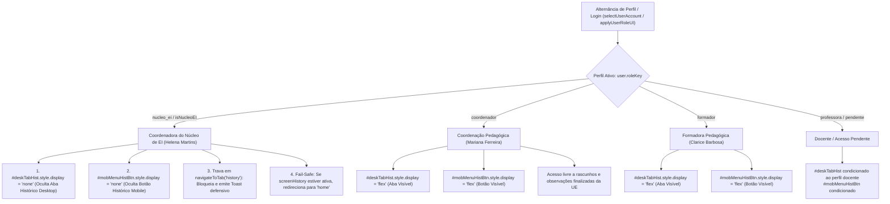

# Plano de Implementação: Remoção da Aba "Histórico" do Perfil da Coordenadora da EI

> **Diretriz de Execução (Obrigatório):**  
> O assistente executor da **Etapa 2 (Operário)** DEVE OBRIGATORIAMENTE ler e seguir integralmente as diretrizes do arquivo [WORKFLOW_MACOS.md](file:///Users/bruno/Desktop/gestor%20supervisao_patos/WORKFLOW_MACOS.md), do [WORKFLOW_GITHUB.md](file:///Users/bruno/Desktop/gestor%20supervisao_patos/WORKFLOW_GITHUB.md) e a skill `.agents/skills/execucao-operario/SKILL.md` antes de aplicar quaisquer modificações no código-fonte.  
> A execução deve ser estrita, cirúrgica, atenta à dupla checagem, versionamento sequencial duplo (`CHANGELOG.md` e `#modalChangelog`), criação de cópia intermediária em `intermediárias/` e execução do algoritmo de auditoria modular pós-deploy (`python3 audit_platform.py --silent-on-success`).

---

> **Status:** 📐 Planejamento Concluído (Etapa 1 - Arquiteto)  
> **Data:** 27/10/2026  
> **Versão Alvo:** `1.41` (`v8.2.8`)  
> **Arquivo de Backup Intermediário:** `intermediárias/aplicativo_v141_remocao_aba_historico_coordenadora_ei.html`  
> **Arquivos Principais Afetados:**  
> - `index.html` (raiz da aplicação)  
> - `firebase_deploy/public/index.html` (cópia espelho de deploy)  
> - `CHANGELOG.md` (registro histórico unificado)  
> - `audit_platform.py` (motor automatizado de auditoria)  

---

## 1. Diagnóstico do Problema e Contexto Pedagógico / RBAC

### 1.1 Contexto e Justificativa Pedagógica
Na arquitetura do ecossistema pedagógico **SerTão Criança**, a governança da supervisão é estruturada em uma tríade de acompanhamento formativo direto:
1. **Docente / Professora Regente (`roleKey: 'professora'`):** Recebe acompanhamento formativo e devolutivas pedagógicas em sala.
2. **Coordenação Pedagógica da Escola (`roleKey: 'coordenador'`, ex: Mariana Ferreira):** Realiza a observação formativa direta das professoras de sua Unidade Escolar (`user.school`), gera rascunhos, finaliza avaliações e necessita do **Histórico de Observações** (`screenHistory`) para consultar, filtrar e analisar a evolução de seus registros.
3. **Formadora Pedagógica Regional (`roleKey: 'formador'`, ex: Clarice Barbosa):** Realiza a supervisão e acompanhamento formativo das Coordenadoras Pedagógicas do seu Polo Regional, necessitando também de acesso ao histórico.
4. **Coordenadora do Núcleo de Educação Infantil (`roleKey: 'nucleo_ei'`, ex: Helena Martins, Bruno Silva, Rodrigo Toledo):** Atua no nível estratégico e normativo da rede municipal (Secretaria Municipal de Educação). Sua missão é a **governança global da rede**, gestão de polos regionais, parametrização de calendários e ciclos avaliativos (`#modalBimesterPeriods`), matrizes curriculares e análise de macroindicadores educacionais.

### 1.2 O Problema Identificado
- **O perfil da Coordenadora da EI NÃO realiza observações de campo:**
  - O botão de ação hero (`#btnNewObsHero` - "NOVA OBSERVAÇÃO") é explicitamente ocultado em `applyUserRoleUI()` (`heroBtn.style.display = 'none'`).
  - A aba de Cronograma de Acompanhamento (`#deskTabSchedule` e `#mobTabSchedule`) é bloqueada e ocultada (`scheduleNavTab.style.display = 'none'`).
  - O perfil não gera nem gerencia rascunhos de avaliação (`homeDraftsHeader.style.display = 'none'`).
- **Inconsistência de Interface (RBAC):**  
  Apesar de não efetuar observações, a aba **"Histórico"** (`#deskTabHist` no desktop e o botão "Acessar Histórico" no menu gaveta mobile `#mobileMenuOverlay`) permanecia visível para a Coordenadora da EI.  
  A tela de Histórico (`screenHistory`) é orientada ao ciclo de vida operacional de fichas de observação ("Meus Rascunhos", "Concluídas", auto-arquivamento de fichas individuais, etc.). Sua presença na barra de navegação da Coordenadora da EI gera poluição visual, sobrecarga cognitiva e desvio da função estratégica de gestão e inteligência pedagógica da rede.

---

## 2. Arquitetura da Solução e Pontos de Impacto



### 2.1 Mapeamento dos Componentes Afetados
1. **Cabeçalho Desktop (`<nav class="desktop-nav">`):**
   - Elemento: `<button class="nav-link" id="deskTabHist" onclick="navigateToTab('history')">`
   - Ocultação via `applyUserRoleUI()` quando `isNucleoEI(user)` for verdadeiro.
2. **Menu Gaveta Mobile (`#mobileMenuOverlay`):**
   - Atribuição de identificador canônico `id="mobMenuHistBtn"` ao botão secundário que aciona `navigateToFromMenu('history')`.
   - Ocultação via `applyUserRoleUI()` quando `isNucleoEI(user)` for verdadeiro.
3. **Controlador Central de Rotas (`navigateToTab`):**
   - Inserção de guarda RBAC: se `tabName === 'history'` e `isNucleoEI(user)` for verdadeiro, abortar a navegação e exibir toast informativo: `"Acesso restrito: este perfil não realiza observações."`.
4. **Proteção Anti-Persistência em Transição de Perfil:**
   - Em `applyUserRoleUI()`, caso o usuário migre para `isNucleoEI(user)` estando atualmente com a tela `#screenHistory` ativa no DOM, despachar navegação automática imediata para `'home'`.
5. **Suíte de Auditoria (`index.html` e `audit_platform.py`):**
   - Enriquecimento do módulo `auth_rbac` com asserções estritas comprovando:
     - Que `#deskTabHist` e `#mobMenuHistBtn` estão com `display === 'none'` no contexto de Helena Martins (`nucleo_ei`).
     - Que tentativa de invocar `navigateToTab('history')` como Helena é barrada sem ativar `#screenHistory`.
     - Que ao alternar de volta para Mariana Ferreira (`coordenador`), `#deskTabHist` e `#mobMenuHistBtn` voltam a estar visíveis (`display !== 'none'`).

---

## 3. Especificação de Implementação Passo a Passo (Snippets Exatos)

### Passo 1: Identificação Semântica no Menu Mobile (`index.html`)
Localizar o botão de acesso ao histórico dentro de `#mobileMenuOverlay` (aproximadamente linha 27738) e adicionar o id `mobMenuHistBtn`:

```html
<!-- ANTES -->
      <button class="btn btn-secondary" style="width: 100%; margin-bottom: 14px; display:flex; align-items:center; gap:12px; padding: 14px;" onclick="navigateToFromMenu('history')">
        <svg viewBox="0 0 24 24" fill="none" stroke="currentColor" stroke-width="2" style="width: 20px; height: 20px;"><circle cx="12" cy="12" r="10"/><polyline points="12 6 12 12 16 14"/></svg> 
        Acessar Histórico
      </button>

<!-- DEPOIS -->
      <button class="btn btn-secondary" id="mobMenuHistBtn" style="width: 100%; margin-bottom: 14px; display:flex; align-items:center; gap:12px; padding: 14px;" onclick="navigateToFromMenu('history')">
        <svg viewBox="0 0 24 24" fill="none" stroke="currentColor" stroke-width="2" style="width: 20px; height: 20px;"><circle cx="12" cy="12" r="10"/><polyline points="12 6 12 12 16 14"/></svg> 
        Acessar Histórico
      </button>
```

---

### Passo 2: Ocultação e Controle Dinâmico em `applyUserRoleUI()` (`index.html`)
Na função `applyUserRoleUI()` (aproximadamente linhas 10514-10640):

1. **Captura das referências no topo da função:**
```javascript
      const unitsNavTab = document.getElementById('deskTabUnits');
      const teamNavTab = document.getElementById('deskTabTeam');
      const adminNavTab = document.getElementById('deskTabAdmin');
      const deskTabHomeLabel = document.getElementById('deskTabHomeLabel');
      const heroBtn = document.getElementById('btnNewObsHero');
      const heroBtnText = document.getElementById('btnNewObsText');
      const roleFilterGroup = document.getElementById('histFilterRoleGroup');
      const scheduleNavTab = document.getElementById('deskTabSchedule');
      const histNavTab = document.getElementById('deskTabHist');
      const mobMenuHistBtn = document.getElementById('mobMenuHistBtn');
      const homeDraftsHeader = document.getElementById('homeDraftsHeader');
      const homeDraftsContainer = document.getElementById('homeDraftsContainer');
      const homeScheduleBanner = document.getElementById('homeScheduleBanner');
```

2. **Restauração no Reset Global (garantindo visibilidade nos demais perfis):**
```javascript
      // Reset visibility for these before applying rules
      if (scheduleNavTab) scheduleNavTab.style.display = 'flex';
      if (histNavTab) histNavTab.style.display = 'flex';
      if (mobMenuHistBtn) mobMenuHistBtn.style.display = 'flex';
      if (homeScheduleBanner) homeScheduleBanner.style.display = 'none';
      if (homeDraftsHeader) homeDraftsHeader.style.display = 'block';
```

3. **Ocultação explícita no bloco `isNucleoEI(user)`:**
```javascript
      } else if (isNucleoEI(user)) {
        if (scopeTitle) scopeTitle.innerText = 'Coordenadora do Núcleo de EI:';
        if (scopeDesc) scopeDesc.innerText = `Governança global da rede municipal SerTão Criança. Acesso onisciente a todas as 32 UEs, consolidados municipais, gestão de polos, atribuição de formadores e rubricas.`;
        if (deskTabHomeLabel) deskTabHomeLabel.innerText = "Gestão Pedagógica";
        if (unitsNavTab) unitsNavTab.style.display = 'none';
        if (teamNavTab) teamNavTab.style.display = 'none';
        if (adminNavTab) adminNavTab.style.display = 'flex';

        if (histNavTab) histNavTab.style.display = 'none';
        if (mobMenuHistBtn) mobMenuHistBtn.style.display = 'none';

        roleFilterGroup.style.display = 'block';
        if (indicatorsTargetFilter) indicatorsTargetFilter.style.display = 'inline-block';
        if (indicatorsTargetBadge) indicatorsTargetBadge.style.display = 'none';
        heroBtn.style.display = 'none';
        
        if (scheduleNavTab) scheduleNavTab.style.display = 'none';
        if (homeScheduleBanner) homeScheduleBanner.style.display = 'none';
        if (homeDraftsHeader) homeDraftsHeader.style.display = 'none';
        if (homeDraftsContainer) homeDraftsContainer.style.display = 'none';

        // Redirecionamento defensivo caso o usuário estivesse na tela de Histórico
        if (document.getElementById('screenHistory')?.classList.contains('active')) {
          navigateToTab('home');
        }
```

4. **Tratamento defensivo para usuário com acesso pendente (`roleKey === 'pendente'`):**
```javascript
      } else if (user.roleKey === 'pendente') {
        if (scopeTitle) scopeTitle.innerText = 'Acesso Pendente:';
        if (scopeDesc) scopeDesc.innerText = 'Sua conta foi criada e está aguardando liberação de acesso pela Coordenadora do Núcleo de EI.';
        if (deskTabHomeLabel) deskTabHomeLabel.innerText = "Início";
        if (unitsNavTab) unitsNavTab.style.display = 'none';
        if (teamNavTab) teamNavTab.style.display = 'none';
        if (adminNavTab) adminNavTab.style.display = 'none';
        if (histNavTab) histNavTab.style.display = 'none';
        if (mobMenuHistBtn) mobMenuHistBtn.style.display = 'none';
        roleFilterGroup.style.display = 'none';
        if (indicatorsTargetFilter) indicatorsTargetFilter.style.display = 'none';
        if (indicatorsTargetBadge) indicatorsTargetBadge.style.display = 'none';
        heroBtn.style.display = 'none';
```

---

### Passo 3: Bloqueio Defensivo na Função `navigateToTab()` (`index.html`)
Na função `navigateToTab(tabName, subFilter = null)` (aproximadamente linha 10790):

```javascript
    function navigateToTab(tabName, subFilter = null) {
      const user = getCurrentUser();

      if (tabName === 'schedule' && (isNucleoEI(user) || user.roleKey === 'pendente' || user.roleKey === 'professora')) {
        showToast('Acesso ao cronograma restrito.');
        return;
      }
      if (tabName === 'history' && (isNucleoEI(user) || user.roleKey === 'pendente')) {
        showToast('Acesso restrito: este perfil não realiza observações.');
        return;
      }
      if ((tabName === 'opManagement' || tabName === 'units' || tabName === 'rubricsAdmin' || tabName === 'admin' || tabName === 'team') && (user.roleKey === 'pendente' || user.roleKey === 'professora')) {
        showToast('Acesso restrito ao perfil docente.');
        return;
      }
```

---

### Passo 4: Sincronização Obrigatória com a Cópia Espelhada
Replicar cirurgicamente as mesmas alterações em:
- `firebase_deploy/public/index.html`

---

### Passo 5: Atualização Sequencial do Changelog Duplo
1. **Em `index.html` e `firebase_deploy/public/index.html`:**
   - Atualizar rótulo do botão `.btn-changelog`:
     ```html
     <span>Versão 1.41 (v8.2.8)</span>
     ```
   - Inserir card explicativo no topo do `#modalChangelog`:
     ```html
     <!-- VERSÃO 1.41 - REMOÇÃO DA ABA HISTÓRICO DA COORDENADORA DA EI -->
     <div class="card" style="margin-bottom:16px; border-left:4px solid #10B981; background:#F8FAFC;">
       <div style="display:flex; justify-content:space-between; align-items:center; margin-bottom:8px;">
         <span style="font-weight:800; font-size:14px; color:var(--text-primary);">📌 Versão 1.41 (v8.2.8)</span>
         <span style="font-size:11px; color:var(--text-secondary); background:#F1F5F9; padding:2px 8px; border-radius:12px;">27/10/2026</span>
       </div>
       <div style="font-size:12px; font-weight:700; color:var(--text-primary); margin-bottom:6px;">
         Remoção da Aba "Histórico" do Perfil da Coordenadora da EI (Núcleo de EI):
       </div>
       <ul style="font-size:12px; color:var(--text-secondary); margin:0; padding-left:18px; line-height:1.5;">
         <li>🧹 <strong>Otimização de Escopo e Higienização Visual:</strong> Ocultação da aba desktop <code>#deskTabHist</code> e do botão mobile <code>#mobMenuHistBtn</code> ("Acessar Histórico") para o perfil da Coordenadora da EI (Helena Martins / Núcleo de EI), alinhando a interface ao fato de que o perfil gestor não realiza observações de campo.</li>
         <li>🛡️ <strong>Blindagem RBAC e Trava no Roteador:</strong> Bloqueio preventivo na função <code>navigateToTab('history')</code> com mensagem contextual e redirecionamento defensivo caso o usuário alterne de perfil estando na aba de histórico.</li>
         <li>🔄 <strong>Preservação Integral para Coordenação e Formação:</strong> Coordenação Pedagógica de escola (Mariana Ferreira) e Formadoras Pedagógicas (Clarice Barbosa) mantêm acesso total ao histórico, rascunhos e observações concluídas.</li>
       </ul>
     </div>
     ```

2. **Em `CHANGELOG.md`:**
   - Adicionar entrada no Sumário Executivo:
     `| **1.41** | 27/10/2026 16:15 | aplicativo_v141_remocao_aba_historico_coordenadora_ei.html | Solicitação direta / plano_remocao_aba_historico_coordenadora_ei.md | Remoção da aba 'Histórico' do perfil da Coordenadora da EI, ocultação desktop (#deskTabHist) e mobile (#mobMenuHistBtn), trava no roteador navigateToTab e preservação integral para Coordenação Pedagógica e Formadoras 🧹🛡️ |`
   - Adicionar seção detalhada correspondente em `Detalhamento Integral das Versões`.

---

## 4. Critérios de Aceite e Roteiro de Teste

### 4.1 Critérios de Aceite
- [ ] **Coordenadora da EI (Helena Martins):**
  - A aba "Histórico" (`#deskTabHist`) **não deve aparecer** na barra superior desktop (`display: none`).
  - No menu mobile "Mais" (`#mobileMenuOverlay`), o botão "Acessar Histórico" (`#mobMenuHistBtn`) **não deve aparecer** (`display: none`).
  - Tentar executar via console `navigateToTab('history')` não abre a tela `#screenHistory` e exibe o toast de restrição.
  - Se Helena fizer login ou alternar para o perfil enquanto na tela `#screenHistory`, a interface redireciona imediatamente para a tela `home`.
- [ ] **Coordenação Pedagógica (Mariana Ferreira):**
  - A aba "Histórico" (`#deskTabHist`) permanece perfeitamente visível e clicável no desktop.
  - O botão "Acessar Histórico" (`#mobMenuHistBtn`) permanece visível e funcional no menu mobile.
  - Clicar em "Histórico" navega para `#screenHistory` e carrega normalmente seus rascunhos e observações.
- [ ] **Formadora Pedagógica (Clarice Barbosa):**
  - A aba "Histórico" permanece visível e funcional.
- [ ] **Integridade Sintática do JavaScript:**
  - `python3 audit_platform.py --check-syntax` retorna 100% de sucesso léxico/sintático sem qualquer erro.
- [ ] **Suíte Automatizada Modular:**
  - `python3 audit_platform.py --silent-on-success` aprova 100% dos 12 módulos determinísticos no Chrome headless.

---

## 5. Seção Obrigatória de Auditoria (`audit_platform.py` e Suíte In-App)

### 5.1 Alterações no Algoritmo de Auditoria
- No script `audit_platform.py`:
  - Atualizar o cabeçalho informativo para referenciar `Versão 1.41 (v8.2.8)`.

### 5.2 Adições na Suíte de Auditoria In-App (`runFullPlatformAuditAsync` em `index.html`)
No módulo **`auth_rbac`** (em torno da linha 25040 de `index.html`), adicionar o bloco de testes determinísticos de alternância e visibilidade da aba Histórico:

```javascript
// Teste de ocultação e trava da aba Histórico para Coordenadora da EI (Helena)
appState.currentUserKey = 'helena';
applyUserRoleUI();
const deskHistHelena = document.getElementById('deskTabHist');
const mobHistHelena = document.getElementById('mobMenuHistBtn');
if (deskHistHelena && deskHistHelena.style.display !== 'none') {
  throw new Error('Aba #deskTabHist deve estar oculta (display: none) para a Coordenadora da EI');
}
if (mobHistHelena && mobHistHelena.style.display !== 'none') {
  throw new Error('Botão #mobMenuHistBtn deve estar oculto (display: none) para a Coordenadora da EI');
}

// Asserção de bloqueio em navigateToTab('history') para Coordenadora da EI
navigateToTab('history');
const histScreenActive = document.getElementById('screenHistory')?.classList.contains('active');
if (histScreenActive) {
  throw new Error('Coordenadora da EI não deve conseguir acessar #screenHistory via navigateToTab');
}

// Teste de restauração e visibilidade para Coordenação Pedagógica (Mariana)
appState.currentUserKey = 'mariana';
applyUserRoleUI();
if (deskHistHelena && deskHistHelena.style.display === 'none') {
  throw new Error('Aba #deskTabHist deve estar visível para a Coordenação Pedagógica (Mariana)');
}
if (mobHistHelena && mobHistHelena.style.display === 'none') {
  throw new Error('Botão #mobMenuHistBtn deve estar visível para a Coordenação Pedagógica (Mariana)');
}
logger.log('Validação de RBAC: ocultação e bloqueio estrito da aba Histórico para Coordenadora da EI', true);
```

### 5.3 Exclusões
- Nenhuma exclusão de módulos ou testes preexistentes. O Módulo 9 (`historico_governanca`) permanece executando autenticado como `mariana`, preservando 100% de compatibilidade e cobertura.
