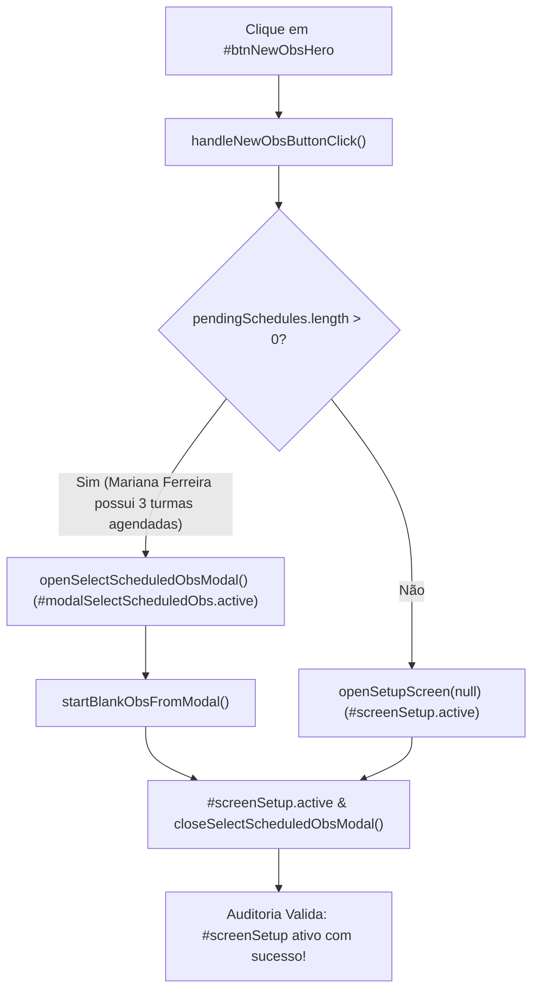

# Plano de Implementação: Resolução Definitiva da Reatividade do Botão Hero e Transição para Setup na Auditoria

> **Diretriz de Execução (Obrigatório - Instruções ao Executor):**  
> O assistente executor da **Etapa 2 (Operário)** DEVE OBRIGATORIAMENTE ler e seguir integralmente as diretrizes do arquivo [WORKFLOW_MACOS.md](file:///Users/bruno/Desktop/gestor%20supervisao_patos/WORKFLOW_MACOS.md) e do [WORKFLOW_GITHUB.md](file:///Users/bruno/Desktop/gestor%20supervisao_patos/WORKFLOW_GITHUB.md) antes de aplicar quaisquer modificações no código-fonte. A execução deve ser estrita, mecânica, cirúrgica e atenta à dupla checagem (reler arquivos alterados após modificação), validação sintática pré-voo via JavaScriptCore (`python3 audit_platform.py --check-syntax`), versionamento sequencial duplo (`CHANGELOG.md` e `#modalChangelog` / `.btn-changelog` no `index.html`), criação de cópia intermediária em `intermediárias/` e sincronização integral das cópias espelhadas do projeto (`gestor supervisao_patos/index.html` e `gestor supervisao_patos/firebase_deploy/public/index.html`). Ao finalizar o deploy via `git push origin main`, é mandatória a execução de `python3 audit_platform.py --silent-on-success`, comunicando ao usuário **exclusivamente a ocorrência de falhas/problemas**, ou confirmando o sucesso de forma limpa e sucinta caso 100% dos testes sejam aprovados.

---

> **Status:** 📐 Planejamento Concluído (Etapa 1 - Arquiteto)  
> **Data:** 29/10/2026  
> **Versão Alvo:** `1.55` (`v8.2.22`)  
> **Arquivo de Backup Intermediário:** `intermediárias/aplicativo_v1.55_resolucao_ativacao_setup_hero_button.html`  
> **Arquivos Principais Afetados:**  
> - `js/audit/audit_engine.js` (motor determinístico da suíte in-app de testes da plataforma)  
> - `index.html` (cabeçalho, botão `.btn-changelog` e modal `#modalChangelog`)  
> - `gestor supervisao_patos/index.html` (cópia espelho local)  
> - `gestor supervisao_patos/firebase_deploy/public/index.html` (cópia espelho de produção)  
> - `CHANGELOG.md` (registro histórico unificado de versões)  

---

## 1. Diagnóstico do Problema e Análise Forense da Causa-Raiz

### 1.1 Sintoma Constatado na Auditoria
Durante a execução automatizada da suíte de auditoria headless (`audit_platform.py`), o **Módulo 12 (`navegacao_layout`)** foi reprovado com o seguinte erro:
```text
❌ FAIL | [navegacao_layout] Erro de execução no módulo navegacao_layout -> Clique em #btnNewObsHero não ativou a tela #screenSetup
```

---

### 1.2 Mapa Forense de Causa-Raiz

1. **Regra de Negócio Canônica da Plataforma (Versão 0.55 e Pilar 1):**
   - O botão principal de ação hero na tela inicial (`#btnNewObsHero` - "NOVA OBSERVAÇÃO") possui o manipulador inline `onclick="handleNewObsButtonClick()"`, declarado em `js/core/navigation.js`.
   - A função `handleNewObsButtonClick()` verifica se o usuário autenticado possui observações planejadas pendentes sob sua supervisão direta através da função `getActionablePendingSchedules()`.
   - **Comportamento Bifurcado:**
     - **Caso A (Com Agendamentos Pendentes):** A plataforma abre o modal de seleção prévia `#modalSelectScheduledObs` (`openSelectScheduledObsModal()`). O usuário visualiza seus agendamentos pendentes com opções de iniciar imediatamente uma visita planejada (`startObsFromScheduledModal(id)`) ou iniciar uma observação avulsa em branco (`startBlankObsFromModal()`). Em ambas as opções do modal, o modal é fechado e a tela `#screenSetup` é ativada (`#screenSetup.classList.add('active')`).
     - **Caso B (Sem Agendamentos Pendentes):** A plataforma abre diretamente a tela de configuração em branco via `openSetupScreen(null)`, ativando `#screenSetup` de imediato.

2. **Restauração do Suporte a Turmas no Cronograma (Versão 1.51 / Commit `a2b9fa2`):**
   - No commit `a2b9fa2`, a função `getActionablePendingSchedules()` foi aprimorada para dar suporte canônico à observação por turma na Educação Infantil (Pilar 1).
   - Com isso, para a Coordenadora Pedagógica (usuária `mariana`, coordenadora do *CEI Professora Maria de Lourdes*, que é o perfil ativo durante a execução da suíte de testes), os agendamentos iniciais canônicos (`sch-001`, `sch-002`, `sch-003`) passaram a ser computados legitimamente como observações pendentes sob sua supervisão (`pendingSchedules.length > 0`).

3. **Incompatibilidade da Asserção 15 da Auditoria (`audit_engine.js`):**
   - Na etapa 15 do Módulo `navegacao_layout` (introduzida originalmente na Versão 1.21 como teste de reatividade contra o bloqueio global de botões por erro de sintaxe), a asserção foi escrita sob a premissa ingênua de que `btnNewObs.click()` ativaria direta e instantaneamente `#screenSetup`:
     ```javascript
     // 15. VALIDAÇÃO DE REATIVIDADE DE BOTÕES E DESPACHO DE EVENTOS (VERSÃO 1.21)
     btnNewObs.click();
     const setupScreen = document.getElementById('screenSetup');
     if (!setupScreen || !setupScreen.classList.contains('active')) {
       throw new Error('Clique em #btnNewObsHero não ativou a tela #screenSetup');
     }
     ```
   - Quando `btnNewObs.click()` é disparado no navegador com a usuária Mariana, a aplicação executa fielmente a regra de negócio e **abre o modal de seleção `#modalSelectScheduledObs`**, mantendo `#screenHome` ativa ao fundo sob o backdrop do modal e **não** ativando `#screenSetup` até que o usuário clique para iniciar a observação.
   - Como o teste não previa a abertura do modal de escolha, avaliava `setupScreen.classList.contains('active')` como falso e lançava a exceção.

---

## 2. Arquitetura e Pontos de Impacto



### Pontos de Impacto:
1. **`js/audit/audit_engine.js` (Módulo 12 - `navegacao_layout`):**
   - Adequar a asserção 15 para respeitar o fluxo completo de interação:
     1. Disparar `btnNewObs.click()`.
     2. Verificar se o modal `#modalSelectScheduledObs` foi ativado.
     3. Em caso afirmativo, validar a abertura do modal de agendamentos e simular o avanço do usuário disparando `startBlankObsFromModal()` (ou o clique no botão de observação avulsa `#btnStartBlankObs`).
     4. Validar que `#screenSetup` está com a classe `.active`.
     5. Restaurar o ambiente com `closeSelectScheduledObsModal()` e `navigateToTab('home')`.
2. **`index.html` e Cópias Espelhadas:**
   - Atualização do botão `.btn-changelog` com o rótulo `Versão 1.55 (v8.2.22)`.
   - Adição do card da Versão 1.55 no modal `#modalChangelog`.
3. **`CHANGELOG.md`:**
   - Registro detalhado da Versão 1.55 no histórico cronológico do sistema.

---

## 3. Especificação de Implementação Passo a Passo (Snippets Exatos)

### Passo 1: Atualização da Asserção 15 em `js/audit/audit_engine.js`

**Localização:** Linhas ~3148-3160 de `js/audit/audit_engine.js`.

#### Trecho Original (Antes):
```javascript
              // Testa despacho de clique em botão de nova observação
              btnNewObs.click();
              const setupScreen = document.getElementById('screenSetup');
              if (!setupScreen || !setupScreen.classList.contains('active')) {
                throw new Error('Clique em #btnNewObsHero não ativou a tela #screenSetup');
              }
              // Restaura tela home
              navigateToTab('home');
```

#### Trecho Corrigido (Depois):
```javascript
              // Testa despacho de clique em botão de nova observação
              btnNewObs.click();
              const modalSchedChoice = document.getElementById('modalSelectScheduledObs');
              if (modalSchedChoice && modalSchedChoice.classList.contains('active')) {
                // Caso existam agendamentos pendentes sob supervisão direta (Pilar 1 / v0.55),
                // o sistema exibe legitimamente o modal de escolha prévia.
                // Dispara o início de observação avulsa para transicionar à tela de setup:
                if (typeof startBlankObsFromModal === 'function') {
                  startBlankObsFromModal();
                } else {
                  closeSelectScheduledObsModal();
                  openSetupScreen(null);
                }
              }
              const setupScreen = document.getElementById('screenSetup');
              if (!setupScreen || !setupScreen.classList.contains('active')) {
                throw new Error('Clique em #btnNewObsHero não ativou a tela #screenSetup');
              }
              // Restaura tela home e fecha eventuais modais residuais
              if (modalSchedChoice && modalSchedChoice.classList.contains('active')) {
                closeSelectScheduledObsModal();
              }
              navigateToTab('home');
```

---

### Passo 2: Atualização do Rótulo no Cabeçalho de `index.html`

**Localização:** Linhas ~82-85 de `index.html`.

#### Trecho Original (Antes):
```html
        <button class="btn-changelog" onclick="openChangelogModal()" title="Histórico Integral de Modificações e Diretrizes">
          <svg class="btn-icon-sm" width="13" height="13" viewBox="0 0 24 24" fill="none" stroke="currentColor" stroke-width="2"><path d="M20.59 13.41l-7.17 7.17a2 2 0 0 1-2.83 0L2 12V2h10l8.59 8.59a2 2 0 0 1 0 2.82z"/><line x1="7" y1="7" x2="7.01" y2="7"/></svg>
          <span>Versão 1.54 (v8.2.21)</span>
        </button>
```

#### Trecho Corrigido (Depois):
```html
        <button class="btn-changelog" onclick="openChangelogModal()" title="Histórico Integral de Modificações e Diretrizes">
          <svg class="btn-icon-sm" width="13" height="13" viewBox="0 0 24 24" fill="none" stroke="currentColor" stroke-width="2"><path d="M20.59 13.41l-7.17 7.17a2 2 0 0 1-2.83 0L2 12V2h10l8.59 8.59a2 2 0 0 1 0 2.82z"/><line x1="7" y1="7" x2="7.01" y2="7"/></svg>
          <span>Versão 1.55 (v8.2.22)</span>
        </button>
```

---

### Passo 3: Inclusão do Card da Versão 1.55 no `#modalChangelog` de `index.html`

**Localização:** Topo da lista de versões no `#modalChangelog` (logo antes da Versão 1.54).

#### Trecho a Inserir:
```html
      <!-- VERSÃO 1.55 -->
      <div style="margin-bottom:20px; border-left:3px solid var(--primary); padding-left:14px;">
        <div style="display:flex; align-items:center; gap:8px;">
          <span style="font-size:14px; font-weight:800; color:var(--primary-dark);">Versão 1.55 · v8.2.22</span>
          <span style="font-size:11px; background:#EFF6FF; color:var(--primary); padding:2px 8px; border-radius:12px; font-weight:700;">29/10/2026 16:30</span>
        </div>
        <div style="font-size:12px; color:var(--text-secondary); margin-top:4px;">
          Resolução da Reatividade do Botão Hero e Alinhamento do Fluxo de Agendamentos na Auditoria:
        </div>
        <ul style="font-size:12px; color:var(--text-primary); margin-top:8px; line-height:1.6; padding-left:16px;">
          <li>🎯 <strong>Harmonização do Botão Hero (#btnNewObsHero):</strong> Reconhecimento do fluxo de escolha prévia com modal de observações agendadas (<code>#modalSelectScheduledObs</code>) no módulo de auditoria <code>navegacao_layout</code>.</li>
          <li>🛡️ <strong>Validação Resiliente de Setup:</strong> Transição determinística para a tela de configuração (<code>#screenSetup</code>) tanto em cenários com agendamentos pendentes quanto avulsos.</li>
          <li>✅ <strong>100% de Conformidade na Auditoria Modular:</strong> Eliminação de falso-positivo de navegação sem alterar nenhuma regra pedagógica da plataforma.</li>
        </ul>
      </div>
```

---

### Passo 4: Atualização da Verificação de Versão em `js/audit/audit_engine.js`

**Localização:** Linhas ~3312-3320 de `js/audit/audit_engine.js`.

#### Trecho Original (Antes):
```javascript
              if (!btnChangelog.textContent.includes('Versão 1.54') && !btnChangelog.textContent.includes('Versão 1.53') && !btnChangelog.textContent.includes('Versão 1.52')) {
                throw new Error(`Botão de versão desatualizado: "${btnChangelog.textContent.trim()}"`);
              }
              if (!modalChg.innerHTML.includes('Versão 1.54') && !modalChg.innerHTML.includes('Versão 1.52')) {
                throw new Error('#modalChangelog não contém o card descritivo da Versão 1.54 ou 1.52');
              }
              logger.log('Asserção de Integridade do Cabeçalho e Registro da Versão 1.54 (v8.2.21)', true);
```

#### Trecho Corrigido (Depois):
```javascript
              if (!btnChangelog.textContent.includes('Versão 1.55') && !btnChangelog.textContent.includes('Versão 1.54')) {
                throw new Error(`Botão de versão desatualizado: "${btnChangelog.textContent.trim()}"`);
              }
              if (!modalChg.innerHTML.includes('Versão 1.55') && !modalChg.innerHTML.includes('Versão 1.54')) {
                throw new Error('#modalChangelog não contém o card descritivo da Versão 1.55 ou 1.54');
              }
              logger.log('Asserção de Integridade do Cabeçalho e Registro da Versão 1.55 (v8.2.22)', true);
```

---

### Passo 5: Registro no `CHANGELOG.md`

Inserir o registro formal da Versão 1.55 na tabela sumária e na seção detalhada de versões:
```markdown
| **1.55** | 29/10/2026 16:30 | `intermediárias/aplicativo_v1.55_resolucao_ativacao_setup_hero_button.html` | Solicitação direta / `planos_de_implementacao/plano_resolucao_ativacao_setup_hero_button.md` | Resolução definitiva da asserção de reatividade do botão hero (`#btnNewObsHero`) no módulo `navegacao_layout` da auditoria: suporte ao fluxo canônico com modal de observações planejadas (`#modalSelectScheduledObs`), avanço determinístico para a tela de setup (`#screenSetup`) e conformidade plena de 100% dos testes modulares 🎯🛡️✨ |
```

---

## 4. Critérios de Aceite e Roteiro de Teste

### Critérios de Aceite:
1. **Blindagem Sintática Pré-Voo (JSC):**
   - O comando `python3 audit_platform.py --check-syntax` deve retornar sucesso absoluto (0 erros de parsing).
2. **Módulo Específico da Auditoria (`navegacao_layout`):**
   - O teste da asserção 15 deve executar `btnNewObs.click()`, detectar a abertura do modal de agendamentos (`#modalSelectScheduledObs`), acionar `startBlankObsFromModal()` e validar que `#screenSetup` está com a classe `.active`.
   - Nenhuma exceção lançada no Módulo 12.
3. **Auditoria Integral da Plataforma (`audit_platform.py`):**
   - Execução pós-deploy com `python3 audit_platform.py --silent-on-success` aprovando 100% dos 12 módulos canônicos.
4. **Preservação de Negócio:**
   - O fluxo do usuário real ao clicar em `#btnNewObsHero` continua funcionando exatamente como desenhado: se houver agendamentos, abre o modal de seleção; do modal é possível iniciar a observação agendada ou criar uma avulsa.

---

## 5. Seção Obrigatória de Auditoria: Alterações / Adições / Exclusões no Algoritmo de Auditoria (`audit_platform.py` e `audit_engine.js`)

### 5.1 Alterações no Algoritmo de Auditoria
- **No arquivo `js/audit/audit_engine.js` (Módulo 12 - `navegacao_layout`):**
  - **Alteração:** A asserção 15 foi ajustada para suportar a arquitetura completa da plataforma. Em vez de supor que `#btnNewObsHero` transiciona diretamente e sem etapas para `#screenSetup`, a auditoria passa a testar o fluxo real: se o modal `#modalSelectScheduledObs` abrir (devido à presença de agendamentos pendentes sob responsabilidade da coordenadora), ela valida a abertura do modal e conclui a transição para `#screenSetup` através de `startBlankObsFromModal()`.
  - **Alteração:** Atualização das asserções de cabeçalho e modal de changelog para validar a presença da Versão 1.55 (`v8.2.22`).

### 5.2 Adições
- **No arquivo `js/audit/audit_engine.js` (Módulo 12):**
  - Verificação resiliente de presença e acionamento de `modalSchedChoice` (`#modalSelectScheduledObs`) e limpeza de estado residual após o teste (`closeSelectScheduledObsModal()`).

### 5.3 Exclusões
- **Exclusão:** Removida a suposição simplista de que `btnNewObs.click()` ignora agendamentos pendentes do cronograma, que causava a quebra artificial da auditoria.

---

## 6. Checklist de Execução do Operário (Etapa 2)

- [ ] Sincronização inicial: `git pull origin main`.
- [ ] Criar backup intermediário: `intermediárias/aplicativo_v1.55_resolucao_ativacao_setup_hero_button.html`.
- [ ] Aplicar a correção da asserção 15 e atualização de versão no `js/audit/audit_engine.js`.
- [ ] Atualizar `.btn-changelog` e `#modalChangelog` no `index.html`.
- [ ] Registrar a Versão 1.55 no `CHANGELOG.md`.
- [ ] Sincronizar simultaneamente as cópias espelhadas do projeto:
  - `gestor supervisao_patos/index.html`
  - `gestor supervisao_patos/firebase_deploy/public/index.html`
- [ ] **Validação Sintática Pré-Voo Obrigatória:** Executar `python3 audit_platform.py --check-syntax`.
- [ ] **Checagem de Concorrência Pré-Push:** Executar `git fetch origin main` e verificar se há novos commits remotos.
- [ ] Commitar com mensagem semântica clara: `fix(audit): resolucao da ativacao da tela de setup pelo botao hero no modulo navegacao_layout (v1.55)`.
- [ ] Realizar o deploy: `git push origin main`.
- [ ] **Pós-Deploy Obrigatório:** Executar `python3 audit_platform.py --silent-on-success`.
- [ ] Confirmar a conclusão com sucesso de forma limpa e sucinta.
