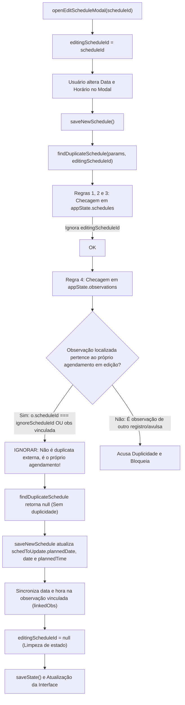

# Plano de Implementação: Resolução da Atualização de Agendamento em Edição no Cronograma (Módulo `agenda_cronograma`)

> **Diretriz de Execução (Obrigatório):**  
> O assistente executor da **Etapa 2 (Operário)** DEVE OBRIGATORIAMENTE ler e seguir integralmente as diretrizes do arquivo [WORKFLOW_MACOS.md](file:///Users/bruno/Desktop/gestor%20supervisao_patos/WORKFLOW_MACOS.md), do [AGENTS.md](file:///Users/bruno/Desktop/gestor%20supervisao_patos/AGENTS.md) e a skill `.agents/skills/execucao-operario/SKILL.md` antes de aplicar quaisquer modificações no código-fonte. A execução deve ser estrita, cirúrgica e atenta à dupla checagem, validação de sintaxe pré-voo (`python3 audit_platform.py --check-syntax`), versionamento sequencial duplo (`CHANGELOG.md` e `#modalChangelog`), criação de cópia intermediária em `intermediárias/` e execução da auditoria pós-deploy silenciosa (`python3 audit_platform.py --silent-on-success`).

---

## 1. Diagnóstico do Problema e Análise Forense da Causa-Raiz

### 1.1 Sintoma Relatado
O usuário executou um diagnóstico na plataforma através do Safari e obteve a seguinte mensagem de falha no console:
```text
[Log] ❌ FAIL | [agenda_cronograma] Erro de execução no módulo agenda_cronograma -> Agendamento não atualizou plannedDate/date/plannedTime após salvar edição (audit_engine.js, line 224)
```

A reprodução controlada via `python3 audit_platform.py --module agenda_cronograma` confirmou a falha:
- **Módulo:** `agenda_cronograma` (Cronograma de Observações, Destaque da Próxima Observação e Baixa Automática)
- **Status da bateria:** 8 de 9 testes aprovados (1 falha crítica)
- **Ponto de ruptura:** Linha 2237-2239 do `js/audit/audit_engine.js`, no sub-teste de edição de data/horário de um agendamento já realizado.

### 1.2 Análise Forense da Causa-Raiz Técnica
A investigação profunda do fluxo de edição em `js/features/schedule.js` revelou o seguinte mecanismo causador:

1. **Implementação Recente da Barreira Anti-Duplicidade:**  
   Recentemente foi introduzida a função `findDuplicateSchedule(params, ignoreScheduleId)` para impedir agendamentos redundantes no cronograma longitudinal.
2. **Ocorrência de Falso Positivo na Regra 4 de `findDuplicateSchedule`:**  
   A função possui 4 regras de verificação de duplicidade:
   - *Regra 1:* Duplicidade de Bimestre em `appState.schedules` (ignora `ignoreScheduleId` com sucesso).
   - *Regra 2:* Duplicidade de Data em `appState.schedules` (ignora `ignoreScheduleId` com sucesso).
   - *Regra 3:* Conflito de Horário do Supervisor em `appState.schedules` (ignora `ignoreScheduleId` com sucesso).
   - *Regra 4:* Verificação de Observação Concluída / Em Andamento Existente para o Alvo no Bimestre em `appState.observations`:
     ```javascript
     // 4. Verificação de Observação Concluída / Em Andamento Existente para o Alvo no Bimestre
     if (appState.observations && Array.isArray(appState.observations)) {
       const bimNumMatch = cleanBim.match(/([1-4])/);
       const bimNum = bimNumMatch ? bimNumMatch[1] : '';

       const obsDuplicate = appState.observations.find(o => {
         if (o.status === 'archived') return false;
         if (cleanSchool && o.schoolName && (o.schoolName || '').trim().toLowerCase() !== cleanSchool) return false;
         const oBimNumMatch = (o.bimester || '').match(/([1-4])/);
         if (!oBimNumMatch || (bimNum && oBimNumMatch[1] !== bimNum)) return false;

         if (targetType === 'turma') {
           const oClass = (o.className || '').trim().toLowerCase();
           return oClass === cleanClass || oClass === cleanTarget;
         } else {
           const oTarget = (o.teacherName || '').trim().toLowerCase();
           return oTarget === cleanTarget;
         }
       });

       if (obsDuplicate) {
         return {
           isDuplicate: true,
           type: 'observation',
           existingObservation: obsDuplicate,
           message: `Já existe uma observação (...) registrada...`
         };
       }
     }
     ```
3. **Mecanismo de Bloqueio Durante a Edição:**  
   - Quando um agendamento já passou por baixa automática (status `realizado`) ou possui uma observação vinculada em andamento/concluída, ele possui um registro correspondente em `appState.observations` (com `o.scheduleId === sched.id`).
   - Ao clicar em "Editar" (`openEditScheduleModal(updatedSched.id)`), a variável `editingScheduleId` recebe o ID do agendamento.
   - O usuário (ou a suíte de teste) altera a data (`scheduleDate`) e o horário (`scheduleTime`) e aciona `saveNewSchedule()`.
   - Dentro de `saveNewSchedule()`, a validação `findDuplicateSchedule(..., editingScheduleId)` é executada.
   - A **Regra 4 não verifica se a observação localizada em `appState.observations` pertence ao próprio agendamento que está sendo editado**! Ela localiza a própria observação vinculada ao agendamento e a classifica erroneamente como duplicata concorrente de terceiros (`isDuplicate: true`).
   - Em seguida, `saveNewSchedule()` encontra `if (dup && dup.isDuplicate)` e dá um `return` imediato:
     ```javascript
     if (dup && dup.isDuplicate) {
       showToast(dup.message, 'warning');
       checkScheduleDuplicationUI();
       return; // Aborta sem salvar!
     }
     ```
   - O bloco de atualização `if (editingScheduleId) { schedToUpdate.plannedDate = ... }` **nunca é executado**.
   - Os valores de `plannedDate`, `date` e `plannedTime` permanecem inalterados no agendamento.
   - A asserção do teste no `audit_engine.js` falha imediatamente:
     ```javascript
     if (updatedSched.plannedDate !== newTestDate || updatedSched.date !== newTestDate || updatedSched.plannedTime !== newTestTime) {
       throw new Error('Agendamento não atualizou plannedDate/date/plannedTime após salvar edição');
     }
     ```
4. **Vazamento do Ponteiro de Edição (`editingScheduleId`):**  
   Adicionalmente, se o modal for fechado sem salvar (`closeAddScheduleModal`), ou após salvar a edição em `saveNewSchedule()`, a variável `editingScheduleId` não estava sendo resetada para `null`, gerando potenciais efeitos colaterais em verificações posteriores.

---

## 2. Arquitetura da Solução e Pontos de Impacto



### Componentes e Arquivos Impactados:
1. **`js/features/schedule.js`:**
   - Na função `findDuplicateSchedule`: adicionar filtro de isenção relacional na Regra 4 quando `ignoreScheduleId` estiver presente, desconsiderando a observação se ela estiver vinculada ao próprio agendamento sendo editado (`o.scheduleId === ignoreScheduleId` ou `linkedObsToEditing.id === o.id`).
   - Na função `closeAddScheduleModal`: garantir que `editingScheduleId = null;` seja executado ao fechar o modal.
   - Na função `saveNewSchedule`: garantir que `editingScheduleId = null;` seja executado após a atualização do agendamento existente.
2. **`firebase_deploy/public/js/features/schedule.js`:**
   - Cópia espelhada idêntica das alterações realizadas em `js/features/schedule.js`.
3. **`index.html` e `firebase_deploy/public/index.html`:**
   - Atualização do botão `.btn-changelog` para a Versão 1.69 (v8.2.36).
   - Inclusão do registro correspondente no modal `#modalChangelog`.
4. **`CHANGELOG.md`:**
   - Registro detalhado da versão 1.69 na tabela sumária e no histórico detalhado.

---

## 3. Especificação Passo a Passo (Snippets Exatos)

### Passo 3.1: Ajuste na Regra 4 de `findDuplicateSchedule` em `js/features/schedule.js`

Localizar a Regra 4 dentro de `findDuplicateSchedule(params, ignoreScheduleId = null)` (linhas ~911-942):

```javascript
      // 4. Verificação de Observação Concluída / Em Andamento Existente para o Alvo no Bimestre
      if (appState.observations && Array.isArray(appState.observations)) {
        const bimNumMatch = cleanBim.match(/([1-4])/);
        const bimNum = bimNumMatch ? bimNumMatch[1] : '';

        // Localiza agendamento sendo editado e sua observação correspondente para isenção relacional
        const currentEditingSched = ignoreScheduleId ? (appState.schedules || []).find(s => s.id === ignoreScheduleId) : null;
        const linkedObsToEditing = currentEditingSched && typeof findObservationForSchedule === 'function'
          ? findObservationForSchedule(currentEditingSched)
          : null;

        const obsDuplicate = appState.observations.find(o => {
          if (o.status === 'archived') return false;

          // Se estamos em modo de edição, ignora a observação que já pertence ao agendamento sendo editado
          if (ignoreScheduleId) {
            if (o.scheduleId === ignoreScheduleId) return false;
            if (currentEditingSched && (currentEditingSched.observationId === o.id || (linkedObsToEditing && linkedObsToEditing.id === o.id))) return false;
          }

          if (cleanSchool && o.schoolName && (o.schoolName || '').trim().toLowerCase() !== cleanSchool) return false;
          const oBimNumMatch = (o.bimester || '').match(/([1-4])/);
          if (!oBimNumMatch || (bimNum && oBimNumMatch[1] !== bimNum)) return false;

          if (targetType === 'turma') {
            const oClass = (o.className || '').trim().toLowerCase();
            return oClass === cleanClass || oClass === cleanTarget;
          } else {
            const oTarget = (o.teacherName || '').trim().toLowerCase();
            return oTarget === cleanTarget;
          }
        });

        if (obsDuplicate) {
          const targetLabel = targetType === 'turma' ? `a turma ${className || targetName}` : `a coordenadora ${targetName}`;
          const obsStatus = (obsDuplicate.status === 'finalized' || obsDuplicate.status === 'concluida') ? 'concluída' : 'em rascunho';
          return {
            isDuplicate: true,
            type: 'observation',
            existingObservation: obsDuplicate,
            message: `Já existe uma observação (${obsStatus}) registrada para ${targetLabel} no ${bimester}. Não é necessário criar um novo agendamento.`
          };
        }
      }
```

### Passo 3.2: Higienização do Ciclo de Vida de `editingScheduleId`

1. Em `closeAddScheduleModal()` (linhas ~717-719):
```javascript
    function closeAddScheduleModal() {
      editingScheduleId = null;
      document.getElementById('modalAddSchedule').classList.remove('active');
    }
```

2. Em `saveNewSchedule()` (linhas ~1148-1150):
```javascript
          showToast('Observação atualizada com sucesso!');
          editingScheduleId = null;
        } else {
```

### Passo 3.3: Sincronização nos Arquivos Espelhados
Copiar integralmente `js/features/schedule.js` para:
- `firebase_deploy/public/js/features/schedule.js`
*(E se aplicável, no diretório `./gestor supervisao_patos/js/features/schedule.js` se for mantido).*

### Passo 3.4: Versionamento Duplo no `CHANGELOG.md` e `index.html`

1. **Atualizar `index.html` e `firebase_deploy/public/index.html`:**
   - Botão `.btn-changelog`:
     ```html
     <span>Versão 1.69 (v8.2.36)</span>
     ```
   - Inserir no topo de `#modalChangelog`:
     ```html
     <div class="changelog-item">
       <div class="changelog-badge">Versão 1.69 (v8.2.36) · 03/11/2026</div>
       <div class="changelog-title">Correção da Edição de Agendamentos Realizados no Cronograma e Isenção Relacional de Duplicidade</div>
       <div class="changelog-desc">
         Ajuste na Regra 4 do motor de detecção de duplicidades (<code>findDuplicateSchedule</code>) para desconsiderar a própria observação vinculada ao agendamento que está sendo editado, viabilizando a alteração de data e horário de visitas já concluídas e sua sincronização bidirecional no histórico.
       </div>
     </div>
     ```

2. **Atualizar `CHANGELOG.md`:**
   - Inserir linha da versão **1.69** na tabela sumária e bloco de notas detalhado da versão.

---

## 4. Critérios de Aceite e Roteiro de Teste

### Critérios de Aceite:
1. **Validação Léxica/Sintática Pré-Voo (macOS JSC):**
   ```bash
   python3 audit_platform.py --check-syntax
   ```
   Deve retornar com saída 0 e confirmação de sintaxe 100% íntegra.
2. **Execução do Módulo Específico (`agenda_cronograma`):**
   ```bash
   python3 audit_platform.py --module agenda_cronograma
   ```
   Deve retornar 9/9 testes aprovados (100% PASS) sem qualquer falha ou exceção.
3. **Auditoria Geral Silenciosa Pós-Deploy:**
   ```bash
   python3 audit_platform.py --silent-on-success
   ```
   Deve executar os 12 módulos oficiais em Chrome headless e encerrar com código de saída 0.
4. **Verificação no Safari:**
   A mensagem de erro reportada pelo usuário (`❌ FAIL | [agenda_cronograma] Erro de execução... Agendamento não atualizou plannedDate/date/plannedTime após salvar edição`) deve desaparecer por completo, retornando `✅ PASS` para todos os testes do módulo.

---

## 5. Seção Obrigatória de Auditoria: Algoritmo de Auditoria (`audit_platform.py` e `audit_engine.js`)

- **Alterações necessárias no `audit_platform.py`:** Nenhuma.
- **Alterações necessárias no `audit_engine.js`:** Nenhuma.
- **Justificativa Técnica:**  
  O teste existente no Módulo 8 (`agenda_cronograma`) de `audit_engine.js` (linhas 2216-2245) já expressa com perfeição o contrato esperado de produto e arquitetura:
  1. Renderiza o botão de edição em agendamento com status `realizado`.
  2. Abre o modal `#modalAddSchedule` em modo de edição com o botão de exclusão visível.
  3. Altera a data para `2026-10-25` e horário para `10:00`.
  4. Executa `saveNewSchedule()`.
  5. Assegura que o agendamento atualizou `plannedDate`, `date` e `plannedTime`.
  6. Assegura que a observação vinculada em `appState.observations` sincronizou retroativamente a nova data e horário.
  
  O teste falhava exatamente porque o código de produção (`schedule.js`) bloqueava indevidamente o salvamento por um falso positivo da barreira de duplicidade. A correção pontual em `schedule.js` fará com que o teste passe com 100% de conformidade, sem necessidade de enfraquecer ou refatorar as asserções da suíte de testes.
