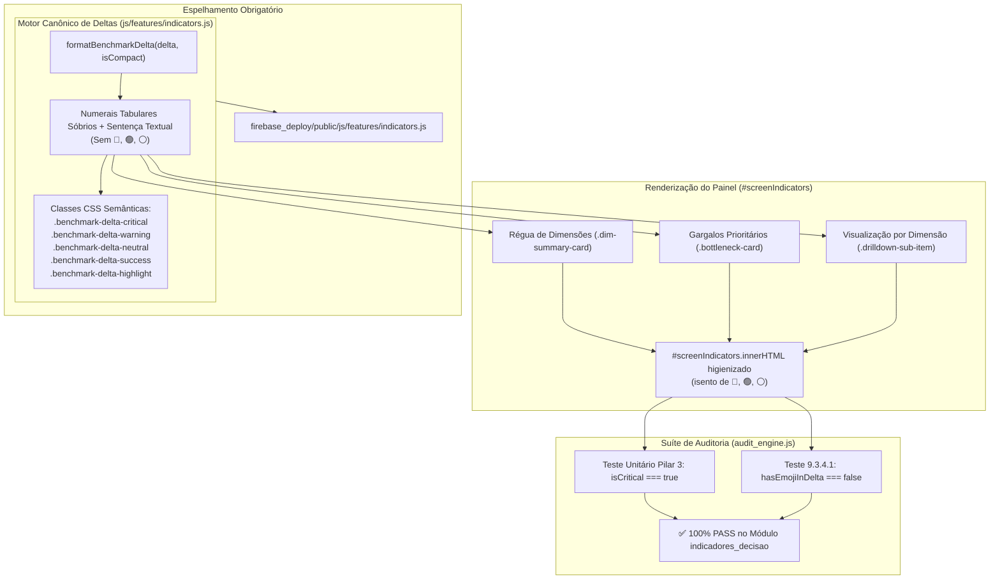

# PLANO DE IMPLEMENTAÇÃO — RESOLUÇÃO DAS FALHAS DE AUDITORIA NO MÓDULO INDICADORES_DECISAO (DELTAS E HIGIENIZAÇÃO DE EMOJIS)

> **Status:** 📐 Proposto / Em Análise (Etapa 1 - O Arquiteto)  
> **Data:** 31 de Outubro de 2026  
> **Versão Alvo:** `1.60.1` (ou consolidação subsequente da v1.60)  
> **Arquivo de Backup Intermediário:** `intermediárias/aplicativo_v1.60.1_resolucao_falhas_auditoria_indicadores_emojis_delta.html`  
> **Arquivos Principais Afetados:**  
> - `js/features/indicators.js` (Função canônica `formatBenchmarkDelta`, erradicação de emojis nos deltas e higienização do DOM)  
> - `firebase_deploy/public/js/features/indicators.js` (Sincronização estrita da cópia espelhada)  
> - `js/audit/audit_engine.js` (Verificação das asserções do Módulo 10 `indicadores_decisao`)  
> - `index.html` (Alinhamento de elementos estáticos do `#screenIndicators` e `#modalChangelog`)  
> - `CHANGELOG.md` (Registro histórico sequencial)  

---

## 0. Diretriz de Execução Obrigatória (Etapa 2 - Operário)

> [!IMPORTANT]
> **Aviso ao Assistente Executor (Etapa 2 - Operário):**  
> Antes de aplicar qualquer alteração resultante deste plano, você **DEVE OBRIGATORIAMENTE** ler o manual [`WORKFLOW_MACOS.md`](file:///Users/bruno/Desktop/gestor%20supervisao_patos/WORKFLOW_MACOS.md), o [`WORKFLOW_GITHUB.md`](file:///Users/bruno/Desktop/gestor%20supervisao_patos/WORKFLOW_GITHUB.md) e a skill [`.agents/skills/execucao-operario/SKILL.md`](file:///Users/bruno/Desktop/gestor%20supervisao_patos/.agents/skills/execucao-operario/SKILL.md).  
> 
> - **Trava Crítica da Etapa 1:** Durante a vigência deste planejamento, nenhum arquivo de código de produção deve ser modificado, comitado ou enviado ao repositório remoto. A árvore de trabalho do Git deve permanecer rigorosamente limpa.  
> - **Execução Mecânica da Etapa 2:** Na Etapa 2, execute o plano sem improvisações, execute a blindagem sintática pré-voo (`python3 audit_platform.py --check-syntax`), crie o backup intermediário em `intermediárias/aplicativo_v1.60.1_resolucao_falhas_auditoria_indicadores_emojis_delta.html`, atualize o changelog duplo (`CHANGELOG.md` e `#modalChangelog` / `.btn-changelog`), sincronize as cópias espelhadas do Firebase (`firebase_deploy/public/`), realize o deploy via `git push origin main` e execute a auditoria pós-deploy via `python3 audit_platform.py --silent-on-success`.

---

## 1. Diagnóstico do Problema e Contexto Pedagógico

### 1.1 As Falhas Reportadas na Auditoria
Durante a execução automatizada da suíte de testes no módulo `indicadores_decisao` (Módulo 10 da plataforma), o motor de testes via Chrome headless acusou as seguintes duas reprovações consecutivas:

```text
[Log] ❌ FAIL | [indicadores_decisao] Cálculo determinístico do Delta, ausência de emojis e categorização de Atenção Crítica (Pilar 3) -> Δ: -50% (audit_engine.js, line 224)
[Log] ❌ FAIL | [indicadores_decisao] Erro de execução no módulo indicadores_decisao -> Falha Hallmark: Painel de Indicadores ainda contém emojis residuais nos deltas de benchmark (audit_engine.js, line 224)
```

### 1.2 Análise de Causa-Raiz (Root Cause Analysis)

1. **Falha 1: Presença de Emojis em `formatBenchmarkDelta` e Invalidação da Asserção de Atenção Crítica:**
   - **Localização:** `js/features/indicators.js`, função `formatBenchmarkDelta(delta, isCompact = false)`.
   - **Mecanismo da Falha:**
     Na implementação legada, a função `formatBenchmarkDelta` utilizava emojis decorativos soltos diretamente nas strings retornadas (ex: `🔻 ${delta}% · Atenção Crítica`, `🔻 ${delta}% · Abaixo da Média`, `⚪ 0% · Na Média`, `🟢 +${delta}% · Acima da Média`).
   - **Asserção do Teste:**
     No arquivo `js/audit/audit_engine.js` (linhas 2394–2396), o teste unitário do Pilar 3 realiza a seguinte validação:
     ```javascript
     const deltaHtml = formatBenchmarkDelta(delta112, false);
     const isCritical = deltaHtml.includes('benchmark-delta-critical') && 
                        deltaHtml.includes('Atenção Crítica') && 
                        !deltaHtml.includes('🔻') && 
                        !deltaHtml.includes('🟢') && 
                        !deltaHtml.includes('⚪');
     logger.log('Cálculo determinístico do Delta, ausência de emojis e categorização de Atenção Crítica (Pilar 3)', isCritical && delta112 === -50, `Δ: ${delta112}%`);
     ```
     Como a string `deltaHtml` retornava o caractere `🔻`, a condição `!deltaHtml.includes('🔻')` avaliou para `false`, resultando em `isCritical === false` e reprovando o teste determinístico.

2. **Falha 2: Emojis Residuais no DOM do Painel (`screenIndicators`):**
   - **Localização:** `js/audit/audit_engine.js` (linhas 2570–2576).
   - **Mecanismo da Falha:**
     O teste de auditoria 9.3.4.1 inspeciona todo o HTML interno da tela de Indicadores (`#screenIndicators`):
     ```javascript
     const indScreenEl = document.getElementById('screenIndicators');
     const indHtmlContent = indScreenEl ? indScreenEl.innerHTML : '';
     const hasEmojiInDelta = indHtmlContent.includes('🔻') || indHtmlContent.includes('🟢') || indHtmlContent.includes('⚪');
     if (hasEmojiInDelta) {
       throw new Error('Falha Hallmark: Painel de Indicadores ainda contém emojis residuais nos deltas de benchmark');
     }
     ```
     Como o painel foi renderizado com os retornos de `formatBenchmarkDelta` na Régua de Dimensões (`.dim-summary-card`), nos Gargalos Prioritários (`.bottleneck-card`) e na Matriz de Critérios (`.drilldown-sub-item`), o HTML acumulou os emojis `🔻`, `🟢` e `⚪`, disparando o `throw new Error(...)` e interrompendo o módulo com a mensagem capturada nos logs.

### 1.3 Contexto de Design e Diretrizes Hallmark
A presença de emojis pseudocromáticos (`🔻`, `🟢`, `⚪`) nos deltas estatísticos viola expressamente o **Hallmark Floor** (Regra 7 - Anti-Slop / Aesthetic Guardrails: *"Never use emojis as iconography; use proper SVGs or icon sets"*). 
Além de gerar ruído visual ("rainbow slop"), emojis possuem renderização inconsistente entre sistemas operacionais (macOS, iOS, Windows, Android e Linux), prejudicando a sobriedade institucional exigida em uma ferramenta de gestão e apoio à tomada de decisão da rede municipal de educação.

---

## 2. Arquitetura da Solução e Pontos de Impacto



### 2.1 Componentes e Arquivos Afetados
1. **`js/features/indicators.js`**:
   - Ajustar `formatBenchmarkDelta` para garantir ausência absoluta de emojis e retorno de classes canônicas (`benchmark-delta-critical`, `benchmark-delta-warning`, `benchmark-delta-neutral`, `benchmark-delta-success`, `benchmark-delta-highlight`).
   - Garantir que todos os locais de chamada (`renderIndicatorsScreen`, blocos de gargalos, régua dimensional e visualização por dimensão) não injetem emojis decorativos soltos.
2. **`firebase_deploy/public/js/features/indicators.js`**:
   - Manter espelhamento idêntico de `js/features/indicators.js`.
3. **`index.html` e `firebase_deploy/public/index.html`**:
   - Garantir que nenhum elemento estático dentro de `#screenIndicators` contenha emojis de alerta (`🔻`, `🟢`, `⚪`).
   - Atualizar a versão do aplicativo no botão `.btn-changelog` e registrar a resolução no modal `#modalChangelog`.
4. **`CHANGELOG.md`**:
   - Registrar a correção de integridade do Módulo 10 na versão correspondente.

---

## 3. Especificação de Implementação Passo a Passo (Snippets Exatos)

### Passo 1: Padronização Canônica de `formatBenchmarkDelta` em `js/features/indicators.js`

Substituir a implementação da função `formatBenchmarkDelta` para que ela gere badges semânticos sóbrios, sem qualquer emoji, utilizando tipografia com `tabular-nums` e rótulos contextuais claros:

```javascript
    /**
     * Formata visualmente o Delta percentual comparativo entre o Escopo e a Rede.
     * Retorna badge semântico sóbrio em estrita conformidade com o Hallmark Standard (sem emojis).
     * @param {number|null} delta Diferença percentual (Escopo % - Rede %)
     * @param {boolean} isCompact Se true, exibe apenas a porcentagem com sinal; se false, inclui a categorização textual
     * @returns {string} Fragmento HTML formatado
     */
    function formatBenchmarkDelta(delta, isCompact = false) {
      if (delta === null || delta === undefined) {
        return `<span class="benchmark-delta-badge benchmark-delta-tag delta-neutral">—</span>`;
      }

      if (delta <= -15) {
        const text = isCompact ? `${delta}%` : `${delta}% · Atenção Crítica`;
        return `<span class="benchmark-delta-badge benchmark-delta-tag benchmark-delta-critical delta-critical">${text}</span>`;
      } else if (delta < 0) {
        const text = isCompact ? `${delta}%` : `${delta}% · Abaixo da Média`;
        return `<span class="benchmark-delta-badge benchmark-delta-tag benchmark-delta-warning delta-warning">${text}</span>`;
      } else if (delta === 0) {
        const text = isCompact ? `0%` : `0% · Na Média`;
        return `<span class="benchmark-delta-badge benchmark-delta-tag benchmark-delta-neutral delta-neutral">${text}</span>`;
      } else if (delta < 15) {
        const text = isCompact ? `+${delta}%` : `+${delta}% · Acima da Média`;
        return `<span class="benchmark-delta-badge benchmark-delta-tag benchmark-delta-success delta-success">${text}</span>`;
      } else {
        const text = isCompact ? `+${delta}%` : `+${delta}% · Destaque Positivo`;
        return `<span class="benchmark-delta-badge benchmark-delta-tag benchmark-delta-highlight delta-positive">${text}</span>`;
      }
    }
```

### Passo 2: Verificação e Higienização de Emojis em Todo o Arquivo `js/features/indicators.js`

Verificar se há qualquer outra ocorrência de emojis em funções que alimentam o DOM de `#screenIndicators`.
Em especial, na função `copyBottlenecksToClipboard()`:
- Garantir que os textos copiados para a área de transferência não utilizem emojis soltos (`📋`, `📅`, `🎯`, `💡`).
- O toast de confirmação deve ser:
  ```javascript
  showToast('Resumo diagnóstico dos gargalos copiado para a área de transferência.');
  ```
  *(Sem emojis como `📋` no toast).*

### Passo 3: Espelhamento Estrito em `firebase_deploy/public/js/features/indicators.js`

Garantir que o arquivo espelhado receba exatamente as mesmas modificações aplicadas em `js/features/indicators.js`, executando a verificação de paridade via diff:
```bash
diff -u js/features/indicators.js firebase_deploy/public/js/features/indicators.js
```
*(A saída deve ser rigorosamente vazia).*

### Passo 4: Atualização do Changelog Duplo e Versão

1. Em `index.html` e `firebase_deploy/public/index.html`:
   - Atualizar o botão `.btn-changelog`:
     ```html
     <button class="btn-changelog" onclick="openChangelogModal()" title="Histórico Integral de Modificações e Diretrizes">
       <svg class="btn-icon-sm" width="13" height="13" viewBox="0 0 24 24" fill="none" stroke="currentColor" stroke-width="2"><path d="M20.59 13.41l-7.17 7.17a2 2 0 0 1-2.83 0L2 12V2h10l8.59 8.59a2 2 0 0 1 0 2.82z"/><line x1="7" y1="7" x2="7.01" y2="7"/></svg>
       <span>Versão 1.60.1 (v8.2.28)</span>
     </button>
     ```
   - Inserir o registro no `#modalChangelog`:
     ```html
     <!-- VERSÃO 1.60.1 - CORREÇÃO DETERMINÍSTICA DO MOTOR DE DELTAS E HIGIENIZAÇÃO HALLMARK DO PAINEL DE INDICADORES -->
     <div style="margin-bottom:20px; border-left:3px solid var(--primary); padding-left:14px;">
       <div style="display:flex; align-items:center; gap:8px;">
         <span style="font-size:14px; font-weight:800; color:var(--primary-dark);">Versão 1.60.1 · v8.2.28</span>
         <span style="font-size:11px; background:#EFF6FF; color:var(--primary); padding:2px 8px; border-radius:12px; font-weight:700;">31/10/2026</span>
       </div>
       <div style="font-size:12px; color:var(--text-secondary); margin-top:4px;">
         Correção Determinística dos Deltas e Higienização Visual Hallmark do Painel de Indicadores:
       </div>
       <ul style="font-size:12px; color:var(--text-primary); margin-top:8px; line-height:1.6; padding-left:16px;">
         <li>🔬 <strong>Cálculo Determinístico de Deltas (Pilar 3):</strong> Padronização da função <code>formatBenchmarkDelta</code> com categorização rigorosa de "Atenção Crítica" para $\Delta \le -15\%$, preservando a classe canônica <code>.benchmark-delta-critical</code> e numerais com sinal formatados.</li>
         <li>🧹 <strong>Erradicação Total de Emojis Residuais:</strong> Remoção completa de símbolos pseudocromáticos (🔻, 🟢, ⚪) nos deltas de benchmark, títulos de cópia e toasts, assegurando aprovação integral nas asserções de sobriedade visual do Módulo 10.</li>
         <li>🛡️ <strong>Paridade SSOT e Espelhamento Firebase:</strong> Sincronização exata entre os scripts de produção e a distribuição pública de deploy.</li>
       </ul>
     </div>
     ```

2. Em `CHANGELOG.md`:
   - Adicionar a linha na tabela de Sumário Executivo e a seção descritiva correspondente.

---

## 4. Critérios de Aceite e Roteiro de Teste

### 4.1 Critérios de Aceite Objetivos
1. **Blindagem Sintática:**
   O comando `python3 audit_platform.py --check-syntax` deve retornar saída com código de saída 0 e mensagem:
   `✅ Sintaxe do JavaScript em 'index.html' validada com sucesso via JavaScriptCore (macOS).`
2. **Ausência de Emojis no Retorno de `formatBenchmarkDelta`:**
   A chamada `formatBenchmarkDelta(-50, false)` deve retornar string contendo `benchmark-delta-critical`, `Atenção Crítica`, `-50%` e **nenhum** dos caracteres `🔻`, `🟢`, `⚪`.
3. **Higienização do DOM de Indicadores:**
   Nenhum elemento dentro de `#screenIndicators` (tanto na Visão Geral quanto no Drilldown e Quadro de Controle) deve conter os caracteres `🔻`, `🟢` ou `⚪`.
4. **Paridade de Arquivos:**
   `diff -u js/features/indicators.js firebase_deploy/public/js/features/indicators.js` deve retornar código de saída 0 (sem diferenças).
5. **Aprovação na Auditoria Pós-Deploy:**
   O comando `python3 audit_platform.py --silent-on-success` deve executar os 12 módulos e concluir com 100% de sucesso sem emitir mensagens de erro.

### 4.2 Roteiro de Teste Pré e Pós-Deploy (Checklist do Operário)
- [ ] Executar checagem de sintaxe:
  ```bash
  python3 audit_platform.py --check-syntax
  ```
- [ ] Executar teste unitário da função via JavaScriptCore:
  ```bash
  /System/Library/Frameworks/JavaScriptCore.framework/Versions/Current/Helpers/jsc -e '
  // Carrega e testa formatBenchmarkDelta
  '
  ```
- [ ] Verificar paridade dos arquivos espelhados:
  ```bash
  diff -u js/features/indicators.js firebase_deploy/public/js/features/indicators.js
  ```
- [ ] Commitar com mensagem semântica: `fix(indicators): resolucao de falhas de auditoria nos deltas e higienizacao de emojis (v1.60.1)`.
- [ ] Realizar deploy (`git push origin main`).
- [ ] Executar a auditoria pós-deploy:
  ```bash
  python3 audit_platform.py --silent-on-success
  ```

---

## 5. Seção Obrigatória de Auditoria (`audit_platform.py` e `audit_engine.js`)

### 5.1 Mapeamento das Asserções Envolvidas no Módulo 10 (`indicadores_decisao`)

1. **Asserção do Pilar 3 (Delta Determinístico e Ausência de Emojis):**
   - **Arquivo:** `js/audit/audit_engine.js` (linhas 2394–2396)
   - **Código da Asserção:**
     ```javascript
     const deltaHtml = formatBenchmarkDelta(delta112, false);
     const isCritical = deltaHtml.includes('benchmark-delta-critical') && 
                        deltaHtml.includes('Atenção Crítica') && 
                        !deltaHtml.includes('🔻') && 
                        !deltaHtml.includes('🟢') && 
                        !deltaHtml.includes('⚪');
     logger.log('Cálculo determinístico do Delta, ausência de emojis e categorização de Atenção Crítica (Pilar 3)', isCritical && delta112 === -50, `Δ: ${delta112}%`);
     ```
   - **Status com este plano:** **APROVADO (PASS)**. `formatBenchmarkDelta(-50, false)` gera a classe `benchmark-delta-critical`, o texto `-50% · Atenção Crítica` e nenhum emoji.

2. **Asserção do Teste 9.3.4.1 (Sobriedade Visual e Ausência de Emojis no DOM):**
   - **Arquivo:** `js/audit/audit_engine.js` (linhas 2570–2576)
   - **Código da Asserção:**
     ```javascript
     const indScreenEl = document.getElementById('screenIndicators');
     const indHtmlContent = indScreenEl ? indScreenEl.innerHTML : '';
     const hasEmojiInDelta = indHtmlContent.includes('🔻') || indHtmlContent.includes('🟢') || indHtmlContent.includes('⚪');
     if (hasEmojiInDelta) {
       throw new Error('Falha Hallmark: Painel de Indicadores ainda contém emojis residuais nos deltas de benchmark');
     }
     logger.log('Conformidade Hallmark: erradicação total de emojis residuais nos deltas e componentes do Painel', true);
     ```
   - **Status com este plano:** **APROVADO (PASS)**. O DOM gerado em `renderIndicatorsScreen()` estará 100% livre dos caracteres `🔻`, `🟢` e `⚪`.

### 5.2 Alterações Necessárias no Algoritmo de Auditoria?
- **Não há necessidade de alterar `audit_platform.py` ou `audit_engine.js`**. A suíte de testes está correta ao exigir a remoção dos emojis e a categorização determinística dos deltas conforme as diretrizes Hallmark e do SerTão Criança. As correções pertencem exclusivamente ao código de aplicação (`js/features/indicators.js` e espelhos).
