# Plano de Implementação: Resolução Definitiva das 3 Falhas da Suíte de Auditoria Modular

---

## 0. Diretriz de Execução Obrigatória (Etapa 2)
> [!IMPORTANT]
> **Atenção Executor / Operário:** Antes de aplicar qualquer modificação em código, leia obrigatoriamente o manual [`WORKFLOW_MACOS.md`](file:///Users/bruno/Desktop/gestor%20supervisao_patos/WORKFLOW_MACOS.md) e a skill do Antigravity [`.agents/skills/execucao-operario/SKILL.md`](file:///Users/bruno/Desktop/gestor%20supervisao_patos/.agents/skills/execucao-operario/SKILL.md).
> Siga estritamente este plano sem improvisações, mantendo a integridade sintática via JSC (`python3 audit_platform.py --check-syntax`), gerando a versão intermediária de backup `intermediárias/aplicativo_v148_resolucao_falhas_auditoria_modular.html`, atualizando o changelog duplo para a versão **1.48 (v8.2.15)** e executando a auditoria modular silenciosa pós-deploy (`python3 audit_platform.py --silent-on-success`).

---

## 1. Diagnóstico Forense das 3 Falhas Reportadas

A execução determinística da suíte de testes de ponta a ponta (`python3 audit_platform.py`) reprovou em 3 módulos do sistema SerTão Criança. Abaixo detalha-se o diagnóstico de causa raiz de cada falha:

```
❌ FAIL | [indicadores_decisao] Erro de execução no módulo indicadores_decisao -> Falha Pilar 10: Esperado status completed/green para 1º Bimestre da Infantil I, obtido overdue/red
❌ FAIL | [navegacao_layout] Erro de execução no módulo navegacao_layout -> returnToCurrentAcademicYear() não restaurou o ano vigente 2026
❌ FAIL | [catalogo_dados] Erro de execução no módulo catalogo_dados -> Ana Carolina Silva não possui alocação exclusiva em Infantil I - Turma A
```

### 1.1. Falha 1: `[indicadores_decisao] -> Falha Pilar 10: Esperado status completed/green para 1º Bimestre da Infantil I, obtido overdue/red`
- **Ponto de Quebra:** [`js/audit/audit_engine.js`](file:///Users/bruno/Desktop/gestor%20supervisao_patos/js/audit/audit_engine.js#L2274-L2277), linha 2274:
  ```javascript
  const statusGreen = calculateClassBimesterStatus('Infantil I - Turma A', 'CEI Professora Maria de Lourdes', '1º Bimestre');
  if (statusGreen.status !== 'completed' || statusGreen.colorKey !== 'green') {
    throw new Error(`Falha Pilar 10: Esperado status completed/green para 1º Bimestre da Infantil I, obtido ${statusGreen.status}/${statusGreen.colorKey}`);
  }
  ```
- **Causa Raiz:**
  1. **Destruição do Estado por Efeito Colateral entre Módulos:** Os testes dos módulos 3 (`setup_longitudinal`, linha 918) e 4 (`rubricas_observacao`, linha 1037) executam explicitamente `appState.observations = []` para testar fluxos isolados de formulário limpo, sem restaurar os dados de observação pré-existentes. Como a suíte compartilha a instância viva de `appState` ao longo dos 12 módulos, ao chegar no Módulo 10 (`indicadores_decisao`), a observação seed canônica `obs-001` já foi expurgada da memória.
  2. **Ausência de Metadados e Nome Canônico Incompleto em `obs-001`:** No arquivo [`js/config/seed.js`](file:///Users/bruno/Desktop/gestor%20supervisao_patos/js/config/seed.js#L14-L26), a observação `obs-001` foi cadastrada com `className: 'Infantil I'` (sem o sufixo canônico ` - Turma A`) e sem o atributo explícito `academicYear: '2026'`. Como a engine `calculateClassBimesterStatus` em [`js/features/indicators.js`](file:///Users/bruno/Desktop/gestor%20supervisao_patos/js/features/indicators.js#L1074) exige correspondência estrita com o ano ativo `(o.academicYear || '2026') === activeYear`, a ausência da observação faz com que o algoritmo considere a turma sem observação realizada e com prazo encerrado no calendário de 2026, retornando `status: 'overdue'` e `colorKey: 'red'`.

### 1.2. Falha 2: `[navegacao_layout] -> returnToCurrentAcademicYear() não restaurou o ano vigente 2026`
- **Ponto de Quebra:** [`js/audit/audit_engine.js`](file:///Users/bruno/Desktop/gestor%20supervisao_patos/js/audit/audit_engine.js#L2964-L2967), linhas 2964-2967:
  ```javascript
  returnToCurrentAcademicYear();
  if (appState.selectedAcademicYear !== '2026') {
    throw new Error('returnToCurrentAcademicYear() não restaurou o ano vigente 2026');
  }
  ```
- **Causa Raiz:**
  1. A função `returnToCurrentAcademicYear()` em [`js/services/export_backup.js`](file:///Users/bruno/Desktop/gestor%20supervisao_patos/js/services/export_backup.js#L432-L436) resolvia o ano vigente através da ordenação léxica ingênua `sortedYears[0]`:
     ```javascript
     function returnToCurrentAcademicYear() {
       const sortedYears = [...(appState.academicYears || ['2026'])].sort((a, b) => b.localeCompare(a));
       const latestYear = sortedYears[0] || '2026';
       onGlobalAcademicYearChange(latestYear);
     }
     ```
  2. Quando o teste temporal de autocura roda no Módulo 2 (injetando temporariamente `'2099'` para testar a expurgação de resíduos futuros) ou caso o `localStorage` do ambiente tenha resíduos persistidos de anos futuros como `'2027'`, a ordenação léxica pura seleciona o ano futuro ou, se houver inconsistência de tipos (`number` vs `string`), falha na resolução. O conceito de "Ano Vigente Oficial" da rede pública municipal de Patos é determinístico: é o ano civil em curso (`currentRealYear = new Date().getFullYear().toString()`), não podendo exceder o ano civil atual nem assumir valores órfãos.

### 1.3. Falha 3: `[catalogo_dados] -> Ana Carolina Silva não possui alocação exclusiva em Infantil I - Turma A`
- **Ponto de Quebra:** [`js/audit/audit_engine.js`](file:///Users/bruno/Desktop/gestor%20supervisao_patos/js/audit/audit_engine.js#L494-L497), linhas 494-497:
  ```javascript
  const anaClasses = (appState.classes || []).filter(c => (c.teachers || []).includes('Ana Carolina Silva'));
  if (anaClasses.length !== 1 || anaClasses[0].name !== 'Infantil I - Turma A') {
    throw new Error('Ana Carolina Silva não possui alocação exclusiva em Infantil I - Turma A');
  }
  ```
- **Causa Raiz:**
  1. **Ausência de Escopo Temporal no Teste de Alocação:** A docente Ana Carolina Silva atua em regime de Tempo Parcial Matutino na turma `Infantil I - Turma A`. No entanto, quando anos plurianuais coexistem (ex: transição anual com clonagem de turmas em `confirmCreateNewAcademicYear` ou turmas clonadas para anos históricos/futuros em `localStorage`), `appState.classes` passa a conter as turmas clonadas do ano transacionado contendo a mesma docente no novo ciclo.
  2. A asserção do Módulo 2 filtrou `appState.classes` globalmente de forma irrestrita sem delimitar o escopo ao ano letivo em análise (`(c.academicYear || '2026') === (appState.selectedAcademicYear || '2026')`).
  3. Além disso, em [`js/config/catalog.js`](file:///Users/bruno/Desktop/gestor%20supervisao_patos/js/config/catalog.js#L130), a rotina de resiliência `getClassesForSchool` para escolas sem turmas continha um fallback que utilizava `'Infantil I - Turma A'` como nome padrão de turma agrupada caso `classAssigned` não estivesse presente, gerando potencial colisão de nomes de turmas entre unidades.

---

## 2. Arquitetura da Solução e Pontos de Impacto

```mermaid
flowchart TD
    subgraph S1["Módulo 10: Isolamento e Integridade dos Indicadores"]
        A1["Início do Módulo indicadores_decisao"] --> B1["Assegurar appState.selectedAcademicYear = '2026'"]
        B1 --> C1["Assegurar presença canônica de obs-001 (Finalizada 1º Bim 2026)"]
        C1 --> D1["calculateClassBimesterStatus('Infantil I - Turma A', ...)"]
        D1 --> E1["Status: completed / colorKey: green (Aprovado ✅)"]
    end

    subgraph S2["Navegação e Layout: Resolução Determinística do Ano Vigente"]
        A2["returnToCurrentAcademicYear()"] --> B2["Filtrar academicYears <= currentRealYear"]
        B2 --> C2["Identificar maior ano válido (2026)"]
        C2 --> D2["onGlobalAcademicYearChange('2026')"]
        D2 --> E2["appState.selectedAcademicYear === '2026' (Aprovado ✅)"]
    end

    subgraph S3["Catálogo de Dados: Exclusividade Docente por Ciclo Letivo"]
        A3["Validação de Exclusividade Docente"] --> B3["Filtrar turmas do ano letivo ativo (2026)"]
        B3 --> C3["Validar alocação única de Ana Carolina Silva em Infantil I - Turma A"]
        C3 --> D3["Exclusividade confirmada (Aprovado ✅)"]
    end
```



### 2.1. Pontos de Impacto no Repositório
1. **`js/config/seed.js`:**
   - Padronizar o objeto `obs-001` com `className: 'Infantil I - Turma A'` e `academicYear: '2026'`, alinhado estritamente à turma `cls-pml-01`.
2. **`js/services/export_backup.js`:**
   - Refatorar `returnToCurrentAcademicYear()` para resolver de forma determinística e segura o ano letivo canônico vigente (`currentRealYear.toString()`), blindado contra resíduos de anos futuros ou falhas de ordenação.
   - Em `confirmCreateNewAcademicYear()`: assegurar que as turmas clonadas registrem explicitamente seu `academicYear: yearVal` e não sofram contaminação de IDs ou atributos órfãos.
3. **`js/core/state.js`:**
   - Em `loadState()`: garantir que a autocura temporal expurgue turmas duplicadas da mesma docente no mesmo ano letivo em turmas de tempo parcial e reforce a higienização de anos futuros.
4. **`js/audit/audit_engine.js`:**
   - No Módulo 2 (`catalogo_dados`): escopar a asserção de exclusividade docente de `Ana Carolina Silva` ao ano letivo vigente em teste (`(c.academicYear || '2026') === (appState.selectedAcademicYear || '2026')`).
   - No Módulo 10 (`indicadores_decisao`): garantir isolamento idempotente garantindo a presença de `obs-001` caso módulos anteriores destrutivos tenham esvaziado `appState.observations`, e fixar `appState.selectedAcademicYear = '2026'`.
   - No Módulo 12 (`navegacao_layout`): atualizar a verificação da versão para `1.48 (v8.2.15)`.
5. **`index.html`:**
   - Atualizar a exibição da versão no botão `.btn-changelog` e no `#modalChangelog` para a versão **1.48 (v8.2.15)**.
6. **`CHANGELOG.md`:**
   - Registrar formalmente a versão **1.48**.

---

## 3. Especificação de Implementação Passo a Passo

### 3.1. Padronização Canônica de `obs-001` em `js/config/seed.js`
Localizar a declaração de `obs-001` (linhas 13-26 de [`js/config/seed.js`](file:///Users/bruno/Desktop/gestor supervisao_patos/js/config/seed.js#L13-L26)):

```javascript
// SUBSTITUIR O BLOCO DE obs-001:
        {
          id: 'obs-001',
          evaluatedType: 'professora',
          teacherName: 'Ana Carolina Silva',
          className: 'Infantil I - Turma A',
          schoolName: 'CEI Professora Maria de Lourdes',
          evaluatedBy: 'Mariana Ferreira',
          bimester: '1º Bimestre',
          academicYear: '2026',
          date: '2026-03-12',
          startTime: '08:00',
          endTime: '09:45',
          durationMinutes: 105,
          status: 'finalized',
          synthesisMaterialDimension: 2,
          synthesisPredominant: 'Folhas pré-prontas (xerox e apostilados)',
          synthesisOrg: 'Atividades padronizadas para todos simultaneamente',
          comments: 'Diagnóstico inicial do 1º Bimestre: professora acolhedora, com necessidade de ampliar materiais concretos.',
          responses: {
            '1.1.1': 'partial', '1.1.2': 'not_done', '1.1.3': 'partial', '1.1.4': 'consistent', '1.1.5': 'partial',
            '1.2.1': 'partial', '1.2.2': 'not_done', '1.3.1': 'partial', '1.3.2': 'partial',
            '2.1.1': 'consistent', '2.1.2': 'partial', '2.1.4': 'not_done', '2.2.1': 'not_done', '2.3.1': 'na',
            '3.1': 'partial', '3.2': 'not_done', '3.3': 'consistent', '3.4': 'not_done',
            '4.1.1': 'consistent', '4.1.2': 'consistent', '4.2.1': 'consistent', '4.2.4': 'partial', '4.3.1': 'partial', '4.4.1': 'consistent',
            '5.1': 'consistent', '5.2': 'consistent', '5.3': 'partial'
          },
          criterionComments: {
            '1.1.2': 'Poucas perguntas abertas no momento da roda.',
            '2.3.1': 'Materiais guardados no armário neste dia.'
          },
          photos: {},
          linkedNotes: []
        },
```

---

### 3.2. Resolução Robusta do Ano Vigente em `js/services/export_backup.js`
Substituir a função `returnToCurrentAcademicYear()` (linhas 432-436 de [`js/services/export_backup.js`](file:///Users/bruno/Desktop/gestor supervisao_patos/js/services/export_backup.js#L432-L436)):

```javascript
    function returnToCurrentAcademicYear() {
      const currentRealYear = new Date().getFullYear();
      const validYears = (appState.academicYears || ['2026'])
        .map(y => parseInt(y, 10))
        .filter(y => !isNaN(y) && y <= currentRealYear)
        .sort((a, b) => b - a);

      const targetYear = (validYears[0] || 2026).toString();
      onGlobalAcademicYearChange(targetYear);
    }
```

---

### 3.3. Autocura e Saneamento de Turmas em `js/core/state.js`
Em `loadState()` ([`js/core/state.js`](file:///Users/bruno/Desktop/gestor supervisao_patos/js/core/state.js#L58-L67)), reforçar o saneamento de turmas para deduplicar alocações por turno e ano letivo:

```javascript
          if (!appState.classes || !Array.isArray(appState.classes) || appState.classes.length === 0) {
            appState.classes = JSON.parse(JSON.stringify(INITIAL_CLASSES));
          } else {
            // Saneamento e deduplicação resiliente contra turmas órfãs com mesmo ID
            const seenClassIds = new Set();
            appState.classes = appState.classes.filter(c => {
              if (!c || !c.id) return false;
              if (seenClassIds.has(c.id)) return false;
              seenClassIds.add(c.id);
              return true;
            });
          }
```

---

### 3.4. Blindagem e Isolamento de Testes em `js/audit/audit_engine.js`

#### A) No Módulo 2 (`catalogo_dados` - linha 494):
Substituir a asserção de Ana Carolina Silva para validar o escopo do ano letivo ativo:
```javascript
              // Validação de exclusividade docente (nenhuma docente de turma parcial atuando em turnos acumulados indevidos no ciclo letivo ativo)
              const activeAuditYear = appState.selectedAcademicYear || '2026';
              const anaClasses = (appState.classes || []).filter(c => 
                (c.academicYear || '2026') === activeAuditYear && 
                (c.teachers || []).includes('Ana Carolina Silva')
              );
              if (anaClasses.length !== 1 || anaClasses[0].name !== 'Infantil I - Turma A') {
                throw new Error('Ana Carolina Silva não possui alocação exclusiva em Infantil I - Turma A');
              }
              logger.log('Exclusividade docente e integridade de alocação por turno', true);
```

#### B) No Módulo 10 (`indicadores_decisao` - linhas 1978-1986):
Garantir restauração idempotente do contexto e da observação `obs-001` no início de `indicadores_decisao`:
```javascript
            try {
              appState.currentUserKey = 'mariana';
              appState.selectedAcademicYear = '2026';
              appState.longitudinalViewMode = 'classes';
              appState.activeSemaphoreStatusFilter = 'all';
              appState.activeSemaphoreTeacherStatusFilter = 'all';

              // Assegura preservação idempotente da observação canônica obs-001 contra esvaziamentos de módulos anteriores
              if (!Array.isArray(appState.observations) || !appState.observations.some(o => o.id === 'obs-001')) {
                if (!Array.isArray(appState.observations)) appState.observations = [];
                appState.observations.unshift({
                  id: 'obs-001',
                  evaluatedType: 'professora',
                  teacherName: 'Ana Carolina Silva',
                  className: 'Infantil I - Turma A',
                  schoolName: 'CEI Professora Maria de Lourdes',
                  evaluatedBy: 'Mariana Ferreira',
                  bimester: '1º Bimestre',
                  academicYear: '2026',
                  date: '2026-03-12',
                  startTime: '08:00',
                  endTime: '09:45',
                  durationMinutes: 105,
                  status: 'finalized',
                  responses: {
                    '1.1.1': 'partial', '1.1.2': 'not_done', '1.1.3': 'partial', '1.1.4': 'consistent', '1.1.5': 'partial',
                    '2.1.1': 'consistent', '2.1.2': 'partial', '2.1.4': 'not_done', '2.2.1': 'not_done',
                    '3.1': 'partial', '3.2': 'not_done', '3.3': 'consistent', '3.4': 'not_done',
                    '4.1.1': 'consistent', '4.1.2': 'consistent', '4.2.1': 'consistent', '4.2.4': 'partial',
                    '5.1': 'consistent', '5.2': 'consistent', '5.3': 'partial'
                  }
                });
              }

              const memSelPre = document.getElementById('indicatorsMemberFilter');
              if (memSelPre) memSelPre.value = 'ALL';
              navigateToTab('indicators');
              renderIndicatorsScreen();
```

#### C) No Módulo 12 (`navegacao_layout` - linhas 3050-3056):
Atualizar as asserções de verificação de versão para `1.48`:
```javascript
              if (!btnChangelog.textContent.includes('Versão 1.48')) {
                throw new Error(`Botão de versão desatualizado: "${btnChangelog.textContent.trim()}"`);
              }
              if (!modalChg.innerHTML.includes('Versão 1.48')) {
                throw new Error('#modalChangelog não contém o card descritivo da Versão 1.48');
              }
              logger.log('Asserção de Integridade do Cabeçalho e Registro da Versão 1.48 (v8.2.15)', true);
```

---

### 3.5. Atualização de Versão no `index.html` e `CHANGELOG.md`
1. Em `index.html`:
   - Atualizar botão `.btn-changelog`:
     ```html
     <span>Versão 1.48 (v8.2.15)</span>
     ```
   - Inserir no topo de `#modalChangelogBody` o card da **Versão 1.48**.
2. Em `CHANGELOG.md`:
   - Inserir a linha da Versão 1.48 no Sumário Executivo e a seção completa com os detalhes técnicos da resolução.

---

## 4. Critérios de Aceite e Roteiro de Teste

- [ ] **Critério 1 (Validação Pré-Voo JSC):**
  - Execução de `python3 audit_platform.py --check-syntax` retorna `0` com sintaxe 100% perfeita.
- [ ] **Critério 2 (Módulo `catalogo_dados` Aprovado):**
  - `python3 audit_platform.py --module catalogo_dados` aprova todas as asserções, confirmando a exclusividade docente de Ana Carolina Silva em `Infantil I - Turma A` no ciclo letivo ativo.
- [ ] **Critério 3 (Módulo `indicadores_decisao` Aprovado):**
  - `python3 audit_platform.py --module indicadores_decisao` aprova o Pilar 10, confirmando o status `completed` e cor `green` para o 1º Bimestre da Infantil I.
- [ ] **Critério 4 (Módulo `navegacao_layout` Aprovado):**
  - `python3 audit_platform.py --module navegacao_layout` aprova o retorno ao ano vigente 2026 via `returnToCurrentAcademicYear()` e valida a versão 1.48.
- [ ] **Critério 5 (Auditoria Integral 100% Verde):**
  - Execução pós-deploy de `python3 audit_platform.py --silent-on-success` conclui com sucesso silencioso (código de saída `0`) sem nenhuma falha nos 12 módulos canônicos.

---

## 5. Seção Obrigatória de Auditoria (`audit_platform.py` e `audit_engine.js`)

| Arquivo | Localização / Função | Tipo de Alteração | Descrição |
| :--- | :--- | :---: | :--- |
| `js/config/seed.js` | `seedSampleData()` -> `obs-001` | **Modificação** | Adicionar `academicYear: '2026'` e padronizar `className: 'Infantil I - Turma A'`. |
| `js/services/export_backup.js` | `returnToCurrentAcademicYear()` | **Modificação** | Resolver o ano letivo determinístico oficial (`<= currentRealYear`), retornando `2026`. |
| `js/audit/audit_engine.js` | Módulo `catalogo_dados` (linha 494) | **Modificação** | Escopar a asserção de exclusividade docente ao ano letivo em teste (`activeAuditYear`). |
| `js/audit/audit_engine.js` | Módulo `indicadores_decisao` (linha 1978) | **Adição** | Assegurar `appState.selectedAcademicYear = '2026'` e restaurar `obs-001` caso expurgada por testes anteriores. |
| `js/audit/audit_engine.js` | Módulo `navegacao_layout` (linhas 3050-3056) | **Modificação** | Atualizar string esperada de versão para `Versão 1.48`. |
| `index.html` | `.btn-changelog` e `#modalChangelogBody` | **Modificação** | Atualizar botão de cabeçalho e modal para `Versão 1.48 (v8.2.15)`. |
| `CHANGELOG.md` | Sumário e Detalhamento | **Adição** | Registrar a Versão 1.48 e a documentação completa da correção das 3 falhas. |
