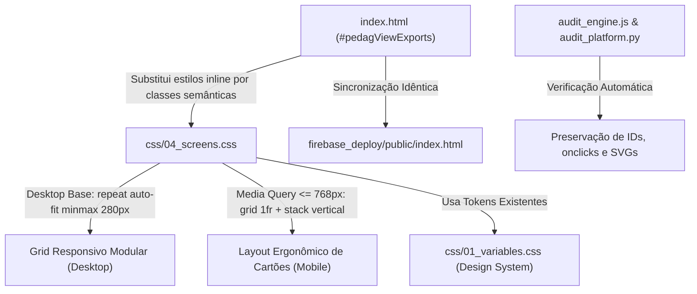

# PLANO DE IMPLEMENTAÇÃO — RESOLUÇÃO DA VISUALIZAÇÃO MOBILE DA ABA DE RELATÓRIOS SSOT

> **Status:** Proposto / Em Análise (Etapa 1 - Arquiteto)  
> **Data:** 03 de Novembro de 2026  
> **Autor:** Antigravity Architect  
> **Alvo:** Sub-aba Extrações & Relatórios SSOT (`#pedagViewExports` em `index.html`, `css/04_screens.css`, `css/01_variables.css`, e espelho `firebase_deploy/public/index.html`)  
> **Padrão de Qualidade:** Hallmark Design Standard (v2.0.0 / `RULE[user_global]`)  
> **Classificação de Demanda:** Correção Crítica de Layout Responsivo Mobile & Blindagem Anti-Slop

---

## 0. Diretriz Obrigatória de Execução (Etapa 2 - O Operário)

> [!IMPORTANT]
> **Aviso ao Executor da Etapa 2:**  
> Antes de aplicar qualquer linha deste plano no código de produção, consulte obrigatoriamente:
> 1. [WORKFLOW_MACOS.md](file:///Users/bruno/Desktop/gestor%20supervisao_patos/WORKFLOW_MACOS.md) — Manual de operações e checklists macOS.
> 2. `.agents/skills/execucao-operario/SKILL.md` — Checklist de execução fiel, espelhamento duplo e validação sintática pré-voo.
> 3. **PROIBIÇÃO CATEGÓRICA:** Nunca abrir o Google Chrome interativo (`open -a "Google Chrome"` ou `/browser`). A validação do Chrome é headless e acionada exclusivamente via `python3 audit_platform.py --silent-on-success` após o deploy.
> 4. **BLINDAGEM SINTÁTICA PRÉ-VOO:** Executar `python3 audit_platform.py --check-syntax` antes de qualquer commit.

---

## 1. Diagnóstico e Contexto (The Read — Hallmark Standard)

### 1.1. Para que serve a tela (Público & Ação Principal)
A sub-aba **"Extrações & Relatórios SSOT"** (`#pedagViewExports`) integra a tela de Gestão Pedagógica / Gestão da Rede (`#homeGestaoView`). É um ambiente gerencial exclusivo do Núcleo de Educação Infantil (perfil Administrador / Helena), projetado para:
- Efetuar backup completo e restauração integral da base relacional (`appState`) via arquivo `.JSON`;
- Exportar relatórios em lote e dados brutos consolidados da rede municipal em formatos tabulares (`.CSV`) e estruturados (`.JSON`): Servidores/Membros, Unidades Escolares/Polos, Matriz de Rubricas (Professores e Coordenadores), Registros Formativos de Campo e Observações Realizadas.

### 1.2. O que funciona e DEVE ser preservado
1. **Governança RBAC e Isolamento de Perfil:** A sub-aba é bloqueada de forma estrita para perfis de Coordenadora Pedagógica e Formadora, sendo acessível apenas por administradoras do Núcleo de EI (`isNucleoEI(user)`). Todos os testes do Módulo 2 do `audit_engine.js` cobrem esse isolamento.
2. **Rotinas de Exportação e Importação:** Funções globais de download e upload (`exportFullBaseJSON`, `triggerImportFullBase`, `importFullBaseJSON`, `exportTeamMembersCSV`, `exportTeamMembersJSON`, `exportUnitsCSV`, `exportUnitsJSON`, `exportRubricsCSV`, `exportRubricsJSON`, `exportAllNotesCSV`, `exportAllNotesJSON`, `exportAllObservationsCSV`, `exportAllObservationsJSON`).
3. **Assinaturas Semióticas de Auditoria:** O Módulo 11 da suíte (`backup_exportacao` em `js/audit/audit_engine.js`) valida deterministicamente a presença dos botões com atributos `onclick*="exportFullBaseJSON()"` e `onclick*="triggerImportFullBase()"`, conferindo os caminhos SVG dos pictogramas vetoriais (bandeja com seta para cima e para baixo).

### 1.3. Causa-Raiz do Bug de Visualização no Celular ("Super Estranha")
A investigação detalhada do código revelou **cinco falhas graves combinadas** que colapsam a renderização em dispositivos móveis:

1. **Anti-pattern Destrutivo de Grid (`.export-card-grid` em `css/04_screens.css:825-830`):**
   ```css
   .export-card-grid {
     display: grid;
     grid-template-columns: repeat(auto-fit, minmax(0, 1fr)); /* BUG CRÍTICO */
     gap: 16px;
     margin-top: 14px;
   }
   ```
   - O uso incorreto de `repeat(auto-fit, minmax(0, 1fr))` estabelece uma largura mínima de `0px` para cada trilha. No algoritmo do CSS Grid, `auto-fit` com base `0px` calcula que um número indefinido de colunas cabe na mesma linha.
   - **Resultado no celular (viewports de 360px a 414px):** O navegador espreme **todos os 5 cards na mesma linha horizontal**, reservando apenas **~50 a 55 pixels de largura para cada card**!
   - Dentro dessa coluna minúscula de 55px, títulos longos como *"Servidores & Membros da Rede"* são quebrados em dezenas de linhas de uma letra só; os botões CSV e JSON se sobrepõem ou explodem para fora da tela; e o dropdown `<select>` do Card de Rubricas vaza horizontalmente, provocando desalinhamento brutal e scroll horizontal na tela inteira.

2. **Ausência Absoluta de Regras Mobile para `#pedagViewExports`:**
   Enquanto as sub-abas 1, 2 e 3 (Escolas, Turmas e Servidores) contam com tratamento detalhado de *Table-to-Card* sob o bloco `@media (max-width: 768px)` em `css/04_screens.css`, a sub-aba 4 de Extrações foi esquecida, herdando apenas o CSS desktop bugado.

3. **Card Hero de Backup Desestruturado no Mobile:**
   O card de Backup Completo possui botões com textos longos (*"Exportar Base Completa (.JSON)"* e *"Importar / Sobrescrever (.JSON)"*). No celular, o container flex horizontal quebra de forma assimétrica e desordenada, sem largura total (`100%`) nem espaçamento ergonômico.

4. **Assimetria nos Botões CSV/JSON dos Cards:**
   Nos cards 4 (*Registros Formativos*) e 5 (*Observações Realizadas*), o botão CSV possui `style="flex:1;"`, mas o botão JSON não possui a propriedade flex, gerando assimetria visual evidente mesmo no desktop.

5. **Violações dos Gates Hallmark Standard:**
   - **Floor 1 (Tokens First):** Cor `#F8FAFC` fixada inline/direta em `.export-card` e `style="color:var(--red);"` inline em vez de tokens semânticos declarados.
   - **Floor 6 (Acessibilidade & Touch Targets):** Botões e selects sem garantia da altura mínima de toque (`min-height: var(--touch-target-min, 44px)`) no mobile.
   - **Floor 4 (Viewport & Overflow):** O vazamento do `<select>` dentro dos 50px provoca quebra de contenção horizontal (`overflow-x`).

---

## 2. Arquitetura da Solução e Pontos de Impacto



### Arquivos Impactados:
1. `css/04_screens.css`:
   - Linhas 825-854: Refatoração da base de `.export-card-grid`, `.export-card`, `.export-card-title`, `.export-card-desc` com tokens CSS e `minmax(280px, 1fr)`.
   - Adição das novas classes estruturadas da Central de Extrações: `.export-view-header`, `.export-view-title`, `.export-view-subtitle`, `.export-backup-card`, `.export-backup-container`, `.export-backup-info`, `.export-backup-title`, `.export-backup-desc`, `.export-backup-actions`, `.export-backup-btn`, `.export-backup-btn-danger`, `.export-card-content`, `.export-card-controls`, `.export-card-select`, `.export-card-actions`, `.export-card-btn`.
   - Bloco `@media (max-width: 768px)` (próximo à linha 2050): Adição da seção responsiva da Sub-aba 4 com coluna única (`grid-template-columns: 1fr`), botões empilhados full-width no backup card e touch target de 44px para botões e selects.
2. `index.html`:
   - Linhas 474-608: Limpeza de dezenas de `style="..."` inline, adoção das novas classes semânticas e equalização dos botões CSV/JSON em todos os cards, preservando 100% dos IDs, `onclick` e SVGs.
3. `firebase_deploy/public/index.html`:
   - Atualização espelhada obrigatória de `index.html`.
4. `CHANGELOG.md` & `#modalChangelog` / `.btn-changelog`:
   - Registro de versão subsequente documentando a harmonização mobile Hallmark da sub-aba de Relatórios SSOT.

---

## 3. Especificação de Implementação Passo a Passo (Snippets Exatos)

### Passo 1: Atualização dos Estilos Base e Mobile em `css/04_screens.css`

#### 1.1. Substituição do bloco base (linhas 825-854 de `css/04_screens.css`):
```css
    /* =========================================================================
       CENTRAL DE EXTRAÇÕES E RELATÓRIOS SSOT (BASE DESIGN & DESKTOP)
       ========================================================================= */
    .export-view-header {
      margin-bottom: 16px;
    }
    .export-view-title {
      font-size: 16px;
      font-weight: 800;
      color: var(--primary-dark);
      display: flex;
      align-items: center;
      gap: 8px;
      margin: 0 0 4px 0;
    }
    .export-view-subtitle {
      font-size: 12px;
      color: var(--text-secondary);
      margin: 0;
      line-height: 1.45;
    }

    /* Card Hero: Backup & Restauração Completa da Base */
    .export-backup-card {
      background: var(--gestao-surface);
      border: 1px solid var(--gestao-border);
      margin-bottom: 18px;
      border-radius: var(--radius-lg);
    }
    .export-backup-container {
      display: flex;
      justify-content: space-between;
      align-items: center;
      flex-wrap: wrap;
      gap: 12px;
    }
    .export-backup-info {
      flex: 1 1 280px;
    }
    .export-backup-title {
      font-size: 15px;
      font-weight: 800;
      color: var(--text-primary);
      display: flex;
      align-items: center;
      gap: 8px;
    }
    .export-backup-desc {
      font-size: 12px;
      color: var(--text-secondary);
      margin-top: 4px;
      line-height: 1.45;
    }
    .export-backup-actions {
      display: flex;
      gap: 8px;
      flex-wrap: wrap;
      align-items: center;
    }
    .export-backup-btn {
      display: inline-flex;
      align-items: center;
      gap: 6px;
      padding: 8px 14px;
      font-size: 13px;
      font-weight: 600;
      min-height: 38px;
      white-space: nowrap;
    }
    .export-backup-btn-danger {
      color: var(--sem-red-ink);
      border-color: var(--sem-red-border);
    }
    .export-backup-btn-danger:hover {
      background: var(--sem-red-bg);
    }

    /* Grid de Cards de Exportação Modular */
    .export-card-grid {
      display: grid;
      grid-template-columns: repeat(auto-fit, minmax(280px, 1fr));
      gap: 16px;
      margin-top: 14px;
    }
    .export-card {
      background: var(--gestao-surface);
      border: 1px solid var(--gestao-border);
      border-radius: var(--radius-lg);
      padding: 16px;
      display: flex;
      flex-direction: column;
      justify-content: space-between;
      gap: 14px;
      box-shadow: var(--shadow-sm);
    }
    .export-card-content {
      display: flex;
      flex-direction: column;
      gap: 6px;
    }
    .export-card-title {
      font-size: 14px;
      font-weight: 800;
      color: var(--primary-dark);
      display: flex;
      align-items: center;
      gap: 8px;
      margin: 0;
    }
    .export-card-desc {
      font-size: 12px;
      color: var(--text-secondary);
      line-height: 1.45;
    }
    .export-card-controls {
      display: flex;
      flex-direction: column;
      gap: 8px;
    }
    .export-card-select {
      width: 100%;
      display: block;
      font-size: 13px;
      min-height: 36px;
    }
    .export-card-actions {
      display: flex;
      gap: 8px;
      width: 100%;
    }
    .export-card-btn {
      flex: 1 1 0;
      justify-content: center;
      text-align: center;
      font-weight: 600;
      font-size: 13px;
      min-height: 36px;
    }
```

#### 1.2. Inclusão de regras mobile sob `@media (max-width: 768px)` (próximo à linha 2050 de `css/04_screens.css`):
```css
      /* =====================================================================
         6. Sub-aba Extrações & Relatórios SSOT no Celular (Hallmark Standard)
         ===================================================================== */
      #pedagViewExports .export-backup-container {
        flex-direction: column;
        align-items: stretch;
        gap: 14px;
      }
      #pedagViewExports .export-backup-actions {
        flex-direction: column;
        width: 100%;
        gap: 8px;
      }
      #pedagViewExports .export-backup-btn {
        width: 100%;
        justify-content: center;
        min-height: var(--touch-target-min);
        font-size: 13px;
      }
      #pedagViewExports .export-card-grid {
        grid-template-columns: 1fr !important; /* Coluna única no celular: erradica o esmagamento */
        gap: 12px;
        margin-top: 12px;
      }
      #pedagViewExports .export-card {
        padding: 14px;
        gap: 12px;
      }
      #pedagViewExports .export-card-select {
        min-height: var(--touch-target-min);
        font-size: 14px !important; /* Previne auto-zoom indesejado no Safari iOS */
      }
      #pedagViewExports .export-card-btn {
        min-height: var(--touch-target-min);
        font-size: 13px;
      }
```

---

### Passo 2: Refatoração Semântica do HTML em `index.html` (linhas 474-608)

Substituir o bloco HTML de `#pedagViewExports` pelo código semântico e higienizado:

```html
      <!-- SUB-VIEW 4: EXTRAÇÕES & RELATÓRIOS SSOT -->
      <div id="pedagViewExports" class="pedag-subview" style="display:none;">
        <div class="export-view-header">
          <h3 class="export-view-title">
            <span>Central de Extrações e Base Unificada (SSOT)</span>
            <button type="button" class="btn-platform-info" onclick="openPlatformInfoModal('Central de Extrações SSOT', 'Acesso gerencial exclusivo para exportação de dados brutos consolidados da rede e backup da base.')" aria-label="Informações sobre extrações">
              <svg class="info-pictogram" viewBox="0 0 24 24" fill="none" stroke="currentColor"><circle cx="12" cy="12" r="10"></circle><line x1="12" y1="16" x2="12" y2="12"></line><line x1="12" y1="8" x2="12.01" y2="8"></line></svg>
            </button>
          </h3>
          <p class="platform-info-text export-view-subtitle">
            Acesso gerencial exclusivo para exportação de dados brutos consolidados da rede e backup da base.
          </p>
        </div>

        <div class="card export-backup-card">
          <div class="export-backup-container">
            <div class="export-backup-info">
              <div class="export-backup-title">
                <span>Backup & Restauração Completa da Base (JSON)</span>
                <button type="button" class="btn-platform-info" onclick="openPlatformInfoModal('Backup & Restauração', 'Exporta ou sobrescreve integralmente todas as entidades do sistema: Servidores, UEs, Polos, Rubricas, Registros e Avaliações.')" aria-label="Informações sobre backup">
                  <svg class="info-pictogram" viewBox="0 0 24 24" fill="none" stroke="currentColor"><circle cx="12" cy="12" r="10"></circle><line x1="12" y1="16" x2="12" y2="12"></line><line x1="12" y1="8" x2="12.01" y2="8"></line></svg>
                </button>
              </div>
              <div class="platform-info-text export-backup-desc">
                Exporta ou sobrescreve integralmente todas as entidades do sistema: Servidores, UEs, Polos, Rubricas, Registros e Avaliações.
              </div>
            </div>
            <div class="export-backup-actions">
              <button class="btn btn-secondary export-backup-btn" onclick="exportFullBaseJSON()">
                <svg class="btn-icon" viewBox="0 0 24 24"><path d="M21 15v4a2 2 0 0 1-2 2H5a2 2 0 0 1-2-2v-4"/><polyline points="17 8 12 3 7 8"/><line x1="12" y1="3" x2="12" y2="15"/></svg>
                <span>Exportar Base Completa (.JSON)</span>
              </button>
              <button class="btn btn-secondary export-backup-btn export-backup-btn-danger" onclick="triggerImportFullBase()">
                <svg class="btn-icon" viewBox="0 0 24 24"><path d="M21 15v4a2 2 0 0 1-2 2H5a2 2 0 0 1-2-2v-4"/><polyline points="7 10 12 15 17 10"/><line x1="12" y1="15" x2="12" y2="3"/></svg>
                <span>Importar / Sobrescrever (.JSON)</span>
              </button>
              <input type="file" id="importFullBaseFileInput" accept=".json" style="display:none;" onchange="importFullBaseJSON(event)" />
            </div>
          </div>
        </div>

        <div class="export-card-grid">
          <!-- Card Servidores -->
          <div class="export-card">
            <div class="export-card-content">
              <div class="export-card-title">
                <span>Servidores & Membros da Rede</span>
                <button type="button" class="btn-platform-info" onclick="openPlatformInfoModal('Servidores & Membros', 'Lista completa de profissionais: docentes, coordenadoras pedagógicas, formadoras e lotações.')" aria-label="Informações sobre servidores">
                  <svg class="info-pictogram" viewBox="0 0 24 24" fill="none" stroke="currentColor"><circle cx="12" cy="12" r="10"></circle><line x1="12" y1="16" x2="12" y2="12"></line><line x1="12" y1="8" x2="12.01" y2="8"></line></svg>
                </button>
              </div>
              <div class="export-card-desc platform-info-text">Lista completa de profissionais: docentes, coordenadoras pedagógicas, formadoras e lotações.</div>
            </div>
            <div class="export-card-actions">
              <button class="btn btn-secondary export-card-btn" onclick="exportTeamMembersCSV()">CSV</button>
              <button class="btn btn-secondary export-card-btn" onclick="exportTeamMembersJSON()">JSON</button>
            </div>
          </div>

          <!-- Card UEs e Polos -->
          <div class="export-card">
            <div class="export-card-content">
              <div class="export-card-title">
                <span>Unidades Escolares & Polos</span>
                <button type="button" class="btn-platform-info" onclick="openPlatformInfoModal('Unidades Escolares & Polos', 'Relação cadastral de escolas infantis, polos territoriais vinculados e endereços.')" aria-label="Informações sobre unidades escolares">
                  <svg class="info-pictogram" viewBox="0 0 24 24" fill="none" stroke="currentColor"><circle cx="12" cy="12" r="10"></circle><line x1="12" y1="16" x2="12" y2="12"></line><line x1="12" y1="8" x2="12.01" y2="8"></line></svg>
                </button>
              </div>
              <div class="export-card-desc platform-info-text">Relação cadastral de escolas infantis, polos territoriais vinculados e endereços.</div>
            </div>
            <div class="export-card-actions">
              <button class="btn btn-secondary export-card-btn" onclick="exportUnitsCSV()">CSV</button>
              <button class="btn btn-secondary export-card-btn" onclick="exportUnitsJSON()">JSON</button>
            </div>
          </div>

          <!-- Card Rubricas -->
          <div class="export-card">
            <div class="export-card-content">
              <div class="export-card-title">
                <span>Matriz de Rubricas & Critérios</span>
                <button type="button" class="btn-platform-info" onclick="openPlatformInfoModal('Matriz de Rubricas & Critérios', 'Estrutura completa das 5 dimensões diagnósticas, subdimensões e descritores pedagógicos.')" aria-label="Informações sobre rubricas">
                  <svg class="info-pictogram" viewBox="0 0 24 24" fill="none" stroke="currentColor"><circle cx="12" cy="12" r="10"></circle><line x1="12" y1="16" x2="12" y2="12"></line><line x1="12" y1="8" x2="12.01" y2="8"></line></svg>
                </button>
              </div>
              <div class="export-card-desc platform-info-text">Estrutura completa das 5 dimensões diagnósticas, subdimensões e descritores pedagógicos.</div>
            </div>
            <div class="export-card-controls">
              <select id="rubricMatrixSelectExports" class="form-select export-card-select" onchange="syncRubricMatrixSelect(this.value)">
                <option value="teacher">Matriz de Professores</option>
                <option value="coordinator">Matriz de Coordenadores</option>
              </select>
              <div class="export-card-actions">
                <button class="btn btn-secondary export-card-btn" onclick="exportRubricsCSV()">CSV</button>
                <button class="btn btn-secondary export-card-btn" onclick="exportRubricsJSON()">JSON</button>
              </div>
            </div>
          </div>

          <!-- Card Registros Formativos -->
          <div class="export-card">
            <div class="export-card-content">
              <div class="export-card-title">
                <span>Registros Formativos & Ocorrências</span>
                <button type="button" class="btn-platform-info" onclick="openPlatformInfoModal('Registros Formativos & Ocorrências', 'Todas as anotações qualitativas de campo registradas pela supervisão pedagógica.')" aria-label="Informações sobre registros formativos">
                  <svg class="info-pictogram" viewBox="0 0 24 24" fill="none" stroke="currentColor"><circle cx="12" cy="12" r="10"></circle><line x1="12" y1="16" x2="12" y2="12"></line><line x1="12" y1="8" x2="12.01" y2="8"></line></svg>
                </button>
              </div>
              <div class="export-card-desc platform-info-text">Todas as anotações qualitativas de campo registradas pela supervisão pedagógica.</div>
            </div>
            <div class="export-card-actions">
              <button class="btn btn-secondary export-card-btn" onclick="exportAllNotesCSV()">CSV</button>
              <button class="btn btn-secondary export-card-btn" onclick="exportAllNotesJSON()">JSON</button>
            </div>
          </div>

          <!-- Card Observações Pedagógicas -->
          <div class="export-card">
            <div class="export-card-content">
              <div class="export-card-title">
                <span>Observações Realizadas</span>
                <button type="button" class="btn-platform-info" onclick="openPlatformInfoModal('Observações Realizadas', 'Base de acompanhamentos pedagógicos, sínteses, níveis de materiais e metadados.')" aria-label="Informações sobre observações realizadas">
                  <svg class="info-pictogram" viewBox="0 0 24 24" fill="none" stroke="currentColor"><circle cx="12" cy="12" r="10"></circle><line x1="12" y1="16" x2="12" y2="12"></line><line x1="12" y1="8" x2="12.01" y2="8"></line></svg>
                </button>
              </div>
              <div class="export-card-desc platform-info-text">Base de acompanhamentos pedagógicos, sínteses, níveis de materiais e metadados.</div>
            </div>
            <div class="export-card-actions">
              <button class="btn btn-secondary export-card-btn" onclick="exportAllObservationsCSV()">CSV</button>
              <button class="btn btn-secondary export-card-btn" onclick="exportAllObservationsJSON()">JSON</button>
            </div>
          </div>
        </div>
      </div>
```

---

## 4. Critérios de Aceite e Roteiro de Verificação

### 4.1. Critérios de Aceite (Definition of Done)
1. **Visualização em Telas Pequenas (Mobile: 320px a 414px):**
   - Os 5 cards de exportação modular empilham-se perfeitamente em **coluna única** (`1fr`), ocupando a largura útil total sem deformação.
   - Textos de títulos e descrições fluem com espaçamento harmonioso e legibilidade imediata (sem quebras de letra única).
   - O card de Backup Completo empilha seus botões com `width: 100%`, centralizados e com altura mínima de toque de 44px (`--touch-target-min`).
   - O `<select id="rubricMatrixSelectExports">` no Card de Rubricas ajusta-se a 100% da largura do card com fonte de 14px (imune a auto-zoom no Safari iOS).
   - Ausência total de barra de rolagem horizontal indesejada na tela (`overflow-x: clip`).
2. **Visualização em Telas Médias e Grandes (Tablet/Desktop: 768px a 1440px+):**
   - Os cards organizam-se em grid balanceado com no mínimo 280px por coluna (`repeat(auto-fit, minmax(280px, 1fr))`), adaptando-se confortavelmente a 2 ou 3 colunas.
   - Os botões CSV e JSON mantêm larguras iguais (`flex: 1 1 0`).
3. **Padrão Hallmark Floor:**
   - 100% das cores referenciam tokens CSS do `:root`.
   - Elementos interativos preservam `:focus-visible`.
   - Emojis banidos como ícones; preservação dos pictogramas SVG.
4. **Preservação Funcional Absoluta:**
   - Todos os botões continuam executando suas respectivas rotinas de exportação e importação.
   - O isolamento RBAC para Coordenadora e Formadora permanece intacto.

### 4.2. Roteiro de Verificação Pré-Deploy e Pós-Deploy
1. **Validação Sintática JSC (macOS):**
   ```bash
   python3 audit_platform.py --check-syntax
   ```
2. **Checagem de Espelhamento:**
   Garantir sincronia idêntica entre `index.html` e `firebase_deploy/public/index.html`.
3. **Auditoria Headless Pós-Deploy:**
   ```bash
   python3 audit_platform.py --silent-on-success
   ```
   Confirmar 100% de aprovação em todos os 13 módulos da suíte.

---

## 5. Seção Obrigatória de Auditoria (`audit_platform.py` / `audit_engine.js`)

| Tipo | Elemento / Teste | Arquivo de Auditoria | Descrição do Impacto / Medida |
| :--- | :--- | :--- | :--- |
| **Preservação** | Módulo 2 (`rbac_seguranca`) | `js/audit/audit_engine.js:741-795` | Os IDs `#pedagTabExports` e `#pedagViewExports` foram 100% preservados, assim como seu comportamento em `switchPedagSubTab('exports')`. |
| **Preservação** | Módulo 11 (`backup_exportacao`) | `js/audit/audit_engine.js:3128-3146` | Seletores `button[onclick*="exportFullBaseJSON()"]` e `button[onclick*="triggerImportFullBase()"]` e seus pictogramas SVG foram rigorosamente mantidos. |
| **Adição Sugerida** | Módulo 12 (`navegacao_layout`) | `js/audit/audit_engine.js:3155+` | Validar asserção de que a classe `.export-card-grid` existe no DOM e que todos os cards de `#pedagViewExports` possuem a classe semântica `.export-card` e botões `.export-card-btn`. |
| **Exclusão** | Nenhuma | N/A | Nenhum teste existente é impactado ou necessita de exclusão. |

---

## 6. Próximo Passo

Aguardar aprovação expressa do usuário para iniciar a **Etapa 2 (Operário)**, que aplicará as modificações em `css/04_screens.css`, `index.html`, `firebase_deploy/public/index.html`, atualização do changelog, validação JSC, commit, push e auditoria automatizada.
