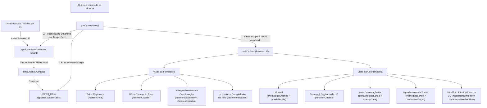

# Plano de Implementação: Sincronização Dinâmica em Tempo Real das Visões de Formadora (Polo) e Coordenadora (UE e Turmas)

---

## 0. Diretriz de Execução (Obrigatória para Etapa 2)
> [!IMPORTANT]
> **Atenção:** Qualquer agente ou desenvolvedor que for executar este plano **DEVE LER OBRIGATORIAMENTE** o arquivo [WORKFLOW_MACOS.md](file:///Users/bruno/Desktop/gestor%20supervisao_patos/WORKFLOW_MACOS.md) e a skill [execucao-operario](file:///Users/bruno/Desktop/gestor%20supervisao_patos/.agents/skills/execucao-operario/SKILL.md) antes de iniciar.
> É expressamente proibido improvisar, alterar escopos não descritos ou pular etapas do checklist operacional (backup, validação sintática via `python3 audit_platform.py --check-syntax`, changelog duplo, sincronização espelhada e auditoria pós-deploy).

---

## 1. Diagnóstico e Contexto

### 1.1 O Problema Relatado
O usuário reportou a seguinte falha de integridade funcional e reatividade de escopo:
> *"quando eu mudo o polo de uma formadora, ou a UE/turma de uma coordenadora, as alterações não vão pra visão dela. crie um plano para mudar, pois isso deve ser dinâmico."*

### 1.2 Análise Forense da Causa-Raiz
Ao analisar a arquitetura dos arquivos `js/core/rbac.js`, `js/core/state.js`, `js/features/management.js`, `js/core/navigation.js` e `js/config/catalog.js`, identificamos seis falhas estruturais conectadas que provocavam a estagnação da visão:

1. **Resolução Estática e Desconectada em `getCurrentUser()` (`js/core/rbac.js`):**
   - A função central `getCurrentUser()` lia puramente o dicionário em memória `USERS_DB[appState.currentUserKey]`:
     ```javascript
     function getCurrentUser() {
       if (!appState.currentUserKey || !USERS_DB[appState.currentUserKey]) {
         return {};
       }
       return USERS_DB[appState.currentUserKey];
     }
     ```
   - O objeto `USERS_DB` é uma tabela estática (inicializada em `js/config/rubrics.js` com dados fixos como `mariana.school = 'CEI Professora Maria de Lourdes'` e `clarice.school = 'Polo Regional 1 (Norte)'`).
   - A verdadeira **Single Source of Truth (SSOT)** do quadro de servidores, onde o administrador efetua alterações de lotação, polos e vínculos hierárquicos, é o array `appState.teamMembers`.
   - Como `getCurrentUser()` não reconciliava dinamicamente com `appState.teamMembers`, qualquer modificação no polo da formadora ou na escola da coordenadora ficava presa em `teamMembers` e nunca chegava ao objeto retornado por `getCurrentUser()`.

2. **Desencontro de IDs Canônicos vs Chaves de Autenticação (`handleEditPoloSubmit`):**
   - Ao alterar o polo de uma formadora no modal de polos (`#modalEditPolo`), o código em `js/features/management.js` tentava sincronizar `USERS_DB` usando o ID do membro (`m.id`):
     ```javascript
     if (typeof USERS_DB !== 'undefined' && USERS_DB[m.id]) USERS_DB[m.id].school = newName;
     ```
   - Na equipe (`INITIAL_TEAM`), o ID da Formadora Clarice Barbosa é `'usr-7'`, enquanto a chave em `USERS_DB` é `'clarice'`.
   - Como `USERS_DB['usr-7']` é `undefined`, o polo de Clarice em `USERS_DB` jamais era atualizado. O mesmo ocorria em `handleCreatePoloSubmit` e `removePolo`.

3. **Inércia de Vínculo Residual na Gestão de Polos:**
   - Em `handleEditPoloSubmit`, quando um polo tem sua formadora alterada para outra servidora ou para "A definir / Nenhuma", a formadora anterior que estava vinculada a esse polo não tinha sua lotação limpa, mantendo o polo antigo no registro.
   - Da mesma forma, coordenadoras das unidades pertencentes a polos modificados mantinham supervisores legados.

4. **Lacuna de Persistência para Usuários Padrão (`handleEditMemberSubmit` e `state.js`):**
   - Em `handleEditMemberSubmit`, a sincronização com `appState.customUsers` dependia de `if (appState.customUsers[customKey])`. Para usuários canônicos nativos (`mariana`, `clarice`), a chave não existia previamente em `customUsers`, impedindo a persistência da alteração territorial no `localStorage`. Ao dar refresh na página (`F5`), os usuários revertiam aos valores fixos de código.

5. **Cache Cego de Identificação em Seletores de Interface (`renderClassesScreen`):**
   - No gerenciamento de turmas (`js/features/management.js`), o filtro de unidades para a formadora utilizava a trava:
     ```javascript
     if (schoolFilterSelect.dataset.populatedFor !== user.name) { ... }
     ```
   - Como o nome da servidora não mudava (`user.name === 'Clarice Barbosa'`), a lista suspensa de unidades escolares do polo nunca era repopulada após uma troca de polo, mantendo visíveis apenas as escolas do polo antigo.

6. **Reatividade Reativa Imediata ao Alternar Usuários (`selectUserAccount`):**
   - No modal de alternância de perfil / simulação (`modalRole`), a função `selectUserAccount(userKey)` definia `appState.currentUserKey`, mas não forçava a limpeza de caches nem re-executava a renderização das telas ativas com base nas novas unidades e turmas sob responsabilidade do usuário autenticado.

---

## 2. Arquitetura e Pontos de Impacto



### Arquivos Envolvidos
1. `js/core/rbac.js`:
   - Refatoração de `getCurrentUser()` com lookup dinâmico bidirecional em `appState.teamMembers`.
   - Criação da função utilitária `findUserDbKey(identifier)`.
   - Refatoração de `selectUserAccount(userKey)` para revalidar a sessão e recarregar os dados da tela ativa em tempo real.
2. `js/features/management.js`:
   - Criação da função central `syncUserToAuthDb(member)` para manter `USERS_DB` e `appState.customUsers` perfeitamente alinhados à SSOT.
   - Refatoração de `handleEditPoloSubmit`:
     - Desvinculação automática da formadora anterior se substituída.
     - Atualização correta da formadora selecionada via `syncUserToAuthDb`.
     - Atualização em cascata do supervisor das coordenadoras das unidades do polo.
     - Notificação imediata de alteração da UI ativa.
   - Refatoração de `handleCreatePoloSubmit` e `removePolo`:
     - Uso de `findUserDbKey` e `syncUserToAuthDb`.
   - Refatoração de `handleEditMemberSubmit`:
     - Auto-vinculação da Formadora do Polo correspondente quando a Coordenadora muda de UE.
     - Persistência incondicional em `appState.customUsers[dbKey]` para usuários padrão e customizados.
     - Reatribuição das docentes e garantia da existência das turmas da nova UE via `getClassesForSchool(schoolVal)`.
   - Invalidação de cache em `renderClassesScreen`:
     - Chave combinada de validação: `schoolFilterSelect.dataset.populatedFor !== (user.name + '|' + user.school)`.
3. `js/core/state.js`:
   - Blindagem em `loadState()` para persistir em `appState.customUsers` qualquer divergência de polo/escola detectada em `teamMembers`.
4. `js/audit/audit_engine.js`:
   - Adição de asserções nos Módulos 1 e 2 testando a dinamicidade ponta a ponta da alteração de polo de formadora e da alteração de UE/turmas de coordenadora.

---

## 3. Especificação de Implementação Passo a Passo (Snippets Exatos)

### Passo 1: Utilitário Central de Mapeamento e Resolução Dinâmica em `js/core/rbac.js`

Substituir as linhas 2-7 de `js/core/rbac.js`:
```javascript
// --- ANTES ---
    function getCurrentUser() {
      if (!appState.currentUserKey || !USERS_DB[appState.currentUserKey]) {
        return {};
      }
      return USERS_DB[appState.currentUserKey];
    }
```
Por:
```javascript
// --- DEPOIS ---
    // Utilitário Canônico de Resolução de Chaves de Autenticação (USERS_DB)
    function findUserDbKey(identifier) {
      if (!identifier) return null;
      const idStr = String(identifier).trim().toLowerCase();
      return Object.keys(USERS_DB).find(k => 
        k.toLowerCase() === idStr ||
        (USERS_DB[k].id && String(USERS_DB[k].id).toLowerCase() === idStr) ||
        (USERS_DB[k].name && USERS_DB[k].name.toLowerCase() === idStr) ||
        (USERS_DB[k].email && USERS_DB[k].email.toLowerCase() === idStr)
      ) || null;
    }

    // Resolução Dinâmica SSOT em Tempo Real do Usuário Autenticado
    function getCurrentUser() {
      if (!appState.currentUserKey) return {};
      const authRecord = USERS_DB[appState.currentUserKey] || (appState.customUsers && appState.customUsers[appState.currentUserKey]);
      if (!authRecord) return {};

      // Sincronização Dinâmica em Tempo Real contra a SSOT de Equipe (appState.teamMembers)
      const member = (appState.teamMembers || []).find(m => 
        m.id === appState.currentUserKey ||
        (authRecord.id && m.id === authRecord.id) ||
        (m.name && authRecord.name && m.name.toLowerCase() === authRecord.name.toLowerCase()) ||
        (m.email && authRecord.email && m.email.toLowerCase() === authRecord.email.toLowerCase())
      );

      if (member) {
        authRecord.name = member.name;
        authRecord.roleKey = member.roleKey;
        authRecord.roleTitle = member.roleTitle;
        authRecord.school = member.school;
        authRecord.supervisor = member.supervisor;
        if (member.classAssigned) authRecord.classAssigned = member.classAssigned;
        if (member.email) authRecord.email = member.email;
      }

      return authRecord;
    }
```

---

### Passo 2: Função Universal de Sincronização em `js/features/management.js`

Adicionar no topo dos manipuladores de servidores em `js/features/management.js` (antes de `openAddTeacherModal`):
```javascript
    // Sincronizador Bidirecional entre SSOT (teamMembers) e Autenticação (USERS_DB / customUsers)
    function syncUserToAuthDb(member) {
      if (!member || member.roleKey === 'professora') return; // Docentes não acessam o sistema
      const dbKey = (typeof findUserDbKey === 'function' ? findUserDbKey(member.id) || findUserDbKey(member.name) || findUserDbKey(member.email) : null) || member.id;
      
      if (!USERS_DB[dbKey]) {
        USERS_DB[dbKey] = {
          id: dbKey,
          name: member.name,
          roleKey: member.roleKey,
          roleTitle: member.roleTitle,
          school: member.school,
          supervisor: member.supervisor,
          email: member.email || `${dbKey}@teste.com`,
          password: '123456',
          avatarText: member.name.split(' ').map(p => p[0]).slice(0, 2).join('').toUpperCase()
        };
      } else {
        USERS_DB[dbKey].name = member.name;
        USERS_DB[dbKey].roleKey = member.roleKey;
        USERS_DB[dbKey].roleTitle = member.roleTitle;
        USERS_DB[dbKey].school = member.school;
        USERS_DB[dbKey].supervisor = member.supervisor;
        if (member.email) USERS_DB[dbKey].email = member.email;
      }

      if (!appState.customUsers) appState.customUsers = {};
      appState.customUsers[dbKey] = { ...USERS_DB[dbKey] };
    }
```

---

### Passo 3: Refatoração da Gestão de Polos (`handleEditPoloSubmit`, `handleCreatePoloSubmit`, `removePolo`) em `js/features/management.js`

Substituir o bloco de atualização da formadora em `handleEditPoloSubmit` (linhas 401-430):
```javascript
      // 4. Propagação da Formadora Responsável e Supervisão de Coordenadoras
      const currentPoloUnits = (appState.units || []).filter(u => u.polo === newName).map(u => u.name);

      // Desvincula formadora anterior caso uma nova tenha sido selecionada ou caso o polo fique sem formadora
      (appState.teamMembers || []).forEach(m => {
        if (m.roleKey === 'formador' && (m.school === oldName || m.school === newName) && m.name !== selectedFormadoraName) {
          m.school = 'A definir / Secretaria';
          syncUserToAuthDb(m);
        }
      });

      if (selectedFormadoraName) {
        (appState.teamMembers || []).forEach(m => {
          // Se for a formadora escolhida, atualiza sua escola/polo
          if (m.roleKey === 'formador' && m.name === selectedFormadoraName) {
            m.school = newName;
            syncUserToAuthDb(m);
          }
          // Coordenadoras das unidades do polo passam a ter esta formadora como supervisora
          if (m.roleKey === 'coordenador' && currentPoloUnits.includes(m.school)) {
            m.supervisor = selectedFormadoraName;
            syncUserToAuthDb(m);
          }
        });
      }

      // Se renomeou o polo, atualiza a formadora que estava vinculada a ele anteriormente
      if (oldName !== newName) {
        (appState.teamMembers || []).forEach(m => {
          if (m.roleKey === 'formador' && m.school === oldName) {
            m.school = newName;
            syncUserToAuthDb(m);
          }
        });
      }

      // Reatividade imediata de sessão se o usuário ativo for afetado
      const curr = getCurrentUser();
      if (curr && (curr.school === oldName || curr.name === selectedFormadoraName)) {
        curr.school = newName;
        applyUserRoleUI();
      }
```

Em `handleCreatePoloSubmit` (linhas 484-491):
```javascript
      if (formadoraName) {
        const fMember = (appState.teamMembers || []).find(m => m.roleKey === 'formador' && m.name === formadoraName);
        if (fMember) {
          fMember.school = name;
          syncUserToAuthDb(fMember);
        }
      }
```

Em `removePolo` (linhas 512-518):
```javascript
      // Desvincula formadoras que tinham este polo
      (appState.teamMembers || []).forEach(m => {
        if (m.roleKey === 'formador' && m.school === poloName) {
          m.school = 'A definir / Secretaria';
          syncUserToAuthDb(m);
        }
      });
```

---

### Passo 4: Refatoração de `handleEditMemberSubmit` para Coordenadoras e Turmas em `js/features/management.js`

Em `handleEditMemberSubmit`:
Garantir persistência incondicional em `appState.customUsers` e vincular a Formadora do Polo da nova UE à Coordenadora:
```javascript
      // 3. Sincronização com USERS_DB e customUsers apenas para usuários com login (não docentes)
      let dbKey = null;
      if (roleKey !== 'professora') {
        dbKey = (typeof findUserDbKey === 'function' ? findUserDbKey(id) || findUserDbKey(oldName) || findUserDbKey(emailVal) : null) || id;
        syncUserToAuthDb(appState.teamMembers[memberIndex]);
      }

      // 4. PROPAGAÇÃO RELACIONAL AO MUDAR DE UNIDADE ESCOLAR / POLO
      const unitChanged = (oldSchool !== schoolVal);
      const nameChanged = (oldName !== name);

      if (unitChanged || nameChanged) {
        // A. Se for COORDENADORA que mudou de unidade escolar
        if (oldRole === 'coordenador' || roleKey === 'coordenador') {
          if (unitChanged) {
            // Vincula automaticamente à formadora do polo da nova UE
            const targetUnit = (appState.units || []).find(u => u.name === schoolVal);
            if (targetUnit && targetUnit.polo) {
              const targetFormadora = (appState.teamMembers || []).find(m => m.roleKey === 'formador' && m.school === targetUnit.polo);
              if (targetFormadora) {
                appState.teamMembers[memberIndex].supervisor = targetFormadora.name;
                syncUserToAuthDb(appState.teamMembers[memberIndex]);
              }
            }

            // Garante que a nova UE tenha suas turmas catalogadas na SSOT
            getClassesForSchool(schoolVal);

            // Docentes da unidade antiga: desvincula da coordenadora que saiu
            const remainingCpOldSchool = appState.teamMembers.find(m => 
              m.id !== id && m.roleKey === 'coordenador' && m.school === oldSchool
            );
            const fallbackSupOldSchool = remainingCpOldSchool ? remainingCpOldSchool.name : 'Coordenação Pedagógica da Unidade';

            appState.teamMembers.forEach(m => {
              if (m.roleKey === 'professora' && m.school === oldSchool && m.supervisor === oldName) {
                m.supervisor = fallbackSupOldSchool;
              }
            });

            // Docentes da nova unidade: vincula à coordenadora recém-chegada
            appState.teamMembers.forEach(m => {
              if (m.roleKey === 'professora' && m.school === schoolVal) {
                m.supervisor = name;
              }
            });
          } else if (nameChanged) {
            appState.teamMembers.forEach(m => {
              if (m.supervisor === oldName) {
                m.supervisor = name;
              }
            });
          }
        }
```

---

### Passo 5: Invalidação Reativa do Cache em `renderClassesScreen` em `js/features/management.js`

Em `renderClassesScreen`:
Substituir a verificação de cache da lista de UEs da formadora (linha 817):
```javascript
// --- ANTES ---
if (schoolFilterSelect.dataset.populatedFor !== user.name) {
// --- DEPOIS ---
const userCacheKey = `${user.name}|${user.school}`;
if (schoolFilterSelect.dataset.populatedFor !== userCacheKey) {
  schoolFilterSelect.innerHTML = '<option value="ALL">Todas as UEs do Polo</option>';
  formadorUnits.forEach(uName => {
    const opt = document.createElement('option');
    opt.value = uName;
    opt.text = uName;
    schoolFilterSelect.appendChild(opt);
  });
  schoolFilterSelect.dataset.populatedFor = userCacheKey;
}
```

---

### Passo 6: Reatividade ao Alternar Contas em `js/core/rbac.js`

Em `selectUserAccount(userKey)` (linhas 208-219 de `js/core/rbac.js`):
```javascript
    function selectUserAccount(userKey) {
      appState.currentUserKey = userKey;
      closeRoleModal();
      const indUnit = document.getElementById('indicatorsUnitFilter');
      if (indUnit) indUnit.value = 'ALL';
      const indMember = document.getElementById('indicatorsMemberFilter');
      if (indMember) indMember.value = 'ALL';
      
      // Limpeza de caches de seletores de tela
      const schoolFilterSelect = document.getElementById('classesFilterSchool');
      if (schoolFilterSelect) delete schoolFilterSelect.dataset.populatedFor;
      
      applyUserRoleUI();
      saveState();
      
      // Re-renderização reativa das telas ativas
      if (document.getElementById('screenIndicators')?.classList.contains('active')) {
        renderIndicatorsScreen();
      }
      if (document.getElementById('screenClasses')?.classList.contains('active')) {
        renderClassesScreen();
      }
      if (document.getElementById('screenSchedule')?.classList.contains('active')) {
        renderScheduleScreen();
      }
      
      navigateToTab('home');
      showToast(`Sessão ativa: ${getCurrentUser().name} (${getCurrentUser().roleTitle})`);
    }
```

---

### Passo 7: Sincronização em `loadState()` em `js/core/state.js`

Em `loadState()` (linhas 198-211 de `js/core/state.js`):
Garantir que `appState.customUsers[dbKey]` seja criado se não existir:
```javascript
      if (!appState.customUsers) appState.customUsers = {};
      if (!appState.customUsers[dbKey]) {
        appState.customUsers[dbKey] = { ...USERS_DB[dbKey] };
        sanitized = true;
      } else {
        appState.customUsers[dbKey].school = m.school;
        appState.customUsers[dbKey].supervisor = m.supervisor;
        appState.customUsers[dbKey].roleKey = m.roleKey;
        // ...
      }
```

---

## 4. Critérios de Aceite e Roteiro de Teste

1. **Alteração do Polo de uma Formadora:**
   - Efetuar login como Administrador (`bruno` ou `helena`).
   - Ir em **Gestão Pedagógica ➔ Polos Regionais**, editar o "Polo Regional 2 (Sul)" e selecionar "Clarice Barbosa" como formadora responsável.
   - Alternar a conta para "Clarice Barbosa" (`selectUserAccount('clarice')`).
   - **Critério de Aceite:**
     - O cabeçalho / subtítulo exibe imediatamente: `Formadora Pedagógica · Polo Regional 2 (Sul)`.
     - Na aba **Polos Regionais**, Clarice visualiza apenas o Polo Regional 2 (Sul).
     - Na aba **Turmas & Regência**, o filtro exibe apenas as UEs do Polo 2 (ex: "CEI Vovó Zezé") e suas respectivas turmas.
     - Na **Nova Observação** e no **Agendamento**, as únicas coordenadoras e escolas selecionáveis pertencem ao Polo 2.
     - No **Painel de Indicadores**, o escopo consolidado reflete exclusivamente as escolas do Polo 2.

2. **Alteração da UE de uma Coordenadora:**
   - Efetuar login como Administrador.
   - Ir em **Gestão Pedagógica ➔ Equipe**, editar "Mariana Ferreira" e alterar sua Unidade Escolar de "CEI Professora Maria de Lourdes" para "EMEI Pequeno Príncipe".
   - Alternar a conta para "Mariana Ferreira" (`selectUserAccount('mariana')`).
   - **Critério de Aceite:**
     - O cabeçalho / subtítulo exibe imediatamente: `Coordenação Pedagógica · EMEI Pequeno Príncipe`.
     - Na aba **Turmas & Regência**, o título é `Turmas & Regência · EMEI Pequeno Príncipe` e as turmas listadas são estritamente as da EMEI Pequeno Príncipe.
     - Na tela de **Nova Observação**, o campo de escola está travado em "EMEI Pequeno Príncipe" e o dropdown de turmas lista apenas as turmas da nova UE.
     - No **Agendamento**, a escola travada é "EMEI Pequeno Príncipe" e as turmas são da EMEI Pequeno Príncipe.
     - No **Painel de Indicadores**, o seletor está travado em "EMEI Pequeno Príncipe" e a lista de docentes avaliadas lista apenas as professoras da nova UE.

3. **Persistência após Refresh (`F5`):**
   - Recarregar a página no navegador.
   - Confirmar que as alterações de polo e UE permanecem ativas na visão da usuária, sem reset para os dados de seed.

---

## 5. Seção Obrigatória de Auditoria (`audit_platform.py` / `audit_engine.js`)

### 5.1 Testes Automatizados a Adicionar em `js/audit/audit_engine.js`

No **Módulo 1 (`Autenticação, Usuários, Perfis e RBAC`)** ou **Módulo 2 (`Catálogo Canônico, Escolas, Turmas, Professores e Estado Global`)**:

```javascript
// Teste Automatizado de Dinamicidade SSOT de Escopo (Formadora ➔ Polo / Coordenadora ➔ UE e Turmas)
(function testScopeDynamism() {
  const origCurrentUser = appState.currentUserKey;
  
  // 1. Teste Dinâmico de Polo da Formadora
  const clariceMember = appState.teamMembers.find(m => m.name === 'Clarice Barbosa');
  if (!clariceMember) throw new Error('Clarice Barbosa não encontrada em teamMembers');
  
  const origPolo = clariceMember.school;
  const targetTestPolo = 'Polo Regional 2 (Sul)';
  
  // Modifica o polo na SSOT de equipe
  clariceMember.school = targetTestPolo;
  syncUserToAuthDb(clariceMember);
  
  appState.currentUserKey = 'clarice';
  const clariceResolved = getCurrentUser();
  if (clariceResolved.school !== targetTestPolo) {
    throw new Error(`Falha de dinamicidade: getCurrentUser().school de Clarice esperado "${targetTestPolo}", obtido "${clariceResolved.school}"`);
  }
  
  // Valida que o escopo de unidades de Clarice mudou dinamicamente
  const formadorUnits = (appState.units || []).filter(u => u.polo === clariceResolved.school).map(u => u.name);
  if (!formadorUnits.includes('CEI Vovó Zezé')) {
    throw new Error('Unidade CEI Vovó Zezé não detectada dinamicamente no novo polo de Clarice');
  }
  logger.log('Dinamicidade SSOT de alteração de Polo da Formadora validada com sucesso', true, `${targetTestPolo} ➔ ${formadorUnits.join(', ')}`);
  
  // Restaura polo original de Clarice
  clariceMember.school = origPolo;
  syncUserToAuthDb(clariceMember);
  
  // 2. Teste Dinâmico de UE e Turmas da Coordenadora
  const marianaMember = appState.teamMembers.find(m => m.name === 'Mariana Ferreira');
  if (!marianaMember) throw new Error('Mariana Ferreira não encontrada em teamMembers');
  
  const origSchool = marianaMember.school;
  const targetTestSchool = 'EMEI Pequeno Príncipe';
  
  marianaMember.school = targetTestSchool;
  syncUserToAuthDb(marianaMember);
  
  appState.currentUserKey = 'mariana';
  const marianaResolved = getCurrentUser();
  if (marianaResolved.school !== targetTestSchool) {
    throw new Error(`Falha de dinamicidade: getCurrentUser().school de Mariana esperado "${targetTestSchool}", obtido "${marianaResolved.school}"`);
  }
  
  // Valida que as turmas resolvidas para Mariana passaram a ser as da nova escola
  const marianaClasses = getClassesForSchool(marianaResolved.school);
  if (!marianaClasses.some(c => c.school === targetTestSchool)) {
    throw new Error(`Turmas da nova UE (${targetTestSchool}) não foram resolvidas para Mariana`);
  }
  logger.log('Dinamicidade SSOT de alteração de UE e Turmas da Coordenadora validada com sucesso', true, `${targetTestSchool} (${marianaClasses.length} turmas)`);
  
  // Restaura escola original de Mariana
  marianaMember.school = origSchool;
  syncUserToAuthDb(marianaMember);
  
  appState.currentUserKey = origCurrentUser;
})();
```

### 5.2 Validação Sintática Pré-Voo
- Executar `python3 audit_platform.py --check-syntax` e assegurar que a engine JavaScriptCore do macOS compila sem erros lexicais/sintáticos.

### 5.3 Auditoria Pós-Deploy
- Executar `python3 audit_platform.py --silent-on-success` após o push no branch `main`.
