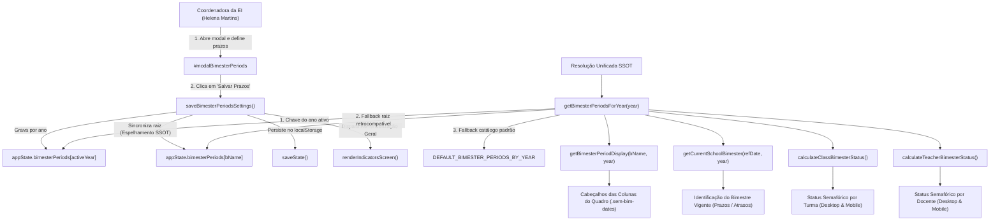

# Plano de Implementação: Sincronização Dinâmica dos Ciclos Avaliativos (Prazos Bimestrais) da Coordenadora da EI no Quadro de Controle

---

## 0. Diretriz de Execução (Obrigatória para Etapa 2)
> [!IMPORTANT]
> **Atenção:** Qualquer agente ou desenvolvedor que for executar este plano **DEVE LER OBRIGATORIAMENTE** o arquivo [WORKFLOW_MACOS.md](file:///Users/bruno/Desktop/gestor%20supervisao_patos/WORKFLOW_MACOS.md) e a skill [execucao-operario](file:///Users/bruno/Desktop/gestor%20supervisao_patos/.agents/skills/execucao-operario/SKILL.md) antes de iniciar.
> É expressamente proibido improvisar, alterar escopos não descritos ou pular etapas do checklist operacional (backup em `intermediárias/`, validação sintática via `python3 audit_platform.py --check-syntax`, changelog duplo, sincronização espelhada e auditoria pós-deploy via `python3 audit_platform.py --silent-on-success`).

---

## 1. Diagnóstico e Contexto

### 1.1 O Problema Relatado
O usuário reportou a seguinte falha funcional:
> *"eu modifiquei o período como o coordenador da ei e a mudança não foi pro quadro. crie um plano para solucionar isso."*

### 1.2 Análise Forense da Causa-Raiz
Ao investigar os módulos `js/services/export_backup.js`, `js/core/navigation.js`, `js/core/state.js`, `js/features/indicators.js` e a suíte de auditoria em `js/audit/audit_engine.js`, identificamos quatro falhas estruturais conexas que provocam o desencontro de dados entre o modal de ciclos e o quadro:

1. **Discrepância Estrutural na SSOT de Prazos (`appState.bimesterPeriods`):**
   - No modal gerencial `#modalBimesterPeriods` (acessado pela Coordenadora do Núcleo de Educação Infantil, Helena Martins), a função de gravação `saveBimesterPeriodsSettings()` armazena os prazos por chave de ano letivo:
     ```javascript
     if (!appState.bimesterPeriods) appState.bimesterPeriods = {};
     appState.bimesterPeriods[activeModalBimesterConfigYear] = newPeriods;
     ```
     Exemplo de payload resultante: `appState.bimesterPeriods['2026'] = { '1º Bimestre': { startDate, endDate }, ... }`.
   - Por outro lado, o catálogo original e as funções consumidoras do Quadro de Controle Bimestral esperam encontrar os bimestres diretamente na raiz do objeto:
     ```javascript
     appState.bimesterPeriods = {
       '1º Bimestre': { startDate: '2026-02-02', endDate: '2026-04-30' }, ...
     };
     ```
   - Em consequência, ao salvar as alterações no modal, as novas datas são escritas exclusivamente sob a chave `appState.bimesterPeriods['2026']`, deixando as chaves canônicas da raiz com os dados antigos inalterados.

2. **Leitura Cega da Raiz em `getBimesterPeriodDisplay()` e `getCurrentSchoolBimester()`:**
   - Em `js/core/navigation.js`:
     ```javascript
     function getBimesterPeriodDisplay(bName) {
       const periods = (appState && appState.bimesterPeriods) ? appState.bimesterPeriods : DEFAULT_BIMESTER_PERIODS;
       const p = periods[bName]; // <-- Procura bName na raiz de appState.bimesterPeriods!
       ...
     }
     ```
   - Os cabeçalhos de coluna do Quadro de Controle Bimestral de Turmas (`.sem-bim-dates` em `js/features/indicators.js:3618-3621`) e de Docentes (`js/features/indicators.js:3886-3889`) invocam `getBimesterPeriodDisplay('1º Bimestre')`.
   - Como `getBimesterPeriodDisplay()` lê da raiz sem consultar a chave do ano ativo (`selectedAcademicYear`), ele lê o valor residual antigo ou cai no fallback padrão, exibindo as datas desatualizadas (ex: "02/02 a 30/04") em vez das datas configuradas pela Coordenadora.
   - O mesmo vício ocorre em `getCurrentSchoolBimester()`, impedindo o recálculo do bimestre letivo corrente com base nos novos prazos.

3. **Cálculo de Status Semafórico Temporal Desconectado do Ano (`calculateClassBimesterStatus`):**
   - Nas linhas 1166 e 1190 de `js/features/indicators.js`:
     ```javascript
     const bimPeriod = ((appState && appState.bimesterPeriods) ? appState.bimesterPeriods : DEFAULT_BIMESTER_PERIODS)[bimesterName];
     ```
   - As mensagens determinísticas dos cartões semafóricos (`"Prazo expirado em..."` e `"Prazo vigente até..."`) leem diretamente da raiz de `appState.bimesterPeriods`, ignorando as alterações gravadas pela gestão em `appState.bimesterPeriods[activeYear]`.

4. **Gatilho de Renderização Inoperante ao Salvar a partir da Gestão da Rede:**
   - O botão oficial de acesso ao modal de ciclos (*"Ciclos Avaliativos & Calendário"*) localiza-se na tela de **Gestão da Rede** (`#homeGestaoView` em `#screenHome`), exibida à Coordenadora da EI.
   - Ao clicar em *"Salvar Prazos"*, `saveBimesterPeriodsSettings()` executa:
     ```javascript
     const screenInd = document.getElementById('screenIndicators');
     if (screenInd && screenInd.classList.contains('active')) {
       renderIndicatorsScreen();
     }
     ```
   - Como a servidora está na tela de Início/Gestão (`#screenHome`), `screenInd.classList.contains('active')` é avaliado como `false`. O quadro de indicadores não é re-renderizado nem invalidado.
   - Ao navegar posteriormente para a aba de Indicadores (`#screenIndicators`), o quadro se renderiza lendo as chaves obsoletas da raiz, dando a impressão exata de que *"a mudança não foi pro quadro"*.
   - A mesma inconsistência atinge a função `restoreDefaultBimesterPeriodsPrompt()`.

---

## 2. Arquitetura e Pontos de Impacto



### Arquivos Envolvidos
1. [js/core/navigation.js](file:///Users/bruno/Desktop/gestor%20supervisao_patos/js/core/navigation.js):
   - Criar a função centralizadora `getBimesterPeriodsForYear(year)`.
   - Atualizar `getCurrentSchoolBimester(referenceDate, targetYear)` para aceitar e utilizar `targetYear`.
   - Atualizar `getBimesterPeriodDisplay(bName, targetYear)` para resolver os períodos via `getBimesterPeriodsForYear(targetYear)`.
2. [js/services/export_backup.js](file:///Users/bruno/Desktop/gestor%20supervisao_patos/js/services/export_backup.js):
   - Atualizar `saveBimesterPeriodsSettings()` para:
     a) Salvar sob `appState.bimesterPeriods[activeModalBimesterConfigYear]`;
     b) Se `activeModalBimesterConfigYear === (appState.selectedAcademicYear || '2026')`, espelhar os valores na raiz de `appState.bimesterPeriods`;
     c) Re-renderizar o Quadro de Indicadores incondicionalmente (`if (typeof renderIndicatorsScreen === 'function') renderIndicatorsScreen();`).
   - Atualizar `restoreDefaultBimesterPeriodsPrompt()` com a mesma lógica de espelhamento e re-renderização.
   - Atualizar `onGlobalAcademicYearChange(selectedYear)` para sincronizar a raiz caso haja períodos específicos do ano e recarregar os indicadores.
3. [js/core/state.js](file:///Users/bruno/Desktop/gestor%20supervisao_patos/js/core/state.js):
   - Em `loadState()`, assegurar a reconciliação bidirecional entre `appState.bimesterPeriods[selectedYear]` e `appState.bimesterPeriods[bName]` ao carregar do `localStorage`.
4. [js/features/indicators.js](file:///Users/bruno/Desktop/gestor%20supervisao_patos/js/features/indicators.js):
   - Em `calculateClassBimesterStatus()` (linhas 1166 e 1190), consultar `getBimesterPeriodsForYear(activeYear)`.
   - Nos cabeçalhos da tabela do Semáforo (Turmas e Docentes), passar o ano ativo como segundo parâmetro para `getBimesterPeriodDisplay(bName, activeYear)`.
5. [js/audit/audit_engine.js](file:///Users/bruno/Desktop/gestor%20supervisao_patos/js/audit/audit_engine.js):
   - Adicionar teste automatizado no Módulo 10 validando a sincronização ponta a ponta: alteração via `saveBimesterPeriodsSettings()` e conferência imediata no cabeçalho do Quadro de Controle Bimestral.

---

## 3. Especificação de Implementação Passo a Passo (Snippets Exatos)

### 3.1 Em `js/core/navigation.js`

#### Criação de `getBimesterPeriodsForYear(year)` e refatoração de `getCurrentSchoolBimester()` e `getBimesterPeriodDisplay()`:
Substituir o bloco de resolução de bimestres (linhas 692-750) pelo código unificado e resiliente:

```javascript
    // =========================================================================
    // PILAR 7 & 15: Resolução SSOT dos Ciclos Avaliativos & Calendário Escolar
    // =========================================================================
    /**
     * Retorna os períodos oficiais dos 4 bimestres para um determinado ano letivo (SSOT)
     * Suporta busca por chave de ano ou dicionário legado na raiz
     */
    function getBimesterPeriodsForYear(year = null) {
      const activeYear = year || (appState && appState.selectedAcademicYear) || '2026';
      
      // 1. Procura no dicionário específico do ano
      if (appState && appState.bimesterPeriods && appState.bimesterPeriods[activeYear] && appState.bimesterPeriods[activeYear]['1º Bimestre']) {
        return appState.bimesterPeriods[activeYear];
      }
      
      // 2. Se for o ano corrente/ativo e houver chaves de bimestre na raiz
      if (appState && appState.bimesterPeriods && appState.bimesterPeriods['1º Bimestre'] && appState.bimesterPeriods['1º Bimestre'].startDate) {
        if (activeYear === '2026' || activeYear === (appState && appState.selectedAcademicYear)) {
          return appState.bimesterPeriods;
        }
      }

      // 3. Fallback no catálogo estático por ano ou catálogo geral
      if (typeof DEFAULT_BIMESTER_PERIODS_BY_YEAR !== 'undefined' && DEFAULT_BIMESTER_PERIODS_BY_YEAR[activeYear]) {
        return DEFAULT_BIMESTER_PERIODS_BY_YEAR[activeYear];
      }
      return DEFAULT_BIMESTER_PERIODS;
    }

    function getCurrentSchoolBimester(referenceDate = new Date(), targetYear = null) {
      const d = (referenceDate instanceof Date && !isNaN(referenceDate)) ? referenceDate : new Date(referenceDate);
      const yr = targetYear || (appState && appState.selectedAcademicYear) || String(d.getFullYear());
      const periods = getBimesterPeriodsForYear(yr);
      const BIMESTERS_CANONICAL = ['1º Bimestre', '2º Bimestre', '3º Bimestre', '4º Bimestre'];

      const year = d.getFullYear();
      const month = String(d.getMonth() + 1).padStart(2, '0');
      const day = String(d.getDate()).padStart(2, '0');
      const refDateStr = `${year}-${month}-${day}`;

      // 1. Procura se a data coincide diretamente com a janela de algum dos 4 bimestres
      for (const bName of BIMESTERS_CANONICAL) {
        const p = periods[bName];
        if (p && p.startDate && p.endDate) {
          if (refDateStr >= p.startDate && refDateStr <= p.endDate) {
            return bName;
          }
        }
      }

      // 2. Se a data de referência for anterior ao 1º Bimestre oficial:
      const firstBim = periods['1º Bimestre'];
      if (firstBim && firstBim.startDate && refDateStr < firstBim.startDate) {
        return '1º Bimestre';
      }

      // 3. Se a data estiver em janela de recesso/transição entre bimestres, aponta para o próximo
      for (let i = 0; i < BIMESTERS_CANONICAL.length - 1; i++) {
        const curBim = periods[BIMESTERS_CANONICAL[i]];
        const nextBim = periods[BIMESTERS_CANONICAL[i + 1]];
        if (curBim && nextBim && curBim.endDate && nextBim.startDate) {
          if (refDateStr > curBim.endDate && refDateStr < nextBim.startDate) {
            return BIMESTERS_CANONICAL[i + 1];
          }
        }
      }

      // 4. Se for posterior ao encerramento do ano letivo oficial:
      return '4º Bimestre';
    }

    /**
     * Retorna o período oficial formatado de um bimestre para exibição em tabelas (ex: "02/02 a 30/04")
     */
    function getBimesterPeriodDisplay(bName, targetYear = null) {
      const yr = targetYear || (appState && appState.selectedAcademicYear) || '2026';
      const periods = getBimesterPeriodsForYear(yr);
      const p = periods[bName];
      if (!p || !p.startDate || !p.endDate) return '';
      const fmt = (isoDate) => {
        if (!isoDate) return '';
        const parts = isoDate.split('-');
        if (parts.length >= 3) return `${parts[2]}/${parts[1]}`;
        return isoDate;
      };
      const s = fmt(p.startDate);
      const e = fmt(p.endDate);
      return `${s} a ${e}`;
    }
```

---

### 3.2 Em `js/services/export_backup.js`

#### Refatoração de `saveBimesterPeriodsSettings()` e `restoreDefaultBimesterPeriodsPrompt()`:
Localizar as linhas 508-575 e atualizar para realizar o espelhamento na raiz e a renderização incondicional do quadro:

```javascript
    function saveBimesterPeriodsSettings() {
      const user = getCurrentUser();
      if (!isNucleoEI(user)) {
        showToast('Acesso restrito à Coordenadora do Núcleo de EI.');
        return;
      }

      const bimMap = {
        1: '1º Bimestre',
        2: '2º Bimestre',
        3: '3º Bimestre',
        4: '4º Bimestre'
      };

      const newPeriods = {};

      for (let i = 1; i <= 4; i++) {
        const bName = bimMap[i];
        const startInput = document.getElementById(`bimPeriodStart_${i}`);
        const endInput = document.getElementById(`bimPeriodEnd_${i}`);
        const startVal = startInput ? startInput.value : '';
        const endVal = endInput ? endInput.value : '';

        if (!startVal || !endVal) {
          alert(`Por favor, preencha as datas de início e fim do ${bName}.`);
          return;
        }

        if (startVal > endVal) {
          alert(`A data inicial do ${bName} não pode ser posterior à data final.`);
          return;
        }

        newPeriods[bName] = {
          startDate: startVal,
          endDate: endVal,
          label: bName
        };
      }

      if (!appState.bimesterPeriods) appState.bimesterPeriods = {};
      
      // 1. Grava na partição do ano configurado
      appState.bimesterPeriods[activeModalBimesterConfigYear] = newPeriods;

      // 2. Espelhamento SSOT: se for o ano selecionado atual, sincroniza na raiz
      const currentSelectedYear = appState.selectedAcademicYear || '2026';
      if (activeModalBimesterConfigYear === currentSelectedYear) {
        ['1º Bimestre', '2º Bimestre', '3º Bimestre', '4º Bimestre'].forEach(bName => {
          appState.bimesterPeriods[bName] = JSON.parse(JSON.stringify(newPeriods[bName]));
        });
      }

      saveState();
      closeBimesterPeriodsModal();
      showToast(`Períodos dos ciclos avaliativos do ano ${activeModalBimesterConfigYear} atualizados com sucesso na SSOT!`);

      // 3. Re-renderização reativa imediata do Quadro de Controle Bimestral
      if (typeof renderIndicatorsScreen === 'function') {
        renderIndicatorsScreen();
      }
    }

    function restoreDefaultBimesterPeriodsPrompt() {
      if (!confirm(`Deseja restaurar os períodos oficiais padrão do município para os 4 bimestres do ano ${activeModalBimesterConfigYear}?`)) {
        return;
      }
      const defaultForYear = DEFAULT_BIMESTER_PERIODS_BY_YEAR[activeModalBimesterConfigYear] || DEFAULT_BIMESTER_PERIODS_BY_YEAR['2026'];
      if (!appState.bimesterPeriods) appState.bimesterPeriods = {};
      
      appState.bimesterPeriods[activeModalBimesterConfigYear] = JSON.parse(JSON.stringify(defaultForYear));

      const currentSelectedYear = appState.selectedAcademicYear || '2026';
      if (activeModalBimesterConfigYear === currentSelectedYear) {
        ['1º Bimestre', '2º Bimestre', '3º Bimestre', '4º Bimestre'].forEach(bName => {
          appState.bimesterPeriods[bName] = JSON.parse(JSON.stringify(defaultForYear[bName]));
        });
      }

      saveState();
      loadBimesterPeriodsForModalYear(activeModalBimesterConfigYear);
      showToast(`Padrões municipais para o ano ${activeModalBimesterConfigYear} restaurados com sucesso na SSOT!`);

      if (typeof renderIndicatorsScreen === 'function') {
        renderIndicatorsScreen();
      }
    }
```

#### Sincronização ao alterar o ano letivo em `onGlobalAcademicYearChange(selectedYear)`:
Nas linhas 409-430 de `js/services/export_backup.js`:

```javascript
    function onGlobalAcademicYearChange(selectedYear) {
      if (!selectedYear) return;
      appState.selectedAcademicYear = selectedYear;

      // Sincroniza a raiz de bimesterPeriods com o ano selecionado
      if (appState.bimesterPeriods && appState.bimesterPeriods[selectedYear]) {
        ['1º Bimestre', '2º Bimestre', '3º Bimestre', '4º Bimestre'].forEach(bName => {
          if (appState.bimesterPeriods[selectedYear][bName]) {
            appState.bimesterPeriods[bName] = JSON.parse(JSON.stringify(appState.bimesterPeriods[selectedYear][bName]));
          }
        });
      }

      saveState();
      renderGlobalAcademicYearSelector();

      // Recarrega telas ativas
      if (typeof renderIndicatorsScreen === 'function') {
        renderIndicatorsScreen();
      }
      const screenHome = document.getElementById('screenHome');
      if (screenHome && screenHome.classList.contains('active')) {
        renderHomeScreen();
      }
      const screenHist = document.getElementById('screenHistory');
      if (screenHist && screenHist.classList.contains('active')) {
        renderHistoryScreen();
      }

      showToast(`Contexto alterado para o Ano Letivo ${selectedYear}`);
    }
```

---

### 3.3 Em `js/core/state.js`

#### Autocura e Reconciliação no `loadState()`:
Nas linhas 68-77 de `js/core/state.js`, garantir que o carregamento reconcilie a partição do ano com a raiz:

```javascript
          if (!appState.bimesterPeriods || typeof appState.bimesterPeriods !== 'object') {
            appState.bimesterPeriods = JSON.parse(JSON.stringify(DEFAULT_BIMESTER_PERIODS));
          } else {
            const currentSelectedYear = appState.selectedAcademicYear || '2026';
            
            // Reconciliação bidirecional SSOT
            if (appState.bimesterPeriods[currentSelectedYear] && appState.bimesterPeriods[currentSelectedYear]['1º Bimestre']) {
              ['1º Bimestre', '2º Bimestre', '3º Bimestre', '4º Bimestre'].forEach(bName => {
                if (appState.bimesterPeriods[currentSelectedYear][bName]) {
                  appState.bimesterPeriods[bName] = JSON.parse(JSON.stringify(appState.bimesterPeriods[currentSelectedYear][bName]));
                }
              });
            } else if (appState.bimesterPeriods['1º Bimestre']) {
              if (!appState.bimesterPeriods[currentSelectedYear]) {
                appState.bimesterPeriods[currentSelectedYear] = {};
              }
              ['1º Bimestre', '2º Bimestre', '3º Bimestre', '4º Bimestre'].forEach(bName => {
                if (appState.bimesterPeriods[bName]) {
                  appState.bimesterPeriods[currentSelectedYear][bName] = JSON.parse(JSON.stringify(appState.bimesterPeriods[bName]));
                }
              });
            }

            // Garante presença e integridade dos 4 bimestres canônicos na raiz
            ['1º Bimestre', '2º Bimestre', '3º Bimestre', '4º Bimestre'].forEach(bName => {
              if (!appState.bimesterPeriods[bName] || !appState.bimesterPeriods[bName].startDate || !appState.bimesterPeriods[bName].endDate) {
                appState.bimesterPeriods[bName] = JSON.parse(JSON.stringify(DEFAULT_BIMESTER_PERIODS[bName]));
              }
            });
          }
```

---

### 3.4 Em `js/features/indicators.js`

#### Resolução do Período em `calculateClassBimesterStatus()`:
Nas linhas 1166 e 1190 de `js/features/indicators.js`, substituir o acesso estático pela função unificada:

```javascript
      // 4. Se o bimestre já passou no calendário letivo (bimesterNum < currentBimNum) ➔ 🔴 VERMELHO (ATRASADO)
      if (bimesterNum < currentBimNum) {
        const activeYearPeriods = getBimesterPeriodsForYear(activeYear);
        const bimPeriod = activeYearPeriods[bimesterName] || DEFAULT_BIMESTER_PERIODS[bimesterName];
        const deadlineStr = bimPeriod && bimPeriod.endDate ? bimPeriod.endDate.split('-').reverse().slice(0, 2).join('/') : '';
        let sub = deadlineStr ? `Prazo expirado em ${deadlineStr}` : 'Prazo expirado sem observação';
        if (draftObs) sub = 'Rascunho não finalizado (Expirado)';
        else if (sched) sub = `Agendamento pendente (${schedDateFormatted})`;
        ...
      }

      // 5. Se o bimestre é o atual (bimesterNum === currentBimNum) ➔ ⚪ CINZA / AZUL (NO PRAZO)
      if (bimesterNum === currentBimNum) {
        const activeYearPeriods = getBimesterPeriodsForYear(activeYear);
        const bimPeriod = activeYearPeriods[bimesterName] || DEFAULT_BIMESTER_PERIODS[bimesterName];
        const deadlineStr = bimPeriod && bimPeriod.endDate ? bimPeriod.endDate.split('-').reverse().slice(0, 2).join('/') : '';
        let sub = deadlineStr ? `Prazo vigente até ${deadlineStr}` : 'Período letivo em aberto';
        ...
      }
```

#### Passagem do Ano Ativo nos Cabeçalhos da Tabela Semafórica:
1. Na Tabela de Turmas (linhas 3618-3621):
```javascript
                    <th class="col-bim">1º Bimestre<br><span class="sem-bim-dates" style="font-size:10px; font-weight:normal; opacity:0.8;">${getBimesterPeriodDisplay('1º Bimestre', targetYear)}</span></th>
                    <th class="col-bim">2º Bimestre<br><span class="sem-bim-dates" style="font-size:10px; font-weight:normal; opacity:0.8;">${getBimesterPeriodDisplay('2º Bimestre', targetYear)}</span></th>
                    <th class="col-bim">3º Bimestre<br><span class="sem-bim-dates" style="font-size:10px; font-weight:normal; opacity:0.8;">${getBimesterPeriodDisplay('3º Bimestre', targetYear)}</span></th>
                    <th class="col-bim">4º Bimestre<br><span class="sem-bim-dates" style="font-size:10px; font-weight:normal; opacity:0.8;">${getBimesterPeriodDisplay('4º Bimestre', targetYear)}</span></th>
```
*(Onde `targetYear = appState.selectedAcademicYear || '2026'`)*.

2. Na Tabela de Docentes Regentes (linhas 3886-3889):
```javascript
                    <th class="col-bim">1º Bimestre<br><span class="sem-bim-dates" style="font-size:10px; font-weight:normal; opacity:0.8;">${getBimesterPeriodDisplay('1º Bimestre', targetYear)}</span></th>
                    <th class="col-bim">2º Bimestre<br><span class="sem-bim-dates" style="font-size:10px; font-weight:normal; opacity:0.8;">${getBimesterPeriodDisplay('2º Bimestre', targetYear)}</span></th>
                    <th class="col-bim">3º Bimestre<br><span class="sem-bim-dates" style="font-size:10px; font-weight:normal; opacity:0.8;">${getBimesterPeriodDisplay('3º Bimestre', targetYear)}</span></th>
                    <th class="col-bim">4º Bimestre<br><span class="sem-bim-dates" style="font-size:10px; font-weight:normal; opacity:0.8;">${getBimesterPeriodDisplay('4º Bimestre', targetYear)}</span></th>
```

---

## 4. Critérios de Aceite e Roteiro de Teste

### 4.1 Critérios de Aceite
1. **Reflexo Imediato nos Cabeçalhos:** Ao alterar qualquer data no modal de Ciclos Avaliativos como Coordenadora da EI (ex: 1º Bimestre de `02/02 a 30/04` para `10/02 a 25/04`) e clicar em *"Salvar Prazos"*, a coluna correspondente no Quadro de Controle Bimestral de Turmas e no Quadro de Docentes Regentes DEVE exibir imediatamente `"10/02 a 25/04"`.
2. **Reatividade do Semáforo:** Se a alteração de datas colocar a data atual fora do 1º Bimestre ou alterar os limites, o status semafórico das turmas (No Prazo vs Atrasado) e os cards de KPI (ex: *"Pendentes no 1º Bimestre"*) devem ser recalculados fielmente.
3. **Persistência no `localStorage`:** Ao recarregar a página (`F5`), as datas modificadas pela Coordenadora da EI devem permanecer ativas e refletidas no quadro.
4. **Isolamento por Ano Letivo:** Configurações de ciclos de anos históricos ou futuros não podem sobrescrever as datas do ano letivo corrente ativo.
5. **Restauração de Padrões Confiável:** Ao acionar *"Restaurar Padrões"* no modal, as datas oficiais padrão de Patos/PB devem voltar imediatamente tanto no modal quanto no Quadro de Controle.
6. **Integridade da Suíte de Testes:** 100% de aprovação na validação sintática (`python3 audit_platform.py --check-syntax`) e na auditoria pós-deploy (`python3 audit_platform.py --silent-on-success`).

### 4.2 Roteiro de Verificação Operacional
1. Autenticar como Helena Martins (Coordenadora do Núcleo de Educação Infantil).
2. Na tela de Início (Gestão da Rede), clicar no botão *"Ciclos Avaliativos & Calendário"*.
3. No modal `#modalBimesterPeriods`, alterar a data de término do 1º Bimestre para `2026-04-20`.
4. Clicar no botão *"Salvar Prazos"*.
5. Acessar a aba de **Diagnóstico / Indicadores** e clicar na sub-aba **Prazos & Turmas (Quadro de Controle)**.
6. Conferir se o subtítulo do cabeçalho da 1ª coluna exibe `"02/02 a 20/04"`.
7. Alternar para a visão de **Docentes Regentes** e conferir o mesmo rótulo.
8. Retornar ao modal e clicar em *"Restaurar Padrões"*; verificar retorno imediato para `"02/02 a 30/04"`.

---

## 5. Seção Obrigatória de Auditoria (`audit_platform.py` e `audit_engine.js`)

### 5.1 Alterações no Algoritmo de Auditoria (`js/audit/audit_engine.js`)
No **Módulo 10 (`indicadores_decisao`)**, atualizar e expandir o teste do Pilar 15 (linhas 2712-2737):
- Simular o fluxo operacional real:
  1. Definir usuário como `helena` (`appState.currentUserKey = 'helena'`).
  2. Abrir o modal `#modalBimesterPeriods` via `openBimesterPeriodsModal()`.
  3. Preencher os inputs `#bimPeriodStart_1` com `'2026-02-15'` e `#bimPeriodEnd_1` com `'2026-04-22'`.
  4. Executar `saveBimesterPeriodsSettings()`.
  5. Asserir que `getBimesterPeriodDisplay('1º Bimestre') === '15/02 a 22/04'`.
  6. Inspecionar o elemento DOM do cabeçalho do semáforo:
     ```javascript
     const thBim1 = document.querySelector('.semaphore-table .sem-bim-dates');
     if (!thBim1 || !thBim1.textContent.includes('15/02 a 22/04')) {
       throw new Error(`Falha Pilar 15: Cabeçalho do Quadro de Controle não refletiu o período salvo no modal (obtido: "${thBim1 ? thBim1.textContent : 'ausente'}")`);
     }
     ```
  7. Restaurar os períodos canônicos via `restoreDefaultBimesterPeriodsPrompt()` ou reset padrão e validar o retorno para `'02/02 a 30/04'`.

### 5.2 Validação Sintática Pré-Voo
Executar obrigatoriamente:
```bash
python3 audit_platform.py --check-syntax
```

### 5.3 Auditoria Pós-Deploy
Executar após o `git push origin main`:
```bash
python3 audit_platform.py --silent-on-success
```
Confirmar a aprovação silenciosa e reportar ao usuário de forma limpa e objetiva.
