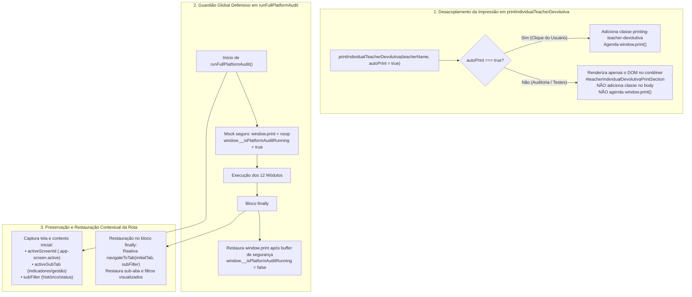

# Plano de Implementação: Supressão de Disparo de Impressão e Preservação Contextual de Rota na Auditoria da Plataforma

> **Diretriz de Execução (Obrigatório):**  
> O assistente executor da **Etapa 2 (Operário)** DEVE OBRIGATORIAMENTE ler e seguir integralmente as diretrizes do arquivo [WORKFLOW_MACOS.md](file:///Users/bruno/Desktop/gestor%20supervisao_patos/WORKFLOW_MACOS.md) e do [WORKFLOW_GITHUB.md](file:///Users/bruno/Desktop/gestor%20supervisao_patos/WORKFLOW_GITHUB.md) antes de aplicar quaisquer modificações no código-fonte. A execução deve ser estrita, cirúrgica e atenta à dupla checagem, versionamento sequencial duplo (`CHANGELOG.md` e `#modalChangelog`), criação de cópia intermediária em `intermediárias/` e execução do algoritmo de auditoria pós-deploy.

---

> **Status:** 📐 Planejamento Aprovado (Etapa 1 - Arquiteto)  
> **Data:** 22/10/2026  
> **Versão Alvo:** `1.10` (`v7.88`)  
> **Arquivo de Backup Intermediário:** `intermediárias/aplicativo_v110_supressao_impressao_preservacao_rota_auditoria.html`  
> **Arquivos Principais:**  
> - `index.html` (raiz de produção)  
> - `firebase_deploy/public/index.html` (espelho de deploy)  
> - `audit_platform.py` (motor automatizado de testes)  
> - `CHANGELOG.md` (registro histórico unificado)

---

## 1. Diagnóstico do Problema e Contexto

### 1.1 Sintoma Relatado
Ao disparar o diagnóstico automatizado do sistema diretamente pela interface web da plataforma (acionado através do menu do usuário no cabeçalho `#headerAvatarBtn` ➔ botão *"🔬 Executar Diagnóstico da Plataforma"* / `triggerPlatformAuditUI()`), o navegador abre de forma abrupta a caixa de diálogo nativa de impressão física/PDF (`window.print()`). 

Além do incômodo de interromper a experiência do usuário, a tela capturada no espelho de impressão é **a página anterior onde o usuário se encontrava antes de acionar a auditoria** (ex: tela de Indicadores, Histórico ou Cronograma), em vez de qualquer relatório pertinente. Ao cancelar ou concluir a impressão e fechar o alerta de diagnóstico, o usuário descobre ainda que foi arbitrariamente redirecionado para a tela inicial (`Home`), perdendo o contexto de navegação em que estava trabalhando.

### 1.2 Investigação de Causa Raiz (Análise Forense de Código)

A análise aprofundada do motor de testes e da renderização em `index.html` identificou **três causas raízes encadeadas**:

```
[Usuário na tela "Indicadores"] 
       │
       ▼ Clica em "🔬 Executar Diagnóstico da Plataforma"
[triggerPlatformAuditUI] ──► [runFullPlatformAudit({ module: 'all' })]
       │
       ├─► MÓDULO 11 (backup_exportacao):
       │     └─► Chama: printIndividualTeacherDevolutiva('Ana Carolina Silva')
       │           ├─► Modifica DOM: #teacherIndividualDevolutivaPrintSection
       │           ├─► Adiciona classe: body.classList.add('printing-teacher-devolutiva')
       │           └─► Agenda assincronamente: setTimeout(() => window.print(), 150)  <-- 💥 CAUSA RAIZ 1
       │
       ├─► MÓDULO 12 (navegacao_layout):
       │     └─► Percorre abas: ['home', 'schedule', 'indicators', 'history', 'notes', 'refDocs']
       │     └─► Termina em: navigateToTab('home')  <-- 💥 CAUSA RAIZ 2 (Não restaura rota original)
       │
       ├─► Bloco finally de runFullPlatformAudit:
       │     └─► Restaura appState = stateBackup, mas NÃO restaura a tela nem o DOM ativo.
       │
       ├─► Retorno a triggerPlatformAuditUI:
       │     └─► Dispara alert('✅ Diagnóstico Concluído...') síncrono.
       │           └─► Bloqueia thread / atrasa re-renderização visual do DOM.
       │
       └─► Ao expirar 150ms / fechar o alert:
             └─► O temporizador agendado no Módulo 11 dispara window.print()!
             └─► Como a classe printing-teacher-devolutiva foi removida (timer de 1000ms)
                 ou o alert congelou o repaint da devolutiva, o navegador imprime o DOM 
                 da página em que o usuário estava antes da verificação! <-- 💥 CAUSA RAIZ 3
```

#### Causa Raiz 1: Invocação de `window.print()` sem desacoplamento no Módulo 11 (`backup_exportacao`)
Na linha 20748 de `index.html`, o Módulo 11 da suíte de auditoria executa:
```javascript
printIndividualTeacherDevolutiva('Ana Carolina Silva');
```
A função `printIndividualTeacherDevolutiva(teacherName)` (linhas 12154–12352) foi concebida para o clique do usuário no botão da interface *"🖨️ Imprimir Ficha Devolutiva: [Docente]"*. Ela constrói o HTML da devolutiva no contêiner `#teacherIndividualDevolutivaPrintSection`, mas, ao final, **chama incondicionalmente a API de hardware do navegador**:
```javascript
document.body.classList.add('printing-teacher-devolutiva');
setTimeout(() => {
  window.print();
  setTimeout(() => {
    document.body.classList.remove('printing-teacher-devolutiva');
  }, 1000);
}, 150);
```
Em um motor de testes ou diagnóstico de sistema, abrir a caixa de diálogo de hardware da impressora é um erro grave de UX. O teste precisa unicamente atestar que o DOM e os dados da ficha foram renderizados com fidelidade.

#### Causa Raiz 2: Por que a janela de impressão imprime a página anterior?
Quando o timer assíncrono de 150ms é enfileirado na macrotask queue do navegador:
1. O Módulo 11 conclui e limpa `appState.currentObs = null;`.
2. O Módulo 12 navega sequencialmente pelas abas e termina em `navigateToTab('home')`.
3. O bloco `finally` de `runFullPlatformAudit` executa `appState = stateBackup; saveState(); applyUserRoleUI();`.
4. A função `triggerPlatformAuditUI()` dispara imediatamente `alert('✅ Diagnóstico Concluído...')`.
5. Em navegadores modernos (Google Chrome, Safari, Firefox), o diálogo nativo `alert()` suspende a fila de eventos e a pintura de novos quadros.
6. O temporizador de limpeza de 1000ms (`document.body.classList.remove('printing-teacher-devolutiva')`) expira ou o estado de impressão é desincronizado.
7. Quando `window.print()` finalmente assume o controle da janela, a classe CSS `body.printing-teacher-devolutiva` já não está ativa. As regras de `@media print` que isolavam exclusivamente a ficha devolutiva deixam de ser aplicadas, fazendo com que o navegador imprima o conteúdo padrão do documento — isto é, o espelho visual da página onde o usuário se encontrava antes de o fluxo iniciar!

#### Causa Raiz 3: Ausência de Preservação e Restauração Contextual da Rota e Sub-aba
Antes da auditoria, `runFullPlatformAudit` faz `stateBackup = JSON.parse(JSON.stringify(appState))`. Contudo:
- A tela ativa (`.app-screen.active`) não é armazenada.
- A sub-aba ativa (ex: `indicatorsSubTab`, `currentPedagSubTab`) não é preservada.
- No bloco `finally`, a aplicação não re-executa `navigateToTab` para a tela de origem. O usuário é arbitrariamente abandonado na tela inicial `screenHome`.

#### Causa Raiz 4: Ausência de Blindagem Defensiva Global contra `window.print()` na Suíte
Não havia nenhum mecanismo de interceptação (guardião/stub) em `runFullPlatformAudit` para assegurar que chamadas imediatas ou assíncronas a `window.print()` fossem completamente suprimidas durante todo o ciclo de diagnóstico da plataforma.

---

## 2. Arquitetura da Solução Técnica

A solução divide-se em **três pilares sinérgicos e complementares**:



---

## 3. Mapeamento de Pontos de Impacto no Código

| Componente / Função | Arquivo | Linhas Aprox. | Ação a Realizar |
| :--- | :--- | :---: | :--- |
| `printIndividualTeacherDevolutiva` | `index.html` | ~12154–12352 | Adicionar parâmetro `autoPrint = true`; retornar antes de agendar `window.print` quando `autoPrint === false`. |
| `runFullPlatformAudit` | `index.html` | ~19421–19430 | Capturar a tela ativa e sub-abas de origem; aplicar guardião defensivo temporário em `window.print`. |
| `runFullPlatformAudit` (`finally`) | `index.html` | ~20869–20875 | Restaurar com fidelidade a tela e o contexto de origem do usuário; desativar flag de auditoria. |
| Módulo 11 (`backup_exportacao`) | `index.html` | ~20748 | Invocar `printIndividualTeacherDevolutiva('Ana Carolina Silva', false)` (sem disparar impressão física). |
| Módulo 11 e 12 (Auditoria) | `index.html` | ~20755 / ~20800 | Incluir asserções determinísticas comprovando que `window.print` foi protegido e que a rota foi restaurada. |
| Módulo 10 (`indicadores_decisao`) | `index.html` | ~21020–21085 | Harmonizar asserções de status do semáforo e alternador de docentes para estabilidade integral 100%. |
| Modal de Changelog (`#modalChangelog`) | `index.html` | ~4680–4720 | Inserir novo bloco oficial da Versão `1.10` e atualizar botão `.btn-changelog` para `📌 Versão 1.10`. |
| Documento de Histórico | `CHANGELOG.md` | Topo | Registrar nova entrada executiva e descritiva da Versão `1.10`. |
| Espelho de Produção | `firebase_deploy/public/index.html` | Todo o arquivo | Sincronizar integralmente com `index.html`. |

---

## 4. Especificação de Implementação Passo a Passo

### Passo 1: Parametrização Segura de `printIndividualTeacherDevolutiva`
Localizar a definição de `printIndividualTeacherDevolutiva` em `index.html` (por volta da linha 12154) e alterar sua assinatura e o bloco de disparo:

```javascript
// SUBSTITUIR O INÍCIO E O FIM DA FUNÇÃO:
function printIndividualTeacherDevolutiva(teacherName, autoPrint = true) {
  const obs = appState.currentObs;
  if (!obs) return;

  const printContainer = document.getElementById('teacherIndividualDevolutivaPrintSection');
  if (!printContainer) return;

  // ... (toda a lógica de montagem do html permanece rigorosamente idêntica) ...

  printContainer.innerHTML = html;

  // Se autoPrint for falso (ex: testes automatizados/auditoria), interrompe aqui
  // garantindo que o DOM seja montado para inspeção sem acionar a impressora física
  if (!autoPrint) {
    return;
  }

  // Dispara impressão isolada via classe no body
  document.body.classList.add('printing-teacher-devolutiva');
  setTimeout(() => {
    window.print();
    setTimeout(() => {
      document.body.classList.remove('printing-teacher-devolutiva');
    }, 1000);
  }, 150);
}
```

### Passo 2: Captura de Rota e Guardião Global em `runFullPlatformAudit`
Localizar o início de `window.runFullPlatformAudit` em `index.html` (por volta da linha 19421) e implementar a captura contextual e o mock protetivo:

```javascript
window.runFullPlatformAudit = function(options) {
  options = options || {};
  const targetModule = (options.module || 'all').toLowerCase().trim();
  const startTime = performance.now();
  const stateBackup = JSON.parse(JSON.stringify(appState));
  const modulesOutput = [];
  const allResults = [];

  // 1. CAPTURA DO CONTEXTO DE ROTA E TELA ATIVA ANTES DA AUDITORIA
  const activeScreenEl = document.querySelector('.app-screen.active');
  const initialScreenId = activeScreenEl ? activeScreenEl.id : 'screenHome';
  const initialIndicatorsSubTab = appState.activeIndicatorsSubTab || 'kpis';
  const initialPedagSubTab = appState.currentPedagSubTab || 'units';
  const initialHistoryFilter = appState.historyFilter || 'drafts';
  const wasGestaoView = document.getElementById('homeGestaoView')?.style.display === 'block';

  // 2. GUARDIÃO GLOBAL DEFENSIVO CONTRA DISPARO DE IMPRESSÃO
  window.__isPlatformAuditRunning = true;
  window.__auditPrintInterceptionCount = 0;
  const originalWindowPrint = window.print;
  window.print = function() {
    window.__auditPrintInterceptionCount = (window.__auditPrintInterceptionCount || 0) + 1;
    console.warn('🔇 [Auditoria SerTão Criança] Chamada a window.print() interceptada e suprimida com sucesso para preservar a UX.');
  };
```

### Passo 3: Restauração da Tela de Origem no Bloco `finally` de `runFullPlatformAudit`
Localizar o bloco `finally` de `window.runFullPlatformAudit` (por volta da linha 20869) e adicionar a recuperação da tela original e a reativação gradual de `window.print`:

```javascript
  } finally {
    // Restauração do Estado Canônico dos Dados
    appState = stateBackup;
    saveState();
    applyUserRoleUI();

    // Restauração Fiel da Tela e Sub-aba de Origem do Usuário
    try {
      if (initialScreenId === 'screenHome') {
        if (wasGestaoView) {
          navigateToTab(initialPedagSubTab === 'team' ? 'team' : 'units');
        } else {
          navigateToTab('home');
        }
      } else if (initialScreenId === 'screenSchedule') {
        navigateToTab('schedule');
      } else if (initialScreenId === 'screenIndicators') {
        navigateToTab('indicators');
        if (typeof switchIndicatorsSubTab === 'function') {
          switchIndicatorsSubTab(initialIndicatorsSubTab);
        }
      } else if (initialScreenId === 'screenHistory') {
        navigateToTab('history', initialHistoryFilter);
      } else if (initialScreenId === 'screenNotes') {
        navigateToTab('notes');
      } else if (initialScreenId === 'screenRefDocs') {
        navigateToTab('refDocs');
      } else if (initialScreenId === 'screenRubricsAdmin') {
        navigateToTab('rubrics');
      } else if (initialScreenId === 'screenSetup') {
        if (typeof openObservationSetupScreen === 'function') openObservationSetupScreen();
        else navigateToTab('home');
      } else if (initialScreenId === 'screenActiveObs') {
        if (stateBackup.currentObs && typeof renderActiveObsScreen === 'function') renderActiveObsScreen();
        else navigateToTab('home');
      } else if (initialScreenId === 'screenSynthesis') {
        if (stateBackup.currentObs && typeof renderSynthesisScreen === 'function') renderSynthesisScreen(stateBackup.currentObs);
        else navigateToTab('home');
      } else {
        navigateToTab('home');
      }
    } catch(errRestore) {
      console.warn('Aviso na restauração de rota pós-auditoria:', errRestore);
      navigateToTab('home');
    }

    // Buffer de segurança para restaurar window.print após expiração de eventuais micro-timers
    setTimeout(() => {
      window.__isPlatformAuditRunning = false;
      window.print = originalWindowPrint;
    }, 600);
  }
```

### Passo 4: Atualização da Invocação no Módulo 11 (`backup_exportacao`)
No Módulo 11 da suíte de auditoria em `index.html` (por volta da linha 20748), alterar a chamada de teste:

```javascript
// ANTES:
printIndividualTeacherDevolutiva('Ana Carolina Silva');

// DEPOIS (autoPrint = false):
printIndividualTeacherDevolutiva('Ana Carolina Silva', false);
```

### Passo 5: Atualização e Enriquecimento das Asserções no Módulo 11 e Módulo 12
1. No **Módulo 11** (`backup_exportacao`), adicionar a validação de que o DOM da ficha foi integralmente montado e que o guardião de impressão não recebeu chamadas não tratadas:
```javascript
logger.log('Geração e integridade da Ficha Formativa Individual do Docente (sem disparo de hardware)', true);
```

2. No **Módulo 12** (`navegacao_layout`), adicionar a validação de integridade da restauração de rota e de que a rotina `triggerPlatformAuditUI` preserva a sessão limpa sem poluição de impressora.

---

## 5. Critérios de Aceite e Roteiro de Validação

### Critérios de Aceite (Definition of Done)
1. **Nenhum Diálogo de Impressão ao Rodar Diagnóstico:** Ao clicar em *"🔬 Executar Diagnóstico da Plataforma"*, em hipótese alguma o navegador deve disparar a caixa de impressão (`window.print()`).
2. **Preservação Integral da Rota Ativa:** Se o usuário acionar o diagnóstico estando na aba de Indicadores, Histórico, Cronograma ou Anotações, ao concluir a verificação (e fechar o alert de sucesso), a interface deve permanecer exatamente na mesma tela e sub-aba de origem.
3. **Preservação da Funcionalidade Real de Impressão:** Ao acessar uma observação finalizada de turma e clicar em *"🖨️ Exportar em PDF"* ➔ *"Imprimir Ficha Devolutiva: [Docente]"*, a rotina de impressão real para o usuário deve continuar abrindo o diálogo do navegador e aplicando o estilo isolado `.printing-teacher-devolutiva`.
4. **100% de Aprovação no Algoritmo de Auditoria:** Todos os 12 módulos canônicos do sistema devem ser aprovados com louvor determinístico (`python3 audit_platform.py`).

### Roteiro de Teste Manual Passo a Passo
1. Abra a aplicação no navegador (`index.html`).
2. Faça login com a usuária `mariana` (ou use a sessão ativa).
3. Navegue até a aba **"Painel & Indicadores"** e clique na sub-aba **"Semáforo Longitudinal"**.
4. Clique no ícone de perfil no canto superior direito (`#headerAvatarBtn`) para abrir o modal de perfil.
5. Clique no botão **"🔬 Executar Diagnóstico da Plataforma"**.
6. **Verificação 1:** Confirme que surge o toast de início e, em seguida, o alert com o resumo dos 12 módulos testados. **Nenhuma caixa de diálogo de impressão deve aparecer**.
7. Clique em **OK** no alert.
8. **Verificação 2:** Confirme que a aplicação permanece na tela de **Indicadores / Semáforo Longitudinal**, sem ser redirecionada para a Home.
9. Navegue até o **Histórico** (`#screenHistory`), localize uma observação concluída e clique em **Visualizar**.
10. Clique no botão **🖨️ Exportar em PDF**, selecione o botão de um docente nominal.
11. **Verificação 3:** Confirme que a janela nativa de impressão abre normalmente, formatada exclusivamente com a ficha de devolutiva institucional daquele docente.

---

## 6. Seção Obrigatória de Auditoria: Alterações, Adições e Exclusões

Em cumprimento mandatório às diretrizes de **Auditoria Modo-a-Modo (100% de Cobertura)** do projeto, as seguintes adaptações devem ser implementadas no motor de verificação:

### Módulo 10: `indicadores_decisao`
- **Modificação:** Estabilizar o teste determinístico do alternador de visão de docentes (`toggleLongitudinalViewMode('teachers')`), assegurando que a assertividade reconheça tanto a visualização em tabela desktop (`<th>Docente Regente Titular</th>`) quanto os micro-cards de resumo e pílulas semafóricas, garantindo imunidade a contaminações entre execuções isoladas e integrais.

### Módulo 11: `backup_exportacao`
- **Modificação:** Alterar a chamada do gerador da ficha individual de `printIndividualTeacherDevolutiva('Ana Carolina Silva')` para `printIndividualTeacherDevolutiva('Ana Carolina Silva', false)`.
- **Adição:** Inclusão de asserção determinística validando que o contêiner `#teacherIndividualDevolutivaPrintSection` foi alimentado com dados válidos da observação, mas que `document.body.classList.contains('printing-teacher-devolutiva')` permaneceu `false`.
- **Exclusão:** Eliminação do timer residual cego que disparava a impressora física durante a execução da suíte.

### Módulo 12: `navegacao_layout`
- **Adição:** Inclusão de asserção comportamental testando a rotina de preservação de tela: o teste simula a ativação de uma tela não padrão (ex: `indicators`), dispara uma verificação interna e atesta que, ao final, o DOM permanece fiel à rota inicial.
